# 学习CS6120高级编译器课程-p05-P05-Lesson-3-Homework---CS6120---Advanced-Compilers--BV1dr3Ez4EEP_p5-

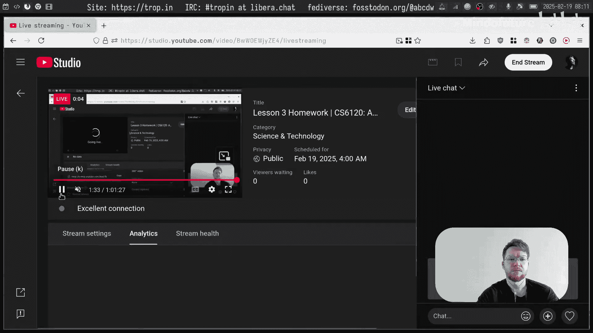

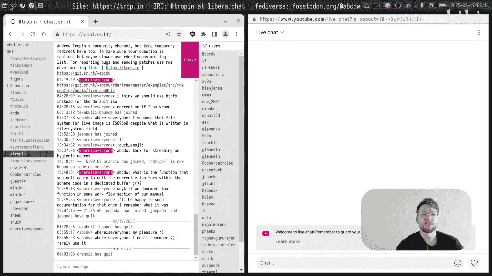

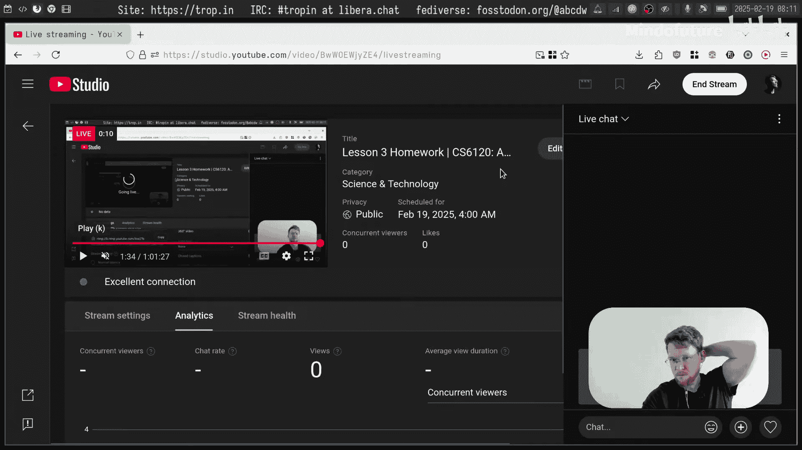

Hello and welcome， everyone。Today we continue our work。1 c S 610。And we will be。

Implementing two optimizations。First one is that code elimination。Like the simple one。

And the second one， a bit more involved。Is local value numbering Last time we already packaged all the tool necessary for those tasks。

The student concludes。Like bur real interpreter guarantee for a tests。And。

Briil GXT for transforming Braille to Drson and Drson back to burial text implementation。

So we have infrastructure for rain coal tests。We have tests for that code delimination。

And we will have a make that to run those tests。They are a bit ad hoc。But。They will下 the你。

We just need to implement a function， which will be accepting say。Input port origin from it。

Providing a Json， transforming Json into another Json。

 which is represented with as expressions in scheme。

 and she realizing it back to the stream and putting it into the port。That's basically it。

Sounds actually quite easy。 Let's see how much time it will take。I wantt。 I want。嗯。え対ま？

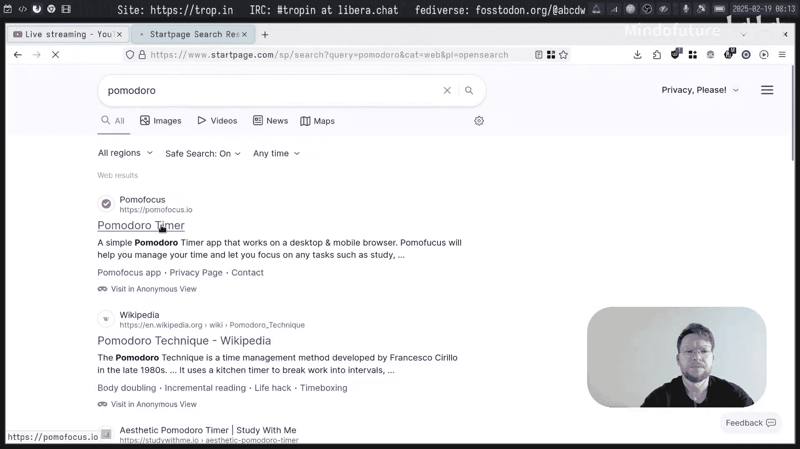

Let's set。搞我的。

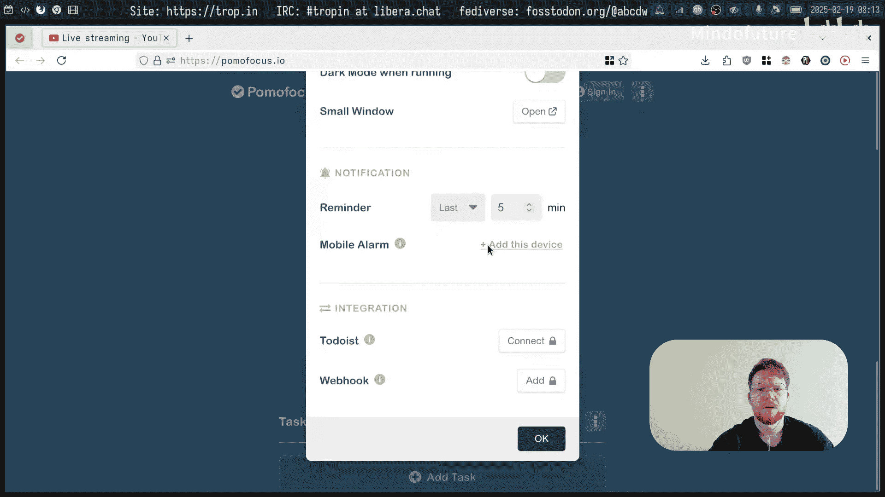

Okay。What else we can do， What， what else we need to do Papa。I need to post a message。

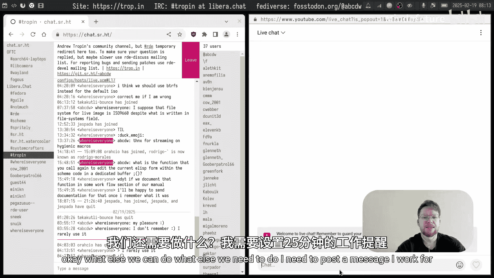

呃。Theこ。I worked for 25 minutes。Bs。between。So。Session。For chat and。Right。Feel free to。Yes。Question。

And。And what。Feel free to ask questions， and。是。あさ？Don't expect。Proly。Pumpetly reply。Have a nice day。

ok。Now， let's， let's start our time。

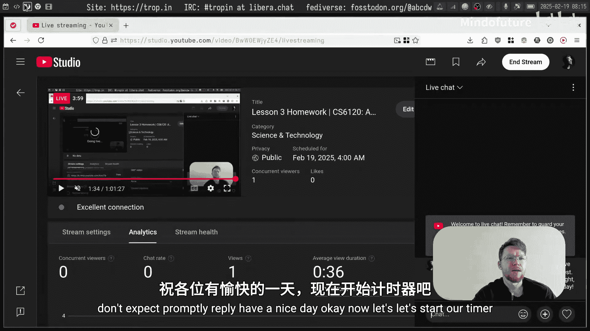

Let's go to qua。And let's。Make。A variable。We have a apple initialized。 Very good。 We have a function。

 and we have。Check。洗忆洗衣。GDC is for t De delimination。We can seeize it。They， like， 8。Tests and。

何 of themぱしのか？Weend。We can， actually。Take this video file。TTranform into Json ourselves， I guess。

Let's。She。这人机。Brill to dressson fell name。 So we have he。We get。We get very soon。

So we can start directly transforming it。 The problem is。The problem is that。I would like to have。

Raceson all radio。So， what。What they can do here。I can。I can do real on myself。But for the。And你。いの。

Be do this song。嗯。Let's put it。S西ベ。利利息。Yeah。广播累似了。で。いっくりよ。洗地。Okay， good。We have sample reason file。

That you'll be working with in repal。And。Politician and all that stuff。

And they have desert that you can run。Independent game。Okay。Now， I define。自使。公白。不理。V有边。

Which should be something like this。しぶ。一し。Okay， so。And no。We have this program loaded。

 Now we need to。Transformment。To transform it， I guess we will split it into the blocks。

As we did previously。And we need combine logs back to the whole program。変と知ばズ。不火哦。

We can try to write an optimization pass for now。Or you already have the blocks。

Instructions to blocks function in。Instructions。Let's call it print。The box。プログラ。Or even bur program。

But in looks。It will be block a 0。Okay and。For this one。Bring the blocks， materialial program。Okay。

 I guess， I guess it's okay。If it works。If it works， I don't care about the implementation。

ASo video 프로그램。Let's。Vクトルマップ。嗯。I't get the blocks。And no。嗯。Can I update a make file。

So it fails in the first encountered test。And also。Shows me G。NowLet's see。いち。😔，其到了吗？😔。

We have a diff。 We have parallel。嗯。是。X。Make file。Okay， we we for now can。Just do something。like this。

Notオッ。And it thought that it's not okay， but。跟你当咩喂。Pnt table。嗯好给。爱惜。I see。 my bed。And。The hip。

What the skipping right now。Something。Gs banana。And they don't understand。W why so。Okay， okay。

 there isn't probably。That there is some argument。Get past to。To our part that we don't really want。

Maybe。Maybe。This is because we use a relative file name。诶好似。We can hard code it。的时候。Be。あルトイチ。😔，This。

 this one becomes a bit annoying。嗯。Let this comment get executed。A。In the context of the folder。

In the context of the file。Yeah。So you need to use absolute name。Okay， okay。 it's fine。

Let's return on our comments。I mean， committed code。I use simple hack。Because they don't。

Like to create a comment macro in all my programs。 So I just define a function called comment。

Which never。100。The only problem is that it haster return and value。Because it's function。But。

speak deal。Okay， we have。We have our blocks。Do I want to combine those blocks back。Bクストプ。

How the program looks。オッケーうん。You define。Blocks。ThePro。Con for graph。And what's a for now。B。Display。

looks。Get the box。不理我。😔，Program。Mhmmmm。Something goes wrong here。Much blocks and my pink。嗯，O。

We have only one function， for now。So。ウニットテイク。Only first element。Yeah。I。裤ol。

We have our control flow graph from0 to 2。P管22。So we need to tell our graph。

And the power directly sort。Pologically sorted。I guess。For this。

 we need to transform control for graph to slightly bit different。Structure。

The structure would be the。We are6。And the list of accessible verox， vers。Hereex from it。Right now。

 we have a list of address， but we need。How old。う。Ajustcent list。Just。At least。Deine。It just。

Adddress些。Interesting。し？

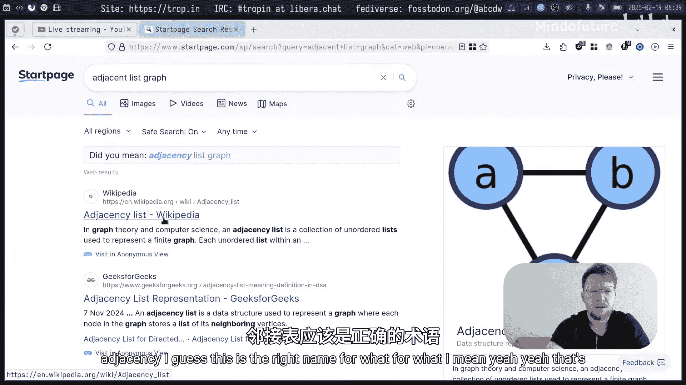

I guess this is the right name for what。For what mean。Yeah。That's true。O。

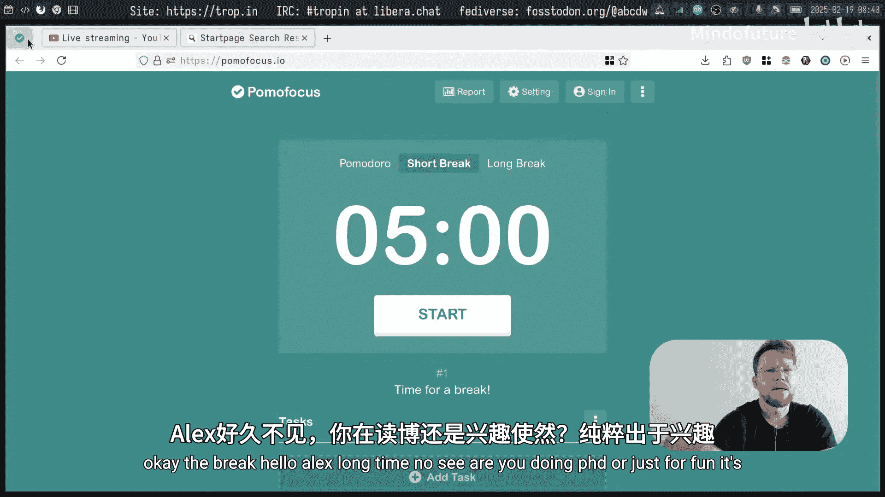

你是不。Hello， Alex， long time。 no see。Are you doing PhD or just for fun， It's just for fun。😊。

And for profit。I guess when we will be implementing the bargain capabilities。For a。

It really require like a lot of work of this intermediate representation of gu programs。

 which will be similar in some sense to what they are working with right now。嗯。Greg asks。

 Ivy building a compiler in Guile。Not exactly， in some sense。

 maybe we build right now just intermediate optimization phases for possible compiler。

 but not exactly compiler at the moment。Maybe later in the course， I didn't like。

Go through the whole course。 We only covered like for， for lessons。 now， maybe later in the course。

 we will become pi to some。Bte quote or whatever。What do we expect us。Okay。

 I have a couple more minutes of， of a break and。I will take my time。Get some。

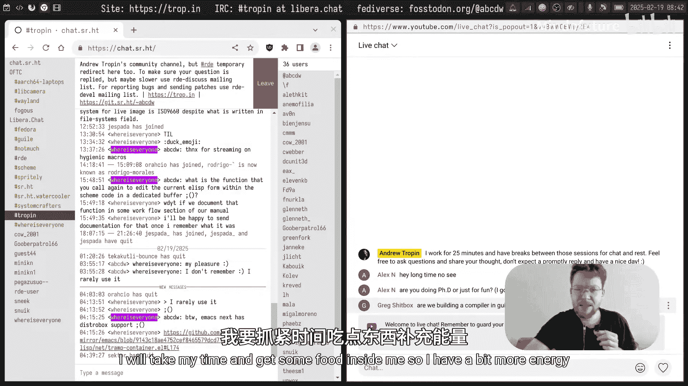

Food inside me。 So I have a bit more energy。 I will see you。get soon。

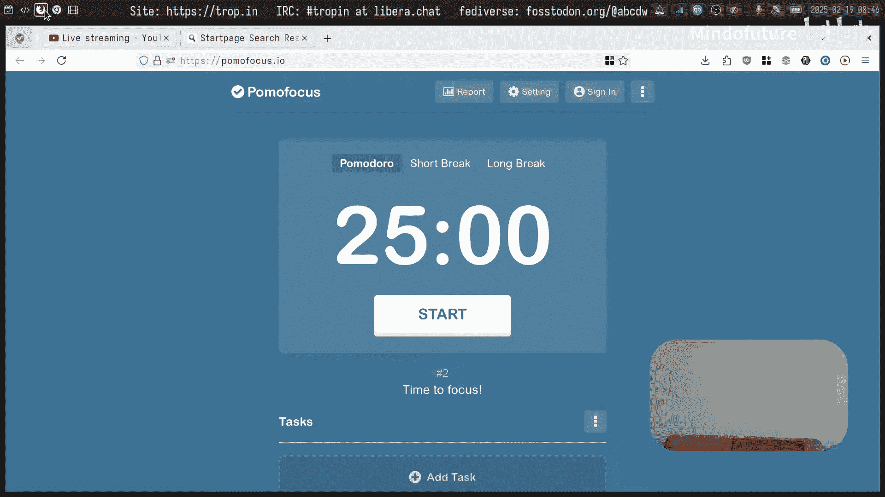

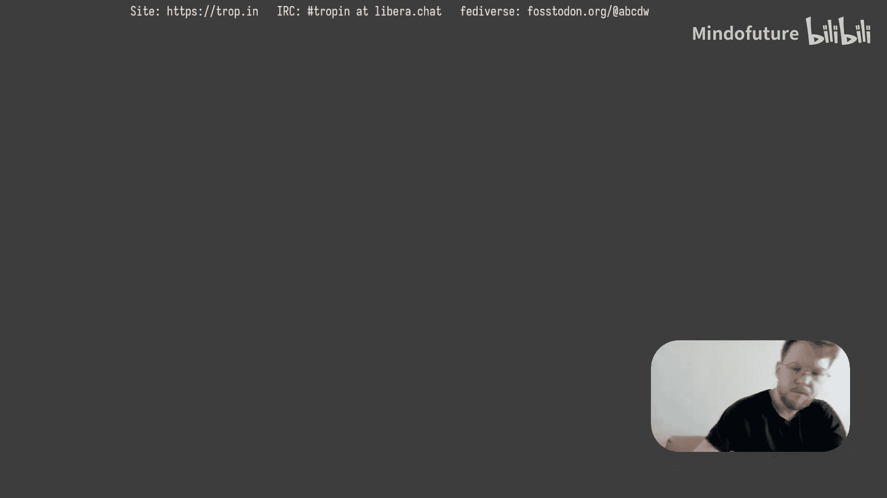

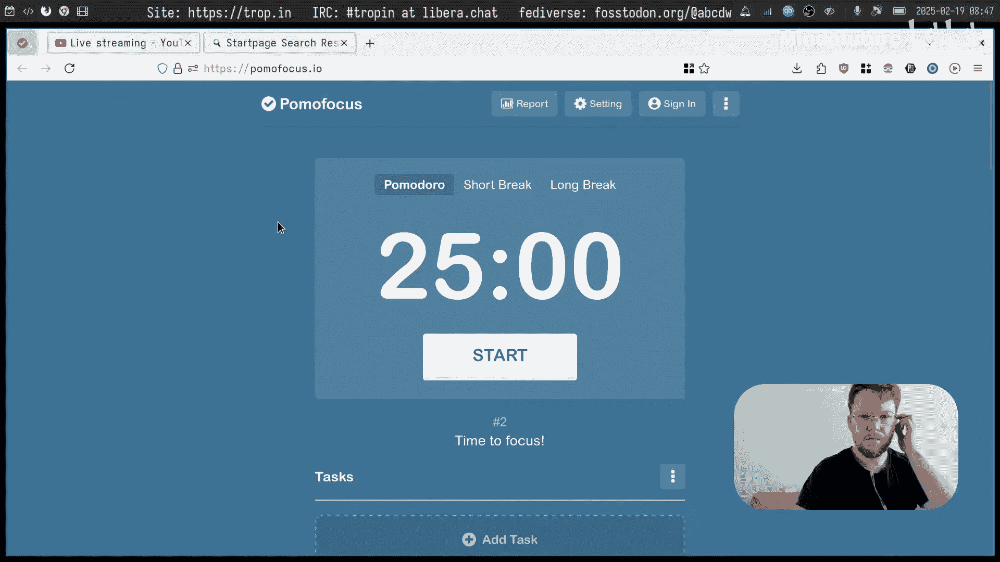

Alex asks， can I contribute to RD， Of course you can， Why not。🤧嗯。It's quite open project。

Just send your pictureses to R D double。很惜我我特别。Okay， okay， let's get the back。To our work， I guess。

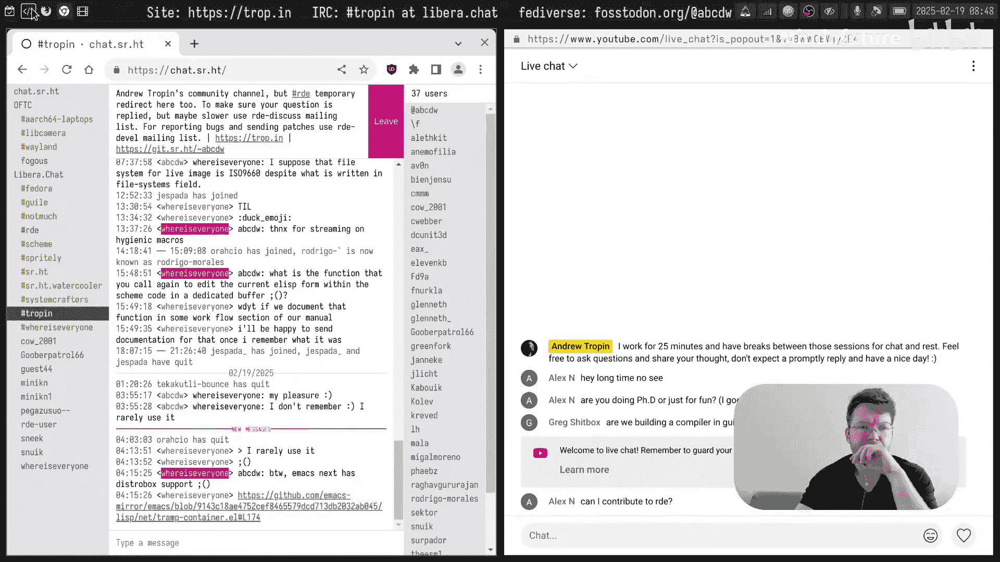

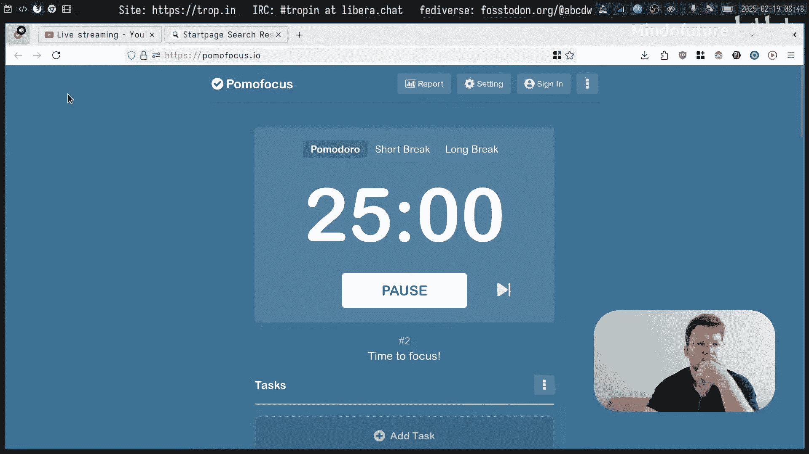

One huge downside of ski。I said。Like bothers me very much knowing how it implemented。In glitter。

 for example。We don't have a good data structure form。Good as associative data structure， like maps。

We have。Hsh mapps orh hashes。Hush tables， hush tables， like a few implementations of them。You know。

 they are very questionable， but but let's see what what。What you can do is them。开始。呃。Hisish table。

 has count We has。Fold。We have H F。But I don't want her ref。I want to update。えぱチ。ぱ이짝 끼。But basically。

 I need。 I need the following functionality。 I need to。Update in some。Assort data structure。

 And here。Here a key。And they want a function to be applied to the key， to producing new value。

And then closer， it's like basically just just it。 you just literally write。This is squad。

 And it works。But imagine trying to do the same with association lists。I can hardly imagine。

How to do so。这是死。This is very set， very set variance such as fnk interface。

For working with data structures。嘿嘿嘿。it is liium。嗯。到时再 hit。Okay。Whi is。

A quarter implementation for Gaile。Which looks very similar toque， which。Which is cool。In some sense。

I guess I would like to have something a bit more skin flavored， probably。

 but very much similar to this one。Unfortunately， workki is not shipped with gal self， so。

I can't use it。Inside libraries or somewhere else， because。Independency in management sucks。应该了。

At the moment， at least。So now I need to come up with this idea。How to collect。How to collect。

Address into a address list。Let let's write a stupid implementation。Update。At least， at least。几。

Function。Do you need the default value？Yeah， let's make a default failure。嗯。

Update list of what we will do。I guess I already。Implemented the sink。At least， delete。

At least delete。G a least。Equal。And no。Of courses。We also need shelf， but we already have it。A once。

Okay。And福 needて。是是 really。How to extract the value of a list。Selectors your。Mhm。语你。そ。Key， at least。

At least。We have a previous value。By the way， if。I do a list delete from。Empty list。Gateworks。

 cardiac clip。Yeah。あか。K。If。Be have。How you call this sink。How we call the player。僕か気分。

What's called the brave bear。Previous value will be if。Believe， believe。And then。丢给。Yes， got。

Cade breath player。Otherwise， it will be default。Like this。If but if。Look right。Acors。Set。We。

 of course， can use set。嗯。It doesn't sound right。It sound very。And functional。

In terms of functional programming。A key value at least all。

At least its going because the last element。This is great。 Every function has its own。하썰들。ok。

It have this function。Which is completely unt tent。불어보 물어볼까。We have a list。 We have a key。

 We have a function。两不得。X。呃。Soello。And default。Re流。And if。We have。Okay。H。What else。Properly。And。先きと。

Hello。Let's save you this。Mmmhmm。Okay， now let's。Let's implement this one。に行って。と reduce。

To hold or whatever it called。Hold。嗯，两不得。X。On edge。I never。 I never remember。

What order of elements is。I would prefer if accumulator value would be the first。

Argument to the function。Because you know， no matter how many lists you have。

 you always know where to place your acccumulator。M得ky。嗯。ど。Where is Microsoft。Come on。Thank you。

Accomulator value。有右边。Just empty list。It's beginning。But。Because we have pairs from and to。

 and we have a directed graph。 It's very easy。 It should be really easy。We just take accumulator。

Update， at list。Let's for this function。Update a list。Alright。Ki。Will be car。Ethics。Cars。Function。

And default radio。嗯。Function and。Inter here text。Coect。Inine。Enter text。Re。It will be a function。

Acceptionion list and editorial。Cons a。The area。And the order order is messed up。嗯。But okay， let。

 let's try to build our。It just。Amer I think address correctly at。Yeah， I think so。

It just addressess list。We have。1， to，2。嗯。多多。ど3。と。For。And let's put 2 to 1。Just。😔，Letト。家ねどロに狙られてるぞ。

But in the wrong world， of course。Let's do end up。Which will go through the list。Number the x。

X will be a bear。だから？Co。Coect。Itigs。X。No。Be have。奥。Almost。You correct。Let's see all this stuff。

都 make good。오래 때 부 때려。This is。级别的。This one like。Too much quote for this algorithm。

It should be one line。It must be one line。If you consider your language expressive。你出的。Okay， you。

It it。ええ。A least。Which we created from edges。And now we need to do aological sort。

How have you do with the biological sort。We have a graph。 We have a list of。visiteded。If your thises。

 we needed to prevent like。我bin。Actually， our graph don't have loops。Oh， no， it can have oops。

 actually。It can have。 But anyway， we start from。嗯，most。Earlier block to the。Later blocks and can。

 can do some loops。 But be B， because we mark in our vertices as visited， we don't like。哦。

And in infinite loop， reversing this graph。So we will be going as deep as possible。

 And when we reach。The leaf nod。Of the graph very turn it。

Can you remind me why we need the political sort at all。What we try to achieve。

 We try to reconstruct。It constructs the program。From list of blocks。

 So the topological order will allow us to。To place the blocks in some order。You know。You know。

 they they is the tiny property of of these blocks。This is a very funny property。 They all numbered。

 I numbered them up front。I don't need to do all that。Fancy magic with topological sort。그라터 열어소。

Because。We can just go through the blocks and put them in the order of their names。That's it。

Simple solution。But at least you saw how I suffered by just。D 그。Basic algorithm of his scheme。

Trying to make it look like a functional programming。Because using set and other stuff。

We'll make it a bit easier， I guess。GoodBye。It's， it's a good exercise。So， yes。

 you basically can take the blocks。You put them one by one。And do you don。Very nice。

 actually we probably。We'll need this function， anyway。Because it's kind of。Useful。Some thanks。

Let's use define。 And let's make this optional。你肤。You'll be equal to。Empptist。Of falses or what。

Let me think。Yeah， let's， let's be emist。mhm。Okay， so if we， if we just go。

We don't even need the control flow graph。We just go through the blocks。And map。Like this。

The only mission here。That we have also functions， instructions。And all that stuff。嗯。嗯。Books。

 vector of。It's not exactly butlos。Right。Get blocks function instructions。

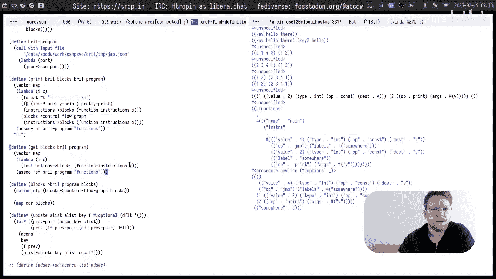

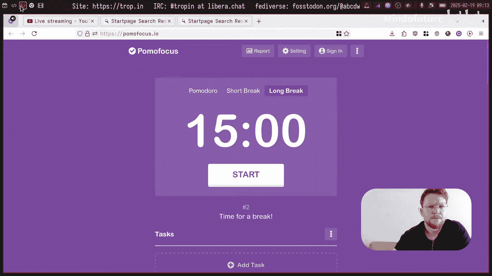

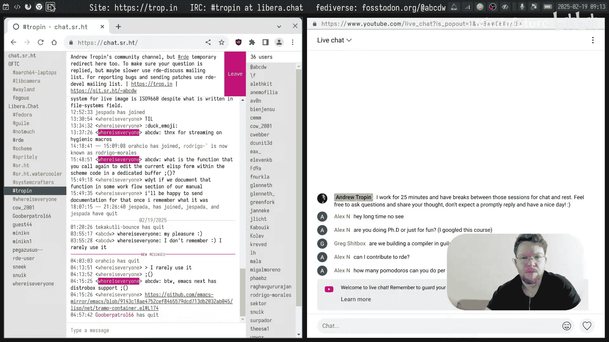

嗯。

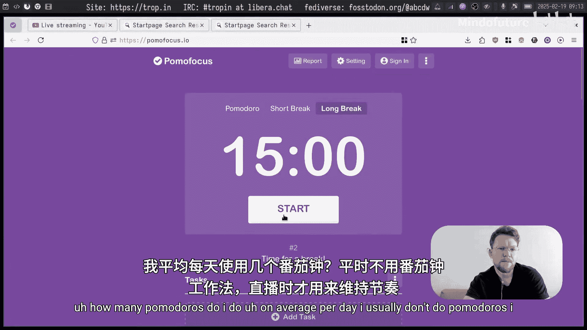

How many panmoddoas do I do。On average。Bルデ。I usually don't do my。

 I do it only for the stream to make， to make some structure。Because when I work on my own。

I do breaks whenever I feel I would like to do it。嗯。Sometimes I forget。

 and sometimes I sit for our a couple hours。 Sometimes I can do it like every 10，15 minutes。

So I don't like have a very rigid structure during my usual day， but on the stream。

I far find it easier to make it。Like a break every 25 minutes。So， I am sure that。

The people who watching have expectations and like， can rely on that。

I will stop working and will reply to questions and。Chat them， and get some arrest。嗯。Yes。

 that's basically only first stream。 usually I don't do Madurs。

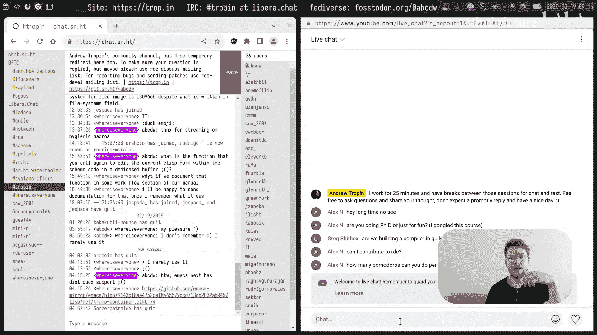

However， maybe， maybe if I hit。I bit。More。Integrated tool into my environment。 I don't know。

 maybe a hot key， maybe a status bar plugin that shows me。Current pomodoras。 I would do it。

 I just have efforts in my work agenda， and。Due to those efforts。

 when I take time on a task and the time comes。Close to the effort estimate。

 I get on notifications that you already have。To finish this task and my usual estimates。

 like from 15 to 30 minutes on the tasks。If it takes more time， I try to split this task into F U。

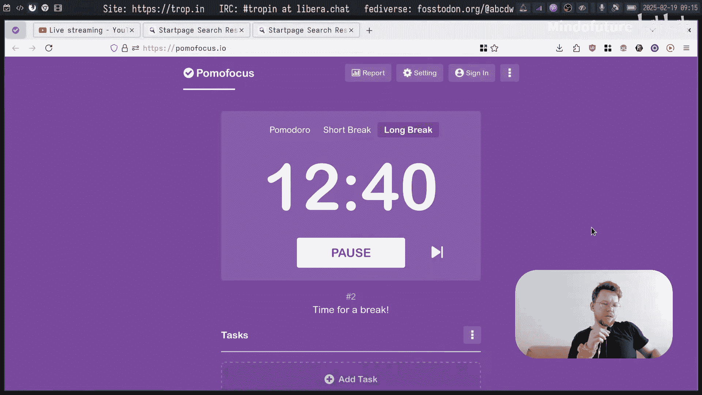

Okay， I will prepare a very。

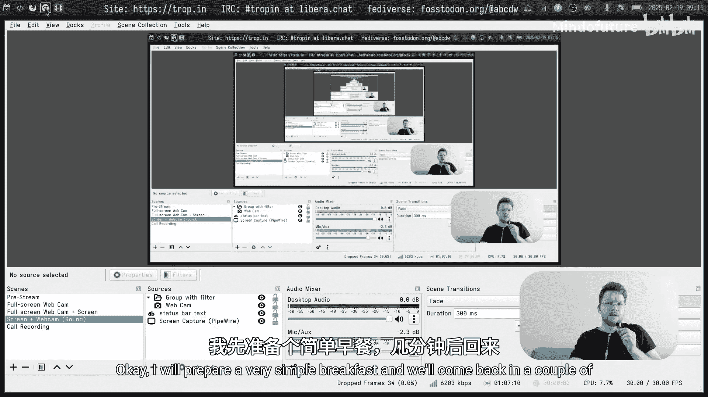

Simple breakfast。And he'll come back。In a couple of minutes。

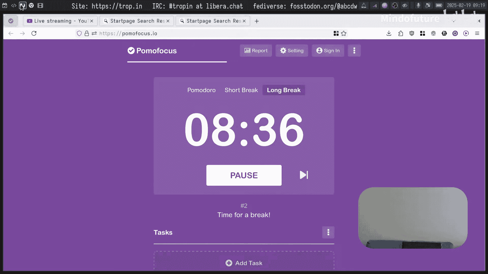

嗯嗯。

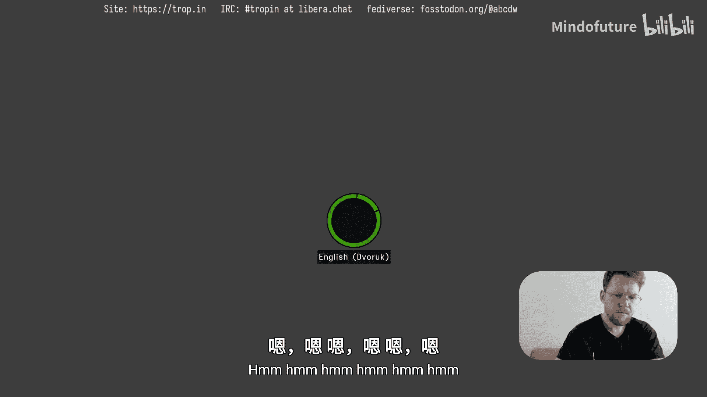

嗯嗯。Mhふhm。

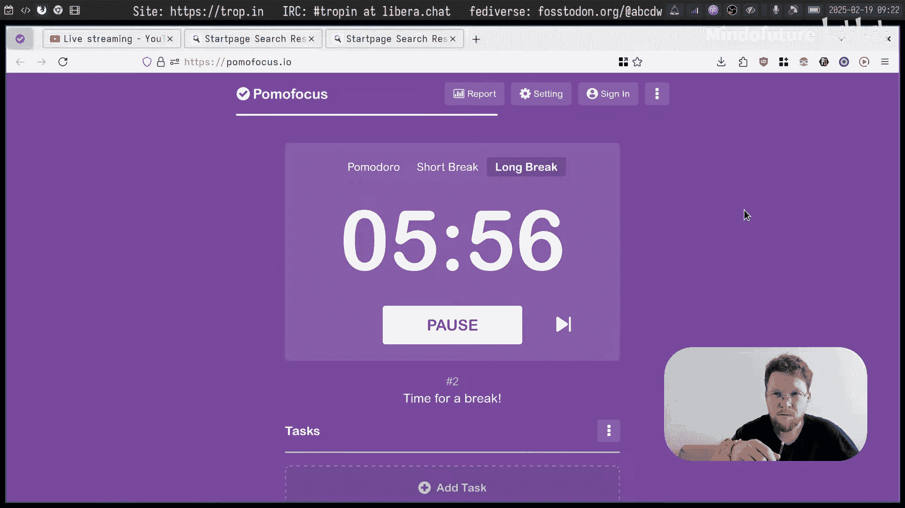

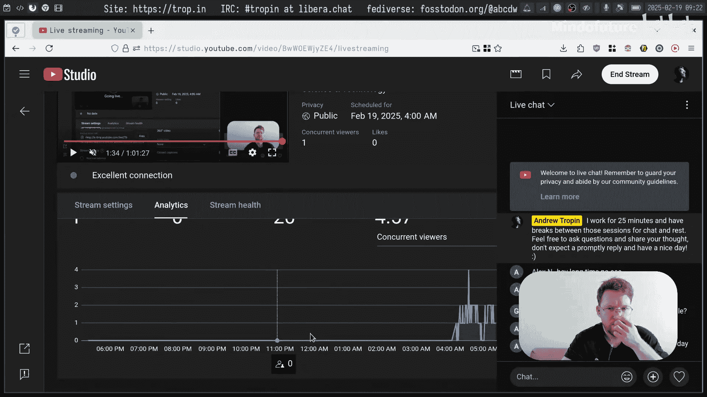

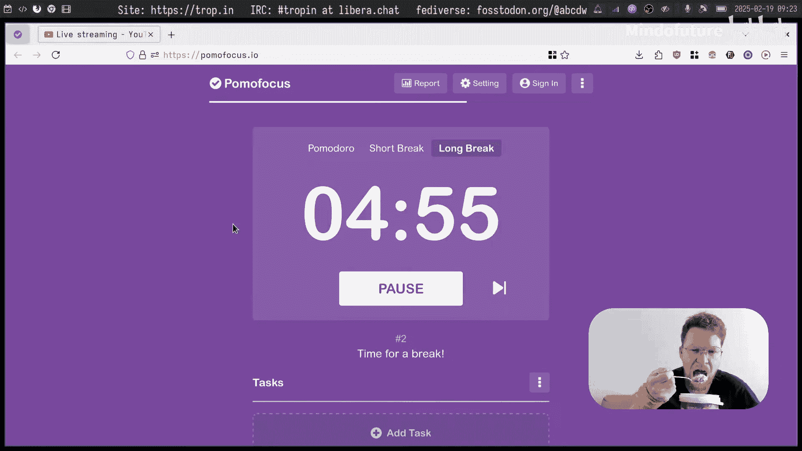

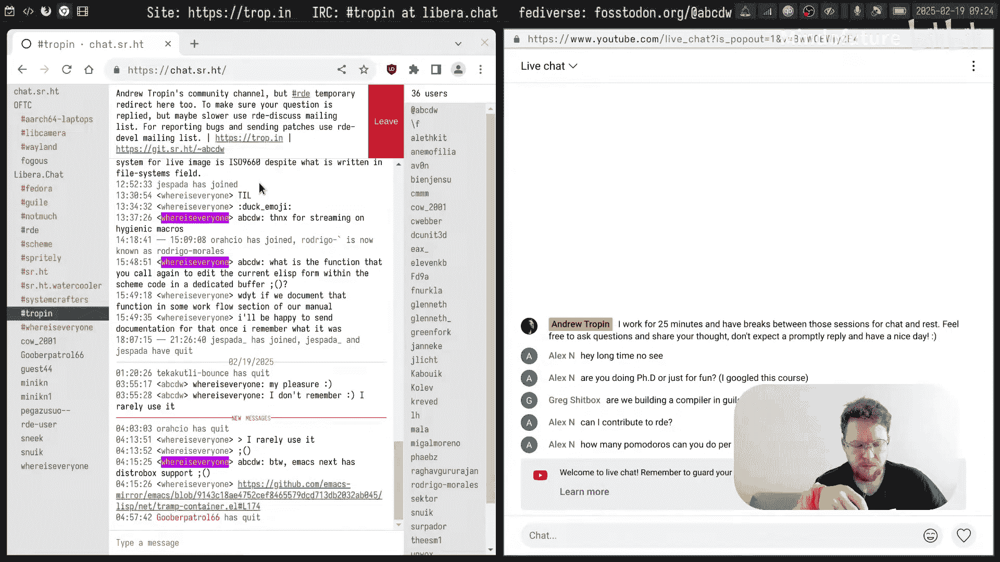

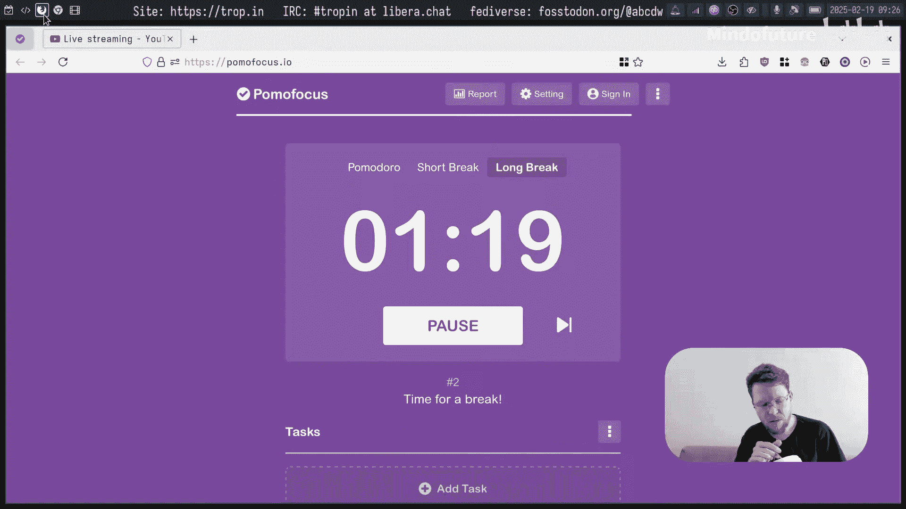

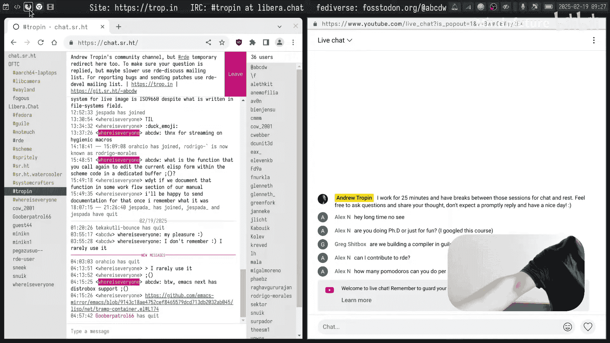

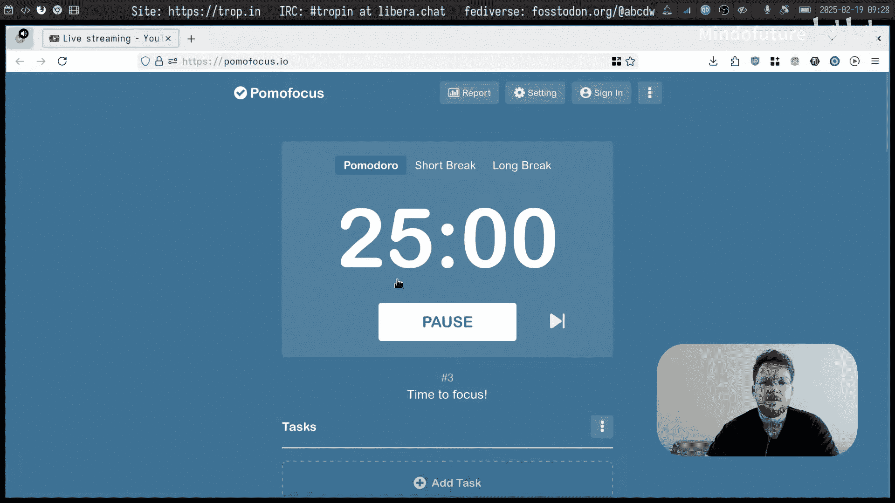

Okay。They have。 we have problems。 They have blocks。We have functions。嗯。I think， I need。

I need to do Samsung， Please get the blocks。Function。Because it takes all the functions。

Goes through the blocks。Mmhmhmm。Okay， the high level problems that I have right now is that I need to combine everything back。

Into braille program definition， and it contains a list of functions or a vector of functions。

Like this， we have。Name。Function name and list of instruction。Inside this function。We， of course。

 can。Shortcut this stuff right now。And just don't care about。Functions at all。 and always c。

A function with name， main。Or we can handle it。we can handle it。He can implement function， define。26。

唔俾。光ker。Right。Believe from。And now。Blics。M。Sounds good。No， we will be able。赌。诶都嘟。嘟嘟嘟嘟嘟嘟。

There's a cool trick。Instructions。We have functional instructions。You will be able to implement。

Our optimization passes only on the list of blocks。And we can write interface。

For this transformation， in which will be。Very convenient。So we have a program。 now。

 we need to go through all the functions and for all functions。

We takes a list of instruction converted to the blocks， apply transformation and save back。The value。

Okay， it will look like。Different。Tranformum。Program blocks。프로グ。Im very 프로그램。I没。Like this。Vview。通够。

Through them。嗯。Different。Udate。It will be a list update。俾啲优。Bロ。Functions。

And here we need the function top date with those functions。Like this， different。Update functions。

Hector map。So the F Ns and。Good then。I X。And4。Each x we do at least。Update。Right。Update the list。

A list update。X。自。Ins。We have a list of。Stras。In transformation。Inst transformation。ok。And now。

 let's。Let's do the following link。Qu elimination is just remove all the instructions。And we need。

We have to get。The same program， but with empty instructions。M this empty vector。Of interactions。

Let's see how it looks。It should be。Tranformum program。とボッ。그 프로그램。InV program。And。Rememberumb the x。

Eレトル엠プティレクト。Oops。Okay。We did it。Now， instead of removing all the instructions， we need to write。

Simple function， define。But look。No，那。It。Let's call it GDC。and。

It will accept a list a vector of instructions。After that。V di。This list of instructions。Instaction。

 doublelock， Ins。And we need to transform。This book。Let's the name it。In是的。Gら不。Form blocks。

And least direct。And they should be below。Like this。No。我。Let's do it。And we got。The same program。

 right。ポ boomポ boom。Very good。 Very， good。Very nice。Very happy with these results。

 a program that does nothing。It a program。Whi is， which is still cool。

Because now we need to only inject the optimization。って。Into here。Define envelopes。And lookss。牛逼。

And贴 them。Now we need to just transform。Those books。嗯呵呵。Whats。Let's display blocks。バボックス。英据。

You know what。 You know what。We不如我不累。😔，Could use react。For representing books。

Instead of using a list。These numbers。It would be easier， right。嗯。Instructions to blocks。Where。

 where is it implemented。Prodions the blocks。I don't like the fact that instructions to blocks。

It turns not actually blocks。And this。Could be just a vector。嗯。Another thing that I don't like。

About skim。That we don't have。Plimorphic。Interfaces on。Data structures。 so I can't read。嗯。

At least in the。With same function。However， I would like to。

Because I don't really care what is under a hood。What's the implementation and the result is it the list or is it director is random access is linear or constant time。

And I would like to swap the implementation depending on。

My use cases without changing the top level API。But right now I need to plan it up front。

And to make those decisions that I don't want to make at the moment。Because they don't know yet。

How it turns out。Blocks instructions。Don't like the function name， because it not blocks。

But blocks and。And jumps。Okay， let's， let's see what。What is inside？GC关本不6。We have one block。

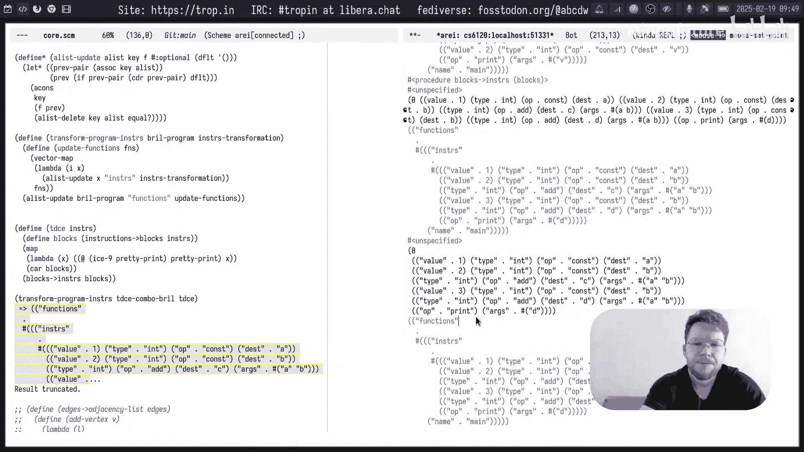

So let's try to optimize it。I already forgot。

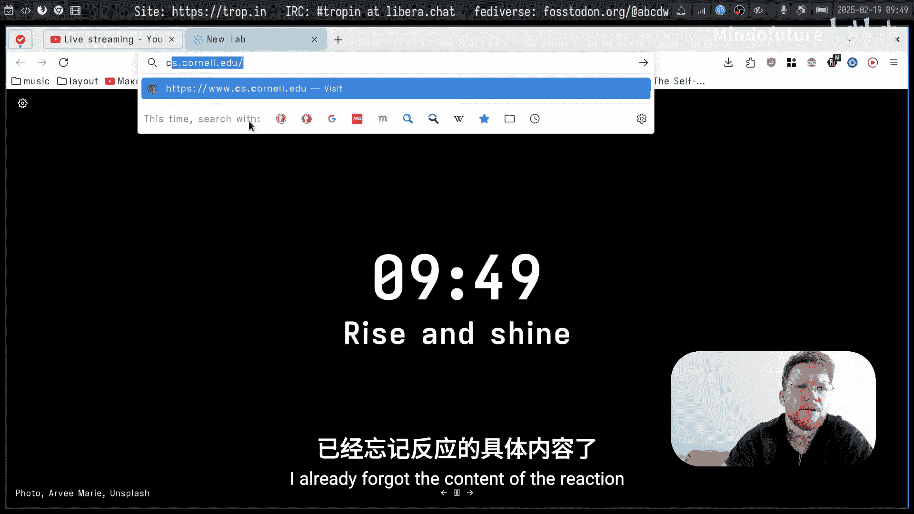

In the光不 the action。Iine。But before we do that， I want to give technical or different kinds of optimization for study。

The difference is between how we deal with。There's a simple kind of optimization that remove code that can't possibly have an effect on the output thereby by making the program faster。

We're getting more familiar with real programs in this instruction based syntax and the semantics of the various instructions。

 so we'll be able to understand this simple program that just a couple。

Book forget code emination on this program。 Do that now and figure out which instructions it would delete。

My implementation， at least would delete only this instruction。

 that is this is the only instruction that's unused。

 And the tricky thing about this is that by thinking with your human brain。

 you can also realize that this instruction is also need because it feeds into instruction that's never used anywhere。

 but it doesn't meet the criterion。Curction won't have。 The Prince section won't have a destination。

 and therefore， we will never。Shift and thinking is that has to happen when you transition from thinking within a single basic block to thinking about an entire CFG。

 Let's start out by looking at a drill program that's possible to optimize。

 We're to start by thinking about deco o， which is a simple kind optimization that remove code that can't possibly have an effect on the output。

 but by making program faster。I hope were more familiar with drill and the instruction based syntax and the semantics of the various instructions。

 So I'll be able to understand this simple program that just has a couple of ads of concept。

 And my question to you is， what should we do to this program in order to make it faster。

 Where is the optimization opportunity。This assignments to the variable C that is never used anywhere in the program。

 And so it's possible to delete this instruction and to get in a open program that runs faster。

 that is it uses one instruction when executing， but does exactly the same thing。

 So the next question I have for you is， what is the general principle that can you phrase in a sense for what opportunities exist like this one for optimizing real programs that is if we were to implement an optimization。

 What would we be looking for， Try to phrase that in a sense， Try to actually writing it down。

That assigns to a variable that is never used as an argument anywhere in the function。

 As long as that instruction has no side effects。By side effects。

 just mean that we shouldn't eliminate instructions that don't seem to assign to a variable and yet they have an effect on the inside row。

 For example， bra has print instruction， you can say like print C， for example。

 and it't be penalized for the fact that doesn't assign to a variable And therefore。

 it seems to be dead because't producing values values used elsewhere。

 The criterion that we can use to do some deco is just to eliminate every instruction that。

That has this pure semantics that all does a assigned variable。

 And that variable is never used by any instruction everywhere in the entire program。 Therefore。

 this is a global property we come up with the framework of for a global acquisition that needs to look at the entire function。

 We ought to be looking at function here。 There only has one basic block。

 but this is a global property。 It's not possible implement by looking at a single basic block。

 It's possible that you don't use see in this basic block and in a larger function， for example。

 then you jump to a basic that does you see。 Therefore， this is a global property。

To turn this into a real optimization， I would like to now try writing the pseudocode for an optimization that carries out these instructions。

 That is that M is a program and deletes every instruction that is dead by this definition of assigned to a variable that is never used anywhere and also not having any site。

Okay， you can try to start with a simple。先不。Optimization pass。And use。Variables。嗯。Instructions。

Un local directions。Well do fault。And lamb the x。I would like to finish this one。

Before going to rest。Below。Inンスタル。And it will be different Use variables。Mtiable。えセ。1ion。Acumulator。

Vctor。To list。Let's so。A。とエ？Next40。Animals。唔帮我。In。Food。Function。Initial video。List。What。对。I。I런 그 빠기면。

Very interesting guy。W happens。嗯O， ok。Define。And updatedate。Look。Ins block。嗯。关司。Function。Go不 look。

かてる。Yes。嗯。Okay。Okay。There come。Here。We can。They come here。No。Okay， okay， it's not。

 it's not the block。It's not Apple work， okay。The looks。スたラクシ。Update blocks in direction。The box。

 And we need to go map。So some blocks。And。Exist。And。We will get。We will get the block name。Gter。Go的。

It's not a car。你吃逼。Car from blocks。I this is an instruction， This is。This one is right。This what。

And I have instructions。So director。Soく래。我。不。May， maybe a union， accept。D， A D。D A B used variabless。

Thisリ。This is quiteリアク。wait it。And get it多。Below instructions。ミキシムスライトミ。

I'm a bit bothered by the sound。K。エビッてした。て病です。We found unused variables correctly。Use available。

But to around type expect compare， wait happens。The error message is not very helpful。

Need more information。Cons are block function。 But block。はい？Expecting bear。

Compputate the blocks directions。嗯嗯哼。Okay， I understood。It should be quas。Of this map。Nice。

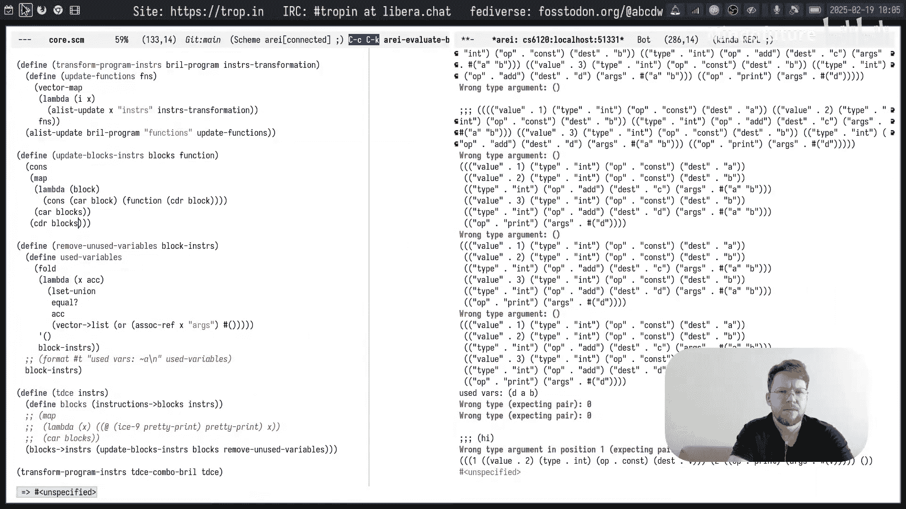

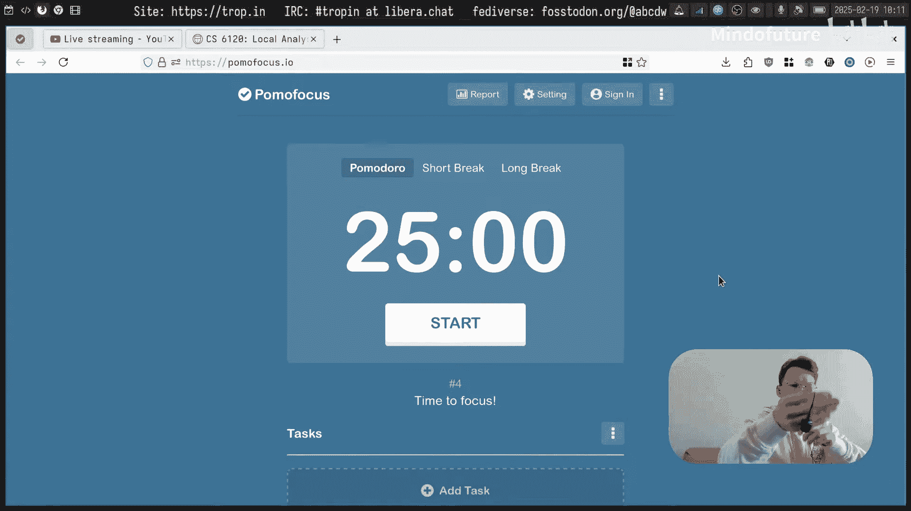

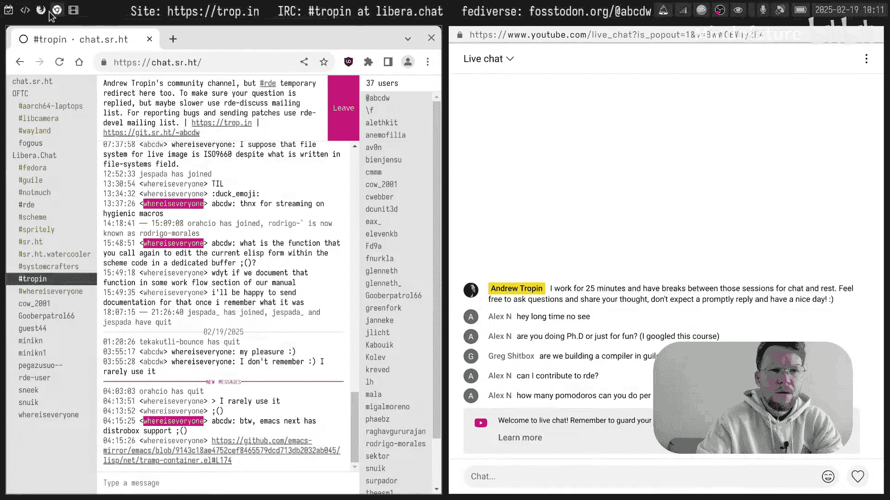

I feel that I'm getting tired and。Frustrated by the sound。So I will try to finish。

Is this transformation as soon as possible？And。I guess we will finish this three semester。

The transformation。属别。Very simple。We need to find。エレスト。Use the variables。

And go through all the instructions。Which。Have a type con。And the destination。

Is not in used variables。s that's basically it。🤧P。So it will be just a fault on a lambda。X。嗯。Comp。

Block instructions， block。In directions。And。What do we do？Fold works from left to right。Right。

 we get dub。And。And。The dog。Youた。use。😔，Avaable。Use the variables。Let's see。In our program。Arguments。

 A B。唔知。ABD。B。They are here in。The order is。Fur frustrating。アクス。AB。AB。二。

Can you just preserve the fucking order。你时。All that pain in this。Okay。How else set the union works。😔。

unionion。但烦多。S。4，3，1，2。それで。O거 때문에。Whatever， it's an ordered set。 Let's treat it as an。

 an ordered an ordered set， and we don't care。We just don't care。What we care。

 We care about the order of the blocks。好一次。我师乎。If。If。Destruction up。At X。F X equal。Cons。And。Let's so。

😔，It if。😔，ヘック。In just。😔，Am I using it right？At least gay。Nice。I think you not right。Yeah。Just。面边。

Use it。Vables。Then。AndDoes this。As I arise， does this。X。Okay。Let's see what we get。Oh， let's。

He or what we get。Os。寿面。😔，Show me who the hip Prince as this。嗯 o嗯。M白。Is this。系始。嗯，呵呵。

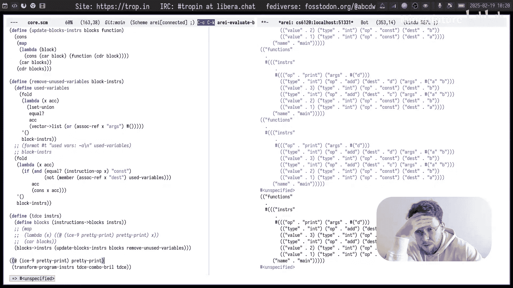

嗯。

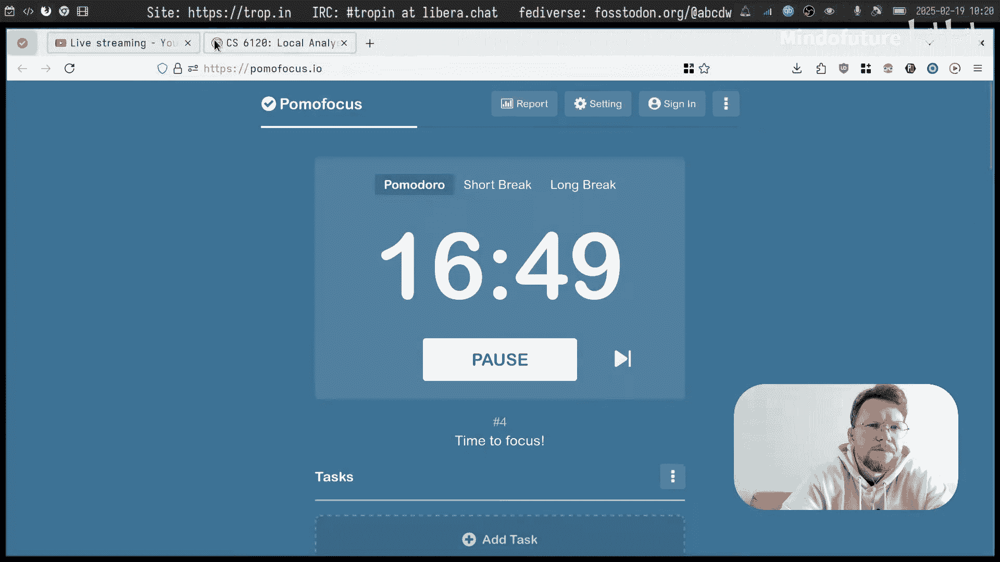

We have。😔，If that's what the answer， go。嗯。关闭了。He。Used if used。Be used。So we have A B， B， T， print。

Yeah。Yeah， it's very nice， but。Is a fucking wrong direction。For the right。AB。ok诶。Ifve。Iそ。

And we need to swab the order of the fucking arguments。Yeah。Okay。Yea。

 our first that elimination plus。Finally works。Great。T removes the variables。

That never used for sure。呃。Okay。And now， we need extra to remove。One more think。 this one。

Because it gets shadowed。How you do Here's code。 It's works in pass two loops。

 The first loop looks over all the instructions and accumulates a set of all the variables that are ever used anywhere in instruction。

 The second loop all the instructions the second time and looks for instructions that have a destination And that destination is not in the used set and it leads those instructions。

 This allows copy， operations built the standard don't have side effects if they assign can do operations results or the value operations that't have only。

 is complicated have to think carefully about what the instructions。 But for example。

 the doesn't have a destination field。 doesn't assign to anything。

 So won't a and therefore we will never believe those instructions。

 So that's simple first optimization。Great work。I wantna now show you a second program that we're going to want to worry about optimize。

As a first step for this program， I want you to try， in your mind。

 running your pseudo code for deco emination on this program。

 do that now and figure out which instructions it would delete。My implementation。

 at least would delete only this instruction。 that is this is the only instruction that's unused。

 And the tricky thing about this is that by thinking with your human brain。

 you can also realize that this instruction is also need because it feeds into an instruction that is never anywhere。

 but it doesn't meet the criterion that I set out in the pseudo。

 that is this instruction the one designs to see。 It doesn't have the property that is never used in any instruction ever。

 So sort of disappointing we know there's more opportunity to optimize here than we are giving credit for。

 that unable to do an optimization we'd do。 So now I wouldd you to think for a second about how you can rec this。

 you can take the pseudo code that we wrote for simple deco and make it slightly more powerful to capture this case as well as the previous。

There are several ways to do it， but there's one way that's particularly easy。

 which is just to do the same thing multiple times。

 That is to run the algorithm repeatedly until it conges。 by that I just mean。你这就开了。Run it。

 then running our program believe until the optimization are。 I want need to think for a second。

 again， about what our algorithm so far， including everything convergence will do to this program and what opportunities does that leaves on the table。

If you said nothing， You're correct。 The previous algorithm would do absolutely linked to this thing。

 Even though the opportunity for optimizing it is fairly clear。

 That is this assignment to the variable A has no effect on output of the program。

 The only one that matters is the second constant in the program。Clearly。

 there's an opportunity here to do stronger。 If we can find variables that are assigned to and then assigned to again before they're used again。

 I'm caution， that this is a little bit more subtle to implement than the previous one that to do looking global the entire function and looking for uses variable。

 And the reason that is it has to do with the ordering of things。

 the one didn't about the order of instructions。 It was if assigned to variable and the entire function variable is never used by any other。

 we can that its safely。 That's not big bag instructions is not going to work for this of optimization。

In particular， we're going to have to think carefully about what happens globally in programs that have control flow。

 Let's imagine a slightly different function that has a assignment to A。

 and it has another assignment to A。In between， there is a jump to a legal。In coation， was jumped 51。

 L compile one。Yeah。可调回。Not to be done。 just taking our programs like the one of them。

That is where there's a local I really， wait here we go。

Before theyre ever used in any other instruction。So now I would like you to write down some pseudo code for how to implement that local optimization that reduces dead stores to variables within the context of a single baseball。

 a local deco emission based on overwritten variables。If what you think differently。

 because I it's a lot different。 Here's my idea。 we're going to start the course by doing a for loop over the instructions that this sign said instructions in a programgram will now just audience。

Just for the record however did this exercise during selections。 you can。

Which in the previous streams。Right now， I just a refresh。M introduction in the block。

 My idea is to keep track of those variables at every point in the block that after every instruction。

 we're gonna to keep track of those variables that have been defined， but not used。

 that is variables that have been assigned to。 but they haven't actually been consumed yet。

 So these are candidates for dele。 And if we ever see another assignment to that variable before we get to the end of the block。

 then we know that the previous assignment is worth deleting So this means that we will preserve variables that are assigned to but never used we get to the end of the block。

 because we might be jumping somewhere that's going to use those variables。

 we're not going to worry about global optimization。

 But we can say that if we ever hit one of those candidates de that's defined but not used。

 and we another definition， then we the dele opportunity。 So here's my idea we're gonna have a。

A mapping called last step that keeps track of those variables that are defined but not used yet。

 And this is going to be mapping from variables。Two instructions。

So this's going to keep track of the last definition， the most recent definition。

 but only variables that have that haven't been used yet。 So in the in the instruction。

 we're going to do this in two phases in the loop。 were going do in two phases。 Well first。

Check for uses， and then check for definitions。It has to get go in this disorder order because instructions can be both users and defines。

 That is if you say like x equals x plus1， for example， you're using X and then defining x again。

 And we dont want to consider x dead just because we're assigned X because we're also reading the previous value of X。

 Any case， we need to check for users first。 So the way this will work is that we'll look at whether the instruction has any arguments。

 And if so， we will take those things out of our last steps。

 Remember this last thingll be minus equal to we' take out all those variables that are now being used。

 Last is meant to keep track of all the variables that have been defined but not used yet。

 and we're encountering a use of the variable for everything in insert R。

 So we're gonna take get out。

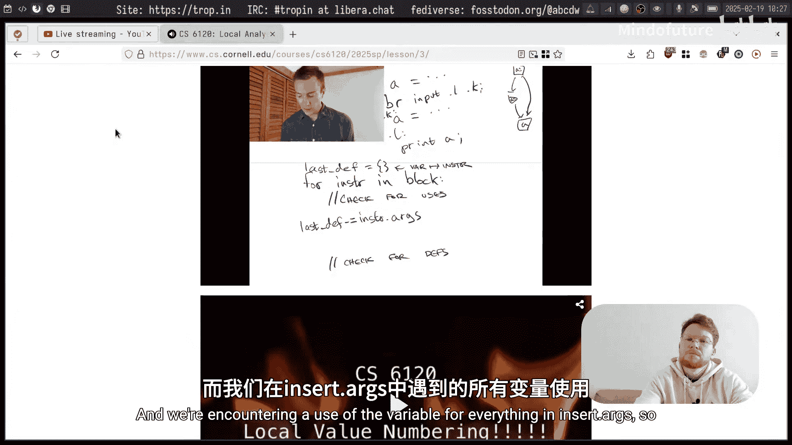

Okay， I think， I think。

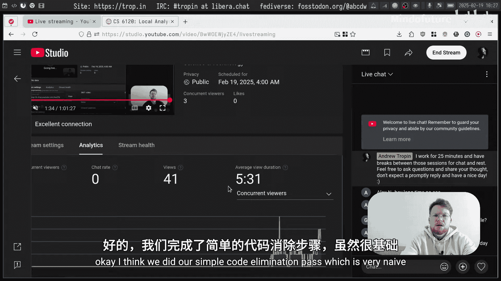

We did our simple。Go elimination pass。Which is very。Nve， but still removes some。Nate， guess， let's。

Let's go meet。あ我 stop。Implement simple。我前讲你。😔，That called elimination pass。And in。R structure。

Transformations。Core the。Of course。Okay， and now let's apply this transformation。😔，It do will be。

Respon to SM。Program。Pro programgram。Yes C2。Rson。Gian。😔，Ohd。And now， let's see。If it works， yes， yes。

But now one step closer to accomplishing the host。The justテ。Let's actually see。If。呃。

This optimization。Made a sp。Any tests。Okay， we passed two tests。Which is funny。3 tests。Let's。

 let's remove the g。Have got city tests out of8。Nice， nice， radical cool。嗯，光。No。😔，Can meet extent。嗯。

We have five more minutes left。

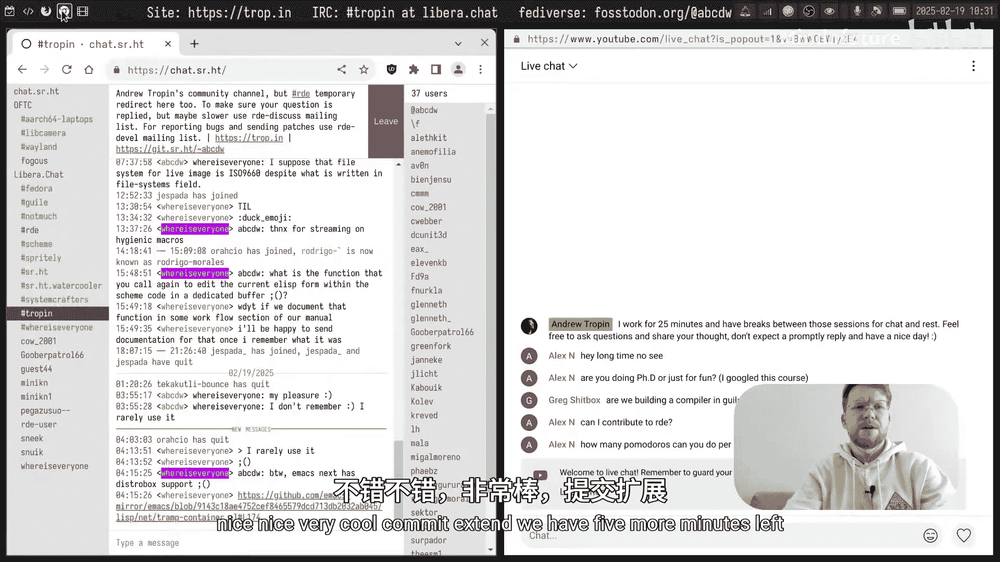

But we browse right here。

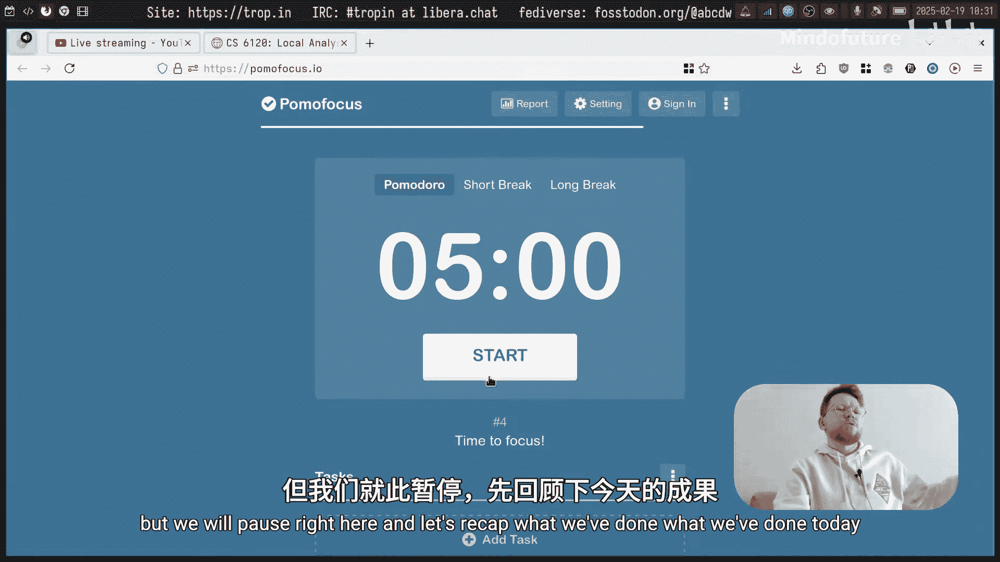

And let's up。 let's re up what we've done。

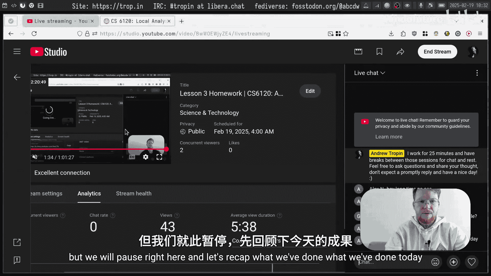

What we've done today。Today， we polished up a bit the。Testing infrastructure。V provided。Like。

 a lot of。Not avoid just a few of functions。For applying transformations to the programs。

 And we implemented one very simple transformation。

 which just goes through the quote marks variables as。

Use and remove unused variables is the definition of unused variables。That's basically it。

It was a bit slow。But still productive， in my opinion。We spent a bit of time。T to write a top sort。

And implementing a list update。Some way during this process。But， in fact。

 we realized that we don't actually need it。And we can combine blocks back together just by block names。

Which are cons。Is it right for numbers？That's。that's it。That's basically it。Very good。 Very nice。

Quite happy with the results。 if it there。嗯。バ you系点。

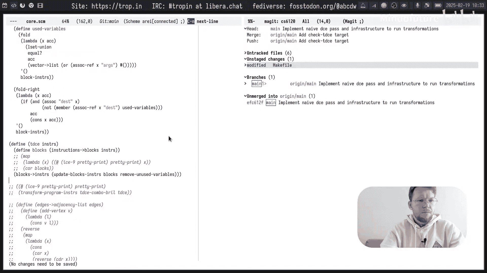

I hope it was useful for you。

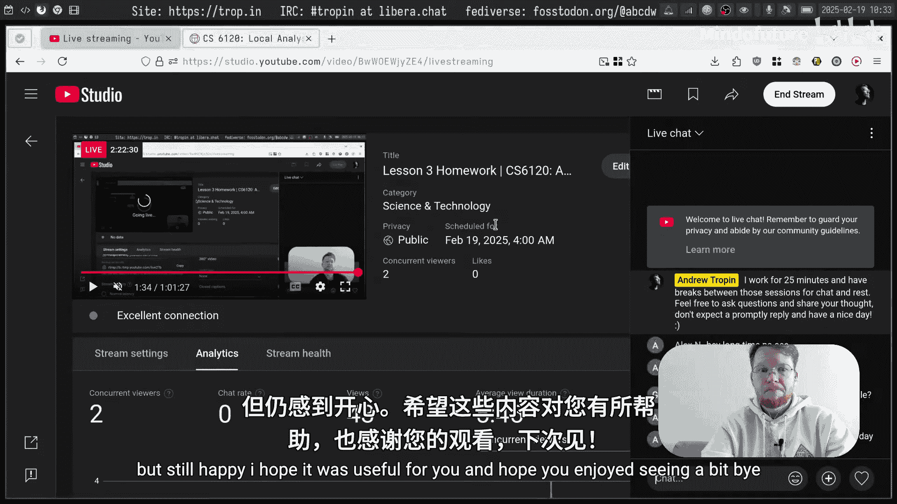

And hope you enjoyed it。See in a bit， Bye bye。

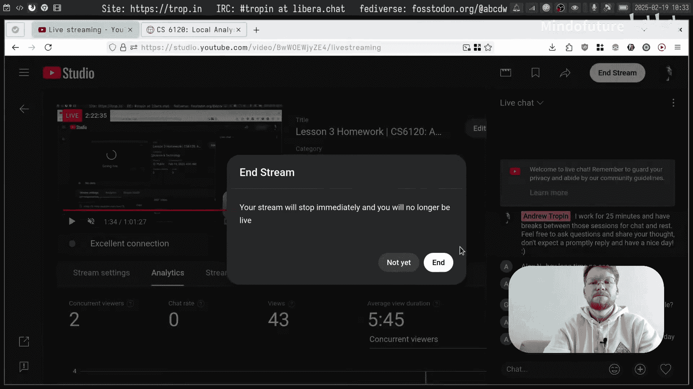