# 将guff绘图设备移植到Rust-｜-Jon-Gjengset--BV1RXtUzEEAQ-

Hello folks， welcome back to another I rust stream。

 It's been quite a while since we did one of these。 It's been a bunch of Q And A streams。

 some shorter streams， but I really wanted to go back to just like。😊。

Writing a bunch of Ru code over a few hours。 And so that's what we're gonna do today。

 I am I spent a bunch of time thinking， like， what do I want to do。

 And there were a lot of good suggestions on the the discord。 when you。

 when you're like any of the supporter tiers， you get access to a channel where you can like suggest stream topics。

 There are a bunch of good topic suggestions in there。 And I got some on on maseddon and stuff， too。

 But I actually wanted to do something a little different today。

 which is I wanted to kind of code something。😊，That's not very serious for the lack of a better word。

 right， Like， I feel like a lot of the things we end up building in these streams are like。You know。

 implementing TCP， like a lot of protocol spec and figuring it out how that thing work or like reportinging Fgraph there's a lot of like really weird intricate code for manipulating stack traces。

 or with a port of the concurrent hashm from Java that's like heavy atomics code。

 and that I understand that that is interesting to learn from right it gives a lot of detail and in-d depthth analysis。

 but sometimes I just kind of want to write some not straightforward rust。

 but just like something that isn't intellectually that hard。

 but it's just like we just have to write a bunch of rust code。

 The codecraft or streams have been a little bit like that， but they're still very problemoriented。

 whereas here I wanted something that was more outcome oriented。

 Like I just want to build a thing that is gonna be kind of fun to build and also maybe is useful。

 And so I found this tool called Guff， which I' I've had in my bookmarks for ages to just like。😊。

Play around with。 And I never have。 Ive literally never run this program。

 but I like the idea of it a lot。 And I also notice that it is。

 its last commit was 9 years ago and is written in plain C， which sounds like a good。😊，You know。

 candidate for let's try to write it in a different language to see what it's like。

 This is a command line tool that takes a bunch of numbers on its input。

 and then it plots them to your terminal and askI text。

 And this is something that I end up doing quite a lot。 Like I want something like this。

 I very often in a piping things like into new plot or into like R script where then I then put like a dash E to get summary statistics and stuff。

 And that works。 But I'm just like， I want something that just does kind of the right thing。

 Like it just does something reasonable。 And I think we can always extend on this。

 So this lets you give like X and Y coordinates like this。 So you can plot X and Y。

 or you can just give the y coordinates and just plots you know from x equals1 and onwards。😊。

And like it just literally just reads input like this and then plots it， which is super handy。

 But I think we could possibly expand expand this a little bit to do things like plot the the CF So the cumulative distribution function or the PF。

 the probability density function。So that if you have data。

 you can get like statistical analysis over that maybe by running H histogram or something behind the scenes。

 like there's a bunch of ways in which this could be made like slightly more powerful even for relatively simple inputs that I feel like you end up generating quite a lot when you work on the terminal like these kinds of command lines。

 I write a lot like I graph for something I sort I a something out maybe I said something and then I just want to see like I end up with a bunch of numbers and I want to see just a plot of them。

 or quite often I want like summary statistics like I want the median。

 I want the mean and I want like like a histogram with buckets or something or at least like the 95th percentile and stuff and I feel like we could actually incorporate this into a tool pretty easily So that was one of the reasons why I wanted to do Guff the other reason I wanted to do guff is because it is a C program and I feel like we've from Pearl report from Java Pearl was F graph Java was concurrent task。

😊，Map we've ported from like。Spk， right， which is TCP。

 But so I feel like just porting a straight C program is gonna be pretty funny。 Now。

 it's worth pointing out。 and someone pointed it out in chat already。

 that Guff is also the name of a few other tools。 Some of them related to LMs， for example。

 This is not that This is a tool that just like plots the stuff that comes as input on terminal。

 And the name is short for McGuffin McGuffin is a term that's used is just like a thing that does stuff for example。

 in D And D or or in a lot of movies， like this is plot device that's used。

 and hence the dual meaning plot device， a McGuffin is a plot device that's like a thing that everyone wants because it can do something。

 there's no explanation of why it can do it。 It's just like it's a McGuffin。

 It's just like a thing that someone came up with that does a thing。 if you' played Baldersgate。

 like the Astral pism is arguably a McGuffin。 It's a plot device。

 it's not no one knows exactly how it works。 but it's like。😊。

That's's the thing that lets us carry the story along。 And so I really like that naming， but it。

 it is also confusing in that it applies this L M LM tool as well。😊，But we're not doing the L M tool。

 We're doing this thing。 in terms of naming it， I think what I'm gonna name this is actually Dingx。

 which is a Norwegian word that means something similar。 Like a Dingx is like a。It's like。

 what youma call it。 It's， it's a， it's a thing。 It's it's a。Gdget thing。

 and I feel like a Norwegian word feels appropriate。 I was thinking of trying to get an R in there。

 but I don't think it's that important that it's written to us。 Tingy is also good。

 but I still think Guff is， is solid。 thinging Imajiig is also a good name， but it's too long。 right。

 Like， if this is a thing， I'm gonna run at the end here。 I feel like I want it to be shorter。😊，U。

Yeah， I think， I think I might just do Cargo new bin。Things， we also have the word duit。

 which is similar。 It's like。I mean， it means the same thing。

 It just means a thing that does something。 And no one really knows how or why。

 And that doesn't really matter。Like du predict。 But that too is too long。

II do think that like guff is， it's so good， like as a plot ofise， it's so good。

 But I don't know that I can come up with something quite so clever on my own。😊。

So we're gonna go with Dings and then start from there。Thanks。Okay。

So the basic input thing is here is just a stream of numbers。

 We're just going to get new lines separated input where the input is going to be。

 And I think this is dictated down here in an input format。

 it reads lines of floatinging point numbers separated by a single character。

 So here and here these both read as 1，2 and 3。 If multiple separators appear。

 then the value treated as missing for that columns row。 Okay， so it's basically CSv。

 but the separator is space or comm whatever is convenient。

Any line beginning with slash or hash is ignored and anything else that stir to D considers an ill formatted number。

Interesting， okay， so it doesn't really do a lot of scanning here。

 I don't think I'm gonna to use Rata2 here。 Like if you look at this。

 this doesn't depend on n curses。 Like， it doesn't try to build a2i。

 and I kind of want to do the same thing。 I want to just print a standard。

 I don't want to take over my terminal and do like full screen drawing or anything。

 I just wanted to print a terminal。 It also has this nice nice mode where you can you can pass in dash S to render SVG instead。

 And the nice thing is you end up with this binary that just like has no dependencies。

 It's super easy to run。😊，And then the other feature that it has， I wonder what it does， actually。

 if it has multiple column values。嗯。Blank lines may gouff plot and reset。

To make it make a an infinite stream of SVG plots。Interesting， that's nice。But write another plotter。

 well， this because you don't want graphic stuff and you just want a quick way to get a data distribution on the command line。

I don't know whether we'll do SBG we'll see。O it uses colorblind safe modes。

But I wonder so like if I have multiple lines of numbers。

 like this presumably is going to be x and y， right， But what if I have three numbers。

 what does the third number do。H interesting， which shall see。 And like the plotting is interesting。

 right， because like here， this is like clearly using basically random characters to draw。

 So I I'm really curious when we go into the code， like how this plotting is implemented。😊。

So let's see。Let's start out here。With。Where is the。Where is just Guff。 Here we go， Guff dot H。Okay。

 that's just logging and stuff。 That's fine。 I want。 Why is there F and V in here。

Why is the fuller hash in this algorithm and why is it hard go it in。

 Why do you even need the randomness， What is greatest。😊，Oh， greatest is some kind of testing tool。

Okay， so a lot of this， we won't。Need， because we can just use normal tests。Okay。

 it's interesting that it has a bunch of like testing utilities in here。嗯。Main dot see。

 see what we got。Gruff could be the the rust version of this。 That's true。All right。

 what do we got of Maine so。It doesnt comefig。 That's fine。 Where does it read from。

Then it reads environment variables into there， handles the arguments， loops over the stamp。

Whatever is the input， so it does not have to be standard in。I guess。If we look at the bottom here。

But is file the output file or is file the input file。

This feels like I may just need to check this out locally and see。

 So let's go ahead and grab a a third terminal and do dev others ski clone。CD Guff。Make。哎。Tlash Guff。

I guess I need some input。 What I want is input here。 Let's do。Left， let's do。

Find all the files in here for each one run WC L。Oh， X， I want Xec。All right， do we see the shell？

And then， I'm going grab out。Just the first one。What？Oh， one index in O。 Okay。

 now we have bunch numbers。 These numbers are the number of lines in each of the files inside of Guff itself。

So if I now pipe this to Guff， what do I get。Well， that makes sense because this data is。

 it's in random order effectively， right， So this is just like if， if the input only has one value。

 that's the y value and the x is just auto incremented。 So if we now sort this numerically。

Now we get a plot that looks like this。And it's a little tall for me。

 So I think it does like 50 by 50。60 by 30。30 by 60。No， okay，60 by 20。 There we go。 fits on screen。

So the range is printed at the top here， so x goes from 0 to 41， y goes from 0 to 837。Okay。

 so we see most of them are down here。 and then it goes up a little bit。 Okay。

 so this gives us a sense of the distribution， which is nice。Yeah， zip law， right。

 like this is how how surprising that is log normally distributed。😊，Okay。

But what I want to know is what is the file argument， Like if I bias dashes the file。

 that does the same thing， what if I do， what if I write this to data。And then， I do。This。

And I give data here。 Okay， so the first argument is a file argument where if the file is specified de usess that instead of standard in。

 and like from most of these tools， if you give dashes the file name。

 then that means read from standard in。

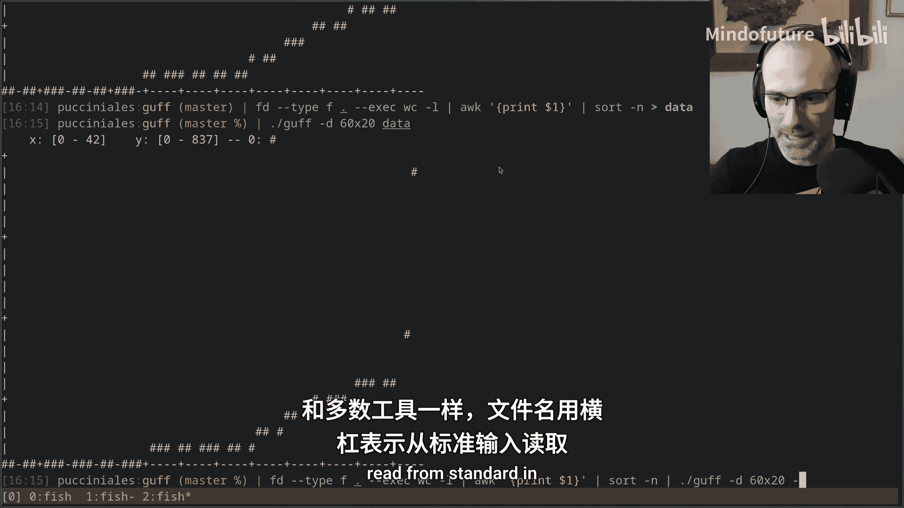

Cool。All right。There is a man page。 That's interesting。Guff。I guess I could open Guff H M L。

That's awful。 I don't want to open guffet to milk。

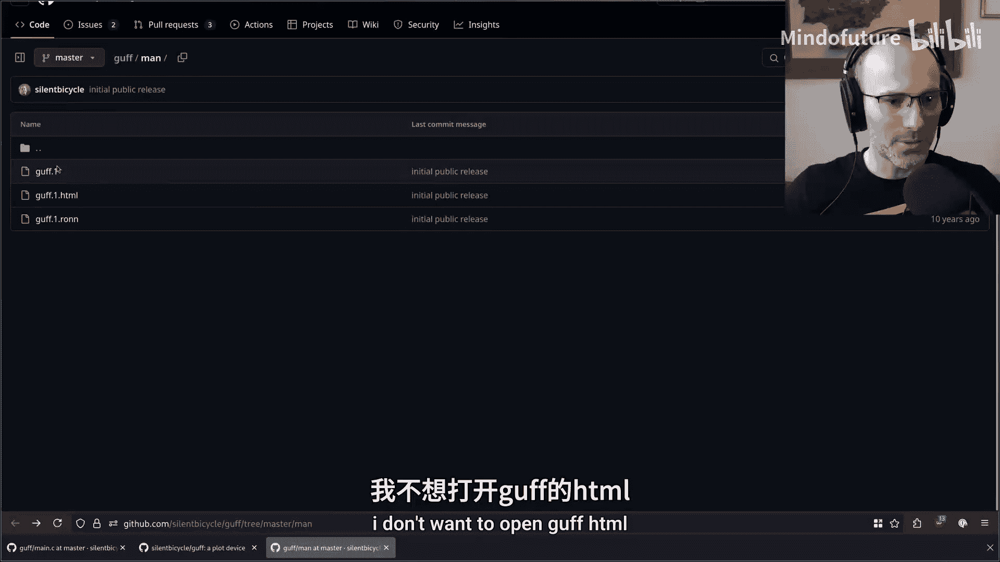

Oh， I guess actually， I have it cloned locally， right， so I could do dev others guff。Man H。

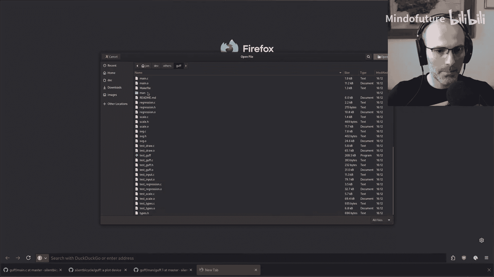

Ohoh， that's bright。Inpect， no， inspect。Itも。呃。No， that's not。u。Now， I forget what the。A fil filter。

Filter。Kbert。Right， isnn't it now， I've completely forgotten what the trick is。

 which is really sad transform。

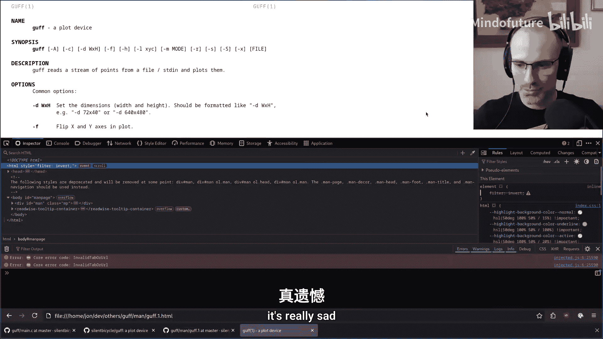

C S S filter， invert。Dert colors。Invert yes。

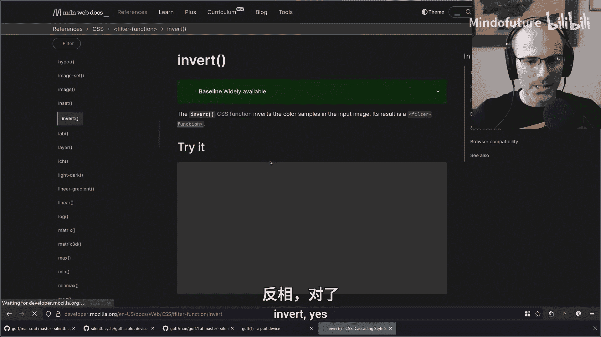

S。I thought， but I'm pretty sure it's just， oh， it's invert 1 and 80 degrees or invert like this。

 There we go。

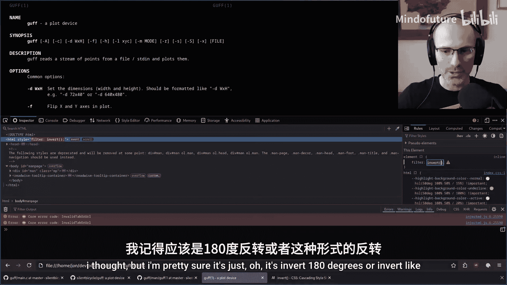

Nice。Okay。Go is a plot device， this is mostly just the same thing that we saw。

 although it has a bunch of examples， which is handy。It can do it with log scale。 Okay。

 let's handy to。A linear regression line for each column。

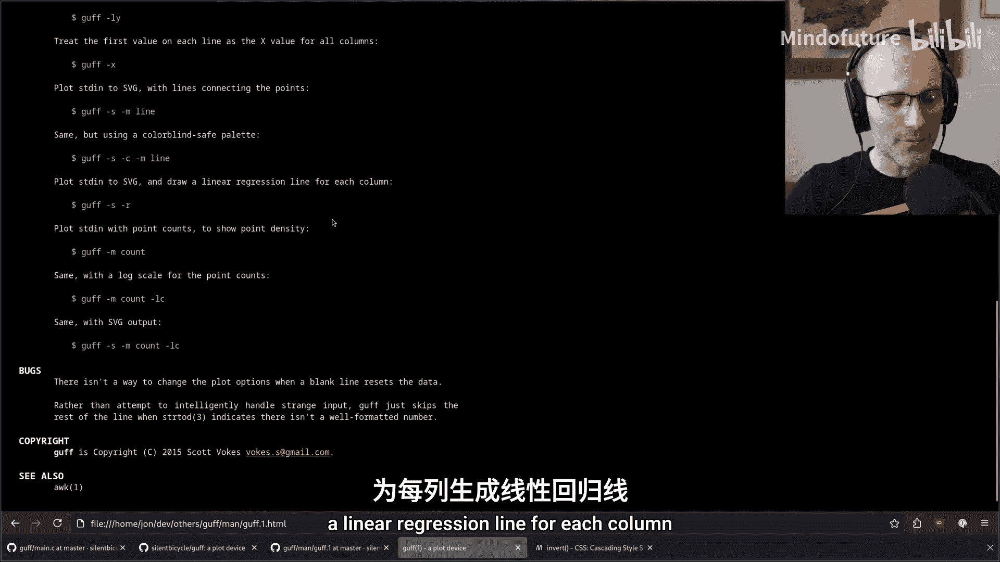

That's cool。Okay， so if I do dash R。

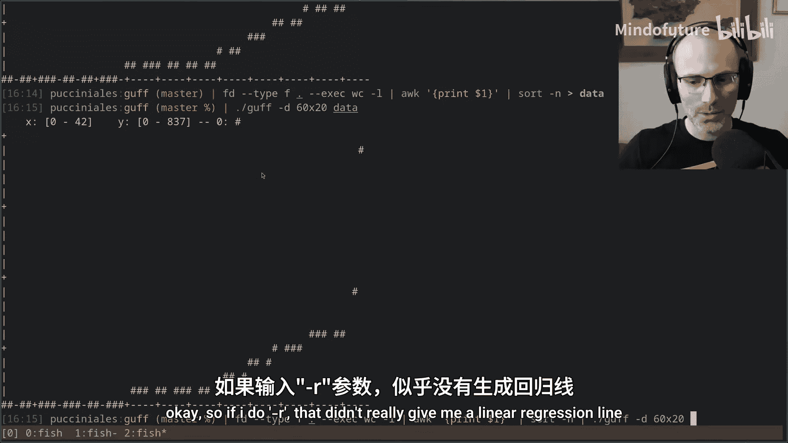

That didn't really give me a linear regression line。没毕。S， O， S would be the SVG version， okay。嗯。

With point counts。

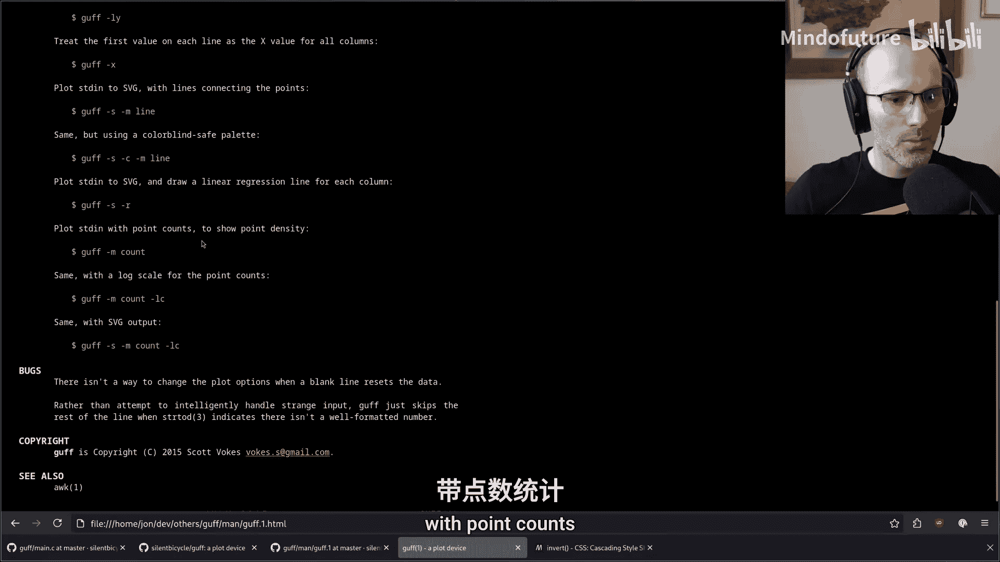

Dash M count。Oh， I see。 So then the。I see so if you now have duplicates。

 you would get a sort of account of how many things were at that location too。

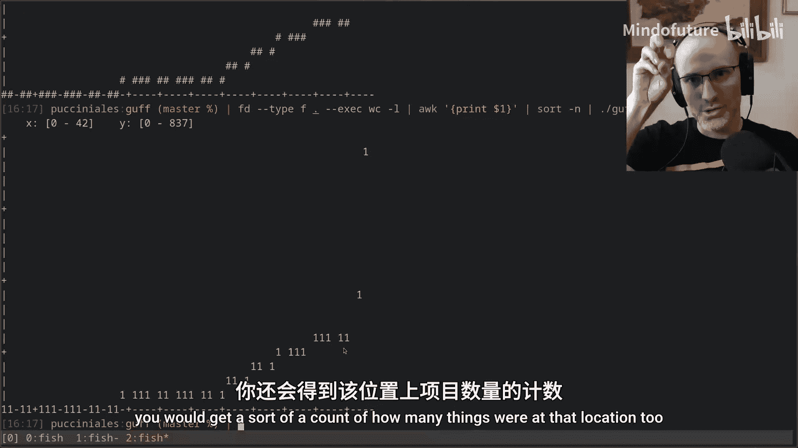

Yeah， it's like these kinds of transformations that I think are really useful。

 where I would want to add things like CDF， for instance。呃。Okay。

 so you can log scale particular things。Can flip X and Y。Dot line or count。

Through the first column is the x value for the other columns。

 otherwise the row number is used for the x value。Oh， linear regression is SVG only okay。共。

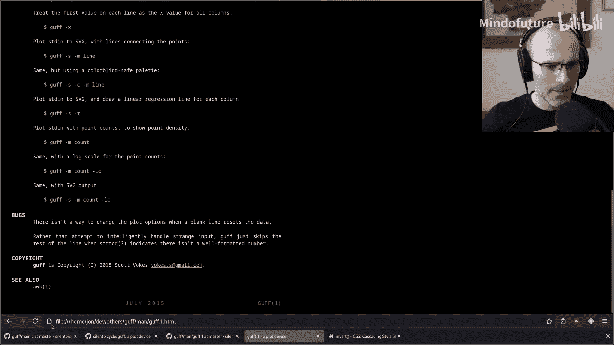

All right， let's go back to look at this。So it loops over。

 So this input read is presumably then gonna read whatever is configured to be the input as in config here。

 D S is。A data set that's a bunch of pairs。 That's what it's going to read into。 That's fine。

This is because C doesn't have R AII。Interesting， so it does actually。

 it reads all of the points before it tries to draw。Interesting。I guess that makes sense。

 So it doesn't incrementally draw as it gets data， which， which makes sense， right。

 Because if you have a command line tool that's not a2i， right， it just prints the output。

 It couldn't incrementally draw anyway because it like。Once it's drawn。

 once it's like drawn this line， it can't go back and change it because this is not a tuy。

 It just prints the standard out。I put free new line。Cool， okay， so draw is gonna be the。

I guess we could look at the config2 just to see what what's in there。

 but I don't think it's going to be anything particularly interesting。This is just argument handling。

 This we're going to get。For basically for free through clap。It's an interesting question。

 whether I even want to bring in clap here or whether I want to use something simpler。Asi dotci。

 So I think this is the ASI plotter。 So we'll at that a little later。

Counter dot C is for tracking point counts。 So this would be to make sure that for each value。

 you can say how many of that value there were， right， So this is the dash M count mode。 where here。

 all none of the values are。None of the values are the same as each other。 And so as a result。

 all of them are one。 But if we tried to do， for example。Do I have something that's bigger。

 Let's grab in like。The source code for alacrity。What。Oh， right。 I need a pattern， as well。

Interesting， okay， what if I make it a little wider here， I give it a little more space to work with。

 and 25。The this count mode is a little weird， right， like。What what if you have more than。

More than one digit worth of count。mm。嗯。Interesting。Yeah。

 I don't know if we'll preserve the M count mode， but this is basically the thing that is needed in order to give you the counting。

 And of course， this is a manual implementation of a hash table because this is C。

 And so that's why they need F and V， whereas for us， we can just use a hash table for this。

 And I think realistically I'm not sure we're gonna to want the count mode。

 I think instead what we do is store this into something like an HR histogram。And that way。

 we can plot the histogram instead， which I think is way more useful than the count here。um。Yeah。

 a shorter width。Yes if I do 30。That's awful， it starts counting in hex。I mean， it makes sense。

 right if you're showing a single character。Then that's fine。 Okay， what if I go， what if I go 10。

What is G？I think it's no Hex。 I think it's just。 it just keeps counting through the alphabet。

And if it goes oh above Z， it just goes to like hash， I guess。I mean。

 what happens if I go even narrower？No， it just becomes pound if there are too many。And I see G。

 So like， what if I go 10， What if I go 15。It was the， oh， I don't think。 Yeah。

 I think this is like base。36， right？Like000 through 9， a through z。

And you could be totally right that this is where the。These came from。Right。

 because because this is x from 0 to 720， which means that it repeats， right。

 until you would end up with multiple counts for the same point。Yeah。

 so that is totally where that comes from， that's really funny。

I don't know if it's worth preserving like this is a weird mode right。

 where you want to say how many points are here because you don't have the resolution to show multiple points。

But like， it's not bad。It's not bad。 I dont， I don't hate it。 Maybe we' will preserve that。 right。

 Like if you want to draw a bunch of point clouds， but you don't have the resolution for the point clouds。

 you just put like name like。The count there， instead。Braille characters would be good， too。

 I like that。😊，Okay。So in draw what do we have。First， it draws the calculated bounds。That one's easy。

 right， Do you loop over all of the columns of all the rows。You grab。😔，The pair at I column。

 although I'm interested in how they populate pairs。嗯。And then， it just looks for。

It just grabs the min and max。That's funny， It's fuss tested with with Afl。

We might want to do the same。 That's really funny。So， the range is max。Acrosses。O crosses x。

 whether it crosses the X axis。And。Crosses y is whether it crosses the y axis。If it doesn't cross X。

Interesting。So if it doesn't cross the X axis， it might cross the y axis if the。

Minimum x is greater than the0。And the minimum x。Minus the range。Of x。Times the crosspa。

Why this is where comments and code are useful， people。Then it sets the min to 0。

And it sets the range。 Oh， I think this is， if。If the value is。

 if the value doesn't cross the x axises， then you set the minimum x to 0。

 so you always plot with x at 0。And this is so that otherwise you might end up with like。

 let's say you have a data point at like， I don't know，1011 and 12。

 You don't want to end up with a plot that goes from 11 to 12。

 You want to end up with a plot that goes from 0 to 12。

 because otherwise it's very hard to tell where those data points actually are。Yeah。And then I。

 it does the same thing here for。If， if the， if the x axis is to the left， then it goes from。

 it goes from whatever the smallest value is， like the largest negative value is to 0。

Same thing for why。And then draw the calculator axis positions is just。Okay。

 so scale point we're gonna end up going to。 Okay， that's fine。 So it draws the。

Doesn't really print the bounds here， though， even though it says draw， right。

 it just computes what the bounds of the plot should be。If the motives count， then it。

Does the counting by value。So if we don't pass count， but there are duplicates， what does this plot？

Oh， I see them they're all just pound characters。Okay。Interesting。

So why would you ever not want count， I guess it's to avoid the overhead of this， maybe。

But like this feels like it's pretty damn cheap。Yeah。Option to disable that。 What's that here。Oh。

 option to disable the， the grounding to 0。 if you're plotting years， for instance， Yeah。

 that's interesting， right， Like if someone plots something and the X axises are like the past 10 years。

 you don't really want to have a graph that starts at 0。Yeah。Oh。

 C alloc allocates this many of this size。 So it's the same as a malloc of this value times this value。

 but just express better。嗯。Okay， and then if。If the mode is plot ASciI， then it plots with ASI plot。

 Otherwise it uses s FiG plot， that seems fine。So sort of separates out the gathering of the data and the computing of the bounds。

Interesting， okay， so let's then look at the ASI plotter。So the ASCI plotter。If axis， oh， right。

 Because I think it said that there was a。222。I thought I saw something to specifically disable the axes。

 but I don't see it here anywhere。Dash capital a。 Oh， don't draw axes。 I'm just blindest what I am。

 So if I do dash a。Isaiac， then you get it without the axes。So， in AskK C。Yeah。

 if axes then draw the calculated axes and draw the axes。

 But I'm going draw the axes before it draws the。Data because draw you can't draw the y axis or the x axis independently of the points。

So what does this function actually do？Oh， it just calls this。Function again。

Which just computes what the axes should be。And scale point。Just as。Oh。

 I see this just scales to you have a value that's like 700。

 but you need to scale it to what actual column of the terminal output does it need to be at。

 So what this file does。But， I'm。So this doesn't actually draw anything。

 So it's kind of misleadingly named and draw axes。 What does that actually do。Oh。

 I see what this is doing。 What it's doing is actually drawing it in memory。

 like it keeps an in memory representation of the output。

So that it can draw things in arbitrary order right so that it can draw the axes first and then draw the points。

 and then it just prints that after the fact。Interesting， I wonder why they did that。Ha。Oh yeah。

 I can update the the stream。 Let me do that real quick so that people don't get confused。see here。

Pa， give me a second。Let's see if I'm even able to do this in this window。

YouTube is really unhappy about me doing this。 All right。

 let me do this and I'll be back in a second。

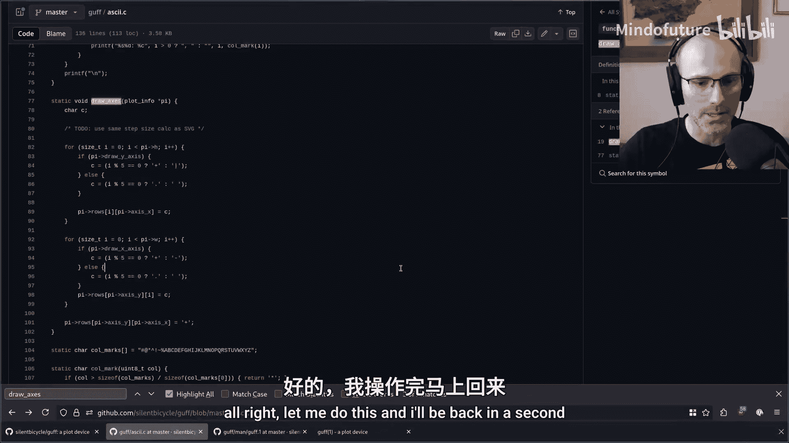

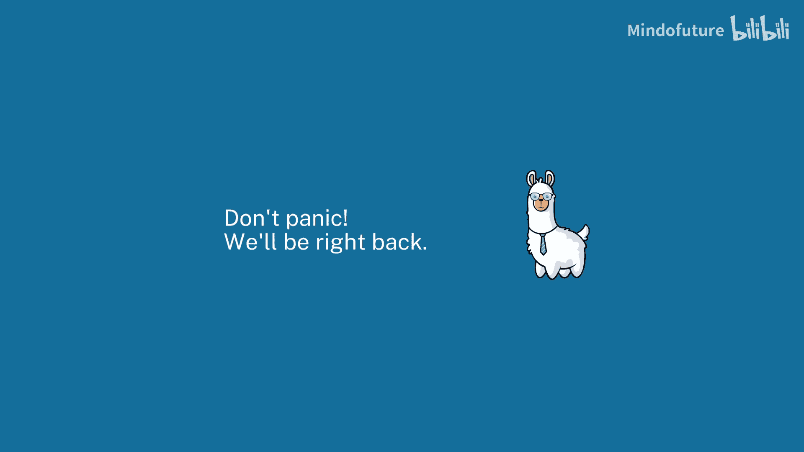

Like so。I mean， like so。嗯。Okay。Yeah， so it draws it in in an in memory buffer so that it can draw things in an arbitrary order and that it prints all of that to terminal。

Which we should be able to see if we go in here to ask E see。Printnce the header plots the points。

Yep， and then it just loops over。The P I here， which is the plot info plot loops over all the rows and just prints them。

 I wonder why they did it this way。I guess it's because otherwise you need to pass around to say。

 like every line you have to draw， you would have to。Like。Have the thing that prints the line。

 no to first print the axes and then print the data， which would get pretty annoying。Yeah。Yeah。

 not to mention， like I think it， it's nicer code because you can actually separate these concerns。

 And， you know， the memory footprint of this is basically nothing。

 right It's like you're drawing U8s。 like you're allocating like what a terminal sized buffer of U8s。

Okay， I buy that。嗯。So this computes the axes bounds。

 This draws the actual axes and drawing the actual axes here is really just about looping down and then looping across。

Which is fine。It is interesting， though， here， like why。Iie， if you， if you draw the axes。

Then you draw when you go down you draw pipes and you draw plus for every minor tick。

 and if you draw the x axises， you do minus and you draw plus for every tick。

 and if you don't draw the axis， you still put a line there。But why。Like。

 why does the line still go there because it doesn't actually print that line？Ha。😔，And then。

It puts a plus where the axes meet。Yeah， so。Oh， but we overrite that plus with a pound。

 This is the other reason right to， to separate this drawing from each other。

 to draw in memory and then print is because you get to do things like one layer that draws the axes want to put a plus there。

 But then the data points once to plot there。 And the data points you take preference over the。

Over what goes there。But， but the。It's the dots that really get me here。

 Like the white space is fine because you're going to draw over it anyway。 right。

 So you're putting an empty character there。 But why do the dots go there。Like for every five。

 that suggests that you should get like ticks for every five， but。

I'm not getting that when I do dash A。Interesting， so there might be something special here in the。

In the actual printing， no， that's still。Yet， it still loops over these。

 I it loops through the entire up to the height。And。When we draw the axes， we loop。Also。

 all the way to height。So why am I not seeing these。 That's interesting， okay。Sve that for now。

The other thing it draws to prints the header。 and the header is just the thing that prints like what the scale of the graph is X and y。

That's fine。Point counts。Point counts。I feel like point Council has got to be this thing。But。

But this mean this looks weird， right， Like this is saying0 is pound。

But that should at the very least， be one this pound， right， becauseuse it's one sample per。

 if I do M count。Then it goes away。So that seems just broken。Right， like this is supposed to be。 Oh。

 it's for the columns。 I see。 this is for here。 What if we do， it's a good way to show this。

 if I just do like。呃。5。No， like this。And then I try to plot。Just see that I'm not going insane。Wait。

 why does that even include the file name at all。What comes out of this？ Am I confused。

I don't think I'm confused。Oh， it's because I'm stupid。 is why it is。Like this。The 90 by 25。 Yeah。

 okay。 so column 0 is pounds， and column 1 is printed as ats。And so if I now made this， I don't know。

 like 100 instead。Or something that comes up further up。I want it further up。Oh， the y goes to 3000。

 Okay， so let's do 2000。There we go。All right。Cool， so now we know what goes here。

 And if you do M count。Then you're giving up the ability to visualize different columns。

But you're gaining the ability to see how many points。 Okay， that makes a lot more sense。

 The thing that draws the axes。嗯。Oh， I see this just puts them in there。As you plot。Oh， I see。

 it doesn't even do this if aes is off。That makes a lot of sense。 That still doesn't explain to me。

Oh， I see。 So that's why we don't get anything printed。

 But then how do I disable draw Y axis without disabling。Axxies altogether。

Draw Y axisxes is dependent on。You only you draw the Y axis。Oh。

 I see if any of the data points are below 0。 So if I did here-2000。And I got rid of this thing。

If min X。Is less than 0。And max S is more than 0。Well， for y， right， If min y is smaller than 0。

 which it is， I set it to -2000， and max Y is greater than 0 than it should。

 than it should draw the X axis。Okay。Oh， less than or equal。 Oh， I see what's going on。

I see what's going on。 So if I do， I don't know if I can do this plus 50。And then，2000。Like。

 I think it's trying to show if you're disconnected from the X axis。

 like if you're drawing higher up， then it will not， then it will draw the X axis different。

 I think that's what's going on。嗯。Interesting。嗯。Yeah， so so if you're， if you're not rooting it。

 like if you're not drawing zero along a given axes， then it draws that axis differently。

 That's what's going on。But how can I make it do that， Because。

If I try to make it not draw the X axises， that means that I either need to make the minimum y。

Smaller than 0， or the maximum y。Sorry， greater than the minimum y greater than 0 or the maximum y is smaller than 0。

But I did that。 Oh， they both need to be further along that line。 Yeah， but that's what I have。

 right， All of these numbers are now above 0 by like a non trivial amount。

 I think maybe there's a padding issue here。It's like if I move them far enough away。Yeah。

 I see that it's an end that doesn't change anything， right？It's it draws it。

 it draws it if they're both true。 so in order to have it not dry it。

 I just need to make one of them false。And in this case， my。My maximum y。Is greater than 0。

 My minimum y。Yeah， my minimum y。Is not less than or equal to zero。They're both。Greater then。

 So this should evaluate it to false。Right， am I。Am I confused？I mean， I might be， but like。

It could be that it only computes over one of the columns， but。That feels like it shouldn't matter。

Yeah， I， I think you're right。 I think it's like if your data is close enough， but， but this。

 this feels pretty unambiguous， right。Oh， but it icy， but it snaps as。 yeah。

 this is the cross pad thing。Yeah， no， you're totally right。

 That's what the crosspad is doing is like how close do you need to be in order to snap to it。2。😔。

Since if you're。It's if your're minimum， y。Is greater than 0， which it is。

 And your minimum y minus your range of y times 2。Yeah， so it's like， it's not if you're far enough。

 It's if the range of your data is such that basically wouldn't be visible otherwise。

 So if I do like。This， there we go。 Now it snaps it away。

So it because it's not looking at how far you are from x， it's looking at the span。

 the range of your data in that dimension relative to the minimum value。😡。

And so that's what it's using to snap。 Okay， And here you now don't get the X axises。

 you get dots instead。O。Cool。And now we see the， yeah， now we see the dots。Yep。Cool。Okay。

And then what else do we have here that's potentially confusing， But it's the header plot points。

 right， We need to look at the plot points， plot points。

Oh and these are the marks it uses in this order for different lines right so if you had four different columns。

 the first would be hash， the second would be at the third would be asterisk and the fourth would be carrot。

Quu。And then uppercase letters because the lowercase letters you can't use because are' counts， oh。

 but you can't combine this with counts anyway。So plotting the points is you loop over all the columns。

 you loop over all the rows， you grab the pair， you scale it to the size of the output canvas。嗯。

You get the column marked for that column。If you're using counters。

As of the mark is just the column mark， unless your use encounters， in which case you get the count。

 If the count is less than 10， then you use。Then you use the digit， if it is。

Less than 36 then use the letter。 Otherwise use powder。 Okay， so we， we。

Reverse engineered this from the output。Oh。We reverse engineered this from the output。

 I'm happy about that， that these this is， in fact， saturating base 36。嗯。All right。

So the only thing left then is how pairs。Which is like the input data here， this thing。

 how that is populated。And that happens in May。 No， an input， right， because I think in main。

 it just calls yeah， input read。 So input read is the thing we need。Imppari。Alright。

In it pair just allocating。How what does it allocate here？And it pairs D S。

I' just in it Pariss here do。All kids one。See Aloc Minro ceiling。Why。😔，Okay。😔，And then add pair。

 I'm guessing basically re implements a vector or something。 Yep。

 it reimples a reallocating vector because this is C。 So you don't have vectors。Cool。😔，Yeah。

 so this is， how many rows do you have room for in the allocation？

And then I'm guessing there's going to be like a 2 x here somewhere to like grow it by double。

And when you grow it， you have to real look and copy all the things over。 Oh， man。Okay。

 let's go back up and let's lead read this in order。 So in it's the pairs。

 which is just allocating it。And then， it。The street for input。 that's fine。 Snc line is just。

 I've now read a line。 absorb the line。呃。Interesting， okay。And this is a skipping comments。

 So sync line is the thing that will actually absorb。A new line into the data。

It swaps new lines with null terminators so that they're valid sea strings。 Sure。

 Why not love sea strings。Current X is the row count unless we get told something else。And then， it。

Not number head cart。 Okay， so this is， it looks for whether the line is a comment。 If it is。

 then it just returns。呃。If the first character is not a number。

Then it just sets it to be an empty value。 Otherwise， it keeps moving。It moves by one character。

 Okay， this is the this is the single column separation。That it tries to move by one character。

 And then if it now doesn't find a number， then it just goes， yeah， this value is empty too。

 So if you did one space space 2， what you would end up with is three columns where the middle value is missing。

That's funny。Okay。呃。If is naan thee。Okay， what's the empty value here。

 The empty value is not a number。 Okay， cool， that's fine。And stir to D here is just。

Parsing a string as a number。And this is a C function that will this is pretty common in sea land。

 so stir to D here is going to it takes a pointer to the start of a string and it will return this prefix of the string pars a number and in the process will mutate your string pointer to point to after the number。

U。Okay， and if it reaches the end， then we break。Otherwise， while line offset。

I don't think that matters， okay。And so now。If we're supposed to read the X column and we don't have X。

 then the value the value that we read is X。 So this is just like there are two modes， right。

 One is where there's an implicit x， which is the row number。

 and the other is where the x is the first column value。 And so here for each。

Line that we loop through has x gets set to false， and we set it to true the moment we read the first column value and we store that as being the x value。

And then we allocate a point， which has an x。And a y。 And then we add a pair。

Does this mean it'll miss the first data point？Oh， no， okay。 yeah， This is just for the first column。

 not the first row。 Co。 So that's a point。 What this also means。 This is also interesting。

 So as it walks the columns， it will create a point for every X， Y pair。 So it reads column 0。

 And let's say you have X columns on。 It reads column 0。 and that gives you the X value。

 Then you read column 1 that gives you a y value， and then you store the point X， Y。

 which is column 0， column 1， and then you walk to column 2， you read its value。

 Now you have a new pair， which is。😊，X Z， so column 0， column 2。 And you store that as a pair。

Interesting。Okay。And this also means that the。I wonder how the pes are stored。

 Because what if you have a gap， like， what if you have one line that is fewer columns than the others。

 then you wouldn't get pes。For the remaining data points。

Like for the remaining column values for that row， I guess you would just， that's fine。

 It just means that the， So that means the pairs is not a vector per column。

Because it can't be because it might have missing values。 Instead， it is， is just like a。

For each column index， you keep a。Set of points， X， Y。Interesting。Okay。呃。与。Con goes to max columns。

 Why is there， Why even is there a max columns。Likewise 2，55， the maximum number of columns。

Thereir reason to have this upper limit？Doesn't feel like it is， right？

Maybe it's so that you can like error out or something， although it it just breaks reading。

 fill remaining columns with empty value。Oh， so it does actually make it complete。

Which is interesting because it doesn't really need to， right。

 like I guess it allows you to keep it contiguous in memory。But this feels like it would be broken。

 right， like if the。So imagine that the first row of your input only has two columns， X and Y。

And the next row has three columns， X， Y， Z， Then the first column。

You wouldn't run this code for the first column because you've already dealt with its row。

They wouldn't have a pair。It's like why， why are these empty value。Points even needed。

 I feel like you just not store them because their empty values that they don't need to be plotted。

Interesting。Like what we could test this， Right， So if I did， instead of a given this real data。

 right， I could just give it。呃。Like， let's do one。5。😔，New line。2，1015。Like， what does that plot as？

What's the star for？Oh， it's because I need to pass。X。Yes， there's a data point here at5。And with a。

 no， at x equals 1 with a value of 5。 And this is x equals 2。Value of 10。

 And then this is x equals 2 value of 15 with a different data set。But like， there's no。

 there's no value for x equals one for the second column data set， which makes sense， but。

It does feel like if I do this now and do3。5。Like， I think。

 I think what's happening behind the scenes now， it actually adds an empty pair here。Or like not。

 not actually there。 But it adds an empty data set for this。Collection， the sequence。4 x equals 3。

With the y of empty value。 But it doesn't do the same for x equals one， right， because here。

It loops over the。Remaining columns with empty value。 But this happens inside of。

The loop that is for a single line。So okay， where does DS S columns come from。

 I guess let's find that out。So where does it set？D， S， columns。This comes here。No。😔，Yeah。

 that's just an ad Paris。Add pairs will just dynamically update it。 Okay， so。

 so I don't understand why it needs to add these remaining points because I think they're just unused。

All right。A mystery to solve later。 These are the valid digits in reading a number。 that seems fine。

And then add pairs， I'm just going to ignore because we can probably do things a little nicer than that。

A bunch of this ends up being just because they need to implement a global vector。In fact， yeah。

 so this is the check， right， if， if you're suddenly given a pair for a column that you didn't have。

 then you allocate a new vector to hold that column's values。In fact， maybe that's， okay。

 so maybe this is the thing that ends up adding empty。 It is， yeah。

This ends up looping over all of your previous rows and giving them the extra column。But why。Like。

 I don't understand why these empty value points are needed， given that they're empty。Interesting。

 we might just skip this and like， see if that becomes clear when we start writing the code。

And then it grows rows， which might require reallocating， but is normally just。Adding to Rose。And。

Setting the row value。Kol。😔，Okay， I think we have what we need to start。

So how about we go in here and open main。嗯。So I'm thinking there are a couple of data structures。

That we're going to need， right， So we're， we're going to want something that's kind of like a canvas。

And the canvas is going to hold our output structure。Which is really。You could。

 You could think of it as ave of， or you could really think of it as an array， right。

 where it's like the outer thing is rows and the anything thing is columns。 And this is like a。

U8 arguably it could be a character， right， because we're drawing them to terminal。

 but I think it's okay with this being a U 8， but it can't actually be an array of arrays because columns and rows aren't known at compile time。

 So you might be tempted to say that it's a V of Vec of U8， but that would imply that the。

 So if the outer V is rows。 each of the each of the innerveex could actually be of different size。

 So I think instead what we want this to be， is just a simply a Vate。 And then we can do imp canvas。

Canvas。And then we can do P fan rows。呃。Oh， I think it actually does need to store its dimensions so that it can return these。

 So row is going to be a U 16。 columns is going to be a U 16 and cells is going to be evacuate。嗯。

And then yeah， you alternatively， right， you can instead of storing this。

 you can just store the the stride， which is how， which is essentially the column count。

 like it's how far do you move in order to get to each row。 So that's fine， too。 We can do stride。

I don't know that it's meaningfully better。 but so Rose gives you back a U size。Which is。

You take the， in fact， I think I don't want this to be a Vck。

 I think I want it to be a boxed slice because we don't want this to grow or shrink after we first allocate it。

Which is the difference really between a V and a box slice。

 So it's going to be the number of cells divided by self dot strideide where there's going to be u size from。

And we're going to enforce basically that these evenly divide each other at the at the beginning。

 Right， So the idea here is that cells is going to be rose titans columns and stride。

 Here is the number of columns。 If we have this be。Column based。

And so this will be row times columns divided by columns， which gives you rows and similarly。

Columns is going to be that， but it is just going to be your stride。

Is the number of columns P and new。Ts itself。New here is going to take the dimensions。

 So it's going to take a rose and a columns。And it's going to set。Is going to return you a canvas。

 which I guess is just a self where the stride is the number of columns。

And the cells is going to be a v of。Space。Times。In fact， we could meet this。

 but it's not terribly important。R times columns。So that's going to give us a vector。

 And then we're going to do in into box slice。To basically make it now impossible to change its size。

And I'm going to say that these are both going to be U16s。

 and I'm going to do u size from on this and u size from on this。

Cause it feels excessive to allow more rows。 We could have them both be useless。

Is there a difference between u size from and as u size， Yes。

 so the reason I use u size from here is because if I so let's let's do this here。

 So if I have a I want to create an x let's of u size。And I want to assign it from， say， row。

 Then there are two ways I can do that。 I can either say as u size or I can do。

 let me actually should keep that one around。As u size， or I can do U size from。

The difference between these。Is nothing。 There's no difference between these in terms of behavior。

 where it matters， though， is imagine that I now say use size is may be a bad example。 Let me。

 let me use。Actually， no， this is fine。 Let's say that row here。 I changed to U 1，28。

So if I change this to U 128， then this line will still compile。

 but this one will not because this one will say you're not guaranteed that a U128 fits inside of a U size。

 It fails， whereas a U 28， a U128 cast to a U size will work。 and it will just like。

Do whatever casting a big number into a small number does。

 which is usually like an overflower wraparound， depending a little bit on the architecture。

 But this one， your compiler will stop allowing this。嗯。And so。That's， that's the reason I prefer the。

 the use I from it's sort of a little bit more。 it's like defensive programming in a way， right。

Why you U 16 instead of U size， mostly because it it feels unreasonable for this to be a U size。

 but I guess it's fine。 We can have it be a U size。I don't feel that strongly about it。

I just feel like we， we over relyly on U size。 like everything doesn't need to be a U size。

 And I like using specific types。 Why not use N D array instead of canvas。

 So I could use an N D array here， but I would need to take a dependency on the N D array crate。

 which like。I could do， but I would rather not have that dependency given it was like this much code。

 right。Now， the other thing that I can do here is I can implement。嗯。Hm。

Trying to debate how I want this to be indexed。Think I just am gonna do it by。

I could actually do this。 I could say， P and row。I only ever really need to write to this。

 I never need to read for this。 So I'm just gonna say row is this。 Otherwise。

 the convention would be top row and row mute。 So if you give me a row。

 you're going give me the row index。 and I'm going give you back a。

This is where we need to decide how willing we are for this these bounds to be wrong。嗯。Let's。

 let's have it be an option for now。 So that will return a mutable list of U8s。

 But it's an option because if the row index you give me is out of bound。

 I'm not going to give you one。 And then I'm going to say that the way you get a given row is you do self dot cells dot。

Get mute。And get mute here takes a slice index， which means it could dig a range。

 and the range I want to take here is row times stride。2 row times stride plus 1。Oh。

 self down stride。Right， so this is imagine that that row is 0。 This will be from 0 to。Oops。

 this is wrong。 This should be row plus  one time strip。Glad I caught that now rather than later。

 So this is0 times whatever the stride。 let's say there are three columns。 So this is 0 times 3。

 zero times 3 is 0。 So this is starting at 0。 and it's until1 times3。 So until index 3。

 So I'll give a mutable slice here of0 to3 like index 0，10，1 and2。

 and that is indeed the first row those are the three first values。

 if I give a row of1 right then I will get one times the stride。

 So three columns So I'll get starting from column from index 3 into the byteter array。

 which is right after the first three values21 plus1 So two times the stride， which is three。

 So6 So I go from3 to6 So that would mean index 3，4 and 5。

 which is indeed where the three next values are。😊，So this would be how I get a row。

 I can't easily get a column because the data here is in row row format， right， I'm storing one row。

 then one row， then one row， then one row。And so this is where you you'll sometimes see like columnar data formats。

 So column data formats do it the other way around。 So so all of the columns。

 all the values for column1 are stored first in the array， and then all the values for column 2。

 then all the values from column 3， etc cetera， which makes it really easy to get contiguous access to all the values in a given column。

 but it makes it harder to access them by row。 And so here we've chosen a rowwise layout。

 but you can easily choose a columnwise layout。 I think the reason we probably want a rowwise layout here is because when you loop over the rows。

😊，Actually， it probably doesn't matter here because we're gonna index by cell anyway。

 It might matter for how we store the data points， but I don't think it matters for how we store the canvas。

 I think either would be fine。 In fact， you're unlikely to even use this accessor。

 I think more commonly， if you want a given cell。 So row and column。That will give you back。

Mutable reference to a U8。 We could here have it be instead of cell。 it's the right to cell。

 So you give it the value to write there and it returns like a result or something。

 But we'll see how this pantss out and what looks nicer。

 But this one is just going to be row times self dot stride plus column。Like so。Oh yeah。

 row wise layout will be helpful for printing because we're going to print it row by row， To right。嗯。

All right。 So we have these。 Yeah， they probably don't need to be pub here because。

We're not going to have this be a library anyway。 Okay， so we have our canvas。

 which we can create and allocate at a different size and we can write to particular cells。

 So that's obviously something we're going to need。

 The other thing we're going to need is a way to store our data points。

 We have a couple of different ways that we could store the the data here。

 One of them would be to simply store a。Data。Might not need thestruct see。

So here we're going to need。We're going to have like data sets and every data set and the data sets are going to be a hash map from a。

Column index。To a。Beree map。Of ob。It's an interesting question， whether this should be a。

We have some interesting options here。 actually， for what we want to do。 I think this is going to be。

From X and Y。To count。But that feels dissatisfying， too， plus F 64 is not or。

 so that's not going work。嗯。But it does feel like we probably want to split these by the columns。

 although， and this is where the original code had an idea， right， which is。

You might not need to do this because you could say that your X values are just a vector of F64s。

And then your'。Your Ys are a Vk of Vk F 64s。RightWhere this is really a two dimensional array where。

Like the outer thing is indexed by which y value column and the inner thing is all of the values for that column。

In that way， you don't need to do any of the hashing or anything。

 The hashing you only really need to do if you want to start keeping track of counts instead。嗯。Yeah。

 it it's a good question here。 we actually want to arrange this data。Because there's a third way。

 which is we store point。And every point has an x。 And then it has Ys。 And then we store。

The data is just points and is a me of point。 So we do it this way。 This one is pretty nice。

We could even say that these are stored in order。Awkward thing about it is that we end up allocating。

I imagine you have。Like 100 data points， each with just one value for the second for the for the y column。

Then you end about getting 101 vectors， right， because you have a vector for every point。

 which feels excessive， right。So I think actually， this is where the the original did have a pretty good。

 like if you really want to optimize this and I'm not convinced the optimization matters。

 but like if you really want this to be fast when you have like lots of input data points。

There's a decent argument here that the thing you should do is just keep a columnar data format。嗯。

Where we keep。嗯。We keep a vector of x's。And then we keep。And actually， yeah。

 and then we keep wise is a option Vc F 64。Of length， max columns。Although at that point。

 like that this  one， I think it's fine to have the outer V and the innerve because you'll just here have。

The number of things in the outer one is just a number of columns。

 and then you have a vector per column， which doesn't seem that bad。

And then the other way to do it is that instead of storing the raw data here。

 we store the data basically in the canvas。Or like in canvas coordinates。

So you basically store like instead of this。You store cells， which is a box slice of F64。呃。

But this doesn't work because the cells here would be like for every actual rendering block。

 this is the value that goes in that block， but that doesn't really work if you have multiple data sets。

 because what you're writing in there's not a value。

I suppose there's an argument here that you could just not store the data at all and just plot directly into the into the canvas。

 like as you read the data。But you can't。You might re redraw the same cell multiple times。

 because if you're using something like count。The value in there is going to change over time。

 and it's going to get hard to layer them， right， because imagine that you have column X and column Y。

And sorry， column Y and column Z。It's just whichever one you draw last is going to be the one on top because you're drawing directly into the canvas。

 you're sort of there's no separate place you can store the data and then decide what order to layer them in。

呃。Yeah， I think we're just going to go with this one。 So we're just going to store the X values。

And we're going to store the。The wise and columnar format， which does end up in the same thing。

 actually， that。The original code had， which is， if you discover that there's a new column。

 you have to go back and add some value for that column for all previous rows。

Which I think is probably okay。Okay， so let's do that。 So I'm fine with that being the data。

There's an interesting thing here too， where we might want to pre process the data right counts as a good example of this。

 but if we wanted to go do something like a CDf， then the way that you do a CDf is you would take all the inputada。

 read it into a histogram， and then walk over the histogram and produce a new data from the previous data you might even be able to stream the data into the histogram first。

嗯。There is a， there's a crate called。Ordered float that lets you declare like not N of F 64。

But I don't think we need it here because I think we can do the same thing as the original thing does。

 which is not a numbers don't get printed， like the empty value is not a number。

Which I think is fine here。Yeah， I think that's fine。Let's try this and see how it pan out。 It also。

 I like that it's similar to the original。 it let us sort of translate concepts between that better。

Let's start writing the sort of relatively straightforward parser。

 I'm going to wait with argument parsing for now。 So for now。

 we're just going to say stood in is stood。 I stood in。Not lock。呃。

And I think actually I need to do this， right？And then。

Because I want to lock it so I don't have to relock it every time I read something and then while let some line is stood in dot。

What？Oh， we line。Give me Bied， please。Line is string new。

I think it's fine to require them to be valid lines。 We don't care。About that。

 So we can just do while this do is some。Read line and read it into line。Now is okay。 Oh。

 that's not what I want。呃。Yeah， while let we do actually need the。啊。So we need to know when to stop。

So really what this is going to be， it's going to be a loop。Where we're going do let N is this。

Question mark。And then if n is0， which is the end of the file， then we break。And at the end here。

 we're going to go with an okay， which means here we're going to need a result。

 This is where we need to start making decisions about how many dependencies we want to take because here it's tempting to bring in something like meet or something like air or like anyhow。

嗯。Or we could just not do that and use like I errors。

I dislike IO errors because they don't let you give context。

 but at the same time I don't think there's going to be all that much context in this program。

I think we're just going to stick with IO errors here for now。I'm okay with that。

So there is a stood in dot lines。Although， I don't。Think that's a good question。 Actually。

 what does lines here do。Because I think lines will。Yeah， every time you read something from lines。

 it allocates a new string。And I wanted to not do that。嗯。But that's mostly in my， in my striving for。

 for ultimate performance， you know？So we're going do this。 Then we're going to do line dot。Yes。

 there's an interesting question here about what we care about trailing new lines and stuff。

 I don't think we do， but we can do line dot。Frim and。Okay。

 and then next is the question of whether we want to preserve the behavior in the original code of。

Do we want to preserve the original code。Where it will treat any single character as a column break。

It's a little weird， right， Like the original code is basically。It ends up being something like。呃。

Numb is line dot。呃。Characters dot。Actually， no， it's line dot。Find。呃。Next non nu。

 I'm trying to write what the original is。 and the original would be not C dot is ASi。Digit。Or。And。C。

 not equal to。We could really do。Hhelley。I suppose we can do a match here。Right， so we match on C。

And0 to 9。Is now what we're looking for？呃。Actually， we can just do this。

Which is going to allow us to simplify it further。 So if we get a 0 to 9， a minus a plus or a dot。

It matches macro。So we're going to find the first thing that doesn't match any of these things。

 that will be the index of the next thing that is not a number。And then。We're going to dot unwrap。

Or呃。Ld O Lyn。And then next nu is going to be the line until the next notd nu。And then。

The line is going to be line。From next， notum and onwards。

So we're basically we're pulling out the characters as a substr until we hit something that's not a number and if we don't find anything。

 we go to the end of the string or like the next number extends to the end of the string。

 the next number is then what comes to there and the line that we're going to continue to process afterwards is whatever comes from that character the next and then crucially the bit that really happens here is like in the original。

 this is basically a plus one we skip exactly one character。And that feels weird。 Oh， yeah。

 this can be a split。Once， right， which takes a pattern as well。 So split ones at the first thing。

Yeah， but this gets rid of the character that gets split， which I guess is， yeah。

 which I guess is exactly the thing， although split once fails if the string is。

If the delimiter does not appear in the string。 So I guess that means it would have to unwrap or a。

Unwrap or。Line and nothing。Right。So this would be next nu， and this would be。remaindermainder。

And line would be remainder。But I agree that's nicer。

And then V here is going to be next nu dot parse as F64。And we're going to match on that。

And if it's okay， then that's our V。And if it's not okay， what does the original do here， Like。

 if it reads something that is not a valid number。If is in。

 which I guess is what it returns if that's not a valid number。 So if that's an error。

 then it just silently skips the value。Guo。Which I re， I guess like there's like a to do here， right？

To do。Printe。Which I'm going to not do right now， but it does feel like which this is where we might want to add a logging thing of some kind。

Yeah， we're going to split this out of the main function。 Don't worry about it。 Like this is just。

 I'm more， I'm building up the structure of the program until I get a sense for which parts to split out。

Okay， so that's our V。嗯。And then the line is going to be the remainder。呃。

And this is then going to be while。Line。While the line is not empty， we're going to do this。

When we eventually break， so each one of these is going to give us a V。And， I mean。

 this ends up mirroring quite closely。 the code in the original， right， which is there's like a。

For each line。We're going to keep track of x， the x value。

And this actually is going to be for row in。0。It's an interesting question of whether the first value。

 if we don't have the x B in the income input data， should the first row be x equals 0 or x equals 1。

 That's what we're basically deciding here， right。But this is going be let。X in。

Infer x or x is rh is false。So， x is rh。Then。I think there's a then some， Yeah， then some row。

RightSo this is if the x is the row。Then we set x to be just sum of the row。

 So as in we've already read X， Otherwise， the x is none。 meaning we haven't read X yet。 So here if。

X dot is none。Actually， this is going to be if let some X is x。Else。X is sum of V。

And I suppose this is going to have to be as F64。Right so if we already have an X。

 then now we have a data point， have a data point。Otherwise， we found X value。Now。

 the other thing that's interesting is we don't currently have the column， right。

 So the column here is going to be let mute column is 0。And down here。Column plus equals  one。

 If we find the x does not count as a column。 right。

 So if we think the columns is being output columns here。

 So the first output column is the second value。 If x's are in the data。 if x' is are the rows。嗯。

Okay， cool。 So at this point， we have a data point。 And so now， if we say up here。

 let moot data is data new or data default， which we don't currently have。

 But this feels like a derived， debug and default kind of case。 Probably same for。

Canvas should be debug， at least。Data default。And so now， if I do。

I guess we can have a convenient accessor here too， right so。Let's， let's mirror the original here。

 So it's going to have an x， which is N F 64， a column， which is a U size and a V， which is N F 64。

 So this is saying set the value at。At X， said the。Value4 column column。At X this to be this value。

And we could have like there's a， there's a point type right that they have that's just like x and y。

嗯。But I think this is okay for now。 So adding a pair is then going to say self dot X dot push。X。um。

And then。The next thing we're going to have to do is we're going to do self dot wise。

And we almost kind of want like an entry API。 We want entry number column。 And if it doesn't exist。

 we have to create all the ones in between。And I think the way we're going to do this is。嗯。f。See in。

Mute self dot wise。嗯。No， here's what we're going to do for C in。What I want to do is write I want。

 I want to have a way to construct the vectors for any missing columns。

 So I think what that's going to look like is if the column is greater than Y is dot L。

 And I think there's an off by onearrow here。Because。Because if。So column zero。

If we want to insert column 0， then0 needs to be greater than one， which doesn't work。 So there's a。

So then off by one here， right， so that we also make sure we have the current one。 and then。

 but regardless， I'll fix that in a second， then we're going to loop over the difference between the two。

 So self dot y dot L to column。And each of these。So these are all the additional columns we need to add in order to get to this column。

 And I think actually we know there's only ever one because we know we like the code that calls this knows that it calls the columns in order。

 right for any given row。 So we know we will only ever extend by at most one column。嗯。

So we could in theory simplify this， but I think this is fine this for loop because its it's a trivial trivial to allow it to skip by multiple columns。

So for C in the difference here， need a new the。Discovered a new column。Need to add it for all。

 needed to add the column， which means adding empty values for that column for all pre existing。Rose。

So this is then going to look like the。The new column is going to be a Vck of F 64 Nns。Of length。呃。

Self do。X dot L。Right， so we're creating a new a new column that is going to be Nns for all of the rows。

 including this one。 So we've already pushed our X， right， So including this one。And then。Actually。

 maybe I don't want to include this one。Let's do without this one for now。

 So itll be naan for all of them up to， but not including this one。

This is where it gets weird that it can extend by more than one。

 I think we're actually going to assert。I think we're going to assert that。

You only ever added most column， at most one column。 So if。嗯。If the column is greater than。😔，Lth -1。

 right， So this would mean that there's no the that index is not valid on Y is not length， then。

Assert equal column self dot y， y dot L。So this is basically assert that the column we're adding is only one past the number of columns we already have。

呃。Add pair will only ever。Add a single new column at a time。

And so that way we know here that there' is only one and we know that we're about to add a value for it。

 so therefore we can say it actually doesn't matter whether we do this or not。

 I think we're going to do it with the updated length so that we don't get an accidental resize by when we push one value right so we're going to push here the R new value。

In fact， we can do that outside the loop。So， we're now going to say。嗯。Self dot wise dot push New C。

 And then this is going to do self dot wise。Column pushby。Like so。Yeah， that was pretty good。

 that was pretty good。And so now down here， if we have a data point， we'll do data dot add pair of x。

 and the column is column， and the y value is the V that we just read。Cool， and then at the end here。

 we'll do， we'll do a debug of data。Excellent， so if I now go back to the。The data set that I had。

Yeah， sure。 Why， Why not have multiple columns。 That seems fine。It's fine I go here。And we do this。

And。Here。Did Cargo run？Attempted to subtract with overflow。Oh， I guess， yes。 because if。

 if this is already 0， then。It subtracting from it would fail。 It's fine。Whoa。

Does that make sense that we got this much output。This feels like too much output。

We're getting a bunch of fives。And this seems this feels like something's wrong， right， Let， let's。

 let's maybe try with something easier first。So let's go back here and then we do echo dash E1。5，2。

10。Well， that's clearly wrong already。That's clearly wrong。 So， first of all。

 there are only two rows， and yet we ended up with four x's。Let's go ahead here and do。

Dbug of X and V。X is none v is 1。And then x is 1。 V is 5。0， right， So this is。

 this is what we expect to happen。 So we first don't have an x， and then we。

Get a V that we decide is the X。 So on the next column value， we set x to be sum of 1。0。

 which is the V we got in the previous row and V to be 5。0。 And so now we have X and V。

 which should be a data point that we add。And then， for the next line。X is now none again。Wui。😔。

This feels something'， something's fishy。Line 1，5。Line1 oh。

I've made this mistake before the when you call read line， it doesn't clear line for you。

 You have to do it yourself。 So line do clear。 Otherwise it just appends to the string。So now， great。

That's much more reasonable。 Now the line is first 1，5 new line than is 2，10 new line。

 and our data ends up with x being 1，0，20， or y having one entry in it right because there's only one column and the values for those is off by one right there should only be two values in here。

 which is because。呃。It's almost certainly because of this extension here。Oh， yeah。 minusus。

 Didn't I make this -1。Apparently not， great。Cool。So now we have data collection。

You think I add X twice。 Okay， try。 Okay， so now we can draw one。1，5，50。2，10，100。Oh， yeah。

 we do end up adding to X twice because we add it for every y value。Which isn't right。

It's really almost like。Interesting， yeah， I know you're right。 where this breaks， right。

 iss that we are adding a。We're adding a data pair。Every time we encounter a column value。

 but we also then add to the X every time we do that。Which just ends up being wrong。Instead。

 I think we need to add to X。Every time we get to X。Right。And。Here。😔，We're not really adding a pair。

 right， We're just。Add。Column value。Which sort of breaks the abstraction a little bit， right。

 because it's really just add。Column value。 This sort of assumes that you've already pushed the X。

 There's a lot of assumption built into this。嗯。Yeah。They have a pair。 How did they not duplicate。

 It's a good question。 Let's go look。So I think it's because。And various columnies。In the。Rose。

Oh rose。This is the power of two growing。 but assuming we don't have to add a column。

 we don't have to grow。Tears column and row。Interesting， they actually just keep a single vector。

 They just keep the whole matrix。Which gets awkward because you don't know the number of columns or rows in advance。

And so that's why this ends up kind of complicated。Because you need to。Walk the old stride。No。

 I think they do actually have a， no， they do have nested allocations because I this is an allocation for just the column pointer。

 So they do have a Vcca vectors。But I think it's because they don't store the x values separately。

 they actually end up repeating the x value lots of times。They store the x so P here。

P here is a point and a point includes x and y。 and so they store the x and y values together separately for every column row combination。

 whereas we're trying to store the x values separately from the y values so that you don't end up duplicating them。

嗯。

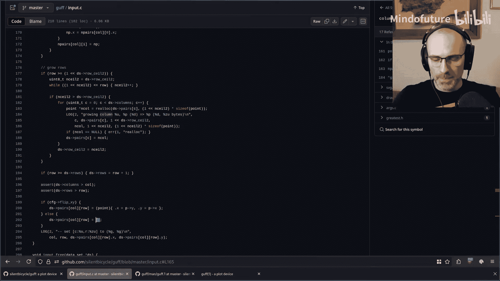

I don't want don't want this to be a B tree map because you could legitimately have multiple data points with the same x。

 but different y。 so we can't assume that the X uniquely identifies the data point。U。And like。

 actually， we have a。So there's a bunch of people suggesting in chat here that we could just store like a the X and a vector of y values。

 but we don't want to do that because then we end up storing a allocating a vector for every point because we don't know the number of columns in advance。

 right the number of columns we discover。And so that's why we're using a column or format here。

 And the only awkward part is when you discover there's a new column， you need to change things。嗯。

I think actually， we can do this quite nicely in a way that we don't really need the data  struck here。

 I think we can just have these be。This。This is like configuration that's data。And so。

 we can say here that。We pushed to x's。 And at that point。

 we actually don't need to keep the X around， although we can， because we。

 we need to keep something around to track that we've gotten the X and we shouldn't treat the next value we read as an x value。

And then here is where this code goes。And again， this is not all going to be in Maine。

 we're going to move it around。So if we get a value at a column that we've already gotten the x4。

 then we。Potentially， extend wise。By one column， if we need to， and that column will be of length。

The number of x values，-1，-1， because we've already pushed our own x value onto there。

And then we push our value onto that column， and then we in a column。So this， I think， will be right。

嗯。We can't keep a hash set of x and y pairs either because you could have multiple instances of the same X Y value。

 and those should still be treated as separate data points for the purposes of something like count。

嗯。😊，It could be a hash map from X， Y to counts。 But at that point。

 we're just doing a bunch of hashing that we don't didn't really need to do in the first place。

 A column and data format like is the right thing to do here。

 just a little awkward in setting up the the data structure when you discover columns is all。嗯。

So this， I think。We will only provide a single new column at a time。 The。

 the one thing that we do miss here is。Imagine that you now get a row that has too few columns。

So that would be down here。 Make sure we fill in the。Other column values。

 So this is going to be for y in mute Y。If y dot L is less than x' is dot L。Then。First of all。

 we can assert equal that y dot n is x' is dot n minus-1， right。

 It should be that we've only failed to add one value。And then we do Y dot。Push F 64， N。

So now we're walking all of the columns and we're making sure to add values for any of the columns that we know exist。

 but that we didn't see。You can't preelocate the right number of columns because we don't know in advance how many columns there are going to be。

Why fill other columns with Nan as opposed to using。Get X， Y， unwrap or N。嗯。

So I think the proposal is that instead of using Nan here， we could have these be option F 64。

But option F 64 is just larger without giving us a benefit， I think。

 and and Nan is sort of the right value for the F64s here， right。

 because it is not a number like we don't have a value for it。

 And I don't think option F 64 gives you a niche so that it gets optimized。Yeah。

 I don't think it does。Doest mean that we get and end up with like infinity here， for example。

 if we parse out infinity。I wasn't saying to do the pre allocationloc right away。

 but to ingest the data in the most natural format for that， then transform it into columnar。

It's not clear that there is a natural format。 like the the natural format， right。

 is a vector of vectors。But then you end up with allocating a vector for every point。

 not even for every point for every line。 And that's just excessive。 We were willing to do that。

 We could have just done that from the start。And so if we're not willing to do that。

 then we just need to do the thing to maintain the column or format。

 which like is really not that bad， right，'s like to do it this way。

 And so now I think we should be able to do X S and Ys。 And if I now run this。Great。

 we now have the x's are 1 and 0。 The y's are 5，10 and 5，500 for the two columns。

There's an interesting question here about like， if we want to sort the input data， for example。

 but I'm not too concerned about that。 The nice thing now is we can now loop over the data pretty easily。

 right， so I can do。呃。Or the nice as waited。Do this， right？ So I do for。

R and x in x's dot it or dot enumerate。And， in fact， I can do copied because these are numbers。

 And then for column and y in。Fact， I don't need to do that。 I can just do for column in 02 Y dot L。

 Those are the number of columns and the cell value， which is the y value， is。Wise indexed by column。

Which I suppose I could do。呃。Wice in。Wice。And。Except I probably do want the column number that might be useful。

 unclear， but wise is do It dot copy no do It。umerate。So why is going be。Wise of rowe。Right。

 so with this， I should be able to now print out。Like all of the X Y pairs that are in here， right？

Just as a sort of sanity check。This prints out 15，152，10 to 100。Which are indeed all the data points。

Test with 1，2，3，4，5。 Sure， let's do this。Yeah， so now one for the row one for the second column is not a number。

And crucially， we can also do three。50。And so， the。The y value here。

 like the the array is or the the set of arrays is still consistent here， right。

 because it they have there are as many entries in each Ys as there are in x。

ThereThere are definitely some things that are kind of awkward here， right， like this， for example。

 will still now only consider a single character difference。 And so here。

If we fail to parse whatever is the next value， then we treat that value as being not a number。

And then we just walk right on past it。 But do we skip the character。

 because there's an interesting question here， right， like in the original。There was this setup。

 where。Like， let's， let's add another column here， right， so。嗯。Let's say， we have。1。2，2，2。

Then I should be allowed to do。4。Space， space 4。Right like single delimiter， single delimiter。

 Nan should be the middle value。And indeed， the， that is how we parse it right now。 And I'm。

 I'm pretty sure， I mean， this is a thing worth checking。 But I'm pretty sure that we。

 if we gave this here to Guff。呃。Right that I think it would plot the way we expect it to。

Which is that the first column。Should have two data points， one at 2 and one at 4。Second。Column。

a star should only have a single data point at  one at 4， which it does。 and there are no。Oh。

 that's a carrot， too。Oh， no， asterisk， I mean。This is because they're all the same value。

 So let's do 3。f。And then at 2， we' do。M'll do the same thing。So。Pound， which is the first column。

 should have values a2 for both data points。So there has one there。But there's no pound here。

 Why is there no pound here。Star， which is the next column。 Oh， it's because I haven't passed D X。

Good， okay， so this is x1 and x2 for the first column we get a value here，2， right。

 which is this two， and here to， which is this two。 The second series is Ampersands。

 Ampersand has a value here does not have a value here。

 which is the empty value and star is star here and star here。

Now the thing I wanted to test is what happens if I had an extra space here？I get the same behavior。

 And what if I had another space here。Then。Interesting， yeah， okay， good。 So with the extra one。

 it thinks there's another data column now， which is。It thinks that there are now four columns。

 this one。I guess let me move up here。 maybe， right， So it thinks that there are four columns。

 This is column 1， This is column 2。This is column 3。

 It's a little unclear how this splitting is reasonable。 Springs split by single character。

 So this would be column。 This would be data set 2。This would be data set 3。

 and then this would be data set 4。This single character splitting is inconsistent at best。Right。

 like if it truly required single character delimiter， I would expect to see a deiter there。

 a delimiter there and a delimiter there in order to get to four data points or four sequences rather four columns。

I think this might be just a bug in the original guff。

 but it's also something that probably no one makes use of that like。An empty value is nothing。 Well。

 I guess 1，2，3。4 delimiters， which should imply five values， but they're not five sequences。

 So it's not really single delimiter either。Every two spaces。

It's not every two spaces either because， well， that would， that would be one。 This would be 2。

 and then this would be。3， but there are four。It counts the gaps between the delimiters。 Yeah。

 but I I can't make that。 I mean， lets， let's make it be commas， right。

So this produces the same behavior。But it claims here now that there are four columns，0，1，2， and 3。

And yet。0。Wu。Like， one。2。th3e。4our。Now，1，2，3，4，5， right， And then I just。Remove the spaces in there。

 so there should be five columns， but it finds four。

And I think it's because there's an error in the parsing here。

I think something eats a delimiter or like fails to continue or something。 because my guess is。

 if I do this。They have。 Then I get 5。So it just gets confused if there are two delimiters in a row and it can't parse the value。

But that's awkward for us， right， because it means that our thing will actually parse things differently than they will。

 But I think ours is more reasonable question mark。Right， like if we。

 if we did the same thing here and we said。So now we claim that there are four columns with this。

 So let's do 1，2，3。Right， so1，2。3，4。 So right now there should be four columns， and there are。

 And if I add spaces in here。Then we now treat the spaces also as delimiters。And so， therefore。

 there is。1 column。😔，2，2 column，3 column，4 column，5 column。6 columns，1，2，3，4，5，6。 Yes。

 so our parsing is consistent with the logic that every non numeric character is a delimiter。

But I'm going to claim that this is not。Because then there should be six columns here。

So in other words， there's a。There's an inconsistency here in。

 like Guff claims that every single character is a delimiter， but it doesn't enforce that。嗯。

I think this is fine for now。 I think we're just going to leave it the way it is for now。

 we could always choose to change this to be like split y space。

 So it'd like split by runs or something。 But I think for now， we're good。

 We don't actually care about this X that we've stored。So we can just do if x is sum。

This error we still ignore。嗯。I'll leave a comment here， too， that invalid values are treated as。系来。

As missing。Kuol。😔，Alright， so we now have。I'm going to call it sensible data input output。

And so now the next bit is going to be plotting this data。But first。

 we're gonna have to compute some metrics over， right， So were going to need。X min。Anex max。

Which are going to be。I don't think there's a function currently that takess an iterator and gives you the min in the max separately。

 But we I think we're fine here to just do X's dot。Is there just a max directly on it， No， okay。

 well， max X。And min X。 So this is going to be min。 This is going to be max。M Y and max。

 Y is going to be Ys dot it dot。Flatten dot min。And max here is going to be max here。Oh。

 but I can't compare them because F64s aren't Od。Min by。呃。This takes an A and a B。

And we're going to do a dot total comp， B。 So total comp is the。

Implementation in the standard library of。Bas of ord for F64， but through a function。

The only thing we need to be careful here is we want Nans to not end up of the min or the max。诶。So。

Yeah， the problem here is our men would always end up being na。

And so I think what we're going to have to do here is。Filter。F 64 is。Normal。Neither zero。

 infinite subnmal none。 Well， but I'm O with zeroes。Is。I think I actually have to do。W is that？

So I want to skip the Nuns。And this is where it would be a little nice to have than the options。呃。

Oops， I put that in the wrong place。Guo。We shouldn't have infinity values， although like in theory。

 I guess someone could write INF。 but if they wrote in， it wouldn't match this。

 And so you would never get to a point where parse is parsing out infinity。 But we can do that here。

 right， We can do。If V dot is。If V dot is。嗯。Is infinite。Then F64 n as well。But like。

 that feels overly。 I think we can just do assert。Infinite。So， now。Is finite does is finite do that？

Is。Finite。Is neither infinite nor none。 Oh， you're right， great。Let's use that instead。 then。

 So this one， we're going make F 64 is finite。Nice， that does look way better。What。That's okay， fine。

 I'll， I'll take them copied。 I don't care。呃。Here and here。What's。Why。Senator over F 64。 Oh。

 it's because。嗯。Yeah， I mean， I can I can keep the copy actually anyway， but。

It is because is finite expects to consume the， its argument。

But what you get in filter is a reference to the argument。 So we still need the closure。Its finite。

But， that's fine。It's not the end of the world。Okay。And let's do。Print line here。

 just a sanity check。 So x is in min X。To max X。And y is in min y 2 max y。Oh。Right。

 these may be options because we may have empty data， although。In fact。

 we could have only X values and all the Y's R Nans。That's funny， yeah。

 so all of these could be none。Cool， so we now know the range of X heres from 1 to 2。

 the range of y is from 2 to 4。 And so we can stress this as little， right， where。This column is 5。

 and then like。This column is 20， and it should get from 2 to 20， perfect。

I suppose we don't also need to count these after the fight。

 we could actually keep track of these as we were running。

But it feels more right to compute them after the fact。

It does feel a little wasteful to compute Min by and max by separately for each one。But such is life。

Okay， so now we have the X and Y。 And so now we need dimensions to scale these so。

With is going to be 90。Height is going to be 25。嗯。And so now。

We're going to have to scale each of these。So。Scale is going to be。

I guess this is where we need the code for figuring out what range we're actually plotting。

 So not just the range of the data， but what range we're actually plotting。

 So this is the code that was over in。

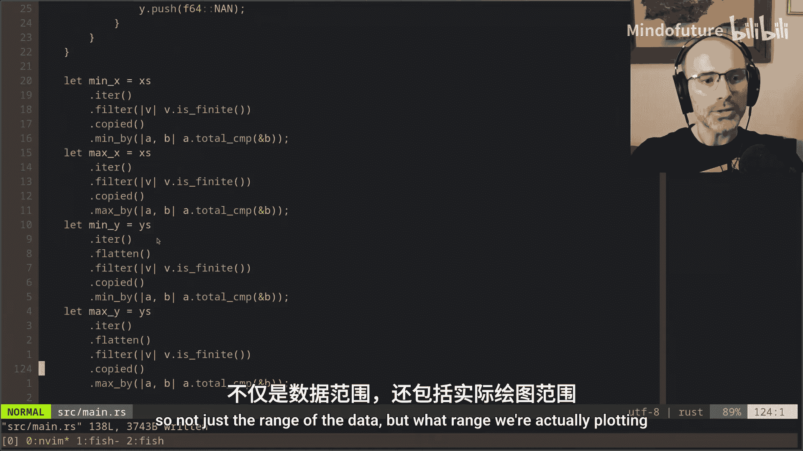

Not an input。But over in draw， I think it was in draw。Yeah， for calculating the bounds。

 this is basically where they're computing the min and max X and Y。呃。Yeah。

 there's like an interesting thing here on if we want to log， transform the data and stuff。

But that I think we can treat separately。Sca gett transform is just if you want to scale the data to be log X or log Y。

When is scale transform here。Is。I see。 This is just if。

This is just how to transform it into log X and log Y。

 because you need to do that for the min and the max as well。 That's fine。

 We're going to ignore scaling for now。And then we basically want。This exact code。

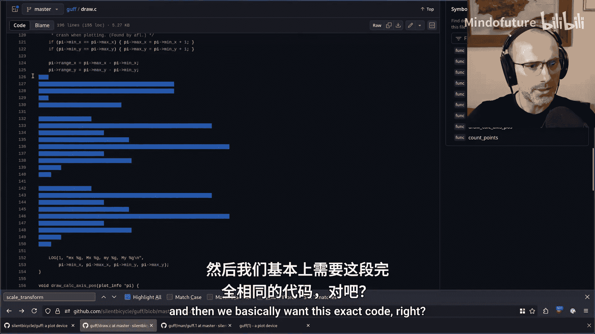

Right。This is the point at which or maybe actually a little bit ago is when。

We now need to look at the license of the underlying code and make sure that we license our thing the same as their thing。

 I think their ISC licenser should be okay。 It's worth pointing out。呃。This is a clamp。So this is if。

I see if it's not quite a clamp。嗯。If min x is equal to max x。Actually， no， it is。 It's let min X is。

No， max X is。It is the。Max of。Minex plus。1。0。And。😔，Maxax。Right， so the max X needs to be。

At least as big as this。Oh man， all these errors。 I really need to figure out how to get rid of these again。

Yeah， and similarly， max Y is going to be at least min y plus  one。嗯。Or itself。Cool。Rangnge X。

Is max X minus Min。And similarly， why， why， why。呃， crew。

Crosses x is if min x is less than or equal to 0 and max x is greater than or equal to 0。

And crosses Y。Is same for y。呃。Why is crossba assigned to a variable here that seems weird。F64。

 and we saw this was equal to2。嗯。If not。Crosses x。And this is where my code is gonna have comments to explain what's going on here。

 So if。Min x is greater than the 0。And。Min X minus range x times。Cross pad is。Less than。0。

I realize I'm swapping the arguments around compared to how they had it。

 but I find this easier to read。Else。F。Max X。Is less than 0， and。呃。Max X plus。Rang x times crosspa。

Is greater than 0。Okay， this， let me， let's make this a comment so that I get formatting and the like。

There we go。呃。Oh yeah。 What's the what what。What do they do if there are no values here。Min P is max。

 They just have a predefined max value。Cool。😔，They just clamp minimax to this value。Why。

So this means that if I gave Guff dash x。And I said。1 space。To space。It plots nothing。

Why does it plot nothing。As you something exits earlier if there are no column values or some such。

 right。I'm basically trying to see if I can trick it into actually using those bounds。

Or whether that's checked。 Oh it's here， right， all empty points。Yeah， it's definitely this。Yeah。

 if min x is max or if min y is max。Then， it just exits。Alright， that's fine。

 So then what we'll do is。let。In fact。We can do this。 Let's sum min X， sum。Max X。S equal to min X。

Max X else。Return， okay。It's nothing to plot。And we can do the same here for min Y。Max Y。

 we also know that if if min is set， then max is set， right。

 because they're operating over the same data。Cool。

 and now this can go away and this can go away and this can go away， and this can go away。 Now。

 the fing total compares in again。F 64 is why you like this。Why you like this， okay。

So we'll do max by， and then。Here， can I just do。F 64。Total comp， or do I need to make it a closure。

Oo， because then I think I can do the same thing here， F 64。Total comp。 And it looks a little nicer。

Next by。Yeah， that looks nicer。 Okay， great。Cool。😔。

Maybe a new type for F 64 ord that they're not or like F64 just isn't really or。 This is what the。

The ordered float Catus for it。 It gives you that type。

 It gives you in the form of like a knot naan wrapper， which allows it to be ordered。

But I don't think we actually need such a raper， I would rather do this。嗯。And again。

 the trick here is to skip things that are not finite here， right。

 so that means that now the definition of total comp is way more reasonable because there are no ns。

 there are no infinity， and so it's just number negative numbers， negative subnormals， negative0。

 positive0， and then normal numbers it ends up being normal ordering because we excluded anything that's not finite。

And。Okay， so。We're down here。Right， so if we're in this world， then min X is going to be。诶。

I suppose these actually do need to be mutable， which is kind of interesting， right。

So min x here is going to be 0 and range x here is going to be max x。

And I think it's the same thing here， except min X is going to be。呃。Oh， it actually。

 I guess Max has to be。Where's my eye wear of my mapies here。Mute。

So here this is going to be max X goes to 0 and range is going to be。Negative Min。

Didn't I make that mute， Oh right， I need to make it mututable here as well。

Which means the max values don't need to be mutable here。Guo。😔，And similarly。Not crosses y。

 And I think the crosses Y code is exactly synonymous just using y instead of x。So arguably we could。

 we could have a little helper for this， right， instead of。Having this beat reliant on。

Me getting all of the excess's and not missing any。Because I definitely will。why， why， why， why， why。

 why， why， why， why， why， why， why， why， Okay， great。So， this is now。So this code is。If。

Along a given axis。We don't intersect。Data doesn't intersect。

The axis itself would like to start slash end plotting at the axis。This makes data this makes。

Data sets。Read slightly more reasonably， since thell。Start at 0。Rather than starting at some other。

value that just happens to be the minimum of。The distribution。However。

 if the data is sufficiently far from zero and sufficiently narrow。

And has a sufficiently small range， plotloting from 0 would。

Squish it so much that it won't be readable。 And so we try to find a heuristic in between that。

Generally results in reasonable display behavior。Oh， there's an F 64 in Max。Is there。F 64。Max。

Oh yeah， cool。That's better， I agree。Nice。That's fine。

 These values are never read because I'm about to start reading them。Cool。

So down here now we have the actual range of x。So and we also now have the size of the terminal。

 we plotted that up here， and so the next thing now that we need to do is scale every value to the range that we're plotting。

呃。And we need to scale。That to the terminal， So there's sort of two levels of scaling。 right。

 So we want the way to do this is you take the the value and you find its percentage in the in the X axis and the y axis。

 like percentage of the range。 And then you multiply that by the。

 So let's say shows you it's supposed to be at， you know，50% of the X axis that you display。

 And then you just take 50% of the width that you have。 And that's where the point goes。

 So this one's actually pretty easy。The interesting question is like how we're going。

Do this in terms of points to plot。 I think this is where we create a canvas。

Did I already create a canvas up here somewhere， I did not。 Okay， cool。 I'll create it here。

Canvas is canvas default。嗯。So now we're going to walk all of the values。 We are going to。

As fraction of axis。And we'll do the same thing for X， actually。

X is fraction x as fraction of axis is x divided x minus min x。Divided by range X。And similarly。

 y as fraction of axis is y minus min y divided by range y。

 Let's double check that code actually appears here somewhere。

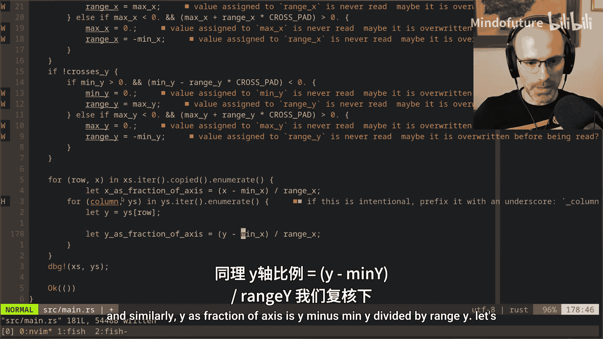

It ought to。And。Draw axis position， count points。呃。That computes the axes。Oh， I need to go into ASki。

As you dot see。And。Priinnt points。Print。Print points where you here。

As you scale it to be logest loggwi if necessary， and then scale point。

Which comes from here and scale point。Does what？ It does a scale transform。

Which is the log part which we can ignore。 Then it gets the x and y。And x is going be。Interesting。

 what's the padding for here。 Assert that the min that x is greater than min X minus pad。

Oh so this is just an assertion that we basically did the scaling， right。

 And then you have a little bit of a factor to allow that the scaling might mean that an X point like fell slightly outside the axis because of rounding or something。

Interesting， and then you take the。Oh， I see they， they do it the other way around。

 So they compute how wide every cell is， which is the range， the range over x divided by the width。

 So that's how that's how many。Like X data value range， every cell in the window is。And。

And then you compute your X as being。The window， minus pad。

Yes so the window width minus how much you're going to pat it with。Multiplied by x minus min x。Plus。

 the cell with divided by two。Why plus the cellth divided by2。

But but like this is basically the code we wrote， right。

 it's an x minus min X divided by range x multiplied by the width of the window。

I'm just curious why they also have this cell with。 I think this is rounding。

This is to make sure that you don't want to。You don't want to crop。 So without this。

 I think you always end up choosing。The cell to the left of the data point。So， imagine that。

So imagine that a data point is at。Like the very end of one cell of your terminal。

I think this will end up then putting it in the next cell， instead。Yeah。Okay。

Flip y at the bottom of the plot。

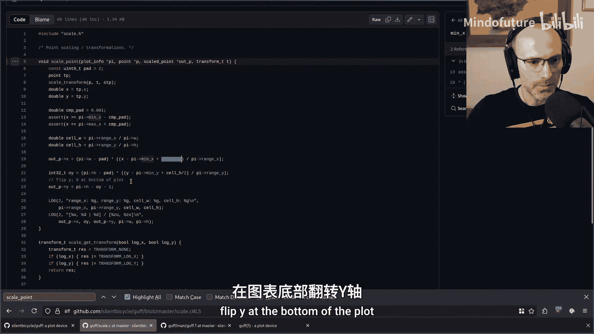

I mean， we can just grab this and see it in the editorca it'll be nicer。So。Let。

Seell with is range X divided by with as F 64。And the cell height is range Y， divided by the height。

 as of 64。嗯。Wwhichch we can compute outside the loop， which is nice。

 and then we compute X' fraction of the axis。 and here the note。

 the addition of cell width divided by 2 samples the center of the cell。Instead of its left border。

The left edge。Plus， so width divided by2。And similarly， here， this will be this plus。Divided by 2。呃。

The plus。Here and below。Yeah， I mean， it's bus rounding。Okay。😔，And。Then there's also this padding。

 which is that we don't actually want。Yeah， so this is y is a fraction of the axis， right？

 And then what we actually want is the。Like plot width， which is the width minus some padding。Where。

 let's say， Pat is。

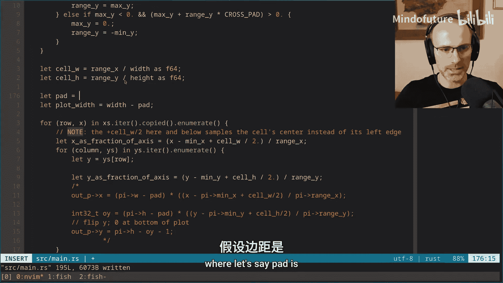

What is this in cells， Do you think that the padding is in cells。

 Its got to be because W is in cells。 Okay， so let's say pad is one。 So plot width plot height。

But then shouldn't it be pad times 2？Assuming you want to pat on both sides。

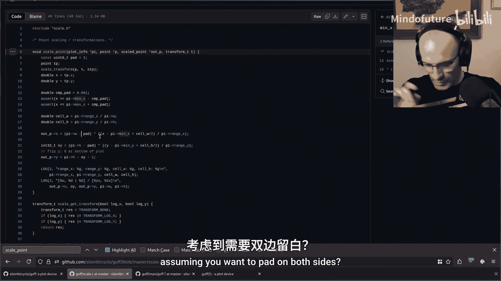

Okay。I guess not so。Exel is now going Excelel is going to be the plot with。I suppose we can do。呃。

Times x as fraction of x's。And y cell is plot height。Times y as fraction of x's。

The only thing that's tricky here is we。We're going to treat this as an integer。Right。

 so we're gonna do。This is where I'm like， I don't know that the cell width matters here because I think we can just round here instead。

Right， because this ends up。嗯。I think we can compute the fraction accurately。And then， just。

Here round when we turn it back into an integer， right？Becauseuse alternative。

 so the thing we now end up doing is just this。Is just casting this to an integer。 But。

 I feel like it's just as good to just compute that entirely in F 64。

And then just round when we do the computation here。So that this becomes as of 64。

 this becomes as of 64。And then this， we now do this dot。Round。I wish there was an integer round。

But I don't think there is。Actually， what happens when you do a cast to F64， I thought it truncated。

 but maybe it doesn't F64。I'm hoping this is at least documented here。嗯。Yeah， it rounds towards 0。

But so is there a round and round to the nearest integer？I'm pretty sure there。

I I guess that's what this does， right， as it ends up so that when you cast it。To an integer。

 you know that you have。嗯。You know， the truncating will give you the right result。Yeah， I I。

 I think that's where they're coming from。 But I， I want to say that round as U size does the same thing that if you round up to an integer。

Right round rounds to an integer。And then you cast a use eyes。

Then that will presumably give you the integer you just rounded to by like if 0。

6 rounds to 1 and you cast it to U size， I'd be very surprised if it returned to 0。

At which point if that is the behavior， then I don't think we need this。

 So I think maybe they did this because they didn't have round。Yeah。

 I'm just going to get rid of those。And then I'm going to say that this， oops， Yeah。

 and then I'm going to say that this。Dot round as usis。Cool。

And then there's this bit flip y0 is at the bottom of the plot。 Yeah。

 so this is y as a fraction of the axis gives us the y。

 but as a positive number counting down from the top。

 But we actually want to plot from the bottom up。 And so this is just。Myself from top。

Yhy cell is going to be the height minus。Why so。Top -1。Cool。

And so now we should be able to tell our canvas。呃。We should be able to do canvas dot cell。

X cell and Y cell。Actually， I suppose。This doesn't work， right。

 We need to give it a new where this is going to be the row is going to be the height and columns is going to be the width。

And so， this。呃。We can do。来。Some cell。Is this？Else。Pnic。Inval cell。Exel。Why so。For data point。X。Why。

And now we should be able to say that that cell is going to be equal to。

 Let's just make it pound for now。哦。And it's true。 We don't actually use the column。

 We can see if we can get rid of that later。 And so now let's do four row in canvas dot。Rose。Yeah。

We're going to do this， so zero to that。Let row is canvas dot。I suppose actually this， we。

 we could do this a little better， right， So we could say this is。This is N rows and N columns。

 but then you can also get an iterator over。Iterator item is a slice of U8。

 which is then just saying self dot cells。Dot， and this is where we can use chunks， exact。

Of selfdot stride。Because chunks exact iterates over a slice in chunks of exactly a certain size。

 and we know how wide every row is that is self dostr。

 so this will give us exactly an iterator over those。嗯。And crucially， chunk's exact gives you back。

 like each item of that is if we can find the implementation of iterator for it。Its item is a slice。

 So we end up with a bunch of sub slices。U。Why why is it unhappy with me？Oh， right。

 because this now should be able to just be four row in rows。Print line。In fact。Here， we can do。

Stood out his。Stood out。Let's stood out is stood out dot lock。And then， we can do。Right。To stood out。

 in fact， we can do row。We can we can do stood out thatt right all row。

And all we need is here to grab this。And then I can write to row。呃。A new land。In fact。

 I seen just right line row。Stood out， I mean。Write a new line to there。And now。It crashed。

And valid cell 45，22 for data。12，45，22。That's because cell takes the row， and then the column。

So those are reversed。How's that for a plot？Why， I forget what we sent in 1，2，5，2。Oh， boy。 let's。

 let's make this something more reasonable for now。So we should now have a data point at。1，2。Yes。

 and a data point at 2，4， yes。Cool。Okay， okay， we， we have a plotter， right。

 And now if we said this is where the column is going to come in。 So if we say， in fact。

 we can grab that from the code over here in ASI again。呃。Co color marks，t， whatever cons marks。

As we'll go up here， put that up here， const。Colum marks。Which is gonna be a。呃。Of view8。

It's going to be that。And then， down here。We do。 this is going to be marks。Of column。And now。

 if I do this。Haha， look at that。We obviously， we haven't done the useful thing to actually print which each of these are。

 and something is still off because I'm not seeing any pounds anymore。

 But that's because some of the data points are the same。 So 3，4，2。2，3，4。Yeah， so at one， we have2，3。

4， and at two， we have 2，3，4。嗯。This does mean there's like one observation from here。

That this is how we end up with max columns， right， I that up here where we loop over the columns。

We gotta say if。Down here。If。Column is。Yeah， if column here。Is equal to。Or is。

Greater than or equal to Mark dot L。Then。It's an interesting question。 What we do here。

 because there is an argument。I think also I want to set line equals remainder up already。Like。

 do we just skip if there are more data points， I think we do There don't need to really crash here。

 It just means that if you have more columns than we have symbols for， then we're just going。

 we're just not going to handle them anymore。Guo。呃。You can't label these ones。

Obviously the comments here can get better。Why do we never use Max X。Oh。

 it's just because that is a part of what's printed。 In fact， let's。

 let's match that print that they put at the top to print header。Which is going to be this。Right。

 so they do this and they do this。And then， they do。This， we don't have print counts right now。

And we can do this by just doing a right line intued out of。This。And。This。And。This。

This loop might be harder because there's a variable number of them。

 So I think we're going to stick with right for that one。And that's going to be min X， max X。Min why。

 max Y。And then，4。Column in。Wise do。For columns in 0 to y dot n。

I so to iterate over a lot of the columns。We're gonna say。This is。Right to standard out。This。And。

This will be marks of。Column。And yes， this obviously will not match rust formatting。 We just fine。

 What's percent G for print F。No， man print of。Mand 3 print of。 I want the C function percent。

Where's G。Conversion specifies G。Is converted in style F or E。

 The precision specifiedifies the number。Still E is used if the exponent from his conversions less than -4 or greater。

 okay， this feels like just， just， just print the number。Minex。Max X。Minwai。X，Y。So that one's easy。

This one is。Present S， which is just a string。 Pres D， which is just a number and present C。

 which is just a character， all of which we can just print easily。 This one is。Just trying to。

Include comma space after the first one， which we can do with if column is greater than 0 than this。

Otherwise， this， we don't have a ternary operator in rust， or we could split it into multiple rights。

 but that's easy either way these are going to have to potentially error。Fine hour on this。Cool。

 it gives me that。 But I'm missing a right line twisted it out。Cool。

 and now we don't need this print line we have up here anymore because we now print this the same way that Guff does。

 right， right。Yeah， yeah， that looks pretty promising。Although the mark is printed incorrectly。

 the mark should be printed as。Is there a character from here， The problem is this is a U 8， right。

 which is printed as an integer， And we want it printed as a character。 There we go。嗯。Okay。

We have a plot。 So what's missing now is the axes。The axes， which are draw axes。And this one。

 luckily， is pretty straight forward。 But again， we'll take the。That goes to the。This one， I guess。

 doesn't need to go in the canvas。Right。Because this is just separate。 It could go in the canvas。

 but there's no real reason to。 And then now up here， draw in the axes。

 This could happen before or no， it actually has to happen before because as we saw。

 the data points can go over the axes。So， we do actually need。To do those first。

So this is drawing the axes。 This is draw in the points。So this is just for I in。0 to H to height。

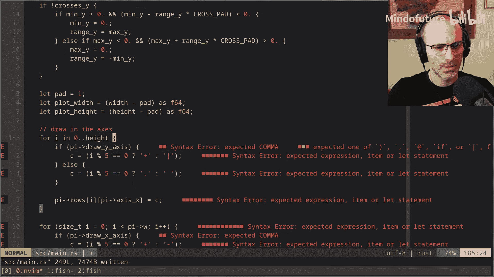

If draw wire writes， this is the draw wire axis that we had to figure out where it came from。

 which is computed over here。Right， because it needs to compute the。Origin as well。That's fine。So。

 this is。Compute origin。So draw X X is going to be if。Min why is。Less than or equal to 0。And max Y。

Is greater than or equal to 0。And this is min x is less than or equal to 0。

And max X is greater than or equal to 0。来。Origin is。Origin X is。呃。That's fine。

 we'll stick with the code as they wrote it， and then we can always modify it later。

So we're just going to say， let origin is。0，0。If not， draw Y axis。Then， if。Min x is greater than 0。

Origin dot0 is min X。Else。Origin dot 0 is max X。I got to decode that code in a second。嗯。S my way。

 if draw。X X， min Y， mean， y， mean y。1。Okay， so what does that code do， So this is if we。

If we decide to draw the X axis， that is if we are including。

If if zero appears in the plot is really what this measures， right， so this is。

This is not really draw X。 Well， I guess it is draw X axis， but it's like literally like。

 are we drawing the line for the X axises in the sense of the line that goes horizontally through origin。

 not X axis is of the plot， but X axis is of like the coordinate system。

 So I think this is really draw y equals 0。 And this is okay， let me。

May I want my formatting and auto complete back， please。Thank you。 I think this is more like。

Just because there are two different definitions of x axis， right。

 it's the one you plot and the one in the coordinate system， this is draw y equal to0。

And this is draw x equal to 0。 Right， So the this， the second one is draw the vertical line that where x is equal to 0。

And you draw the vertical line where x is equal to0。

 if the minimum of x is less than or equal to0 and the maximum of x is greater than or equal to0。

And the origin of your plot is going to be if you 0，0。But if you're not drawing 0，0。

 then your origin is going to be if the minimum x is above 0。

 then you're going to draw like your origin is going to be from 0 and onwards。 and if you're。

Minimum x is less than 0。How can your minimum x be if your minimum x is less than 0。

 then by implication through this， your maximum x must also be less than 0。

 right we're drawing to the left， so to speak of the x equals 0 axes。

 then your origin is going to be your max x。Why is that。Why do they care where the origin is。

I guess the origin is like in that direction， but do they like highlight origin specially？Yeah。

 you do have to scale the origin， but like。Point origin。

But how dont think the origin is stored anywhere here。I sort an S。

 so x is x and x is y is going to become those。

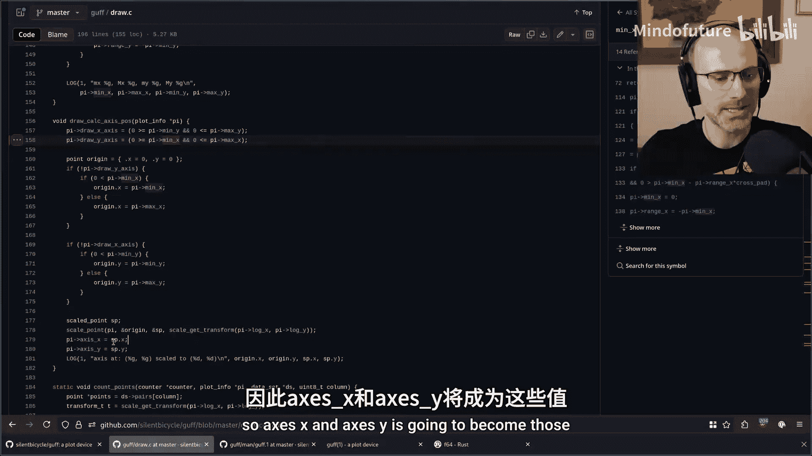

So。But X axis x is going to be origin dot 0。And X y， just to keep the naming that they have。

 but it's scaled。 So that's just the the logarithmic scaling， which we're not currently doing。

And so that gives you X is x。 So do they use axis x in here， they do。W。😔，Oh。

 I see what's happening here。 This is， if you're drawing a negative plot。I。

I think I see what's going on。 Let's， let's make these values minus 2 and 2。And then  -1。And one。

Yeah， so see here your axis is to on the right hand side。

 And so what they're trying to figure out is not really where origin is。

 It's where to draw the X axis on your screen。 And that's either gonna be like if if the X is gonna to be in the middle of your screen somewhere。

 because you're spanning you're spanning 0， then your X is gonna be at some column in the middle。

 whereas if you're drawing everything is like to the left of the X axis。

 even if it's far to the left of the X axis。 you're going to draw the X axis is on the right hand side of the screen。

 regardless。 And so that's why this gets set to max X if you're below 0。

 because you're still going to draw the axis at max X。

 you can't draw it further over where the origin really is。 So this isn't really origin。

 This is like。The， this is like the。The drawn axes。 But it's like。

 it's not in the value system either。 It's like， oh， it is in the value system。

 So it's like in the coordinate system， what is the。X value of where we're just going to draw a line。

 This has nothing to do with origin。呃。I think what I want to do here is to say。This is。Draw。

Vertical at。Is 0。And draw horizontal at。And if we're not drawing x equals 0。

 then we need to figure out where to draw the vertical line。And we're going to draw the vertical。At。

The minimum x that is being displayed。If minimum x is greater than the zero。

 otherwise we will draw the vertical at the max X。And similarly， here。

 we will draw the horizontal at Min， and we will draw the horizontal at max y。

The axis position is arguably right。And so now when we draw the axes。

 now we can say for I in0 to height。If。Draw。Y axis is x equals 0。So we're looping over the height。

And。We're moving over the height because we're drawing the x equals 0 line， which is a vertical line。

 which really means。So this， I'm going to claim that this actually isn't even draw y equals 0。

 or it kind of is。 but the more meaningful word here is like。This is like Y0 is visible。

And this is x 0。Is visible。Yeah， now， now actually， this reads a lot better because。

 because take a look at this now。 So we loop over the height。 So this is draw the ver vertical axis。

The vertical， which is the。The Y axis。呃。So where x is equal to 0。So we're looping over the rows。

 If x 0 is visible。Then， we're going to market。With， let me skip this for now。

 Then we're gonna to market with。A pipe。And if it's not。Then we're going to market it with a space。

 This is a code we were trying to figure out earlier， right？

 But I think now it makes more sense that if， if x， if x0 is visible。

 then we want to show a line there。 if x 0 is not visible。

 Like if the x we're showing is not actually the x axiss。

 we're just going to show spaces there instead with delimiters for the for just the minor ticks。

A horizontal at equals min x。Yes， that should be Min why。 Good catch。So this now is。

 if I modd 5 is 0。I don't know why it's 5。 That seems very arbitrary， but okay。Otherwise， this。

And in fact， use a we could basically make our own turnernary operator here that you're going to hate。

 but I'll do it in the else branch， which is i mod 5 equals0， then sum B dot unwrap or B space。

That's the other way to write that。It's longer and more confusing， but you can。I'm not。

 I'm not going to do that to you。There we go。Cool。Yeah， I know， right，'， isnn't that beautiful？Okay。

 so now we have the C。 And so now we're going to write into。The data into the canvas， I mean。Sell。

 the row is going to be I。The X is going to be the。Draw。V vertical at。Something's not right。

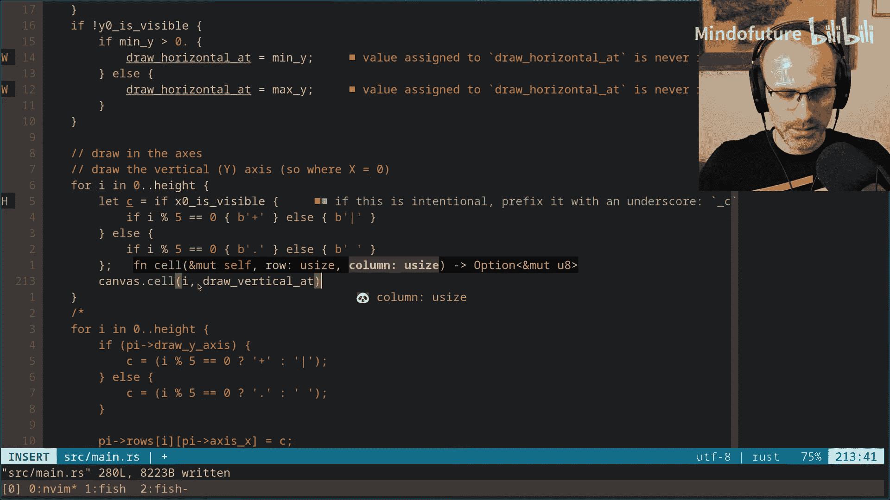

Yeah， this， this isn't right。 Draw Drers on the la needs to be scaled to match the heighthen width。

Or is that？IWhy do I keep forgetting whether scale point is just the log transfer。 It's not。 Okay。

 great。 Yeah， So we need to do the same thing that we're doing here。

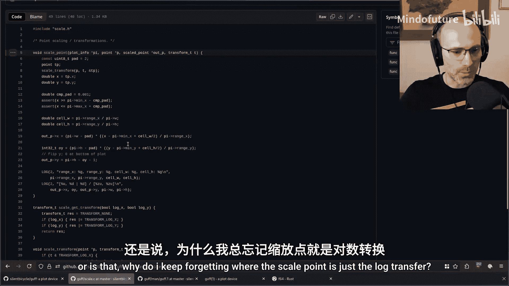

呃。Yeah， and this is why we really need this to be a helper because now this is going to get kind of ridiculous。

This is going to be。H at as fraction of axis is draw vertical at minus minus the。呃。Yeah， yeah。

 we definitely need a helper here'cause this， this makes me sad。But that will do it。

And then we'll have to do the same things here。Horizontal。Waiit。This oh boy。This goes there。

 that goes there。Oh no， what do I do？嗯你。minus M。Okay， I got to actually think about this。

 the horizontal line。The horizontal line is needs to be a fraction of y。So that's going to be draw。

Horizontal at minus the min Y divided by the range of y。

And then it's going to be the plot height times that。 And the vertical is x equals 0。

 So that's the vertical at minus x divided by x。Multiply by the width。Yeah， yeah。 Okay， great。

 I definitely gonna trust me， we're gonna make this a helper。All right。 So now this can be cell。

 which now makes a lot more sense。So is that else。Panic， where's our panic from before。

And I would sell。I。Draw vertical itself for axis。Component。呃。嗯。Accs component， wait。

 this isn't right。This is actually。This should be Y cell and X cell because it the。

 the cell is row column and the data points are X， Y， which is all sorts of confusing。

 So this is the。No， so that was right， because the row is I here。 let's call that row。

So that we don't get confused。 This is row。 This is row。 That's the column for axis components。

And I guess， we actually don't know。What the why is here， Because it's。

 we're walking the whole gamut， right， and we're walking in terms of rows。

 not in terms of data values。 draw vertical。At。

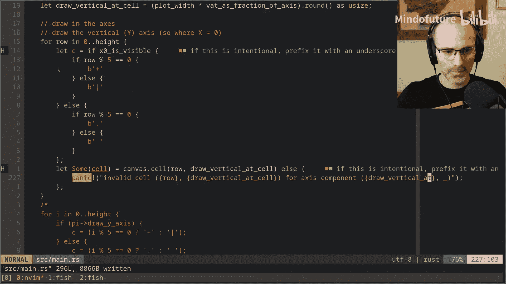

And then we can do cell is equal to。 And this is where what does it draw for the axis。Oh。

 that's the C that we just。Computed。Great。And then we do the same thing again。

 draw the horizontal So the x axis。 So where y is equal to 0。 And so now we're going to do this bit。

And now we're going to walk the column。In with。And if y is0 is visible。Then if the column mod 5 is 0。

Then plus otherwise dash because it's a，'s a horizontal axis， otherwise。They use dots still here。

 I'm not sure whether I agree that should be a dot， but that's fine。

 This is now going be not the row， but this is draw horizontal at cell row。

 which actually means that this is not cell。 This is draw horizontal at。呃。At row。

 And this is draw vertical at column。And now this becomes easier to read。Because now this。

This is going to be draw vertical at row。 So it's clear that it should go first and column clearly should go second。

 and this should be draw horizontal at。 And that also means that I kind of want to rename this because this is draw vertical at X。

 and this is draw horizontal at y。And so now these match up and everything is happy， draw those。

And then， crucially。Where the axe sees meat。Put ala。So， that is。Canvas dot cell。drawraw。

Horizontal at row。 Draw vertical at column。This is sort of the。This is the intersection。elsese。

And this one， I， I think this is actually impossible to fail， right。

 because we've already walked all the rows and the columns。 like we've already used these values。

 We just haven't used them together， but that must guarantee that they are actually valid。

 So here we're going do dot expect。All。呃。Must have hit one of the panics above。

And so now we can do intersection is equal to。Plus。U with the be。

I reallyally don't like those two nested if statements。

 Which of them they're all over the place here。Or those。There's a bunch of them。Okay。

 so now we get axes。Those are not expected axes。That's because we are this flipping of why。

Its we got to have a function。 I totally agree。This。Needs to be。This needs to be draw。

Draw horizontal at row。Cause we need to flip it。Now we have a plot。Cool。And so now that just。

 just to see what happens， right， If I give it this data。Okay， let's stop。

It's not quite what I was hoping for。Oh， that's because I'm currently assuming that I get X。

 which is not true。 This is where the lack of。诶。True。

The lack of command line parsing comes back to bite us now we fill at line 94。Now， this fails。

Attempted to subtract with overflow。Oh， that's because the X value now。

 normally we set when we found it。 But if we find it because it is here。Then that becomes different。

 We really want to call that the moment we。The moment we find an X。呃。Alternatively。

 we switch this so that we add。The X， at the end。Yes， I think that's what we're going to do。

 We're going to do this。 So this no longer needs to subtract one because we haven't pushed to X's yet。

Yeah， This is gonna be great。 This is gonna be great。 So down here， if let sum x is x。Then。嗯。

X is do push x。 So this is whatever x value we discovered。Is the x for the row。Note if。

If there are no。If this is none， that means there were no column values at all。

 which is equivalent to an empty line， which has， which we don't count as a sample at all。呃。

Which we don't count as a sample。Simply， don't count as a sample。

Note also that this means wise has not been pushed to either。Guo。呃。Yeah。

 and that needs to be done before this because this fills fills all the y's to be equal to x's。Guul。

Now， if I do this， Ha， look at that。Look at that。And the y value here is like， what 3000 something。

 So if we do 2000。We got a line there。 And if I now go back to doing the same thing in。G。呃。Where was。

😔，This。Oh。That's pretty good。The only difference seems to be。

That I think they're doing some kind of padding。 right？ So remember。

 we are currently not doing the padding they're doing。

 And the pa here seems to be by like one column。Right。

Like our plot is one wider and one taller than theirs。Why is that。Why is that indeed。😔，Um。

I think it has to be in the。In the scaling code， right， Ca it's in the scaling code where。呃。

We would end up overdoing this。

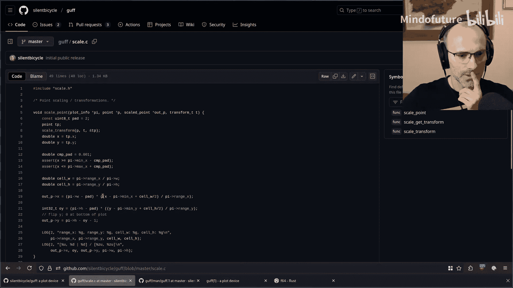

But it， it's just with minus pad， which I did we not do that。Oh。

 it's because this needs to be plot height。And this needs to be plot。With oops。Unless the axes。

Our axes are actually the same。So I don't think it's there。So it's got to be in the data points then。

Oh， maybe it's simply here that the scaling of that one should not be。

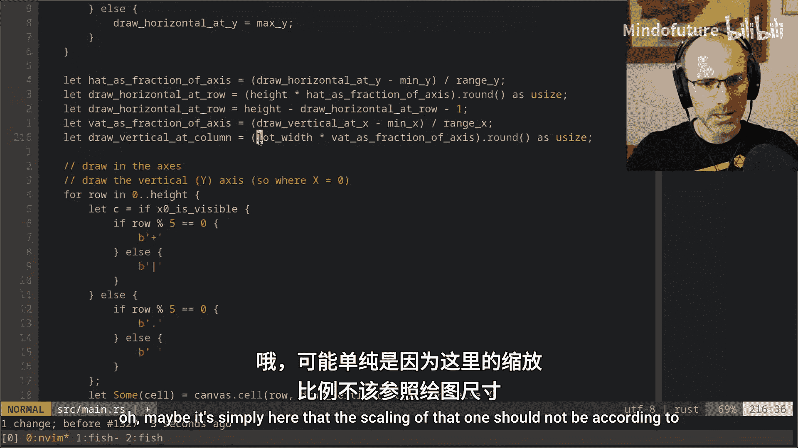

According to the plot， that's actually interesting。 So what do they scale by here， They scale by。

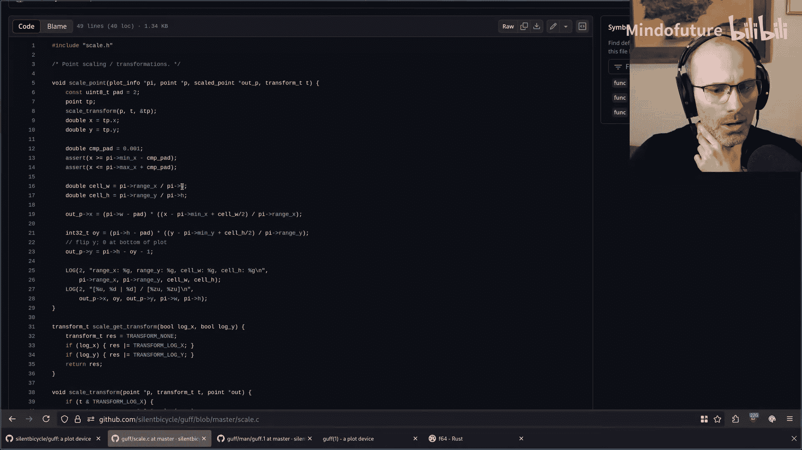

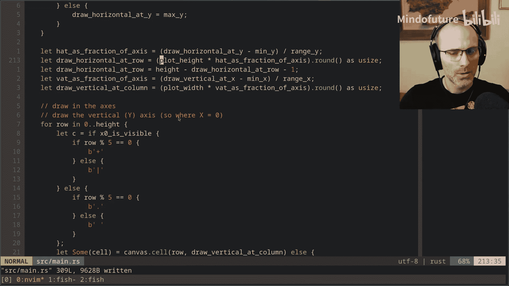

Oh， no， it's the。We don't do this。I mean。😔，Right。That only appears here。

 So that doesn't feel particularly relevant。 But it， I guess it's a reasonable。

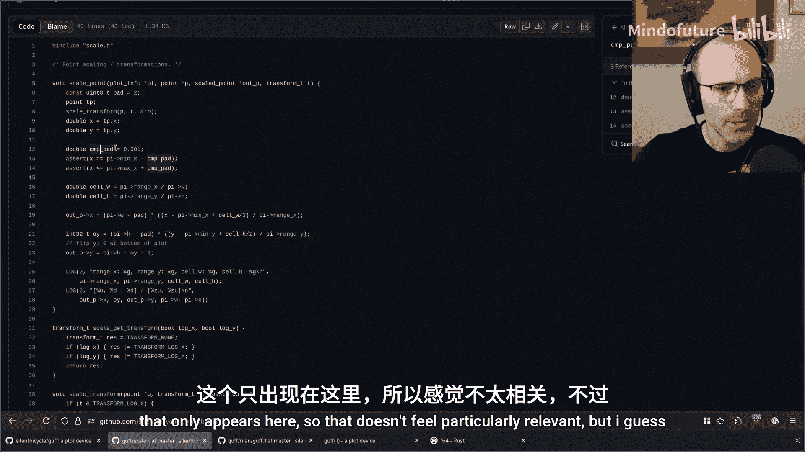

Assert to have in there。For。You can do that at the point， I suppose。呃。

It would be down here where we actually plot the points。 Yeah。

 this is now getting to the point where it needs to be。Needs to be。Refactored。

So that is not all in the same place。 Ast that x is greater and equal to。This。

That's just an assert they have and fine with that。

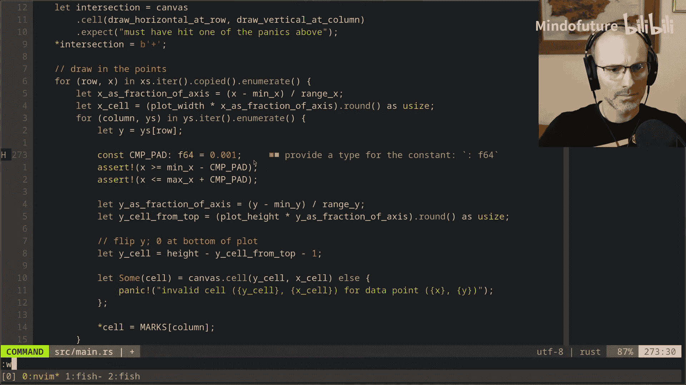

嗯。They scale by pad。But I don't see this show up anywhere else。Oh， that's that's stupid。

 It's justca their pat is2， not one。

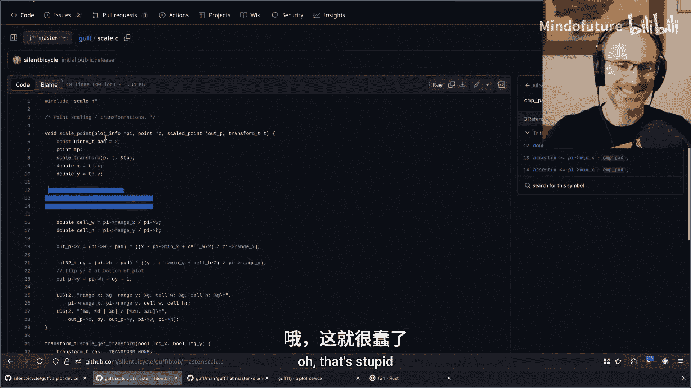

Right， I said it to one up here tonightt I somewhere。 Pat， Yeah， Pat is Pa should be two。There we go。

I think this is where a rounding。Is coming to bite us， maybe。You see how。At the。阿迪。

At the point where we like switch from one to the other， their rounding is different than ours。

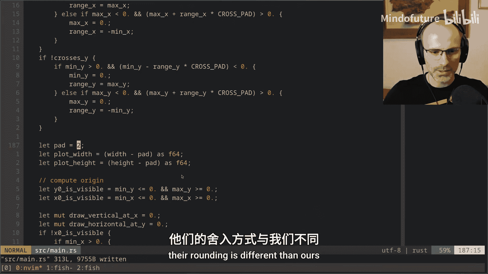

U。Just interesting。 I mean， we could。 we can do what they do。 I suppose。 I'm just like， I'm。

 I'm confused about why this matters。

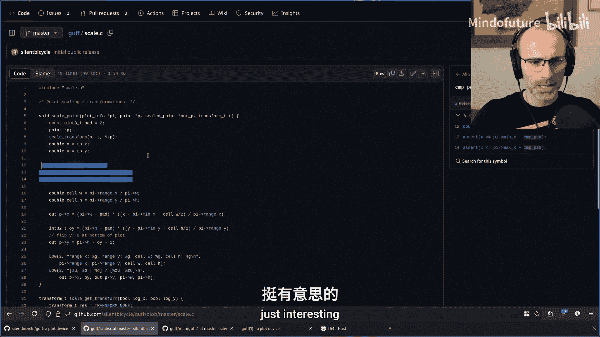

Right， if I do。With。64。So they do plus cell with divided by 2。And they do the same thing here， right。

 And they do that。Yeah， except that's cell height。And then， I guess they。Don't drown。 They just cast。

And then they do the same for the data。 So this is plus。

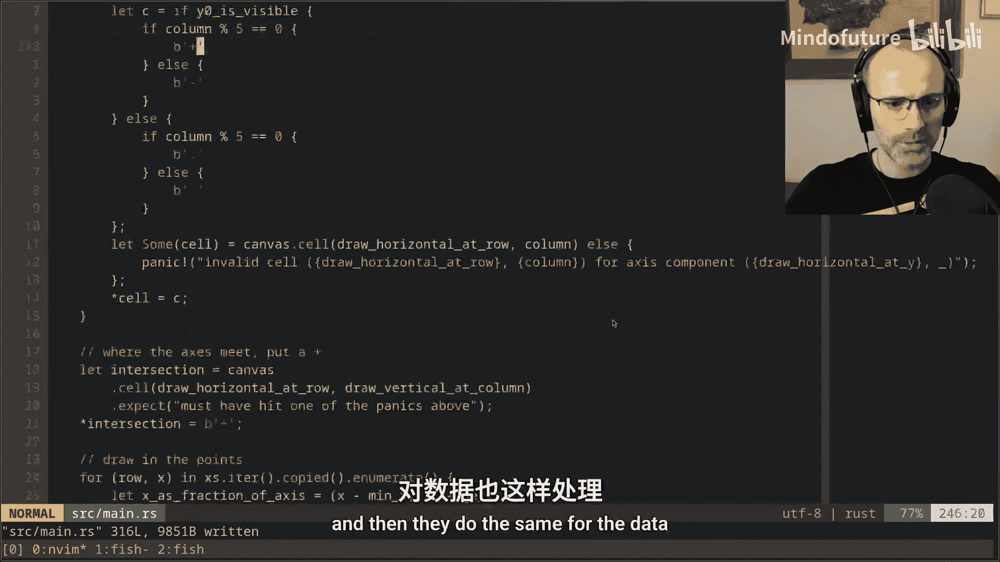

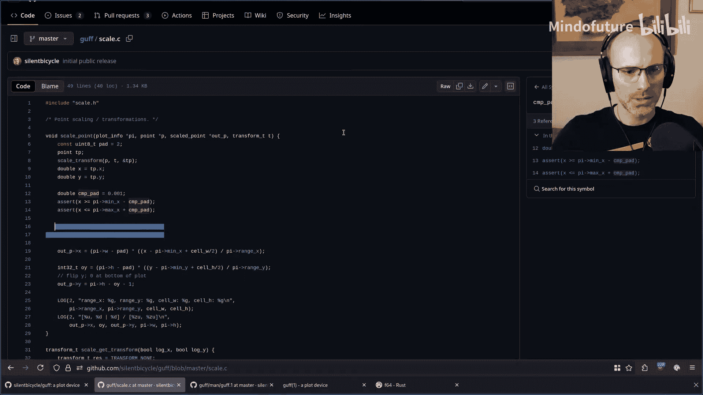

Seell width， divided by 2。This is plus cell height divided by 2， and this doesn't round。Yep。

 now it's the same。 Boa， but the axis is in a different place。That's interesting。Was it。

 was it like that before。No， the， okay。 so I just， I just messed up the。What how did I mess this up？

All uses of cell is divided by 2。Yes， but。That's what I did。Yeah， I mean， I know。

 I know I can divide this by two， but so that I don't have to do it in every place。

 but I'm just like， why。Why did this mess up our axes plottdding。Oh， this， Did I get these backwards。

 That's probably why。YeahOkay， great。 So now the plots are identical。I just don't understand why。

Why these are different？Like， why is？This。Different from。This。I think it's a boundary thing。But。

 I mean， we can easily do just like one。2。This is just， so it doesn't break。Sure， and then I wanna。

Asert eche。Draws a little one。Draw。Pizontle at。Rrow 2。And I guess I'll do。

Just print some things in addition， right， Soll I'll print the drawer at y。And I'll print min why。

 and I'll print。Sell height。And I'll print。Range Y， which are all the things that go into there。Oh。

 and。Ptite。What。Or， because the rows do actually compute the same。It's。

 it wasn't the rows that were different。 It was the columns。 Oh boy， Okay， fine。

 So that means it's actually。This bit。To， this。These don't actually differ at the moment。

I guess suppose I can still keep it， but。Because really， this。This。Versus that。

So this is going to be one。This is gonna be 2。2 is going not do that。 And instead， do dot round。

And then， we're going assert equals。Vertical at column is going to be draw vertical at column 2。

Dr vertical at common one。Traw vertical at X。And this， now， we need min X。Sell with。

Rang X and plot width。Okay it's not for the aes for the points。Alright， fine。 just restore these。

 store these。 That's fine。 That's fine。😊，I'll restore this one， as well。And then I'll grab。

This assertion， and I need to bring it down to where we flip the points。And here。It's the X。

 that looks wrong。So。Exc L 1， X L 2。 How many times are you going do this dot round。

 assert equal X L 1。X cell 2， x。Let X cell is X cell 1。Okay， finally， 40 and 41。I mean。

 those are different numbers。So， let's do。Let's sort of retrace our steps here。Right。

 so this is what we get out。 And we get that this is 40 versus。41。So why， why， why， why， why， why。

So x is 145， min x is 0。 cell width is 3。5 range is this。 So what we end up computing is 145 minus-0。

 which is 145。 So we do 145。 Let's do the case with round first， divided by range of x， which is 315。

And then we do that times plot with。But we do this dot round。

 So that's one version where the plot width here is 88。The other。

 the first one is that we actually do 1，45 plus 3。5， and we don't round。Yeah， so it's got to be at 0。

5， right， that's the problem。It's gotta be。If a value is half between two integerters。

 round away from 0。 So this rounds up。What if I do this。Okay， that， that didn't help。So， I mean。

 first of all， what is 1，45 divided by 315， It is 0。46。0。46。So that should round down。呃。会。Oh， no。

 the rounding is afterwards， right， It's not。 It's not this way。 It is。This way。So 88 times 0。

46 is 40。48。Which is， so that's 40。48， which goes to 40。Whereas here， if we do 1，45 plus 3。5。

That's 1，48。5。And we divide by 3，15。 We got 0。47。So this is now equal to 0 47。

So this is now 88 times that。And 88 times 0。47 is。Is 41。36， which is 40。For is 41。For one。36。

 which just to 4 one。It's not 3。5。It's 3。5。Oh， divided by 2， divided by 2， divided by 2。

 divided by 2，145 plus 3。5， divided by 2 is 1，46。75。Divided by 315 is 0。4658。4，6，5，8，88 times 0。

4658 is 40。99。But that's still like not quite 05。 I guess maybe we're hitting F 64 here， but like。Oh。

Hang on。This should be floor， this should trunnccate。Which means that this。Shi。😔，Trunet。Right。

But then why is it。Oh， wait， this becomes 40。 This becomes 41。 Why does that become 41。Divide by 3。

15 times 88。Oh， it's 40。5， okay。5，0，1，5，0 z。Number5 the word by 315 times 8，40。5079。

So it gets rounded up to 41。嗯。But， but it is because of the rounding， right。

 It's because this gets rounded。I think it's because of the rounding just at like， 05。It's got to be。

Yeah， I think it's just a precision error。Which then raises the interesting question of。

 should we match the original rendering or should we use the thing that's more reasonable。

 which is to just round。I think the right thing to do is to do the rounding。Here。Like the way we。

 the way we do it in Excel， too， right， like it feels like the right thing to do is calculate with the most precision we have until we have to round it to an integer。

I don't think you need to round twice。 I think this the Excel too。

Is the the right way to do it because you， you compute like all of this is in F 64 space， right？

And then it's only when you round。Then then you only round once。

 which is the moment you need to turn it into an integer。If you're on a match， you need around twice。

 yes。Although where would that round even happen？It's not clear where the other round happens。

You can't round here because you don't want to go to an integer here because then this multiplication makes no sense。

 I this is， I'm gonna。mm。I'm just going to go with this one because I think it is a more reasonable approximation for what we want to do。

Even if it renders slightly differently and it avoids having to have these extra cells around。呃。

And then。TheDa round， this was still using selm confused。Okay。

So now we get this and they get it shifted slightly。 But that's okay。 All right。Fine， fine， fine。

 fine， fine， fine。 We now have the rendering in place。We didn't need this。 We didn't need this。

 I don't think we're going to need this either。 So I think we're good。嗯。

There are a couple of things that I would like to add to this。嗯。

The first is they have this option to apply logarithms to X and Y， which I think is pretty useful。

 The other thing that we have is。They have the ability to count for values， instead of。Instead of。

Using just a point。The count is kind of interesting because。I wonder where you do the counting。

Because remember， we have a slightly different data layout than they do now。

 And I actually wonder if。This would actually be easier if we did it the other way around if we had columnar data。

Again， if we didn't walk by row here instead， or we have column data。

 So I think I would walk the columns。Oh， but you don't know the X。

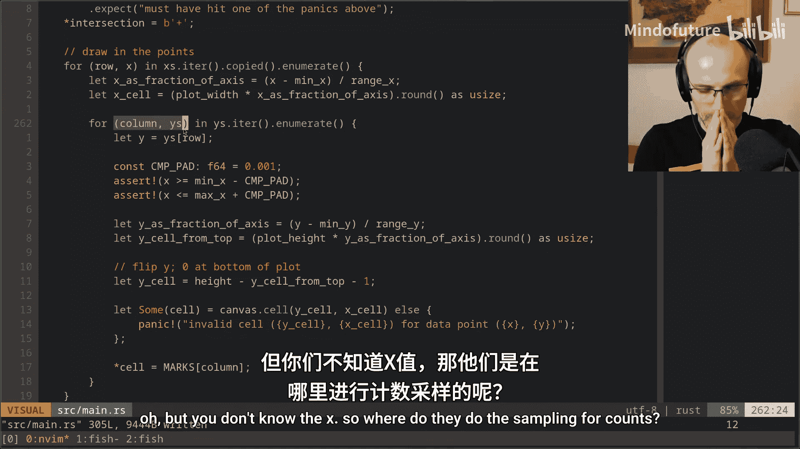

So where do they do the sampling for counts， Because there are a couple of places you could do it。

 You could do it as a pre processing step。This is going be the same thing if we want to compute things like PF or CDF because。

You're gonna have to walk。All of the points of a data set。

Which I guess actually is what we're doing here。 right， Like these are， we're gonna walk all of the。

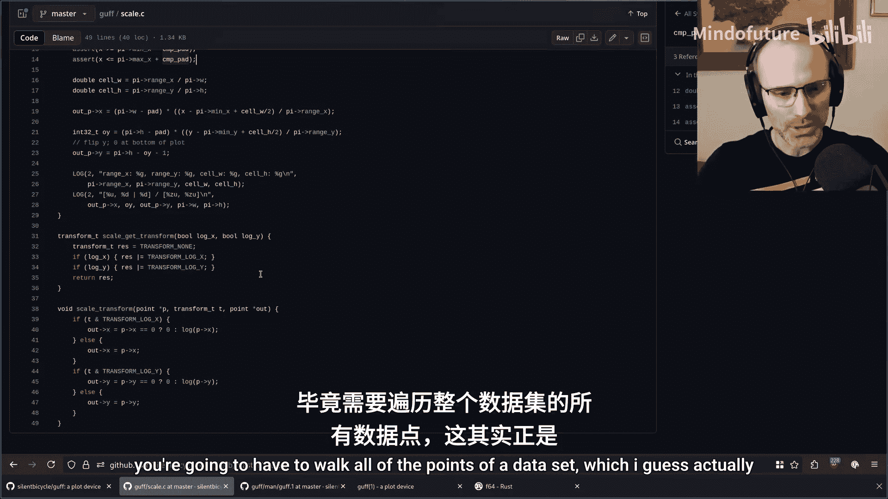

No， this ends up walking。All of the rows。And then all the columns。

 whereas I think what we actually want is walk all of the columns。

All of the rows for a given column is how you would compute distributions over the data。

Which would mean that we would just flip this so that the outer loop is that and the inner loop is this。

嗯。Because then here you can do a post processing step。 So actually， okay， we can。

 we can keep this the way it is。 And then I think the trick we're going to pull is here。

 actually maybe more like。Before we normalize the data。 So up。呃。

Here so this is where we read the data。 and then here we're going to apply transformations。

And when we apply transformations， then we're going to do it differently。 Oh that I。

 I fuck this up down here， didn't I。 Yeah， this is going to be row and X's。 No row。In X's， yes。

How did I break this？Didn't mean to break that。W。X's。

I don't quite understand how I broke the go down here。By changing the code up there。Oh。

 it's cause that used to have a copied his way。That's fine。 So down here， iter dot copied。

 and we could actually do the same thing here。 Oh， no， that's， it has to be just there。And now。

 if I go back up to here。coopied。No。Copiied dot。 There we go。

 What we're going to do is we're going to loop over the columns。In the outer loop。

Because that way the columns are just like the data sets right and then here what we end up doing is walking all of the Xy pairs for a given column and all the Xy pairs for the next column and all the XY pairs for the next column and we want to do the walk in this way here because it allows us to transform all of the data points for that data set and see all of those values in a row。

嗯。And so， now。We have a couple of ways in which we could do this。I guess it's like M count。

 I forget what the exact syntax for this was。 It's like dash M mode dot counter line。

 and that applies for。AThat applies for。So we're going to have enum mode。

 and the mode is going to be dot。Or count。Moode is gonna be mode count。And so now。

I actually don't think mode can be applied here because mode is about counting the number of things in a given cell。

 It's not about the underlying data。 So I actually think this might have to live down where we do the rendering。

Because mode is sort of an output tweak。 But this is where we would apply。

 Let me pull this down here， I guess， so that we can deal with it later down here。But up here。

This is where we would do something like create a histogram of the values， and then change them。

It gets really interesting here， though， because imagine that you want to do a histogram over。

Like can imagine you have two data sets。And you want to do a histogram。Over the over one column。

 but not the other， you actually need to change the X axis because for a histogram or for a CF rather。

 for CF， the。诶 the。Y axis becomes the X axis。And the y axis becomes a probability。

So what happens if you have multiple data sets？I guess you just。Group all of them。

 but it becomes pretty weird。I think we might have to assert， like if you ask for CDF mode。

We may have to assert that。There is only one dataset set， which is fine。CDF， maybe。Cool。

 I' also show you a CF plot。 So it a useful reference here。All right， it' for modes。嗯。

That goes to here。There are a couple of ways we could do this。

 one of them is that we actually keep like a hash map of some kind。The other is that we。

Keep the counter in the cell。This is not something the original did。But， like。

There's a world in which。Here， look， like this， it's， it's gonna be terrible。

 but you're gonna love it if。Let mode count is mode。Then。Oh， this is going to be really ugly。

 but I'm going to do it anyway just just to show what it looks like。呃。Then。And you're。

 you're probably going to hate it， but that's okay。We're going to walk all of these。

And we're going to say cell is equal to a0。For all of those。 And then down here。

If let mode count is mode。Actually， we're going to match on mode if mode dot， then。This。

And here comes the ugly part。If mods count。Then， cell is going to be。Cell plus equals  one。

Its going to be。Sell。Plus， one。Dot。Camp。No， it needs to， it needs to。No。

 it won't be plus one because in ASCI， the letters don't come after the numbers。

So we need to match on cell。And say that if it's currently。Between。😔，0。😔，And 9。Then， cell plus one。

If it is currently 9。Then turn it into a。If it's。Currently。In a。SZ。

So I guess this is actually this or that。And Z。Or anything else actually becomes bound。No。

 it's dot dot， it's it's exclusive ranges this。 So it doesn't include Z。And Z gets handled here。

And pound is not after thee。Yep。That's awful。That's really awful。

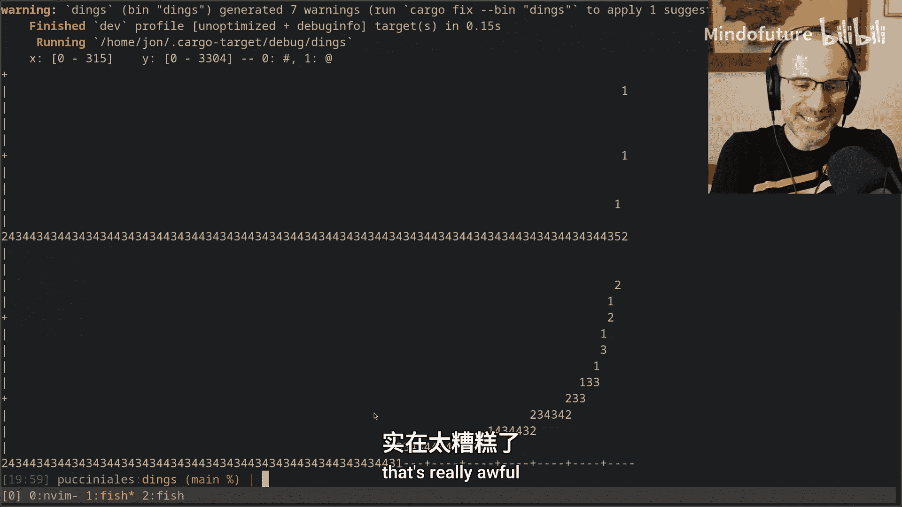

You don't need a hash map。 What do you need a hashmap for the original， Okay， so the original。

 where's， where's the， where's the stuff。 It's very cursed， I know。😊，So they have this， like。

 if mods counter， they allocate this counter thing。 They walk all the counters。

 They create a counter for every。Column， and they count all the points。

And count points here is like walk all the rows， scale the point increment the counter。

 which is hashed by the X and y value。

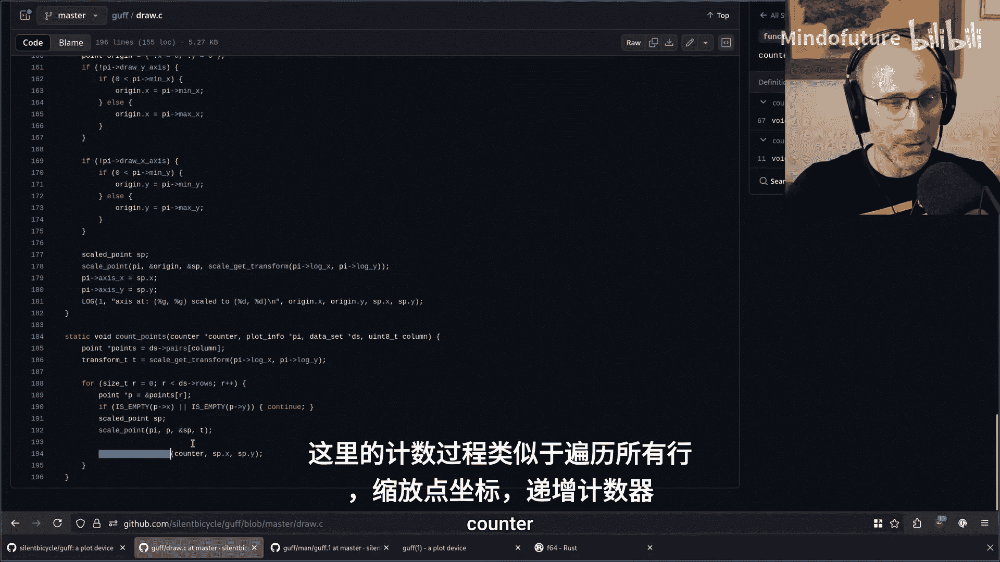

But。But。You can just do that。That's fantastic。Oh you're right， we do have to change the header。

 the header needs to not include this。Oh， I need to refactor this pretty damn sooncause this is a mess。

It's down here， right， yeah。Yes， so this now will become this。And this becomes if。

Let mode dot is mode。Then write to stood out this， please。呃。And count。D 90 by 25。Oops。

That T 90 by 25。Yeah， and we see this is the rounding， right？Because of the roundings。

 some of the numbers shift around for us。Like if you watch this area down here。

 it's kind of interesting。That's a four here， and it's a three and a one for us。

This is a2 and a one there， and it's a three for us。 The next is a four for us and a four for them。

And then it's a three for us， but a four for them。 But the next is a three for them and a four for us。

 So I do think it actually adds up。呃。That's glorious。But the annoying thing， right。

 is that we need to compute the positions twice。嗯。Which。We can avoid by。

So the reason we need to do this in two rounds is because。The value of a cell might be like space。

 but it might also be like the axes ticks， right？ And so you don't really want to。

You don't really want to just loop over and do the logic we had below for arbitrary current values。

 The only exception would be。 And this is maybe even more cursed is if we did this。This。

And we did anything else。It's like axes and such。Becomes one。Then I don't think you need this。

That only works if。The things we use for axes and the background。Are never letters。Or pound。

Which I don't think they ever are。So， fine。But that's way more brittle。But it does work。

 It does mean we don't have to do it in two passes。苦ol。It's quite， is this like。

A curse on top of a curse。Right， like it's cursed to do the counting in the cell。

 and it's doubly cursed to just like assume that anything that's not any of these just is gonna to be one now。

Okay， this at the very least deserves a comment。In count mode， we。

Want to display the number of points in every cell。呃。

We want each cell to display the number of points that fall within that cell， from any data set。嗯。

We can get this behavior by abusing the U a。That gets stored for every cell。呃。

We simply use that U8 as a counter。呃。Counter in base 36。呃。A counter that saturates in。

This part is cursed。Is extra cursed。Yeah， I mean， it's true， right， like we could。嗯。

We could not store U8s in cells。 We could have this be like either an enum of。Blank or。

Character or count。Or point， I suppose， the downside of doing that is。

This printing later becomes way more annoying because now you actually need to not just loop down。

 you need to loop across the characters and print the characters one by one。

Which isn't the end of the world。 But like this， this is fine， right， Like it's not。

 we control the code above。We。Something needs to。Iitize the U8 base， the US base 36 counter。Sorry。

 not sorry。To。To initialize。We。Could。Do that with a loop before this one。

 But doing so would mean we also need to compute all the cell values multiple times or cache them somehow。

Something needs to initialize the U8 base 36 counter。嗯。Because their previous value could be。Space。

I guess I should really make this be in single quotes instead。

 it could be space from the blank canvas。Plus。Minus。呃。Dot。Or。Ppe。From。From the aes。

We could do that with a loop before this one that sets。Every data points sell to0。

 But doing so we mean you need deliver remote mode or cache them somehow。Instead。

 we simply assume that any。Non base 36 and not pound value is 0。Yeah， it is base 37。

 It's like base 30，36 that saturates to pound。Okay。Dot is never constructed。 That's fine。

 That's going to come in once we add argument parsing。 And then for this transformation stuff。

I think it might function。Similarly， to count。Where I suppose count is really just about the visualization。

 right， It doesn't actually change the way you plot the data。

So let me show you a CDFcause it might be instructive here， cumulative distribute。Chun。😔，Function。

Right， cu distribution function。

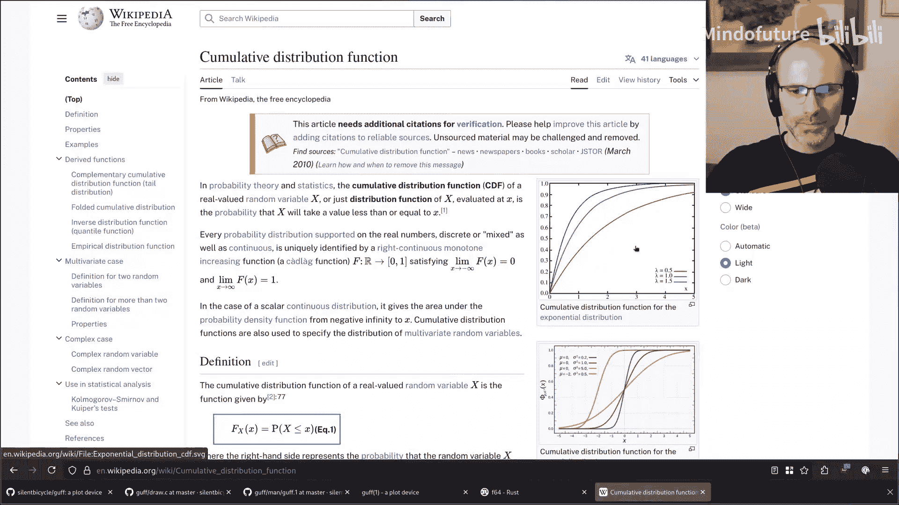

So。The cumulbu function looks kind of like this。 So the values on the X axises are the y values of the data set。

 and the Y axis is the。Percentage of values in the data set that have that value。

 So imagine that you have a data set that has like as a。An equal number of ones twos and threes。

 What you would see is a step function。 So you would have0 all the way。

 like the plot would imagine it goes in infinite directions and x。

 it would be at y equals 0 all the way until you get to I said one ss and threes， right。

 So although until it gets to1， then it would jump up with step function up to 33%。

So what that's saying is 33% of the data is of value one or below。

And then it would it would be a flat line at 33% until it gets to2。

 and then it jump to 66% saying 66% of the data have a value of you know0 to0 to2。

 and then it would be constant as 66% all the way until it gets to。X equals 3。

 and then it would jump to 100%， saying 100% of the data is contained within like is is up to the value 3。

 And then it goes at 100% forever。 So the nice thing about this is it lets you see how your data is distributed。

 It lets you find the median。 So the median would just be at y equals 0。5。

 The X the X axis is value there。 That's your median。 your mean you can't get from this plot。

 but your median you can because the median is saying 50% of the values are this are of 50% of the values are of this value。

呃。And they're also handy to see things like， do I have a， like。

 do I have a long tail where there's lots of values that either are very small or very large。

 So I don't quite get to 100。 Or like it takes me a while to get to even 1%。So CF， super nice and。

PD F is the same thing， except that it's not cumulative。

 So it's just the instantaneous the instantaneous percentage of the values。 So like if。

 let's say x equals 0。 you would get if， if you saw let at x equals 0 is 50%。

 that means that 50% of your values are 0。 So it's not below。Um， so CDf is cumulative PDF。

 if you will， at least if unless I've gotten that wrong。

So the the thing that gets weird here is imagine that you have multiple data sets。

 So if you have multiple data sets， they're going to have different y values and the x values kind of don't matter here like the。

I think for a CDF and PDFF， you just have a bunch of numbers。

 they don't really have X values like you plot a distribution。

 you plot the statistic over a distribution of numbers。

 not a distribution over pairs of numbers like X Y。

And so I think the way we would implement this in practice is that we would say。

 you cannot use this with the dash X argument。Right。

I think we would say that because the X values don't really make sense。

 like it should just be a single set of data。 And if you have and where it gets weird is if you have multiple data sets and they happen to have different ranges of y values。

 then you would end up with these like these these sort of nice curves that you get from CDfs。

 but they would be like offset relative to each other。 So one of them might go from like -5 to -2。

 and one of them might go from 1 to 4 right and they would both be this distribution between 0% to 1%。

 they would share a y axis， but they would be offset in X。And， and I think maybe that's okay。

It's just weird， right， because you have a plot where you don't have numbers on the axes either。

 and we could probably add those。 The Pdfs have the same problem， I think， right。

 because the X axis is the y axis of the data。They are stacked here。 Yes。

 but or the nice thing here is that they are plotted over the same distribution。

 So they all share an X range。 That is they share the range of the original values。

 And so therefore they end up sharing the X range here that would not necessarily be the case for different data sets。

 Well I suppose it could be right， that's really just up to the provider of the data。嗯。

So I think this is fine。 I think what we're going to do here is。Let。

And I actually think the other thing we would probably do here is to say。

That count mode is forcibly enabled when you use。CDfs。Maybe。

And the reason I say that is because that way you can see where lines cross。Right。

 because where the lines cross。 Oh， but you wouldn't be able to tell them apart if they don't cross。

 I think what I really want is a count mode that。I want a couch mode， where。If the value is one。

 you use the mark。Yeah， only count an overlap。Which？You're gonna eat this even more。 which we can do。

 because。😊，We know what the values are here， and we can say that they must be distinct from these。

It would mean taking pound out。And plus minus dot dash pipe。None of those are in there。Right。

And so then， what we would say is。That。呃。So， dash。Or plus。Or dot。Or pipe。Or space。Turn into。

Marks of column。We want non overlapping。Values to keep their mark。

 So different data sets can be told apart。 So one is marks column。This， in turn。

 requires that none of the。None of the axes。None of the。Axs marks are in marks。

And then here we would say， see if。Marks。Contains C。Then， that would become2。

And anything else is actually a panic。This should be unreachable。Because。This is saying。Sell at。

Held unexpected counting mark。Right。Seell at。 and this is like what row and columns。

 So this would be Y cell and X cell。Interesting。I mean， that works。It's a little weird。

 but I think it's okay。 I think that's an improvement on mode。And then now what we can do for CFs is。

 I think we'll say CF is true。呃。And I think when CF is true。It's going to force the mode to be count。

So what we'll do then is we'll go down here。 we'll grab our mode definition。

Because that's really going to be configuration up here。And that's going to be dot。But if， if CF。

Then mode is gonna be mode count。And we can also say that that goes up here。

I don't think CDF is a mode。Because the mode is like a print mode。

 It affects your drawing whereas CF is more like， it's more like a scale transform like log。

 except it transforms your data as a whole as opposed to converting your data set。

Value by value is not element wise。You're already using star。

 maybe that can be the satur mark instead。Start is in there you。嗯。So I think what we'll do here。Is。

This is also where we could do log， right， like we could implement log in this too。

So the interesting bit here。It's also going to be that our x's are going to completely change。Right。

 it's going to be like， if CF。Then we're going to completely overwrite x's。

 We're not even going to loop over x's here。What we're going to say is actually that x's is going to be。

嗯。Copy from slice。And we're actually going to say cons。Yeah， this is。

 this is going to be interesting。 So I think what we need to do is we need to construct a histogram for each one。

 So here we're going to do cargo add H histogram。So we're going to do histogram is his。Istogram new。

呃。And we'll do。Is there a default， I forget。There might not be histogram dot， and there is not okay。

 fine。5， I don't remember what value to use here。 Histogram dot0。Dot。Expect。Vialid。

5 is a valid s think。We should probably pick this more reasonably。 what， what's the。

Lowest discern value of 1 and an odd adjusting highest trackable value。See new with bounds。

New with bounce。Upper and lower bounds for recordedorded values。Oh， well， we actually know those。

 don't we。Right， because these are going to be the min and max。Why。From the data。In fact。

 all of these values are going to change once you do a CF right so。

 so we might as well compute them before and that we may have to recompute them after。

 but that's fine。So this is going to be that。 so I can actually do new with bounds。Oh， but。

HcrR histogram doesn't do floats。 It only does。Integerters。That doesn't sound right。

 I don't think it only does integers。Right。Now， I'm now， I'm unsure。Acord。Does only take integers。

Well， that makes things awkward。The doubly awkward thing is that。

I'm the one who wrote it your histogram。So I should have known this。

It might be the case we want to compute the CDF in Canvas coordinates。In canvas coordinates。Why。No。

 that doesn't seem reasonable。Mean， it would give us integers， but。

I don't see why you would do it in that space。It would allow us to do it with a histogram like this。

 but like。You lose a bunch of fidelity that way， but maybe that's okay。Yeah。

 it's true histograms for floating board numbers are weird because you can't really define the bins meaningfully。

So we're going to lose the resolution regardless， I agree with that。

 because when you plot that the resolution goes away。

 but like this is similar to the round thing where I'd rather lose the precision later than earlier。

 but we might not have a choice。嗯。This is where it gets a little awkward too， because if we want。嗯。

We're basically going to have to do all of this computation。First。

RightAnd then we're going to have to compute the CDF。

 and then we're going to have to compute all of this stuff again。

Because we're changing the x and y values， which is okay。

 It just means that this is a little less trivial。And I actually think we want to do the refactor first so that we have a way to do this recomputation by just like calling a function。

So let's maybe do that next， let's。嗯。Yeah。So we're going to set this to false for now。If。Cool。

And then what I'm actually also going to do is I'm going to go back to this。

 I'm going to get rid of this dependency。K of check。And then， so main。Get rid of this。

That's not there。 That goes away。Okay， add dot commits。诶。A thing that does a thing。You know， in the。

 in the interest of。In the interest of。McGuffin and Dnkx。Alright， I's start to split this up。

 Let's maybe get some proper。 I think I maybe want to split it before I start adding。

I think I want to split it before I start adding command line argument parsing。So。

What are the modules I want here， I want， I think I want canvas in its own。I think I want。嗯。

Think I once。It's going to say maybe I want scaling as its own。

 but I'm trying to see what this would look like。I'm fine actually with the input parsing。

 just living in Maine。U。But that would mean at the end of this loop。 So this is after we've。

Computed all the inputs， and we have the columnlin vectors。What follows？ Well， what follows is。

Computing of the。It's computing of the ranges。And the axes。Which I。

Would call something like a frame or a viewport。IThink frame might be right。

So the frame would be responsible for computing the。A。What is the。X and Y ranges that were plotting。

 And where do the axes go in the plot。And then。Next thing that's needed is a way to。Scale values。

And I think the way you scale a value is that you give it to a frame。Yeah。

 I think you have a frame and the frame knows the sort of domain that it's plotting in the coordinate system。

 and it knows what the axes are。 And so if you give it a X， Y coordinate。It can tell you the X。

 Y cell that thou would correspond to。And similarly， the drawing。

Of the axes is something the frame can do into the canvas。And then， the points。

I then the points live separately from the frame。But where do they live？

Arguably feels like it could just be a function in main， but it's like。

Maybe maybe we should have a data。Sort of container that main populates the data into。

And then it has a way to plot itself into a。Into a canvas。Now， let's do that。 Let's do mod data。

 I don't know if I like mod data yet， but we're gonna create that。 We're gonna create that。

 We're gonna create that。 Canvas is easy enough because canvas we already have。呃，Oops。Pub。Great。Use。

Oops， this is also incorrectly named。 That should be canvas。Cool， use canvas， canvas。This， I think。

 can actually remain a pub here。嗯。Frame。Is going to be a pub cratestruct。Frame。

And it is going to know。呃。It's。Min X。It's max X。It's range of x。It's min Y。 It's max Y。

 and itss range Y。Like arguably it doesn't keep need to keep those separate。

 but let's do that splitting in a second。And on a frame。呃。I think it also needs to know its own。With。

And its own height。And one of the things that needs to be able to do is draw into。

And that's going to take a canvas。呃。Yeah呢。I don't think it implement from data because it only doesn't need to own the data。

 but I do think it implements。呃。New over。Tis the width。A height。And data。

And then this is going to have a pub cratestruct。Data that we haven't quite figured out yet。

This needs to import， create data data。And now we can pull out。Herere。😔，This stuff。

So this is going to be data dot x's。Did it not wise。And we're going to give this now。

 X is going to be a V F 64。 And y is it going to be V of V of。F 64。

And for now we'll make these pub crate。 we might make accessors for them。 that's fine。

So that's going to compute this。It's also going do this stuff。

I want to figure out what to do with these early returns。Because these early returns are like。

 if there is no data， then what does it draw？It we'll have to figure out what exactly goes there。

 I think it's going to be a to do， and this will be a to do。This is no longer really origin。

 This is figure out where to draw the axes in the frame。嗯。

And this might even be a thing that happens on。Draw might not need to be computed。

When you first get the。Data。Yeah。I think that's right。

 I think here we're actually going to un draw is when we're going to do this bit。

That's going to go in there。 And then this is now going to return self。With。This。

And then this is now going to be， it's going to take self。So this will be self out width。

 soft out height。This will be a con stop here。The so be self thought men， self taught man。Self， self。

Self。Yep。And then。We said that the frame was going to have a method for doing this computation。Right。

 so there's。There's going to be a pub crreate probably， which is going to be a。呃。Point to sell。

Which takes a point in F64， F64。And gives you back a。You size， you size。And this will be。呃。Actually。

 I kind of want to grab the other one because it already has better naming for these。This。

 except this will be X and y。And this will be rowowan column。And then， this will be。This is呃。Yeah。

 and this will be Y cell X， because it's going to be row column。This will be soft dot height。嗯。

But there's another bit that's interesting here， which is。Where did plot height go。

 P height and plot width。Go in here。Like， so。So that computes a Y cell in an Excel cell。And now。

 these guys。Over here。This can now become。Way nicer。

 because we can say draw horizontal at row is going to be self dot。Point to sell。Of。0。

 and drawers until at y。呃。Row。And similarly， draw vertical at column is going to be。

Draw vertical at X with a。Y of 0。And we're going to pull out the column。And they need to be0。Okay。

And we're still in， this is still in draw， right， so we can now draw these。嗯。These look very similar。

 but I don't think this it's actually trivial to share between them。

 I actually think I want to keep them separate。 I think that's going。Payoff。

To simply have them like this。And this will be self dot width。 and this will be self dot height。Okay。

So here。I suppose we will say， let mute frame is frame。New over。With。height。Data。

Where we don't have data yet。 So we're going to say here that our。Data is a data default。Data。

 you can。Derrive， debug and default。X's goes away。And now this will be data Dotwise。 And here。

 maybe we could have some helpers on data to make this。To tidy up this logic a little bit。

 But for now， I'm doing it a fairly straightforward transformation here。 Like so， nope， there。

This will be data dot wise。 Eventually， this now has data， great。And then points is going to be。

A function on data。Draw into。And it's going to draw into a。Canvas。Using a frame。I think。

So this is gonna be the self。 Then this will be。hSo we were doing a sort of optimization here。

 re computinguting the cell for x and the cell for y like the。

Column for x and the row for y separately， because we only have to compute the column for x once。

The implement that optimization， the optr might actually just catch this。

 But I suppose we can do a here we could do。X to。Column。Right， and we could do a。

So that will just do。This。And similarly， we'll do a。呃。Y to row。Which just gives you this。

And that will do height， and。These and this， and then point to cell just becomes self dot y to row of y and x to cell of x。

And now， we can preserve。What our X2 column。And now， here， we can say x。

Should really be column not sell， but let's name it cell and then news rename is going be。

Using dot x2 column of。X。Soft device。Using， I don't know if I really。

 it's kind of weird to have this assertion here using data from frame。

 but we'll figure that out in a second。And then let y cell is gonna be using dot Y row of y。Oh。

 I guess the mode needs to be passed in somehow here。

I wonder if the mode is actually a property of the canvas。It's a little weird， maybe， but let's。

Let's say that it's a property of the canvas for now。Might move out of there。

So that's going to be debug。I could make it implementble default， too， actually。

 and say the dot is the default。呃。So mode is mode。 mode is mode is mode is mode is mode is mode is mode。

Pub create mode。Right and also here， poke cr mode。And import mode。And stick the mode in there。

 And now in data here， we should now have access to the mode， which is going to be Canva Though mode。

嗯。And importm these。And I think the marks。I guess those do kind of belong in data because they are properties of the data set when we display them。

呃，5。Unmatched where。I have done something wrong。But what have I done wrong。Oh， boy。

I don't know if we even need this assertion， but I'm more trying to figure out what I broke。Oh。

 mode can also be no can be copy and clone。Whats。It's borrowed。 Canvas is borrowed here。啊，Fine。

Silly borrow check it because cell takes a mutable reference to self to the whole canvas and doesn't know that that only borrows the cells and doesn't borrow the mode。

That's fine。But I still don't understand why it's unhappy with me。Maybe it's just confused。呃。This。

All good。 And then data points is going to be。So we' going to frame， draw into Mo canvas。

Data dot draw into。Canvas with the frame。I suppose the frame should really be the printer of this。

 right？But it doesn't draw that into the canvas it just prints it。H。Yeah， I'm torn here。Oh。

 I suppose we can actually implement display for canvas， right？Because that's kind of what it does。

 Iple format display for。Canvas。Yeah， give me those。 And that's going to be。4 row in this。

F dot right all。Right by death。Okay。What。😮，I'm not allowed to write bytes into a formatter。

That's interesting。So is there not a。But so the problem with right is that this will end up being format right。

 which takes a format string， but I。Don't have a reasonable format string here。Is the problem。

 Like if I just do F and row， I don't think it'll let me。Yeah， becauseuse you need a format string。

 and then I would have to do this。 but row is a slice of U 8， which doesn't work。嗯。

And so I would need to do like a。I would have to do a stood string from UTF 8。

 which I don't really want to do。 So now the question becomes， is there a an。Format。

 is there a rust format string。Specifier that let me print ASi。Is what I want to know。嗯。

Formenting traits。Nu。😔，Unless mano binary is different。嗯。H。

I'm really not allowed to write bytes into a formatter。Yeah。

This is where we're going to do a good old Google search。Rust。Bite string。Askky。Display。

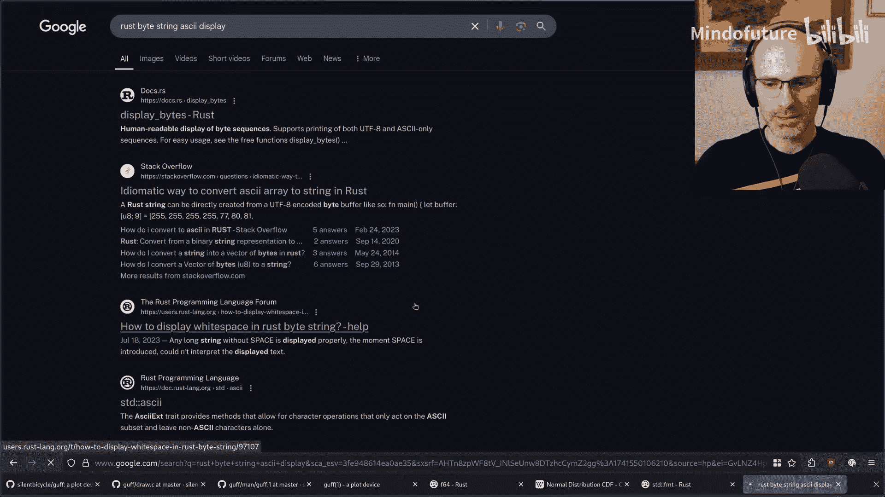

Of course， is a crate Display bys， thanks。

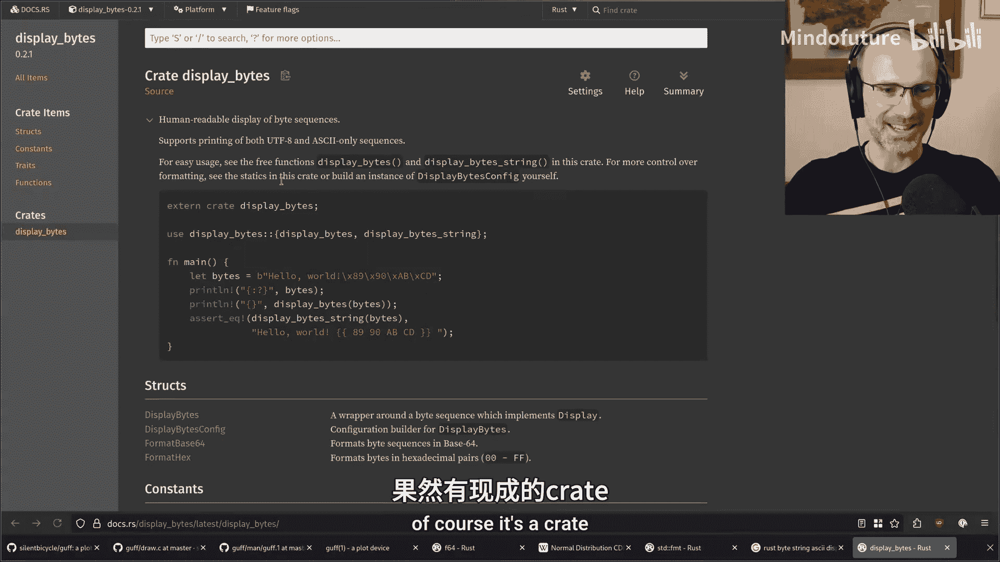

嗯。Yeah， but I don't wantna。

Could be this something instead Askky。No。

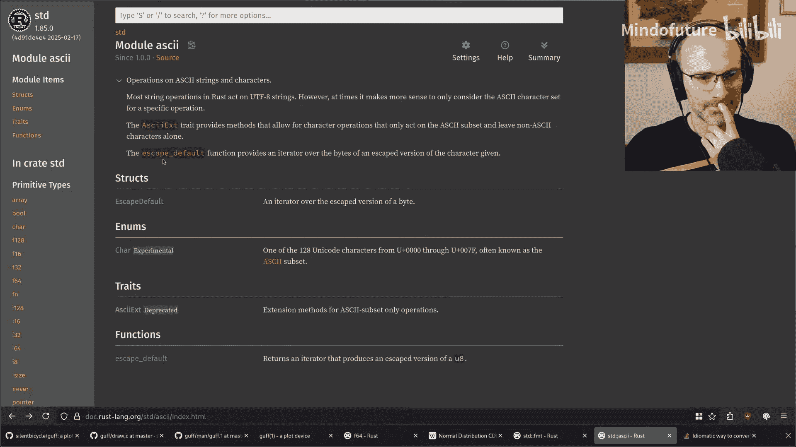

I was hoping that there was like， a nice。Just assert this is askingki。

 but I guess that really just means treated as UTFA。

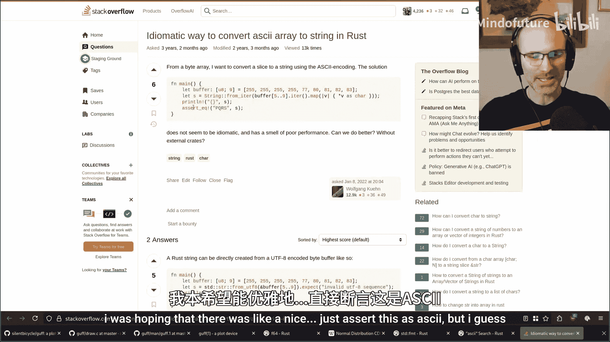

Now do I want to do this unsafely？I know it's ASky because that's what I wrote in there。But。

I super fine。mm。嗯。I don't like it。 I don't like it1 bit。 So now back in Maine。

 I should be able to now。Rui。Wn。😔，Stood out。Canvas。Right， yeah， okay， good。嗯。

And then these mins is like， it's a property of the frame。 So I guess the frame can make those。

Public。It， but I don't want people to modify it。 So we're going to go ahead and do。

Accessors for the FN Min or。I think I'll do this actually。 So this is going to be self dot min X。

 self dot max X。I guess this could be X。Boce。And then this is y bounds。And so now I could do here。

E min X max X is frame dot X boundce。And why and why are why bounds。

And frame doesn't need to be mutable。And。Whats。All right， I commented this out。

Min X max X is frame using dot exp boundce。Okay。Still plots。That's good。

So now we have a much better separation here， at least。Right， the main now is just like。

Processing bits from Standard in。potentially applying transformations。

 although we haven't done that part yet。Creating a frame。

 drawing it and printing that those all feel like main tasks。

 The only interesting bit that's left here is that。This parsing， we might want to do。嗯。

We might want to do this parsing over something that's not standard in。

 but I don't think that matters too much。I think now。Commit。Organization for the。嗯。

I think now I want to try my CDF。Thing。Which is then going to be。We do all of this stuff。Right。

 we do all of。This stuff rather。And then， we get。嗯。Asert。X is0。嗯。

I guess I'll set this too true as well。So for the CDF。We're going to want to。

 if we're going to do the the thing we planned of doing it in。In canvas space。

 rather than in the data space。Then。I need the。😔，Min and max。In that space。

And I think I'm just going to do that globally。 I could do it for each y separately。

 but I don't think I wanted。I guess for maximum resolution， that's what I would do。

 but the translation to space is global for the canvas， so it has to be here。

So what we're going to end up with here is。Min Y and max Y。Is going to be frame dot Y bound。

And then we have to convert those。 So frame dot Y to。Here's the other thing that's weird， right。

 does that。We're actually changing the plotting space。This is going to give me Y as a row。

 but we have more columns that we have rows。So I think we have to rescale。

I think we have to rescale the y values here。To be in accordance with。

The width instead of the height whereas normally the wises， according to the。Ht。Which is a little。

Awkward。嗯。😊，I mean。We could do it as a one off， right， So if we go to frame。嗯。

It's really just this conversion。Here。😔，Right， it's this conversion。But using。This will be weird。

 It's like， it's， I want to do this for， okay。呃。No， no， no。嗯。I do want to use the width。I wan to use。

😔，OhI guess actually， I don't need to do that。 I know that min Y will map to sell 0。

 and I know that Max Y will map to the last column。

So I think I actually don't need to do this at all。All I need is the。Pot。Wi。😔。

The padding is weird to me， because the padding。Is from the top。 So， the padding is just from the。

 I it relative to the axes， right， So you end up with。Yeah。

 you just end up with a pad there and a pad to the right。So I think what that means is。

When we do this， the bounds are actually going to be。0。To with。And what is significant figures。

 the number of significant figures to maintain。 This is the number of significant decimal digits to which your histogram will maintain value resolution and separation。

I think that almost doesn't matter， right？Like。It depends on the width。

 The width is like at most a hundred and 20 is。 like no one's going to use 1000 as the width。

 So I guess three significant figures is probably fine。So three is a valid sic。And。

And then what we're going to do is we're going to loop over。Values and Ys。In fact。

 I think histogram has like a record。apparently not。 Okay， so we're gonna do histogram。

Thought record。What's record correct again？Coordator mission， there's no coordinated。

 or we're going to assume there's no coordinated mission here。I what a saturating record。

Clamp to the range of the histogram。That shouldn't matter。So we're going to record the Y cell。

The the why as future column。In the Y as future column。This is where things get a little weird。

Because this is where we need to do this conversion。But we need to do it with。Why。Minus min y。Min Y。

 max Y。I do Y bounce。And range。 So the range X is， we do actually need to get that。Okay， that's fine。

That's fine。 That's fine。 That's fine。So the range， this is this one's a little bit of an abuse。

 but let's do that。Range。Let's call that range X， Y。 So we're going to do let。

Range Y is frame dot range X Y。So now we have the range in y。So， this is the。This is why。

 as a fraction of。Of the axes。But then， the why。As future column is that fraction。

 but multiply by the plot width， not the plot height。So it's gonna be the。With。Right。

 so this is taking y， computing as a fraction of the range of y and then scaling it to the plot width instead of the height。

 The only way in skip which this skips weird is if the。

If moving it to from being y to being X is not symmetrical。

 that if moving it changes what range is going to be used。

And the only way I can think of that happening is for this part， which moves us to zero。

And we're actually going to want to disable this potentially because for CDfs。

 you don't really want to clamp x to zero。Oh， maybe you do。 Maybe you do。Okay。

I think we keep it for now。 if it would only end up stretching things anyway。

 So now we record all of those。Over all of the values here。嗯。And once we've done that。

 we now want to loop over and gather， we want to sample points on the histogram。

And this is where we have to4 x in。Histogram dot。How do we want to iterate through this as the other。

 I think we want to iterate through the quantiles。Quantas this is like an interesting thing， right？

 You have， you have the the bins of the histogram。 How do you want to walk the bins。

 Because HR histogram， one of the things it does is the。The bins aren't linearly spaced。

 They are exponentially spaced， kind of， so。You。You kind of need to decide how you want to walk them。

 So that's why there are multiple of these its。So you can iterate through them at logarithmically incrementing levels。

 You can iterate through all the values that have been seen。

You can iterate linearly through in the y space， which I think is what we want here because we I think we actually want to sample basically just at every rendered cell。

Because that's the best resolution we can get anyway。Yeah。Yeah， let's do that。Itterline takes a step。

 And so the step here is actually going to be one。 We're going to step by one from 0。

That is going to give us a bin。And then。This is where this gets interesting。

 So I think here we clear this Y。And then as we walk the bins。We push to why。呃。The percentile。

Of that bin。And so we're going to do that for every column。 And then finally， we need to fix X。

 And X here is going to be the columns we walk over。

 which should hopefully be the same for all of them。 right？

 So I think we should here be able to say that data dot x's。Is going to be。We're going to clear it。

And then， we're going to extend it。With。0ro。😔，Dot， dot。Plot with。Right。多多。Equal plot width。

And then the other thing just as a sanity check that we'll do here is we're going to iterate over x's。

呃。And we're going to do this dot zip。With。X is dot it。

And what I wanted to do here is assert that the bin。哎。Ben dot。Value iterated 2。Is equal to x。Right。

The value iterated 2 is equal to x。 And， and this here is going to have to be。Is actually this。

 but mapped。Because this is an， this is a。Column， and it has to be the column as F 64。

And we want to check what the values， the X values that we get out of the histogram。Are themselves。

Like they sort of match the X's。 The only place where this will get awkward is that the histogram。

 because it is not a linear histogram。 It's a high dynamic range histogram。 The bins are。Are like。

 not evenly。Based。And so it's not clear that we're going to get necessarily back exactly the same value。

So I actually think this won't be quite right。 I think we do。

 I don't think we get to set x's like this。 I think we have to derive it from the values we iterate over。

u。Because it could be， for example， that there is no bin for cell4。

That there's only one for cell three and five because of the nonlinear sampling。Oh。

 this needs to be inter mute。So I do think we need to gather the x's and then we better check that the x's are the same。

So I think the way this will look is we'll clear this。And then as we walk through here。

Let mute should push X。 Let should push X is data dot x's dot is empty。So， if。If should push x。

 then xs start push。Bin dot value iterated to。Otherwise。Assert equal。Be not。Value iterated， itated。2。

Is equal to been is equal to。Okay， so this is where we're going to do enumerate。啊嘿呃。

Is equal to x's of I。This is not going to zip over that any more。

You need to clear the wise after the loop。I don't think that's true。 I'm modifying the wise in place。

嗯。呃。Valu iterd 2。So。The first y we walk， we're just going to push the X's that weerate over this if we have multiple data sets。

 though， we are going to check that walking the bins for the second one will yield us the same values as the first。

 And I don't know that this is guaranteed if they have different data points and stuff。So I mean。

 let's just see what happens。All right， why am I not getting compile errors anymore？

Did I do something stupid？Main， number 5。Data， where do， where is pads。I'm confused。Oh， pub con pad。

Okay。Maine is unhappy at line 1，20。Because this should be data dot X's。And data dot access。108。

 but like why， why， why am I not getting compiler messages anymore。I don't understand。

 expected to use 64。Fund use size。That's fine。That does mean that this needs to cast a U 64 as well。

 which is fine。And。1，10。Right， this is the rescaling， which we can really just do this。

 So we get the y。1，20。P F 64， right。 So this is where。The u sign needs to be turned into an F 64。

 and this needs to be turned into an F 64。And 10，7 is unhappy because we need to choose our counter here。

 So this is the。What value， what type to use to count the number of values in each bin。

 I think this can just be U size probably， but let's do U 32。And then it's unhappy at's 116， because。

While， we don't need this guy。And at 106， we don't need the column。So this can just be this。

And it's unhappy with me， because。😔，Oh， because this needs to be that。 Have it it。

 that shouldn't matter。Why S moved here。Oh， I need a reborrow。 That's fine。1，13。

 This is unhappy because。Value is in range。It should be because we already constructed that to be within width。

The low value is not allowed to be 0。Cool。That just means this needs to be。With。

We're just going to have to increment all those values by one。

 and then we're going to have to do this minus1。 That's fine。Oops。No， go back。呃。

I think we'll then do what X is this， but minus。O，-1。0。And now， this can be X。And this can be X。

I think you could do。Why is a drain？That's true。I don't think it matters， really， but。

I is that clearer。 I don't know if that's clearer。But， all right。呃。Oh， it failed。

 but it failed somewhere interesting。Do me a favor here。 And debug print。Data。

 because I think this suggests that it ran。Yeah， look at that。X is now from -1。To 87。Oh right。

 these are columns。But。😔，How could that be。How could that。Possibly， oh。

 it's because we record this value。As 0， But this needs to be plus  one as well。

So that when we subtract it here， it makes sense。Okay， so x。What's？what。

I'm recording values that are plus one。So。The integrated。First value must still be 0。

It still will be。Right。Oh， the first non0 discernible value， no。

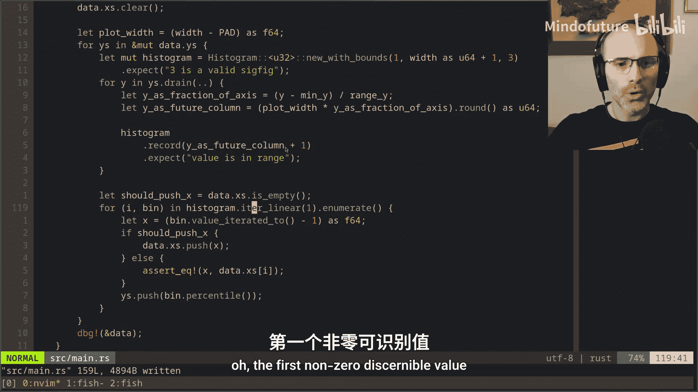

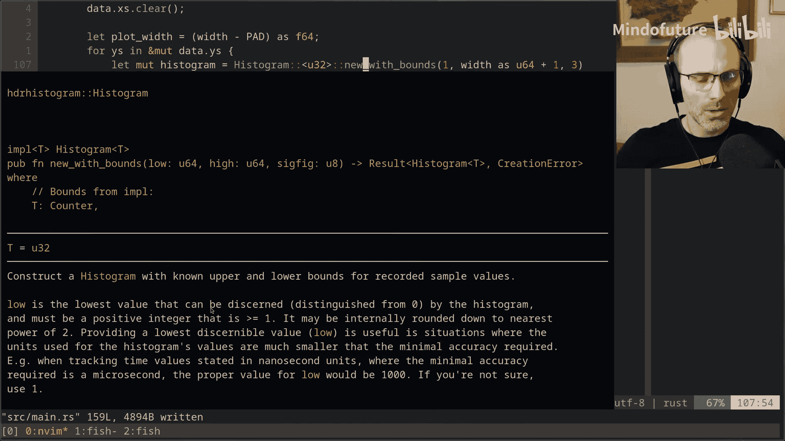

Oh， I see。Okay， so they can still be one。 Okay， so in that case， we will do this。

 and we'll get rid of this and we'll get rid of this and we'll get rid of this。Said happy now。Okay。

 great。 From 0 to 88， the Y's are。Those values。And that。Right。

 and and because this is a constant value， the CDF just goes immediately to one when it hits that value。

Of 2000， although， I feel like that should be。Beyond。Oh。

 this is where it gets a little awkward because。When you walk the CDF。Once you get to 100。

 you don't get more samples。And so imagine that you have a distribution that like we have here where it goes to 100 at like 2000。

 but the other data set has points that go to like 5000。

 so there are more x values that need to be put in there for the one that stops at 200 and it needs to be sort of held at 100。

And so I think， I think we need to add to this two things。 First， we need to extend X。Yeah。

 we need to extend X here。If it doesn't already have a value。

 this is where they this is the reason why the x's can differ。呃。Oh no， but it's interlinear。

Does itline。The iterator terminates when all recorded histogram values are exhausted。Yes。

 I think what that means is we just， we might have to keep walking。

And we might also walk farther than in the previous one did。 So。

 so should push X actually has to be if。I is greater than or equal data dot xs dot L。

 because we might have to push more values onto X because the previous iteration stopped early。

 but we also might need to iterate further because the。Because there's further to go。

 but that can only happen here。 And so this is actually the same thing we did in Maine。

 which is we need to do this extension。Down here。So， for each y。While。Actually。

 this can just be Y dot resize。New L is going to be data dot excess dot L。Y dot push F 64， N。

And resize will shrink if x' is shorter， but it shouldn't be shorter because we extend it from a y。

 but it will extend it with x's or it will extend it with values。Of of。This value。

 So Nans are missing data all the way until the end。 There's an interesting question here。

 whether we want it to be gaps or whether we want it to be line。 But I think we want gaps。

That's not quite right。呃。But I think we're getting there。

 I think the reason that's not right is because we need to recompute the frame。

Because we've changed all the data。 So here we need to say frame is。New over the updated data。

Because if we look at the data here now， I think this data is now reasonable。

 So it goes from 0 to 88。 And there are a bunch of。Y values for the first data set。

 And for the other one， it's 0， goes to 1000， and then has not a number。好好。Oh， that's pretty nice。

 Okay， so what we see here， right is the， this is the CDF for the。😊，Right， if we didn't CF。

 it remember how it was like a power law distribution。 So it was like looked exponential。 Well。

 this is the CDF you get when you have data like that is that。嗯。

A lot of the values are the same near down by the bottom。

 this is actually hard to tell from the plot。 But if we go back to the non C DF data。

 So we set this to false， if I now plot this。 So you can't actually tell， oh， maybe if I do count。

 count。嗯。So there's quite a lot of data down here， right， Like we see a lot of fours， some threes。

 same here， But there are few data points over here。

 So most of the data points are down in this area down here， which has a pretty small y span， right。

 Like the y span here is from 0 to 3000， but that means that a lot of these values are the same。

 Basically all of these values are the same。They're at the same Y value。

 as far as this compression of the y axis is concerned。 So all of those are。Like， in fact。

 if we look at the other plot from earlier， you see that this tells us that the median value if you look around the center should be around whatever this values is。

 And remember， we don't plot the axis values。 It's hard to say。

 but this tells us that like the median value is some relatively low number and that matches this right。

 like here we see that the values down here。 this is like。The median ish is right around here。

 And there are very few data points that are up here。 And that's also what we see with the CDF。

 that like there are quite few data points here。 We're quite close to like 95% of the data covered when we get to this value。

 And there's like a tail because there's some really large values at the end。

The other thing that's interesting， you see the two here。The two here is because there is。

Conceptually， a single line that runs here。 This is when the the data set that just has values of 2000 goes from 0 to 100%。

 And so it only intersects right there。And so I think this actually is right。

 The only thing I wish is that we had got a line here， but there isn't really a way to plot。

Like this plotter does not take into account like vertical lines。

 It doesn't have a way to plot them because they would have to have the same x value。

 or they would have to have very similar x values， but not the same X value。

 And that we do actually have that in the data。 We just don't have it in the histogram because we normalize to cells。

 So this is actually a thing that would get better if we didn't use cells。

 Maybe we can use half cells。No， everything to the right won't have twos at the moment。

The stars are the second series。But then they shouldn't be here。 There shouldn't be any values here。

 because those should all be naans。Oh， or maybe we actually， oh， I think we just ended。

 I think this is just wrong。 I think we currently end up plotting Ns。Yeah， if if。Not Y dot is finite。

Continue。That's， that's just wrong。Which you only see when you do a CF。Boom。

 so you see it stops there。It is interesting right， whether this should expand to the last value。

 we could easily do that so that it extends， but the a CDF is normally supposed to be more like like it stops when there's no longer there。

But sure， we can do that。 That would just be that here we do。Why dot last。Dot unrap or F 64 M。Yep。

 so now we get that。The sad thing though， is we don't get a line。

 and that's because we only sample once per per X axis's tick。

 but we could actually solve that by doing two times the width。呃。

Over sampling this as two times that。And。And then when we get these x's back。We will do。

The integer value iterated to divided by 2。0。I think。Two times。Yeah。

 so we get slightly more resolution in the data。 And in fact， we could。

 we could make this arbitrarily more。Densely sampled， right， by doing this。 We just get more points。

 I was hoping we would see a line， because he would get。You get a， oh。

 I guess you don't get any Ys in between ears is the problem。And we're not drawing lines。

So you do get better sampling， but I don't think it's meaningfully better sampling because if we don't draw lines。

Cool。Deff。I have a bunch of dependencies now， which is a little sad。Can plot CFs now。

Can we remove that tail by properly setting up the frame？Not sure what you mean。Yeah。

 I think it's right。 I I think it's better to keep it like this。 I then that's right。嗯。😊，Cool， yeah。

 I mean， now you see the， the frame top gets correct now， too。 I， Oh I guess we still have the debug。

 I should get rid of that。呃。Aend。Yeah。Cool。Okay， so we now have a plotter。 It supports mode count。

 It supports CFs， which weren't originally supported。 It doesn't word log yet。

 but that should be a trivial transformation， right， like if we said。You know。Let log X。Lgu。

This should assert。That you're not log X， because that doesn't make any sense。

 And I think it should also not log Y。It depends on whether this is apply logarithm to the values or apply logarithm to the plot。

Right。And in neither case， I suppose we could allow log Y。Log Y is interpreted as。Log of the input。

 not。Output。Right， and now。I go back to this and I say， I want to plot log。Why， right？

 then we would just say， honestly， we could do the the logging here。I forget with Guff。

 if there's a H。Oh， this flip X and Y， we don't support yet either。um。Log any of X square C。

 or you can log rhythmically scale the count。 That's weird。

 I feel like it should really allow you to set， I want to log this particular column， not all of y。

 But that suggests that you're actually logging the output， not the input。But in either case。

 this is easy enough to do， right， because you just do。V is if。呃。Actually。

 I guess it would be faster to do it here， right， so。If log X。Then， x。Then，4 x in。Mute data X's。X is。

X dot。Marug。And if log Y， then for y in y。Dot inner mutute， dot flatten。Yeah， we'll do log。10。Yeah。

 and now it's log。Wai。😔，Interesting。

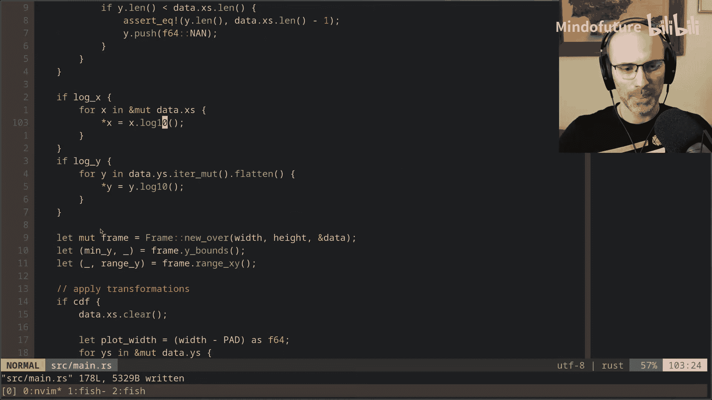

Although there was one bit of code in there that was like for the scaling part。

 I think there was like a special scaling for it， which was where scale。嗯。Oh yeah， if it's equal to0。

 then 0 otherwise。

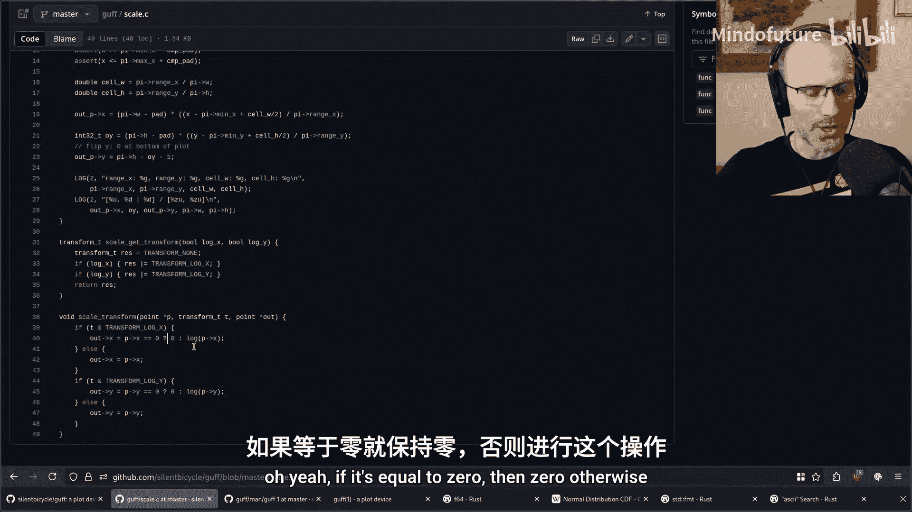

If it's not equal to 0， then this。Similarly， here。Although I think。

What's also interesting is that there's also this。This is a question about whether you need to scale。

The axes， separately， somehow。Right， you could imagine。Oh yeah， I guess we got a print。 That's fine。

 Let's see see。We also don't have to test for this yet， I realized。呃。Yeah， that' is in the printing。

 Okay， so down where we print this。嗯。If。Lolog X。And。If log Y。这乖。Here we go， logway。And similarly， we。

 I guess we also have log X， but。It's just the row， so it doesn't really。make any sense。嗯。Cool。Okay。

I think we now have all of the bits that。Like， seem like they're annoying。

 There's like flip and stuff。 And there's。Log on the count， which is a little weird。

 We don't have SVG， but that's fine。And we don't obviously don't have actual。

Command like argument parsing。 But I think that's okay， too。 I think。

 I think that's actually where I want to stop。嗯。Support， log。This is a tool that I actually。

 I think I want to keep fiddling with。 Like'll I'll post it to Gitthub so that it's posted there。

 but I'll probably keep fiddling this and like post and share it somewhere。

 I feel like there's a bunch of stuff that could be added here that just make it nicer。 like。

 for example， we have terminals now that can display colors。 So rather than use different symbols。

 We could actually use colors in addition， or instead of So there's a bunch of interesting to dos not to mention the feature parity with。

 with guff。😊，But yeah， I think， I think we're gonna stop there this was。

 I hope you you see that like the intent of this was to be a little less like on something that's on a。

 you're like picking up an interesting technical problem at the same time。

 Like this is mostly just the code。 Like it's interesting because it's doing something fun。

 but it's not like the the contents is not hard。 It's only the code。 So hopefully that's a useful。

 a useful split。 Are you gonna to accept merger cu。 If someone wants to contribute。😊，Possibly。

 I don't see why not。 This feels like a tool that I， I have。

 It's not important to me that I like have written all of this myself。 So I will probably。

 like when I post it， I'll start looking at merger request and stuff。

 I don't know how much time I'll have to actually review them， but you got to start somewhere。嗯。😊。

Cool， oh， yeah。 This is also potentially a good place to start。

 If you want to fiddle with some code and you've been following along with this。

 you now know all of the code。 You've seen me write all of the code。 So now is a good time to like。

 fiddle with it。 Add whatever features you think would be fun to add。

 Thiss a good way for you to just like， play with rust yourself。😊，Okay。That's all for today。

 Thank you all for coming。 And I'll I don't know when the next stream will be。

 but I'll make sure to let you all know through the the usual channels。 So with that， I think。

 I think we're， we're done for the day。 It was wonderful to have you all here。

 Let me make sure that I have this right。 Yep， that's recording。 Good。

 So I'll see you all on the flip side as the cool kids say， I think。😊。

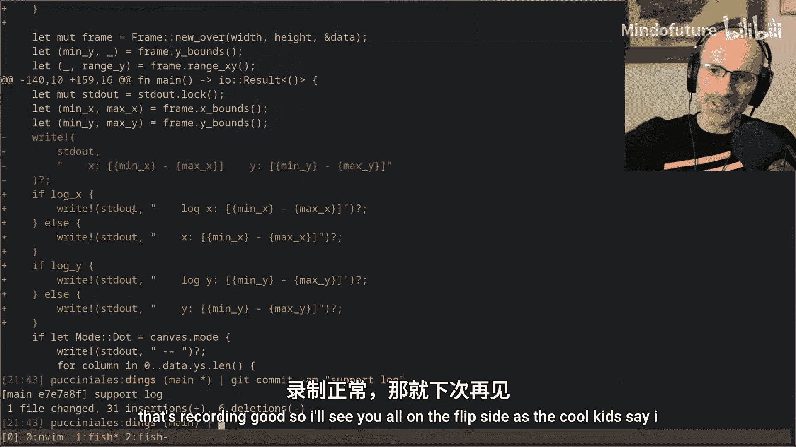

They about。