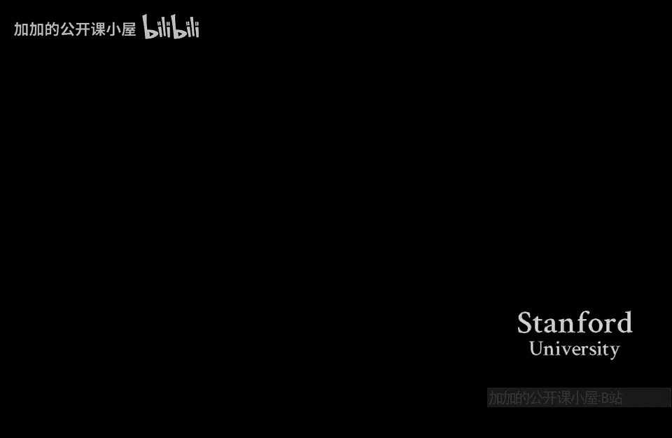
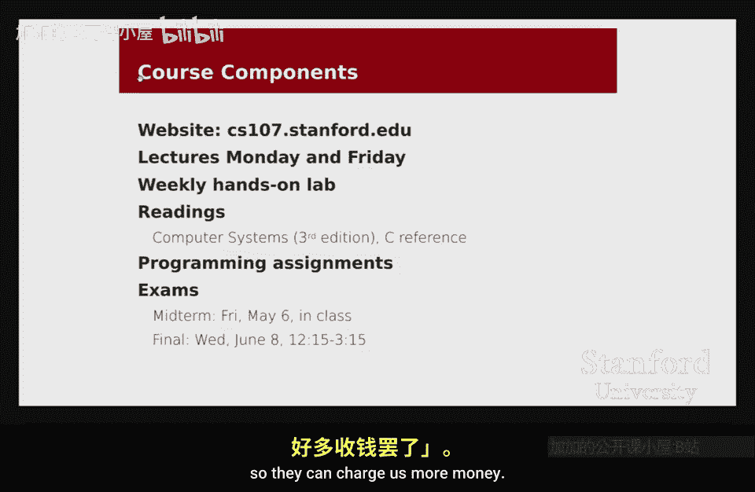

# 斯坦福大学【中英⚡计算机组织与系统｜2016 CS107 Computer Organization Systems】 p01 P1 Lec-1 -BV1tBSPB2EYN_p1-

外玩。All right。Good afternoon， everyone。Hello。Oh， I guess I'm not， I'm not even liked。 interesting。

 Okay， I guess that's fine。 Good afternoon， everyone。 Welcome to Spring Qua and welcome to C， 107。😊。

Hopefully you're all super excited to be here。 It's gonna be， there we go。 an exciting。

 an exciting quarter of just sort of good times。 So let me let me get started。

 Oh'll sit down and follow this。 So well， we'll do the normal kind of first day things today。

 I want to， So the outline for today is gonna be that I'll start by giving you just a quick overview of you know what who we are。

 And what we're doing here。 kind of the usual first day announcements。

 there is a handout that hopefully。😊，All of you got that's in the back with kind of。

Brief overview of the policies and kind of things like that。

 I'll tell you where to get all of the details in a moment。And so after going over kind of the。

 the logistics and the， the basic kind of policies and what we're hoping to do here。

 I hope to spend most of today's lecture just sort of talking to you about how awesome 10。

7 is and why we're all here and what we're gonna try to accomplish throughout the quarter。😊，So， yeah。

All right， so let me start off by just kind of giving you a brief introduction to who we are your course staff。

 We have two instructors this quarter， which is very exciting。

 Julie Zelessky sitting over there has basically sort of created and run this class for the last many years。

 I guess and has is certainly an expert in all things that are R107 So it's gonna to be great to have her sort of you know helping us out and keeping us on track when I inevitably get sidetracked or something。

 my name is Michael Chang。 I am a lecturer here with the Cs department and so Im。😊。

I've I've worked with CS 107 for a little while now。

 kind of working on the tools and the sort of backend stuff。

 And so I'm excited to finally get to to teach it and sort of you know。

 help you guys through what's hopefully going to be an awesome， an awesome class。😊。

I do want to make a note before we continue that。Just。

 just so that we're all kind of on the same page that so I am visually impaired what that means is that if you。

 you know， have a question or whatever and you sort of sit there and raise your hand and like wait to be called on。

 it's sort of not gonna work like， you know， I'm not ignoring you。 I'm not you know。

 just try to like move on here， its I really just can't see your hand up。

 So if you have any questions， if you have， you know。

 if something is confusing or if certainly if something weird happens with with what you're seeing that that I don't catch。

 just speak up， you know， I'll try to pause whenever I can to sort of get， you know。

 questions and and anything。 But if anything kind of happens and you need to get my attention totally feel free to just know interrupting as I'm going。

😊，So in addition to the， to us， Julian me， we also have 16 awesome Ts whose whose names are are there。

 You will certainly get to know the T As throughout this quarter， they'll be the ones who are。

 you know， holding office hours and grading your assignments running labs and things like that。

 So your， the Ts are， are your best friends throughout this this quarter。

 They will do whatever they can to help you succeed。

 And so it's good to get on their their good side。😊，Oh。Al right。

 so before we actually get into what 107 is， I want to go over kind of。

 go over kind of briefly what the。Components of the course are mostly these are covered in the handout。

 So， you know， and also on the course website。 So I don't want to go into too much detail over all of this stuff。

 I just want to have this， you know， as kind of the the obligatory first day slides， as it were。

 the first， most important thing about this section of the lecture today is to know about the C S 1 and 7 website。

 It's displayed prominently on the handout。 And also at the top of this slide。Cs 17。

tanford Eu will be the place to go for all things about this course。 you know。

 make it your homepage like that's just that's where we're gonna be posting announcements。

 assignments， office hours， schedules， etc。 So in particular。

 there's all the details about our course policies are you know。

 grading and late policy and the breakdown of course grades and all that stuff is is all there。

 that is the definitive reference for that information So rather than you know repeat it in five different places。

 where're gonna put it all on that website for you to find。😊，So， the。So then。Obviously。

 there is the lecture component， which is why you're all here。

 So lectures are are we have a slightly unusual sort of lecture schedule。

 I think compared to other classes that you might be used to。 we meet twice a week。

 we meet Monday and Friday。 So there's there's no Wednesday lecture。

 And the idea here is to give you an opportunity to really kind of work with the material hands on during these lab sessions。

 And so we have labs running Tuesday， Wednesday and Thursday。

 essentially in place of a third lecture we have we have these these one hour。

50 minute sessions with a T A and you know a couple dozen of of your peers where you actually get a chance to work with the material you know。

 actually like try different things and sort of and explore concepts。

 I think much more deeply than if I just。😊，Here and showed them to you on a screen for an hour and a half。

So a note about lecture as， as you certainly probably know， lectures are recorded this quarter。 And。

 and so this， of course， for our friends out in SPD land。 that's， you know。

 thats that's that's great for， for them。 But it also means that for you on campus students。

 it gives you an opportunity。 this a pretty good opportunity to review the material that we've talked about to。

 you know， pause and rewind and take notes and all that。😊，Of course， it does also create this。

Potential opportunity to just， you know， not show up and。

Let me just know start off the quarter right， we all want to start off the quarter right by saying。

 you know。What makes， I think these lectures， you know， worthwhile and what makes them。You know。

 interesting and engaging is for you to be here participating， asking questions。

 And I think that far too often we see cases of students who think， oh， well， that's okay， Ill。

 you know， I I'll miss this lecture， but I'll certainly catch up。 before the next one。

 And then that doesn't quite work out。 So then they'll say， well， gosh， you know。

 I'll catch up on the next one。 And then the next one。 And then before you know it。

 you have 18 lectures and the finals tomorrow。 And what do you even do。

 you can't even fit that into if you watch them all at 1。8 speed。

 So and I think especially for 107 with this lab structure with the weekly labs with the weekly programming assignments。

 Its it's。😊，We we're gonna go pretty quickly。 And so I think it's， you know。

 it's a really good opportunity if you come to lecture to just sort of make sure that you're keeping up with the pace that we're going at。

 And it's a good， it ensures that when you show up to lab， you'll have all of the。

 the background you'll need to really kind of dive into the that week's lab material。

 So please come to lecture。 you know， it's， it's hopefully it's it's worthwhile to you。 And if not。

 you certainly let me know you know， how to make it， make it more so。😊。

A couple other points about sort of our course components。 We do have a required textbook。

 It's the full title。 and you know， the information is in your handout。

 But I do want to mention about the the textbook this quarter。 So as of last quarter。

 we moved the C S 107 entirely moved to the third edition of the Brian Ohallleran computer systems book。

😊，And unlike， maybe， you know， you might be used to all or whatever。

 they just bump addition numbers so they。

