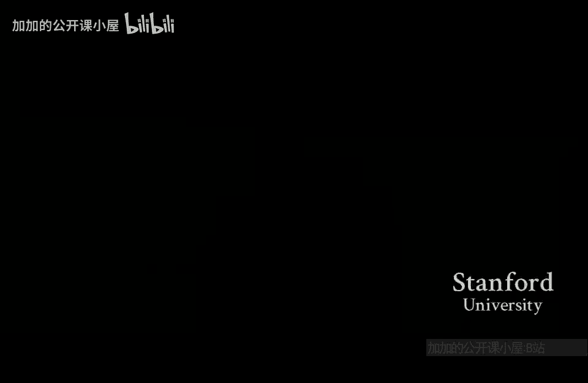
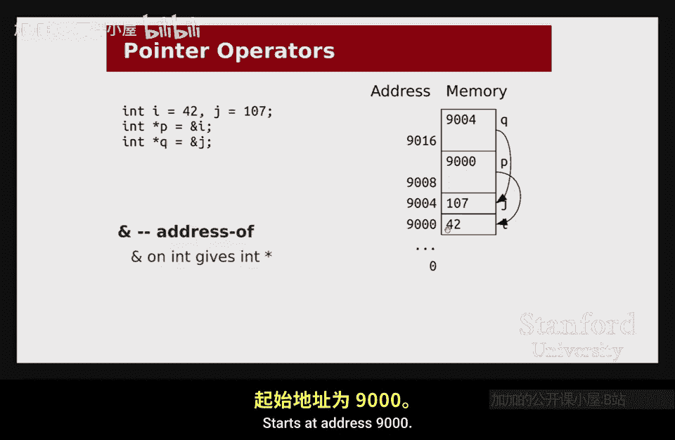

# 斯坦福大学【中英⚡计算机组织与系统｜2016 CS107 Computer Organization Systems】 p02 P2 Lec-2 -BV1tBSPB2EYN_p2-

Let's get started。Let's get started here。Good afternoon， everyone。Welcome back。

To another exciting day of CS107。Today， lecture number  three。

 we're going to continue our discussion of the C language。

By exploring one of the most important aspects of the language。

 which will be recurring all throughout the quarter， which is pointers。Before we get into it。

 a couple of quick announcements， hopefully you are all aware that assignment 0 is due tonight。

At 1159。A reminder that we are not taking any late submissions for this assignment。

 so please make sure you get your submission in by tonight at 1159 because to earn some early points for this class。

The other major announcement is that labs are starting up this week。In particular， labs。

 I think many students would say that labs are one of their favorite parts of this class and especially for this week and for the next couple of labs。

 the labs will be really useful for your assignments。So in particular。

 this week's lab and today's lecture also will be really useful when working on assignment1。

So be sure to check that out。All right。Just like last time I want to start。

The day by giving you an overview of what our goals are for where we want to be by the end of today's lecture。

Today。There are three main goals， the first is that we will just start by giving a brief introduction into what pointers are and talk about the basic operations that we can do on pointers。

Then。We will talk about。Allocating memory in the heap。 So we will compare。

We will talk about a couple different ways we can get memory and what maybe discuss a little bit about what the tradeoffs are。

 it's okay if you at this moment don't know what the heap is， that's part of the discussion。😡。

And then lastly。We'll talk about arrays and this will probably be very new concept to most of you called pointer arithmetic。

 and we'll tie arrays back into the first two topics。Today's lecture and most of and really this。

 this whole week of content is going to be vital throughout the quarter。 We're going to。

We're going to start by talking about pointers today， we're going to cover them for about a week。

 and then we're just going to keep coming back to pointers week after week in this class there's pretty much no end in sight to our discussion of pointers and so it's going to be really important that we clear up any confusion any sort of misunderstandings。

😡，Right away， I expect that many of you have lots of questions。 and that's， that's great。

 So please do ask them as we go along here。 It's a lot better for us to。😊，Clears stuff up now。

 rather than try to rush ahead and get through more content only to find out that。

 find out later that you。Missed something important and are having trouble kind of filling in the gaps。

All right。So let's just get into it。Before I。Show you some examples and some of the actual raw mechanics of pointers。

 I want to motivate them a little bit and tell you why we are covering pointers and why。

 in particular so early。Now you've already seen a few examples of how pointers are used。😡。

From your days in 106 B X。For example， you saw them used all over the place in some of the later data structures that you were implementing for linked lists。

 binary trees， graphs， if you worked on， if you saw the implementation there。

 they all counted on using pointers。Something that you also maybe saw a little bit of is that pointers are also really convenient for sharing。

For sharing objects， so for example， if I have a program that's keeping track of student enrollments and I have a student who's enrolled in two different classes。

 say CS107 and CS 109， rather than duplicating all of the students information，😡，When storing。

Their information 41，0，7 and then storing their information for 1，0，9。

 I can keep one copy of their information and just have pointers to。Just have pointers to it。

From each class that they're in， just as just a little example。

 just stuff that you've seen you've maybe seen a little bit of already。In sea。

We'll use pointers in those ways as well， but we're also going to see them just kind of show up everywhere。

 there's pretty much no way to program and see that doesn't inevitably involve pointers in some way。

😡，And we'll see that even for cases like arrays and strings。

 some of these these things that we thought were these kind of basic data types。

 pointers are going to show up。There as well and。The last point that I have there pass by reference is kind of an interesting example where C++ has some special syntax for passing。

Variables by reference。 Well， in C， we don't have those syntactic conveniences。

 So we kind of just have to。We kind of have to。Make it make it up our own way。

 and the way we will end up doing that will be through pointers。

So hopefully that's just a little bit of motivation for why it is that we think pointers are so important that we cover them starting in lecture number three。

So here we go。 Let's just get into it and talk about。And talk about the pointer operations。Now。

 for all of today， I will be， I'll be staying pretty much on the slides because we'll need to be talking about the。

 we'll need to be looking at， I think covering pointers is most effective when we actually have a picture of what's going on in memory as we start as we execute each line of code。

 So that's why I've got the code here on the left， and I've got a picture of memory on the right。

 Now before I actually get into the specific example of this piece of code。

I want to talk a little bit about what this diagram is so that we're all on the same page。

So here I've got。A picture of memory on。The left here， I've got the addresses。

Of I've got the addresses， which are， essentially numbers。Which represent a。

 which refer to a location in memory。 So the lowest address in memory I have written kind of near the bottom。

 starting at 0。 There's a bunch of stuff there。 And then I'm。

 I'm mostly making up these addresses for our convenience。 But you might imagine。Around here。

 we have address 9000 going up to， going up to whatever。In the in the boxes themselves。

 I'll be writing the the contents of memory。 So， for example。

 here we can see that the variable and I I'll write the variable name sort of to the right of the box if。

If there is a good name for that variable， just as a convenience to sort of keep track。So here。

 for example， I have the variable I， which is an int。 we can see that from the code。

 it stores the value 42， and we can see that。😡，The。

 the box containing the 42 is located at address 9000。We can see the same thing happening for J。

 and then also we'll get to P and Q in a second。All right， now。

A couple things to note about this diagram right away。 First of all。

 you'll notice that I'm not that the addresses aren't just counting up one after another， that。

 for example， here， this isn't 9001 and this isn't 9002。 I'm kind of skipping a few addresses。

 So what's up with that。Well， we'll talk a lot more about data representation in a couple of weeks。

 we'll talk about how to how we actually store ints and how we store addresses and how we store characters and floating point numbers and all that。

😡，But for now。I need to introduce you to。The the terminology of a bitete。

 So a byte of memory is essentially a just a small unit of memory。Where we can store something。

And when we talk about addresses， when we use the number like 9000。

 this is the address of a particular bite in memory。But the problem is， we can't store an entire int。

In one bite of memory， and inch is bigger than that。In fact， on our machines。Ints are four bytes。

So what that means is that。Even though I'll be using a sort of shorthand language like I is stored at address 9000。

What I actually mean since I is an int and ints take up 4 B is that I is stored at address。

 starts at address。

