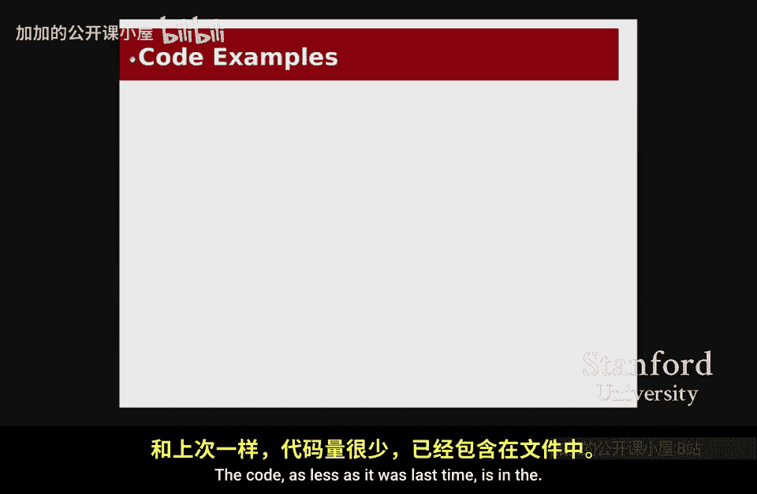
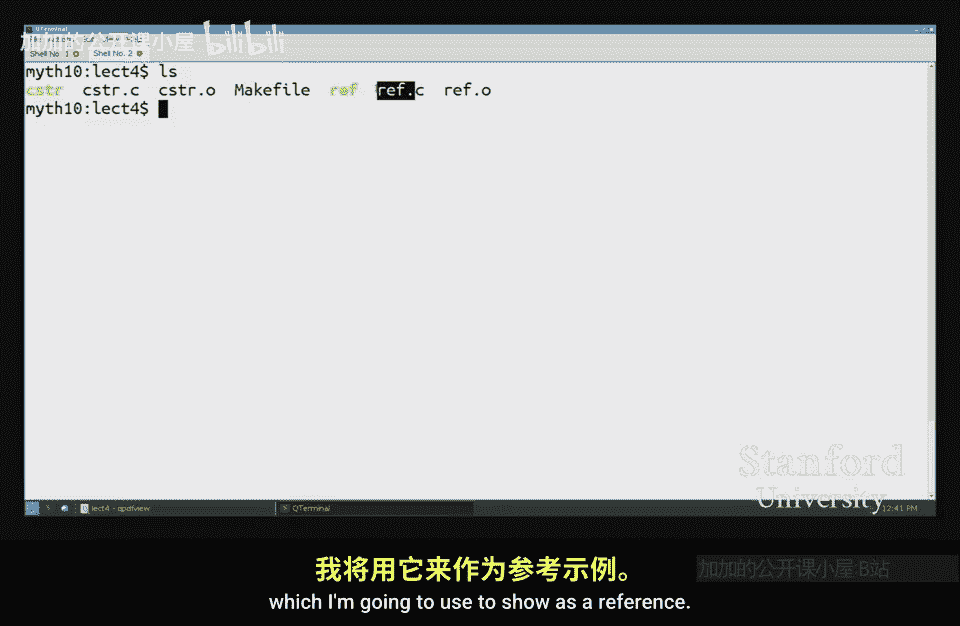

# 斯坦福大学【中英⚡计算机组织与系统｜2016 CS107 Computer Organization Systems】 p03 P3 Lec-4 -BV1tBSPB2EYN_p3-

All right， let's get started。Well，lcome back， everyone。To another exciting day of CS 107。

 end of week two here。Which is， I don't know if that's moving quickly or slowly for you。

 but whatever the case may be， hopefully it's all going。

A couple announcements before we get into lecture today。The first one。

 the first couple are things that have already happened。

The first being that labs hopefully all happened this week， hopefully you all enjoyed that。

That process of working through C strings， a little bit of GDP。

 just seeing generally how to work with C and work with pointers。

The other thing I just want to mention briefly is that assignment zero grades went out a couple of nights ago。

So we made a post about that with the medians。If you want to review your grades at any point throughout the quarter。

 you can go to the gradebook link on the course website that'll show you your assignment scores。

 but also your lab attendance note that the lab attendance will not show up。

Until the end of the week， we'll probably post it around Saturday。

 So don't worry if you just went to lab and you're like， oh gosh， it's not showing up。

 don't worry if if the rule of thumb is if the grade。

 if there is no line for that assignment or lab in the grade book。

 that means we haven't posted anything yet， so don' don't panic if you don't see a recent assignment or lab。

Big thing to note， of course coming up is that assignment one is due on Monday。

 this coming Monday that is the sort of normal deadline for that assignment please check out our late policy if you have any questions about how our deadlines and hard deadlines work we realize that the late policy is maybe a little different than what you might be used to from other。

CS classes， so just watch that and be aware of that。All right。Okay，'s， let's get into it。

Here's what what we have on deck for today's lecture。

So last time we ended with a discussion about arrays， we saw how to allocate arrays on the heap。

 we talked a little bit about how to allocate them on the stack。

 and then we saw lots more with arrays and in particular with C strings。In lab this week。

So we're gonna pick up where we left off from that。 And we're gonna go back to this question。

 which has come up a few times in piazza and in office hours already， which is。

 when exactly do we use。The stack versus the heap， Why should I prefer？

One form of memory allocation over the other。Then we'll look at somewhat briefly at another。

Common example of how pointers can be used， which is to pass variables by reference。

 so you may recall from C plus+ that there was some special syntax that allowed you to say that a variable was passed by reference in C we don't have that syntax。

 so what do we do instead？😡，And then the main part of the class today is going to be working through some pointer code examples。

 will' be mostly on the terminal， but then I'll switch back to the slides at the end to draw a couple more pointer diagrams。

 and the intention here is we worked through a bunch of stuff on Monday。

 we saw some good examples of how pointers were some of the operations work。

 we saw the pictures for that。😡，And now our goal is， well。

 how does this actually translate to the code that we're writing， How do we actually。

How does it matter these？For example， how did memory errors and sort of the common issues that we were discussing last time show up in our code。

 whether that be in our output or。How do we debug it， How do we look at。

How do we use something like GDP or Valalgrind to make sense of。

Something that is going wrong in our memory。 So we'll sort of switch between code and slides as a way to。

To， to work some of that out。Alright。Okay， so let's get into it with a。Somewhat。

Condensed discussion of snack versus heap。 We've， we've certainly talked about this on， on。

 on piazza。 And there's some stuff in the assignment 1 handout and advice page about it to look into it。

 But here's， here's the rundown。So we saw two different ways to allocate。An array。

 And I'll be focusing on arrays because those are the by far the most common cases where we need to think about using the stack or the he。

 We saw two ways to allocate an array。 One of them was to say an array bracket 5。

 which declares the memory on the stack。 One of them was to say to declare an instar and have it。

Point to a meic。Right。With the stack， there's， there are some pretty compelling advantages。

 And by far， the biggest of them is that the memory is automatically cleaned up for us。

 We don't need to call free。 We don't need to remember to， you know， clean anything up。

 once the function returns。 The memory associated with A R R is just， is just taken care of。

 and program continues to run。 No memory leaks， No memory errors。 That's， that's really nice。😊。

Another advantage that we started to talk a little bit about in assignment 1 is that the stack is considered really efficient。

What this is saying is you might be thinking from when you think about efficiency from the perspective of CS 106。

 for example， and thinking of like big O runtime and asking， well， wait。

 are you saying that the heap runs in something that's not constant time。

 like is the heap running in some crazy linear time。 what's the factor。

's it's not quite that stack both allocating on the stack in the heap are largely constant time。

 but the constants are very， very different。So if we were to have， for instance， a mallic。

Inside of a loop that was running for 100，000， a million，100 million iterations。

We'd start to notice that the program would slow down a little bit。

 whereas if we had been doing exactly the same loop with a stack array， way， way faster。

So in general， the rule of thumb is use the stack when you can。If， if there is。

A good like you don't need a good reason to use the stack。 that should sort of be your default go to。

But there are a couple reasons that you might need to use the heap we already saw a couple in throughout。

 which is that the big one， of course， being controlling。

 we need to control the run the lifetime of the variable that we allocate。

 So for instance for instance， in read F in the starter code for assignment1。

We can read the the fragment into。Into memory。 But then we need the fragment to stick around until after we have reassembled everything。

 So it would be a huge problem if the memory were delocated。At the end of read f。Therefore。

 have to use the heap。Another advantage that we won't talk too much about in lecture is that the memory can be resized。

 so there is this function called realc， I encourage you to take a look at it。 it should be in KNR。

 you can look at the man pages， but essentially it lets me say actually I know I asked for five ins of worth of space but I actually need 10 I actually need 20 and we can use that structure to build these kind of automatically expanding blocks of memory in contrast if I say inch array bracket5。

 that's it。 you can't say， oh just kidding， I need five more can't do it。

 you won't be able to extend this array。嘅。😊，Questions about stack versus heap。Yep。

 so when do you have to stop。Is it possible to use a variable near AC it possible to sit it is possible to use a variable at the length of a stacker ANC What do you mean use a variable in length So say I have like in X equals like five and then I want to do H R ofM？

Oh so you're asking whether it's possible to declare an array and instead of putting five in here。

 you want to put the name of a variable in here。 Yes。

 this is a somewhat new and when we say somewhat new and C we'd be 1999。

 which is not at all somewhat new in some of them， but it was in addition to the language after after C happened。

 which is that we can declare an array with a variable length here。

 that doesn't mean we can resize it right even if the variable changes， the array will not resize。😡。

It'll be whatever size it was when you declared it。

 We'll actually see an example of this showing up later in today's lecture。 So yes， that is possible。

Anything else？O。Great， so let's get into the actual， actual coding part to do。

 to do the first part of this。 The code as last， as it was last time， is in the。😊。

Is in the class directory if you want to follow along， that's fine。

 If you want to just watch me do it， that's also fine。 I have my normal two terminal setup here。

So let me just get into it。We have two programs that we will be working on today。

 One of them is a pretty short program called Ref。 C。

