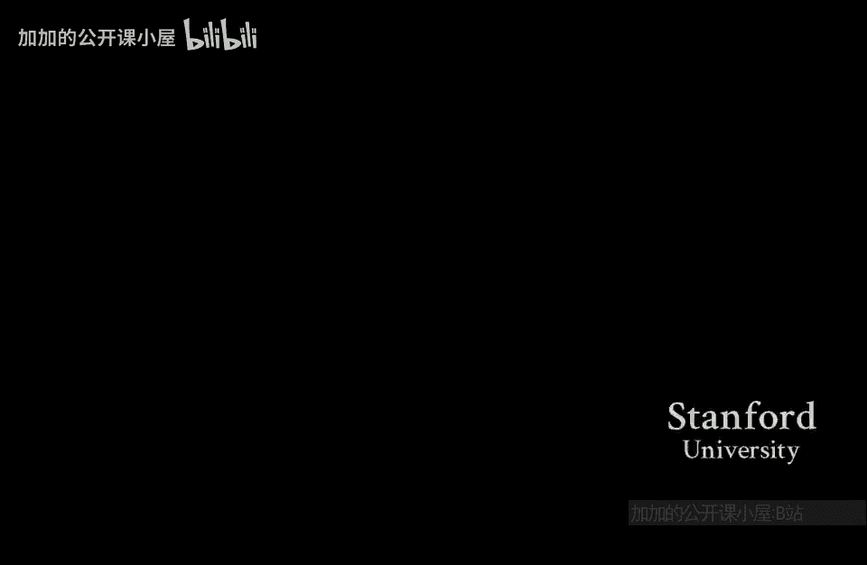
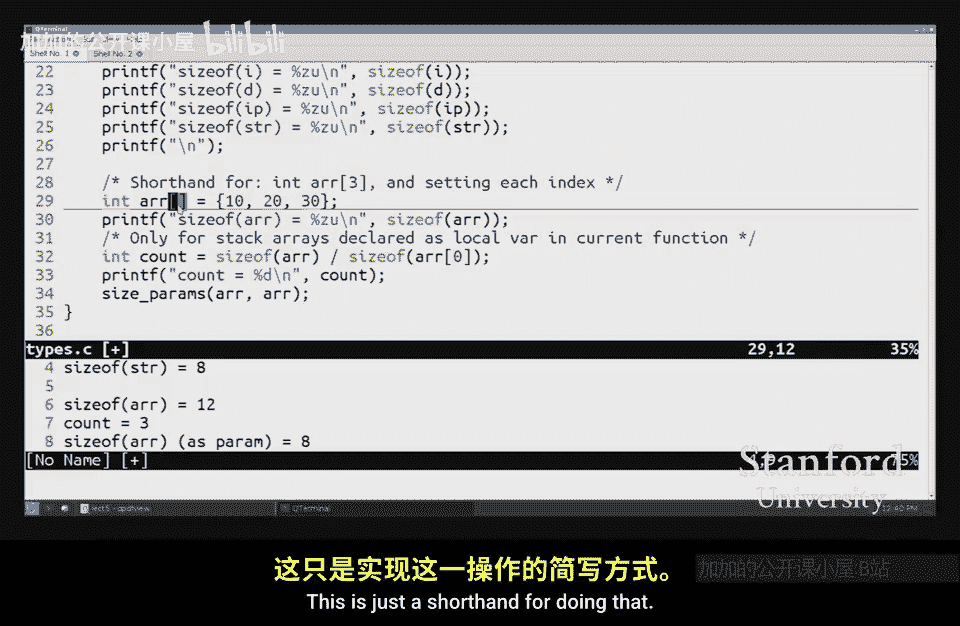

# 斯坦福大学【中英⚡计算机组织与系统｜2016 CS107 Computer Organization Systems】 p04 P4 Lec-5 -BV1tBSPB2EYN_p4-

Bed。

Here we go。Okay， good afternoon everyone， well back。

It's week three I don't know if that's good or bad really I've lost track of most sense of time at this point。

 but that's fine so hopefully you're all excited to be back in week three of CS107 we've gotten into a bit of a pattern now in terms of our assignments and labs or just going to kind of keep on going so I decided to cut out the announcement slide because it's really just going be the same issue thing for the next week or two we've got assignment one coming in tonight hopefully you're all making good progress on that if if not done yet we have assignment two going out either probably tomorrow is what we're shooting for just putting some finishing touches on that。

And we have labs as usual running through this week。

 as reviews of this week's lab being review of the pointer material that we've talked about last week。

 as well as some of the stuff that we're going to talk about this week。My mic isn't on。

 Should I be louder or should they turn up the amp。Okay。

 I guess I'm just going to be louder unless the amplification kicks in。 like not on。

 isn't just for the back， right。Okay， so I hope， all right， well， anyway， I'll be louder。

 but hopefully that yeah， anyway， okay， well， okay， that's why now I have to not be louder。

 this is going to be very complicated Okay All right， so let's get into it today。😊。

So here are the goals for today， the first couple of goals are。

Relatively shorter little things that I just kind of wanted， mostly to wrap up with from。

Our previous discussion last week about pointers and memory。

 I want to wrap up a bit of discussion on the size of operation and show kind of one。

Sp case of size of that you will definitely see in lecture today and also in lab。

And then I want to talk a little bit about type casting。

 We've alluded to various type issues in the past， especially when we talked about pointers。

 and I want to really， I want to focus on that aspect and just kind of。

And talk through some some interesting cases from that。

 And then the book of today's lecture is going to be talking about generic functions。

 I'll tell you what they are， why they're interesting， and most importantly。

 I think how we can actually use them as so we won't talk today about how to write these generic functions。

 That'll probably be Friday's topic。 We probably won't get there today。 and that's fine。

 We'll spend all of today talking about how we can use them as a client。😊，All right。

So let me get into it。 Let me just dive right in with some code examples。 As usual。

 code is in the same place it always is。 Feel free to follow along。We've got a。

 we've got a handful of programs today。 I'll start with types do C。

 then and then the other two are related to generics。 So let me pull up types do C。In my editor。

 So the first thing I want to talk about today， the first couple of things are about size of and typecasts。

 And both of them are going show up in this file。 I've got a couple of little functions to just kind of demonstrate some points。

 So let's start off with， with size of。Here you can see I've declared a few variables。

 I've declared an int， a double an it star， a care star， and I'm calling size of on。

On each of those variables。 Now， we've already seen size of used。

 especially in the context of malicking memory when we needed to say malik some number of bytes。

 we had to use something like size of int or or know。

 maybe we saw a couple other size of type name in order to know how much memory we needed to allocate for an array of 5 ins or an array of three doubles。

 We can also call size of though， on an actual variable name。 And just like size of with a type。

 this is gonna to tell us the number of bytes that this variable， in this case。

 I will take up in memory。Another quick note is that our print app format。

 this is a different format specifier。 like I certainly don't expect you to memorize all the format specifiers。

 mostly we'll just show you the ones that matter when they come up， but they're not a huge priority。

 It turns out percent Z U is the way we print out what is called a size T。So youve。

 you may have seen size T。 if you looked at the man pages for some of the string library functions。

 Well， turns out size of also returns a size T。 And this is。

 and that's the format for printing that out。 Like I said， not a really important detail， but just。

Don't want you to get confused by it。Okay。So let me run this program and just sort of show you what some of this output is。

Now， so I've already made， I can make again just to make sure。 but now I'm going to run types。

 The program doesn't take any arguments， and we're not actually going to be rerunning it a ton of times。

 at least for the size of discussion。Oops， sorry，Yeah。I need to。Yeah， go。

the copy of the lecture Oh so it's an H clone。 I believe it's on the。So the。

 the path is in the syllabus。 It's an A F S I R class to go to the syllabus page and copy that， that。

 that thing。 And that's lecture number 5。 And then you're gonna do an H G clone of that。

 just like you would for your assignment。Yeah。Okay， so。Yeah。

 so I can run the Ty program and we get some of these size of， don't worry about the bottom part yet。

But， O， it's going to be a little annoying。 This is a pretty quick aside。

 It's going to be a little annoying for me to have to switch between the code and the output of the program every time。

 especially since we are just focusing on。The code for today。

 we're not actually interested in running the program in a bunch of different ways and seeing the different outputs。

 So I'm going to do this cute little vim trick， which is I'm going to dump the output of the program at the bottom of my of my screen。

This pretty much o。 I can't think of a situation where this would ever otherwise be useful except in this one。

 So， yeah。Anyway。So what we have at the bottom here is down here now。

 we have the output of the program。 and then up here is is the code。Okay。

So we can see from these first four lines that the size of for the different types， the int star。

 int， the int star， the double and the string are。Some are pretty much as we described and as I drew in the diagrams。

In in the past week， so we see that ins or that I， which is an int， takes up four bytes in memory。

 a double takes up  eight bytes。And both versions of both pointers。

 whether they be intstar or carestar， and if we tried this for any other pointer。

 we'd see the same result， all pointers take up8 bytes of memory。That part okay。

 Any questions about those sizes。Yeah yeah， so this is gonna be。

 So the the whole format specifier here is percent Z U。

 They go together and percent Z U is what we use to print out here。 I'll write a comment。

 percent Z U is size T。 So we can use。 So percent Z lets us print out a value of type size T。

 which happens to be what the size of。Function returns。Not an in。

 So if I put percent D here or percent I， They're the same thing right。

 then I would get a warning that says， hey， you pass me a size T， but I think。

 but you asked me to print an in。 I'm not really sure what you're trying to do。

 And so I figure I'll be， I'll be good about it。 I'll make sure that I don't just let those warnings stay。

 and I'll use a percent E size T。Size tea。You for pretty much everything we're going to do in this class。

 size T is is pretty interchangeable。 What it is is it's an unsigned type that is guaranteed to be large enough to store。

A any like array length or any number of bytes。 For example， Stlin would return a size tea。

 and it's guaranteed to be large enough to store pretty much any string length you could possibly want to have to store。

 But it's totally fine to take a size of and assign it to an in variable。

 We'll actually see that a little bit later。 We're just gonna it's totally fine to just to use an in variable in this case。

 because we're not worried about getting up to that those large numbers for now。But。

 these are good questions， Anything else。Okay， so this part is somewhat review。The part that is。

 is different that I want to talk about is。Firstst of all。

 I need to introduce this syntax a little bit。 This is some syntax that you'll see。

In lecture later in lecture and also probably in lab， its we're going to try。

 what we're doing is we are initializing an array of ints on the stack。

 and we could do that by saying into ARR， bracket 3。

 and then setting each of the values or each of the values of array bracket0， bracket1 and bracket2。

😡。

