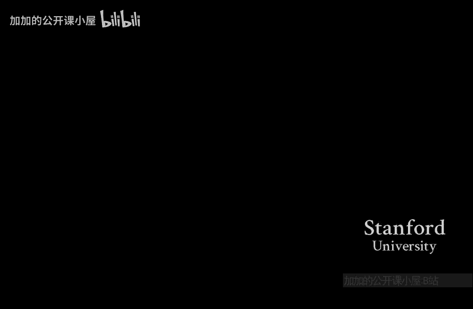
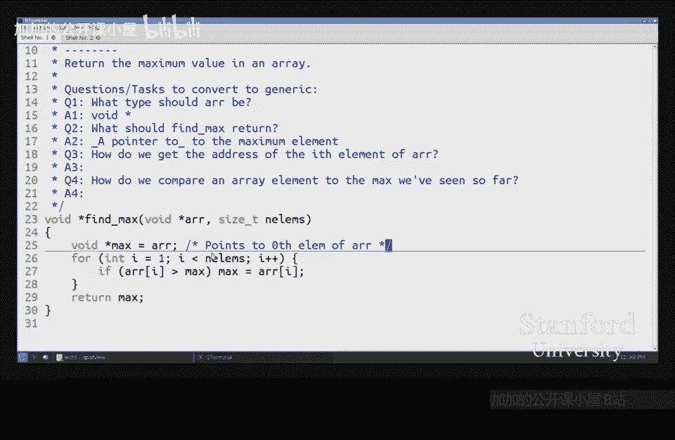

# 斯坦福大学【中英⚡计算机组织与系统｜2016 CS107 Computer Organization Systems】 p05 P5 Lec-6 -BV1tBSPB2EYN_p5-

啊，在这。Hope that's okay for you guys because。Otherwise， it's really random。Okay， let's get started。

All right。Good afternoon， everyone。 Welcome back。To CS107， let's get started here。

 we are at the end of week three， which is very exciting and very scary at the same time。

 but it is what it is， we are steadily moving forward。

A couple of reminders that are kind of the usual things。 we've got assignment one came in。

Throughout the course of this past week and the TAs are all hard at work grading those。

 our goal is to get feedback to you over the weekend so that you will have it in time to respond for future assignments。

 starting as early as assignment too， hopefully。Oh you got assignment two coming in。

Do on Monday with the usual kind of hard deadline policy as assignment one。And then the same kind of。

Everything else is kind of the usual today is the add drop deadline。

 so something to be aware of maybe you know check your schedule。

 make sure you're enrolled for the right number of units and all that。

So that there are no surprises at 501 because the registrar is as unsympathetic as our Sub as I understand it。

Okay， let's get into it。Today we're going to continue our discussion of void stars Last time we saw we introduced the void star and talked about how to use it from the client's perspective。

 and then in lab we saw a little bit more of an example of how to use void stars and comparison functions to sort and search through arrays Today we're going to focus primarily on the implementation side。

😡，From we're going to talk about how to actually write a function that operates on void star and how we can。

You know how we can implement an algorithm like a cu sort or a B search。

 We won't be implementing those because there are already library functions for that。

 So we sure don't need to write our own， but we'll see a couple examples of that。

As part of that discussion， we'll be looking at some of the limitations of Vo star。

 We talked about a couple of them already。 We talked a little bit about them already， but we will。

Both review that and also see a few more things， but specifically。

 we'll see how to work around these limitations。 What does it mean that we cannot do point arithmetic on a void star。

 Well， gosh， what do I do instead。And then last I want to make sure we spend a fair amount of time looking at a few examples of some errors that can come up when working with void stars。

 these are called level of indirection errors。😡，And these are super important for pretty much the rest of the class。

 they're going to be important for we're going we'll see these errors come up all over the place in assignments and labs and pretty much guarantee there's going be an exam question on it。

 looking at what can go wrong with VoSt and how to identify these errors how to fix these errors and how to make sure they don't happen to you。

😡，All right。So let's get into it。I've got two main code examples and I'll be driving the lecture primarily from the perspective of trying to implement these two code examples。

 and there will be occasions where I'll need to switch back to the slides to explain some concept。

 but our primary goal should be focused on getting these examples to work。😡。

So let me switch over to my terminal usual setup。And let me pull up the callback。 C file， which is。

So our goal is to our first goal is going to be that we want， we have this function called Find Max。

 and let me start by telling you what it does。😡，Findbackax at the moment takes an array of integers。

And the number of elements。And it will go through the array。

And figure out which element has the maximum value， and it will return that element。😡。

So the logic here is kind of your standard4 loop over an array。

 we start by assuming we're going to assume that the array has at least one element in it。😡。

And we'll start by setting our maximum value to the first element of the array。😡。

Then we'll check every other element。To see whether or not that element is greater than the max that we've seen so far。

 If it is， then we'll update our max。 And then by the end， we can return。

It can return the value we got。看。So our goal is that we would like this function works。

 It does work on an array of integers。 I can show you that really quickly。You want。

Some form of verification， I can call callback。 Well you can see that in our array of numbers。

It tells us that the max is 99。And so I did call Find Maxax here。

 I'll show you the call later that's not。Our focus right now。

 So the code works for now on an array of integers。

 but it feels really limiting to only operate on an array of integers。

It'd be much better if we could。Opererate on any kind of array。Right。

 this algorithm feels like it's one of those things that I might want to be able to do on an array of strings。

 For example， I want to find the alphabetically last string or an array of doubles or some such some other kind of array。

 So we'd like to be able to convert this function。😊，2。Work on an arbitrary type of array。

And as part of doing that。I've listed four questions that we're going to need to answer。

And every time we answer a question， we will be able to make a change to the code here。

 And by the time we've answered all four of these questions。

 we'll hopefully have arrived at the generic implementation of FindMax。All right。So let's start。

 let's just start with question number one， here's a bit of a warm up question。

 what type should the parameter ARR be？😡，Right now， it is an int star。

 meaning it's pointing to one or more integers。😡，But now we don't know what type。

Of array we are looking at。So we can't use a typed pointer。

 We can't use int star or carestar or Care double star or anything like that。

The only option we have is Vo star。Meaning， ARR is a pointer to something thing or more than one thing。

 And I do not know what type it is pointing to。O。😊，So far so good。

 so the answer to question number one。😊，ARR should be a void star。All right。Next question。Number two。

 what should this function return now。Before with the int case。

 we had find Max returning the actual value， we had it returning the number 99 in the case of the big array of integers。

 we had it， we initialized the max value to the first or the zero width element of the array。

 and then we keep setting max to array bracket I。😡。

We can't do that anymore because we can't declare a variable that。😡。

Represents a whole a thing of arbitrary type。To return that value。So what do we do？Well。

 we talked about this a little on Monday， and you almost certainly saw it in lab when doing the strings example。

That when we have generic functions， they're not going to hand back。The elements themselves。

 and they're not going to pass in elements themselves。They're going to return， in this case。

 a pointer。To the element in the array。So what we need to do is we need this function。

 find max to return a pointer。2。And that's very important， you'll put underscore around it。

A pointer to the maximum element。行。So how does that look？Well。

 instead of returning an integer or instead of returning a thing。

 I want to return a pointer to a thing。😡，So I'll return a void star。

And instead of declaring int Maxax。I'll have void Star Max。

And now I need max to point to the zero with element of array。😡，Well。

 since arrays and pointers are the same thing， A R R。When we say it points to the array。

 we are actually saying that ARR points to。The beginning of their array。

 it points to the  zeroth element。So if I just assign void star Max equals ARR。Now， this points to。

Z S LM of A。

