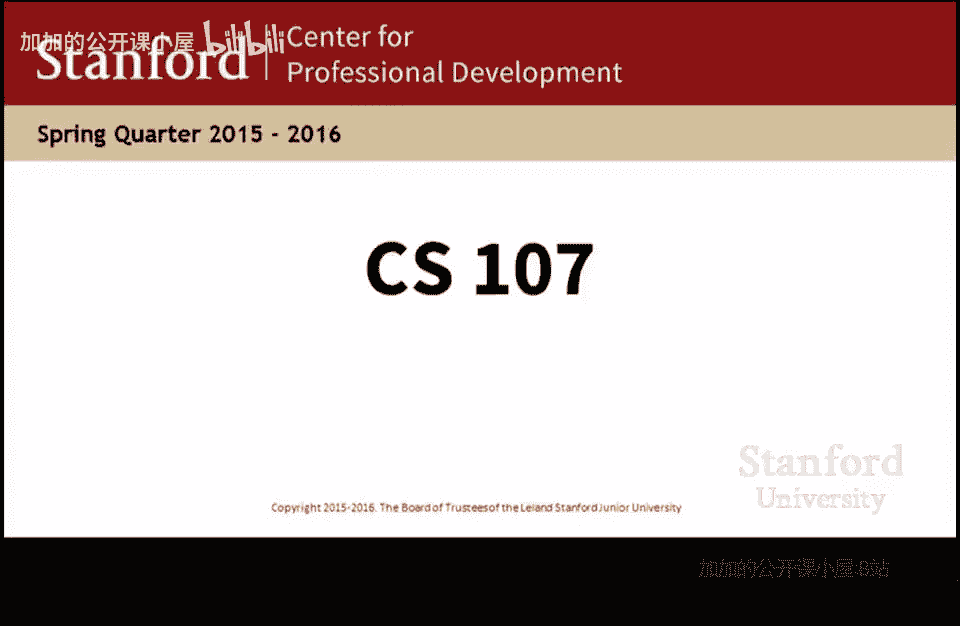
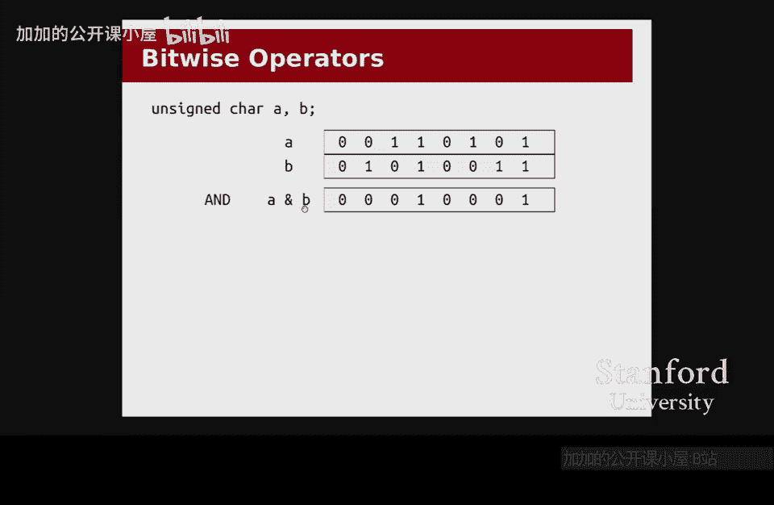

# 斯坦福大学【中英⚡计算机组织与系统｜2016 CS107 Computer Organization Systems】 p06 P6 Lec-7 -BV1tBSPB2EYN_p6-

Allright， good afternoon， everyone。 Welcome back to another exciting day in the world。 That is CS。

 107。😊，A couple announcements before we get into the material today。First and foremost， basically。

 it's all assignments from announcement wise assignment  one grades and feedback went out over the weekend。

 They went out on Saturday。 Hopefully， you got a chance to take a look through that and got some useful comments that。

😊，You could hopefully apply to your assignment2。 Also， you know。

 maybe this is the first time that many of you who have seen the automated testing process。

 the you know， the grading that we do here in 107 being。😊。

In terms of functionality being primarily based on the output of your program being automated。

 there are。There's information on the website that hopefully evolve seen already about how we do the grading and that process。

Historically， maybe there are some there are the occasional surprises as to what the automated grading was able to find that you were or were not able to find in your own code。

 So hopefully that gave you a bit of a sense of what。

Testing is like and the kind of robustness and stress cases we're looking at。

You know how thoroughly we test your program？So moving forward。

 we have assignment two coming in tonight。And we've got assignment 3 going out shortly thereafter。

All right。Let's get into it。Before I start on the actual content for today's lecture。

 I do want to give you a bit of sort of a roadmap for what。

're where we've gotten to and where we're headed toward。

 because we are going to be shifting gears pretty substantially today from what we've been doing and so I't I want to put that into context and give you kind of the big picture of where we're trying to go。

😡，Up until now， we've been talking a lot about the C language。

 We've talked about pointers and memory。 and we saw lots of interesting ways to use pointers to implement。

😊，Interesting things like strings and generics。 And you're working through some kind of cool problems with assignment 2。

 for example。😊，Now， but until now， we've been。Drawing memory is these kind of abstract boxes。

 We've been saying， okay， I've got this pointer。 It's in this box。

 There's there's some address in this box。 and the int is represented as these four little boxes。

 which I threw the word byte around a few times and said， oh， yeah， you know。

 memories stored in a bunch of bytes and ins are four Btes and pointers are 8 Bs。😊。

So now we'd like to actually look at what。What's going on in the memory。

 We want to understand what exactly it means to store a byte。

 how we can interpret that byte as characters， as integers and next time as floating point numbers as well。

😡，So this is the section on data representation。 And then next week we will start on talking about。

 okay， well now we can represent our data。 We can represent our variables and， you know， our numbers。

 We can think about how to do arithmetic on them。 Now， how do we represent our code。

 That will be next week。Okay。So let's get into our plan for today。😡，So the first。

 so the plan for today is going to be， we will be looking at。This data representation。

 these bits and bytes。 And we'll be thinking about them in。3 different ways。 We'll start by looking。

 We'll start by， of course， defining what bits and bytes really are。 And then we'll talk about。First。

 how we can interpret。😡，Each bit kind of individually。

 we just think about them as actually these little like on off switches。

 sort of true true false values using a set of a new set of operators called the bitwise operators。

 And then we'll look at how these bits can be interpreted as。Signed and unsigned。Integers。

So let's start with just a few definitions。So the the first one to get out of the way is what exactly is a bit？

So the bit is which is short for binary digit is。Simply a one or a 0。

 So here you can see I've got this box with。Eight bits in it。😡，So each of these zeros and ones。

 each of those is a bit。 So for now， as we think about interpreting bits individually。

 we can think of each of these as representing true or false， one representing true。

0 representing false。 I may use terms on and off or one is on to 0 is off。 But so， yeah。

 And then when we。So one bit is is fine。 And that's sort of the most basic unit of storage that we could。

 you know， get on a computer。 But when we we can put them together into a byte， which is 8 bits。

 So the picture there is the picture of a single byte。And。The reason that bytes are interesting。

 why theyre know why 8， Why have we decided to put to pack bits in this particular grouping and not in the other is that bytes are the smallest unit that we can。

Really refer to in C。😡，So we learned already when we talked about Vo star that cares are a 1 B type。

 So this box of 8 B could be stored， for example， in a care variable。

And we saw that when we manipulate the addresses that we would be moving through memory。

 like if we did， you know， point arithmetic， we where the unit that we're moving through is in units of bytes。

 So we cannot refer in C to an individual bit。 We can't say， oh， I would like to read this。

This particular zero or this particular one。We have to refer to the entire。But with our operation。

So in order to actually think about bits as。True false， or as on off individual on off switches。

 we need to learn a new set of。We need to learn a new set of operators to work with them。你。

So let me set the stage for introducing these operators。Here I've declared two care variables。

 care because not because I actually want to store characters or because I want to interpret them as characters。

 but because a care is a one byte value， so you can see that I've written out these bit patterns for the one byte values。

😡，And so， I have。The cares， A and B。I'm declaring them unsigned just so that I don't have to deal with anything weird about positives and negatives。

And now we'd like to look at the set of operators that will allow us to work with。These bits。嗯。Okay。

 so the pattern that we're going to see for all of these operators is that。

These operators will work on。The corresponding bits of A And B。 So we'll start。 We could start。

 for example， on the left and。We'll look at the first bit or so this is going to be called the most significant bit。

😡，Of a and the most significant bit of B。 And so we see that they're both zeroes。

 And the operator will， will look at those two bits and produce some。

 some bit to go in that this position。 And then it will look at these two。

 and it will produce a bit to go in these position。

 And the difference between the bitwise operators will be what。😊。

Combinations of these zeros and ones will produce a one or an on bit in the result。

 So let me just give you an example。The first bitwise operator we want to see is the and operator。

Okay， so what and does notice single ampersand， not double ampersand。 So this is the。

 this is a column for what the actual C code would be。 This is the logical name on the left。

So single ampers， not， not double ampersand is our bit wise and。 And what we get from this is。

You'll notice that in the result， which is this box。The the resulting bit will be on。 It will be one。

 if and only if。Both A and B have a one in that corresponding bit。

 So here you can see that both A and B have a one。 So the result will have a one， but in。

These other three slots， even though A has a one here， because B does because B has a 0 here。

 the result will be 0。ok。And we follow that pattern。For the rest of these。It。行。

