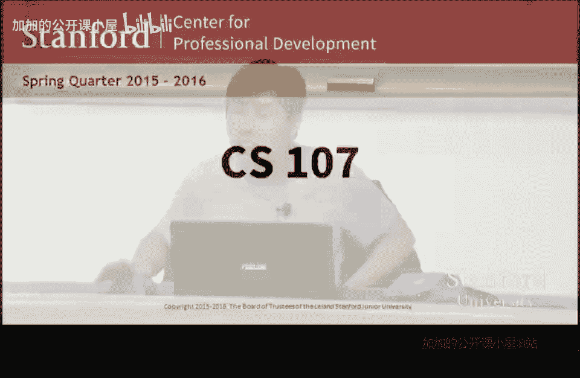
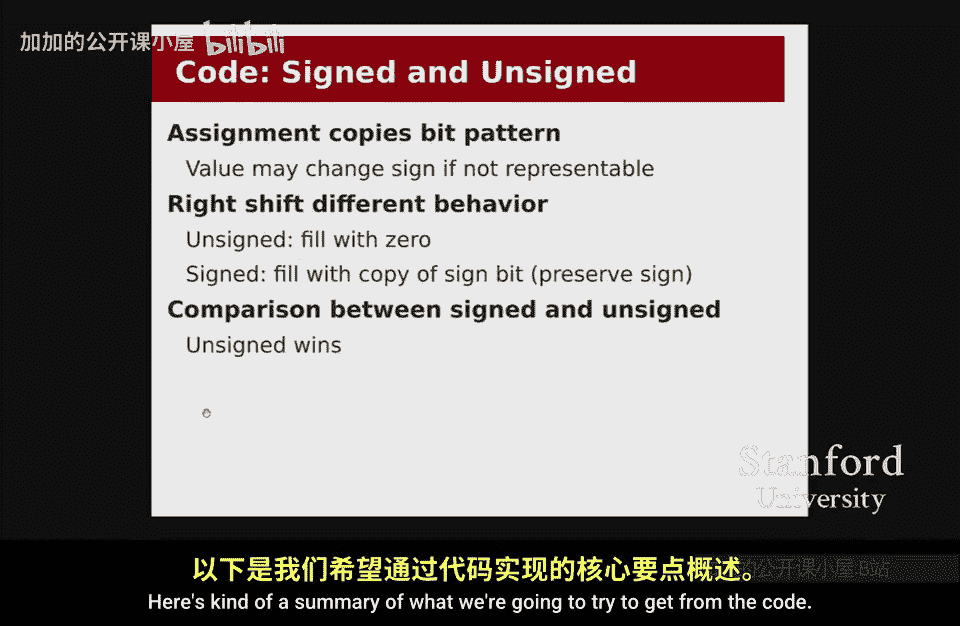
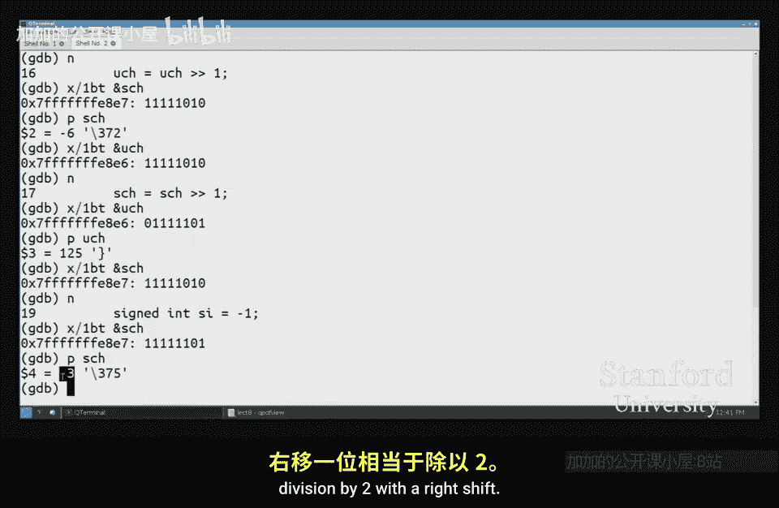

# 斯坦福大学【中英⚡计算机组织与系统｜2016 CS107 Computer Organization Systems】 p07 P7 Lec-8 -BV1tBSPB2EYN_p7-

Let's get started。Welcome back， everyone。To another exciting day here。

 a couple announcements before we get started。First of all， hopefully assignment2。

 so assignment two came in this past Wednesday was the hard deadline。 Hopefully that went。 All right。

' got we've got that in the pipeline for grading。 We will not。

Be able to get the graded feedback for assignments to back to you quite in the same heroic time frame that we saw for assignment1。

 We wanted to make sure that you had。😊，A reasonable amount of time to get your assignment one feedback before turning in assignment two。

 but we'll try to get the feedback to you by early next week。Reaal amount of time， but not。

Not this kind of heroic Ts pulling all nighters a kind of timeframe。

And then the other kind of main announcement for today。

 I think now is kind of a good point in the quarter to remind you that every lecture has textbook readings。

We're starting to reach a sort of point with the content where there's a lot of。

Sort of sort of conceptual understanding。 There's a lot of places where there's a lot of math or a lot of of where pictures can make make a big difference。

 It's not just about kind of。The code so much anymore。

 And so I think this is where something like the Bryant and O Hollleran textbook can really kind of shine。

Explain some of these some of those ideas， so do check out the textbook readings if there's anything that is confusing about lectures or labs or whatnot。

 see if that is explained in the textbook because it probably is and probably in a lot more detail than we were able to cover。

So hopefully that kind of is able to clear up a certain number of those。Of those those。

So let's get into it for today。For today， the first thing I want to do。

 So we finished up last time with talking about signed and unsigned integers。 and you spent a。

All of your lab this week working through bits and ints。

There are a couple of things that you may have seen in lab or maybe didn't quite have time to get to that I just want to review here。

 like kind of recap here， and then I want to spend the majority of our time today talking about how we're going to represent。

Real numbers。 How do we represent stuff that isn't an integer。

And we'll see that there are a number of challenges that come with that。

 a couple of different representations we'll be seeing。Right。So let me go over to the code。

 Here's kind of a summary of what we're going to try to get from the code。 I leave it in the slides。

 just so that。

You know， if you go back to the slides， you'll have a point of reference。

 hopefully that this is what you should be getting from the code。 But， I'll pull it up。

I want to start with the ins。C file here。So。A handful of kind of key points that。

So we ended last time talking about the difference between signed and unsigned。

 And I had this one slide that was just like， hey， there are some differences。

 So I want to actually show you the differences rather than just tell you about them。

 because I think theyre a lot clearer in。When we actually look at them in code。

 also because that's where they're going to come up when you start on assignment 4。

 which is going out next week， you'll be working with bits and ins and you may be running into some of these issues。

That's where it's going to matter I'll mostly be walking through the code in GDP。

 but just to give you a sense of what the code looks like at a high level。

 we've got the variable names so for this piece of code are going to tell you what the types are。

 So SCH is assigned care。UCH is an unsigned care。 Let me just drop into GDP and just start walking through it。

So the first thing I want to talk about today is what happens when we start mixing and matching。

 signed and unsigned。 So this has to do with kind of the last thing that we did last time where we said some stuff about comparisons being different between signed and unsigned。

 I have that example coming up。 But first， I just want to。Stay on something a little bit。

Kind of more。First， the first example I want to show you is just， if I have an unsigned。Care。

 and I assign it to a value， like 250。And I and I copy that value from the unsigned back into the signed care。

What will happen。So now that we've executed this line。I can print out the byte。

 so a care to call one byte8 bits， I can print out the bits for the unsigned care I'll use you saw the examine command in GDP during lab this week hopefully。

 so I'll use that to examine the byte。😡，At UCH。And we can see that is those are the bits for the number 250。

You print out UCH， and you'd see that that so 250 corresponding to those eight bits。Okay。

And if I do this assignment now， so I say SCH equals UCH， what's going to happen？😡，Well。

 as the comments say there。We're going to basically copy those bits into SCH。

 So if I go back up and I examine the bits for SCH。You'll see that it's exactly the same di pattern。

And you might say， sure， okay， fine， great。 That's cool。 What's the big deal。😊，But。

Whereas with the unsigned case， we were representing， we had every bit kind of。

 we didn't have any special bit in the signed case。

 this most significant one is now representing a negative。 So despite assigning the number 250。

To assign number。If we interpret what SCH is， we actually get a negative。😡。

The point that I want to make with this example is that when I do an assignment from unsigned to signed or vice versa。

 there's no conversion， there's no kind of special cases there to say，huh。

 I think what you're doing is going to cause the value to change or to flip signs or anything like that。

 We're just going to copy bit patterns from one place to another。That all okay。

 any questions about that？嗯。Okay。Okay， now this is something I showed。

 I just sort of mentioned as a one liner of the slide last time was that the right shift operator is a little different。

 This is something that actually came up on Piazza a little while ago， I think， which is。

When I talked about。The bit shift operators， I said that when we shift a value right， we fill it in。

 We fill in the bits。You know， the kind of new the， the bits on the left with zeroes。

 So a reminder of what the value of。UCH was。So we have this， if we shift it right by one。

We can see that we filled that slot with a zero。And the zero on the right fell off。看。

And something that maybe you saw a little bit in lab。

 which is that if UCH was previously the number 250。Right。That now it's actually the value 125。

 So right shifting by one is actually equivalent to dividing by two。

 kind of a neat property of the way sort of the binary polynomial works。

 If you think about this in terms of decimal。 If I write a decimal number and I drop off the last digit。

 that's sort of like dividing by 10。With a little bit of rounding。So same here。

 I right shift by  one， I'm dividing by 2。 by left shift by one， that's a multiply by  two。はい。

But now let's say I do that for the signed case。😡，So recall what the value of SCH is。

Same bit pattern as it was before for UCH。 But if I do the right shift by one here。

I did not fill it with zeros。I ended up filling the leftmost slot with a one。What's up with that？

If I follow the rule that I was sort of， if I followed the kind of convention that I was trying to establish here before that。

If that that right shifting by one is like dividing by2。If S， C， H was previously a negative number。

 I would not want right shifting to turn the negative number into a positive number。

 That would be kind of annoying。So instead。😡，We'， keep it negative。By。

The rule here is that if I write shift， so we are able to in fact get。Division。

