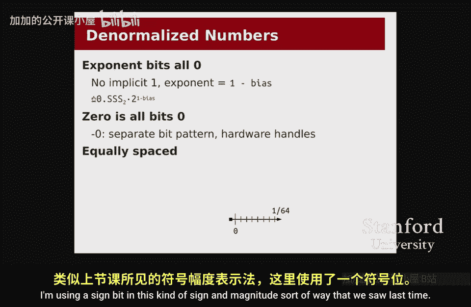
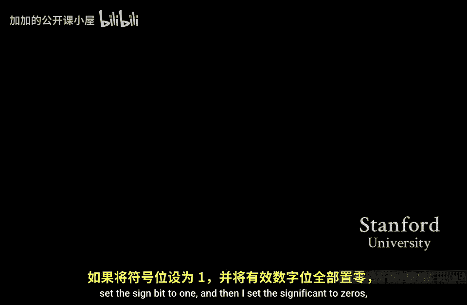
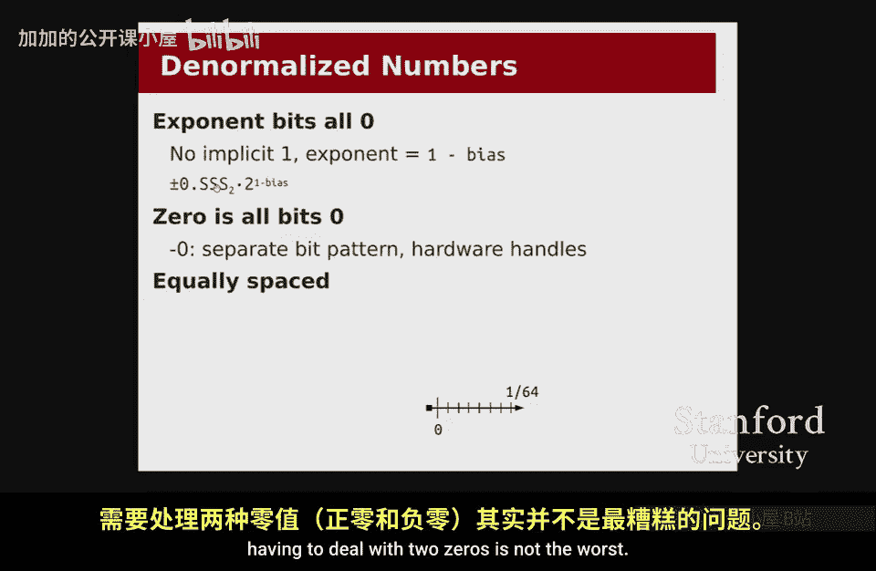

# 斯坦福大学【中英⚡计算机组织与系统｜2016 CS107 Computer Organization Systems】 p08 P8 Lec-9 -BV1tBSPB2EYN_p8-

Of our exciting time here。A couple things before I get started for today。

 just a couple of announcements we are so we're hopefully I suppose right in the middle of assignment three。

 we've got assignment three coming in on Tuesday tomorrow with the usual kind of late policy after that so just a quick kind of timeline for you for the next couple of weeks we have assignment four going out soon after。

And that will be coming in the following Tuesday， so that's Tuesday of week six。And then。

On the horizon is our midterm， which will be on May 6， that's going to be the Friday of week  six。

 So a quick kind of yeah， so so the deal with the midterm in terms of coverage。

 we will post a practice exam。At the end of the week。

 and so we'll give you kind of which will give you a sense of what the format for the exam is and all that。

The coverage for the exam will be everything up to and including floats。

 So that includes sort of the first half of this lecture or so， as well as this week's lab and。

Assignments through assignment 4， we'll be starting on assembly today。

 and that material will not be covered on the midterm。

 It is nevertheless discouraged that you zone out once we get past the float stuff because the assembly。

 there's quite a bit of material for assembly that we'll be talking about for the next couple of weeks。

 And certainly right after the midterm， we'll be jumping right in with， with with assembly， so。

Sort of keeping on top of that is going to be the way to go。ok。And SCPD students。

 you should have received an email from us over the weekend with information about how your exam process is going to go down。

If you have not， make sure you get in touch with us。好。All right。So let's get into it for today。

The first part of today， I want to finish up our discussion of floating point。

And then we'll switch gears entirely and start talking about assembly language。Now。

 last time I spent the entire lecture pretty much going through lots and lots of details about floats。

 and we saw lots of examples and a lot of bit patterns and maybe it was easy to get kind of lost in all the special cases and kind of the issues that came up when representing floats today。

 there are a couple of details that I still need to make sure we we cover so that you're not make sure we're not kind of lost when you get to lab and the assignment。

 but I want to spend most of our time kind of looking at floats a little bit bigger picture thinking about how as programmers。

 we can use floats effectively and how to avoid some of the。😊。

Common pitfalls and issues that we've already started seeing， and I'll review those。

That will come up and so how do we work around that？系。

So just a kind of a recap of what we talked about with floats last time。

We introduced this number system， the floating point number system。

 which where the key insight that we had was that rather than representing a number is as just a single kind of say。

 for example， as a decimal number， we split the number into two pieces。

One piece was kind of the significant figures part， which we call the significant end。

 that would be this kind of one point such and such piece， which we were representing in binary。

 And then the other piece is the exponent， which was a power of two。

 just like with scientific notation。 we had a power of 10。And so kind of。At a higher level。

 we can think about the separation here as you can think about this in terms of。

You can think about the exponent in terms of kind of working with different units of measure。

 So imagine if I were trying to measure。Some kind of distance。And I took some。

 took some measurements， and I say， okay， well， the distance I ended up with was 1。5。

 And that's all I told you。 Well youd probably say， well， what does that mean，1。5， what。

 What unit are you measuring in， Because it kind of matters， right。

 whether I was measuring in nanometers or whether I was measuring in light years。

It's going to make a huge。 It's going to have a huge impact on the the magnitude of my number。

And so we can kind of think of the exponent as encoding the units that we're in this sort of。

 you know， But so this sort of power of two telling us， are we should we interpret the 1。5 as 1。

5 of something really， really small or should we interpret it as something really large。

And we talked about the idea behind this representation。Is that。

When I'm talking about a really small unit， when I'm talking about， for example， nanometers。

 I want a certain amount of accuracy， and I also want a certain amount of accuracy when I'm talking about light years。

😡，The level of accuracy we might describe in some in kind of relative terms， like， oh。

 I would like my measurements to be 10% accurate。But realizing that， the， but realizing that the。

 that accuracy of， say，10% will actually have a different will be different in absolute terms。

 depending on the units。 So say I was measuring something in nanom。 And I said， okay， I've got。

 you know，1。5 nm and I'm allowing kind of 10% accuracy。 So I'm kind of accepting a。Kd of。

 I'm allowed to be off by maybe plus or -01 nm。 and then say that somebody else was measuring something in light years and said。

 okay， well， I want 10% accuracy on light years。 And so I'm willing to be off by plus or。

1 light years。Well， there's a huge difference right， between 0。1 nanom and 0。1 light years。

And both of these people want that kind of 10% accuracy。😡。

So the idea behind our floating point representation is that when we're representing numbers close to 0。

We kind of need to allocate more of our bit patterns to these small numbers in order to achieve that 10% accuracy at the nanometer scale。

😡，And then when we're kind of outweigh in the light years range。😡，Again， we want the 10% accuracy。

 but in absolute terms。You know， there's going to be much there's going to be a much bigger。

 absolute gap between between the two numbers， but we'll still be able to get。Our level of。

Sort of relative accuracy。好的。Alright， so， so a couple of details really quickly before I sort of kind of the main。

 the main points。 there was one thing I really kind of promised you， which was。

 how do we represent 0。 That was one thing that that came up。 So you'll notice with the。

 the formula that I have here for the value of a float。 It's 1。 x times 2 to the y。

 And you'll notice that there's no。There's no values that you could substitute for X and Y to get 0。

I can't say one point something times2 to the something。 I can't get 0 from that equation。

So we'll need to actually see。How we'll need to see a kind of special case that will incidentally allow us to handle zero。

Just to recap on the details of the mini floatat， which is what I'm going to be focusing on for this。

 recall that the mini floatat was this made up 8 bit type。😡，That does not exist in C。

 It has one sign bit and four exponent bits， three significant bits。没有。Okay。

 so let's see that special case for how to represent 0。

So here we had said when we first introduced the exponent and we first introduced Min floatloat that we were going to reserve。

The all zeros exponent and the all ones exponent。 And we'll start to see what those are being used for now。

 when the exponent bits are all 0。We are in the case which we call denormalize numbers。

And with deormalized numbers， rather than the previous value we had of one point something times2 to the something。

 now we have zero point something， so we drop the leading one。😡，So we get 0 point。

 whatever times 2 to the that happens to be the value， I'll show you why that is correct in a moment。

 but notice with this representation that we can now represent zero。

 if I fill in these three bits with0， then I get 0。0 times doesn't matter， so I get 0。😡。

You'll also notice that with the because I have I'm using a sign bit in this kind of sign and magnitude sort of way that we saw last time if I。

😡。

Set the sine bit to one。 And then I set the significant to zeros。

 Then I actually end up with negative 0。

And so that's。That's just something that is a consequence of this representation。

 given all the other trade offs that we're making， having。

