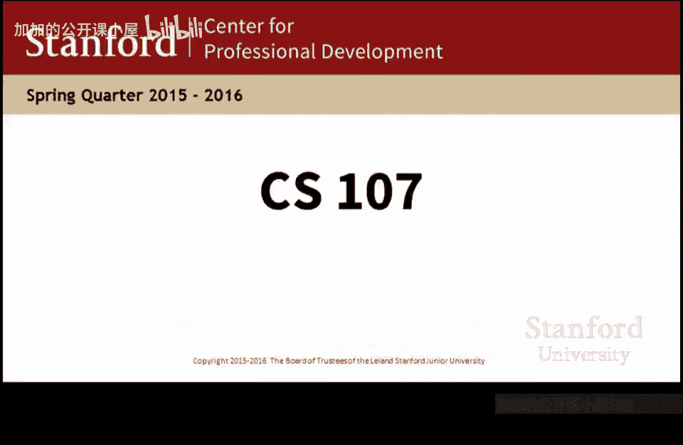
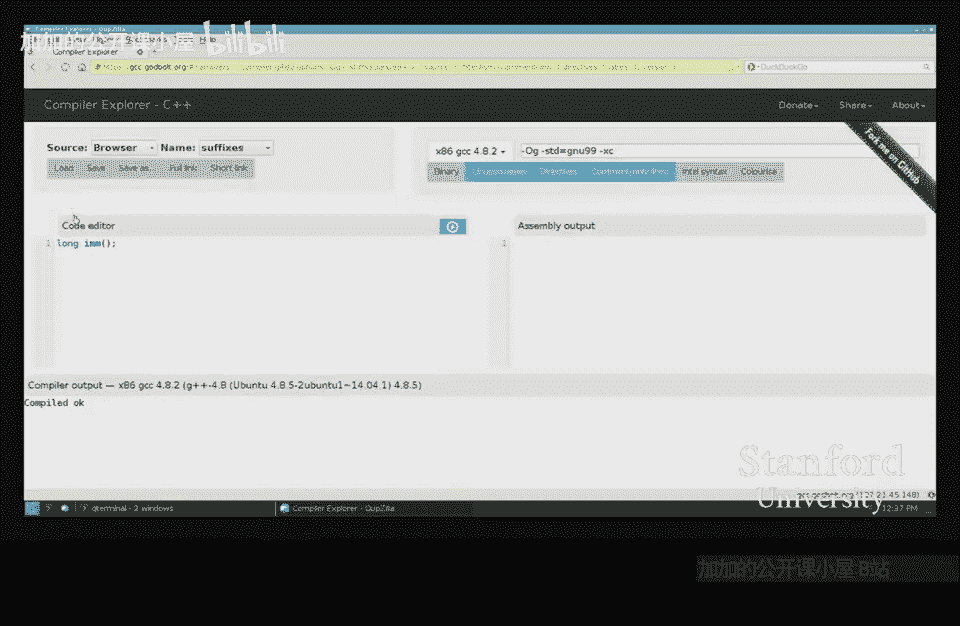
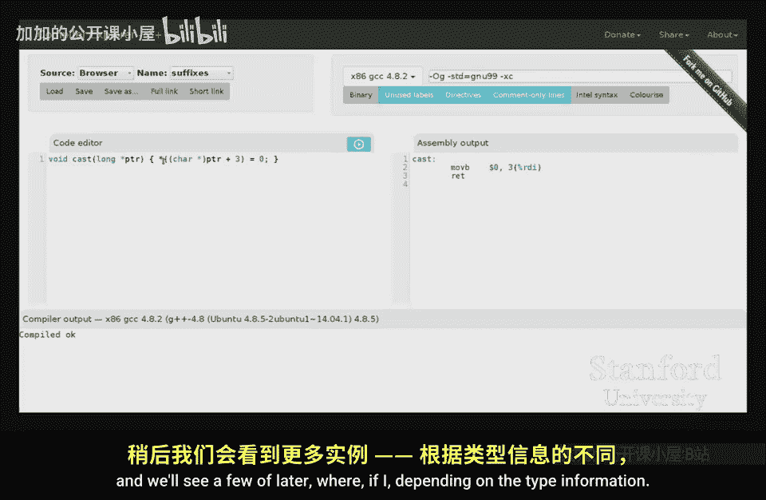

# 斯坦福大学【中英⚡计算机组织与系统｜2016 CS107 Computer Organization Systems】 p09 P9 Lec-10 -BV1tBSPB2EYN_p9-

All right。Welcome back everyone， I guess the crowd is thinning a little bit as midterm weak and such approach。

Nevertheless， we've got。Back into things here， welcome back。

A couple of things before we get before we get started here。

 just a couple of announcements I'm not going to have slide take because I'll be doing everything with through code and Gcc so so the announcement for today we have assignment three came in on Tuesday hard deadline was last night hopefully that all kind of。

You all saw that through lots of practice on void stars， lots of pointers and memory management。

Now we are into assignment four， which has been up for a little while。

 already got a few questions on that， which is always good to see students starting early and getting a good head start on that that's coming in。

In tuesday of next week。And while you are allowed to use the normal hard deadline for that assignment。

It is the more time you take working on assignment four is going to ultimately mean less time for working studying for your exam that is coming up。

A week from today， that exam is in class， hopefully this is not or it's during class it will be split between two rooms。

 the information is on the website and there's a practice exam in the back printed out also that is posted on the website。

So that should give you a sense both for the material on the exam and for what the logistics are going to be。

It's kind of， I guess just a quick kind of。Brief sort of focus on what we' what we're looking for with the exams。

 We're hoping that the exam is going to look a lot like the kind of work that you've been doing on the assignments and the lab so far。

 We're not going to try to pull our goal is to have for there to be no surprises， right。

 It's not going to be that you will show up。 and there will be suddenly this function that you've never heard of and you've never used before that nothing to do with thus far。

 the code， the code that you will be writing and the pointers that you'll be working through the。

The concepts that you'll be tested on are hopefully going to be very familiar because they are precisely the things you've spent so much time on throughout the quarter。

So hopefully you will see that from the practice exam。You know。

 feel like this is something that you can walk in to the exam next week， kind of ready for。Okay。So。

 all right， let's get into it for today。 So last time we started talking about assembly and we talked about。

The move instruction。 First， we introduced the the notion of assembly at all。

 We introduced our and our particular assembly language and our system， our X 86，64。

 we talked about registers， and then we spent the majority of our time last time talking about the move instruction。

 and we saw a variety of ways to access。😊，Data to access our memory。

 So we saw you'll recall the moves of immediate and addressing modes。And so today。

 we're going to kind of。We're gonna keep that going。

 We're going look at a bunch of different instructions， a bunch of different translations of C code。

 So recall that our， our ultimate goal with assembly isn't gonna be to sit down and just drink out a bunch of assembly ourselves。

 But we really want to be thinking about how does C code translate to assembly and vice versa。

 How can I look at a piece of C code and know what will happen on the machine when that code is executed。

 And how do I look at a piece of assembly and know what kind of C code went into generating that。

So today we're going to look at the kind of a few operations。

 we're going to look at arithmetic and logical operations we're going to look at some of the control structures。

 and the next time we will continue and talk about function calls and other C constructs。哎。

So I'll kind of be switching between GCC Explorer and actually showing you the code live。

 but for now let's go ahead and start back up in。In Gcc Explorer。

So last time we ended our discussion with a little bit on Tcast， and I want to review that。Here。

 so' let's just get into it。Soright function， oops， I mean。Oh wow， hold on。Hello here go。One second。

 what's going on？That's unfortunate。嗯，别。Oh， you know what it's going to be？Yeah， I did。Hs。

Here you know what it's going to be is， it's going to be this。Yeah。Hey on， sorry。Whoa。😮，可。

I'm typing it。But it's not。It's not respecting my ca lock。There we go， sorry about that。

Where are we here？Sorry about that， that was unfortunate。Do you know one more normally？嗯。All right。

 let's get back into it， talk about that。So here we've got a function。

 we're going to have it take a pointer。And then we started talking。

 so here's just a quick review of the move instruction that we were seeing last time。Where。

So we've got we're gonna to access now this this instruction might look a little wacky right it's star of pointer plus3 and if you recall from our discussions of pointer arithmetic。

 this is actually just an array access。 this would just be equivalent to pointer bracket 3。

 but you know what I'll show you why I'm doing it like I'm writing it like this on purpose in a moment so here we've got a function it takes a long star and returns along and it's going to return star of pointer plus3。

😡，And so hopefully this looks somewhat familiar for last time we have a， we're doing a move。

 it's an eight by move because we have a Q suffix here。And then starting with the first parameter。

 RDI， we add 24 and dereference it。 remember this wacky syntax where we put the 24 outside of the parentheses。

 and that means that we add 24 and dereence it。你看。And then we moved the value into return our return value location。

 which is REX。You could honest， is there any。Follow up to us。Okay。

 so the question that I want to ask here is。Right now。

 we're doing pointer arithmetic and a D reference on a。On a long star。And。

And the question I want to ask is， actually， whoops， I。I'm not actually going to return it。

 I'm going to actually just set it to zero。That's fine。 We're going to do this。

 we're just going to say equals zero， so same move of the 24， but now we're moving a zero into it。

 right？And then my question is going to be， what if I take pointer and I cast it as a carestar？

What will change about the assembly。 So now we're doing point arithmetic on a care star。

 and now we're dereferencing a care star。And you'll notice that there are two things that did change。

 The two things that I pointed out， actually， now， instead of moving a。An A byte value。

 we're moving a single byte value。 so that's a move B instead of a move Q。And。Instead of adding 24。

 which was three times 8。Right， which is how we do point Earth take on along， we add。

We add three bytes。But in general， nothing really changed about the assembly in terms of we're still looking at RDI for the first parameter and we're still going to move a0 there。

 and more generally， the Tcast itself does not get its own instruction。😡。

Right all the type cast does is it causes。The compiler to interpret our code a little differently。😡。

Yeah。And so you can imagine kind of looking so you can imagine kind of putting- and so this applies- so this example applies to pointers。

 but we can think of this happening for， and we'll see a few of later。

