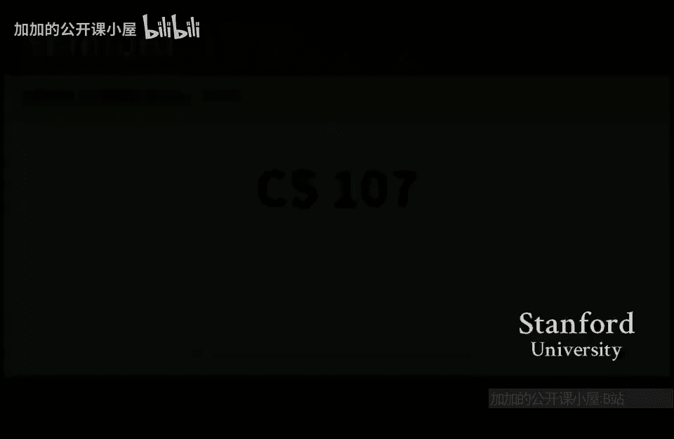
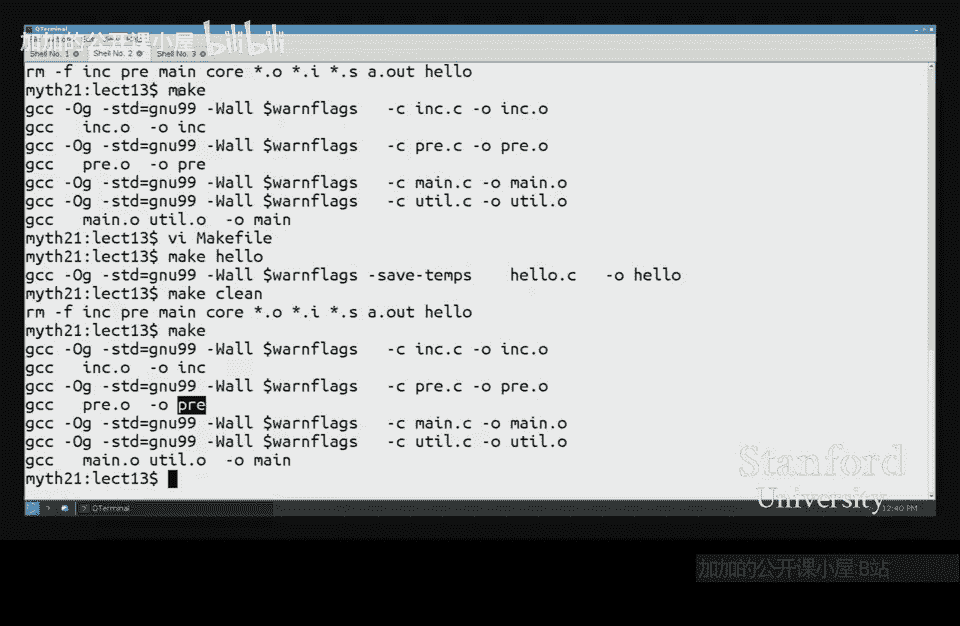

# 斯坦福大学【中英⚡计算机组织与系统｜2016 CS107 Computer Organization Systems】 p10 P10 Lec-14-Compilation -BV1tBSPB2EYN_p10-

Welcome back， everyone。To another exciting day of 107 today。

 a couple announcements before we get into things first since we last saw each other in lecture。

 we released the midterm grades， hopefully you all got emails from gradecope and were able to access your midterm grades。

😊，The website， the course website has the exam solutions as well as some information about how the midterm was graded and any instructions for submitting re grade requests and things like that。

 so if any of that，Applies to you。 please make sure you check out the website for the full details。

Of what that looks like。Assignment5 is well on its way。

 hopefully many of you are seeing that seeing that through and kind of getting getting kind of near the final stages of that。

 Hopefully you enjoyed the brief excursion into just something a little different from just constant C code writing assignmentsment  six will go out over the weekend。

😊，And we'll be kind of you know seeing this， seeing we kind of in the home structure of things here。

Allright。The， the plan for today。 So we've finished our discussion of assembly on Monday。

 So we're not really， So we've talked through all the mechanics of you know， what the。

 the kind of translation between C and assembly looks like。

 And so now we're gonna kind of zoom out a little bit more。And。So the next kind of。

Pretty much the kind of rounding out the lectures。 we're going to be looking at kind of just more。

Sor of systems concepts。 And it's not that the assembly in the sea that we've been working so hard on throughout the last seven weeks is not going to be relevant。

 We'll see， in fact， today， where our knowledge of assembly will make a pretty big difference in terms of understanding what。

What's happening？But we're going to just try to focus on what some kind of higher level。

Higher level concepts。 And for today， what we're going to do。

Is we want to talk through what it means to build a program。So for seven weeks now。

 we've all probably gotten used to just going into directory and typing make。

And theyre just having a program build， I'll go ahead and make clean， just to kind of。

They completed that。 So， you know， we see a few output lines and more often than maybe sometimes we even should We'll ignore the output lines and just say。

 yeah， sure， I type make and my program is built。 and that's great。😊。

Our goal today is going to be to understand what exactly is happening。

 So we want to know what exactly each of these lines do and what the kind of intermediate steps are。

 There are even some steps that are not being shown by make here that are。That are。

 that are contributing to taking a C program that you wrote and turning it into an executable program that you can run。

Okay， and。The one of the main reasons that we're interested in doing this， right， is that we want。

Ultimately， if there're， you know， you've seen， I'm sure you've run into a variety of build errors like you've。

 you know， compiled and you've gotten some syntax errors or you've gotten some undeclared variables or missing。

 missing prototypes and things like that。 And our goal is going to be to understand。

Where those errors came from as a kind of stepping stone to how exactly do we fix them。

 and we'll start seeing a couple of places today where the type of error and you know which step of the process generates that error will give us a lot of information about how we as a programmer can respond to that error。

😡，And that certain errors require a very different fix than others and so that knowing。😡。

know how to categorize these errors more broadly will allow us to figure out where to focus our attention when developing。

O。😊，So rather than go through a bunch of slides because I'll be kind of moving through a lot of stuff。

 And I think it's really important to kind of see the big picture。

 like kind or see like kind in real time as we build these programs and things。

 I've got this little notes file that I'm going to be updating as we go through the lecture today。😊。

And so I've got a little section kind of overviewing the steps of the build process。

 and then I've got a couple of pieces of information down here。

 and so I'll walk through this file kind of one step at a time。

 so don't worry about trying to catch catch it all now。看。All right， so let's get into it the first。

Peace that I do want to talk about。 And I won't spend a huge amount of time on it。

 But I just want to， you know， make sure that we're we realize that it's there is to understand what exactly make does。

 So there have been a couple of occasions already in lab where you were told to go into the make file and make some changes。

 You change how make was compiling your program， maybe with optimizations or maybe for assignment 3。

 you wanted to add an extra test program。 So then you had to go into the make file。And so， you know。

 you just kind of wna give a sort of nod to what exactly the make file is doing for us and why and how that works。

So when I type make what？Make does is it looks at our make file here。😡，And it uses。

It uses the make file as kind of a recipe to know how to build programs， so。

I won't go into like every detail， but I'll， I'll point out a couple things that。

MakeMake some points， so for example here。You can see this this rule there are some comments。

 These comments have been in the make files kind of throughout the class。

 but I'll just kind of draw your attention to this line in particular for this rule says that if I have a dot C program so you can read the percent as kind of just something to be filled in。

 So if I have you know hello dot C。 and I want to create hello dot O this line gives a recipe to make that says here is how you would actually create hello dot O using hello do C。

And then if we go down a little further， we have a line that says， okay， from a particular。

0 file like hello。0， here is how I would create the program hello。😡。

And so we can set some variables and we can set certain compiler flags and things like that for specifying how this works。

But then if I type， and so I， I point out two rules。 And now， if I type， make hello。Okay。

 so that one actually， it looks like it's S a。All right， so let's going to skip the thing。

 let me make clean real quick。But if I do make here。

 then you can kind of see both of those steps happening here。 So let's take the pre dot C program。

Right， because so here you can see the， I have pre dot C。 And I'm turning it into pre dot O， right。

 I'm skip over a lot of flags here because they kind of mostly don't matter。

 And then in the next step， using a different recipe， I'm taking a pre dot O file。

 and I'm turning it into the executable。😊，Pree。有。So。

 so make is pretty convenient for this kind of thing。

 It means that we don't have to type all of these lines over and over again。

 Its make is not reserved just for working with C programs。 We could technically， you know。

 you could， you could anything that can be kind of scripted。

 anything where a file should be generated from a collection of other files。

 can be handled with make files。 And there are lots of interesting examples where you can use make to kind of just。

Autommate certain simple tasks。 You know， this is the kind of thing that that you you do in a command by environment。

 if you just， you know， you don't have like a convenient。

Sort of like automation tool that lets you just kind of。You know。

 do a bunch of mouse clicks if I just need， if I just need to execute a sequence of commands to generate。

Various outputs from various inputs make is a viable tool for that with the one limitation being that it's very hard to read make files。

 That's， that's a thing。 But other than that， you know。

 it's a pretty de factive standard for building programs， at least。So。That's kind of the， the。

 you know， that's the extent to which I really want to talk about make files。

 Nobody ever really write to make fileile from scratch。

 That's you often hopeless just because there are so many weird syn tactic。Qurks about it。

 So if you ever find yourself needing to modify a make file or， you know。

 needing a make file for your own project， you could probably just use the one from 10。

7 and kind of make some modifications to it。 So， yeah。

But what I really want to focus on is I want to focus on these calls to GCC。😡。

And so we've seen over and over again throughout the class， every time we type make。

 we see something about GCC。And it's finally time we figure out what exactly is going on in there。

Right。So we have up till now， pretty much been calling GCC the compiler。 We said， oh， yeah， you know。

 Gcc is a compiler。 It， it builds the program。But what GCC actually is， like the command GCC。

