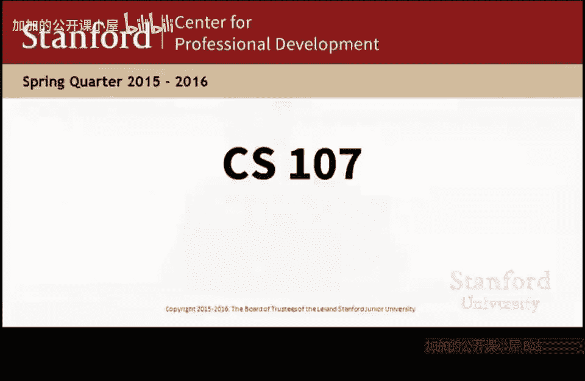
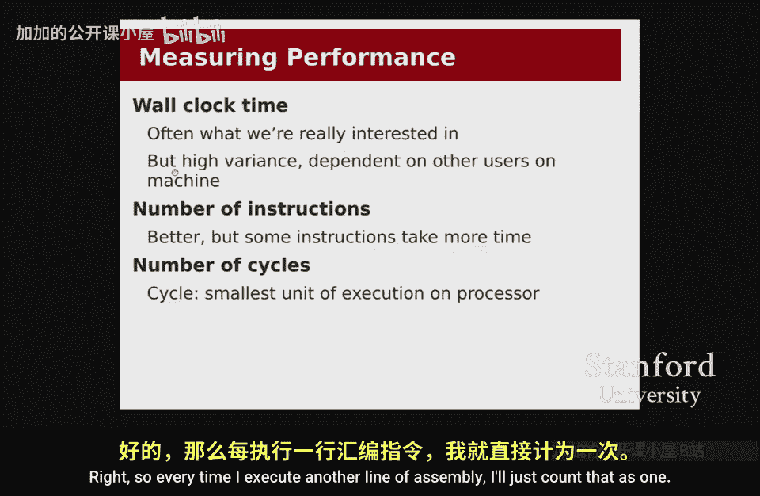

# 斯坦福大学【中英⚡计算机组织与系统｜2016 CS107 Computer Organization Systems】 p11 P11 Lec-15 -BV1tBSPB2EYN_p11-

So，It's the end of week eight here we're rounding out the sort of。Last few lectures here。

 we' got a couple of assignments and the final leftover。

 so I gave you the overview of what the roadmap for that looks like last Monday。

 but just kind of a quick recap at that， we've got assignment six coming in over the weekend and then we'll have assignment7 going out。

Pretty much right after that we're trying to give you a few extra days for assignment7 since that is kind of just a little bigger project and also an opportunity for you to kind of experiment a little more。

 sort of try different different techniques， so just trying to give you a good amount of time for that。

 that'll come in the last day of classes so the Wednesday， the first。Right。

And then our final is on the last day of final week。 So that's Wednesday， the 8th。Right。Okay。

So let's just get into the material today。So last time I talked to you about managing the heat。

 I talked to you about just sort of the。Sort of the high level sort of design ideas behind。

Writing Malik， real and free today is。Going to be a completely different topic。

 but still very related， which is。😡，How for any program。

 and that will include certainly heat allocator， how do we at how do we make the program run faster。

So we'll be looking at so the term， of course is optimizations， we've referred to this。😡。

Throughout the quarter already is in a couple of different ways。

 and now now we're going to look at it formally。So here are the three kind of big picture goals for today the first of them is we have to have some idea of how exactly we're going to quantify performance to begin with and so we've certainly referred at times to optimization we've referred to performance we' said oh your program has to run within two or 3 x the time the solution takes has to use memory efficiency and so on。

 but really what does it mean to write an efficient program。

 what are the ways that we can actually measure that so that we can look at something that we've done and say yes。

 our program got faster or no this didn't actually help。😡。

And so then the based having gotten that understanding。

 we're going to look at kind of two broad categories of optimizations here。

 the first is what can the compiler do for us so there's a nice，😡。

Ptty broad set of things that GCC is just going to be able to help us with that we don't have to and in a lot of ways shouldn't really worry about if it's something that the compiler can get right。

 then maybe we shouldn't twist our code into some bizarre state just so that we hypothetically get that。

😡，Get the optimization from it。And then， but there is going to be a category of things that the compiler is not going to be able to help us with。

 And I want to make sure we spend a lot of time， first of all， understanding， you know， how do we。

Recognize those kinds of issues and then how do we find how do we find them in our code。

 So given just a big program， how do we know where the compiler is giving us help and where it's not。

😡，你看。So let me get into it and start talking about measuring performance。😡，So far。

 we haven't talked about performance at all really throughout 107。

 so most likely your exposure to talking about efficiency or runtime efficiency and performance of programs has been in terms of big O notation。

😡，So from 106 B or X， you talked about Big O as a really convenient way to look at an algorithm。😡。

And say， sort of， how。How efficient that algorithm is in terms of。How。

The performance will change as the size of the input to that algorithm grows。

 So we're so biggo is really thinking about the kind of asymptotic growth of your input。

 Like if I pass my my function an array that's twice the size。

 I it going to become twice as slow or is it going to be four times slower。

 is it going to be you know。😡，Something much worse， right。

 something like exponentially slower and so on。Bico is a really nice。

Its a nice technique because it's machine and language independent。 So I can， you know。

 even just write some little piece of pseudocode and say， all right。

 tell me what the big O running time of this program this function is going be。

 And you don't have to ask me things like， well， gosh。

 what compiler are you using And what assembly language is this going to be compiled to。

 And what are the how many registers does the machine have。

 None of those questions ever came into the picture when talking about big O。

 which means that when we look at something like two different algorithms。

 we're trying to compare merge sort and selection sort or insertion sort。 Well， we can say， clearly。

 merge sort is going to run faster， Asymptically than selection sort because。😊。

Of these you this sort of runtime， and I don't have to worry about。

 well what if your machine had twice as many registers， would it still run faster。

 the big O know the theory folks can say yes， it will still run faster。 Don't worry。

 the big O is clearly different。😡，And so， we can。And so that's still going to be important， right？😡。

You know we'll see a couple of examples today with algorithms and the algorithmic efficiency of your program。

 What is the big O running time， Are you doing something in quadratic time that could be done in linear time。

 that's still going to be very， very important， but that's not the only thing。

 That's not the only way we can talk about performance。😡，And so the limitations of Big O。😡。

That well now we do have an understanding of what our machine is doing。

 We do know about our assembly language and。When talking about performance at this level。

 at kind of the systems level。😡，We want to be able to say。😡。

AhThis block of assembly is faster than this other block of assembly。

 even if the C code was the same。😡，And so Big is talking to be able to help us with that。Moreover。

You know， with Big O， it made sense to throw away constant factors。 it made sense to say， yeah。

2 n squared，3 n squared， Who cares。 It's all kind of quadratic time。 What matters is the growth。

 and that's true， except。100 n squared is a lot worse than one n squared。It really is。😊，In。

 and in the case where we're looking at。When we're thinking about optimizations at this level of like how should I change my code or how should I change？

😡，Or how should I change the assembly？We do need to start taking those constant factors into consideration。

 and when we write substantial programs， you know that need to run within milliseconds。

 if you think about like a Google search engine kind of program that really does have to complete in a very small amount of。

😡，Real time。They can't just say， oh， know， it's O of N。 that's good enough。

 That's not really going to work。So what are the alternatives？All right， so。s。

 you know so here are a couple alternatives I'll sort of talk through them one a sort of obvious alternative is just to take out our stopwatch and just kind of go right like I push start when I hit enter on my keyboard and then when the program stops I look at the time and I use that。

😡，In a lot of ways， that's often what we actually want to get at right So if we think about response times for something like a web page or a server。

😡，Often what we're eventually trying to get at is wall clock time。

 If I have to wait 10 seconds for a web page to load as a user， I'm not going to。

 I'm going to go to a different web page and so。😡，To that extent。

L clock time may be the right metric for that kind of thing， but。

The problem with just using our stopwatch is that。It's， is that。Clock time is going to be pretty。

 pretty high variance。 In particular， it'll depend on things like。

Whether other people are using the same machine， so if 10 people are using this one machine and that machine only has one core。

 then everybody's program is going to get 10 times slower。

 but that shouldn't count against the program， we shouldn't take that。

 We don't want to take that into consideration when thinking about whether our program is whether we're doing well or not with the optimization。

😡，So maybe we might say， okay， well， here's an alternative。

 we now know about assembly and we know that assembly instructions are what's actually executing on the machine。

 so let's consider just measuring the number of instructions that execute for our program。😡。

