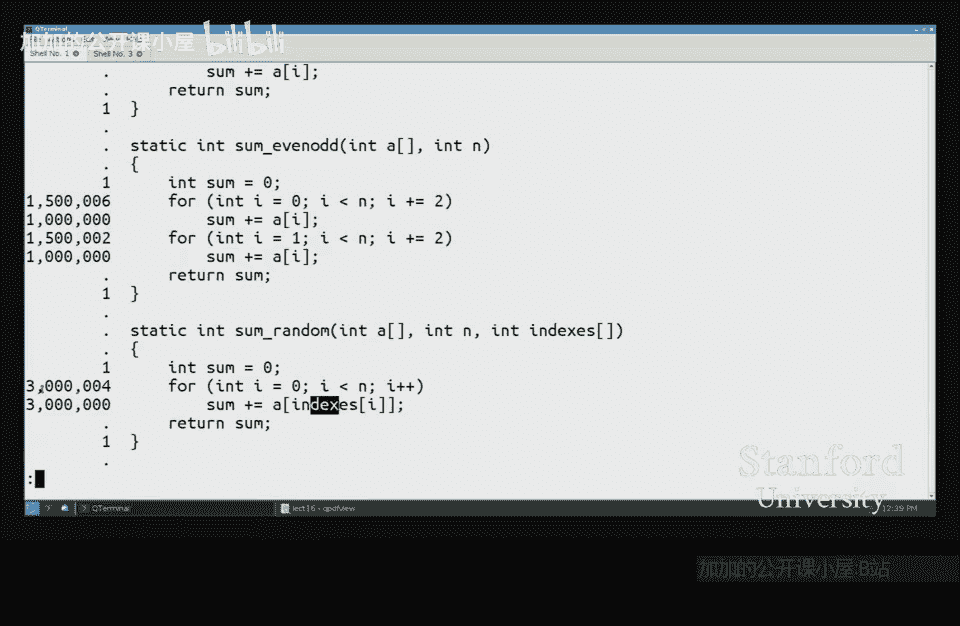

# 斯坦福大学【中英⚡计算机组织与系统｜2016 CS107 Computer Organization Systems】 p12 P12 Lec-16 -BV1tBSPB2EYN_p12-

Awesome， they fix this thing， too。All right。All right， hey everyone， welcome back， it's week nine。

 this is the last week of lectures for this class since we meet Monday， Friday。

 that means that next week， Memorial Day， Monday means that this Friday is our last lecture also this week。

 so a couple just general announcements， this is the last lab is this week。

And then we're kind of into the final stretch of assignments here now with assignment six。

 having its deadline was last Saturday， you still have until tonight at midnight if you are working up until the hard deadline and we just released assignment seven。

The Heap allator assignment that's coming in on Wednesday。 And if you。

Would like to kind of stretch that out。 We're giving you out until Saturday。

 But do be aware that Friday and Saturday are part of final exams。 So hope， you know， I think the。

And especially given that we will absolutely not take any submissions past Saturday night。

 please make sure you get， you know， please make sure you make some submits early。

 You can submit multiple times。 Just make sure you get something。

 something to us and don't cut it too close。 And especially if you have an exam on the Friday or the Saturday。

 we highly recommend that you。😊，You make the deadline。On Wednesday so that no。

 we don't start running into any of your exam exam prep。Okay。

 and a reminder that our final is on the last day of finals week， that's going to be the Wednesday。

 June 8th。So keep that all in mind。As we get into things， all right。For today。

 we're going to last time we talked about a little bit about optimization。 we saw a few different。

Teciques that the compiler could use and then some techniques that we could use to optimize our code。

 Today， we're going to sort of take a different approach to optimization。

 We're going to talk about ultimately， this thing called the memory hierarchy。😡。

And we're going to see some more examples of how to measure the performance of our code。

 some more examples of things that we can do to make our code run more efficiently to run faster。😡。

But before I define the memory hierarchy and before I motivate sort of why this is even a thing that we need to discuss at all。

 I want to just start right off with with a code example to kind of help us。😡。

Get set the scene for our， for our discussion， okay。So here I've got my。My， my code here。

 and I have inside of this array dot C file， Im showing a variety of different ways that we could sum up an array。

😡，So here you can see this version is just going to the normal。

 pretty straightforward code we've got， we're going to go from。0 up to n。

 and sum up the elements of this array。We have a version that will go backwards。

 so starting up at n minus1 and then coming back down。😡，We've got a couple other variants out。

actually， I'll talk about the unrolling one in a moment。

 We've got a version that it looks a little odd， but you know go with me on this where we're summing up all of the even elements before we sum up all the odd elements。

So you can see that this loop starts at i equals 1。 this one starts at i equals 0。And then lastly。

 we have a version that sums up the array in a random order。

 So here you can think of indexes as a random permutation of the numbers from one to N。

 So this will add up every element of the array， assuming indexes is correctly set up。

 but it will add them up in a random order。Okay。😊，And what I want to know is when I run these five variants。

What， what is the performance， What does the performance look like， How well will these variants do。

 We see the code， The codes basically the same just in， you know。

 running the loop in different directions and with a， you know， but。

They're all ultimately going to look at every element of the array。

 So maybe we'd expect there shouldn't be that much of a difference。And so。

We can kind of see what's happening here。 So we see that。Forward and backwards， they kind of look。

Roughly the same。 We might explain the differences between these in terms of just a little bit of variance。

 So I'm using the same kind of cycle counting of metrics that we talked about on Friday。

 So we're counting。We're actually asking the processor how many sort of。

How many cycles it took to execute our code，😡，Basically proportional to the amount of time it took for our particular processor。

 but it'll out things like it'll try to factor out things like other users and stuff like that。Okay。

 we can see that this this unrolled version was a little bit faster。

 So I kind of want to know what's going on there。 That That seems interesting。

And then we see that the， so even an odd one， okay， that's a little bit slower。 You know。

 maybe we can try to find a way to explain that。And then。

 but this random one is the one that's really kind of dragging us down here。

 That one's coming up six times slower than just adding up the elements。From in forward order。

 But hey， I mean， come on， we're just we're adding up the same elements。 So what's the problem。Well。

 we can ask， just like from last time we could ask callgrid。 So I'll come over here。

 I'll close the code because callgriin will show us the code anyway。And so I'm going to run v grind。

Tool is call grind。On do slash array。And so then I'm gonna。

 so I made a little script to handle our annotations。

 So it's I'm basically running callg annotate just like I did before。

 But this is just gonna to make things easier in case I forget to type something。And so， we can see。

First of all， we can see that the number of instructions。Is。Pretty similar throughout here， right。

 And it doesn't really。 So let me just go right into the code and just so just show you each of these variants here。

 I'm gonna。I'm just going to come down。 So for the sum forward and the sum backwards。

 you can see that the numbers are。Basically the same。 the number of instructions for the for loop。

 So it looks like this iteration， the the for loop code itself took up three instructions per iteration。

 and it looks like the sum plus equals a bracket I took up two instructions per iteration since we have a million element array。

Right，And then we got the backwards one， the code looks the same。

The unrolled one is kind of interesting。 So the idea behind this version of the code。

 what we're trying to do with loop unrolling。 So this kind of is related to our discussion of just code optimizations from last time。

 Here's another way that we could try to optimize our code， which is that。

If we don't want to spend 3 million instructions running through this full loop。

We could imagine instead having our for loop sum up our elements in groups of four。😡。

So here I've got the， I've got this， this loop running at multiples of， of four。

 So I'm going so I running down。 But so I bias equals 4， which means that in total。

 I'm only running a fourth as many instructions for the loop。

Control itself for just the for loop itself。 I'm doing the same number of instructions to actually sum up the array。

 though， because now I have to add up all four elements in this， in this group。Right。

 and so the benefit of loop unrolling here is that。I'm actually running half as many instructions。

Right， a total of 2。75 million instructions here， as opposed to， oops。Should't have dragged。Well。

 what happened？All right， let's try that again。Apparently， dragging is not happy about this。

 I did not expect that。Good to know。So we've got 2。75 million instructions。

 but it's not like it ran that much faster， it did not run twice as fast。😡，Com over here。

 we can see that it ran a little bit faster， but really not that much。

In comparison to something forward to something backwards。

So this could help with a certain amount of overhead。

 but it's obviously not totally solving our problem。😡，If I come down to the even an odd one。

 recall this took one and a half times。What summing forward and somethingm backwards did。Alright。

 so 3， roughly 3 million versus 4。5 million。But the number of instructions， if I add them all up。

 is the same。1。5 million plus 1。5 million is 3 million。 million plus 1 million is 2 million。

 So we're still going get our 3 and our 2。And whatever the heck is going on to explain。

I can come down to random， there's 1 million extra instructions here because we have to look up the indexes array。

😡，But。

