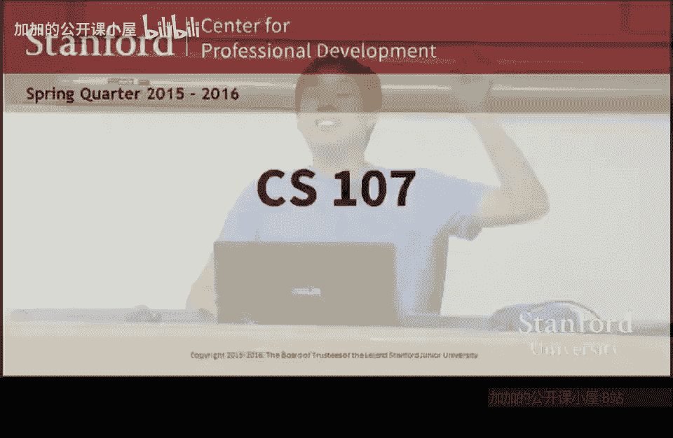
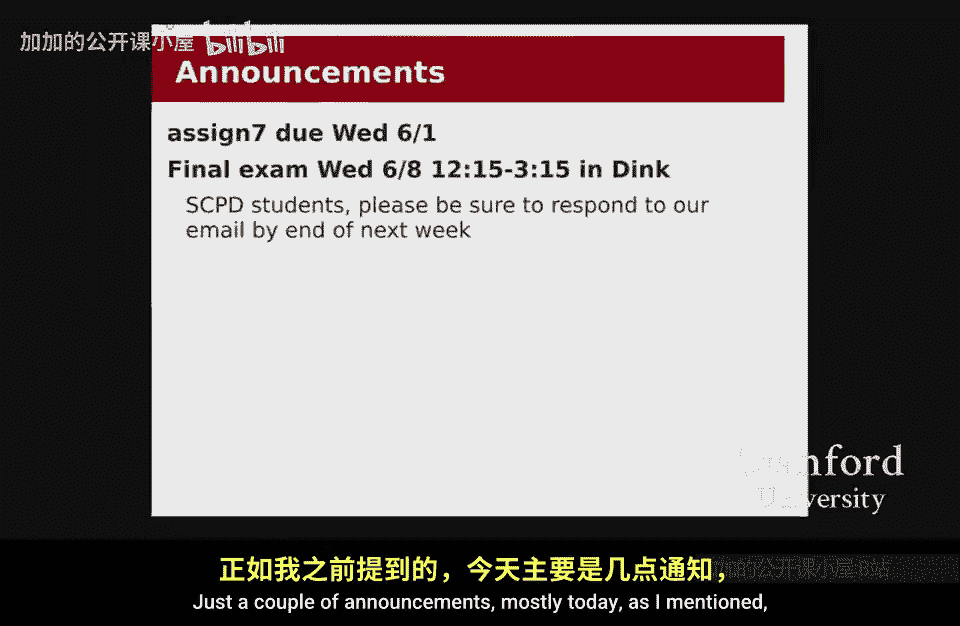

# 斯坦福大学【中英⚡计算机组织与系统｜2016 CS107 Computer Organization Systems】 p13 P13 Lec-18-End -BV1tBSPB2EYN_p13-

Let's get started。

Bo， this is thing working out now it's journalism，All right。

 welcome back everyone to the final lecture of CS 107。He喂。😊，Okay。

 let's get into things real quick just a couple of announcements， mostly today。

 as I mentioned on the kind of on the website， mostly just kind of a little informal just just a chat about where we ended up and what kind of。

😊。

Exciting prospects are open to you now that you've worked you've worked so hard throughout this quarter and sort of where we can go from here。

A couple announcements to kind of round things out。We've got。

The two things that I'm sure are very much looming on your minds assignment 7 and the final exam。

 So we've got assignment 7。 That is just a reminder due this coming Wednesday。

 the first with the hard deadline of Saturday， the fourth。

 keeping in mind that that is in the middle of。Finally， jam， so please plan accordingly。

 we highly encourage you to get。The submission in by the first and a reminder that we will take absolutely no submissions after the hard deadline with no exceptions。

 we have to get these things graded and we have to get them graded pretty pretty quickly。

 so we can't really make any kind of。Any sort of exceptions like that。

 So please make sure to get on that and to get something in。You know， by the deadline or at worst。

 the hard deadline。We've got the final jam coming up。

 I guess that's about a week and a half from today。 So that's going to be on the 8th。At 1215 to 3，15。

 that's like right at the end of the exam window。 So this should not run into any other class exams pretty much。

 We only have one exam room this time。 that's kind of nice。 So we'll all be in dink。

So please don't come here for that， you won't find anybody or if you do。

 they won't have anything to do with us so that could be bad。

And then just a quick note to our SPD students and also to anyone who has， for example。

 an OAE accommodation。 please get in touch with us at the staff email list again。

 even if you've gotten in touch with us for the midterm， please make sure you。

 you specifically email us about the final so that we can make a new list of SPD remote students and OAE students and things like that。

😊，And then just a note about so the practice final。

 we will have a practice final that will be posted within the next two or three days。

 It turns out the process of updating that to work with the new 64 bit and stuff is。

 is maybe a little bit longer than normal。 So we just need to make sure that it's correct and that there are no surprises。

Okay呃。Everyone okay with that？But final logistic kind of stuff。狗狗。

So later today is just kind of wrap up， sort of。You know。

 so I'm kind of breaking this up into two different pieces， which is sort of like， all right。

 you know， we've just spent。9 is weeks working through a bunch of really challenging。

 really intense material。 So part of what I want to。

Summarize for you today is just kind of why does that matter。 And hopefully I can get some of you。

 to chip in on that。 You know， what you thought was， was useful to get out of out of this class。

 but also kind of I want to give you a little bit of a sense of where C shows up。In。

 in the real world。Where people care about。Systems and the work that we've been doing this quarter。

 And then I want to give you an overview of kind of where to go from here。

 whether that be in later classes， whether that be with。Jobs， internships， research。

 kind of anything in and beyond。Computer science。So， yeah， mostly I want to be kind of off sidess。

 I'm just gonna of talk to stuff through， But I'll leave that there。

 I want to show you a couple little， little pieces。

 So I kind of just want to talk a little bit about， you know， where exactly we've ended up。

 And I want to just talk about like。How where 107 kind of fits in。😡，In the。

Sort of grand scheme of computer science in the， in the。Big picture of the major。AndSo。

Maybe just a little story here for those who are interested in C， S and who。

Don't already know about them。 We have a course advisor who is a graduate student whose job it is to help。

C， S majors and prospective C， S majors and， and also grad students， undergrads and grad students。

 you know， to sort of。Know what the lay of the land is in terms of classes， requirements， jobs。

 research and， and all that。 They can just give you general advice。

 as well as sort of specific things like。Am I going to graduate。

 do I need to how should I plan out my requirements and things like that？A couple of weeks ago。

 we were interviewing for。This course advisor position。

 and one of the questions that we asked the prospective course advisors was if a student came up to you and asked you and said that they only had time to take three C。

 S classes， which classes would you recommend and why。And as I understand it。😊。

Pretty much everybody we interviewed said 1，0，7 as one of those three classes。

And I think that's somewhat telling as to sort of where 107 is positioned。

So in the grand scheme of things。So。But so instead of， you know me sitting here。

 I'm sure I can make some kind of a list about all the things like why 107 is。

Is would go on to these folks lists and whatnot。 But maybe I'll， I'll open up to you a little bit。

You know， what kind of things do you feel like if there was one thing that your friend or something said。

 okay， you know I'm going to take one of7 or I'm I'm thinking about it。

From whatever background that you can。That that you're interested in taking on it， you know。

 what would be something that you thought was pretty useful。

 So something like kind of the most valuable thing you felt like you got from this class。

Anyone want to throw anything out there？Anything？I guess one understanding the nitty gritty a couple of concepts that。

Previous process that we brushed office I you don't need to know， oh don't worry about it。Yeah，Yeah。

 so I'm not sure how much the SPD are're getting the student responses。

 so the comment was looking at the kind of the nitty gritty details that sometimes previous classes and I actually think to some extent future classes even right will totally brush off as like yeah yeah that happens that system still right like well this is this stuff and now you hopefully you get。

A feel for that kind of。Those kind of details now。And knowing how that works。Okayよ。

Using a debugger like G。 All right， so using a debugger like G， yes。

 that is a very important aspect of。Of what were trying to build up here， I can tell you that。

You know， as you move on through the classes， for example， in if you were to continue， for example。

 110， that's how it's going to come back right and in fact。In one hand0。

The TAs don't look at your code。人哋。Are they are somewhat assuming that you are going to be able to walk into that class with a a good feeling of how to GDB your way through something。

 how to use Valggrain to get information about memory management。You know， kind of that space。어때요？

It's learning how to read assembly。Yeah， learning how to readassely， you know。

 it's apparently hurt to get into that area of。This could be really relevant to you I can tell you that there are a couple of17 in。

Downstream class and they sure were reading a lot of assembly last couple days。

 anyone a team of my office hours。So working through that， like yeah。

 it turns out that does kind of come up。In。More ways than you might expect。

 assemblyly does kind of very ugly time but just kind of having that working knowledge。

Understanding what goes on behind the scenes of a or high level programming language。 Yeah。

 so understanding what's going on behind something like a higher level programming language， Right。

 So like， now you're actually pretty equipped to understand how Java or jascript or Python or all other languages work in a longer quarter you know。

 for fall winter， we spend a lecture to talking about Python and just kind of comparing and contrasting and saying。

 look， you know， we learn all these things about memory and pointers and addresses。 Hey， guess what。

 that's still there when we're in Java when we're in Python。 It's still exists， It's just that。😊。

The language is trying to kind of hide that from you， in a sense。Great， anything else。

Something that wasn't fun， but having the focus not be on like learning C。

 but on just getting the assignments done increased my confidence in being able to just start。Yeah。

