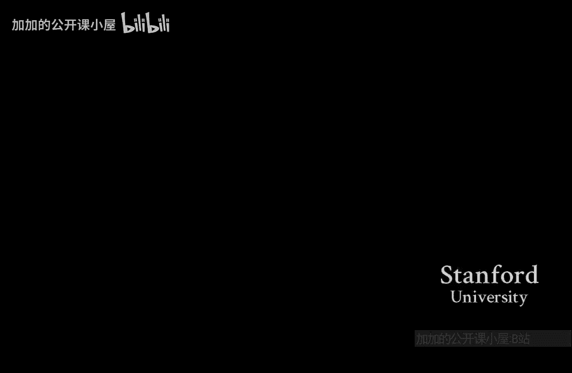
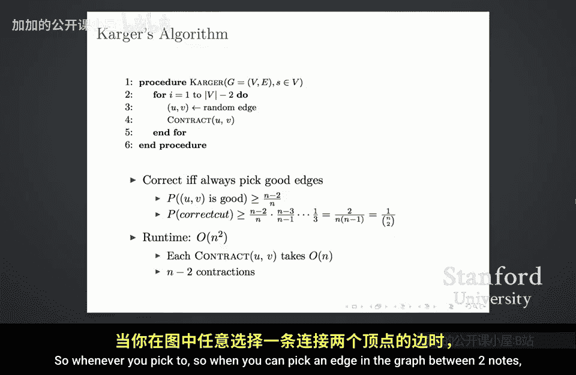

# 斯坦福大学【中英⚡计算机组织与系统｜2016 CS107 Computer Organization Systems】 p14 P14 Final_Review -BV1tBSPB2EYN_p14-

Okay， so I hope everyone is here for the CS161 final reviews。

 otherwise you've been to the wrong place。😊，Okay， so the plan today is I'm going to go through the materials after the midterm because these will be the focus of the finals and then I'll take questions and then we go through some practice problems Okay sure so here here here on the materials that you have to care about well you should focus on these materials when studying for the finals so after the midterm we've been talking about graphs and so we talk about how to traverse the graphs。

 how to find a shortest path on weighted and unweighted graphs how how to find a minimum span tree we also talk about global mean cut and CAs algorithm or some the cut between some particular pair approaches is ST and we also talk about Maxflow so those are on the topics about graph and other end graph。

😊，Algorithms， we also talk about dynamic programming。 dynamic programming is essentially a way to。

 you know， to to design algorithm。 and it has many applications， of course。 But yeah。

 so this are the we also talk we also mentioned we also do some greedy algorithm in the in the class。

 yeah， this will be the focus of the finals。 So。😊，I'm just going to go through some very brief details of this algorithm。

 So， so first thing I'm going to talk about here is graph Travis or algorithm。

 So there are two ways to traverse the graph that and breakfast。 So you know， yes and。😊。

So I'm not going to talk about how to do these algorithms unless anyone asks a question about them。

 but basically by using the graph， very simple graph travel or algorithms you can do things like check whether the graph is connected or find on the connected components。

 you can do a topological so and then with that first search you can find the strongly connected components and with breakfast or you can also find the shortest and weighted path and the runtime of these two algorithms are both m plus and where M is a number of edges and n is a number of purchase in the graph。

 it's a little nontrivial to figure out why these algorithms run in a big area of am and but is essentially some aocized analysis that gives you the a big of em and runtime。

😊，I connecting components with BFS to just like take longer like you could still like check whether like all nodes are reasonable from all the nodes by just running BFS from every node like it would I understand that DFS is faster。

couldnt you still find from connected components。 You just have to like run B F S from everything。 I。

 at least I， I don't really see how you can find a strongly connected component with B F S。

 How can you do that。You can see if the graph is a strongly connected component itself。

if the graph is strongly connected。 one our problems by running BFS twice。

 Yeah so if if your graph is if your graph is is a strongly connected component or in other words。

 it has only one strongly connected components then you can run BFS twice to determine whether that is the case。

 But if it has more than one strongly connected components then then maybe you once be able to find of them with BF。

 to find all the connected components。 So theres an algorithm So then an algorithm mentioned in the textbook。

 if if you are going to use that exam， you can just say that try to find on the connected component with BF。

 and yeah， there are on how to do it I think there's another question on this。😊，No。

Sure yeah so graphra travel show down next thing we talk about in graph was shortlist path and we discussed three algorithms to find shortlist path here so Daictra and Belman Fort and Fl wasng so。

😊，So ditra is a facet one， but it' also theest is also the weakest one among these three。

 so Dshire helps you to find the single softest path only in the graphs where the edges cannot have negative weight Ballman thought essentially the same thing。

 but it works with graph with negative weight edges andlog and f goes on something it does something stronger so it finds the softest path between on pairs of purchasetices and here the corresponding runtimes。

😊，so。Okay， so you should look at a lecture and the lecture note and you know。

 add a memorize this thing or write them into the cheat sheet in case you have to use。😊，ok嗯。

So dynamic programming， I'm not going to talk much about this because we have we will have some practice on dynamic programming because well it's really hard to say anything about dynamic programming because it is it is only a paradigm to solve problems So when you see a problems。

😊，A problem with a lot of repeat repeating subpro then it's time to think of dynamic programming and if you want to design a dynamic programming algorithm。

 the first thing you have to do is figure out what to compute usually you can compute a table or maybe a 2D or 3D table define and then define which what is meant by each dimensions of the table and。

😊，Fear out what is the base case and also the recurrent stuff。

 So I believe everyone knows how to do this。 we have some practice on this later。 Oh， by the way。

 so dynamic programming is somewhat similar to divide and conquer because for So divine conquer is something we talk about before the midterm。

 So it's like you want to solve some problems， you break it into some sub problems and then computer reason and then you know。

 bring them up together。 So it's very similar to Dp。

 If you think about the idea of solving sub problemsble。😊，Okay， so next thing。

 we we also talk about minimum spending tree。 and there are three algorithms to find this minimum spending tree。

 I I list them up here。 So Borovka and Csco and Prim。😊，So。Yeah， I do。 so。

So Brovka and Kco algorithm are very similar in terms of idea because both of them try to keep track of a set of these joint trees and while so Borovka so for Borovka algorithm at each run of the algorithm you pick for each tree。

 you pick the smallest edge and then merge the corresponding trees together for Kco it's a little difference because you go through on the edges and in the increasing order of weight and whenever you see something that I'm not merge then you merge those two so the runtime of Kco algorithm is actually very nontrivial to analyze so it has a factor it has a thing after the minus one of n that is called the inverse ackerman function so yeah we don't expect you to notice but but if you have to use Kco algorithm in the finals。

 then this is a runtime and you can just you can just use this result。😊。

Pmgo is very similar to that extra。 The only difference is that for that extra。

 you keep track of the the weight of you keep track of the soft the distance from the socks node to each the node in the graph。

 but for premal， you only keep track of the weight upper node of the a that connects。

A note to the tree that you havent really built。Okay， so that's all about spending tree。

Then we and the next topic was global meanan cut and cargos algorithm。

 So global meanan cut is a problem where you are given a graph unweighted or weighted。

 that's most are fine。 And you are going you are to and you have to return a way to part the set of vertices in the graph into two subset such that the weight of the edge the sum of the weight of the edges that go between those two subset is minimized。

 So and in case of。😊，Unweighted graph， you just think of each S has weight1。Yeah， so the algorithm。

 so so global mean cut is in general is an NP problem。

 but we discuss an algorithm a randomized algorithm that give you reasonable performance and sorry。

 reasonable correctness and it's quite fast to do that is called that is cglus algorithm。

 So for cargo cglus algorithm is based on an operation the ash contraction。 So whenever you pick to。

 So you can pick an ash in the。😊。

