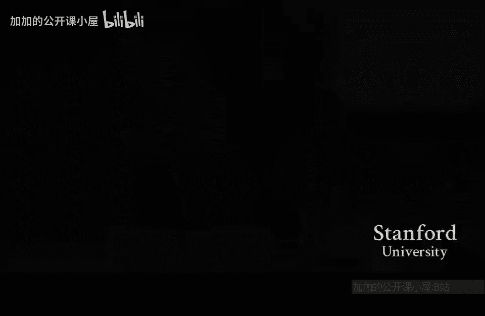
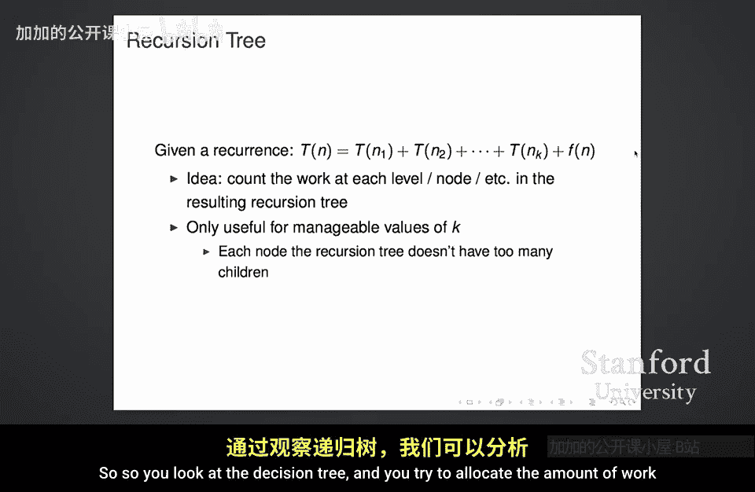

# 斯坦福大学【中英⚡计算机组织与系统｜2016 CS107 Computer Organization Systems】 p15 P15 Review -BV1tBSPB2EYN_p15-

We better get started so I think a plan so today will be a 50 minutes review session for CS161 midterm so I think the format is going to be like this so first I'm going to talk I'm going to give you guys a review of all the topics in the graph so far and this is a compression of half a quarterter into like 20 minutes so if you didn't understand and so if you didn't know about anything at all then you shouldn't expect that you can learn on those in the section but these are better like something to give you a refreshment on these things and so I'm planning to spend about 20 to 25 minutes on of these topics and then I will be answering questions and then after that if we still have time then I'm going to give you some practice problems and we can go through some practice problems to get on about good plans。

😊，Okay and can anybody hear me right Yeah okay sure so so these are these are the topics that you you will have a chance to see on the midterm some of these will be more likely to occur than others so I can say for very sure you will have a problems one so you will have three problems in the midterm one of them will be like one of your homework exercises where you will be given a bunch of recurrences and just solve one of them and then there will be two other problems one shocked problem and one longer longer problem so that will be a format of the midterm and I think as the analysis is the first topic that we will have to cover because it is really important。

😊，So so here I I'm giving you a refreshment of the notation of the O mi O omega and Theta notations。

 So I hope everyone is familiar with this one。 So if you have to function F and G and you say F。

 So if F is smaller than G。😊，Smaller in quotation in the sense that you are seeing on the screen。

 than you say is's big O。 If F is larger than G， then it' big Theta。 Sorry， then it big omega。

 And then， and then if F is both in big O and big omega of G， then you say is theta。😊，Clear on this。

 Okay， so in practice， when you analyze the complexity of the algorithm。

 we will mostly ask for the M O notation because big O kind of give you the upper bound of the running time of the algorithm。

 And we are basically more interested in that。😊，there are some useful stuff that some useful equations about big O notations that I'm showing here so you should be able to prove on this thing formally by you know taking the existence of C1 C2 existence of n0 and stuff like that to derive on all of these equations。

 but I think these equations at this point are，😊，Obvious enough for anyone to just apply them。

 as I'm showing here。 So if you have to， you， so， so the， so make a notation of sum of two things。

 you can just sum them over or you can just take the thing that is bigger。😊。

And big of the products it， so product of two big os is just a big of the products。😊，Okay。

 so I'm going to give you an example on the big notation。

 so on the screen I'm showing on the left I'm showing the Mag multiplication algorithm and it is a very naive approach so and you are asked to analyze this algorithm so。

😊，By using the summation of big O you can break the programs into smaller chunks and then you can analyze each of these chunks individually and then sum them up。

 So in this case the first part of the program is going to be the lines from line 3 to line 7 and so you see that there are two nested follow loops and whenever you see nested fall loops then it is a time that you can use the multiplication of big O notations so here you see that there are two follow loops one the outer follow loop the follow loop as line3 runs for n times and the nested fall loop in line4 runs for p times So let's give you an O times O which is O as said before similarly in line 8 to 14 you see there are three nested fall loops and so the same argument applies and。

Overall， you can just sum those overall。 So lie 3 to8 and sorry 3 to 7 and then 8 to 14。

 those are separated so that you you just sum them together。 you don't need to take a photo。

 I'm going to upload on the slides on P I later。 Yeah。

 so and then you sum this thing over and you know that M andP will always noinate M。

 So the final is only just of M andP。😊，Okay， so these are a very simple example of MI ownnotations and when you have to in the midterm you will be asked I'm sure you will be asked to design some algorithm and then if you can phrase your algorithm in some forms of pseudo。

 then you can just use this kind of analysis。😊，Okay。

So the big notations that as I just showed they are good for solving linear programs。

 I mean linear programs are the programs that doesn't have any Kong to itself it's not recurrence。

 so you can just track them down and then use the adding other multiplication room to analyze the complexity。

 but there are cases where where you will have to。😊。

To phrase complexity in terms of the recurrence and those are actually the bigger problems。

 so we'll talk about recurrences so there will be three ways to solve big recurrences。

 the master theorem， the substitution method and the recursion tree method so the easiest thing to do is master theorem so the scary thing here is called master theorem there are three cases you should either memorize this or write them into yachi shit and I recommend writing them into yachi because these I have to memorize and not very long to write down so master theorem is easy in the sense that it only solve one kind of recurrence and that is the recurrence that I'm showing here So if if theres only one con to the recurrence multiply by a product or something plus a function then you can then depending on on that function you can decide which case of master theorem you can use there's only one thing that I want to note about。

😊，The theorem that is you should be careful in case1 and case3。

 make sure that there is an epsilon great strictly greater than zero because it yeah you need to have something strictly greater than zero otherwise you were just found into the second case and in the third case the conancy must be less than one。

 so we have been seeing these kind of mistakes in the homework so something I just want to note down。

😊，So masterotherorem is the simplest way to solve recurrence if you see a situation like this。

 then just use masterotherorem。😊，ok。Second thing， the second method seems to be a little more complicated。

 The substitution method。 So substitution method。 It is just a way to prove re an upper bound。

 upper recurrence。 it doesn't help you to find the upper bound。 So if you have a recurrence。

 and you want to solve it using substitution method。

 The first thing you have to do is you have to guess the upper bound。

 like what you are trying to prove and。😊，So。Ideally。

 we will want the upper bounds that you guys to be tight。

 but if you cannot get the tightest bound that we are expecting then you will still have the partial credit provided that you will rest correctly and so once you have an upper bound as shown here。

😊，You， you just buy it under definition of big own notation to。

To prove the bound that you guessed so so I have been seeing these kind of questions in the office I also basically when if you want to say that TN is the function you are trying to analyze that is it is in big o of TN then you want to find the nn and the C such you know for on n greater than nn than TN is less than or or less than or equal to C times TN so。

😊，Some people have been worrying about the basic case like what unknownn do you have to select and I would say don't worry about that the important part is you must get the function tree correct and the conancy also correct and once you guess those two and and provide it that you can carry out the the inductive step then you just can just take a very mixed value of ann and that's it。

😊，O。So。I'm showing some example here， but I think we will go back to this later after I answer all the questions。

Okay， next thing is the next method to soft recurrence is kind recursion 3。

 so when you have a recurrence like TN is equal to sum of a bunch of T。😊，And another function。

 Then this thing will basically create a recursion tree。

 and you can look at the recursion tree either at the。 So so you look at。😊。

