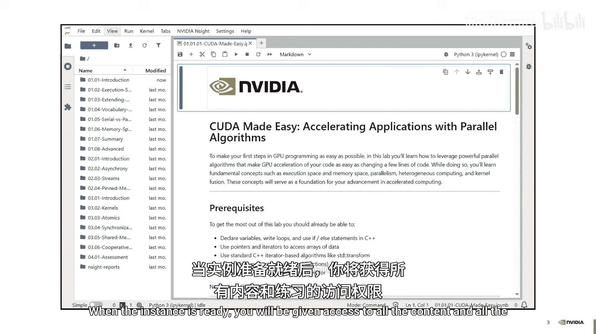

# 现代Cuda-C++-编程课程-2025-｜-Nvidia-Developer-p01-P01_使用并行算法加速应用-CUDA_C++_课程_第1部分--BV1VLSnBqEe1_p1-

Welcome to Nvidia's modern Qar Cpress Press programming class。In this first video。

 you will learn how to program on the GPU using NVdia's latest programming tools。

This video is part of a broader video series teaching Ktor programming。In the second video。

 you will learn how to unlock the GPU's full potential by using a synchrony and cut streams。

In the third and last video， you will learn how to implement new algorithms on the GPU using C kernels。

Links to other videos can be found in the description。While watching this class。

 you will regularly need to pause the video to complete exercises。

There are two platforms where you can complete those exercises。

 one on the accelerated computing home。There you have access to all the slides and notebooks containing the exercises。

 It's open source free and can be run locally if you have a GPU or on Google Collab。

2， on the GA platform。The content is not free， but you will be given access to a GPU。

 the final assignment， and after completing the class to a certificate。

Both links can be found in the description。To go on the JI platform。

 click on the link provided in the description。Go in the GPU hands on section and click on the start button。

Eventually a GPU instance will be given to you when the instance is ready。

 you will be given access to all the content and all the exercises。

So now let's start， so this first section is just to see how you can accelerate applications using GPUs in the easiest way possible。

So first we'll learn about execution space and how they can allow us to achieve huge speeds by doing simple code changes then we'll talk about how we can extend those algorithm using fancy iterators we'll then talk about a few vocabulary types that you can。

Understand better what we talk about here and there when talking about a Qa and power algorithm。

Then we'll learn more about power algorithm itself and especially in GPUs and how we can achieve those 00 x speedups。

 and finally we'll talk about the notion of memory spaces and how they can also end up accelerating a codeor by up to 100X。

So let's first try and understand what's the difference between a CPUU and a GPU。

 so let's consider a bus and a car and the question could be what's faster between a bus and a car well this question doesn't really make any sense if you just take it like that。

A bus。It will take longer to move a few people because usually a bus is slower than a car。

 but a bus can take many people， hundreds of people if the bus is big enough。

 while a car surely it can go usually faster than a bus。

 but it can take only a few people maybe five at the maximum。

So which one is faster doesn't any sense， the question is what kind of speed do we want。

 do we want to just move one or a few people as fast as possible or do we want to move many。

 many people as fast as possible， depending on the answer。

 the best or the car is the best solution for you。😡。

And that's the exact same thing for a CPU and a GPU。😊，On the left。

 you have the CPU and you can see that the latency。

 though usually the amount of time you need to wait for some piece of data to arrive is around 100 of nanoseconds。

😊，On the other hand， the memory itself， so your RA just allow us to move 100 gigabs around 100 gigabytes per second this means that you can read or write data very quickly。

😊，But you can only read up to so much data in this case。

100 gigabytes per second for your CPU is your car。 it moves very fast。

 but only a few amount of data per second。On the other end， the GPU is different。

 The GPU has a higher latency。😊，Then the CPU， it means it needs more time to move a single piece of data around。

 usually around 500 nanoseconds。 That's five times more than the CPU。

 So the GP will take more time to take some data， do some modification to it and then write it back to Mary。

But。On the other side， it has way more bandwidth， way more memory bandwidth。

 A GPU usually has around。1000 gigabyte per second。

 which is1 terabyte per second that's way more than what the CPU can offer is just hundreds of gigabytes per second。

 so the GPU is your best。It's moving more data around but slower， but so in the end。

 if you want to move a lot of data， the GPU will be better， but if you want to move less data。

 but very fast， the CPU will be better。So we might consider what kind of problem can benefit from the GPU bandwidths。

 so here we have an example of the problem of a problem where we have three cups and those cups are at different temperatures so 4224。

 50 and we want to simulate how the coal them over time。And so for now。

 we'll just simplify and say just one cup is one temperature will not take into consideration all the other thing we'll just consider the temperature of each cup。

And so we just have a bunch of cups， they all have a different temperature and we want to simulate how the object will cool at room temperature。

 so if you leave your cups after getting them cold or hot in the room。

 how will the temperature change with time？😊，And so the question might be for this kind of problem。

 so if I want to simulate how my cups cool down or heat up with the room。😊，When is the GPU useful。

 when is the GPU useful， and so the only question you need to think of is how large is M。

 So how many cups do you have。So let's say we wrote the code right。

 to do the simulation of the cups and we first tried on a CPU with a single thread。

 a CPU with all the threads or 64 threads in our example。

 and on the GPU and we try to look how much time it takes。

And so if we just have 512 cups to simulate， we see that a CPU with a single thread is extremely faster than a GPU and even faster than a CPU is 64 threads。

😊，That's because usually when you want to use many threads on a CPU。

 it adds a lot of overhead the same goes for the GPU， the GP as hum overhead to create the data。

 move the data around etc， and there is again the GPU has more latency。😊，So with only 512 cups。

A single threadded CPU is more efficient than a multi threaded CPU and a GPU。Now， if we go further。😊。

And if now we have around 64，000 objects， now we see that finally。😊。

The multith CPU is faster than the only one thread CPU， but the GPU is still too slow。

 that's because 64K elements is still not a huge amount considering what the GPU can do。

And so if we go further and we go to around 200 million objects。

 finally the GPU is 10x faster than what the CPU can do so now the CPU1 thread is the slowest then we have the CPU multithread and then finally the GPU because finally we have enough elements so here 200 million to saturate in the entire power of the GPU that the the bus if you do the bus。

 but you only have five people at the time in the bus the car will move more people around per minute than the bus。

 but if you have 200 million people to move than the bus will move far more people than the car is able to。

So now let's look at how we would implement this code。

 so our goal is to simulate how the cups gradually approach the ambient temperature using the equation shown below that this is a very simple equation so you see that at each step the equation adjusts the object temperature based on the difference between the current temperature and the room temperature。

So each object goes down independently， so each object has its own temperature and each temperature evolution。

And so they all follow the same rule and so one object temperature doesnt affect the others and that's great for GPUs for GPUs we want many things to happen in parallel。

 hundreds of thousand if not millions， and we also want them to happen independently preferably。😊。

And so here you can see at the top， you can see that the cups start with for2 24 and 50 degrees while the room temperature is at 20 and so if we apply this temperature of。

😊，Previous temperature plus k time the room temperature minus what's was the temperature at the previous step we get the next temperature and we see that here 42 goes 231 24 to 22 and 52 35 so we see that all three they start converging to the temperature 20 at different rates。

And so this is how the code would look like so we start by defining the cooling coefficient of 20 we define k here 20。

5 we have our three cups with our initial temperature of 4224 and 50 and then we define what we call the lambda function in simple+ and this lambda function is just the formula that we just define in the previous slide which is just this amient temperature minus the current temperature and we do this time the time the K and that's our new temperature and so once we have this this lambda function which just define at each step how the temperature evolves we could just have our full loop here that will go from step 0 all the way up to step 3 so we'll have three step301 and2 and each time we print the temperature how it evolve and we call the ST transform function so the transform function is a simples plus function from the STL which applies。

😊，Specific Lada， between operator to a whole container。 So here we go from the vector TMP。

 which is our three cups from the beginning to the end。 And we just applied our operator。

 and we do that three times。😊，And so we can see on the right that we go from 42 to 31 to 25 for the first one and so on for the other ones。

😊，And so again， we have our multiple object， they all cool down independently and they cool down in a meative manner。

 and so for now obviously this codes red on the CPU because we're just using a STD vector or an STD transform and we have the three steps。

😊，So if we take a little deeper look at what STD transform is doing。

 transform is literally transforming the input， so you first pass what the first and last element of your container here our vector。

 then where you want to start the results in our case we just wanted to start it in the same container and finally the operation。

😊，So here you can see on the right， again we have our Lada function。

 we're applying it to the vector on the left， we go from first to last。

 and each time we just apply the operator and we store the results in the output vector。

 which is here in our example the same as the input vector。😊。

And so if we wanted to program STD transform ourselves that would just look like this right you just go from index0 all the way to the n of the vector and you just apply the operator right that's just what STD transform is doing it's going from the start to the end could be to a smaller portion but so here we're going from the beginning to the end so zero to the maximum size and then we just apply the operator and we start it in the result which is again in our case just the same vector once all of this is happening on the CP。

And so。Let's first do a quick reminder that CPU， they do not run C+ plus code when you write a full loop。

 they the computer is not going to run this full loop， the computer。

 they do not understand a full loop。What they understand is compile code binary， CPU instructions。😊。

So if you look at the C++ expression on the top you can see we are doing this temporary temperature plus k times the difference well depending on what architecture you want to run on the resulting compiler will generate different instruction so if we take the first one so your usual X86 CPU your Intel AMMD CPU。

 you will use an X86 compiler that will convert the instruction into a VFMA instruction which is a few multiply add instruction which does a plus NA multiply at the same time and so this instruction will work and only work on this X86 CPU but if you were to compile this C+ plus reflection this I plus K times D using an ARM compiler for an AM CPU you will get a different instruction you will get VmlaA。

 F32 instruction。Again， if you want to compile this code to run not on the CPU， but on the GPU。

 then again you will use another compiler， which is in our case。

 the Qta compiler and it will again generate yet another instruction which is FMA。

 R that F32 and so you can see here that for each different architecture you will have a different compiler and a different Indian instruction that will be executed by the hardware but at the top they all see the same code。

 but this code is not executed exactly the same by the different architecture it depends on what the compiler will generate as instruction。

 but so the GPU。😊，It's not that different from the CPU in the end。

 it's just processing instruction and those instruction in the end。

 that is the same thing than the other but just in a different manner。

So this is how it would look like， so if you wanted to compile on an X86 you would just use G++ and specify the output right if you were using an RM CPU you could use the R64 G++ and if youre hearing on the GPU you would be using NVCC。

😊，AndSo if you comply with NVCC， your expression will be converted to executable GPU instruction。

You might think that just compiling this expression with NVCC will make your code magically work on the GPU。

 well actually that's not how it works。😊，Because as is， if you just compile your code。

 as there could be saw before using NVCC， your code will work on the CPU。

And so that shows that there is there can be a confusion onto how people think that code can work on the GPU。

 you need to specify some things in the code to let the compiler know that some part of the code will work on the GPU so yes。

 the compiler can convert the above code into GPU instruction。

 but you need to tell it where is this GPU code and that's how we will talk about this GPU programming model。

So。GPUus they are accelerator rather than just a standalone processor and so a lot of work like interaction with the networks and file system can only be done by the CPU if you read from a file or from the network you will the most likely not use the GPU but use the CPU so to do a programmer always starts on the CPUU you will not start a program from the GPU will always start from the CPU just like any E++ program and so you are responsible as a programmer to explicitly specify which code should run on the GPU and you should say explicitly this part of my code should run on the GPU it will not magically put all of your code on the GPU you're responsible。

So you're responsible to say what code runs where and that's why we talk about execution space。

 execution space is you say should my space of execution should be the CPU or the GPU。

So at a high level， the execution and space are split in the two。 we have what we call the host。

 which is the CPU and we have what we call the device， which is。😊，The Jep。

And so this should explain why using NVCC alone is inefficient to port the previous code with the SDD transform to the GPU by just compiling with NVCC。

 you just compile the code， but at no point you said that you wanted any part of your code to be executed on the GPU。

😊，So。Ely。How do we make the code run on the device so in simple person in any programming language in general we rely on libraries we do not re implementplement everythings from scratch right if you want to do a source usually you will call STD sort to the sorting you' will not program your own sort for QI GPUs in general that's the exact same thing。

Along with the compiler， which is NBCC， we offer La QA offers a very wide area of GPU accelerated library。

 so some libraries are very specific to a specific domain like let's say QDNN for deep learning or tubela hole or algebra。

 but some libraries that are more generic and they're just giving you algorithm that will work on the GPU in the same way that they work on the CPU through the standard library and that's what we call thrust and that's what we will be learning today。

😊，And so。Most of those， there are bill on top of the QA runtime。

 and so the course set of APIs for managing and communicating with the GPU。😊。

And so since this course is not domain specific， so it's not about dening or linear algebra will focus just on thrust and so thrust will allow us to communicate with the cuter runtime without having to reprogram everything from scratch。

😊，And so Thr is a library that helps you write a GPU A program using tools that are very familiar to the C++ ST。

😊，They have many prebuil things， so you have containers。

 you have algorithm and so overall this allows you to program on the GPU in a way more efficient and easy manner that if you had to rewrite everything from scratch so we not go right now into the detailsLs of all the things you can do and use and thrust but the whole goal of this today's DLI is to go。

😊，And move forward and learn one of them at a time and discover all the things that trust can help you with。

So now let's look at how the code that we had earlier。

 this temperature code that was running on the CPU， how we will pour it on the GPU。

So you can see the first thing we change with the container。

So we changed this STD vector to instead be a universal vector because a vector。

 a ST vector is on the CPU， but we don't want the data to be on the CPU。

 we want the data to be on the GP that's why we used here a universal vector will detail more why do we say universal but so first universal vector will allow us to have the data on the GP。

Then instead of just having a regular Lambda， you see we added these host and device keywords。

 and so those will help us identify if the function can be run on the CPUU or on the GP or both。😊。

And finally， instead of calling STT transform， we just call Thr transform thrust transform form will do the exact same thing and you have the exact same API as STD transform。

 but it can use data， which is on the GPU which is here our temporary vector which is now on the GPU and now we just need to specify。

😊，To thrust that it needs to run on the device or on the GPU using this thrust device。

So now let's take a deeper look。So。We had this Lambda right at the top where we did with the computation and if you were on the CPU。

The host compiler will translate that again to a VFMA instruction that can be executed on the CPU authority。

But so that's where execution space comes in。 We don't want the code to be executed on the CPU。

 We want it to be executed on the GPU。 but so as we said， if we want code to be executed on the GPU。

 we need the compiler to emit instruction that can be executed on the GPU so we need to tell in the code。

 hey compiler， this code will be executed on the GPU so please generate GPU instruction because by default。

 it will not generate instructions for the GPU。😊，So what we do here on the right is we added this device to the Lambda and that will tell NVCC so the Q to compiler hey NVcc this code will be executed in the GP so please generate the corresponding instruction which is in our case again fma do err f32 and this instruction。

Can be executed on the GPU， but because we added the device， it can no longer be executed on the CPU。

 we told the compiler hey， this thing will just be executed on the GP so it will not generate instruction for the CPU just for the GP。

If we want the code to be executede from both the CPU sale and the GPU side we'll have to add both host and device and so this will tell the compiler hey compiler MVCC。

 please generate the machine the assembly code for both the CPU and the GPU this way my code can work both on the CPU and on the GPU so I can keep the same thrust transform code but make it run either on the CPU on the GPU based on what I need。

😊，So beside the execution space。😊，Specifying that the code needs to be compiled on the CPU or and the GPU。

 there is another change in the original code we were using STD transform。😊。

But now we use thrust transform， so yes， there is a difference inspace。

 but the main thing is we added this thrust device that you can see on the right this is what we call an execution policy。

😊，So this will tell thrust where the algorithm should be run。 So if you say thrust host。

 thrust will run on the host just like STD transform which so your code will just run in the exact same way as if you had just kept SD transform thrust will just make the code run on the CPUU using SD transform。

 but on the other hand， if you say thrust device then the algorithm will run on the GPU in the same way that it runs the CPU in the send that it will transform the input to the function you gave。

 but it will run the the instruction and the GPU and so。😊。

Thanks to these consistent interface which can work in both CPU and GPU。

 you can easily switch between both to do testing or do benchmark and so you don't need to maintain two separate codebs。

 you can just have the same thing for both CPUU and the GP and way you just switch is the execution policy so you go from Thost to press the device space and if you want the CPUU or the GPU。

😊，And you might think oh okay what's this execution policy thing about but actually it's been there for quite some time so execution policy has been a part of C++ in C++ 17。

😊，And so in the thrust N C++ 17s， you have those execution policies which tells the function how it should be run。

😊，And so in the++ landscape you could pass， for example。

 an STD execution power to paralyze automatically your algorithm on the CPU by default would just run in a single thread on the CPU that the same for thrust with thrust device you're just saying thrust hey。

 this algorithm， this O thing， can you actually run it on the GP so you're just specifying where the computation should happen either the CPU or on the GPU。

So it's important to understand the difference between the execution specifier and the execution policy。

 so when you mark a function with host or device， you're telling the compiler what it should generate as a final executable code for the machine should you just compile and generate code for the host so for the CPU or for the GPU or both if you specify both host and device。

😊，This will not mean that your function will eventually be launched on the GPM。

 this just says to the compiler， please。Generate code。Or the CPU or the GP or both， that's it。

If you want then your code to be executed either on the CPU or on the GPU。

 that's where the execution policy comes in。😊，So when you invoke this thrust transform a function。

 you have to pass this thrust device thing to tell thrust。

 launchch your computation on the GPU but in the same way， passing thrust host or thrust device。

To thrust will not generate CPUU or GPU code to do that you need to first specify host or device that's why you need both things you first need to tell the compiler you needs to generate the correct the correct assembly code by especially host or device and then you need to use the execution policy to tell thrust where the code should be run if you don't do that you will get an error。

So in summary。We first have the execution space specifier。

 so like host and device that we should specify， like you see on the top right in the Lambda and that will make the compiler generate the correct assembly code that the code can be executed either on the host or the device so all of its that compile time。

😊，And then at runtime。😊，To thrust transform， you need to pass an execution policy to tell threat transform if the past Lambda should be executed on the host or on the device。

 and so if you want to be able to execute on either of the two at any point you need to put both host and device so that you have the correct assembly in the end。

So here you have a summary of what you can do， so if you have put host and you called Thrhos if run on the CPUU。

 if you have put device and you use thrust device it will run the GPU。

 but if you do only host and run on device or on a device and run on host you will get an error。

 but if you put both host and device， then the code can be run on either the CPU on the GPU directly。

😊，So in of talking now it's your turn to do some work。

 so if you go in the GLI folder you will have your first exercise which is this one to2 exercise annotate execution space where you will have to replace all the interrogation mark to know if you're actually currently running on the CPU or on the GPU so if you believe that the code where amI is going to be around the CPU you replace it with CPUU else if you think it's on the GPU you will replace that well GPU。

And so for this exercise， you will have five minutes。😊，And so to fund the exercise。

 just open the DLI， go into the execution spaces holder。

 then inside you have this22 exercise annotate execution space exercise。

And then once you have modified the core， you can run the cell on top to save the changes and run。

Finally， once the code has been saved following your modification to put either CPU or GPU。

 you can run the cell below again getting the same button。

 this will make your code run compile and and this way you can see if the code was indeed run on the CPU or on the GPU and see if you were right。

😊，So time's up now let's see the solution so as we said the program the GP the QA program is just like its foundation is just like any CPU program so it's done on the CPU just like any CP++ program so the first one first where raI is on the CP。

😊，Then we called thrust for each and we have past thrust device。

And we have correctly passed host and device as specifier。

 so we know that this code will be correctly executed on the GPU。😊，Then we call thrust for each。😊。

But this time using the Asian policy thrust host， so this code will be executed on the CPU。Finally。

 this last line， again， since there is no specifyifier whatsoever， it's just like any CPU program。

 And so it will be executed on the C。😊，So now let's move to the index exercise。

So you will have to go to exercise 1。2。3 which is changing the execution space。

 and so the goal of this exercise is to modify this stress for rich to make it turn not on the CPU but on the GPU。

And so this time again， you will have five minutes to complete the exercise。

Times up to make this algorithm work。On the GPU， the only thing you need to do is to modify again the execution specifier so here you just need to switch from T host to T device to ask Thr to run on the device。

But you also need to not forget to specify what how the compiler should compile a Lada and specify the device if you want your compiler to generate code for the device。

That's why you should add device at the end and not let host。

 you could also have put both host and device， but you if you want the code forage to be run on the device by passing the thrust device。

 you also need to pass the device specifier。So now let's focus on a different kind of problem。

 let's look at medias。So suppose we want to track the median temperature in our simulation。

 so one way to compute the median easily is to source the input。

 as you can see here and take the middle element。And so for now。

 we only cover the case where it's the amount of element it's odd， you can just take the middle one。

And so to implement that in C++ it would be fairly easy right you just take input your container。

 then you call the STD sort that will be run on the CPU and then you just return the middle element so you take the size divided by2 and that's how you can get the medium fairly quickly and easily。

😊，So your next exercise will be to port this median algorithm on the GPU again。😊。

You the thrust and the rest specifier and so you do that you can go to the exercise 1。2。

4 which is the compute media exercise and for this again you will have。🤧Five minutes。Okay， so。

Tumbs up so before showing the correct solution， let's highlight a common mistake trying to make the median function with the device so because STD sort is not annotated as a device function。

 this approach won't compile。😊，But even if it did， median is called from the CPU in main and you can't call a device function directly from the host code。

😊，You have to use， so that's why you need parallel algorithm。

That's why we need thrust beside that STD sort is a serial algorithm by default it will run sequentially not in a parallel manner。

 so it won't be able to leverage the massive parallel power of GPUs。😊，That's why again。

 we need those parallel algorithm。That's why here， instead of using STD sort。

 which will run sequentially on the CPU， we need instead to use thrust thought。 So again。

 most of the algorithm you have in the STl， they are also in thrust。

 and that's why how you can leverage easily the GPU。

 So here all you need to do is call the thrust version of the algorithm。

 which is here thrust thought and pass the correct。😊，Specifier。

 which is here Thr device in order to make the code work on the GPU and that's it as long as your container so your data hes the vector is on the GPU and you're calling thrust instead of STD and have the correct specifier so th device your code will run automatically on the GPU。

So now let's look at another kind of problem or algorithm we could be doing on the GPU。

Because some things are not as easy as just。😡，Soting something require a bit more advanced algorithm。

So here， let's say we want to compute the maximum difference between the old and the new temperature。

😊，So for example， let's say the first object called down from 42 to 31。

 which is an 11 degree difference， but at the last one here you can see that it call down from 50 all the way down to 35 which is 15 yeah 15 degree difference so we don't have a thrustft minimum temperature algorithm right that's too specific。

😊，That's okay， you can compose algorithm in order to achieve the same results， again。

 doing so on the GP。So to do so， we'll start by creating our as you always universal vector of differences。

 and so that's what will start the output so。😊，The difference between the two vector because we want to find the difference between the one step and another step。

And so。Then we will use thrust transform， which just like STD transform can take a parameter to input ranges。

 so here we can see that we first pass A at begin A at n which is our first step of temperature。

 and then we pass B at begin， which is the second step of temperature。And。

Then the as an output we give this vector and finally， we have our lambda and our Lada again。

 we put host and device so that it can be executed on either the host or the device as input， again。

 we have two things previous step and next step or previous step and current step and what we just want to compute is the absolute difference between the previous and the current So we just do x minus y。

😊，And so once we have computed this difference， which will give us as an output this 11 to and 15。

 which is just again， the difference of the two vector together。

 so once we have this result which is stored in our output vector。😊。

Then we can just compute the maximum。😊，And so to complete the maximum， what we can use is reduce。

 So reduce is again an algorithm that you can find in the STL。

 So you have SDD reduce STD reduce simply applies a。😊，Binary operator to a an input container。

 and it reduces it as the name extend from an element to just one element。 And， for example。

 you can take the sum。 You can take them in in get and take the max。

 until here we're taking our as input our。😊，A already have differences and we just compute the max so we reduce it from element to one element by every time just taking the max between the element。

😊，And so here， the max of 11，2 and 15 is 15。So this code will work。

 it will produce the correct result， but is this code efficient？😊，So to answer his question。

 let's recap the key steps of this algorithm。 so first we have an allocation which is already subult。

😊，Because we are loocating a new array。😊，Then we call transform。

 which transform to input array into one by doing the differences。

So if we want to build an intuition of this tape， we can consider。

 as we can see here on the slides that this first。😊。

Difference is doing a follow loop behind the scene right if you call STD transform it again by default we run sequentially just basically do a follow loop so in this inside this follow loop what do we do we read the first element so a we read the second element so B and finally we write the difference in the resulting vector so we have a first read a second read and then finally another right。

Then once we have this different vector， we then do the reduction again STD reduce if you run in sequentially on the CPU behind the scene it's just again another fold loop。

 so you're just going to re and then compute your reduction。

 which is here youing through through a max。😊，And so here again， you are doing every time one read。😊。

So overall。We're doing two n reads and one n write for the transform step。

 and then in the reduction step， we do n reads。 that's a lot of reads。

For something that looks fairly simple。So in this example， in the end。

 we have three n reads because we read from0 to n two times in the transform and one time in the reduced and we have one right in the transform。

The question is， if you could write the follow yourself， couldn't you make it more efficient？Yes。

 you could。So if you were writing the follow yourself， what you would be doing is this。

But you can see at the bottom of the screen， so you will be declaring a max that like a local max variable that will store the maximum。

 then do a single for loop that two which is a single for loop。

 do again the two reads and then directly compute the different and the max directly。😊。

And so this allows you to go from three reason one rights to two read and one rights。

 So that's two times less memory accesses， which is。😊，Way better， you're doing twice less work。

 right？So the question is， how can we tell thrust？To do this instead of doing first transform and then reduce。

So。We can see our loop on the bottom reduce it good from0 to n and it reads the first two element so it already kind of looks like what we want to do is transform but we want to do the reduce at the same time。

 so how can we try and combine those two together。😊，Before explaining。

 we need to explain a tiny bit of things。So let's first talk about。😊。

Pointers so that we can better understand iterators。So。😊，On this slide。

 you can see a simple program that creates an array with three elements。😊。

And then we initialize the pointer with the address to the first element。

 and so then once we do that we can just use this pointer with the brackets to find what's the first element element zero。

 the element1， etc。So we could say that this pointer is an inertor。To this input array。

So a very simple mental model for pointer is that they store a physical memory address so beside of that pointer to provide an narrow style interface to access the data so if I put the two braces with the specific index I will access the array at the specific address so here if I put zero I will address the data at address zero and put one at data one so it's following what's the type and there needs to indeed get the first integer all the second integer。

😊，And so this subscript operator is not limited to just pointers and array。

If you think about thrust vector or STD vector， you can use the same brackets。

 but so why does that work， that's because C++ in C++ we can define a sub operator just like any other function。

So we can do this for any other operation on which we can do increment thecrement additions。

 anything， so in other words you can write vector at Td 42 where 42 is the past to the parameter with the braces and you can have that inside your your own function and so this allows you to define。

Any the operator in any way you want， so you can see here at the bottom we have defined a operator braces that that takes in the parameter I。

 which is our index here and use to compute what's the I element so to do that we just do data plus I so we upset the pointer by I and then we def we the the pointer to get the correct integer and so you can do that to any of your structure you can define those operators。

And so。Since we can define this operator for a class in any way。

 we don't have to limit ourselves to the concept of physical memory or two pointers or all of that。

 you can imagine a type whose sub operator just return whatever index you pass in， for example。

 if I pass 42 it will return 42 and if I pass  zero it will return  zero。😊。

You can do anything you want with those iterators， right， you just。

Override this brace operator and you can do anything and this will allow us to do some useful modification to our algorithm。

So let's compare the pointer based approach on the left with the custom type on the right。

So when we pass in an index of zero， both print zero， when we pass an index out of one。

 both print one， so both。Do the same， they produce the same results so functionally。

 there is no difference。But because。The pointer is tied to an actual physical memory address every time you call the braces。

 you will do one memory reads because behind the scene it will have to read the underlying vector and。

😊，Read the memory location and return the results and so if you read n times the vector you it will it result in n memory accesses。

But on the right， because we aren't really really reading anything or just returning what's given to us as an input。

 we're not actually performing any memory reads， so it's far less costly to do that。😊，嗯。

So if you need。To use an iterator that returns， what's the current ID。

 you will preferably use a custom iterator， which does return the ID。

 then creating a custom vector which goes from zero to n and then go and address this vector because this will produce way more memory reads than the other one。

So you can think of iterators as a generalization of pointer， so they provide the same interface。

 the iters that provide the same interface as the pointer， which is you can call it with the braces。

But theyre not limited to。😊，Going to an actual physical address。

 you can make it do anything you want。So the one we just talked about， which is take something。

 take an idea input and written on this same ID is what we call accounting。😊。

Itterator and it allowed us to represent an infinitely large amount of numbers we could call this iterator with zero all the way up to billions。

😊，But while doing so， we don't actually require any memory to be stored anywhere and we don't also do any actual memory accesses when we access it。

 which is very powerful。If you want to picture yourself how a。

Ctu operator program is just as easy as what you can see on the top right。

 the mental model is just this， you take eye as the input and you just read on I。😊。

So the counting operator iterator， we just saw didn't make any memory accesses。

 but not every iterator worked that way。😊，For example。

 let's imagine what we could call a transform iterator。That references an underlying pointer。

So every time we call the brace operator instead of just returning the element like you would if you just had a regular pointer of our vector。

 instead what we'll do is we'll take the input and we'll multiivate it by two and return that result that's what you can see on the top right and you can see on the bottom right for at input if we have zero and1 if we address the first one we'll get zero because zero times two is still zero but if we address the first element。

 element1 which is equal equal to1 because we return the11 times two we now get two。😊。

So from the outside， it looked like the entire sequence was scaled if we use this iterator。

but in the end you didn't modify the actual array， what you just did was to have a view of it where everything is scaled by two。

That's what interesting is about。 You're not actually storing anything anywhere。

 You're just computing it on the fly when you're when you're asking for it。

 you're not actually you don't need to actually store anything anywhere。😊，嗯。

Another iterator we could think of is what we call the zip iterator。😊，So a zip iterator。

 just like a zip allows you to reference two sequence at once。 So when you ask for。

When you ask for it instead returning one element， it will return two things so you can see at the top left you have two array A and B and what we want is when we ask for the first element。

 it will not return A nor B， but it returns on both A and B。😊。

And so if to do so you can see at the bottom we have two array A and B。

 which declare the Z Pterator that takes us input A and B and if we want to get the first element of the Zterator we just called obviously thebras with zero。

 but then out of this two elements， if we want to get the first one we call ST to get zero and if we want to get the second one we called STD get1。

😊，And a potential of implementation could be just what you see on the top right。

 you just like as a parameter， the two pointers and then once if you're given an ID by the operator。

 you just return a topple with both elements and so that could be an implementation for the zip iterator and this one you does two it because every time you want to access one element you're actually reading two elements here A of I and B of I。

The real power of iterator shows when you start to combine them。

 so let's imagine a transform iterator that also uses a zip iterator each time。😊，So this time。

 if you look at the top left we have those two vectors again B and first thing we want to do is dip them together because we don't want to just view a or just we want to view both A and B together so that's why we did the zip。

😊，But then what we actually want is not just get to get A and B。

 what we want is the difference between A and B， that's why once we have access to this topple which contains both the first element of A and the first element of B。

 we then compute the absolute difference of it， which returns5。😊。

You have an example on the right where we define a transform in that takes as input and index I。

Then it successes our zippy trait to get not just one but the two element， A and B。

 and return the absolute difference between A and B。😊。

And so you have the example of code on the bottom right， you declare A and B。

 you first declare your zip itator that takes into parameter both A and B。

 and you give the zip iterator to you transform iterator so you just compose to iterator together and this way when you call for iterator0 what you get is the output of the zip plus the transform and so in that case again。

 you just need to n reads if you are going through the entire array because every time what you just do it read A and B and that's it you're not writing the data anywhere and you're not doing any additional reads and the two that are done through the zip iterator that that is being called by this transform iterator and that's exactly the kind of thing will do to do our temperature simulation。

So。😊，In reality， production and iterates or implementation are much more complex than the simple code example we have seen。

 but luckily you don't have to build them yourself， we have already done that in in India。😊。

And so thrust already provides a very wide variety of ready to use iterators。

 so you have obviously the counting iterator we talked about， we have the ziperator。

 we have the transform iterator。😊，And we call those fancy iterator and so here you have two examples。

 so the first one。😊，That's if you want to do a transform iterator so if you recall a transform iterator is I'm taking your input and I'm applying a transformation to it just like a STD transform but this time the transformation will happen on the fly when I'm calling with the braces so here I take the input and I multiply by two so I scale everything by two whenever I'm calling the thing but I'm not again storing anything in memory I'm just applying the operation on the fly。

😊，Sa on the right you have if you want to zip so if you want to yeah have two sequence A and B and you want to see them as a single thing。

 but you will use the zip iterator， you can just call thrust make zip iterator takes as the parameter A and B and this way when you use the braces with this iterator you will get not only A not only B with both A and B。

😊，And finally， you have the accounting iterator， which just returns the same value as the input which is done through make count iterator。

嗯。So first， make counting iterator text an integer。That tells it where to start counting。

 so maybe we want to start counting from one for5 for0。 and so for example。

 in the code on the slide we pass it onto thrust for each to print the first 42 elements。😊，Um。

So if we pass this counting iterator to thrust for each and we tell it to execute on the device and we pass in a lambda that prints。

 it will print 123 all the way up  to 42。😊，That's because our。

 our accounting iterator starts from one， that's why the first one printed is one。😊。

And it goes all way all the way up to 42 because the end is just begin plus 42。😊。

And you really need to understand that here we didn't。😡。

Do any res and we didn't store any memory anywhere on the fly when Thr forage was going through this iterator。

😡，It just called the inator not knowing exactly if it's a vector if it's something else。

 it doesn't really care。 It just called the brace operator。

 which in this case will return what the counting inator is returning。

 which is our case just the input index That's why here it' just returning 1，2，3，4，5 or up242。😊。

But it's not。It's not computing anything， it's not doing any memory reads or writes。

 it's not storing anything anywhere， it's just on the fly returning the correct thing。

So thrust make from iterator takes two things。An intor pointing to the underlying data。

 which could be here our input vector， and then a transformation function that does something to each element。

So。😊，For example， here in the slide， we have a trans vectoror that contains a sequence with one， two。

 three， and so on。😊，So what we need to pass make to thrust make transform eacherator is the beginning of this vector。

And then we need to pass。The lambmbda。This Lada， what we wanted to do is to take the input value and multiply by2。

 Again， we shouldn't forget to pass both host and device because we want the code to be。

Executable on both the CPU and the GP。And so。😊，That will produce what we can see on the right whenever we want to access to the sequence instead of just returning what's at this position in the sequence。

 it will return what's at this position in the sequence time two because that's what we passed in the transform iterator。

 so this time if we call thrust for each。😊，And we pass in this custom transform intor we just made instead of printing one。

 two， three， four，5， et cea， it will print two，4， six，8， etc cetera。

 because every time it takes the input， it multipates by two。Again。Those value， those two。

 four and 68， etc， they're not stored anywhere， we didn't have to create some kind of temporary vector to store those value somewhere。

 we didn't first do the input array， then double everything stored that in another array and then finally printed this whole array。

Wwhich would have resulted in multiple reads， writes。

 and the creation of your new array here on the fly while we go through the vector using Tpar on the GPU using the device。

😊，We see the sequence as everything's cave up by two， so we don't need to sort anything。

So now let's take a look at an example using the zip itdirect。

 so here we have two vectors A and B with 0，12 and 542。😊，So we first declare a zipiterator again。

 the zippyer just need to take what's the beginning of the sequence and that gives us a resulting iterator。

😊，And again， we can call our for use to call it on the device on the GP。And again， it will print。

This time， where the forage sees is a sequence。 So it will just call the。

Racees operator and this time what it will do is it will'll print two numbers that's because here because we are using a ziperator。

 the zipper iterator for each index it takes as an input will generate as an output two values。

 the two values of the sequence of the two sequence it was given as a parameter again here were not creating any additional array anywhere we're not doing any rights to memory were just。

😊，On the fly， while going through this ziperator， we're actually going through A and B at the same time and printing both at the same time。

So now let's compose things together。So first， what we want to do because we want to go through A and B at the same time to compute the maximum difference of the two vector。

 we first need a zipterator so the zip Eerator again allows us to see A and B as a single thing。

Then we are going to pass this ziperator to make transformingerator。 So remember。

 make transformerator takes as a parameter first an inator， which it will。

Used to know where it should find the data is to work on and then we Landa it needs to execute on this iterator and in our case what we want to do。

Is take as an input the topple for the two values and compute the absolute difference between element0 and element1。

 that's why we use thrust get0 and thrust get1 and we just take the difference。😊。

So that's would result in what we see below。😊，In a single iterator。

 which is this resulting transform iterator we do we take both A and B that we see at the single thing。

And we directly on the fly apply the absolute difference and we return that so every time we called transform iterator with the eye parameter。

Under the hood。All of this is going to be executed。

 So by just calling transform eater with the braces and I and the who you're actually getting a。

 the first element of a， the first element of B computing the absolute difference and returning it all of that in a single iterator。

 That's why。😊，We call those fancy generator because they can do all sort of very fancy things so here。

😊，This is the each that will help us to achieve the goal we want。

So remember we had this dive solution where we would first do the transformation。

 then the reduce this meant three memory reads in one right because we had this temporary array where we would have to store the difference before doing the reduction to find the maximum。

But we saw that we could just do a single reduce operation if we had access。

 if we could program it ourselves the for loop。😊，If we could on fly。😊，Retieve the two elements。

 compute the absolute difference and compute the max on the fly we could achieve just two and reads and just one right。

And。Perhaps we could achieve this right if we had the correct iterators and。

Let's say we had such a thing right， let's say we had such fancy traits to go down from3 n reason one and write to2 and reason one。

 right。😊，How would that impact memory， how would that impact performance considering we have twice less memory traffic than usual because we went down from three reason one right to two reads。

 two n reads and one right。This is how。🤧So on the slide。😊。

We have the normalized eappsse time for different vector sizes。So remember， the lower is better。

 the lower we are， the faster we are。So when we're using fancy iterator。

 so fancyancies in green compared to materialize， which is just doing the transform them the reduce。

😊，We can depending on the size of the array， we can go way faster， so usually it's2 x。

But the speed up could climb way more。And that the more elements we have， usually the faster we go。😊。

And again， because normally we do less reads and writes， we go faster。

 also because we don't have a temporary array anymore， the version with iteration in 30% less memory。

 so performance is not the only benefit。😊，So when you're working with GPUs that have a limited amount of memory。

 let's say eight gigabytes。😊，Not only is。Your code is going to go faster。

 but also you need less temporary memory。Which means you're saving memory for the GPU。So。😊。

Most of the parallel algorithm we've seen so far are very challenging to implement efficiently。

 that's why it's crucial for you to understand how to adopt these accelerated libraries just like thrust for your unique use cases without having to reimprintment all of them。

😊，So。😊，Let's pause and verify your understanding of how to extend parallel algorithm to your unique use cases this time you want to calculate the variance of a temperature data。

 which requires us to compute the square difference of each element from the mean。So obviously。

 the myive approach would be to create a whole new buffer in memory to store the square differences。

 which again wass both time and space。😊，Instead of doing that。

 you already know that you can build a fancyter that will compute the square difference on the fly and feed those differences straight into the reduction without ever creating a separate array。

😊，So in the quote snippet。😊，You'll see a placeholder for square difference differences。

 and so your task is to replace that place placeholder with a transform iterator that when so when you different dereence this transform this fancy transform iterator。

 it returns the square difference of the incoming value with the min。😊，And so for this exercises。

 you will have 10 minutes and you can again find this exercise under section1 three。😊，Okay。

 so time up， so as we said， we want to use the fancy iterator。

So what we want to do here is use a transform iterator。That takes in at parameter。😊。

Each time the value， because we want to compute the vary。

 So we need the input value minus the average of the meal。

And we take the mean as a parameter to our Lambda， we don't forget to past host an device because we want the found to be exeable on either the CPU or the GP。

AndThen we can just call thrust reduce that takes as a parameter， this transform iterator。

 which will go from zero all the way up to the end size。

What this thrust reduce will see every time it is going to try to reduce the elements of the array is not the input array。

 So x， but every time it will see x minus the mean。Ts。X minus themin again。 So power of two。

And that's how with a single thrust reduce。We are able to do the variance instead of having to first compute value minus mean times value minus mean in a separate array and then read it again to write the result。

And because we did it this way using fancy Terator， we just have n reads and one write。

 we have n reads because we just run through the x array only once because reduced goess from growths along the whole array and each time on the fly we computed the minus mean times volume minus mean and only at the very end once we have compute all those volume on the fly。

 we have reduced it。And this give us a result and we just have to do a single right to write the result。

 that's why we have a single right and enter read here。So now let's look at another problem。

 so so far we've looked at simple temperature simulations where each cell or object evolve on its own independent of the others。

😊，And of course， that's not very realistic。So now that we're comfortable with fancyerators。

 pole algorithm and execution spaces， let's tackle a slightly more complex scenario。

 the 2D heat aggression。😊，So on the screen， you can see the computational stencil that were used。😊。

So each cell。Each shells temperature in the next time step depends not only on its current temperature。

 but also on its four neighborhood。So the left one， the top one， the right one and the bottom one。

 so in total five because you have also yourself， as you can see on the screen。So in the code。

 the 2D heat equation might look something like this。😊。

So don't worry about the specific math or constant just focus on the data access pattern。

 you can see we're accessing the left one， the top one， the right one。

 the bottom one and ourselves and computing the result for the next iteration。And。

We directly see that this is pretty complicated to access。First。

 we have to read the temperature of the left and right neighborhood of a given cell。

 so a 2D array is typically layout in a row major order。

 meaning each row is placed sequentially in memory。

To find a flattened 1D index of a 2 day row column index。

 you will need to multiply row index by the width of our grid and then add the column index。So here。

 that's why we do row at times widths to jump to the start of the correct row。

And then once we are at the beginning of the correct world。

 we can use the column to offset to the correct location。😊，And so using the same pattern。

 we can take the left neighbor of a given cell。We just sub one from the column index。

 So the plus one is to get the right index and the minus the right neighbor and the minus one is to get the left one。

And so we integrate all of this to access the left and the right neighbor。And so similarly。

 if we want to compute the top at the bottom， we'll need to take the row minus1 and the row plus one to take the top one and the bottom one。

😊，And so。You that， we also need to access。😊，The current one， our current temperature。

 that's what we see here。And so this code will work fine in most of the cases。

 but there is one issue。😊，In reality， our grid is not infinite。

 we have edges and so we need to amel those edges and so if we try to compute the last neighbor for the leftmost cell we're on the left most possible cell。

😊，We'll go out of bound， right？So to prevent that， we need to handle boundaries condition。

So in this course we're using constant boundary recognition。

 this means we don't update the temperature for boundary cell they keep their original value so if here' on the edge you will keep your original value。

That's why the code has a neat statement checking whether the row and columns are strictly inside the grid if a cell is on the edge。

 we skip the update and return the current cell so that's what you can see here。😊。

If we are on the leftmost side， rightmost side， topmost side or bottommost side。

 we don't do anything。 We just read on the value。 But if we're inside。

 that's when we compute the stemil。 So we we take the。Our current value left， white， top。

 bottom and to the computation。So the next question is how we actually launch this computation on our 2D data。

If you think about it， each cell in our grid corresponds to a single linear ID in a flattened。

 so one dimensional space。So we can use a thrust make count in iterator to generate all possible cell one from each cell and then transform this ID into updated temperature values。

But we still need to figure out which row and column this fly I current bond to so when we'll be using our count generatorerator。

 it will go from0 to n so it will just return 1，2，3，4，5， etc ceter， but what we want is not0。

123 what we want is a position in a two degree。😊，That's where the modulo and the division comes in by dividing the cell index by the modo of the matrix width。

 we get the column index and by dividing the cell index by the matrix width。

 that's how we get the row index。😊，With this， we we map each flat index so each one value from the count iterator to its correct 2 de position so after that the rest of the code is the same with the boundary checkologic that we used before so essentially we're just transforming cell ID into the next step temperature without needting an explicit loop over rows or columns so。

That's what you can see on the screen， so we take count iterator that goes that's far from zero。😊。

Then we call our thread transform because we want to apply transformation to our input array。

 but what we want to do is to go from zero all the way to M that's why we use our accounting meator。

 the output will be our output vector and so as an input parameter we take our input pointer the height and the widths and so every time we'll get an ID going then from0 to n we convert。

😊，The single flatten cell ID into A toD coordinate using the modelo and。

And the divide to get the column in the row and then we just， if we're in the bound。

 we apply the stencil formula and if we're out of the bound， so if we're on the edge any edge。

 we just return the current value。And。The one thing we can see here is we need to pass the input data and we pass this data at the point over here。

And here we just don't pass in the data。What we need to do is to call thrust through a。4 gap。

 so install standarder C++ coding dot data。On the vector， we give you the underlying row pointer。

But with thrust containers， dot beta returns a typed iterator instead of a row pointer。So。😊，First。

 need that type information for various reason that we'll explore later for now the main point is that again convert type this typed iterator to a regular C+ pointer by using thrust row pointer casts。

And this is how we give this row pointer to our lambda in order to then dereference this pointer。

To get the data that we need。So if we simulate an n oven using this code。😊，We can see that。

We the entire grid is initialized with low value， and then we have a uniform temperature increase that goes from the ball all the way to the middle。

 And you can so see that the heat is spreading from the。😊。

From the edges all the way up to the middle。So an important thing to remember is that thrust isn't limited to algorithms that are specific to the STM。

 so to the C++ standard the library。If there are a common pattern that can be accelerated on the GPU。

😊，Pres will often provide a specialized algorithm for it。So a good example of that is parataulate。😊。

So。😊，Under the hood is just transforming a counting iterator。

 something that we've seen is quite common to those counting iterators。

And so Thr gives it a dedicated name and interface。😊。

The call looked just like threshold transform except there is no input trench to pass in because the input is implicitly generated by tabulation。

 instead it just takes an output begin and an iterator。Besides being a more convenient。

 specialized algorithm like this are often more optimized。

So if you spot an algorithm whose name and purpose match what you need to do。

 it's often a good idea to use it。So here instead up using a transform with accounting intor。

Because that's， again， a pattern we often see instead， we directly use tabulates。

 So when we use tabulate。😊，We don't need to pass in again。

 like accounting and could go that will go from zero to n， automatically tabulate。

In this ID parameter that we get a as an input， we'll get 0，1，2，3，45， etc。😊。

Now we don't need to create accounting imperator because tablets will do it for us。But apart on that。

 the rest of the code rate stays exactly the same， but it just made things clearer and we don't have to。

Go through the step of explicitly using a county operator which transform since we would just want IDs to go from zero to n。

 we can just call a tabulate instead instead。So。😊，Well likely need to convert from a flat1y index to a 2D coordinate in more than one place。

 so it's best to follow the don't repeat yourself dry principle to put that logic in a separate function。

That's how row call function does so it returns an STD pair with the row and column calculated by dividing and taking a reminder against matrix widths that's the code you can see at the top here for an input ID and widths we do the division and the modular to get the pair of the row and the column。

Again， we have marked this function with host and device that the code is generated。

 the assembly code is generated for both host and device。😊。

And then in our lambda we can use structure binding to unpack the pair directly into row and column variables。

 this is what we do here， we call row call the function and here we have this auto with the braces to directly get the row and the column out of this function so this keeps the code cleaner and make it easier to maintain and how scattering the same row column the formula everywhere new code。

The thing is。Unfortunately， the STL， they don't know anything about QR。

 obviously like the STL is for the CB and for the GP。😊，So function like STD MacP。

 the irons marked as host and device。 So here when we are using STD MacP， this code will not。😊。

It compiled properly to the device for the GPU because the STDMter function wast meant to work on the GPU。

So what are our options here？Do we need to reimple everything single all thing from the SL just to make it work on the device。

 so do I need to reprogram make pair？😊，Well， no， that's the cool thing because we have Leku plus+。😊。

So thrust is built on top of flip Kicles+。😊，Which is a core library that provides host device friendly implementation of many C++ vocabulary type。

For example， we have pairs， we have topples， we have optionals， we have variants， we have complex。

 we have atomic。😊，So not only do these types carry the proper device notation。

 but they're also optimized for the GPU specifically。😊。

That means that you can treat them as a full drop in replacement for the usual C++ types。😊。

And they'll compile and run correctly on both CPU and GP。😊。

So now let's see how you could swap in the code to interrupt using STV pair。

 use the one from the linku++。So it's just as easy as you can on the top of the screen instead of using STD pair。

 you can just call Qa STD pair and instead of creating STD MacP， you call QA STD MacP and that's it。

Just by doing that， the code will now work both on the host ands device。

 so both on the city on the GPU and also it's more optimized for the GP when it' run on the GP rather than something you may have programmed yourself。

 for example。😊，So Q STd pair isn the only type and then can clean up our code right now you saw how we are manually converting those two day indices into those one day into two day indices and it's really cumbersome we have to do those multiplication those plus minus and。

It's complicated， it's hard to read， and it's error probe。So we don't want to do that， right？

And so it might not be too bad when we just flattening two dimension。

 but as soon as we go beyond that， so if we have let's say， I don't know， a five dimensional array。

 things will go crazy just like you can see here and this most likely someone will not understand this code。

 someone will make a mistakes and we definitely don't want to do that even just for 2D but even more for more than 2D。

So instead， what we would want to do is do something like on the right。😊，So we would want to pass。

Each index we want for each dimension and leave。The implementation to the arithmetic for。

So fortunately， that's something we already have in C++ in C+， we have what we call MD span。

 which is multidimensional spans。😊，Which allows you to do just like that has one parameter for each dimension you want to address and this way。

 and this span under the hood will do those complicated computation for you and avoid that you make any mistakes。

Obviously。We have introduced MD spans from the SL， and obviously we have also that in Liu plus plus we have Qda STD mold M span。

 which is just like for the STL known a known owning multidimensional view that's builted on top of a flat array。

 So here have an example on the right where we have。The data is stored at the one D， so we have 1，2。

3，4，510，1，2，3，45， but actually we want to see that as a two D。

 so we want to see that as a matrix with first0，1，2， then 3，4，5。😊。

And so end this band will allow us to see this one D as actually a20 view， so at the matrix。

And so MDDpan results in a cleaner and safer code which in turn leads to fewer bugs and so instead of scattering row major in this is arithmetic everywhere and maybe may make mistakes everywhere。

 you can simply provide MDD span row and column for2D layout and extend the ID if you have more dimension if you're 40。

 50， 70， 10， how many error you want。So。😊，That's what we'll do in our recording of computing the IDs。

 thes and columns ourselves， let's just let MDpan do the work for us。

So if we just take this first example。😊，So because MDpan doesnt own any memory it's interesting fit you。

 you first need an underlying buffer that hold the actual data， so we could be using a vector。

 but here we just decided to use a Qa STD array。And so we want to deal with this array which go from0 to5。

 we want to view it as a 2D matrix， so we want to act just like we were addressing it just like a 2D matrix or an image。

😊，So that's when MD spans come in， so they allow us to view any data as a multi dimensionmensal shape。

😊，But under the hood， it's still this one you right， it's just a view。

 it's just a way of seeing the data。😊，So to do so， we。

Create this Qula STDMD span container as a parameter。 We take the pointer。 So here as data data。

 So we might need hear the first row pointer cast， and then we take the length of each dimension。

 So here we want the height of the matrix， which is two。 That's why we pass2。

 and then we pass three because we want a two by3 matrix。 So then we pass the width of the matrix。

 And just like that now when you're addressing this M span with through M， you're seeing this array。

 which will go from0 to5 as a 2D matrix just just by doing so。

So when you want to access this MD array， you will use the parentheesis。

you can see here that if you want to exit the very first element。

 you will first pass the row index and the column index。

 so00 will give you the first element on the top left of the first column of the first row。

 what you can see on the right on the2 give is0。😊，But if I want to address they。

Second row and address the last column so row1 column2 I will pass in M1 comma2 this will give me the number five so again through this MD span we can address this one D but seeing it through the lens of a 2D matrix and so this makes the code weight cleaner then if we had to manually compute all the indices。

And obviously， so you can query the full size of the array by calling MD dot size to you know what's the full length。

🤧あ。You can also query what's the length of each dimension so E here in our example。

 if we call md at the extent of0 we'll get the amount of rows。

 so here two and if we call md that extent to one we'll get the side of the second dimension which is here columns and so we have three columns so you can query elements you can get the full size and you can get the length of each dimension。

So， as you。As you saw， we had a code which was very complicated because we were using row pointer。

 which we don't want to use and we were computing。😊，Ind is ourselves， but we don't want to do that。

 we could replace all of that with MD spans and we know we can use MD spans on the GPU because we have twoda M spanse So your exercise and you will have six minutes to do so。

 which is in the section 1。4。2， which is exercise MD span you need to change the code in order to make it work。

😊，On using MD spans instead of using row pointers and manually computing each index each time。

 and so you'll get six minutes。Okay， time up。As we said， if we want to。If we want to use M disbands。

We first need to create a view of the data， that's why we will first create an QA STDM dis。

 when to use QA STDM dis or not STDM dis because we wanted to work on the GPU。Then。To create it。

 we mean first the data location， that's why we need to use in the data and convert this data to a row pointer using thrust row pointer cast。

Then we pass in de matrixtriice height and then de matrixtri Swiss。

And so now our thrust tabulate doesn't take as parameter a row pointer anymore。

 it takes as parameter directly the MD span。And。So now。Because we're using this MD span。

To get the column， we can just use M span extend1 to get the widths and find the column and same for the row using a divide that's why we know if we are inside or outside。

If we are on the edges or inside and finally， the best thing is we don't need to compute all the indices ourselves。

 we can just see here that to get the。😊，The neighbor on the left。

 we just pass in the current tour row we are on and we want the column on our left so we can just pass column minus1。

For our current one， we just pass row and column and for the right one。

 we just pass row and column plus one because we just form the one on the right samee goes for the top and the bottom for the bottom one。

 we can just call run row -1 to just get the one below us and for the top one。

 we can just get row plus one to get the one above us。 And so we can see that this code is。😊。

Why easier to read， well， easier to maintain less error prone and a cleaner。

The type for CdA SD span can get pretty involved because it lets you specify static as well as dynamic extent。

 so for your dimension。And you can also specify a memory layout。So typically。

 you should define domain specific type iasees instead of just using M spines directly， for example。

😊，We could define a type called temperature grid and so this alias hides the template complexity and makes your code easier to read and maintain it also makes it clear that this MD span is meant to handle a2 degree of flows。

So here you can see at the top that if you want to use an M span of floats with two dimension。

 you would call it this way with the MD span and the STD D extents for a dynamic vern。

And instead of having all this type store， you will be calling using。

That you can define temperature grid F to be this and this span same if you want a version for the doubles。

U this way， it will again make your cleaner and simple to use rather than call the whole Mpan semantic。

 which can be quite verse。😊，🤧嗯呵。So now that we have a domain specific alias for MD span。

 we can use it in our function signature。 So， for example， in the code in the slide。

 the compute function we have at the top， it takes in an MD span。

 but we instead of taking MD span as a parameter， we can take a temperature grid F。😊。

This way again it makes the code cleaner， we know what this function does and on what kind of data it's working on rather than just in empty span and we don't necessarily know what it's used for。

Okay， so at this point， our simulator is coming together nicely。

 but constantly writing out all the data to disk for visualization。

 which can be an overviewkill so each time we're done with the simulation we write to disk to be able to sit。

😊，So instead， we can track something simpler， like per row total temperature。This way。

 we can easily see how much heats， how much it heat accumulates at the boundaries over time without having to dump every cell' temperature。

To visualize what I mean， imagine we take each row of our two degree。

Add up the temperature of every cell in that row and store the sum in a 10 vector so you can see here on the example on the slide if we consider the temperature of a 2G。

Mattrix on the top we have5，5 and five， we can take the sum and store that as a 15 same for the bottom。

 we can take all the threes and compute the sum and store that as a nine。So now。The question is。

 how do we implement the role wise aggregation？In obviously， a clean and efficient way。

So we could use。First tabulate， calling again on the device to execute on the device。

The output will be our sound vector， we declare our fun again with host device so that it can be used on the CPU and the GPU。

As a parameter， we'll have a row ID because we're executing over the output array。

 which is of size two。😊，And so for each row we'll just run a full loop to go from column zero all the way to the last column。

 we'll just do our full loop with doing a plus equalQl each time and finally return the solution。😊。

That will work， that will produce the correct result， but is that a good solution。

 let's think in terms of performance applicationplication。So。😊，When you write Co this way。

 it's important to keep in mind that the GP doesn't automatically parallelize the loop inside a lambmbda。

 thrust only parallellyize at the level of rows because we're calling thrust tabulate on row indices。

So if you have millions of columns， but only a handful of rows。

 you will end up just with a few thread each doing a massive amount of ropes。

 this will leave the GPU several underutil。😊，So。😊，Here you see if your rows， you just had two rows。

 but each row were 1 billion elements， you would just be using two cut cores。

 so two threads and each doing1 billion plus operation which is severely they utilizing the vast majority of the GPU so what we would want to use is all the cut cores of the GPU so how do we fix this how。

Do we somewhat distribute the work across all the threads？In other words。

 we want each column in a row to be handled in parallel。😡。

So let's explore how we can reorganize our code to achieve just that。But just like before。

 we should begin by naming the operation we' trying to perform。

If we ignore the fact that we have a row dimension， it basically look like a standard reduction rate。

 we want to sum things together so we want to reduce n element to just finite elements here using the sum operation。

😊，Except here， we're grouping values by row。😊，And turns out we're lucky。

 thrust has an algorithm for just that， which is called radio space key。😊。

And so unlike a plane reduce， reduce by a key takes two input ranges， the keys and the values。

 and it then group together consecutive values that share the same key and reduces each group independently。

So in our case， the row index naturally become our key and all the cells in a given row share the same I and we thus sum all the cells together this way we spread the work across many threads while still ending up with the final sum row。

So here you have the examples。Where all the first row will have the key0 which correspond to the row ID here we have all the keys corresponding to the second row。

 so they will all have the row ID one because they all are associated with the second row。

And then we have just the value which is just our array seen as a one dimensional array。

 and so what thrust reduced by key will do is it will reduce all those key together because they share again the same key they are consecutively sharing the same keys it will reduce all those values together。

😊，And then here because the keys different and again they all consecutively share the same key。

 all those three elements will be reduced together until in the end we will indeed get the correct result which is 15 and9 but this time。

😊，Pres did the work in parallel for us of。Attributing a certain amount of tutorors to each set of keys that are to reduce。

So to use reduce by key， we need each shell in grid to know is ro key。

So the straightforward and live way to set this up is to create a row I vector。 so again。

 we are creating a temporary vector where。😊，Each value inside will be what's the row index to do that we can just create again a universal vector that will have this side of the whole vector so he times width and we'll go over it and just return id way by widths。

😊，And so this way we have correctly a temporary array which has the key 0，0，00 and 11，1，11。

 then 22222。😊，It will contain the row the correct row index for each row and so on。

 But so here we have to materialize this。R index and create a temporary。And so。

Once we have this rh I vector， we can call regions by key。So what we need to pass is first。

The row I is that begin that end， which is our input keys。 And so here again， they will just contain。

Conly the key for each row， so 0000 for the first row，11，1，1，1 for the second row， etc ceter。

 so this way it will be able to reduce by key so in our case by row。

Then we have the input value here， our temperature。

 that's why we pass in temp that begin as the input value。😊。

Then we have this make Disc inerator what's this so Mac Disc inertor is our output iterator and we'll explain in a moment why we have this here and not just some output vectorectar。

😊，And then finally， we have the output value， which is where we willll store。😊，The final result。

 which is here in our song array。And now doing this。

 we're sure that we are not only reducing per row， just like we did in our first version with the tablet in the full loop。

 but instead because we didn't write the full by ourselves， which will leave the GPU underutilized。

 here we are leaving thrust to the work of parallellyzing over each row。😊，And。By default。

 obviously reduce by key will write both the key and the values into the output iterator。

But in our case， we already know each role correspond to a unique key or。

 so writing out those through ID would be redundant。That's why you save bandwidth。

 we use the MacDor iterator for the key output。And。都。

A discard charto simply ignores any value written to it。

 so we keep storing that integer sequence and keep only the per row sum。

So here you can see how discard iterator could be implemented here you see on the right。嗯。

No matter what you give it as an input， it will just do nothing with it will just return nothing so no matter what you give it as an input。

 it will just ignore it and do nothing。And in that case。

 that's what we want to do because we don't care what's the。But the result in terms of key。

 we just want the summary to be written， that's why here we pass in the discard iner this way。

 we do less write。To。😊，These changes translate into roughly1004 speed up compared to our initial approach。

 so writing the thrust tabulate with the fold。Whi relied on Tt in the fall in the Lambda。

It's a striking reminder that GPU， they don't magically paralyze your code， right。

 You need to design your data processing。 So all the GP threads with the computer calls share some work code。

 So whenever you see a look inside Lada， ask yourself。😊，If therere not a more popular way to do it。

 So theyre not a。Waiay that I can use thrust to make that more powerful。 So here， again。

 using reduced by key。 So of using the thrust tablet with the follow。

 it made things around around a 00 x faster when we have a large enough amount of columns。😊。

So we already have eliminated most sources of inefficiencies。

 but it's still like we have used the Disc operator to do less reads， less writes。

 and we're using the read by key。But right now， our algorithm is making two paths through memory。

 one for the temperature value and another for the raw IDs。

 and we don't actually need to store those row IDs in memory at all。

 think about how we generated the raw IDs by transforming cell disease by diving them by the widths。

😊，So instead of storing that result in a temporary raw IDs array， we could again use a fancy Terator。

So to do so， we use count inators for the cell， so it will just count the cell ID from one to all the way to the amount of cells。

And on top of this counting yourerator， we make it fancy by using a transform inator that will convert every。

😊，Index， so everyone one the index from 0 to n into a row ID on the fly。So this way。

 we never have to create a temporary array and we never have to write to variety out to memory。

In the next exercise， you will have to do just that。

 so it runs the code to instead of using a temporary array directly do the reduced by key using a fancy iterator that will directly compute the raw ID and this way you don't have to write to the temporary array and you don't have to read to this temporary and you don't need to allocate。

😊，And so for this exercise， you'll have。😊，Okay， so time lag， so again。

 our goal here was to instead of having it here。A temporary array here that will store the row indices。

 so we have to create this temporary array， we have to write into it to write the values and then in the reduced value we have to read from it。

Which results in two end reads。1。Or the heat value and one pond for this。

Row array and we have to write， one to first create this row ID so we have to write to the row ID and finally run to write to the sum array。

 which is our output now using fancy iterator we are just have n reads and nwrites。

And we achieve this by using again a transform iterator an accounting iterator。

 so first we want to use the accounting iterator to go from zero all the way up to n。To do so。

 we just create a count yourterator which starts from zero。Then。

You compose a transform inertor which like as input discounting inerator。

 So this transform intor will just。They reference thising in and get 01，2， three，45。

 but whether we want is not the012，345， what we want is。😊，The correct in index。

 the correct row index。 So to do that， we can just divide the current index。

 which is I by the widths by doing so we'll correctly get0，0，0，0，0，0 for the first row， then 1，1，1，1。

1， for the second row， then 22222， follow the second row。And this way。

 this is far more efficient because we don't need to sort the things temporarily。

 you don't need to write， we don't need to read now reduce by key again。

 well on the fly without having to do any reads and he writes。😊。

Realize when it will start dereferencing the fancy transform meer we just made that this position is actually the row number0。

 the row number one， but the row number three， and so it will know how it should do the reduction by key because it will on the fly know all those 10 consecutive values are all coming from row0 will because those 10。

When I use the itererate on the 10 first value， I got zero each time。

 so all the 10 first value are from row zero so I should reduce them together and all of this was done on the fly again。

 so we didn't have to allocate。😊，And so。If。We take a look at the results。

 So here is again materialized versus fancy So using the custom iterator so we can see here that reduced by key was already100 x faster than doing the tablet with the for loop。

 but now using fancy iterator with the reduced by key is 300 x faster So by cur out the extra memory reads from row indices where we're making much better use of the GPU high memory bandwidth because now all the thing we read from memory are strictly especially that what we need from memory we're not reading anything that is not useful from their memory than what's actually useful for the computation。

Now that we've seen how powerful fancy iterators can be， let's explore what else we can do with them。

😊，So so far we've been transforming value as we read them from an iterator。

 but you can also transform value as you write them。

By adding another level of indirect to the output side so in the example on the slide we return a tiny wrapper object from the iterator sub operator so when we assign a value to the wrapper we assign a operator and apply a transformation。

😊，So that's what you can see on the right。 so you can see here the wrapper is taking as an input of value and。

Right in for example， value divided by two。So we could imagine， for example。

 a transform output generatorerator that we can see below that takes again as a parameter， sum index。

😊，And we'll return this value plus the index， but we apply the wrapper over it。

If you look at the example at the bottom。Proble an input array is 0，1，2。

When we were writing to address zero and address  one， so we're writing 10 and 20。

Because we're addressing this array through the transform output iterator instead of writing 10 and writing 20。

 because it goes through our transform input iterator。We divide the value by  two。

 so we divide 10 by  two and we divide 20 by  two so instead of storing 10 and 20 or tooring5 and 10。

 that's why when we print the results。We see five and10。And so again。

 we don't have to create any temporary data， anything， everything is done on the fly。

 so on the fly while doing our rights， instead of storing the value that is given to us。

 restore the value divided by two here in our example， this again can be used in different algorithm。

So。Let's do another exercise。😊，This exercise is exercise 1。5。3。Which is the exercise segmented me。

And so here your goal is to use a transform output iterator to compute the row min so this transform output iterator ID is really handy for our problem so right now each row sum can be a very large number。

 which isn't always meaningful in practice。We're more interested in the average jumpper to poor。

So of course， we go do another path to divide those sums。Ier Roitz。

But that would mean an extra reason write right so if we had to go through the summary after having generated with our thrust divide by key to divide each row by the row widths again we will do an extra reason and we will be doing an extra right and we don't want to do that that's why we use transform output eacher so we want to directly on the fly convert the total into mins by dividing it by the widths of the row。

So that's what you will try to do in the next 10 minutes。Buttime let's look at the solution。

 So the only thing we need to do is。We need to declare a transform output iterator using Mac transform output iterator。

 this iterator will take the mean at the beginning because we want to go we going to go along the mean vector and as a funor we want to take the mean function so this function。

T as a parameter， the result of the summation， so x。

 because we're summing on the results sum on the sum array。

 and we want to divide by the widths because we don't want to just the sum we want the average。

And so now when don we call our we use by key because we're passing this。

Means this means output custom output deterator instead of writing the sum of each row。

 when the right will happen on the fly it will run not write the sum。

 it will write the sum divided by the width。So just see how many things we're doing with this reduce by key by composing all of our iterators together。

 and this again allows us to just have N reads and N writes while doing so many things in parallel。😊。

So up to this point， we focused on optimizing our temperature simulation by cutting out unnecessary reads and writes by using fancy iterator。

 and we also saw how using certain algorithm allowed us to harness the massive power power of the GPU so all the cutors。

 all the threads。So now let's take a step back and study the input outputs of our current simulation。

So on the slide， you can see that we initialize this pref buffer and we also initialize a next buffer。

And so we will store the data from this prep buffer into disk。In a loop。

And so every time we see that we do a simulation， then we do a store。😊。

Into the disc at each step and so if you see the timing on the right we can see that first the first simulateim is rather quick。

 then we have a store and then the next simulate for some reason is a slope。😊。

Then we have another simulateim， which is fat then another sim， which is fat。 then we again。

Store to disk is again， making the following simulateim slow。

 and it's unclear as to why why is this happening。 So why。After a store to disk。

 is our simulation step slower than when you're just doing more simulations after a first one？

Sims usually checks just。A few me signalma as we can see， but when it's just after the store。

 now it takes 100 days longer。And that that's weird why is our simulation slower when it comes after a？

So that's why we need to remember the difference between memory spaces。So remember。

 when we talked about the difference between a CPU and the GPU as in a car versus a bus。

So we said that GPUs， they have a much lower la， much higher latency。

 but a much higher memory bandwidth or the CPU， they have a much lower latency so they can access the data away faster。

But the memory bandwidth is much lower so it can access less data per second than the GPU and so that's why it's important to know where your data is so to know the notion of memory spaces so currently we never thought when we were doing our simulation using thrust where is the data so okay I'm asking the compiler to generate the code that I can be executed in the GPU and okay I'm asking thrust to them execute the code on GPU by using device but where is the data so far we've never discussed where is the data。

😊，So。😊，When we switched from STD vector to thrust universal vector， we just said， oh。

 it's going to work fine on the GPU and it is。Uing thrust universal vector allow us to have a unified memory This way means that our data can be both on the CPU and the GPU and can be accessed in both in both cases so under the hood though the CPU and the GPU they may have a separate memory space right the CPU has its RA and the GPU has the very Ram whenever the CPU。

 all the GP access the data Qa might have to silently transfer the data from the CPU to the GPU or the other way around because when you're on the CPU and you want to access the data。

 this data might be on the GPU and oply when you' are on the GP and you want to access the data at the current time it might be on the CPU you don't have to know about it and it all of this will be done for you but we have to under the hood keep a copy of post one for the CPU and of the GPU and so to do so we need to transfer the data over from the CPU。

テ比。Thing is。This step is kind of slow。Transferring the data from the CPU to the GPU takes time and the other way around as well。

 that's why this comes at a performance cost so。😊，Ideally。

 if we're in a program where those transfers take time。

 we want to care about the memory spaces and we want to know where the dig is to not have to pay the cost of the transfer。

 note that sometimes some application do not suffer from those transfers and you could keep thrust universal vector without any major performance costs。

So。😊，That's what's going on when you are using a universal vector so imagine the data is in the device memory so currently it's in the device memory on the right right you have your vector of two elements。

 you vector0， you your vector1。😊，And you are trying to store the data on the C。

 so the CP wants to access the data， right？But the data is not on the CPU links on the GP。

 So Qa first need to copy the data from the device to the host memory and。😊。

So this process takes time right， it needs to copy chunks of memory from the GPU to the CPUU。And so。

If you are accessing data continuouslytiguous， this will go fine， but if you're accessing the。😊。

The array in a random manner， it will potentially trigger many。

 many different copies from the GP to the CPU to copy all those different random location from vector from the GPU to the CPU。

So once the data from the GPU has been transferred and stored from the GPU memory all the way down to the host memory。

 so once the copy is done and valid，Then we can do the store to the disk。

 right because to store the memory to the disk， we need to be on the CPU。

But then we call simulate again。😊，And simulateimulate needs the data to be again on the GPU。So again。

 the GP will try to access this data。 It will realize that currently this data is not on the GP。

 but it's on the CPU。 It it will need to again do an implicit copy of the data。

 which is on the CPU back to the GPU。That's why our first simulate after to disk is slow because after a to disk。

 the data is not on the GP anymore it's on the CPU。

 that's why it needs 10 more time if you can first need to copy the data from the CPU to the GP which is very slow and only then once it's done it can start the simulation。

 but then the next simulation because the data is already on the GPU it is faster to compute。

So to solve our performance problem here， we can make this GP and CPU transfers explicit。😊，But first。

 we need to be able to create storage that lives on just one processor， so either the CPU or the GP。

That's perfect because thrust already has that we have the thrust host vector which is just like a STG vector。

 it's just that we specify host because we need to specify that the data will be in the memory space of the CPU and oply we have thrust device vector which is also constructed on the host。

 but this time the memory is allocated on the device。😊。

Host memory is stored is constructed on the host and allocated on the host and accessible。

From the host， but not from the the device。 you cannot access host memory on the device。

 just like you cannot access the SD vector from。A GPU function and in the same way。

 the device vector yes， you will allocate it from the host， but the data。

 the actual data will be stored on the GPU memory and you cannot access it from the host if you try to read a divide it from the host it will crash but obviously you can access it from the device from a thrust for reach from a thrust start that is ran on the GPU。

😊，So by choosing the right containers， we avoid the hidden back and force cost of having because we're using unified memory and we are we don't want to care about the memory spaces。

 we have to pay the cost of transferring back and forth at places maybe where we maybe don't want to do this transfer if we use explicit containers to explicitly have the data on the host or on the device we can handle when we want to move the data from the CPU to the GPU to do so when it makes sense when it's。

Necessary。So。We can handle the copy ourselves by simply using Thrco， just like we have STD copy。

 we have Thrco。😊，And so， ands who it will use the correct instruction to either copy the data from the host to the device or the device to the host or the host to the host or the device to the device。

 So you don't actually you need to know where the data currently is。 You just need to go。

First copy and it will do the copy for you in the fastest way possible。

So now will we just arrive to the final exercise of this first section and so。This time。

 we'll move away from using those universal vectors that we've been needing from the stuff here for the first step and the next step。

😊，And so now instead we want to use separate memory container。

 one explicitly for the host and one explicitly for the device to avoid paying the high simulate cost after the store because remember。

 after the store， the data from the universal vector is now on the CPU and so for the next simulateim it needs to move the data from the CPU to the GPU。

 which is slow。😊，So you'll have to allocate a host vector to hold the copy of data in the CPU space and you thrust copy when it makes sense to transfer the data back between all either of the device all the host as needed。

And so for this exercise， you will have 12 minutes starting。Okay， so now that were done。

 let's see the solution。Here we now need three vectors。😡。

The two vectors that we do the simulation on the pre and the next。

 we always want it to be on the GPU because we always do the simulation on the GPU。

 so we always want to have the previous data on the GP and the next data on the GPU and we want to iterate every time three steps always on the GP。

The only time where we want to have the data on the CPU is。😡。

When we do the store to the disk right so that's why we need to add this thrust copy to copy the previous data to the previous vector so usually we add a D when the data is on the device and a H when the data is on the host that's why here we have the DP DX and a H pref。

And so here at the beginning of the loop。😊，We'd use Thrco to copy the device prep all the way to H。

 and then we can do the store。Each time we to store results to disk。

 we first explicitly copy DPf to HP using first copy。And we then pass H pref to the star function。

 which recall the data on the CPU side。So now there is no hidden transfer between the host and the device。

 so now deeppre and Gen are always on the GPU and we always simulate on the GPU and so now all the transfers are explicitly done on the GPU and now with this change the data only crosses the CP to GPU boundary at times when explicitly choice and this allows us as you can see to have our simulates。

Only not have beins drop right after the store， so right after the store the simulateim is still as fast as usual because every the data is already on the GP you don't have to do some ping pong between the host and the device memory。

Okay， so let's take a step back and recall everything we have seen throughout this first session。

So first， we have used the NBCC compiler to compile some C++ code to the correct assembly language。

 so remember。the computer it doesn't understand C plus code right 10 i plus k times TF means nothing to a computer what the computer understands is assembly language and based on which computer you're using the assemblymb language will be different So if you're using an X86 X86 CPU you will use a g++ you compile the input C++ into assembly language that makes sense if you're using an arm CPU you will use another compiler to compile to yet another assembly language that the armC you can understand and in the same manner if you want your C+ plus code or your Q code to be executable by the GPU you will need to use the inVcc compiler to transform。

Your input C expression into the correct output SM language that the GPU can understand。

Then we have seen that usually when you want to write code for the GPU。

 you don't need to write everything yourself by hand if you're targeting a specific domain usually you already have libraries for that right if you're doing signal processing you have QFFT or you're doing sports you now algebra you have Q sports if you're in densely algebra。

 you have QLOSs。😊，And so if you have a need that is a bit more general purpose。

 like if you want to do just loop over data， do sorting your reductions， we have thrusts per that。

 which is more general， but still will allow you to run your code on the GPU without having to rewrite everything yourself。

And so。When you're already in C code， you need to remember the difference between execution specifiers and execution policies。

Executions specifier， they will tell you for what architecture should the code be compiled So when you declare the Lada or the function。

 you want to be executed on the GPU you need to specify device to tell the compiler please generate the correct assembly code that my GPU can read with this Lada function and if you want to have the code to be able to run on both CPUU and GPU。

 you need to specify both host and device so that the compiler generate code assembly code for both architecture of the host and the device architecture。

Then once your functional or Lada is correctly compile， you can then use your execution policy。

 so your execution specifier to say if the code that you just compile should be on the CPU or on the GPU to do so。

 you can just use thrust， which has most of the STL and more functions， and you can pass your thrust。

 if you want the function to be around the host by using Thr hostt or on the device by using Thr device。

Another thing we have discussed is to avoid stilization as much as possible。

 So when you think of how your code is currently implemented。

 if your conclusion is that you're going to use。To10100 even a thousand different threads in parallel。

 usually this is not enough at all to seturate the GPU， so you should。

Write your algorithm by using thrust or even coal already implemented thrust functions like sort or regions by key to correctly utilize your whole GPU and not reduce the powerization potential。

Finally， we have also saw that if your code is often doing back and forth between the host and the deviceo between the C and the GPU。

Under the hood， the unified memory space humble that for you by doing copies。

 but those copies can take time That's why in those cases you need to use explicit memory spaces so you need to use thrust host vector if your data is going to be on the host and thrust device vector if your data is going to be on the device and so anything you do on the host you do it on the host on the thrust hot vector and anything you do on the device you do it on the Thr device vector this way all the computation you will do the GPU will say on the GPU and all the computation of the host will stay on the host and this way you never have copies between the host and the device at places where you don't want it to happen and but in this way in this case you have to un link yourself by using a thrust copy。

😊，Finally， we have seen that if a specific thrust algorithm does not explicitly do what you want。

 in our case， we want to compute the absolute difference of two arrays or even the max absolute different two arrays。

😊，Well， we don't have a thrust maximum absolute difference of two array function。

 but what we have is thrust reduce and fancyerator and so composing existing algorithm in our case reduce with fancy iterator。

 we can still achieve complicated patterns just like this one where composing。😊。

Reduce or transform with the ziperator and transform iterator wherere able to achieve those complex pattern while still leveragingver the GPU in the most efficient way。

 so you should be using fancy Terators whenever you can。And so that's the end of the session。

 and so we can pause and do the lunch break now。And so if。Please， if you have any feedback。

 there is a feedback session on the GLI website where you couldn't post any feedbacks。

