# 现代Cuda-C++-编程课程-2025-｜-Nvidia-Developer-p02-P02_异步性与CUDA流-CUDA_C++_课程_第2部分--BV1VLSnBqEe1_p2-

While watching this class， you will regularly need to pause the video to complete exercises。

 There are two platforms where you can complete those exercises，1 on the accelerated computing hub。

2 on the DI platform。For more information， please check out the intersection of the first video。

All links can be found in the description below。 Hi， again everyone。

 So in this in the previous section， we covered essential concepts like execution and memory spaces。

 vocabulary data types and parallel algorithm。We also created a functional 2D heat equation simulator。

And although it currently runs on the GPU， our simulation is still isnt making full use of the system's capability。

And so in this section， we'll explore a few additional techniques to optimize the performance。😊。

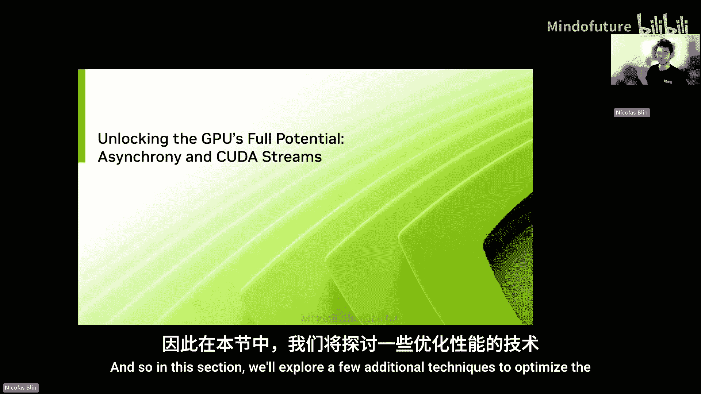

So first。In section 2。2， we'll talk about the synchrony and how we can overlap communication and input output to achieve to exp up。

Then we'll learn the notion of Q stream and see how we can overlap computation with memory transfer。

 and finally we'll learn and talk about pin memory and how to make the memory transfer synchronous and faster。

So if we recap with the current state。The current set of our heat equation simulator is first we copy the data from the GPU to the host and then rewrite write it to disk then once this is done we use through tabs to compute the next set of temperature on the GPU。

And we can see here that the CPU is launching the computation。😊。

And then the GP is doing some computer the。Simulation on the GPU， the computation of the GPU。

 and the CPU here is waiting for doing nothing。😊，So under the hood。

 Thrss launches work on the GPp when we call thrust tabulate and waits for it to finish。

That's because thrust tabulate doesn't reason control antiteop transformation is complete。

 so why the transformation is happening on the GP side， the CPU stays idle， it does nothing。

And so this is a missed opportunity， and so if we want to write an efficient heterogeneous program。

 it means we need to fully use all the resources which also includes the CPU。

 so can we find meaningful things for the CPU to do once why the GPU is computing something？Well。

 yes， obviously。First， let's look at the data dependencies。

So the right step reads from the host memory of the previous operation。

And while the compute step reads from the device memory。

 so because these operations use separate data， they don't depend on each other。As a result。

 the CPU can write the results to disk why the GP is computing the next temperature。

And so to achieve this overlap， wed ideally split the thrust call into separate lynching and waiting steps。

Unfortunatelytunate， Thr doesn't support that， but thrust is implemented in terms of another core library。

 which is called CAB and CAB supports the asynchrony we need here。

So CAbs offers many sorting algorithm。And just at a slightly lower level than what trust does。

 and so we'll see how we can use all those algorithm iterators and types just like we did with thrust。

😊，So first let's understand better the difference between synchrony like a synchronous operation and an asynchronous operation。

 so CA is as synchronous， it means that when you launch an operation from the host to be done on the device or on the GPU。

It immediately hands the control back to the CPU， so here it launches the operation on the GPU and then directly gives you back control。

That's not what trust is doing Per is first launching the computation on the GPU by using CA under the hood and then it synchronizes using Q that if I synchronize to wait for the GPU to be done before giving you back the control of the CPU that's why this thrusttaulate operation is blocking because under the hood it's first calling cu which is a synchronous。

 but then synchronizing the CPU with a GP which means the CPU waits for the GP to be done before continuing。

So here we have an example thrust where we where we compute the beginning and end time to called thrust tabulate。

 we compute the begin an end time on the CPU and so we can see that depending on the number of elements。

 obviously the more elements we have， the more time it takes for the CPU because the CPU here needs to wait for the GP to be done So the CPU is waiting for all of this time。

 So the more elements we have， the more seconds the CPU is waiting while it's just waiting for the results。

 while if we use cur instead， so if we use。Transform instead of tabulate here。

 it will achieve the exact same results。The only difference being that here the CPU never waits。

 So no matter the size of the input， no matter the number of elements we need to process on the GP。

 the CPU will always wait around the same amount of time。

 which is just the small amount of time it needs for。Cb to to tell the GP to launch the computation。

 So the CPU tell the GP launch。That takes a small amount of sign。

 and then the CPU gains control again。 So you don't need to wait for the GPU to be done。

 So no matter the size of the input。Your CPU will always wait for a very small amount of time。

 no matter the size of the input。And if you wanted to have the exact same behavior between the carbon thrust。

 you could just simply add a idea by synchronized what tells which tell the CPU to wait for the GP to be done before continuing。

 And so this will make。Kevin Thrs behaved in the exact same way。

So now that we know that C can launch asynchronous operation and thus leave the CPU。

Running and thus it can do other operation， how can we take advantage of synchrony in our code？So。😊。

When we launch a synchronous work with CB， the CPU， as we said， is freed immediately。

 so it can do any operation while the GP user is doing something else。😊，So here in our case。

 we can start the rating data to disk while the GP is computing。

 So why the GP is doing the simulation computation， the CPU in parallel。Can do the right to disc？

And so then we need to synchronize with the GPU only after it finishes the simulation step。

So since we would have waited for the GPU anyway， we're not losing any time。😊，Instead。

 the weight step becomes shorter leading to more efficient uses of the system and so as a result we can expect a significant performance boost from this approach because before we were waiting doing nothing on the CPU and now we take advantage of this step to right to disk so we first。

😊，Before were doing copy from device to host， then write to disk， then call Thr tabulate。

 which calls curb， which do the computation on the GP and then waits before again doing copy then write to disk now what we do is we copy from host to device from device to host。

 then we call come which we'll do the computation and while the computation is taking place we do the right to disk。

This way we have in parallel， two things going on， the computation on the GPU and the CPU writing to disk。

 But then we don't need to forget to wait because before the next step。😊，We will copy again。

 so we need to make sure the next computational step is done before doing the copy。

So for this exercise， you will need to replace through tabulate to instead use CAd device transform in order to go from a synchronous score that needs to wait for the data into any synchronous code where the CPU can write to disk while the GPU is doing some work so you will also need to not forget to call tua device synchronized to make the CPU wait for the GPU to be done at the correct place to make sure。

When you're doing the copy that the data has indeed been processed and so to do this exercise。

 you will have 10 minutes and so you can find this exercise in the section two and it's exercise2tor2。

 exercise compute IO overlap。The time up now let's see the solution so all we had to do was to replace thrust tabulate with a curb device transform in our simulation function and so thin tabulate is just as we saw in the first section a transform with accounting accounting iterator we can just do the same for CB we can use transform and as an input we take accounting operator it does the same thing as what we did with thrust when we use thrust transform with accounting inerator but now because we're using cavenant thrust this is synchronous and so this allow the CPU to do some work in our case writing disk while the GPU is busy doing this transform operation。

And so after doing the simulation and the sort to disk。

 we must add this QA device synchronized explicitly because again。

 all those simulate steps will happen。Asynchronously， and so then when we reach this line。

 we might go here and start a copy。😊，so before we want to make sure that the right to disk did happen before we override this H pre vector because here we need to write it to disk。

 so you need to make sure that the CPU and GPU are both on st after the simulation of the store before continuing on to the next step。

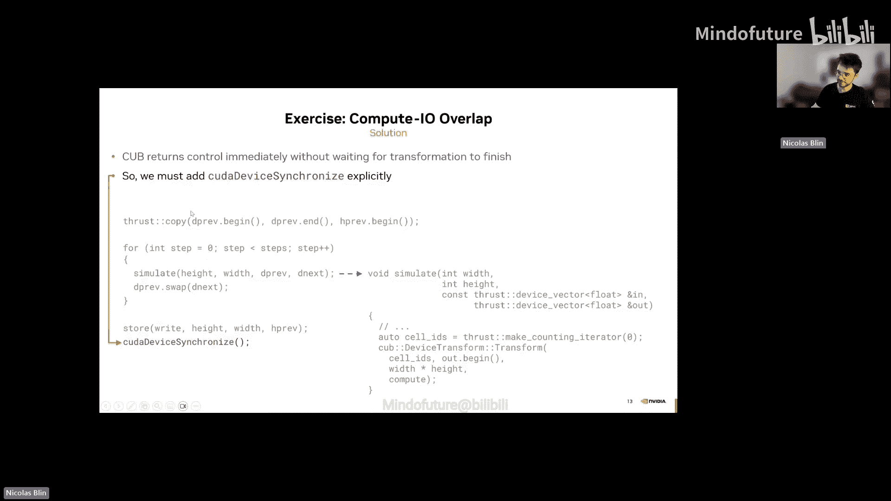

Now we'll introduce something called N system because。As we deeper into a synchrony。

It might become tricky to understand what's going on and to debug and to track down performance。

And so it's not easy to understand what is going on on the CPUU on the GPU because it's happening at the same time。

 That's why at Tvidia， we use Ins system and Ins systems is a software that allows you to visualize。

Your program， both on the CPU side and on the GPU side。

 and so you will be able to visually see when the CPU is doing some work。

 when the CPU is launching some in synchronous work and when the GPU is doing some work and you can all visualize that in a timeline or you will see as time moves on what it is going on either on the CPU or on the GPU。

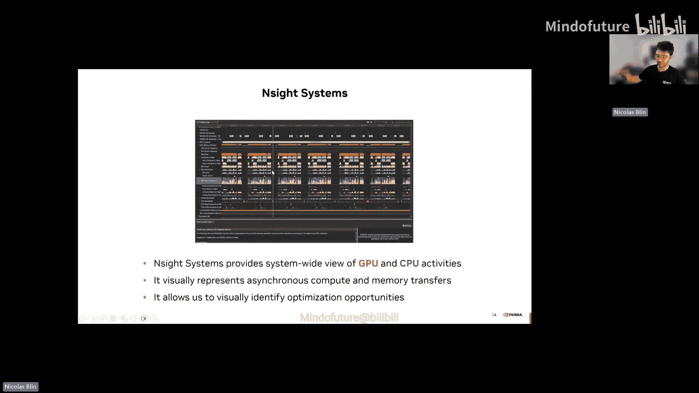

So in this next exercise， you will learn how to provide your code with insight system。

 and so to do that you will use the command line to call insight system that will collect some performance data。

So first open this exercise 2。2。3 and then execute this to generate the insight systems report。

And then once you have created this inside system report。

 you will be able to open it in inside systems。And so to do that， you can click on connect to In2 UI。

 which you will find here in the In system drop down menu。

 and this will open the inside system UI and there you will be able to visualize your inside system reports。

And so it will look like this， so here you have a tab with inside systems。😊。

The and you will be able to open report。 So you can。

 you just have to click on file open and then here select， select the。

Andight system report that you just created by executing the cell。

And then you can visualize what happened between the host。And the device。

You can even select a time region to visualize exactly what happened on a specific time region。

So for example， if you want to see exactly what happen between 0。5 second and 0。7 seconds。

 so in this 0。2 second timeframe， you can。😊，Click， hold click， select this region。

 and then this menu will happen， and you can click on filter and zoom in。

 And so that will zoom on this20。2 seconds slide。😊。

Of your whole execution time and fields are only the thing that are happening in this 0。

2 section portion。And once you're zoom in on it， you will find the hardware section where this is where the GPU is doing some work。

 so you can see detail on what the GPU is doing。And you can also see at the bottom what's here going on the CPU and so you can if you want to see what's going on the GP can click on this arrow to unfold it and see all the details。

You exercise here is to generate the inside system report。

Open it using inside system and try and understand when GPU's computations are being done。

 when is the CPU launching computation as synchronously on the GPU。

 when is the CPU rating on this when is the CPU waiting when are the data transfer happening all of that so take your time you have 10 minutes to open the reportss and really get familiar yourself with the tool and probably get where is everything going on。

Okay so。If we take a look at one。A portion of time where we're doing computation and writing to disk this is what we're seeing。

 so we start with the right step when we're doing a copy from the GPU to the CPU so this is what's going on here。

Then you can see how the computation is initiated by the CPU。

 but actually running on the GPU so that's what's happening when you're calling3 for cow。

 we're calling it from the host or from the CPU， so there is sometimes to lunch the computation。😊。

That's the small amount of time we need to wait， then the E GP will actually run the computation。

And so what we're seeing here， the Qa device synchronize is the CPU waiting for the GPU to be done。

 So here the CPU is launching the work a lot of work here is being launched and this is the actual。😊。

Result of those launches being ran on the GPU。 That's why here。

 this Qta device synchronize is taking a lot of time on the CPU because it's waiting all this all this time is waiting for the GPU to be done with all this computation that was launched from。

The CPUPU。And。😊，The cool thing with all this time taking that this taking by the GP to get the computation is this allowed us because now it's synchronous to do the input output writing in the meantime。

 So this is the CPU timeline。 And we can see here at the right to disk is happening。

 So we are doing an f open to open the file。 a right to write to the file。

 So this is disk input output and finally closing the file。

 And we don't really mind this taking a lot of time because。😊，In any case。

 the GPU is doing some work in the background， so in the end we'll have to wait for it anyways because it's doing those simulation takes some time。

 so it's okay that this right to this is taking a long time because the GPU needs a longer time anyways。

 so because we are able to overlap those two。😊，The CPU taking time here is not an issue for us。

But better is at any point here in this time slice。Both resources are being utilized。

 both the CPU and the GPU， and again， this is thanks to inside systems that we were able to visualize properly what's going on between the and the two。

So if you provide the earlier version of our simulation。

 youll see a clear performance difference between the synchronous and the asynchronous version。

 so here you can see that each time we do a CPU call it gets mapped to a GP call right away and each time we need to wait。

😊，That's why here every single CPU call to the function threat tabulate is mapped exactly when went to one GPU call function thrust tabulate because we wait between each of those and finally once all of those are done in a synchronous manner。

 only then we have the right step， which takes quite some time。While here on the synchronous version。

 we launch very rapidly on the CPU， all those calls to the GPU again。

 because we use threat and is synchronous， lynching those is very fast because we don't actually wait for the GPU to be done and then while the GPU is computing as synchronously we're doing the right to the disk and then before doing the next step to synchronize。

 but so between the two we are about2 x faster because we didn't have to wait。

So analyzing difference those differences between the two file still involve matching what you see in the timeline with your code。

 which can be a bit cumbersome， so fortunately we have a tool which allowed us to visualize easier at what you see and say systems with your code because right now we need to manuallyly look and try and see and understand what's going on everywhere。

😊，And that's what we call NvTX so when were you were working with a complex application with many functions and GPU things and CPU things going on everywhere。

 what we'll usually use is。😊，NVTX so NVTx is NviDdia tools extensions API。

 and it allows you to insert custom markers and ranges directly into your code so that when you view your inside system report you will see labels。

 for example， here you can see in。In my full loop， I'm adding a range with a specific name I'm calling it right step and I'm even adding I can add the right ID and this way when in inside system I will try to visualize what's going on I will see that the right steps that is here is actually composed of this F open this right and this F close and that is because I is a scope rangech which means that this range will remain active for the whole scope of this for loop and inside this full loop I'm doing the right to disk which is again composed of this F open right and close and now I don't need to even know that the right is actually doing an f open and right in the close or I need to do that at this stage I'm doing a right to disk and that right to disk I will see because I added an nvTx range and whenever I go out of the scope this NvTx will be。

😊，Well be stopped。So here， your exercise will be to annotate all the different steps。

 so we have the cop steps， we have the compute step and we have the right step and we also have the weighting steps。

So we will either have to add NvyTs ranges everywhere to be able to better visualize and systems everything that's going on so first they copy it and the compute and the right and to wait and this way you can see everything properly so far this we will have eight minutes。

😊。

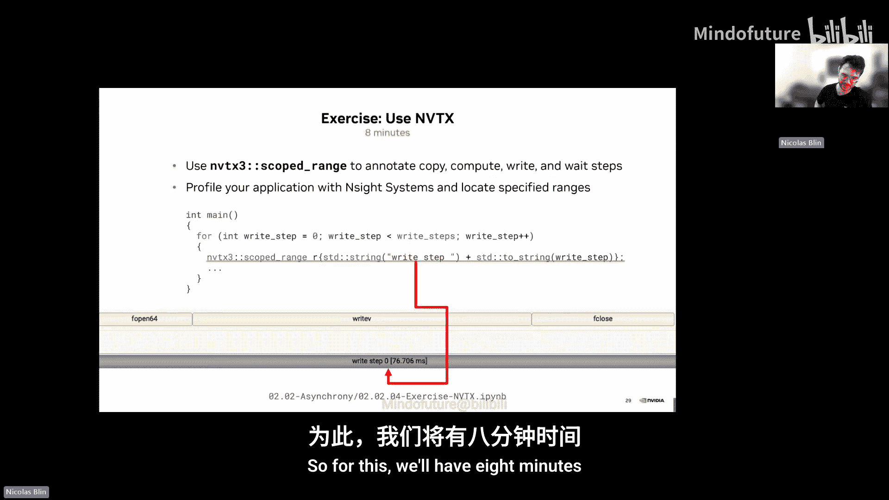

So if you have annotated things。😊，Probably。This is how your insect system view will look like。😊。

And you can see here。It's way easier to see and understand what's going on。Here on the CPU。

 we first do the copy。Then on the CPU we launch the computation that does not mean we do the computation。

 we just ask the GPU to stop the computation， but the CPU to launch many。

 many computation again it needs not a lot of time because it's not actually doing the computation it's just telling the GPU to do so then we have the very lengthy right to disk which is here。

And finally， we have the weights， which just waits for the GPU to be done。On the opposite side。

 if we look at the GP section， we can see here that we first have the copy step and then we have the compute step that takes most of the time it makes sense because we're doing a lot of computation on the GPU。

 but here we can now clearly see what's going on between the CPU and the GPU。😊。

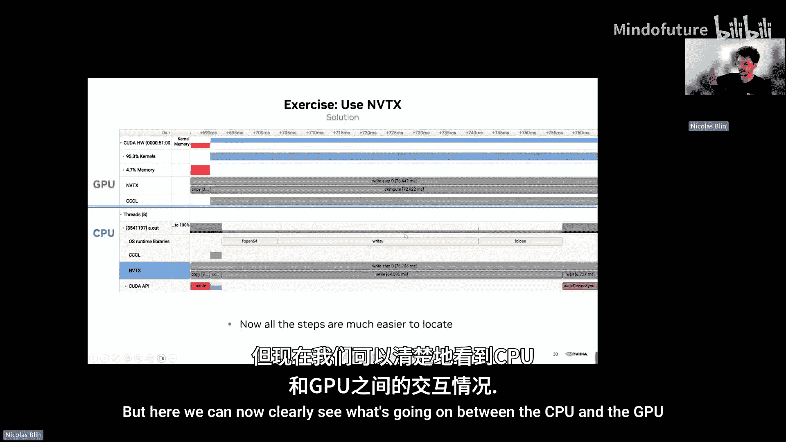

So at this point we have learned how to use the synchrony to overlap CPU and GPU tasks。

 we look to a big performance speedup because we were able to overlap the right to disk from the CPU with the GP computation。

 so our code now scope data from the GPU to the CPU。

Lches an asynchronous computation with SC and then write the result to disk。😊，However。

 we still have room for improvement。😊，The GPU compute doesn't actually have to wait for the computer to finish。

We can apply the same overlapping strategy to the copy and compete step。

But this will require the copy to be as synchronous， which currently it is not。

Trascopy is implemented with a lower level API called QMM copypy aI and this function can copy data between a host and device memory without blocking so without being synchronous。

So while being asynchronous， so let's take a closer look how we can use it to overlap our copy and compute step。

😊，So let's first try and understand how QM copy AsInc is being called by a Thr copy。So it just。

No that man copypy async is not there is not tape size operating byte not element you need to explicitly specify the copy direction and the asInc errors can be easy to miss that's why usually we call firstco。

 but so Q copypy async is。Takes as input four parameters first the pointer to the destination memory address when we're going to copy。

 then the source memory address from which we want to copy。

 then the number of size in bytes to copy so it's not the amount of elements it's the sald bytes so if you are using integer。

 for example， you need to multiply the amount of elements by the size of one byte。And finally。

 what kind of copy you want to do， so is it host to host， so CPU to CPU， is it host to device。

 device to host or device to device。So。😊，One subtlety of a synchronous operation is that errors don't always surface when the error occurs because it's asynchronous。

 So maybe you have launched something。 the GPU is doing something and then you get the error later because it's a synchronous so the error and the GP may arrive later then from the CPU standpoint So for example。

 you could launch a kernel that goes out of bound but the GP doesn't actually start you need right away so you can only see the error right after so meanwhile you might launch another kernel which also doesn't observe the error from the prior kernel this one。

And since it hadn't already just begin to run， right， you launch another kernel。

 but the first one isn't even running yet on the GP。😊，But。Then the board kernel here starts running。

And after that， you learn your QM copy async here。This launch will discover the error but coming from this first earlier kernel。

 in other word， a error triggered by any prior asynchronous operation might either be reported by a completely different call this is why it's crucial to check error codes after every cu code and the error aware that a error can pop up much later than you might expect。

So。Well simply swapping here in our example， Thrcopy for TuM copypy Async be enough to overlap compute with copy。

 naturally because by default， all GPU operations are ordered on the GPU end。

So even though you're calling Q theM copypy ascing and it's not blocking on the CPU side so the CPU will launch the men copy and then come back。

😊，The GPU still executes it in order with everything else。

 just like any other earlier as synchronous computation step。😊。

This means that the GPU will wait for the copy to finish before proceeding to the next computation step。

 so it will first here the CPU is asking for an nest copy。

 so this work will be forwarded to the GPUus of the copy device to host will happen and only once it's done。

That then the compute will stop。 those two by default will not overlap。

 They will go one after another because you ask for the GPU first to do one thing and then to do another thing。

 So by default， it will do them in order to first do the copy device to host。

 which happen on the GPU and then the compute。 So right now we don't have any overlap between copy and computation。

So the controlling the ordering of operation is what we call a cur stream so by default。

 if you don't specify a stream， the default stream will be used。

 which means everything will happen in order on the GPU so from the CPU you're launching a as synchronous copy and a synchronous computation using K but from the GPU perspective all you're doing is stacking operation which is here a Q device to host a computation on the same cur stream so on the same。

Stream of operation， everything will just add one after another and everything will be computed one after another。

So。We don't have to use the default coud stream we can create our owner kud stream actually as many as we need。

 so when operations run in different streams， they are no longer ordered with respect to each other and they can be executed completely concurrently。

😊，And that's exactly what we want， right？😊，If we send the asynchronous copy in one stream and the compute in another stream。

 then those two operation can overlap。 So here you can see we're launching an as synchronous copy from the CPU to the GPU in a copy stream。

 which is the first stream And so then on the CPU when we launch the computation because we launch another stream when the operation finally arrived on the GPU。

 both the copy from the device to host and the computation can overlap and work together because both of the operation nowll launch in different streams。

 So let's see how this works in practice。😊，So that's what kind of operation we can use on streams so we first declare a stream object。

 so here in our example a copy stream and a compute stream。Then we have the construction set。

 which is just you。Construct a valid stream out of just the plain stream object。

 So to do that we call tu stream create which will actually allocate the stream。

 So now our copy and copy team are ready to be used once we're done using them we need to call the structure So we need to call tula stream destroy to destroy the streams once they are done being used because they have been allocated first。

And whenever we need to synchronize， we can use Qa stream synchronize。

 which will wait on the CPU side for all operation that were added。

To this stream to be done so if on one stream you added 100 computation calling QA stream synchronized。

 will make the CPU wait for all those hundreds computation to be done on this stream before doing any other else。

This will not wait for anything coming being launched on any other streams。

 this only blocks the CPU to wait for all operation to be done on this specific stream。

That's why in general， we advice to explicitly use streams and not use the default stream and use QA device synchronize because QA device synchronize will cause the CPU to wait for all GP operations on any single stream to be completed so maybe you are doing 0 different things on00 different streams and just by calling QA device synchronized maybe you just need to wait for one of those but youre actually waiting for the things to be done on all hundred streams that's why in general you don't use QA device synchronized。

 but instead you use Qa stream synchronized to wait for things to be done just on the specific stream you care about。

😊，So you will find streams in most of obviously of the Q libraries we are developing at media because we want to make everything asynchronous and be able to overlap so in QMM copypy async obviously you can pass a stream to make the colon not only asynchronous but also be able to overlap with something else。

When you're using KB， you can also pass a stream if you want your operation like a transform to be not only asynchronous because we're using K but also be able to overlap and same goes with most of the libraries we have like QFftT QB here。

 same goes for QBAS， we have a stream parameter， which again would allow us to do some overlap。So。

Let's start by creating a Qa stream for compute copy。

 so here we declare two streams one component compute one for copy and we allocate the data by calling Qa stream create on both three。

😊，Then we called Char memcopy async passing the copy stream to launch a less synchronous copy。

 so the CPU will ask the GP to synchronously launch。

A copy on the GPU while the CPU can continue on with the rest of the code， not only that。

 but on top of that， this copy will take place on the copy stream。Which means that next。

When we launch the compute by using CAB， because to cu device transform。

 we are passing these compute streams， both this copy here and this compute here。

 both things will happen in parallel concurrently on the GPU because both of them are launch on the different streams。

And then because the copy here happens synchronously we have to make sure that it actually finishes before reading the host data that's what we call we need to call Qa stream synchronize on the copy stream before lynching the store to disk because here we're copying in HPPf and here we're writing to HPPf because this is as synchronous this is as synchronously going on on the GPU we don't want to start doing the store while the GP we think doing some computation right we need to make sure that。

This copy device to host， which copy H prev is done before doing the right on the disk。

 So to do so we just need to synchronize just the copy stream we don't care about the compute stream here。

 We just want the copy stream to be done。 That's why we use shouldda stream synchronize on the copy stream。

Then we can launch the store that writes to disk， and then then we also synchronize the compute streams before going on to the next step。

😊，And congratulation， we've just introduced our first data race。

So let's walk through the first few iterations to see why。😊，So we use a copy from DePv to the host。

 that's what we're doing here。The first compute iteration reads from DPv and writes into DX。

 which is fine， that's what we are doing here， but the next iteration reads from DX and writes back into DPv here。

Because this operation ran in different streams， the GPU can inter them in an unexpected way。

 this means that while data is still being copied from deep to the host。

 it might get overwride by the next compute iteration in another stream。😊，So again。

 here we're asynchronously copying。😊，The de breath pointser into H press and in parallel。

 we're computing deep into Dx。For the very first iteration， that's okay。

 we're competing here into this， but at the next iteration we swap point or so now we're competing GX and writing into DePv。

 but maybe the GPU here is still doing this device to host copy。😊，So we just created a data race。

 which means that。Based on luck and how the program will run。

 sometimes we might find different results in this deep pointer because sometimes the computation will be done sometimes not and so we should find a way to solve this issue。

😊，So。😊，Like many computer science problems， we can solve this by adding another layer of interaction so we can allocate an extra device buffer。

To copy data into it synchronously and then copy from that staging buffer back to the CPU。

Since no one else is writing to the staging bufferer。Because it's just there reading。

There's no risk of data race。But doesn't that defeat the purpose of overlapping compute with transfer at our first glance it may seem like so。

 but we've introduced additional work， which is another copy and an additional buffer so surely this would make things slower。

 not faster right？Well。If you take again a closer look at the bandwidth across your entire system。

 this approach make a lot more sense。 Coing data within the GPU can hit speeds of around thousands of gigabytes per second while moving data。

In the CPU memory is slower。Moving data between the CPU and the GPU often go to what we call the PCIE bus。

Which is going even slower than what the T memory bandwidth can achieve。

Memory copy from device to device is much faster than memory copies from host to ho。

 which is also faster than memory copies from CPU to GPU and from GPU to CPU so the device to device copy is going to be so fast that it's practically free compared to doing the host to device copy that's why here adding an additional device to device copy is not going to be an issue an issue so。

That brings us to our next exercise。 so in this task you'll replace thrust copy with Q di copy asInc to make your device to hood transfer asynchronous and you'll also。

Place your copy operation on separate streams and synchronize them exactly as shown on the diagram on the slides。

 as you can see here as we have discussed and finally once once you're confrontable with that with the changes。

 youll profile the code in insert system to see if it behaves as expecting and so for this you will get 15 minutes burning now。

😊，Okay， so now let's walk through the solution。So first step， as we already have seen。

 is to create two strings， one for copy， one to compute and allocate both three then。

We want to synchronously launch the copy from device to device。

To copy our previous temperature into a staging buffer。

And so this buffer will just be used for staging so then we can we can at this point we can still use thrustcopy here because device to device is generally very fast and so we don't need to block we don't need a cornerous lunch here because it's very fast anyways because it's already on the device。

And so this step ensures that the device data we copied to the host remains untouched by any subsequent computation and thus preventing any batteries。

So this staging bathroom is safe。And so after that， we invoked the as synchronous copy。😊。

On the copy stream again， by calling QM copypy async。

 and since Q copypy Async operates on row pointer， we use thrust to row pointer cast to retrieve the underlyinging pointer from the thrust vector。

Finally， we update the curveb transform call to run on the compute stream we created above and by specifying the stream。

At the last parameter we're telling CB to execute not only obviously asynchronously。

 but running asynchronously on this compute stream and so this transformation that CuB is doing is being run independentlyly from any operation on any other stream so in our case the copies。

😊，After that point， we can proceed to writing the updated host。Data to disk， but before doing so。

 because the operation are synchronous， we shouldn't forget to call QA stream synchronized on the copy stream。

To make sure that the data has finally been copied from host to device before doing the store。

 and then we can finally synchronize the computer。So if we look at the inside system profile of。

Such changes， we have both good and bad。The good news is that our intuition about the cost of data transfer was correct。

Divide to device copy on the left that we see here is significantly faster than the device to host copy。

 which is here on the host。😊，So this， we were correct on this side。

So it confirmed that the P transfer is a real bottleneck here and adding a device to device is not a real issue。

😊，So we don't have a race condition anymore， but the bad news is。

Even though were using separate streams， we are use one stream for the copy and one stream for the compute here there is no overlap。

 right。😊，Compute is waiting for the copy to be done before launching that doesn't make any sense we have just learned about streams and that if we use separate streams things should be run concurrently and here we use stream for this very reason and yet it's running just like we weren't using any streams that's very weird。

😊，So we were missing something here。That's great， that's a new thing what we will learn about。

 which is。😊。

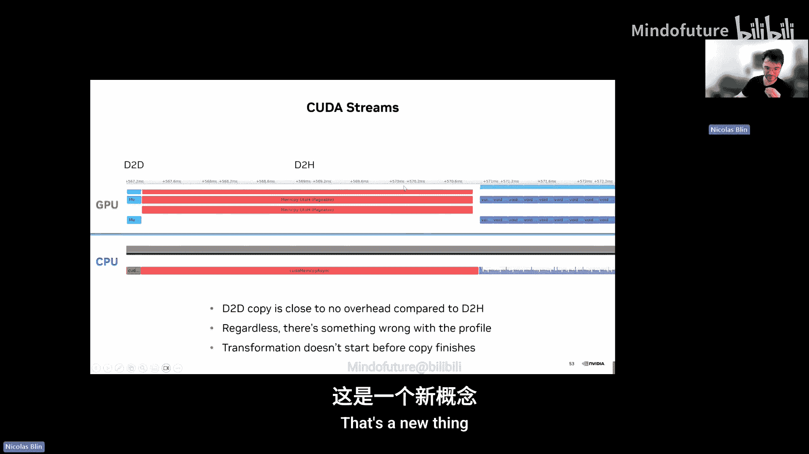

Pin memory so。To understand why our copy and computer operation didn't overlap。

 we need to make a look at how memory actually works。When your program uses virtual memory。

 which is divided into memory what we call memory pages。

 so most of the time those memory pages that are backed by。Physical RA。

 but if the Ram is short on space， as the operating system can swap pages out of the RAM memory into the disk so on your actual hard drive。

So this means that at any given moment， you can't be entirely sure that some memory pages might be on run。

 it might be on disk， you never know， so to make sure that a specific page of memory is on the RAM and that it will not be put on the disk。

We we need。What we call pagelocked memory or pin memory。And so by pinning those memory pages。

 like you can see here in the Ram， you are sure that the operating system is not allowed to move those memory pages from the Ram back onto the disk and so those。

😊，Memory pages there are locked， there are pin， that's what we call the pin memory。

 that are locked onto the ramp。😊。

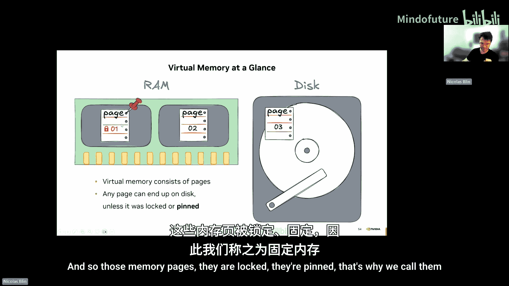

And so how does this has anything to do with a GPU Well， as it turns out。

 the GPU can only re memory from the pin memory。😊，So when it's in Iran， so that raise the question。

 we haven't done anything special for now to transfer data between。😊，CPU and the GPU。

 so how do things work in this case where data could be on the RAm or on the disk？

So behind the scene， the Quda run times used is a small pin buffer at a staging area for transfer。

When you copy the data from regular， what we call pageable memory。

The driver moved the chunk of Dla into the staging buffer which is pin and so send that chunks to the GPU wait for it to finish and then repeat the process again and again so this process effectively makes the copy synchronous even if we use QMM copy I think because。

It blocks everything else I happening because it needs to do this process over and over。

 So the good news is we can avoid this。😊，Allocating of pin memory here of this staging buffer by allocating ourselves。

 so interest。We have a simple eer interface。😊，What we call the universal host pin vector。

That allow us， instead of using a regular hose vector this memory is guaranteed to be pin and so this way we can bypass this hidden stage where the copy is happening synchronously to make sure that the data is in a pin buffer。

😊，So this brings us to the final exercise of this section。This time。

 instead of helloicching a regular hostse vector， we want to allocate a vector that we're sure the data will be backed by pin memory。

 not by memory that might be on the disk， so instead of using a host vector。

 we want to use a universal host pin vector。😊，And so after making that change to the container。

 then you will launch inside system to see the difference and visualize it so for this exercise we'll have five minutes。

So here is the solution to the change is pretty easy right just instead of using a thrust host vector。

 you instead use a a universal host pin vector。And with that done。

 the device to host transfer now overlap with compute， so as we can see on the timeline。

 the GPU here can launch many compute operation one one after another while this device to host a memory copy can occur。

😊，This is because now it knows that the data is in the pin area。

 so it doesn't need this initial step of copying the vector chunk by sh in the stage pin area before doing the rest it can directly do both of those in parallel so that's how we were able using streams and pin memory to overlap device to host transfer and the computation and so this again has improved the efficiency of our program。

So the key takeaway of this session is first， prefer asynchrony。When you can overlap host and device。

 so when you have some time to spend on the CPU so when you open the system and you see have some times where the CPU is doing nothing while there is actually something it could do like in our example right to disk。

 you should swap thrust to cab to instead use our asynchronous programming model and this way be able to overlap CPU task with a GPU tasks。

So as a reminder， when we called cupb， it's。😊，The host is launching computation the device in a synchronous manner。

 which means it doesn't wait for the GPU to be done。

 So no matter the size of the problem you' are trying to solve on the GPU。

 the host will go back almost in almost in an instance and then the CPU can continue on by doing anything at once while the GP is doing some computation may be very lengthy in the background。

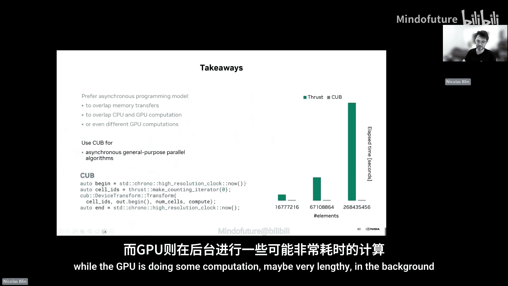

Then we saw how using N systems， we were able to profile our code by。😊。

geneenerating a report and opening it and being able to see what's going on both on the CPUU on the GPU and see when we are wasting time or when is the GPU not busy enough and it also allow us allowed us to visualize our synchronous operation we also talked about how NVTX allowed us to make this visualization way easier by seeing exactly what things happen where in the code by manually adding ranges where it makes sense but we can directly map the code to the inside system report。

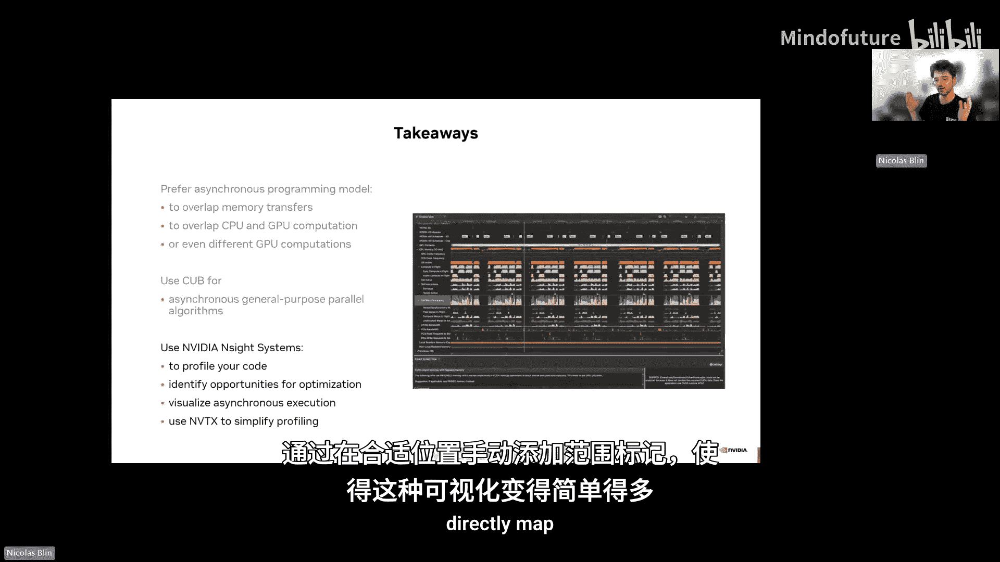

Finally， we said that okay in synchron and synchrony through cable allow this to parallellyze work between the CPU and the GPU。

 but we have seen how using Q stream were also allowed us to make work in parallel on the GPU so for example。

 when we had one step which was a compute step and another step which was a copy step and the two could be done in parallel well instead of running both sequentially we could overlap them by using different streams because if not by defaultal。

 everything will be。I launched on the default stream on the GPU and so all the work will be run one after another and because here the copy on the compute could be run in parallel。

 we should use different streams。We also talked about how QI copy asInc would allow us to launch not only as memory copies from host to device。

 but also allowed us to add this stream parameter and。This way。

 we were able to launch copies not only in asynchronous manners。

 the CPU was free to do something else， but also it would allow us to launch things on one stream when we were doing computation on another stream。

Finally， we have seen that doing copies from host to device can be costly because data by default is pageable。

 so it may be on the disk and so to make sure that copying is fast and nonbing。

 we should use the right thrust hose container to make sure that the memory is pinned and thus that the copy is nonbing and fast。

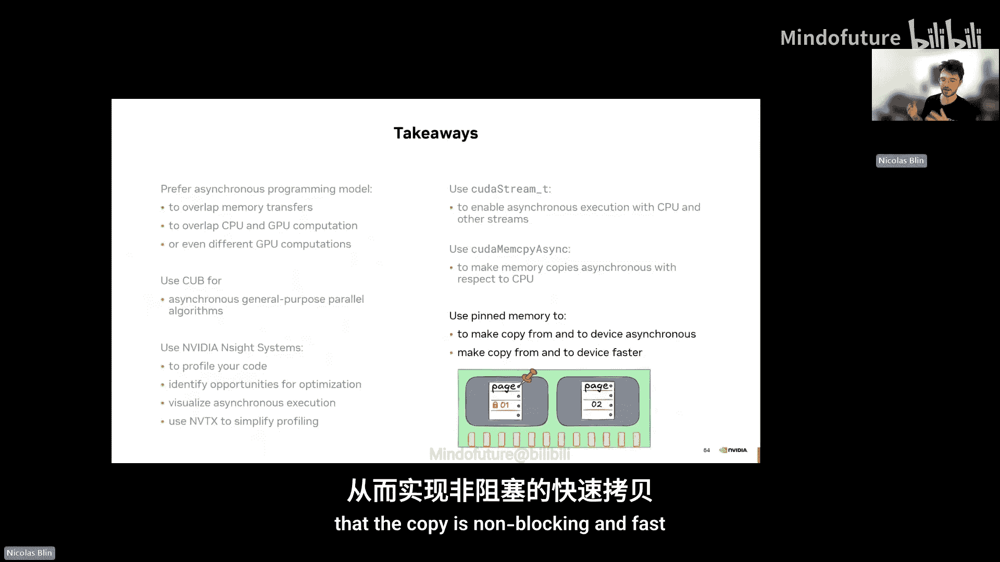

So that's that conclude our section and asynchrony and Q streams again， if you have any feedback。

 please put them on the GLI website。

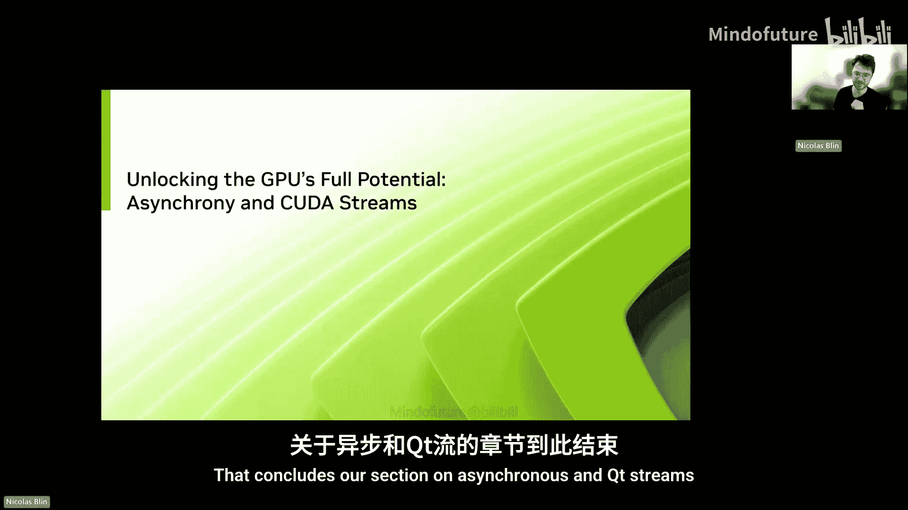

