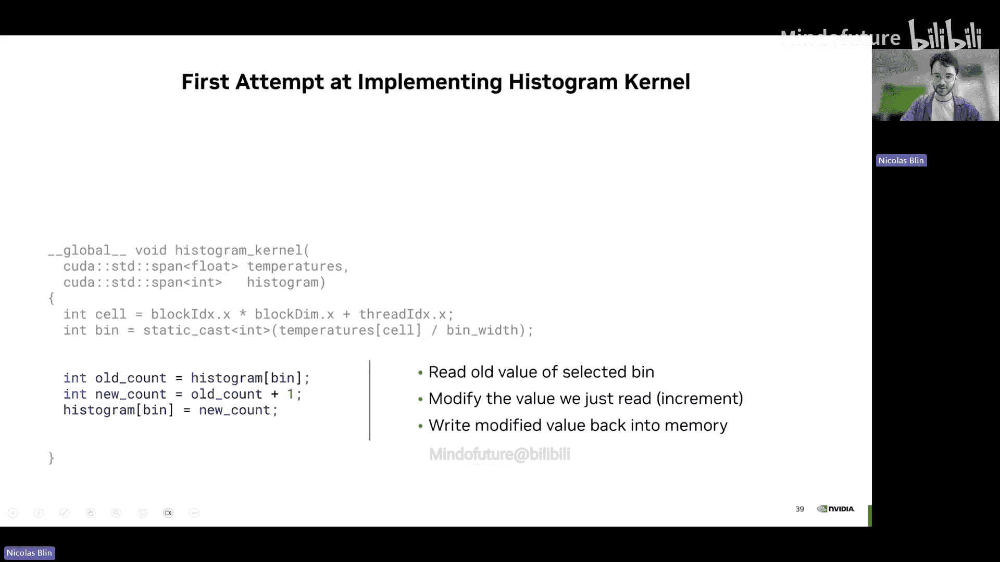
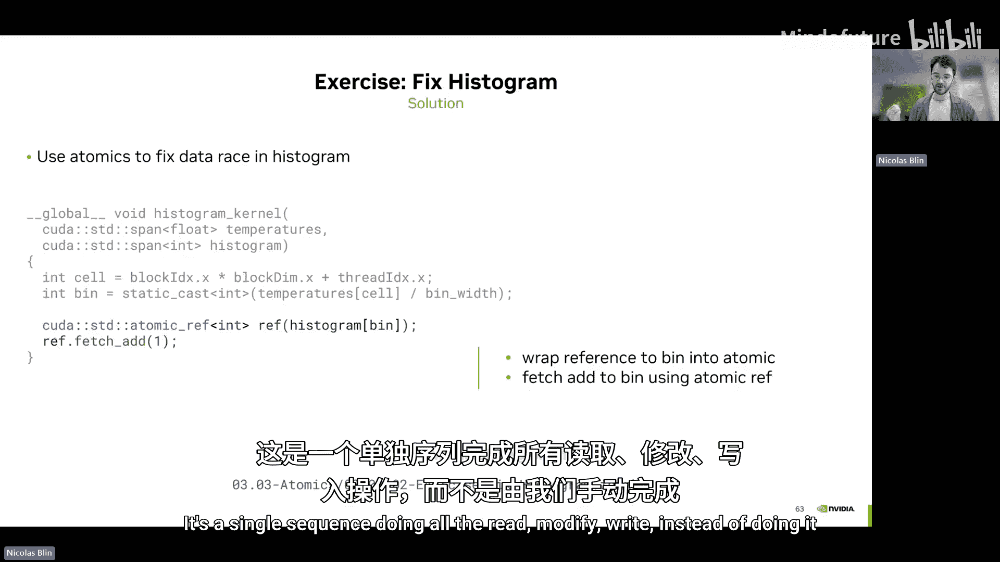
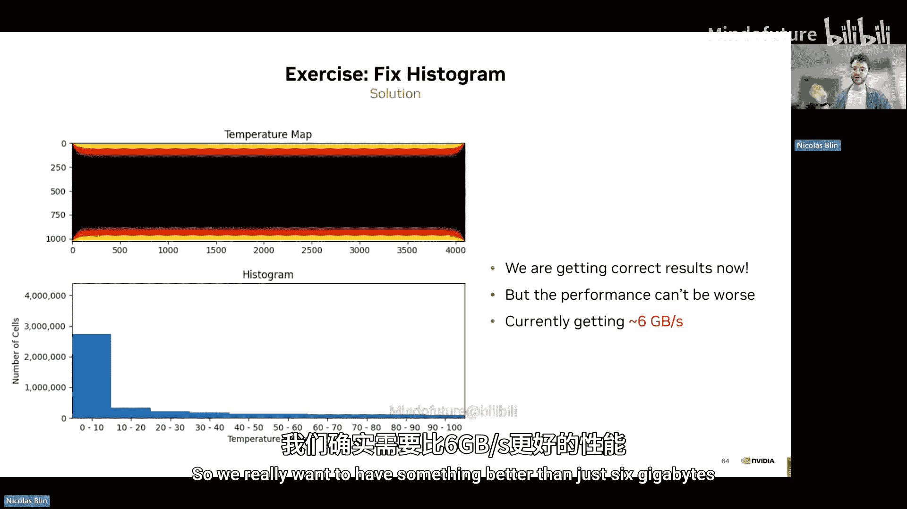
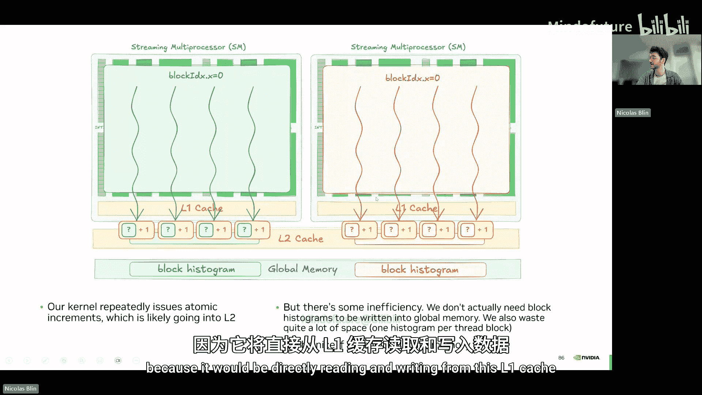
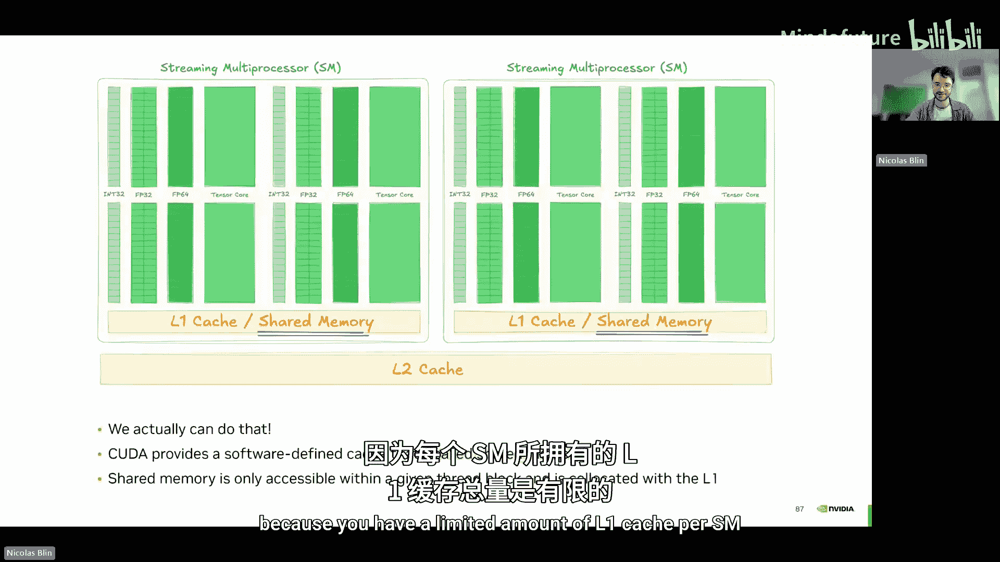
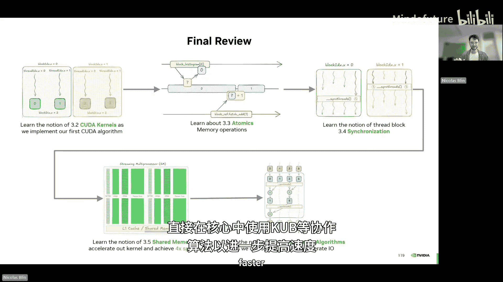
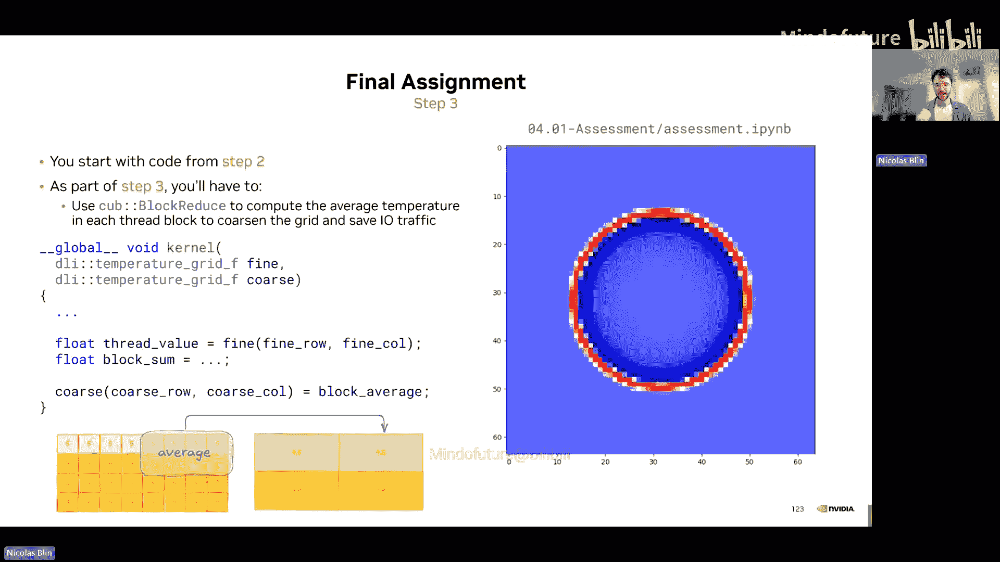

# 现代Cuda-C++-编程课程-2025-｜-Nvidia-Developer-p03-P03_通过CUDA内核实现新算法-CUDA_C++_课程_第3部分--BV1VLSnBqEe1_p3-

While watching this class， you will regularly need to pause the video to complete exercises。

 There are two platforms where you can complete those exercises，1 on the accelerated computing hub。

2 on the DI platform。For more information， please check out the intersection of the first video。

All links can be found in the description below。Okay。Okay， so hi everyone。

 so in the previous section we explored how a synchronous parallel algorithm can further enhance performance。

But what if there is no pro algorithm for your specific use case？So I can't use any Q libraries。

 I can't use trust， I can't even use any fancy director because what I want to do is very specific。😊。

That's when you actually need to write your own algorithm using K kernel and that's the goal of this section。

So first we'll talk about what our k kernels will learn about atomy cooperation。

 we'll learn about the notion of synchronization between threads。

 then we'll talk about shared memory and how we can improve performance。

 and finally we'll discuss about what we call cooperative algorithms。So remember。

 usually the CPU calls a ho function while the GPU calls a device function。

 and so invoking GP work from the CPU requires a special mechanism。So far。

 we didn't really have to care about it， we just call thrust and thrust would do the work for us。

But now， because we want to implement our own algorithm without relying on any library。

 not even threat， not even thrust， we need to understand how to learn GPU。

 how to manage code in the GPU ourselves。😊，So let's do a quick recap on execution space so so far we have discussed about host function。

 so that's when you add host onto a function to say that this specific function will be executed on the host and so the compiler has to create CPU instruction for this function。

We also talked about the specify device or this time， when you put in on function。

It tells the compiler that it should generate GPU instruction for this function。

 allowing it to be executed on the GPU。And so there is another one that we haven't discussed yet。

 which is called global。And so global will allow just like device。

 the compiler to generate GPU instruction so that the function can be called in the GPU at this time。

😊，Because the function is tagged with global， this function will be called from the CPU。

 so the CPU will make the function call to this function。

 but the function will be executed on the GPU。And so that's what we call a kudonee。

The calling a cut kernel from the CPU looks unusual because of the triple angle brackets with thumb number each side。

 so what we can see here in the top right。So let's discuss about what those number mean。

 we'll discuss those what those number mean later in the course。

And another important detail when you launch a kernel is it's just like cut it's as synchronous so the CPU will launch the kernel so the kernel will be launched on the GP。

 but then the CPU just continues it doesn't wait for the kernel to come back from the GP not like threat so it's really like cut it's as synchronous。

So before we start writing our own cur kernel， let's recap how our simulator currently works。

So if you remember， we use an empty span to have a 2D view of the temperature grid。

And then we transform cell indices into new temperature using CAb device transform。

Under the code help implements device transform using cut kernels。

 which is why they run asynchronously， so let's see how cut kernels actually work。

So it's best to start with the code that you're already familiar with。

 so let's try rering our own simulator。😊，And learn your kernel directly rather than relying on thrust to do that。

So on the slide， you'll see a simple cur kernelnal example that iterates over all the cells。😊。

And transform the indices into new temperature， so notice when we launch the kernel。

 we use the triple chevvron syntax。And there is a force parameter which is the cur stream。

 and so by pa a stream here， you can run the computation asynchronously on a specified stream just like what we did when using CA。

😊，And so as you already know， the GPU doesn't automatically and magically parallellyze your code。

This means that a single GPU thread is computing each cell in serial in this example。😊。

So overall this makes our kernel roughly 10，000 times slower than cap because here all the only thing we're doing here is launching we are launching a cur kernel but with a single thread and this single thread is doing the whole computation and so obviously this is way slower than using the whole the entire。

😊，All the size of the G。We can easily increase the number of thread that acur uses， so for instance。

 to launch two threads instead of one， we just pass two in the second parameter so in this triple charon thet。

 the second parameter represent the amount of threads you want to launch so you could just launch two threads。

So you can see on the right that they are doing so using two threads one almost doubles the kernel speed。

 which makes sense because we are using two times more threads。

 but simply launching more threads either enough。If they are all processing the same cell there are actually no speedups so to fix this。

 we need to modify the kernel so that each thread can distinguish itself and handle a different subset of cells we're going to have both threads doing the same thing right the first thread needs to do some part of the array and the other threads need to do another part of the array。

For that' where what we call threadidx。x comes in so threadidx。

x is a builtin variable which is available when you' are inside a Q kernel and it holds the index of the current thread so if we launch two threads。

 thread IDX will be equal to zero in the full thread and in one in the second thread。

And so with this approach， if each thread process is going to process a different subset of cells。

 and so in the kernel， we first read thread IDs to identify what's the current thread index。

 then each thread start by processing the cell whose index matches its own thread index。

That means that the first thread will work on cell zero and the second thread will work on cell1 and so after finishing one cell。

 we move ahead by adding the total number of thread of the cell index this way the first thread takes cell 2 X while the second thread moves to cell3 and so on。

😊，During the very first itration， thread zero and one are processing those two。

 and then those two and so on。😊，So notice how these schemes allow us to compute all the cells in parallel。

 such that one cell is never processed by multiple thread。

 like one thread is always just handling one cell and one thread is always handled by just one thread。

And so another observation that we can do is that there are nothing specific in our code that would limit it to only two threads so we could use more than just two threads。

 so let's try increasing the number of thread working on this computer kernel。😊，So here。

 if we go from two to all the way up to 256 right。It goes obviously even faster。

 so our performance have improved significantly because we're using more thread， but as you can see。

 we're still very， very far from what CO is able to achieve。 So why not just add even more threats。😊。

So if we tried launching the kernel with， let's say， 2048 threads。

 then suddenly you get this cryptic error which was say invalid configure argument。

And so there's something here that we're not understanding because we think we should be able to launch as many as we want。

 but actually we cannot do that。So it turns that there is a limit on the number of threads in a single thread block。

So what exactly is a thread block and why does it matter for our kernel launch？So in CudA。

 threads are grouped into what we call thread blocks and the entire collection of all the thread blocks is what we call a green。

And so。Each thread block can contain 3264， 128 all the way up to 1024 threads。

 not more than that and so。When you are launching a computer kernel。

 all the thread blocks will have the exact same amount of threats。

And when you're using thread I dot X， what you're getting is your thread your thread index inside this local block。

 So if your thread zero in block zero， you will get zero and if your threads zero in block one。

 you will also get。Your3 energy equal does x equal to zero because this will return the index inside your block and not across blocks。

So here for example， on the screen you can see we have three blocks so here in block zero thread0 and3 to one do get0 and one same here thread zero and thread one do get zero and one and same for block two because again those。

Indices are local to the thread block。You can also fetch the widths of your block by using block D X。

 which is here equal to two because we have two thread per block。

And you can also fetch the length of the grid， which is here gradientm dot x which is equal here to3 because we have three thread block and finally you can also fetch what's your current block id so here we are in the first block so block id is that x equal to0 here in the second block block id is that x equal to1 and here in the third block block id is that x equal to2 and so it's by combining all those information that we will be able to compute。

What's our current location in the whole grid？So。Block G mix will tell us how many threads we have in each block。

 and so here we have two why the grid is three because we have three blocks。

 So by multiplying block G X by grid D mix， we can get the total number of that degree。 So here。

 for example， we have。😊，Three blocks， we know that because we have this grid Dms and if we multiply that by the the length of each block by using block Dms so two。

 so if we multiply two by three， we do get six and six is indeed the total amount of threads we have。

呃In。So beside knowing the total number of threads， we also need to be able to know what is each thread unique index across the entire and for that we can use the block ID。

X， which all which is what is holding the block ID。UAnd so you can see that here， again。

 all the threads that are inside this first block， they will all have a block as of zero。

 all the threads in this all block will all have the blocked of form， etc。😊。

And so to calculate the thread global index， we multiply the block IDs。

 so what's the index of my blocks。And we multiply that。😊，By the length of my block and this way， we。

We know what's the offset we have to take to arrive on the correct block and once we are there。

 we just need to add what's my local thread ID so here thread IDx。x。So for example。

The second thread of the last block。Well we use two which is our block IDix dot x sos so that's the index of my block we multiply it by the length of one block which is here two so this allows us to have an offset of one then two to arrive here in my current block and then I can just add what's my thread ID X which is here for the last thread one and I get five and indeed in the whole grid this thread is the fifth thread here I have thread zero thread one thread two thread three thread4 and here thread5。

So again。By multiplying my block ID times the length of one block in grid and then by adding the thread ID。

 I'm able to get what's my thread global ID in the entire grid。

So now that we know how to find each thread unit index within the grid。

 we also and we also know the total number of threads。

 there is one question that remains is what kind of block size should I use because we just said I can launch thread blocks of size 32 256。

 1024。Which one should I should I take？ So unfortunately， there is no。

Magical number that is going to be the best for all the cases。

 so usually you have to fine tune this specific number。

 so the amount of threads per block based on the on the problem but so one helpful guideline to pick for the block size is to always use。

A multiple of 32 so for example， taking 50 or 60 doesn't make a lot of tens。

 you should always use a multiple of 32 and usually a common default value that we that we advise is 256 but again this is dependent on your problem and you should。

Look at which one is best， but if you really have no ID and you don't really want to care。

 you can just use Toronto statisticsistics。So the second question is how many blocks we should launch so okay。

 my block is of size 256 threads now how many blocks， how many thread blocks should I launch？

The grid size will typically depend on the problem size because we want to maximize the parallel。😊。

So。😊，The question is how to divide。My element of my problem among the threats， so。For example。

 if we want each thread to handle just exactly one element。If we just use a simple integer division。

 this won't work because imagine that we have six cells to process。

And we choose a block size of fourth thread。If we do6 by four， so if we divide it6 by four。

 we'll get just one so we will just use one thread block。

 but you can see that if we just use one thread blocks of four threads to006 cells and each thread is polying just one element。

We're going to miss one thread block to0 two last element。That's why inside Cuda。

 we provide what we call kuda seal di。Which will round up to the integer above so you can use this to automatically compute for you。

What should be the correct amount of thread blocks you need when you want to exactly have one thread per element。

 So in our example with the six and the four， if you call seal de， that will return not one but two。

 and so you will correctly hear in this example have two thread blocks allocated with each one having four thread to handle all the six cells you need。

And so to pass down to the kernel the amount of threads of thread block you want to use it's the first parameter here so you can first declare the block size so here we took the usual 256 then we want to know how many blocks I want so to do that again I'm using QSclLD by my total problem size and the size of each block which gives me the correct amount of total block I need and then when I'm calling the kernel I first path with the grid size so the amount of blocks of thread blocks I need and then the size of each block。

So with these changes we're now launching around 5 million threats and we are now finally getting close to cap performance。

 so of course KP still has a more advanced optimization under the hood so。😊。

Probably you won't be able to match the speed of cap， but for such a simple kernel。

 this is already very good to have achieved such a speed up by just adding more threads and correctly computing the IDs and the thread losss。

So we've modified our simulator， but haven't yet confirmed that it still works correctly。

Because our setup is symmetric， temperature at the top and the bottom of the grid are identical。

So we can do a quick smoke test by checking that symmetry the idea is simple for a given cell。😊。

We find its mirror row by subtracting the rose index from the grid height。

 and so if everything is correct， the temperature of the symmetric cells should be nearly the same。

So on the screen you'll see a C plus plus function that performed this check and so as part of this exercise。

 you'll have to turn this CPU C plus function into a cur kernel and launch it with a triple chaveron syntax and so by picking the。

The correct amount of blocks， threads， etca。And so for this exercise。

 you'll have five minutes starting now。就。😊，To turn the symmetric check function into a cut kernel。

We have to annotate it with the global specifier， so remember global allows you to launch a code。

And the GP， so this function will be compiled to be able to work on the GPU because we are specified global。

 but because we're using global in that device， this function is coable from the CPU in an asynchronous manner。

And so after that。We need to learn it using the triple Cheevvinnal indexax that we have discussed about。

Here because there is no real parallel work here we can just launch a single block with a single thread and to make sure these checks run on the correct stream。

 we just specify as the last parameter。The stream we want to use now when we think about it the entire row should be symmetrical right not just a single set so in this exercise you'll modify the kernel that each thread handles exactly one column。

And so again， for this exercise， we'll have eight minutes starting now。So times up。

 so just like before。If we use block and thread indices。

 we can compute what's the thread global ID so that's what we do here in the top because we want to know which column we are we use the block ID so our block index we multiply it by the width of the block and we add what's our current thread ID。

Inside the block， and so by doing so we can compute what's our color index？😊。

And so then when we want to call the actual kernel， just like before。

 we can declare the block widths so we took the default 256 so you compute the grid size。

We check what's the full size of the problem here in our case it's the width and we divide it by the block size using again this cut asive。

😊，And when we called the colonel。We just pass here at the first parameter。

 the grid parameter and then the block parameter and so this way each thread handles exactly one column and the entire row is checked and now in parallel。

AndBut so by doing so， we have just caused our first out of bound access。

Because we round up to make sure that each thread has at least one element。

 we might launch too many threads than the actual problem size。In this case， remember。

 we are launching。In this example， we are launching two thread blocks each with four threads which we only have six elements in total。

 so why the first block will un the first four elements with with its four thread。

 the second block will also have four threads because all the blocks have the same amount of threads。

 but there are only two elements to handle so the two last thread will try to access elements that are actually nonexistent。

So those two addresseses by the two last thread of this last block will be out of bound。

And so we need to find a way to fix that。And so one easy way to fix that is adding what we call a boundary check in the kernel。

 so right after we compute the global thread ID， we just need to compare this value to the total number of column and skip it if there is no work to do。

So here after we have completed the double column ID。

 we could just check is column inor to the width which we can find in the MDD span through extent one and so only if。

My colon ID is inferior to this width， I'm going inside of here and doing the checks。

But so how could we have discovered this on our own if we didn't know about those boundary checks？

So at NVA， we provide a special tool called Comp sitizer that helps to detect out of bound accesses and other memory issues in your cucurral。

If you compile this simulator code with the flags shown on the slide。

 so what you can see here at the top。嗯。Computer advisorr will pinpoint exactly what line on what line did the illegal access occur so here。

 for example， you can see we really have all the information needed we know he did an invalid global re So it's not a right it's a real of what size for byte that makes sense because we're using floats。

We know it's coming from this specific kernel here， symmetry check kernel。

 we know the five a row symmetry that check thatC and we even know the line line7。😊。

We know which thread in which block and we even know what was the nearest valid allocation。

And so here we know that this is actually coming from the last block。😊。

Where we did this out of bar axis and so this way， complete sientitizer is really giving us all the information we need to be able to understand that indeed。

 what we were missing was a boundary check condition。

And so actually endpan can also detect out of burn axis on its own。By default， it's off。

 but if when you compile， you define CCCL enable our sessionion just like what we showed on the top。

This will make MDband detect。When youre doing an accession。

 if you're doing an out of bound and if you do so， it will trigger just like you can see here an assertion so again。

 you will know which thread in which block made an out of bound access so this works by just checking when we are accessing the array through the MD span if what we're trying to access is greater than the size of the MD span。

So by adding those boundaries check， we've just fixed the bug。And so now it's natural to ask。

 so why do we need all this complexity of thread Yarchy with like the thread， the thread blocks。

 the grid， all of that？Well， to understand why all of this is needed。

 we first need to modify the problem a bit to see why the thread block hierarchokey actually makes a lot of sense。

So let's now create an hisstogram for the temperature that our simulator produces。

 so a histogram helps us see how frequency how frequently certain temperature range occurs。

Let's quickly review how this works so first。We divide the entire temperature range into different bins。

In our case， we have we will have 10 different degrees and so for each cell in the simulation。

 we determine in which it been。The temperature will fall into and so a simple way to divide the temperature into the specific different bins。

I to rundown so for example， if the cell temperature is 4 degree。

 we divide by 10 and so we get zero and so we know that this four degree should go in being zero。

AndBut if a cell temperature is for example 15 and so we want to put 15 in the first bin well again you just divide 15 by 10 and this will give you one and so you know that this temperature of 15 has to go in the first bin so thats the example you see here so we want to in the first bin we want all the things that fall between 0 and 10 so we just need to divide the input value here the two of the four by 10 and those will give zero so we'll go add that in bin 0 and on the other hand here all those 15 value that we want to that we want them to end up in this first bin because it's between 10 and 20 we just divide this 15 by 10 this gives one and so we know we need to put that in bin number one。

And so once we have assigned each cell of the correct bin。

 we just count how many cell landing in each of those。

And so that can become the height of the bar we see in the histogram and so in our example we have eight cell that fall in the first bin and fourth cell that fall into the second bin so this final visual make it easy to spot patterns and see which temperature range are the most common in our simulation。

So now let's think of building our own kernel signature to do this histogram。

So because it's an instogram， it just needs one dimension。

 so we don't need an MD span because MD money is a multidimenal span and here we have just one dimension because we're a1D。

 that's why here instead of using QD STDMD span， we just need QD STD span。And so。In Quda。

 just like in C+ span is a preferred way to access data over just using row pointers because it's safer because as we have seen it can detect out of bound。

 you also avoid doing weird things with the pointer you can also access the size and all of those。

And so to construct a span， it's just like for the MD span。

 you just pass the data of the underlying container that you want to see as a span and then the size and that's it。

And so then to access it it' just like any regular container like a vector。

 you just use the braces to access it。And so again， you can just like for a vector。

 have access to the size of the elements and again you are protected when you're accessing it。😊，So。

With both the temperature on Instagram past to a kernel。诶。Again。

 we just need to compute what's our global thread I using the same formula as always with the block I。

 the block gym and the threat I。And then each thread will load its corresponding term temperature value and divide it by the bin with。

 so in our former example it was10， but here it might be different。😊。

And we do that to again find the correct bin index in which we are going to add one based on our value of temperature。

In a production environment， you also want to ensure that these memory access is within down。

 but so for simplicity in the slide， we'll skip the boundary check and just say that the problem size is indeed a multiply of the block size。

So next each thread reads the current count from its assign bin and increment in value and write it back into the histogram。

 So here we first load what with the whole histogram value we incremented so let's say I found that that my temperature is。

4our and so I wanted to end up in the first bin， so I'm doing the computation with the division by the bin widths that will return to me zero because four is between0 and 10 so I'm getting bin zero。

So then I'm going to fetch what was。Bean zero value here by 13 in the Instagram then I will I just want to increment by one because I have one new value that I want to add in this being zero and then I can just write back。

The result in two memory， right？

Well， if I do that。I don't see anything in my Instagram， so it looks like something went wrong。

 so we have around  four million cells in the green。

And so we like the bars should be in the million range well， and yet we don't see anything。

 so what happened here。

The issue is that our kernel has a dig race in the highlighted lines of the code here。

 the three lines。So all those millions of threads that are reading and writing the same memory locations everywhere。

 so let's see exactly what's happening here。So let's say we just have two threads。

 not billion four million， just two。So we have thread zero here。

 it want to read from being zero and the thread to also want to read from thread zero。

 so they all issue the same memory read requests， okay？😊。

So thread one issues its memory read first in the histogram。Okay。

 and then the memory subsystem will respond with the current values stored in the histogram bin。

 which is here in our example zero。😊，Then the old value that we have in the third0 is a8 to0 because the Instagram has just answered。

 well， in being zero， I have the value0。😊，And so then thread one。😊。

Adds one to that variable and store the results in new。But at the same time。

 while threads zero doing that， thread2 is also issuing a read to Instagram。😊。

But since this edition here has not yet taken place in memory。

 T two is also reading value zero from the Instagram。😊。

And so zero will also be brought back to the threat to old value。

So then thread to adds also one to the all value and want to store it again， but at the same time。

 threadread1 is writing the value1 to the histogram。So the one here gets。Writ in histogram。

 and so now this histogram value is one。But the issue is threat two also have the value one。

 and it will also。😊，Start writing one to the histogram value。

This thread doesn't have the information that this thread is currently writing the value one and so that this one should use this one value to ab its own counter。

 but it's too late， the value was already read and so it will also write one to this histogram。😊。

And so in the end what the histogram will have inside here is one while two different threads we're both trying to add one to this histogram value so this is what happened with two threads now imagine what will be happening when millions of thread are trying to do that。

😊，That's why our Instagram looks like it's empty because。When we are incrementing。

 we're not taking into consideration what the other threads are also trying to do and this is what we call a data race。

So to fix this phrase， we need to ensure that the read modified right sequence。

 this whole sequence read Mo right is treated at a single individualdivis memory operation。

 we don't want to have first the read then the modified and the right we want the whole thing done in a single block。

And so in C++ we can do that using atomic operation and so you can think of anatomic operation as storing the instruction itself rather than just the byte。

 we really want to do the whole thing is just one go and so in the example on the right we store plus one into memory and when the operation arrives on the memory system it reads the current value increment fit and then write it back the result in a single step。

😊，That you can see here on the left before we were first reading。

 then updating our local variable and then writing。😊。

What we're doing now because we're doing a fetch app。

 which is again what we can do in C press all the operations are being done in a single one。

 and so by doing so we are preventing any of the threads from reading or modifying at the same time。

 so each thread will issue a single atomic operation while all three re modify right will happen in a single sequence。

😊，And so we are lucky because Quda also provides atomic through what we call Cuda STD atomic graph。

 which lets you treat any existing memory location as an atomic variable。

 so you take any currently available memory location and you can view it as an atomic reference。

 so here we create an atomic reference to count zero here in this example by just wrapping count zero into an atomic graph。

😊，That means that then we can perform atomic operation on this count0 by modifying through the lens of this ref。

 which is an atomic reference。 So we can now do atomic add atomic sub atomic end and every time we do that those operation again will be atomic So they will all be performing a single。

😊，In a single operation， we won't have the first three then modified and write。

This will allow us to modify counts by multiple thread parallel without having any race condition。

 So let's see how we can， how we can put that in our own current， so。In our kernel。

 what will happen now is that thread one we'll use on the atomic graph a fetch add one to add one to the histogram and thread two will also want to do a fetch add one on the histogram。

So what product will happen is now thread one fetches add。😊，And this will arrive， do the read。

 do demo modificationification and do the right all of that in just a single sequence and the result will be stored back in memory。

 so now when the thread one will want to do also its we a when it will finally arrive in memory。

Here it will correctly read the new value which is one because the fetch ad cannot be executed before the first fetch ad so when this fetch ad arrives。

 the first one is completely done that's why we can correctly see the one we can then correctly increment by one and then correctly also update the final Instagram value which is now two back into memory and so now we know that the result is correct and that no increment is lost in the process in the process。

And so what you will have to do in this exercise is to modify the current code histogram code that we have to instead of doing the read modify rights in three lines。

 which creates a data race， now you have to use the atomic graph which have talked about to make the code work and so for that you will have five minutes the times up。

The modification is just a few lines actually all we need to do just like when we showed in the example is to wrap the histogram bin in which we want to write right into an atomic graph so now when we write through this atomic graph we're writing to histogram bin but we're writing it through anatomic so we're sure that when we're issuing something here a fetch a this fetch a operation is anatomic operation and show it's a single sequence doing all the read modifyifier right。

😊，Instead of doing it ourselves， which would create a data race。

And so with this fixed in place， our results are finally correct。

 so we can see an Instagram that makes Hannah of sense and so。😊。

Notice how the initial temperature are near zero， meaning that the first bin have the most selling in it。

 and so as the heat spreads through the grid， we see more bin start to fill up。

But so we have another issue now which is that the performance is very bad we're only reaching6 gigabytes which is very far from the maximum GPU memory bandwidth so we really want to have something better than just six gigabytes so。

Last time we saw such poor performance was because of serenization。

When we were just using a few threads and served using all the threads。😊。

But this time we don't have any loops in our code right。

 we're using all the threads while using parallel， we're using threads， thread blockss。

 to what is going on here。😊，But this time， the serialerilization is coming from the atomic operation themselves。

So while， yes， they solve the data in condition。😊，Because by design they can't run in parallel because we don't want them to run in parallel well all the threads are targeting the same memory location and so now we have many。

 many， many atomic operation which are getting queued one after another so when we launch about 256 threads。

We had about。16 with 16，000 blocks in total were issuing 4 million atomic cooperation and all of those are getting queueed one after another。

So this is obviously way too much we don't want to queue that many atomic operation because that makes the code very slow。

What could be our options here to fix the problem？😡，One solution is what we call privatization。

 so instead of having all the threads updating the same global histogram and at first having too many atomic operation being issued up on all the bits。

 we could allocate a small private histogram for each thread block。

So each thread block will have a private histogram in which it can safely use atomomics and so this won't reduce a total amount of atomic abraration with do but now it's spreaded across more memory location instead of having all the threads writing in the same memory location now first the thread blocks are writing in their own memory location before probagcating them back to the global histogram so when they're done。

😊，The block aggregates its count of its private histogram and update them to the main histogram again using one memory atomic operation。

In our simple two block example， two block， each increments their own local block Instagramogram and only then propagate the result back to the full final histogram。

Although here in this example， obviously it's not very helpful because we have just two blocks。

 imagine in the real case when we have 16，000 of them。So in this scenario， wed have 16。

000 private histogram updated in parallel followed by just 16，000 atomic operation。😊。

Before we were doing four million atomic operation in global memory。

 which were all queued up now because each thread block is just going to do one， we have just 16。

000 atomic operation being done in global memory。So to implement this privatization。

 we need to add a new parameter for our kernel， which we call our block histograms。😊。

So next we create a subpanm for the current thread block portion of the privatized histogram。

 so the subpan function takes an offset and a size。

 and we just calculated the offset by multiplying the black index by the histogram size。

So the first block has an offset of zero， the second block has an offset of 10， etc ceter。

 and so this ensure that each block writes to its own slice of memory。

 so each block will have its own slice of this privatized histogram。😊，And so then just like before。

 each thread computes its spin index， however， we now increment the privatized block histogram instead of the global one because we want to increment this this privatized histogram per block and not the global one because we just said like we want to reduce the amount of atomomics we do in global memory。

 we want to do it in a privatized。Hisisttogram so that we have less atom is being written back to this shared histogram by everyone and so after that each block adds its portal have added to its privatized inogram each blocks will add its private partial account back into the global istogram internal so that's what we can see at the bottom so in the cut snippet。

The first 10 thread in the block， each handles one bin for the broad private Instagram and paralyzing the rights to the global histogram。

 so they use anatomy reference again to safely add their local account to the final Instagram。

But fortunately， by doing so， we have introduced a new bug。😊。

So let's try to take a closer look at what's going on and why there is a bug here。So in the code。

 we have assumed that all threads finish updating the local block histogram before the next session of code begins。

So we assume that all the threads write to the local block histogram before they write to the global block histogram。

 however。C a thread in a block that run concurrently and there is no guarantee of any ordering this means that some threads in your spread block may not have even started while ordering are already starting to exit your kernel。

😊，So you have no guarantee in which all of the threads in your thread box will be scheduled。

 so one could be at the very beginning of the code while some may be at the very end of the code。

SoOne of the possible scenario is that some thread might have read the block histogram before it was completed by all the thread in the block when after that the writing to the global histogram。

To fix this issue， we have to somehow make sure that all the threads are finished with updating the local blog histogram before we read it。

And for that， CA provides what we call thing thread。Thing thread。

Is a special computer function that acts as a barrier for all the threads in a block。

 so when a thread reaches this barrier， it waits until all the other threads in the thread block also arrive at this barrier。

😊，So。In that sense， it's similar to what we have in the start C pipe library called STG Barrier。

 but there is one important difference here。Every thread in the block must call think thread from the same logical path。

嗯m。So things thread will solve our functional problem， but there is still a performance concern。

So if we look back at the Liu++ overview， you'll notice two different set of atomic reference。

 one in the Qud acid name space and another in the Qud name space。

 so which that naturally raises the question what's the difference between the two？

So kuda STD Atomic craft and kuda Atomic graph provide essentially the same interface。However。

 tuar atomic graph extends tudah STD atomic graph by adding a threadco some parameter。

 so choosing the right threadco can significantly impact performance。😊。

So let's try and understand better what the threatco is。

So a thread code represents the set of threats that can synchronize using a given atomic。

The scope could be the whole system， just a device， or even just a threadb。So for instance。

 when all threads are related to each other。For a anatomic， you would use Quda thread scope system。

 This means that a thread from any GPU can synchronize with any other of threads in the GPU or even a CPU thread it's the whole system。

So Cuda STD atomic graph is actually the same thing as kuda atomic curve without the STD。

 that the system scope。So the Ne scope， when it's not the whole system， it's the device。

 so device scope it means any threads within a single GPU。With this scope。

 multiple GPUs cannot issue at into the same memory location。

 nor can both GP and GPU write in the same memory location。

 but any thread within the GPU can automaticallyally write to a location while any other thread from the same GPU is also writing to this same memory location。

The final one， finally， the final thread scope is what we call thread code block。

 which restricts atomic operation to threads within a single block。So。Here， multiple threads。

 as long as they are inside the same thread block can do atomomic cooperation and set to the same memory location。

 but if a thread is coming from another thread block， this won't work。😊，In our case。

 we can see that because each thread block is updating its own local histogram。

 this is perfect to use this threads cup book book。And so this brings us to the next exercise。

 so this time you'll have to use thread block synchronization to make sure that all the threads are done updating the block Instagram before reading it。

And writing to the global histogram and so if time permits you can also improve the efficiency of the atomic operation by adding the thread scope to it and so for this exercise you'll have eight minutes。

The time up， so let's see the solution。So first。We swap the CdiTD atomic craft to chda atomic craft。

Then we limit the scope of at operation on the block Instagramogram to thread scope block。

Because we know that when we're writing in this histogram which is private to each block。

 we're only doing atom cooperation by different threads in the same thread block。

 that's why we can use this C thread curve block。Then we also had into the think thread because。

After having done the pitch， I we want to make sure that all the threads are done updating this block histogram before updating the global Instagramt。

And so when updating this global histogram in the same way。

 instead of using the default system atomic， we can use scopepe device because we know we're writing the histogram only from the device。

But we have to use device or not block because here we know that this histogram is global and shared by all the threads in all the blocks。

 so we have to use Sc device or not block。And by just doing those changes。

We go from six gigabytes per second all the way up to。100 gigabs。For second。

 which is a huge improvement by just changing the scope of the atomic operation we do。

But we can do even better。So before optimizing our histogram kernel even further。

 let's revisit what we have learned so far。😊，So we've just covered atomic operation。

 threadcos and styles。But what about our initial question。

 the initial question was why do we even have thread urarch in first place。

 why do we need thread blockss？Well， let's take another look at thread block synchronization and thread block scope atomics。

 which are only available between threads at a given thread block。

Synchronizing a across group of threads is much more expensive。

So there is a benefit of for  trend0arch here。Synchronizing just the thread within a block is far less expensive than synchronizing all the threads within all the blocks。

But are there any other facilities that aren accessible within a 1 certain group of threats？Well。

 to find out this。Talk a bit about the GPpU architecture。

The GPUs are composed of uniform building blocks that we call SMs for streaming multiprocessor。

 this is what you can see here in green on the screen and so a single GPU can contain hundreds of those SM。

And so each SMM has a lot of course， but there is also a local L1 cache here we can see that each SMM has its own L1 cache。

😊，And so the main the global memory， the main GPU memory sits outside those SM that's why it's called the global memory。

 so back accessing global memory has a had a way greater latency。😊。

Then accessing something in the L1 cache because it's local to the S。

And it's also faster to access obviouslyL to than accessing the global memory。So。😊，Because the GPU。

 as we have seen compared to CPUs， they usually do not have a great latency while having a very good bandwidth。

 that's why we want to make the latency as good as we can by leveraging the L2 and the L1 cache。😊。

So some feature like thread blocklock synchronization， they are built specific into the SMM hardware。

That's because when we do again thread synchronization iss just for one thread block。

 we're not synchronization we're not synchronizing the whole grid。

 so it just needs to run at the SM level， that's why it's much faster。😊。

So now let's think about how our Instagram kernel is mapped onto the hardware。

So each thread block read on a single S。And the block histogram are stored in global memory。

 that's what we can see here at the bottom。So then each thread is issuing atomic operation into our private block histogram。

 which is most likely。Backed by the L to cache。 So that's not very efficient because we don't actually need to keep this blog Instagram around once the kernel is finished so。

They're just temporary storage， while the N1 cache fits right there on the SM and currently we're not using it。

So if we could allocate this block isstogram in the L1 cache here directly。

 that would be extremely efficient for us and we will be first not wasting memory in the global memory。

 but also it would go faster because we would be directly reading and writing from this L1 cache。

AndUnfortunately， we can do that in CA， though QA provides an explicit programmable thread block local memory that we call she memory。

😊，Shanname is located where there is the E and cache and it has so it had similar la and bandwidth than the E and cache。

The only downside of this shared memory is that it's limited。

 you cannot have an infinite amount of shared memory because you have a limited amount ofarrow cash per S。

So if you want to allocate shared memory， you can just add the shared specifier to a variable。

 so in this example we're just declaring an array of size4， so four integer in shared memory。

but so unfortunately， variables in shown memory can't have non trivial construct。

 it can only be the trivial type like ins float， etc。😊，So from within a thread block。

 you can read and write to those array just like you would with any other array。

And so in this example， each thread will write its own thread index into the current expanding element of the array。

 so thread one is writing one thread0 is writing zero into the location zero。

 thread one is writing one into location one， etc。And so。To not forget about any data race。

 we need to not forget to call think thread after we have done any rights to this share memory before we want to do any reads just like before when we were doing it in global memory。

So to emphasize that this shared array is indeed shared across。

All thread block you can see here I have the first thread print out every value stored it so full threads will see the updates from all the other thread at this point and so it will print the value001。

23 because we have used the things thread so。😊，Things， right is。

Not only forcing the fourth thread we have here to be done。

 but it also makes the changes visible to where we one。

 that's why here after we have done the three whites and done the sync thread。

 the thread0 is able to see and we know it's able to see because when we print the results we correctly see the0123 that's because sync thread allow all the threads in the thread block to see all the modification made by the other thread in the same thread block。

😊，And so now let's bring us to the next exercise， so this time you'll have to allocate the block histogram not in global memory but in shared memory。

 which should hopefully improve the performance in our code and so for this exercise you'll have five minutes。

Okay， time up so now let's take a look at the solution。So first。

 we need to change the function signature， so we we no longer need the。

The B span histogram because now we don't use global memory anymore freight it。

There we can use share memory。And so to you allocate this shared memory。

 what we want to have is a block histogram， which will be again local to each thread block。

And so that's why we allocated it with the size of the bin， which is here and non bins。

And then we want to make sure because it's a histogram but is initialized to zero because when then we're going to do incrementally add one into it so it needs to start as zero that's why here we're using our threads to allocate the first and beanss to0 and then we should not forget to use sync threads because we have just。

Either write to short memory， so before really planted memory。

 we need to think that's why we have the thing on this where we're sure we don't have any data races。

And then finally。😊，We wrap this shared block histogram again into anatomic reference just like before。

 and so then the rest of the code can just thing and change。

 we do the same fish add the same thing thread， the same everything just now instead of doing it in global memory we' doing it in short memory。

And so by doing this， again， small change， again， we went from 100 gigabytes all the way up to 400 gigabytes per second。

 so four x speedups。So now finally， our kernel is functional and performance。😊，Thing is。

 we've made a higher level mistake here。When we first started using GP GPUs we relied on accelerated library。

 but now because we're doing while writing our own killer kernel。

 we're trying to implement everything from scratch over again while we could use libraries。

So altering a cur kernel doesn't mean you have to reinvent everything yes maybe your specific use case is very specific so you can't use cubeblast。

 you can't use thrust you can't use scalp and so you need a cur kernel。

 but even inside your cur kernel we still have some tools for you。

So QUA offers a range of what we call cooperative libraries that speed ups your kernel and shorten the development of time。

So for example， in addition to parallel algorithm launched from the host like T and K。

 we also have version from the device。We have things like QLA DX and QFftT DX to launch blastLA operation or foy your transso operation directly from the device。

And the same goes withCO。😊，But so what does cooperative mean in this case。

 why do we call it cooperative libraries？走。We say cooperative because。

We have different type of algorithm we have in current so far， so let's take， for example， salt。

When we talk about a city source， it's a serial algorithm。

 so a serial algorithm is both called and executed by a single thread。So if two different threads。

 each call the theial algorithm， the input from one thread cannot affect the output。😊，Of the other。

Cooperative algorithm on the other end， they are invoked by multiple threads and they are executed collectively by all the threads at the same time。

 so you can imagine the input of this cooperative algorithm as being one large virtual array that just happened to be split across different threads and the same goes for the output。

 So here in the example on the slide a cooperative sort text element13 from the first thread and to4 from the second and so after sorting again cooperatively the first threads the input becomes one2 because we have just sorting the array and。

😊，The for the second turn， we have three， four， even though this two value came originally from thread one。

 that's why we say it's cooperative， the input and the output are shared by all the threads。

So we have also used parallel algorithm which are called by a single thread but executed by many thread behind the scene so from a user perspective this algorithm appears serial since you are not since you just call them like any other function。

 however， another hood they're distributed across multiple threads to make the task faster so。

Some example of parallel algorithm we have used so far are like threshold transform or web device transform。

But so now let's take a closer look at those cooperation algorithms， so on the slide。😊。

You can see how a cooperative reduction might work so here。

All the threads provide a single value into a corporate reduction。

 so thread one contributes to value zero， threat two to value1， etc。

And so inside the cooperative algorithm， these values are written into shared memory。

And after a thread block synchronization。A smaller set of threads are computing the portal sum and write them back again and after one more equalization。

The total sum， so six here in our example is written back to the fourth thread。Also。

 although this is a very basic model， this illustrates the two key points about corporation algorithm。

They rely on shared memory to exchange data between the threads and they may include synchronization here we can see we have two thin threads to make the reduction work。

This means that any threads in the block。😡，Fils to call the if any thread in the block fails to call the co algorithm。

 the entire kernel could have a problem We need all the threads。To be included when calling this。

This cooperative algorithm。So now let's see how this intuition is applied into real code。

On the screen you can see a cooperative reduction provided by KB so unlike traditional function oriented interface。

 KB exposes its cooperative algorithm as a templateative structure。😊。

Template parameter are used to specialize algorithm for the problem at hands。

 so here for example we can specify that we want to reduce a specific type。

 which is here integer and we need to specify that our block widths will be 256 threads。😊。

And so cooperative algorithm， they have a nest temporary storage tag which specified per type and the amount of temporary storage that the cooperative algorithm will need to do the internal communication。

We allocate an instance of this type in short memory。

 then we pass a reference to that short memory instance when we construct。The cockre algorithm。

Finally， member function provide different flavor of one specific copo algorithm。

So if we put all of that together。😊，The usage of the co algorithm looks like this。

 so we first instantiate the block reduction by saying we want to reduce integer and we have the thread block size of four。

Then we allocate the temporary storage in shared memory。Next。

 we construct an instance of this cooperative algorithm structure。And finally。

 when we have this object available。😊，We can finally call the cooperative algorithm from all the threads in the blog。

And so KP provides many general purpose algorithm at the thread block level。

 so you can see we have exchange， Instagram， load themerto， Tradiot， reduce， can， shuffle， etc。

And we can see here that we have what we need here instead of doing a block histogram ourselves and potentially producing a code that is not highly optimized。

 we could be using CA block histogram instead。😊，So。

This block histogram algorithm has a few template parameter。

 so first we have to specify here the type of the histogram， so here in our case it's an。😊。

Then we need to specify the thread block size， so in our case it's 256。

Then we need to specify how many beanss each thread is going to contribute to。And lastly。

 we have to specify how many bins we have in our Instagram。😊。

So the usage of this co primitive is similar to what we have just seen in the reduction case。

And so that brings us to the final exercises in this section。

 so this time we'll have to use Kb block histogram in our histogram kernel instead of implementing it ourselves。

And so for this exercise， you'll have eight minutes。 Okay， so let's look at the solution。So。

We first load the cells from the grid， just like before， this is just like before。

And this time we allocate the bins locally on the stack with a sea like a red instead of the s spa。😊。

That's what we are doing here。Then we instanttensiate the block histogram type。

 allocating its temporary storage and shared memory。

And then we can call the histogram method to make the histogram happen。And finally。

 we shouldn't forget that we still need to synchronize before doing any reads or writes in memory after。

So now let's recap all the things we have learned in this section。

Sometimes we may want to write custom cuter kernels。

Because what we want to do is not covered by ExT library like blast UFFT or thrust。When we do so。

 we need to be careful by using things thread when it makes sense to establish abuer across threats to make sure that all the threads are done doing some modification to some data before doing another set of modification to this data and this is to avoid。

What we call data racism。We can use Atomic to communicate between threads without producing any data races。

And。And even when you use atomic， we still need to use things thread to establish a barrierer across the size in the block。

And。We have also talked about shared memory， so when you need a temporary storage within a threadb or when you need to exchange exchange data between threads within a thread blocks you can use shared memory which is located where is the NN1 cache and so it's faster than relying on the L2 cache of a global memory。

And。When you're authoring a kernel， we still have libraries that can help you that are available directly on the device side。

 so we have a curb that offers a cooperative algorithm that works at the block or at the Wp level like we have seen the block histogram on the block reduce。

We also have this for other more specific library like we have2+ Dx for Li algebra or even QFftTDX。😊。

For a four year transformation。And so don't ever make assumption you you should always measure performance to make sure that you're not being splited by something or something else。

 also to make assumption about if your code is working or not。

 you should use things like compute sitizer to make sure that you're not doing any out of bar access。

And you can also use other tools like Q that GDB to debug your code and inside system to visualize and profile your whole application。

So now let's try and review all the things we have learned today， so we have。

Discover what our execution space and wrote a naive cooling simulator。

Then we saw how we could use fancy iterator to speed up things and avoid unnecessary authorization and do all the things in a single call。

We learn about all the rich vocabulary type that can make the QUDA programming experience easier。

And we have also encountered serialerilization and learn how to avoid it by picking the right algorithm and using the right amount of threads。

😊，And we also find out about memory spaces and how when we use universal memory。

 the transfer of memory between host and divide will happen can take some time and so it's better in that case。

To directly separate memory in order to improve performance。

We have also discovered synchrony and learned how we can overlap computation and input output operation on the CPU。

We also saw how Q streams can control as synchrony in our program and allow allowing us to overlap computation and memory transfers。

And we also went another hood and discovered how the virtual memory worked and how we had pageable and pin memory。

 and we saw how using pin memory allowed us to do host to device memory transfer faster。

 but also in anynronous manner。Finally， we have learned。Through this section。

How to write our own kuda algorithm， so we have found out that we need atomic operation and synchronization primitives to avoid data races。

And we saw how using privatization could reduce the contention when we're doing a lot of atomic in the same memory location。

And to improve performance by using this privatization。

 but that also meant we had to do some synchronization at the correct location。

We also discovered a way to store blockwa data faster by using shared memory instead of using global memory and finally we saw how we can use cooperative algorithm like KB directly inside your kernel to go even faster and avoid having to implement everything curve scratch。

So now if you have the time， you can do the final assessment。

So in this exercise you'll be given the code for a simulator of Max equation for electromagnesism and so your job is to port this CPU code to the GPU and so you will do this in three separate steps so in step one。

You will port it from STT vector to explicit memory spaces using the thrust container。

 you should also add the correct execution space specifier and use GPU accelerated parallel algorithm。

So use thrust instead of using STP transform。Then in step two。

 you will use fancy iterators to avoid unnecessary matterization， so to avoid having to go。

 for example， transform and reduce。And also remove any temporary memory allocation around our not necessary since we have used a fancy Terator。

And finally， in step three， you will use curb block reduce to compute the average temperature in a thread block。

To corpen the grid and save input output traffic。

And with that done， we have finished this whole class， so I hope you have learned a lot。

Through this session and then you're working away with a lot of new knowledge regarding QA programming tools and overall how to use GPU correctly while programming using C+ Qa。

And again， if you have any feedback， do not hesitateate you。

 feel that in the feedback version of the GLI。

