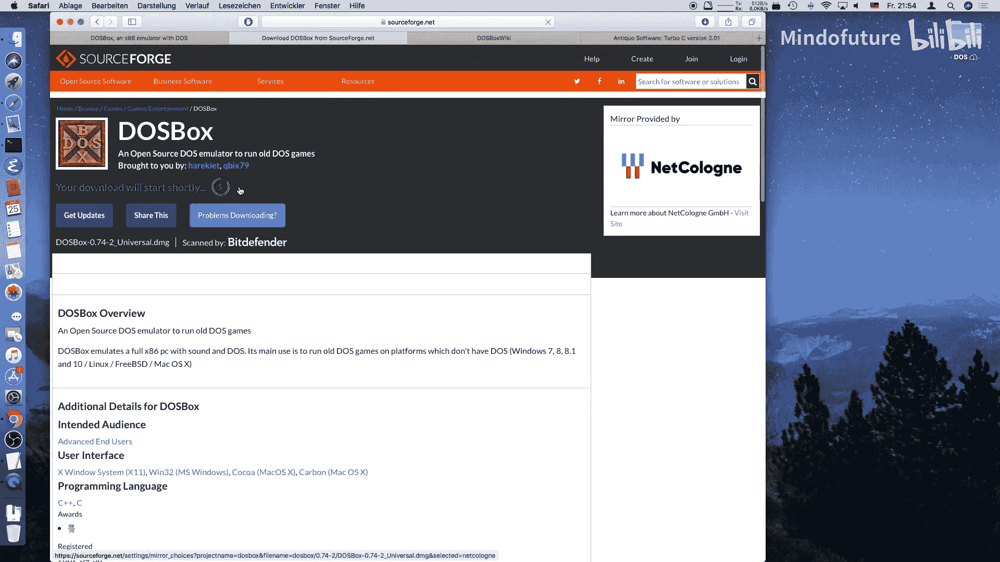
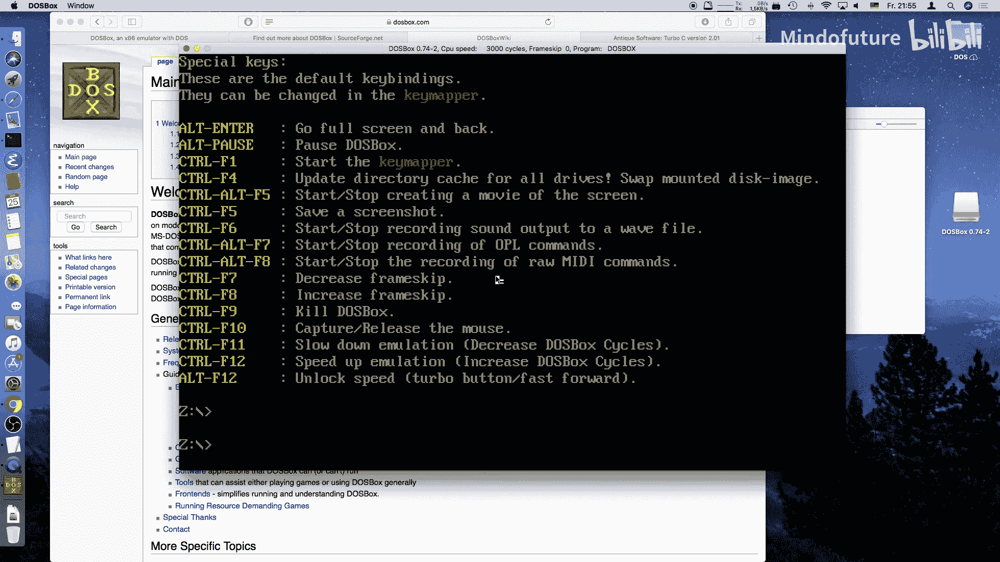
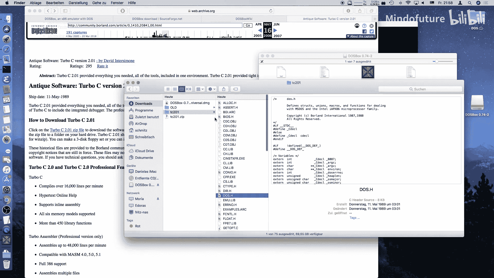
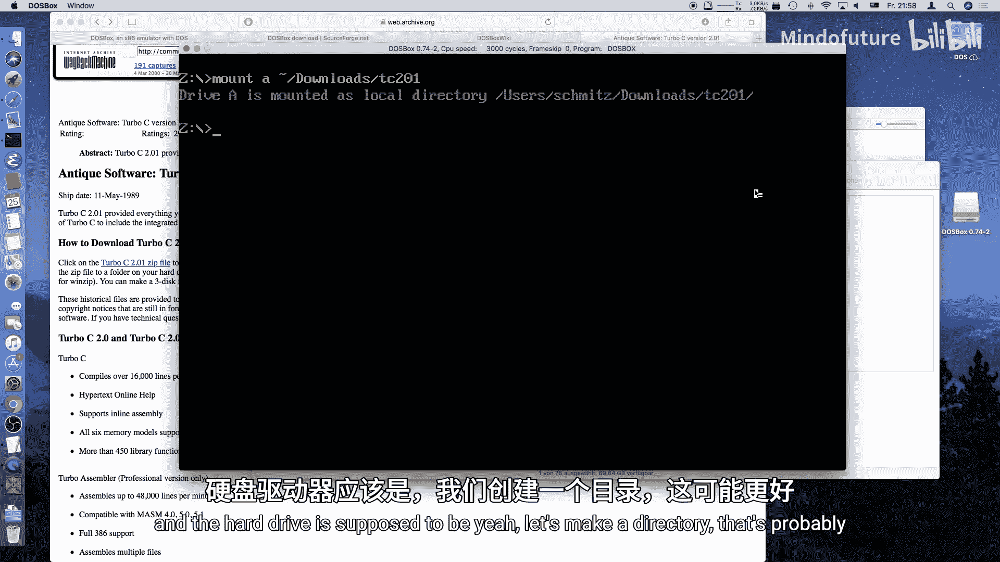
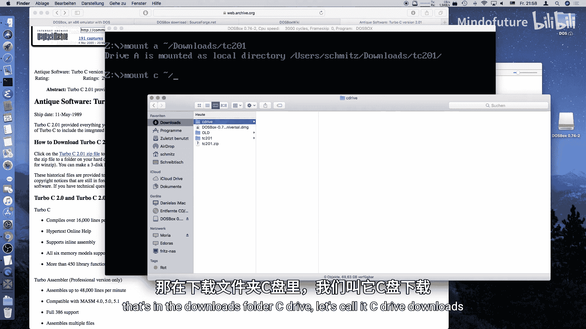
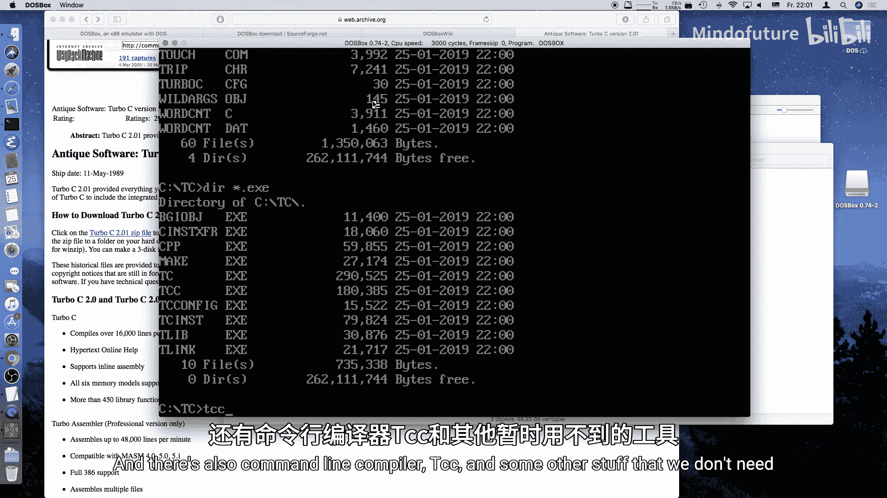
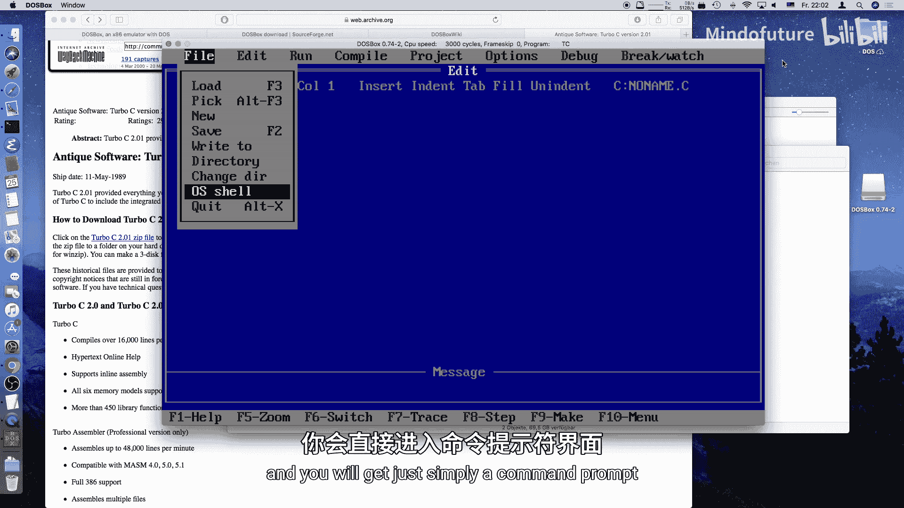
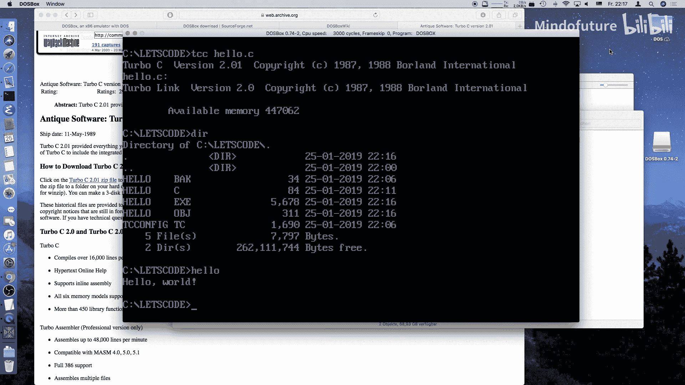

# 编写MS-DOS-系统-｜-windows-｜-操作系统-｜-汇编--｜-vga-｜-x86-p01-P01-Lets-Code-MS-DOS-0x01---Hello-World!--BV1zs35zQEru_p1-

🎼Hello， welcome。 and good evening。 And since my。🎼Fantastic new phone is broken and being repaired。

 Well， it was actually dead on arrival models。🎼Well at were， but there were flaws with microphones。

🎼I decided to do something different today where I don't need a camera。So。

🎼I want to start a new series， because I think some of you might be interested not only in the。

🎼Retro PC staff and the retro games。 But maybe hold this all。🎼Worked。

 And if one could make new games nowadays for these old machines。There are projects currently。

🎼Like the Planet X3 game and other Kickstarta or non Kickstarta projects that are producing new games。

🎼And yeah， people doing that are actually also。🎼Like not professional do programmers or something。

🎼But these are machines are already。Quite complex， but easy enough that you can actually teach yourself to program for them。

 And it's quite fun and interesting， and。🎼So I thought， let's maybe make a very， very tiny game of。

🎼The next， well， couple of episodes， Basically， I will try to keep them short。

I try to watch the time and not make any episode longer than 15 or 20 minutes。🎼In this first episode。

 I wantna set up the development environment。And since not everyone has an ancient PC。

We will start off with emulation because later you can put it on a。I like vintage machine， anyway。

🎼And the most famous emulator for this is a dust box， It's open source。 It doesn't cost the thing。

 and you get it for all the different。嗯。Yeah， operating systems， basically。

And you can just simply download it， pick the one that you need。

 The Linuxes come with it as a package。 Mac as you just download a。

🎼Gimji image。🎼Let's do that in the background here， Windows gets an installer。 And yeah。

 that's basically it。🎼Afterwards， you just install it， or， for example， on。Mekos。

 you can run it from the DG。Alternatively， copy it simply to your applications folder。

🎼There's also a nice wiki with a lot of documentation。 You should definitely check it out。

 There are some articles on， for example， me specific configuration stuff。

🎼I already configured mine in advance。🎼And。🎼Well， when you double click Do box it simply。

Comes up like this。🎼Already made it look a little bit nicer， in my opinion， bigger screen。

 You can also talkgg a full screen if you want to， but the show do。And that's just simply。

And alsoimulator emating a pissy。🎼But it comes with very little， as you can see。

 a couple of programs here， an introduction program。

 which gives you some hints on how to get files into the system。

🎼I just skip through that and explains a couple of。Hotkeys。🎼You should definitely check them out。

 but I won't concentrate on that I know。

What I do want to concentrate on is what do we use for programming。

And I will choose to receive version 2。Why because it's a small language and a language that still has some significance today。

 because if you code in Java or Java script or in C+ plus no matter what or even see everything you see here。

Kind of apply still。 So you learn something not only for your hobby， but also maybe。

For professional life as well。Orre， and。As that I don't expect you to be a cor at all。

 I will take tiny baby steps in each episode。And try to explain everything。

 and you can comment and ask questions， and I will try to clarify them。

So like I plan to do like one or two episodes every month， given I have enough time。And in the end。

 we will have some simple tang game。And if people are interested。

 we can build on that and do other stuff。Tsy is was actually released as like freeware or。for free。

From the corporation， the successor to Boland。They took it down。

 but you can still get it via the wave back machine of the Internet archive。

Just click on the fire and we'll let the little bit of luck。Download will be triggered。

And you get to zip fire。And we will simply unpack the zip file， and we will get three disc。

Diirectctories。嗯。But you can't run it directly from there。

 you have to run the installer problem from To box。And actually， it should be on three floppy disks。

But the easiest thing that you can do is to just。Move all the files into one folder。 So I just。

Copy all the files from disk2 and disk 3 into the disk1 folder。We can get rid of the。Disk。

 one folder。I risk2 and three folder。Next， we can get rid of all the folders here。

Simply don't need that。And now we have everything in the T C 201 directly， okay。

So let's set up。Dos box on that。 dos box。Use the mount command。 And I know saying， please use。Craf A。

 which is basically the floppy drive。And take everything from our Tobo C directory。And put it there。

And the hard drive is supposed to be。

Yeah， let's make a directory， that's probably better。Is in the donors order。Seedri。

 let's call it Cd drive。

Downloads。C drive。Okay， now there it is， we can。Dear C and dear A。Works good。

 We go to AN run the install program。Okay， a nice insulation utility。Copyright in 1988。

19989 by Boland International。Press enter to continue。 Lovely program。 The source drive to use a。

 That's correct。 And we want to install To C onto a hard drive and not onto a floppy drive。 Yeah。

 actually， this would run on a floppd drive。 Like if you have some original PC with maybe two floppid drives。

 you don't even need a hard disk to code。 It's pretty nice。Yeah， all the directories are okay。

 so C TC will have everything in there。And I will explain the details later what the include terophils mean libraries。

BG I and the memory models。We don't concern ourselves right now with that。

Insulation on do boxes fast because of course the emulator is really fast on a 286 or older machine。

 it will take probably a few minutes， especially if you'll install it from floppy disk。Okay。

 it is installed， we can switch to the seed drive。I want already。嗯。here。

 I'm not even sure if that works。It works， okay。Uually use a MD and。

 we make a directory called let's code。Note that under dose。

 you can only have up to8 characters per file name， so。Let's go to actually the maximum。

 plus you can have three extra。 so let's code dot Txc would be a valid file name。

 but let's code1 dot Txc wouldn't。Neither would let's go dot T c1 right。

 so it's eight characters for the name plus3 for the extension。 That's a pretty tough limitation。

 but we will work with that。So， let's go to T C。And yeah， that's a bunch of programs in here。

And the main program is the main ID is TC To， and there's also command line compiler TCC。

And some other stuff that we don't need right now。

We will just use the IeE and it's pretty minimalistic compared to what you are probably used to today。

There's a couple of menus to load and save and change directory。

 and actually we will do that right now because we want to store stuff in the。Let's code。

You can also run a dos command from here。Note that Doss doesn't have any multitasking so everything will be stopped and you will get just simply a command prompt。

And we can run。And even Dbug。With trace into and step over through a program。

 we can compile to Excel files or to object files。嗯。We can do projects。Which you can then build。

We will do that later， but for now， it's sufficient that we simply。Have one source right。

We can set compiler options。 I won't go into the detail。Right now， but we can talk about that later。

We can change the linker and other environmental stuff in the directories。

 save all the options or retrieve options。From different configuration files， Basically。

 this also allows you to do something similar like projects。 You can name the project。

And create a new project name。嗯。Yeah， here' has no project yet。But we can try to say。

We are now have for let go project， and we will save this。点好啊？Confit all every time we open this。

 we will have a let code project。 That's nice。That's more debugging functionality you can。

Get a call sake evaluate expression， stuff like that。 Ed break points， Sos。Minimalistic。

 but pretty powerful has gotten。Context sensitive help， which gives you overview of the shortcuts。

 they are quite different from the editors that you know。I think these are Word stock commands。

 if I remember correctly， So copying works by pressing these keys， C K。And yeah。

Some letters after that。But let's do hello word program。

So C is the language that was developed for UniX。And a lot of problems already Nancyancy。And it was。

Pretty well used on a。Dos and windows as well。But mainly， as I said， came from， from Uniix。诶。So。

 every。C program contains functions。And there always has to be one main function。

You just write the word main and then empty parent disease， there could be something in here。

 but right now we don't need that。And every function also has a return type。In this old version of C。

 you don't even need to specify the return type， if you don't say。What the function returns。

 automatically assumes that it will be。Void， I think， but the C standard。

 the later C standard actually say main has to be of type end。It returns， basically， in error code。

AndThen the party of the function。 So basically the。Recipe。

 what the function does come in a block of these braces。Opening braces and closing braces。

 this is always necessary。 Other languages like Python， for example， say， oh， you don't need that。

 you just put some spaces here and that's the body of the function。 button and C you need that。

And what do we want to do， we definitely in the end need to return something。

Because I said this returns an integer， So some number。And if there's no error。

 Dos and Uniix defines it。That you should return a 0。Okay。😊。

This is already a problem that can be run。Let's just save it。And we will call it。啊，我。

If you go to let's code。ho you call it hello。こ the材。Then we can try to compile it。

Can't find the project。 Yeah， because we didn't。Create one。 Let's delete that for now。

 We don't really need it。LetT computing again。 This seems to work。And let's see if we can run it。

Heran， and ran it a crazy fast， but you can also go to the user screen。And there was no output yet。

 of course， because we didn't do anything。If you want to output something like text。

We have other functions， library functions， and the one for printing stuff on the screen is called print F and C。

Print formatted。 It's actually。And when you want to call a function， you need to。

Put the parenthsesis and then the arguments。 And for now。

 we just put a string here and the string uses double quotes。 and can just write hello word。

And then if we want a new line， we have to put back slash N here。At the end of every。

Comman or expression we need to put a semi on you already saw that。 I didn't explain that。

 So I think it actually put both in one line。But this is， of course， harder to read。But for C。

 the semicolon means， please。Do the next。Command or statement or whatever you want to call it。Okay。

 so this is actually not quite correct code so it。Probably might compile。Yes。😊。

But it only implicitly compiles because actually functions are defined in so called headerophiles。

Which are part of libraries with code that other people wrote for you。

 so you don't have to write them。And our special commands that begin with this Heshtmmal。

And I will explain that later in detail as well。And basically。

 you can include other libraries by writing hash include。And then in。These。What would you call them。

I care。Less than greater signs or maybe triangular brackets， I don't know。

You can include other libraries and one of the standard libraries that comes with sees the so called standard input output library。

And all the library files usually end in dot H for header。So we have source files like our Hello。t C。

Which end with C because it's program language C。And the library files。

With their extra functions come in files with the ending H4 header。So what do we have here。

 We have the statement that says， please use the。Library standard input output。

Use the library still at input outward。Then we have the main function。

 which always has to be there for a run good program。It returns in and doesn't take any arguments。

Then there's a block with all the commands in the function， calling the print F。And。

Pass it the string hell alert with a new line and then return 0 and we're done。

So let's compile again。It does seem to work。Let's run。And also， take a look。And there we have it。

 our first runable program。We can know， actually。quitit。做个事。Go to the。Let's code。

And there we have multiple files。 now， we have the config file that we saved。

 We have the Hello C source file。 We have a Hello back。

Which is quite better obviously every time you save。

That's the backup file of your source code because there's no undo。

 and you can't open multiple files at once。 It's very primitive。Let's the hello O BJ。

 which is basically only the asmb code or the machine code for。

The sea source file and Ho do A E X E is the full X file with the C run time for printing stuff and similar thanks。

True， it should be able to run。Well see from everywhere， we just said。ThePas。To only this。

 if you have other outies that you would put want to put in there， you can put whatever in here like。

Maybe have a do directory or something。嗯。Anyway， we can now run， for example。

 the command line compiler， which has a lot of options。 We don't care about that right now。

 but you can just say。2 compiler。系路乐师。And it will compile and link everything。 and you get。hello x。

Which you can run。And Woa， we have the exit program。Yeah。

 so this is still far from doing a whole game， of course， but。It is a start。

 You now know how to download an emulator。How to download a whole programming language and how to write your very first program and how to compile it。

In the next video， I will try to extend this program a little bit。We。

Will try to maybe switch into a graphics mode or I will try to explain how to do graphics。

But this will be also in baby steps because that's actually a quite complicated topic。

And I will have to explain a bit about the PC hardware。I hope you like this。 I try to keep it short。

 and。If you have any comments or suggestions and stuff that you want to see covered。

Please leave a note。And other than that， share like and most importantly， subscribe。

And here， have a nice evening。🎼う。🎼ああ。🎼。🎼，🎼う。