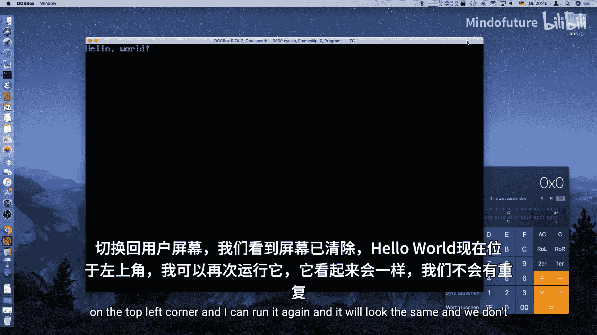
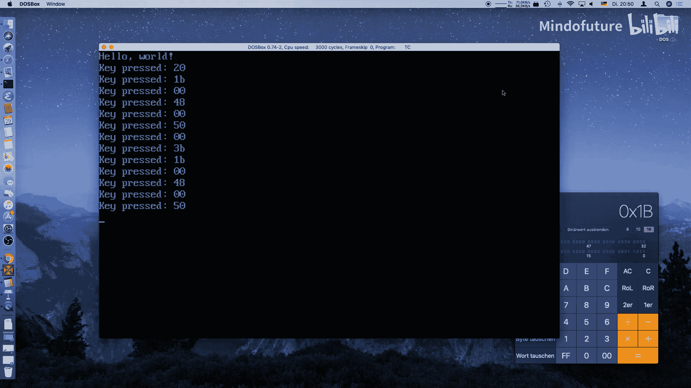
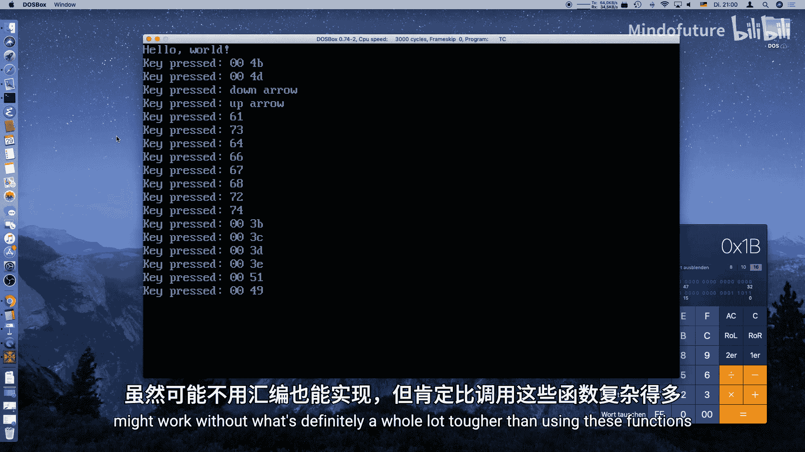

# 编写MS-DOS-系统-｜-windows-｜-操作系统-｜-汇编--｜-vga-｜-x86-p02-P02-Lets-Code-MS-DOS-0x02---The-Keyboard--BV1zs35zQEru_p2-

🎼，🎼。🎼Hello， welcome and good evening to the second part in the Let's code and Astos programming series。

🎼And last time we set up to the forcoding， you learned how to write your first to the word program。

 and in this episode we want to go one step further to our way of having a little video game of our own。

🎼And youll learn how to read from the keyboard。🎼Because， well， if you have a game。

 you want to control。Character。🎼Something。🎼Or other。

 And you would probably want to query the arrow keys or some some other keys to control the video game and maybe to quit it as well。

🎼So there are standard C functions for getting characters from the keyboard。🎼However。

 those deal mainly with normal letters and whatever you。

🎼And they can't deal with the arrow keys or the function keys or page up page down and all the other things that you have。

On a PC keyboard。🎼Because that's not standardized of all the computers。

 So To C and Microsoft C for the dust machines。🎼Came with a different。

🎼Include files that allowed you to control the actual IBM PC console and that header was called conIO。

h for console IO。W， and one of the。🎼Most simple things that you could do with this was to basically clear the screen。

 for example。 so you don't see。🎼The leftovers off the next tour， after the last program。🎼And we can。

On this program。🎼Switch back to the user screen。 and we see， yeah， the screen was cleared。

 Heello word us now on the top left corner， and I can run it again。🎼And it will look the same。

 and we don't have it duplicated。

That's nice。🎼What this thing also gives us is。Functions to query。🎼The keyboard。For example。

 I can ask。Has the key on the keyboard been hit？It doesnn't tell me which one。

🎼But any key has been hit。 If so， then I can do something。 If not。

 I will basically continue with my game without changing anything。🎼So， what we basically need is。🎼诶。

🎼An infinite loop。🎼one loop。🎼Which executes our game engine code basically。Now， this could be。

🎼The true infinite loop will through and do something。🎼And then we could quit， if， for example。

🎼The key that was it。🎼Is the escape key， for example。🎼we need to store that key somewhere。

 and with Hanzii， we need to。🎼Put the variable at the top of the function。

 So I'm going to store the key code。🎼And despairparable。🎼And the key code is always a character。

 one by it， basically。🎼And I will put a zero in here for the time being。And。

🎼I want to quit if the key code。🎼As long as I want to put it the key code， reaches a certain value。

🎼And the question is， which value should that be， right？🎼However， I don't know exactly what。

🎼Kko is here at this place。🎼So I will just put the true in here and I want to print out all the key codes that I have。

So if a keyboard key was hit。I'm going to fetch the key。

And this is done by the get character function， get C， H。And well， if we wantan to see what this was。

 we simply say print F。And。Pin of works like this。We write the string to be。Written out。

 Then we give a format format string， and I w to see this in。P。

So the format string here percent x means I want to see a hex value and that should be two characters with the leading zero optionally。

And yeah。That should do it。We need to make a new line at the end as well。

 otherwise it will clo up our display。Basically。So let's try this。There were errors。 Oh yeah， Tru。

 I'm still。In C+ plus mode here。Y 1，2 is not defined。So， let's try again。I can press spacebar。

 Spacebar has the hex load 20。Escape as x value 1 B。That's good。😊，And when a press occurs。

 a key light up。I see。 it's。2 key codes， actually，0，0 and 48。And key down or arrow down is 0050。

 Well that's interesting。 So there are special keys like the function keys and the arrow keys that have a leading0。

0 in front of them F1， for example， is 0，0，3 b。I think for the game， we will need the escape key 1 B。

0，0，48 and 0，0，50。

Okay， so we now know that Caey equals。You must not equal。Pexa decimal 1 B。

You can write a comment here。嗯。Loop until escape pressed。So let's try if it works。run。

We can press some keys and escape quits。 Now， this is perfect， right。We have this color。However。

 we want special key handling if there is。嗯。A specialial key。

 So if the key code was equal to 0 and we have to cast this because the0 is actually in。

Integer and nototic character。Now we have something special。

We can use the switch statement to decide what we want to do。 We switch。Between different cases。

And the cases are our different。Kreers。 So if I remember correctly， one was 48， which was basically。

The up arrow。And you always have to break after a case。Otherwise。

 it will fall through to the next case。And the second case was。The down arrow。0 x 50。Here。

 we also break。 And then， of course， we have a bunch of。阿。

Things so this is not strictly necessary here， but。Other special case on right here。And in the end。

 we want to write out that we have pressed the up or downarrow key。

So I'm going to exchange this for some string。And I will call the string key， basically。

 so we need to define the variable here。With sufficient space。So 255 should be good。

So we have string off size， 255。And whenever we encounter。平y。We will fill the string。

 and you can do that and see with a string copy function。We put something interesting a string。

And in this case， will right， uper。So that we know that we pressed it。

And we will also write something。When we have the down arrow， we will write the down arrow。

And when you have a different key。We will。Right。Basically， yeah， we can。 we can write the。

Key code again， we use this T the string print F function， which prints to the string S。And again。

 we use the special formatting to get a hex representation。Of the key code。So no。

 in the case of a special key， we will get something nice。But in the case of a normalarchy。

 we write garbage。So we。Still need to let me zoom in。 So now we see more。嗯。

Would still need to write the key code。 Basically， I can copy this line up here。Oh， man。

 I really forgot about the。Shortcuts。ok。One thing it will compile， but for clarityergy's sake。

 we need to include the string header。The string header will be fine。All the string。

 copy and asspirator functions。And should do it。If you're not on Mac OS and you can actually press control of one here and get direct help for this。

 I need always to go to the header files。Go to a string。

 then search for the function like string copy。 copypy string sources to desk。That's simply enough。

Now， what do we have here， We included console I， Standard I string H。

And we find a variable where we store our key code and something where we describe our key that was pressed。

We leave the screen， say hell a word， and we loop until the user presses the escape key。

If a key was it， will you read the key and if it was a0 by it， we know it's a special key。

You can write that He has a comment。Special key handling。Then we make a switch statement。

 We switch if it's an arrow up arrow key， it was case 0 x48。

And three will store up arrow in the string。Otherwise would。Test 4，0，50。

 which is a do arrow and store a do arrow。Then we handle all the other specials and just store their key code。

In the string。And otherwise， we also store simply the key code in the string。That's pretty nice。

And then， we get。🎼The our thing， hopefully。真会。🎼Right print left Keep pressed。Be done with it。

🎼Let's try it， hopefully it works。🎼Errrrows， unfin symbol S。🎼Yes， because we called it differently。

 let's just me an a to his side。🎼Lazy。🎼St arrows， honeys and key。Of course。🎼And finally， it works。

 Now let's right，s space bar， key pressed。Yeah。🎼Uar。🎼Oh it did not work， Okay， downarrow the same。

🎼What did we do wrong Oh yes， of course。We need to read again。

🎼I've got that if we have a special key， we need to read the second bite。

🎼Because they get character returnly one byte and the zero signals that there no especially one coming。

🎼We can actually look that up in the headpho documentation on IO and then get character。

🎼Both functions return the character at characters are available immediately no buffering of whole lines。

 special keys such as function keys and arrow keys are represented by a two character sequence。

🎼A zero character followed by the scan coat for the key pressed。🎼That's pretty。To you right？🎼So。

 that should work now。🎼And we get it。 key press down arrow， key press up arrow。

 You can also find out the key codes for left and right， which is for being4。

 if you want to use them。Space spa enter。🎼It would probably be nice to have the zero by it also printed。

Let's changed this as well。🎼For all the stuff that we don't know。

 we write zero zero in front of that。🎼Because then we can actually see that we have a special key。

 right？🎼So these are the normalies， those are the characters。 and then we have the。

🎼Function keys what you can't get with these things is like stuff like the shift key or the control or I key。

🎼You can actually carry them。🎼But then you would have to read from the hardware directly。

🎼I will probably explain that in a future video， but let's first finish this game and then we can dive into more details if you want to。

🎼See how to read the hardware directly like the keyboard。🎼And stuff。

 which will be very close to the machine。 We might have to use some asmbler。🎼It might work without。

🎼It's definitely a whole lot tougher than using。

🎼these functions here。🎼Well， so that's what we learned today。🎼We can in theory now。

 carry the keyboard and control of player character or whatever。🎼And also， cl for quitting work game。

🎼And I think that's pretty good right， I will probably put up it just with the source code to this so that can copy it directly to Dos box and play around with。

🎼And other than that， I hope you enjoyed this。 hope you watch the next video as well。

 share like and as usual， most importantly， subscribe。🎼Because in the long run。

 it will hopefully make me。🎼Here I would do all these videos。See you next time， have a nice evening。

🎼我妈妈。🎼。🎼ああ。🎼。🎼。🎼うん。🎼。