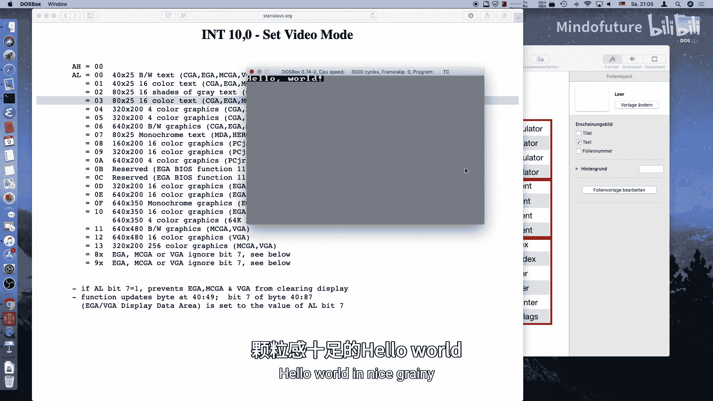
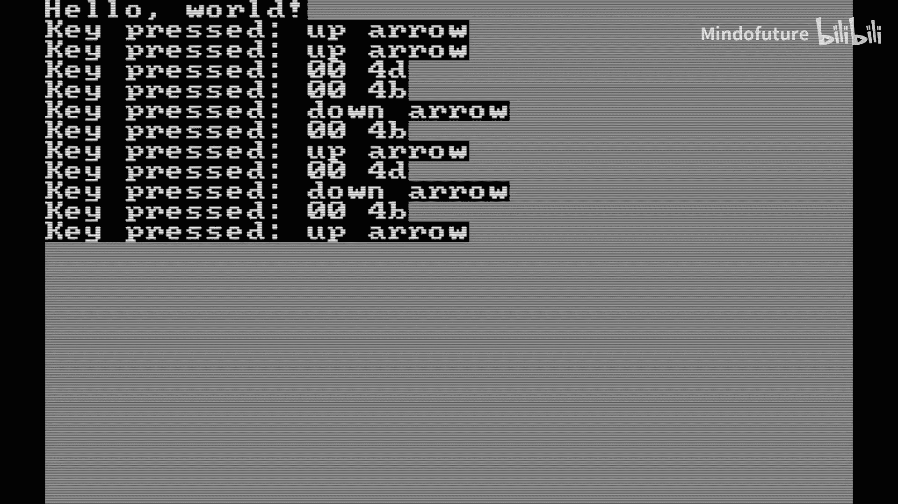
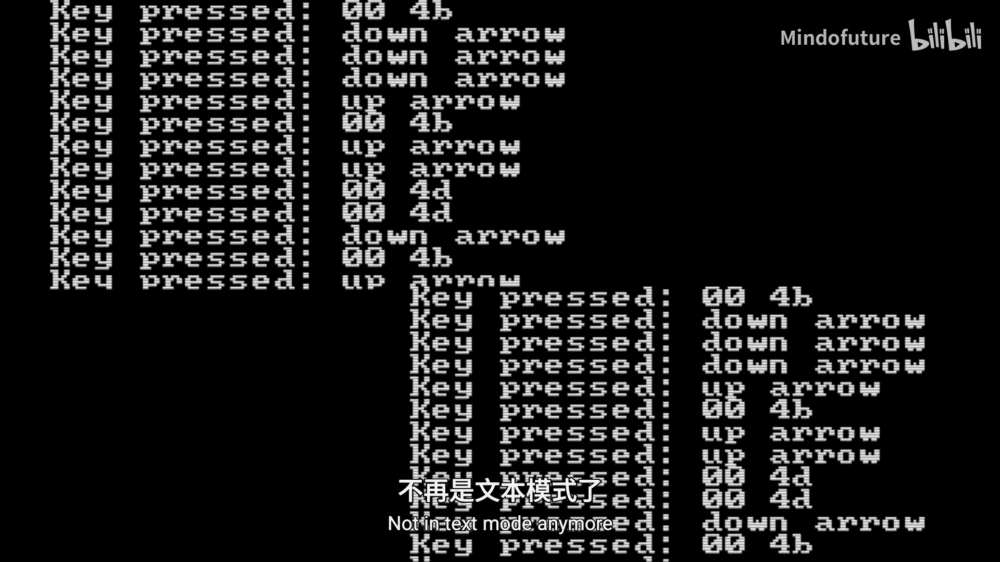
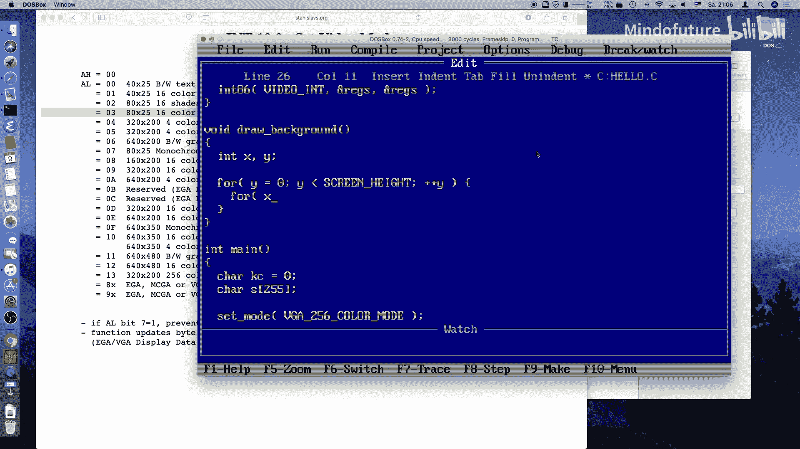
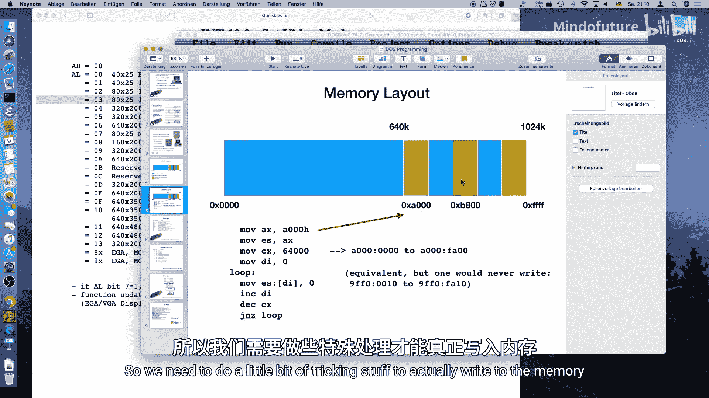
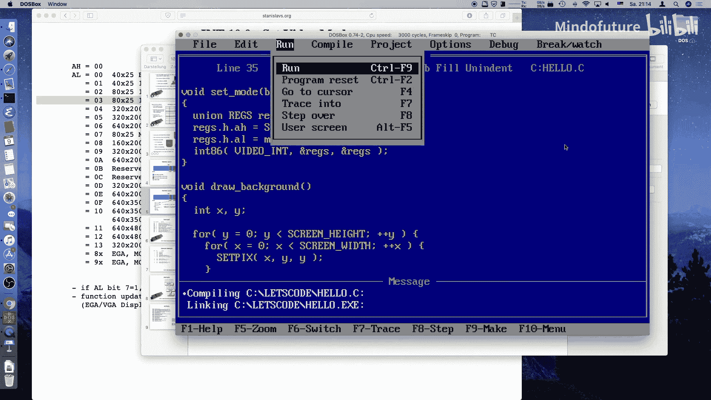
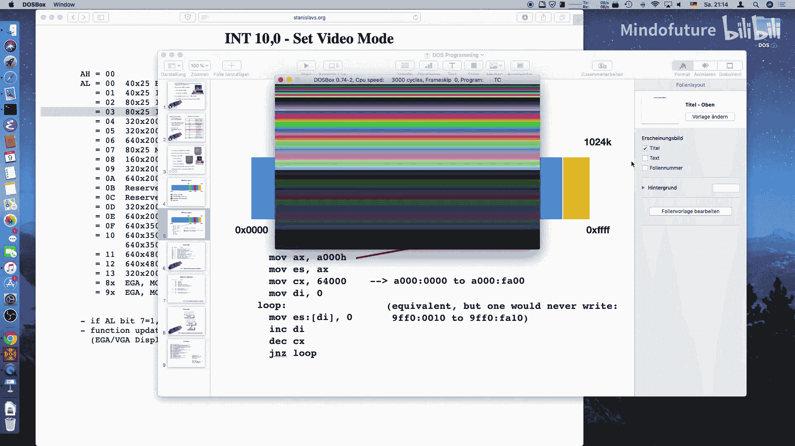
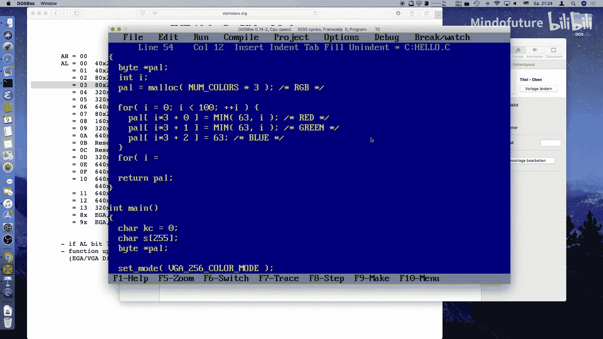
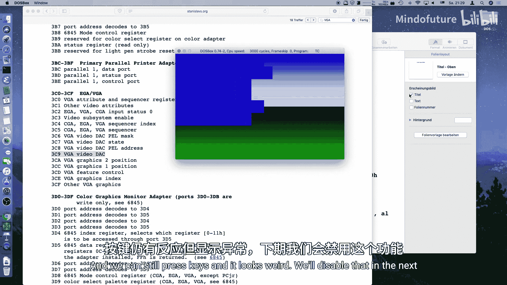
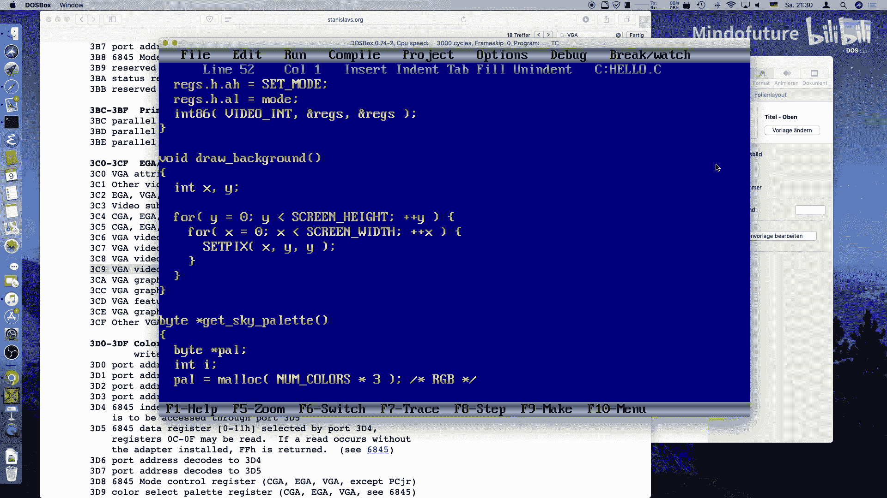

# 编写MS-DOS-系统-｜-windows-｜-操作系统-｜-汇编--｜-vga-｜-x86-p03-P03-Lets-Code-MS-DOS-0x03---The-VGA-Card--BV1zs35zQEru_p3-

🎼う。🎼Hello welcome and good evening and tonight we want to get the third part of the Let's code MSD session running。

🎼And we want to do some graphics today。 graphics is quite a complicated topic， but again。

 we'll take baby steps。 and I'll show you how to initialize the VJ card and am starss to。一样。

🎼So that you are able to draw something on the screen。 there will be a second part。

 most definitely with other stuff like animating things。🎼But for now， this should be， I think， good。

🎼I will have to explain a bit more about memory layout unders and it might be hard to understand and if there are any open questions。

 please post them in the comments because I can elaborate much more。

🎼But I guess this will already be one of the longer episodes。

 so I don't want to put too much in here。🎼So basically what we'll start with is right now。

 what you can see here is standardup text mode application to overee runsom text mode。

🎼And we can't draw any graphics like the border here around the window text window is actually made up of characters。

🎼As well。 So yeah， you can't do。🎼Proper game with 2056 VGA colorsU。

🎼So what we need to do is we need to code a function that sets the video mode。🎼And。

🎼We have a bunch of different videos that we can choose from， and they will be at most one by long。

 so。🎼We haven't defined the bike yet。 This is not a type that。🎼See nose from self。

🎼At least not this old version anyway。 So we say an unsign character is basically justified。

🎼So no sign pit was anything。 and that's it。🎼Furthermore， when you want to set the video mode。

 we have to call the API of the PC and the API consists of so called interrupts。

 There are bios interrupts for those of you that have maybe watched the hard and Catch Fire series That's where the magic happenss in the bios right。

 So in the TV series they。🎼嗯。Reverse engineer， IBM's spers。

🎼And then implement it newly freshly for their own PC。

 because the bio is basically the closed source API of the PC and that's what makes it tick and how you access the hardware。

🎼And I will link to this page here， Steusslas。org， he has a very good comprehensive list of all the bioOS and DoOS interrupt functions。

🎼And there's one in particular that we want to know and you can either click here on bioV services or in 10。

 click through the same page， so interrupt 10 and this is hexodadeimmal 10。

🎼I's actually what we need， let's crank this up a bit。🎼Every bioservice。🎼It hass a number。

 so 10 is the video bio your service and then it has a function。

 function 0 is set video mode well that's what we already need。

🎼But there also other things like said Col palette。

🎼Or read or write characters at Curs a point and stuff like that。 Lots of things。 Well skipppeded。

🎼However， we need this function here。🎼And when you click on that， it says here Ah equals0，0。

 AL equals。🎼0，0 or whatever mode we want。So what do these things here mean， actually。

So how to pass parameters to。The interrupt works in the following way。Every PC has a CPU。And。This。

CPU has adjust。So the CPU in the PC， which originally was the 8086。

 or rather the cheaper 8088 version has registers。 The registers are used for。Eith general purposes。

 like computing。Someums or divisions or whatever。 and also point to memory and other stuff。

So you have these for general purpose，6 timbit registers， X， B，x， X x and Vx。

 which take up to 6 tibits。And then some。Memory pointings registers for code data and X stack。

And some special purpose Regs。 I won't go into detail with all of this。

Apart from the fact that the general purpose registers are divided into high and low bytes。

 so the high by of the AX register is called AH。And the lowbite a。So basically。

 what we need to do here is write a0 into the high bit， which is simple enough。And then。

 a 13 hexodadeciimal。Into the lowb to initialize the 256 calam mode of the VGA。And how do we do that。

 We need to have access to the registers。 We can either code in asser。

 but we will not touch that yet。 maybe later， but。Fair enough， Toberi gives us a so called union。

Which is similar to a tract， if he ever seen it。嗯。Called Rex。And。Yeah， well。

 you can actually manipulate the registers there。You can write registers。

And then the high register Eh。Equals。Something， and there something as a set mode function。And。

The low bite will be the， what do we call it the the mode， actually that we get past here， right。

And then we can call the interrupt。 There's a function for that。 it's got and86。

And it takes the number of the。Interrupt that you want to call and this will be the video interrupt。

And we have to pass it a union。With the input parameters。

 and it will store the results that were passed back from the interrupt in the output。

So this time we take both and we need to take the address of this because it wants a pointer to the stretcher。

And we have to actually tell the compiler what the different things here are we define。

Set mode to be 0。Actually， we can write 0 x 0。 So we have the。嗯。Ex more。Thing here。 And we will say。

The video interrupt is actually。Droppped hex 10。And also， this has to be included from somewhere。

 So if you look into the help file， there will be。Dos dot age and dot age comes with the in 86 function。

That's where it's defined。 And that's where the union rex is defined。And it's basically just。

A union of the 16。Byy registers and of the half registers。Well the pay register， right。

And here you have all the registers that we've seen before， or maybe not all of them。

 the segment registers are missing。But for that， there' another function。

So this will allow you to actually set the video mode。You need to put in the input here。And。

We can try to。Compil it。Success， that's good。Seems fine。

And we should be able to actually call this function。 But first of all， we will。

Define what this should be called。That's call it VJ 2056。可啦。Moote。

And there was the hexod S amount 13。And the text mode that we usually have。Text note。

 Let's take a look here。 So the default for EGA is and VGA is the A0。Columns，16 colour text。ok。嗯。

This year would be grayscale。 and this year is for CGA monitors。 You don't want that。 That's ugly。

 But what we are working here with is actually。Moote 3。So。Yeah， let's try that。 That should work。

Let's put it in here， somewhere。You can still use the clear screen。 That doesn't matter。Said Mauude。

BG 2056。Color猫。And then， when we quit。We will be so nice and set the text mode。Let's see the bills。

It does。Let's run it。 Oh， look at this。 hellello word in my screenny。

output works。

And it will even scroll。我想 text冇顶冇。

And it switches back to。A text mode， when we exit。So that was nice。Okay。

 so basically we can already do something。Next thing we are trying is to。Well。

 draw something I would say， we were。Make a background for the game。So。

Let's do a function draw background， right。The question is， how do we actually draw。Well。

We'll concern ourselves with that in a minute。I'd first want to just。Draw some horizontal lines。

Very simple， the whole screen。So。We will iterate over all the。Horizontal lines。

 So the y axis is because of y axis is like this here。 and the x axis is horizontal。

🎼So first go every line。🎼嗯。🎼So y equals zero and y is less than the screen height。

 and we have to define that。I was right。🎼Plus plus y， this is from OC++ times。

🎼Probably not necessary。 you can write Y plus+ this and send as well。

🎼X equals 0 x is a less than screen。🎼不会。🎼Plus X。🎼Sometimes we need to。

🎼Somehow set the pixel and going at X and y。🎼With some color and I'm going to just take Y here so we have a different color on every line。

 al right？🎼Because we have up to 256 colors and we have 200 ver lines that should be fine。

🎼So now we need to define all these things。 the easy things are。🎼The screen。🎼Height， with 200。🎼23号。

🎼And the screen with is 320 because that's what it says here， right， you have 320 by 2。

🎼But how does the setps function work？🎼Well， for that， we need to take a look。🎼I'm going to take X。

 Y， and some colour。🎼And then we need to do something， something here。

 and I'm going to do a macro here because toolC doesn't know about inlining functions and if I would put it in a function。

 it would be very slow。🎼And with the macro it will be basically in light。And the。🎼Prasically。

 when need to where you can use maybe a bit of Ram， maybe that's bio still there。

🎼And then there's a whole bunch for reserved for bio itself and thus maybe in this green area。

🎼But it's not that simple in Amoss because the 1886 uses a segmented addressing scheme。Which means。

🎼Since you use only 16 bits。🎼To address。🎼Everything。

 in theory you could only not address one MBgabyte but only 65 kilobys。Which is why。

🎼On a 600 machine， pay at another 16。🎼Good value here。This one here。

🎼And basically you take the first6 inputs， multiply them by 16， and then add this offset。

 So this is called the segment and you add the offset。Then you get the flat memory address。

🎼So we need to do a little bit of tricky stuff to actually write to the memory。

🎼And we'll do that now。 So we need to。🎼Cake。🎼The address of the VGA card。

 and I'm simply going to call it。🎼我主系噶。🎼I'm going to call it yeah I'm going to call it DJ and I'll define it in a second。

🎼We take the base address of the VGA card。🎼Then， we add the。Sorry。🎼The X coordinate。 And yes， the。

🎼Parent this year， actually。🎼Need it， or they make it more safe。

🎼Plus the white coordinate times the screen width。🎼All this will do is。

🎼Compute the two dimensional coordinate into a one dimensional address you can try to calculate in paper and you will see that it works。

🎼This gives us only the。🎼Address and in sequence+ to actually do something with the address we need to write an asterisk。

🎼Now we can do something with the address and we can just write okay。🎼Right。

 the color seat into there。🎼And we probably also want to be able to later。🎼や toオ픽ソ？

🎼Works just the same。 We just give out the assignment。

🎼So this will give you the contents of the pixel at coordinates X and Y。

 It will not check for illegal coordinates so you can trash your system。

 you can write anywhere you want。 Don't do that。And we won't do that here。But be careful。

 You can't really make your。PC crash or format your hard drive or whatever。

Estdo didn't have any protection against that。Belong that。Should be fine。The VGA pointer。

 we have to define it， define VGA as something。We can define it， or we can use a variable。

 Let's use a variable， because it's。Probably doesn't matter。So嗯。Yeah， let's， let's start like this。

 So it's basically a pointer to a lot of bytes。And it will be at address0 x a 0，00。And。Offset 0，0，0。

We can't write it like this because， yeah， this is not valid syntax。

 but we can just leave out the semicolon and it will。Do it correctly。However。

 this is a very large number， so we need to also tell it this is actually a long integer。

Which is this L here。But this will not work。If we try to build this。It would say error。

 declarationations and next era。First of all。We need to put。The definition of。The bite before。

However， this will probably also not be enough。The exactly non portable point or conversion。

The thing is， in， all the pointers per default are usually near pointers， which means they only take。

These。4our bys， the offset。These also got nearpoint us。 and they totally ignore the。Segment。

So we need to tell T， and this is totally MSO specific and not supported on Linux or stuff。

This is a far part。And also， since this is only an integer， we need to tell the compiler。Please。

 we actually mean this is a far fighterer。And if we do this。It will actually work。So it did compile。

 shall we try it？

And we don't see much because we didn't call it。Let's take out the。 I't know。 We can do that。

 Let's see plus plus。Let's say what the hell word。 We don't need that。

Let's call here draw background to see what we actually get。

Yeah， that's something that zoom in。We get a nice， colorful rainbow。

And this is what these years the default palette of the VJ cardt。

 It starts off with the standard 16 CJ colors， then a gradient of gray scales， and then。

Coourful rainbows in different saturations and practicess。What we actually want is。A nicer color。

 right， A nicer palette。 So we need to sort of。Have some function that。

Gives us a nice pal and we'll call it get Sky palette。 Well make something that looks a bit like sky。

And who will store this in a bite array。C， no， we don't even need that。Yeah， we need that called pal。

And then， we will。Set the palate， however， we will achieve that。

And pass that pellet to that function。Let's first concern ourselves， with the。

Get Skype andlet function。I am actually this。 we will return。By point up。Sky。P。All right。まら。

We will need a bypoint of pal here。And some counter variable for our looping。And in the end。

 we will return the point。First of all， we need the memory because now we have only a pointer which doesn't point to anything and and Do you actually call as well as on Linux other systems。

 the analog function。And we want a palate， which。Has some nu colors， colors times 3。 Why is that。嗯。

Because we are using RGB pellets。We can change basically， every colour。That was shown here。

And we have 256 different colour， so we will justify that because we will need it later anyway。

Dine local。256。Think to know about the VJ。 it uses not。

Simple true colour modes like modern video cards where you just write， R you build values to。

 to the memory because that was。Too inefficient。But you would only write the index of color like 15 or something。

 which would be。White， I think， And I stand apart。And then you could change that color by manipulating the color palelleette registers。

Inrite those values in here。So we make nice color ramp for this。We come from  zero。To。

 let's say the first half of the screen。This would be 100。W to count up。

And then we are going to ride into this area。At position I times 3 because of the RGB。Plus，0 for the。

Red value。And we will take here the minimum of。The value 63 or the value I。 And why do I say 63 here？

This by here my red color。VGA supports six bits of palelleette colors， so that's from 0 to 63。

Not8 but colors。 There's lots of fidelity here compared to your。Average card， nowadays。

But that's good enough。 This was back in the late 80s， rather awesome。

 already and better than many other things。 So red and green， we will set。

To the same value and the blue will be the ramp up for the， for the screen。No， well actually not。

 This will be held constant， The ramp up will be the other colors。

And this will make a nice blue screen。 We need to define minute max， again， for。Purpos of。Efficiency。

 I will write this as a macro， although it has draw bags。So if X X is greater than y， then we return。

 we should。Put Excel pen around this。Or else it can have。Serious consequences。There is an X。

 otherwise for your charm。Why。And we need the same here for the minimum function。

Al not defined in October C。F is smaller than y than we return X， Otherwise y。嗯。Okay， so this should。

Already build。Yeah， except。We need to include。Mlo， where could Meloc be。

 I think it might be in memberled age。 Yes， membered age is the memory stuff。Oh no， I'm wrong。

Let's take a look again。I loved the age。 Here we have。Alloc will allocate stuff。Great。So， include。

E look at age。And it will make。Please， this year。And I didn't yet write the set palelleette function。

Which means we have to write that still。 That's fine。 We'll do that in a minute。

For the second half of the screen。

We go from line，100。To the last line of the screen。And well do something very similar to this。So。

Let's just copy this block。 What we make。Sle of different stuff here。That's up the。

Readed to fixed value。This year。To some other magic value。 And you can。Figure out at home。

 what it will look like。What do you think。Will the be。So this is step function。嗯。

But we can't yet set。The colour and the tried。How do we do with that？Well。We already know。

That we have the interrupts to speak to the bias。We have the far pointer to the。

Memory address of the DGA memory NA。Third way to talk to the machine。And that's my。Iop ports。Here。

 IO ports are similar to memory addresses， but they have their own。

Machine code on out and in to write to or to read to。And every device gets couple of ipos。Right， so。

 for example， the first few are of the DMA controller and there's other stuff for I think the programmer will interrupt controller or the keyboard controller。

Stuff like that。And there's also。Things for。The video account。It's go to the main page。

And this is probably。Here， port addresses， ports。If you look here for VGA。We find this year。

There's a whole range from hexodademal 3 c0 to 3 cf， which is the VGN EG registers。

 and there's one particular interesting thing， the 3C8 and the 3 c9。

 which influences the digital to analog converter。The first one。

 that you say which color you want to manipulate。And the second one。

 you say what the new RGB values should be for this color。🎼So we won' use that actually。

🎼So the first one， oops。We will have to iterate the first one。🎼We write to， and we call this the。

🎼Pelleette index， because you say which index in the palette you want to change and we will start at zero。

🎼嗯。Re calls now to the。🎼How a data port。🎼We'll actually increment the index value so we only need to make this call once。

🎼And we will just write simply the values from our array。🎼To that port。 and of course。

 we will need to iterate here。F rate of all the values。 and we have。🎼256 times3 so 7。🎼68 colors。

To get a right over。🎼Condent this。🎼And we need to define those two values。🎼嗯。

Let's put it somewhere here。I VJ。🎼No， how to the about it。Inindex。🎼Yes。Look to the left，0 x。🎼3， C，8。

And。🎼Z x3 c9 is the other one。🎼And and C， this is called outP and let us see which。🎼That I O。 No。

 this is not I O。 It is in。Which had。I think it might be in age。I sure。😔，🎼Yes， it is。Here we have it。

🎼O P writes about to hardware port， and the same goes for in P， of course。Simply enough。

Does the age we already have。🎼We have the set palette。 We already called it。

I think we can try to build it。Build it successfully。🎼And we can run it。 Look at that。

🎼G that nice wither a little bit of grass and a nice sky， and we can still。

🎼Press keys and it looks weird， we'll disable that in the next episode。

🎼嗯。🎼Yeah， I think we already are way too long。嗯。🎼What did you learn today。

 Qui a bunch You learned about the VGF frame buffer。

🎼You learn about interrupts and how to use them to initialize the hardware。🎼You learn a bit about it。

🎼Hardware I upwards to define the palelleate。Let's take those bit apart。🎼And。Yeah。

🎼Next time we will try to animate something and to draw a bit more stuff。🎼If you liked this。

 please share， like and subscribe as always， subscribing being the most helpful way。

To support me。🎼And。I hope you enjoyed this not something。🎼Have a nice evening频。🎼。🎼。🎼The。🎼。🎼The。🎼，🎼。

