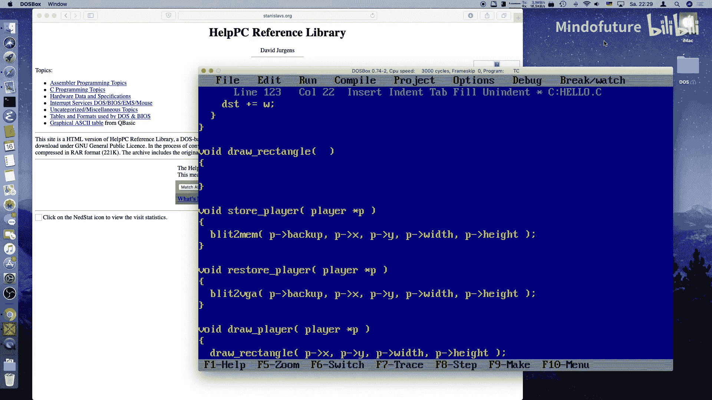
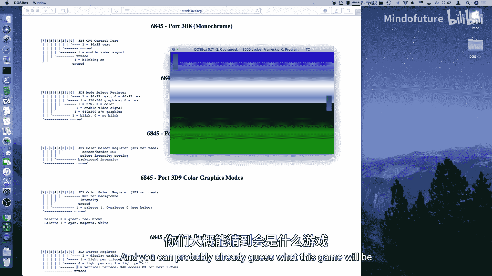

# 编写MS-DOS-系统-｜-windows-｜-操作系统-｜-汇编--｜-vga-｜-x86-p04-P04-Lets-Code-MS-DOS-0x04---Make-It-Move!--BV1zs35zQEru_p4-

🎼。🎼Hello， welcome and good evening and Quebeck with the fourth episode of Let's call Amists。

🎼And the last episode we set up all codinging environment pu。

🎼Learned how to handle key presses and we learned how to initialize the VGA card set a palette and draw some nice background。

🎼So far， this isn't much of a game。So。🎼In this episode， we want to draw something on the screen。

 It will be very simple， but we have a lot of ground to cover still。

 So I think that will be challenging enough。🎼We also will animate kind of what we are drawing on the screen。

And again， this will be very simple， but you will learn ortho basicic concepts too。🎼Later。

 build even more complex games and stuff， right？🎼In the background。

 I already have the help PC see reference library。 handy because we will need to use one two additional。

🎼Hardware registers and stuff。🎼Yeah， first of all， we want to make this thing。More playable。So。

First of all。🎼We will have two players in this game。🎼I'm not yet quite certain if we were make it。

🎼So that this will be。ex it the computer。🎼Maybe yeah， maybe it's simply enough that we can do that。

🎼Or if we were。Have a second player who's also playing on the keyboard or something。🎼We you see。

 as we go along。 It really doesn't matter that much。🎼Right， so。🎼In the main function， we will。

🎼Need to carry on the state of the players。Well call them player P1 and P2。

🎼We will need to define what the player is later on。

 but let's just start by saying what we want to do with them。 So player has some kind of color。And。

🎼For simplicitys sake， I will take colour 255 because that's the last in the video ett。

The first couple hundred colors we already used on the。On the background。

 so I just take the last color here。🎼Every player will also have some geometry associated with it。

 some hide。🎼And let's say it has 30 pixels hide and。🎼Also some width。

 let's say five pixels also will be tall， but very thin。🎼And there will be a player position。

🎼The next coordinate， and well set it。🎼Something small。🎼And a Y coordinate。

🎼Which is somewhere in the middle of the screen。 so it take the screen hide。🎼He write it by two。

🎼And we subtract the player hired divide。🎼32。🎼Because then we will have it exactly centered on the screen。

🎼And all the players will have scores。🎼W whichch we will have to track later so we won't need it this。

E， but yeah， that's fine。🎼Also， when we draw something on the screen。

 it will destroy whatever was under there。 So there are different solutions to solve that。

 The most simple one that we will use here is。To。🎼Just store what El was under there and put it back when the player moves。

🎼So we don't have to readr， this will work in this kind of game in other games it will be more difficult than you have to use different algorithms。

But for now， this will do。We need to allocate that。 Well know how to do that。

And how many bikes will we need well。Basically， the size of the player。

Which looks something like this。And then we saw that it's now。

 it's filled with garbage height that will be。Totally ra。And for。Clarity's sake， we will use me。

To set all the allocated by to a predefined value， which will be0 color 0。

I think it doesn't matter because we won't be using this first backup。

 but just to be on the safe side。So we don't get any garbage on the screen， right。

And mapet is pretty simple。You give it the pointer。To the。Memory area that we want to set。

 that's basically just。Whatever B just returned。We say which character do we want to use。

 We want to use the character 0， so we want to write zeros there。

 and then the number of bytes switches again the size of the member area that we allocate。嗯。

Sa goes for the same player。We will simply copy this whole stuff。

And I don't know my word stock amounts that well， So I will simply manually replace P1 with P2。

Make sure to get everything here doesn't actually matter because the players of same size and stuff。

So that's all good。But the player position should be something different。

 We want to place this on the right side so we take the screen width。inus P2 with-5。

 So it's the same thing from the border。Okay， that's good。This will will compile， not at all。

 because we haven't。Defined。playlay啊。And how to do that， How to do that， indeed。When we and see。

 we can't use objects， but we havestructs。 so I will。Define an alias for a structure。

The structure is basically similar to a class in C or in Java， but it can't take on any functions。

 It will simply be。Collectction variables。 So type ofstruct player。This is now the new type player。

And yeah， what does it have， It has a colour。 And that's a bite because thej colorss are bys。

It has a position and if we take an in， this would be 16 bit ins。

 this would be enough to address the whole screen。It also has a width。And。Hight。

 we might limit this to bytes， but。It doesn't matter much here。

We have solve few variables that it will not be a problem。We have a score。

 and we have some kind of backup buffer， and that's point2 bites from the screen。

And that's already it。This should compile。With two warnings， code is no effect。Thanks for sure。

 I need to initialize this。But we won't see anything， right， We have defined this， and。

Nothing will be wrong， actually。So， maybe we should。Contcer ourselves with the drawing， probably。

So what do we have here， We have the Rdo basically as long as we don't press escape。

We are looking round to see if there's a keyword。But what's the steps， The steps will be。

Every draw loop。That we make。We want to。Resstore whatever。Wass beneath。Can ask price。

We'll do that here。 So we have something like restore。Player or whatever we want to call that。

 What did I call this in the preparation。Just so that， you know， I have some notes。系高元龙。

A little bit atliing this， but。I have tested this before。Re player， P1。Yeah。And the same forplay too。

So that this queen is in a sane state， right？Then we handle all the keyboard stuff。

I won't change that right now。And after。The keyboard handling is done。We will do something like。嗯。

Because maybe there were other draw routines。And there was state updated。

 and we will store whatever is now under the。Player。 So well call store player P1。store。P2。And also。

 then we have to draw whatever the new stuff is that the player status is in。Right。

This breaks everything down into rather small functions that we can actually understand and reason about。

Yeah， I think this is。Pretty okay。We can。Try to handle this。Let's go on to。

Did defineine whatever these functions are。So。We have a stall player function。Which takes astruct。

 I know， we don't give it to write that and see， we want to point it to a player。

And we need to have something to restore whatever the play I was doing。冇。我你话 what电脑。

The player and the frame of him。And we need to be able to draw the player out。

With whatever features we want。 And this is something that we can play around with later。

We can make the player bride more fancy and do more stuff。But this should now again do。

Not do anything because it would say， yeah here has unused parameters。

 we don't do anything with these empty functions， but it will compile and run to nothing。嗯。

Before we do that， we can actually do the keyboard handling。We don't want to deal with the special。

 So I kick out all the。All the stuff here。Ignore the other keys。And here as well。

 we want to do something if we hit the up key because then we want to move our play up。

 So basically player one。嗯。thatt why。And we would subtract， I don't know， two from the continent。

And then we need to check if we run out of the screen if y is less than0。Then we will do say。

 why equal 0。 So we clip。Com from。From the top of the screen。Hery can do。We can do the same。

hold the donkey。For the donkey。We add to to the current play coordinate。

 And if this is no greater than the screen height， Oh， stop right here。 Y plus。Player  one。Oh。

 and look at that。 This will be。This will be a nice syntax arrow。So if the player wipe on it。

 plus the player height。This big on the screen height。 Then we say。

Let's do this to screen height minus player 1。So killinging to the lower hand， right？

Now we already have some game logic。 We can move the play up and on。That's pretty neat，hu。嗯。O。So。

First things first。Stplay。 What does storeplay do。We need do some， some blocked。Transfers。

This is called Bttting and game programming。🤢，Rro and programming language。

Some computers like the Amiga and stuff。 they have separate chips for doing the btting。

The PC doesn't。 so we will do some memory copies。But we will make a utility function for that。

 We will call this B to M， because we will。Block transfers stuff from the VGA frame buffer to our own memory that we allocated the backup buffer。

And this will。Go to the destination。Play our pickup。And。

The coordinates will be wherever the player currently is。

And the size will be the player width and the player height。

I could have put this all into this function right here。

But I think the b functions will come in handy later as well if we want to do other stuff so we can actually use them and these these parameters here are very specific to the player object itself。

So， it's better true。Pull this apart。 So what does the blitz。To memory function look like。

Becauseuse now we will do more of the nice。嗯。Quintter stuff。function here will。 what will it get。

 It will get a pointer。To the destination。And we don't know。What kind of one of this will be We are。

 I mentioned this one， we are here in the small memory model。In the small memory model。

 we only have 64K of code and data， and all the pointers are near pointers， so only the opposite。

But malllo。Might return fire pointers or whatever the programr he used。

So we have demanding of far point heres to be on the safe side and also for the。

🎼Opposite direction when we do the b to VGA in the minute。

🎼That will definitely need a far pointer because to V Gema Mary is in a completely different segment。

🎼You learned in the previous episodes。Haven't seen that yet。🎼Check it out。🎼So that you know what to。

🎼This is totally in specific， as I said， you won't have to deal with such stuff under Linux or modern Windows systems or Macs。

🎼Okay， so。🎼Yeah， we take that。🎼We take the X， Y automatic mats， we take the width and height。

 and I'm going to use very short。Very good names here because。

🎼The formulas will be not much clearer their use。🎼We need to enjoy it over something。

🎼Because we need to go scanline by scanline。🎼And we need to calculate the source pointer。

🎼And we need to calculate a。🎼Destination point up。🎼What does the source pointer look like。

 we are copying from the VGA memory and we defined already pointer to VGA called VGA。

🎼And the opposite will be， of course， the X coordinate。🎼And the whitecon not for the start， at least。

🎼あ。🎼We need to modify this by screen width， so we have the correct offset into the PGA memory。

🎼To skip why scan lines， basically， the destination part is simple。

 just whatever the user supplied us。So now we can。🎼Actually， iterate， and we go from scanlan Y。🎼To。

🎼Y plus。Height of the bathroom。🎼And we just count up very simple。

 so we go over all scan lens from y to y plus height。🎼And。🎼Yeah。

 now we can use a function and we need a function that actually takes far particles。

 otherwise it will't work。🎼All the stuff that we have here， like Mem copypy， which is standard for。

🎼For C and Linux and everything， it would take just the void pointer。

 which is in the small memory model。🎼A new appointmenter。 So this will not work。🎼However。

🎼There's one function called move data。🎼It will take actually segment and offsets。

So we can take all file point here。Like this。Moved later。🎼How do we indent this something like this？

🎼So move data， it needs to take somehow the segment of the source pointer。🎼Somehow。

 the offset of the source pointer。And。🎼The same for the destination pointer， and then。

🎼The number of pipetes and every scan line is W bytes with bytes。🎼But how do we get the。

🎼The segment at the offset。🎼Well if you're in luck， let's take another look at the memory header。🎼H。

🎼And it does say that here。🎼I'm wondering。🎼W of these things defines that， maybe they。🎼イス、ブロスヘラブロセラ。

🎼Just this。 There's these two things。 F P since  for5。0， this takes， this makes。

🎼Gives us the offset and the segment of our。🎼It's basically just。

🎼Andanding and bit shifting the pointer that you have on hand So you can do to yourself。🎼But。

 it's easier to do。🎼It's natural， basically。🎼So。🎼To get the segment we just might test。

🎼Segment of source。And to get the offset， we run FP off。Offservs。Tingles。For these to。FP。谁。

And same here。This should already compile。 This will copy。And it doesn't， because。I had to対。

Hands up Who saw that already， You probably。Seeing much more than I am here doing here。

And move data also。Wrong， of course。 move later。So this is better。

Now we only have two warnings for the other two unimmented function。Okay。

 this is one of those two functions。 The other one will be to re or the player。

 So here we will have to b from memory to the VJ。And the G to V will also。

Take the bigger pointer as a source this time。And the other stuff as well。 So there's no change。

It's only the direction。Changes in the whole function will look， of course， slightly different。

And what does it look like。Well we can copy the。The signature。As well。And it will be called B to VJ。

 And this time， the5 point is the source。We will also need to iterate。Toall the scan lines。

And we will actually， actually， I can really， really， really， really copy this whole stuff。嗯。

There people that say don't copy and paste， just rewrite。

Because he will make errors by forgetting to change stuff。回 want者。We are better than that。啊 부。So。

This looks good， so the source pointer is whatever the user supplied。

 this destination pointer is the GA pointer as defined before。

Then we iterate over all the things here。And。Serious thinking that I want to talk to her。

Which is not true。 Okay so。This is okay， and。I think I already made a mistake on here。Yes。

 but we can fix it。 We can fix it。 So we do the move data。 And as you can see。

 So and destination pointer neither here nor there will change at all。So after doing the move data。

We need to increment the source pointer and how much we will。For the source pointer。

 this is the backup， it's W wide， so we will add w to skip to the next scanline and the destination pointer has screen with。

 so we add that。To get to the next scanline。And this is the same here， except。

With the other thing the source point will be the VGA。

We will add screen width to get to the nexthandline in the destination point on。Will add the。

With off。Whatever the user supplied us。This looks much better。ok。This should compile。It does。

 and we only have one unimmented function。在啊，朋友。Yes。Draw player， draw player。

 What does draw player look like。In this game。It will be simple。 We would draw。A rectangle。

And this would draw directly to the VGA frame file。

 so we say draw rectangle from coordinates X and Y。With， with double view， No。

 with its coin right here and。Height as the height。Done that， but we need to implement that as well。

We won't get around that。Well， drawing a rectangle is easy。You can later just like load graphics。

 define own graphics or do sprites in all kinds of ways。

We won't be talking about transparency yet because that's a whole not kind of worm。

 but that will probably be maybe in season 2 if。There's enough people wanting to watch this。

But for now， we will just draw colourful rectangles。 Oh。

 and we probably should say that we want it in this colour here。

Right。So these are basically just all integers and x and y and T。Hight and some。卡了。Sounds good。啊。

And this will be very simple。We probably could do some more efficient drawinging routine。

Doing 16 bit rides and stuff。But we won't。 not， not， not right now。This is all too complex already。

So we will just again， iterate over all the can lines from y to y plus height of the player。

And implement the J。And there will be an inner loop to draw the individual pixels for。As we line。

 so this will go from x。And。To。X plus the width that was supplied will increment the eye。And。Well。

 now we need again our。Destination pointer。And I write this on one line。

 so it's not such a weird expression。 It would be the VGA buffer。Plus the y coordinate。

 which the x coordinate， which is I plus the y coordinate， which is 20 times as usual。

 the screen width two jump to the correct。Scanline。And that's it。 basically。 So we say take。

This address， and。Use it to store the spite。This should already work。

It complies without any warnings。I have to compile again。And there's something here。You will see wed。

 oh， he pressed， he pressed yeah。's， let's kick that out。 That's ugly。We don't need that。

Let's take a look again。Y。Okay， this is not not working as well as expected。

 There's some blinking stuff and the store restore doesn't work。So we need to find out why that is。

We do have the store player， Re player and drop player， and we are。Calling whistle player and。Yeah。

 we probably should have stored。First of all， we should have stored whatever。

Was in that thing in the beginning。Because we didn't do that。

 So we have the this color here that we set。So we should definitely do that after drawing the background。

And which means we can actually skip this。 We don't need that。So we just say start play。P one。And。

Do the same。42， but I think there will be another bug。 This didn't look quite right to me。Yeah。

 still does suck。So we need to take another look。Think't you guys probably already saw that。

new typing away and copyping away。The destination pointer was completely funnkous。

So we overwrote some memory inside the machine。 and you so you can see there's no good general protection force or anything。

We were just lucky that it grew in at all。And didn't do weird stuff。 Yeah， look at this。

 Now it's flickering， but it's moving。 And I think it's moving too slow。 I want this faster。

 but I can move it up and down。But the flickham is annoying， right。

 but we can hit the top and it won't crash or move out and we can go to the bottom and that works as well。

So we can move our player spr up and down。So I want to change two things。Firstst of all。

 I think this is not wide enough。Let's make a ten for both players so we can see properly。

The colours also ugly。 We will change that in a minute。We want to do it faster。

 So we move by 3 over4 better。And this should be already better。But the yeah。

 now the flickerings even worsem。就我。Yeah， it moves faster。 Looks good。The flicker is terrible。

So the flicker happens because we are basically。Clearing。

Whatever the player was at and then redraing it。 And the screen refresh is so fast that we will see parts of that。

 at least。So。Back in the days， we were using cathorate tubes of the big。

 bulky screens that were scanning the screen with an electron beam。

And when it was at the bottom of the screen， it will retce and move this。

The the elephant game backup up。During that time， no picture would be displayed。 and in this gap。

 you could actually do all the redaws。And that's what we want to do。

So we need to take a look at the helpP library。And we need to get here。

 I think the hardware data specifications， maybe。And then ports。There will be VG airports。

There would be something called。There will be something from V GA。And I think it will be。This year。

So， basically。We need to find the register。 And I think it's not。Very accurately described here。So。

This is the status register。6，8，4，5。 We should look at the 6，8，4，5。Motorola， C T controller。ok企。Yeah。

 that sounds about， right。What I。Yeah， here we are。 Here we are。 That's what I was looking for。

 Po 3D A， sorry， I didn't find that right way， part 3 D A。It has a bit bite here。 a bit， a bit。

 This is the status。If you read this port。And take a look at the third bit。 So that's。

Deimal hex decimal value 8。There's the one of we are in the vary trays。Rammick says O for next 1。

25 milliseconds。 So we need to be working inside of this time。Whenever this bit flips on。

And we can do that。 We can do that。 We are fast。 We can make it。🎼So we will define a new ioppo here。

We wouldn't call it。Inputs is status。🎼Fi。🎼6，8，4，5， Motorola。🎼Control or not。And tour define。🎼对啊。

Go to the retrain bit。🎼Has0 x08。🎼I will write a little function that checks for that right above this set。

No call it。Wait for。Meet trace。🎼And it will be very simple。 First of all， we will read。The thing。

🎼And。🎼Comバルトです。对。🎼But the retra bit。🎼And we will do that as long as this thing is one。

 because maybe we are currently in retrace。🎼And we don't know how long it's lasting。

 so that's why we skip the first retrace and maybe we are not in retrace then this would just skip。

And then。We'll do the exact opposite。活 say。欢迎。🎼This bit is not set， and we are not in a retrace。

We would wait。And then we have the。🎼Guaranteee that whenever we come out of this wine loop。

We are safe for 1。25 milliseconds， right。This should compile， but we need to still call it。

So one more try， this is without。🎼And now let's call it。

 and we will call it whenever we start our next。Draw loop。Basically。Right here，摆 at the top。

Wait for retris。🎼We do everything the whole handling will do inside of that。🎼Oh look at that。

🎼The flicker is gone。 We are now drawing inside the but of the rerece。

 One thing you have to make sure is that your drawer chain is really that fast。

🎼There are ways to work around that， but we'll cover that in later seasons because it will get pretty complicated。

🎼We are ready so much over time。 I think this will be enough for today day。

 The code is up on Gi up again。🎼You can walk through it， but you learned how to。

🎼Copy stuff from the VGA to memory and。🎼The other way around， how to draw an a erectile。🎼And well。

🎼I didn't change the colour of this thing， but you know how to do that in the said palette function。

 So I will leave it up the homework。🎼It's already in the Giub version， it's in there。🎼And yeah。

 now you know how to do that， we can actually move this thing Next time we'll try to actually make a game out of this at some extra action。

 try to keep the scores。🎼And you can probably already guess what this game will be， but until then。

🎼Please share like， and most important of all， subscribe。

🎼Hope you are enjoying this and have a nice evening。啊。🎼う。🎼ああ。🎼The。🎼。🎼う。🎼あ。🎼うん。🎼。

