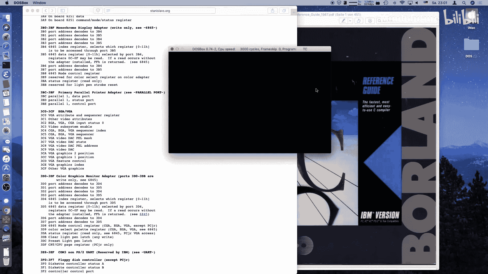

# 编写MS-DOS-系统-｜-windows-｜-操作系统-｜-汇编--｜-vga-｜-x86-p06-P06-Lets-Code-MS-DOS-0x06---VGA-Palette-Tricks-and-Refactoring--BV1zs35zQEru_p6-

Hello， welcome。 and good evening。🎼To the next episode an hour， let's code a store series。

🎼So last time we got the program to。🎼て？🎼Like this， we had two pes that you can move independently so you can have a two player a game。

 but there's no score keeping， no end of game or similar stuff。🎼And。

A few more graphic tricks that we can add。🎼And I think doing all of this will probably take too long for one episode。

🎼Do it in two episodes。Today， we will do some。More graphics tricks。And in the last episode。

 Ill show you how to print the score and penalty。And of。🎼I love the game basically。And this will be。

🎼Per season one， basically。🎼More advanced topics like most support， flicker free animation。

🎼And maybe even a bit sound。🎼Will be something for。🎼The next season。

 but I will have to prepare a bit because some of the stuff I don't remember for back in the day。

 I will have to read up on that。🎼Because honestly， what I'm doing here is more or less。

🎼Taking all the stuff that's still in my head。Looking up a few of the values， like the。

Poort numbers that are need for the VG。Butut it's all stuff that I already did。🎼20，30 years ago。

🎼As a as a kid。🎼Like a student。🎼And， yeah。🎼So what can we do today？

We already learned how to set the palette。And would be nice to be able to。

🎼More softly fade the image in and out， because this just makes boop。 And here it is。

 And that's not very nice， right。🎼So。🎼First of all， another thing is。

 since we gone to page flipping yet， you can always see。

🎼Like the screen building up in the beginning， I repeat this。I guess。🎼M an Osy。Let's try again。

So you can see how the screen builds up。 I don't want you to see that， right。 So we will basically。对。

Black palette。 how we can do it like this set。Like talent。 no need to waste memory。

🎼It will be very simple。🎼We can copy the circular function。🎼And just right out。Theroes。

🎼And if we do this right before we draw anything。😔，🎼We should actually be fine。🎼H。

Let's do it like El。That black。Perhapsps。Exactly。🎼And then after we draw the background。

 we will actually。🎼To this。The original melan tribes。So。Was this better。 Mo this any better。🎼Oh。

 I should have probably removed that。🎼It look more better。Hello。🎼Yeah， but this is better， right。

 you saw just a black screen for a fraction of a second。Let's meet again。🎼Much better。

 And what we can also do now is。Do something like this。 instead of set palette， we。飞飞着。嗯。Got。

And we will also do a fade artifact。嗯。系 before we。Return to text mode。Yeah， that's right。 That seems。

Good， now we need to define these things。诶。Yeah， well。ok。In the future episode。

 we also need to reflector this。 this main function because it has taken on so many things。

Will put all the game code into its own function。But first of all， that's all fade。

In palette function。Have a take。I think5。2。What collapse。And who will obviously need to。It right。

Or something。And。What do we need to to。Over， so。Basically， to fade in。

 it would take us a maximum of 64 steps。Because this is the maximum amount of。

Value that you can get for 1，1 tree， right？So。We need to。Increment the value of every。

Pette that we have。Actually， we need another palellet。 That's true。 So I'm going take a bite it。

Have recall it。How to。I think。嗯。Of size three times colour。And since we're fading in。

We will use themet。Let's look I said again， it's in the memory。Had a fire。 it would take a pointer。

Character and a size。So the point has pal2。The character that we want to write is just a 0。

And the sizes three times。Cos。And we don't even only need iterate over。We 63 steps。

 but we need to iterate over the palette every time。So for这一个 zero。J smaller than three times。

Oh know， not， but。Cos。colors。What do we do。Curse。For every。At alter iteration。

 we wait for the retrace。But otherwise this will be over so quick that you can't see anything。

So we'll sync it to the to the vertical refresh。And then here we need to do something。

 What do we need to do。We need to ride。A pal value。 How to the VJ card。But， not always。扫。

Let's copy this part。We don't need this。So basically， you want to write the。Can you pull that out。

That we are incrementing from black to the actual planet。So。J times。re。Plus 0， this is the red value。

Let's right it here。And here we want to write the index。Which is technically not， not even necessary。

We can move that。Here and just right，0。 It will be autocrementing。 So we just say。

 please start from the0 to colour。And。いや we。Here's the green and the blue index。佢演啊屌。No value。Okay。

 but this will only write out black values at the moment。So how do we get this to be better。嗯。

We need to increment， right。So。And。Actually， I think we might do it。Better than that。Because。

So let's check that。嗯。Yes。派出。J times。Plus。0。This less than。The original palette。J times 3。Have 0。

So if we haven't reached the target value， then we basically just。Increment this value。すよ。Plus， plus。

 this will in by one。However， seeing this， I would say we can。Takeve ourselves turn off。

Is and stuff and computations， by just。Herating over all the colours。And not doing it in red。

 green blue。Steps， this will be so much simpler。As we actually don't care that this is red。

 queen blue。We adjusted rate over all the 768 values here， and this should work， right。

 So at a maximum of 63 times， we will wait for the retrains。 Tell the VG to start at colour 0。

It read over all 7 and 68 components。And if our current component is still less than our target component。

 then we increment。And then we write that value。Sounds good， right。So for this to compilely。

 we need to。You find the al function。But we won't do anything with this。

And we have the fade in here and they fade out down there。So， this shot in theory。Compliile。

One warning， because we have unused parameter， but we don't care about that。上一次。And it doesn't work。

It's even worse。 It hangs。Okay， where's all book。Okay， yeah， have a copy and paste。

Always check your variables。 So we were incrementing eye as， of course， very stupid， indeed。And yeah。

 it works。Did you see the nice Hain。Do it again。This is very nice， isn't it。

 So this is the simplest kind of fading that you can do。

 Actually more correct would be to computer ratios。

Off the colour and to a proper linear fadeen because this is more or less constant， because。

The acceleration is constant for every colour。But it's simple enough and nice enough。As a homework。

 you can try to do this with ratios and stuff。Try to avoid floats， if possible。

 because that will be slow。But yeah， maybe you can figure it out。How to do that。But they don't。

Will be pretty similar， right。So。We will probably also have to。Let's just take this whole block。

 but it will definitely look quite different。嗯。So we can actually work on the original colors， but。

I wouldn't want to do that。We don't want to mutate them。So basically， we can map copy。Let's look up。

That function， as well。So destination point is of point and size， destination point as pal。

 soft point。Have2。As the destination but have palace。

 the original pointer and three times no colour is the size。That's correct。

So we will also want to do 63 iterations。 We will want to wait for the rets。

I would put the0th color for the VJ cards to start over。And then go on the colors。

And if our Panou J is still。Greater than 0。We will dec it。

We don't even need the original colors anymore。And then we will write the value。

And I think this should do the trick。Iice stadium。I a nice。Oh there is。Much nice， alright。

And this is all done on， on a half level， just by manipulating the。Coour register of the VGA car。

 So this is extremely fast。And if I were to take out the。Wait for retce。 Let's do this。如果。😔，See。

 it's very fast。 You can this rise and slow。And this is extremely fast。

 This is even in the simulation， it's slowed down， so。On， on a reader machine。

 it could be like over and over。Frection of a second。I think this is much nicer。

If you want to speed this up， you can do this only every other loop or something。But。

 I think this takes。Just slightly less than one second， because V J is 70 Hz。And that's， that's good。

 good timing， I think。All right。so。This is already quite good。嗯。We have probably a few minutes left。

So maybe it's time to refactor this thing a little bit。Let's throw the print that we don't need。

And take off the game coach， maybe。Let's do something that is called it。Hello。G。

And we need some way to tell it。If it's a new game or if it's running already。

 and it should return if one of the players has won。Or not。So we need some kind of return value。

And by default， it will be 0， which means。呃。Gamme。So going。Let's put this in its new line。😔。

And value one will be play out1。That's one。To be player。2 has one。And3 will be。呃。Escape pressed。

So this is like game wasorted。And we will return this return value。I would set it。

When the time comes。So what do we need， We will need。What a bit of stuff。You really need。Yes。

And the initialization。We不。Nops。So the player status and everything will be。copy。

I think I forgot to delete that， yes。😔，So let's delete that as well。How do I relate with。

 I don't know， I just press control Y until it's all gone。

So the mode initialization and the paled functions can remain here。Also the draw background。

Or can it。Not sure about that。But this stuff here is definitely。

 so we need to make these variables static so that they don't change。Have the day。

Don't get allocated all the time。So if I weren't making this， these fun of these。

 these things static， they would be initialized every time we enter handle game and we would lose old state。

Athetic。Very global to just keep its value。From function call to function code。

And if this is a new game， we would。Need to run all this initialization stuff。

And we don't want to do this every other time。Yeah， here nice function to indent。

 Art indent will be nice。And。Yes， draw round， fade and palette， and then we can see。😔，And。Game。

 and yes， this is a new game。And every other time。It will be like this。系度帮我攞 play啊。Something。

 something。Three other time， it will be like this， but this will have to change and we need a new game loop。

So， handle game。 and then。W呀。Her game。嗯。😊，Is0。Nothing， actually。Turns of breaks。If one player。温河。

Preest。All right。Instead of while handle the game。He could see even not right while not handle him。

 but I would like to rather explicitly check for thee。Return values。

Sot of doing some implicit cool conversions。哦 okay嗯。No， I think we can actually take this year out。

There's actually one。Thing we can do。 wait for retrace。

 Things that shouldn't be in the handle game routine。So we kick it out here。And we don't need this。

So here we also do the invitationdentation。哎。Help。This was not what I wanted。So if keyboard was hit。

 then this and that， we need a。T code variable。And we don't need it down here。Will not be used。

The string will not be used。The penellet will be used。 Yes， that's fine。Look how how short now are。

Our nice main functionist。 It almost fits on a screen。good。 F should always sit on a screen。

If possible。Yeah， this is a bit tedious。But nice code。 is nice code。And this is a very old Ie E。

Doesn't do odd and then， doesn't do auto complete。Does't do syntax checking。

And still paper wrote great software with this。We don't， but that doesn't matter。So yes。

Burious brace。Curly brace handle a balltopplay， rock player。Something， something， something， okay。

If someone。Yes。He character。Was0 1 X， B， was it。I'm not quite sure。Qu sure let me double check。Yeah。

 that's actually correct。Then we can already。W are。3。

We don't return anything else right now because we don't have their game overco。

 We'll do that in the next episode。So， this should in theory。What。see if compliance might be some。

Problem， one error。Too few parameters。 higher handling。0， okay。See it works。And， this is nice。は。Okay。

🎼I can quit， but。That。🎼this this is。🎼This lovely okay， we get stuck here。

🎼Because we call it get character okay。🎼Do we。🎼No， that should actually not。🎼Sキ but。

🎼Then it does everything like that。Oh， look at that。🎼We did something stupid。Yes。

 I think this should be。And here。🎼Those should be in the initialization。🎼Because。

🎼Through the very first time we already need to store whatever was under name。

🎼But that should not matter。🎼Yeah， this just looks weirder。Because we restore。And we。

🎼I still think we do something wrong with the get character。🎼How can you fix it。

 so seems it's already too late for me to think straight。

🎼So the structure of the code is now as follows。 the handler game routine knows if it's a new game。

 then it will initialize all the player structures。🎼Store the background behind the player。

 So we restore。Not garbage。🎼And then it will immediately restore because this is much easier than doing any other trick。

🎼Tricky stuff。🎼And this is important that it happens before the Gi hit because then the animation will actually work。

Then we check if a key is set。🎼I he was it。 but let's say it wasn't。 So we exit。

 And here's when my stuff was wrong。 I accidentally put the handle ball and store and drawer stuff inside the brace。

🎼So what would only happen during a key press。🎼With this， again， being outside of this loop。

 it will simply work。🎼And we have refed our gold， though that it is。🎼Much easier to understand。

 I think， although I didn't just know。🎼But we have one have a game routine which does all the game stuff。

 game logic。🎼We have a smaller main function now， which does this stuff。🎼And。🎼And the next。

🎼Episode we can then go on to print the score to keep track of the score and say when the game is over and present a very small game over screen。

🎼And that's where we will have a more or less complete game， because it will have rules。

 It will have game state and will have an end。With yeah， definitely winner of the game。

🎼So I hope you learned something here and the code will be。🎼On GitHub， as usual。🎼You can read up。

 you can play around with it and make it better。I hope you enjoyed this。

🎼Share like and most important of all。 Please subscribe to my channel if you like this。

🎼And see you next time。🎼う。🎼ああ。🎼，🎼。🎼The。🎼う。🎼。