# 编写MS-DOS-系统-｜-windows-｜-操作系统-｜-汇编--｜-vga-｜-x86-p07-P07-Lets-Code-MS-DOS-0x07---Game-Over!--BV1zs35zQEru_p7-

🎼Hello， welcome， and good evening to the last episode of。Let's code Emma sauce。🎼Well。

 last for this season anyway， we will today finish up the game， let we started it。

 and I think we've learned a lot so far。🎼I want to make another season with more advanced topics。

 and I'll probably make a little poll。🎼On YouTube where can tell me what topics interest you。

 It should be related to Mstores， obviously to retro Vcs。And hi on。🎼No， all of the stuff。

 but I can certainly read up on things and try to come up with。

🎼Ttorial videos on how to do certain things and should be short enough that single topics can be like dive codeed in 15 to 30 minutes。

🎼So we have to break it down into。🎼Sizeable chunks， at least。🎼But yeah。

 please feel free to comment on this and give me some inspiration on what to deal next with。

🎼An example topics that I definitely want to cover is something like mouse support。

 which is nice in these pedal based games or even in other games， of course。

🎼And the mouse is not that hard to do。🎼And， of course， double buffering to make the animation better。

 softft scrolling maybe and its limitations on the PC， as well as stuffle， prides。

🎼Maybe even sound and music， I never did that properly， I'll definitely have to read up on that。

🎼That's a very interesting topic， as well。🎼Naturally， okay， so let's get started with。

🎼This last episode， where。🎼We'll add the gamemo screen the game condition。And first of all。

 we need to define something。🎼The maximum score that is load until。

🎼Over which the players will have won so for them。🎼Let's say if5 is the maximum score。🎼That's a nice。

 nice number， I think。🎼After which we。🎼End of the game will be triggered。

🎼And we also need to clean up a bit here。🎼I'm going to pull down the parameters for the video interrupt here。

🎼So there are two different modes that we support。The graphics mode and the text mode。

 and we have one function currently set mode。🎼But there's also more things that we need。🎼嗯。

🎼We want to print the score， so we could try。🎼The print string function。🎼Although Sil alert。

 we won't be able to do that in PC。🎼Due to the way the ToC handles the registers of the CPU。

🎼But we will come to that later， but instead， something that does work。

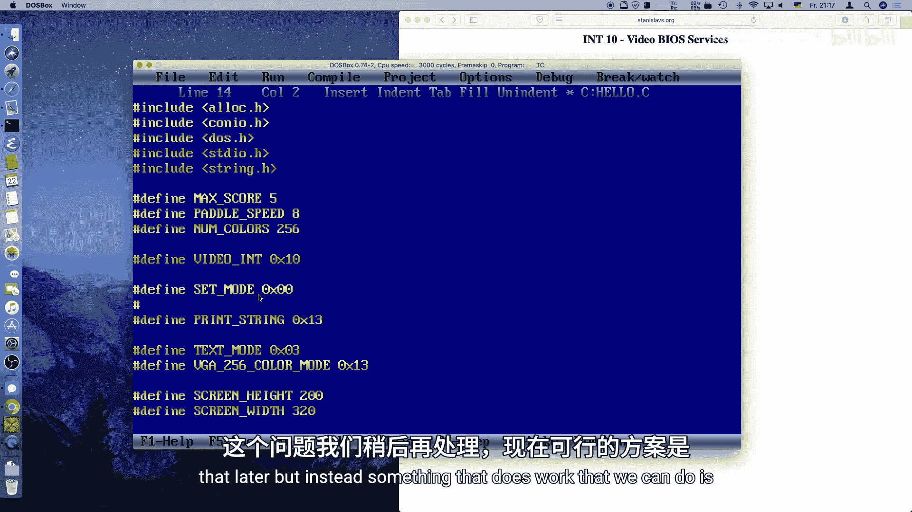

🎼That we can do is。They can just move the cursa。🎼On the screen， one by one and。Right。🎼。

🎼Single character print。Character。🎼I think that was nine。

 so here's the set curvesor position function and here's the right character and attributed curves of position。

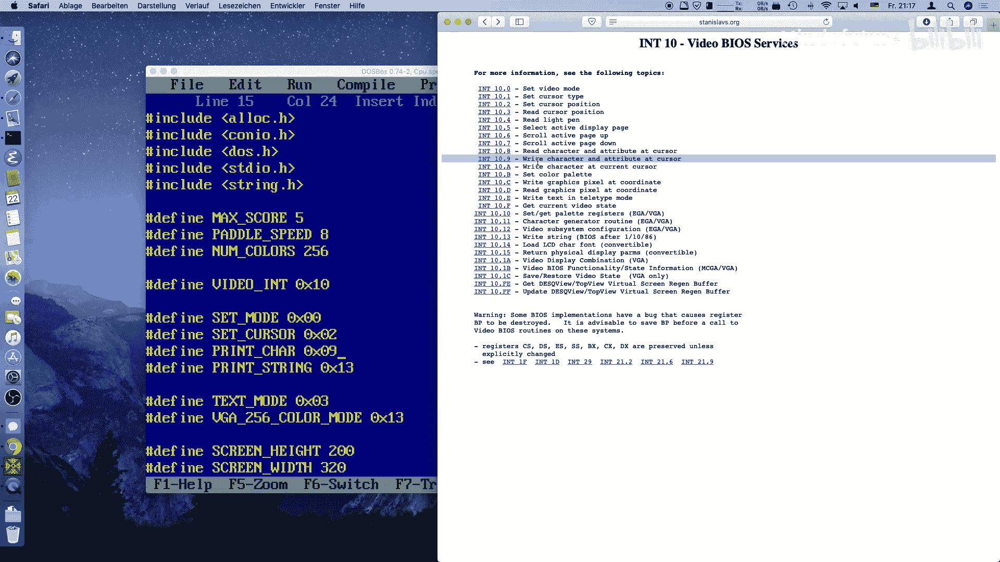

Those would work。🎼嗯。🎼I didn't find a way around。🎼This to simply print a string。

🎼It works if you use assembr or some better C implementation autoto C in this version will destroy one of the registers and that will not work then。

Okay， so these three new functions we will implement。And also for the text printing， we need to have。

Uable colors in the first 16 colors because those are the text printing colors of the VGA and EGA cards。

You can also use higher and better colors in VGA mode， but the bias functions make it a bit hard。So。

I will rename this port here， which we call Plllet index to Plet right。

 and actually there's a second。Register here。3 c7。W I can tell that VJ cut I actually want to read the colors there。

And we need that for our palllette side effects。 So I don't want to reprogram all the nice colour that the VJ has。

 the ones that you see on screen， the yellow and the blue。

 but I want to just copy them from the card into my buffer and then write them back when we do the set palelleette function。

Alternatively， we could just skip the first 16 colors all the time， but。Yeah。

 I think it's nicer if you can fade these things as well with our fading effects。

 the existing colour。So that's why we need this new port。And we'll make。You of it to。I think。

Right now already。One thing。What that we need to take care of is at the moment。

 we draw the background from color 0。But we want to leave the sick for6 colour undisturbed。

And I show you what happens if we don't do that。 So basically。Here in the getky palette。

We will have the following problem。To solve， we need to read out the。6ix colors。 and we do that。

Just quickly check my notes。Okay， so what we'll have to do here is we read out the first6 kernels。

 so we say。i equal equal zero。High， less than 16。Plus， plus， I。And first here。

 I'll put the output of the。P let read， register and I'll say let's start with。Pelleette in index 0。

And then wed say here。Actually， we can just。Can just copy of this stuff from down here。

But instead of。Dfining anything manually， we will just read out the data。So， we'll read from。

Pelle datata port。And we're just。Do that three times。 and we will have the data。That's fine。

 That should work。诶。What else do we need。Oh， yes。At the moment， we would simply override here。

 so we will shift everything here。 Wed say it is from 16 to 19 16。This year from。116 to 216。

And now at the moment， we just。Filled something here。 and actually there's a bug。 that should be 63。

 That's the maximum amount of value。And。We only do it like this。

But we will fill the rest with a nice red， so we do have no uninitialized values。

Which is I think reasonable。And better on 213。I less than to earn it。エステ？6。Plus， plus why。And then。

Setting it。And that's it。This should already work in compile。No， it doesn't。Oh yeah。

 because we rename quite a bit of stuff。 So palette， right，s not the name。Because pallaint exists。

 not quite accurate。This is the index for the writing。Where was。The third year。

And the last error was here。Now we should have something that works。Indeed。

 and there you can already see。He had at the top the original 16 VGA colors。Which is got nice。

 So now we can use those。 We just read them out， but we， of course， don't want them up there。

 So we will。

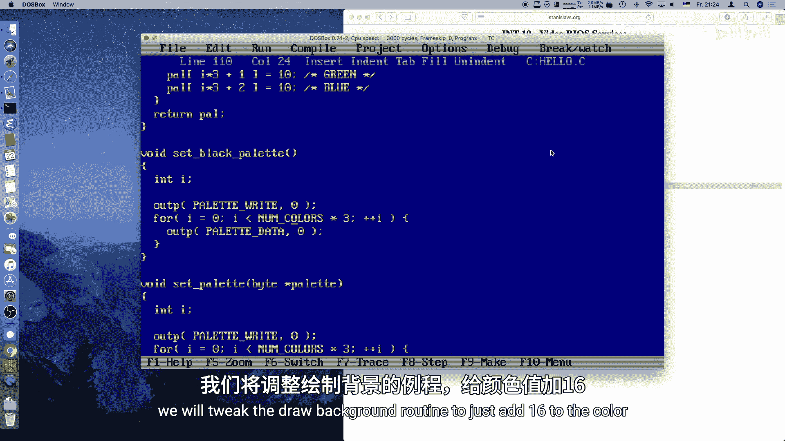

Tweet， they draw background 1 routine to just at 16。To the color。

 and then it should be back to normal。Yes， this looks much nicer， doesn't it？Okay。

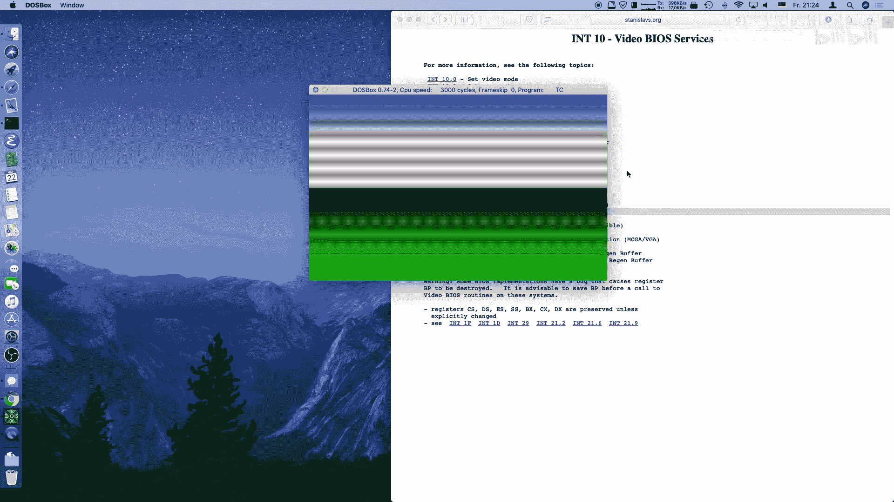

Now we have the pilot up and running。We want to print the score， I think yeah。And。

We need some some kind of。Print function， we can use printf。Not that will scroll the screen。

 as you saw。 And， and see， you don't have any concept of cursor or。Text windows。

 top put something on top。That can do that stuff， but it won't work very well in this manually initialized graphics mode。

Whatps。The bios， the the realm of the PC can do that in the graphics mode， but we have to program it。

Mnually。Similar to how we set manually the。PGA graphics mode， we can as well。C a print function。

Which takes an X coordinate， which will be character column and row actually and not pixels the column and row。

And the characters will be 8 by 8 pixels。啊。Row 0 will start at Pel row 0。

 and row 1 will start at Pel row 9。Or 8。 if you start count by by by 0， it will be  x0 8。

And thus forth。And we will also say， yeah， well， we take a color。And we need some。Far point actually。

 to a string。And we make this con so that we can't mute that， anda， etc。And we again。

 need to have registers to set for the buyers。And as I said， there are two versions that we can do。

 We can first try to use the right string function。The right string function is 13 x。

 and we need to pick a right mode。And we will only put characters in there and not attributes because you can send out interleaved characters and attributes。

 attributes are stuff like color and blinking and underscoring of the character and it will be one character like the C and then a by it which says which color and blinking effects are there。

 and then will be the second character and so on and so on。But。Yeah， we won't use that。

 so we will use just right mode 0。Also， video Patment number will be0 in graphics mode。

Attribute of mode 001。Yeah， because if we。Don't give the attribute the character。 We need to。

Put out the color here in register V。And then the length of the string。

 which we can easily determine and the row and columns x and y。

 and then here's the thing that breaks， We need to pass the pointer to the string。

 the far pointer in the E ES segment register and the base pointer VP。And my。

Theory is that most probably the base pointer is overwritten but over before actually executing the interrupt。

And then it points to garbage and we will read some codeer stuff， or maybe the stack， I don't know。

Definitely something that is not from。My program。And so we will see garbage。 But let's try it anyway。

 shall we。So，Hey， X just time。Has two fields。In the highb， we will put the print string function。

 and since it's hybrid， we need to shift it left by 8 bits。

Because the rack pack doesn't allow us to access the high end low bite independently。And in the。

Low by we write the right mode， which is 0。 So that's that。And now the。Bx register。

Was supposed to be the video page number and the high。And the。Attribute， if the mode is。啊。001。 Okay。

 so we'll write。The0 in the high bid。And。卡了。15， which is white in the low bite。

 You can also pick another colour。 E would be yellow。F is Y。 you can play around with it。Then， Dx。

🎼And also as high and low bite than that was。🎼Rrow and column， Oh， let's do the Cx first。

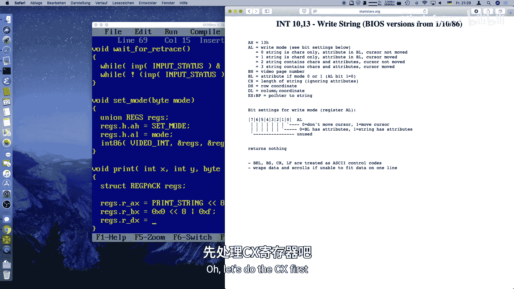

这品 more。🎼This well so CX。🎼It is the stringland。🎼Which is just the C functions to L。

🎼Which returns the number of characters。🎼And it needs to have a zero terminated。🎼。🎼Sting。

 so the strings in sea will look like this hello。🎼Word and then there will be a zero byte。

 which you can write like this picture0。🎼And stringling will count the number of characters until it encounters the first zero byte。

🎼Okay， D X is the。🎼Column and row。 The high will be the。🎼Row， so the Y coordinate。

🎼And this will be a Vx。That's already good。🎼Then， we need to fill。

🎼The E Reg and we take the macro far pointer segment。🎼We take that off the string S。

 that's why we also definitely need a far pointer here， so we have both informations。

🎼Although I think maybe for neopointers it will use the data segment or text segment， I have no clue。

 maybe it's the same。🎼And the base pointer will be the offset of the flower pointer。

All we have to do now is to call the interrupt。The video interrupt and we will pause registers。

🎼And now this should in theory work， but it probably won't。 Let's put it in somewhere here in the。

🎼Handle game routine。In the new game。🎼Let's do it here。🎼Just， let's try to。Column and row0。

🎼And color will be。🎼0ero x F。🎼Oh， we should have used colour， youre right？🎼We didn't do that。

 but it doesn't it's not that bad。可乐了。🎼在这儿。Here。

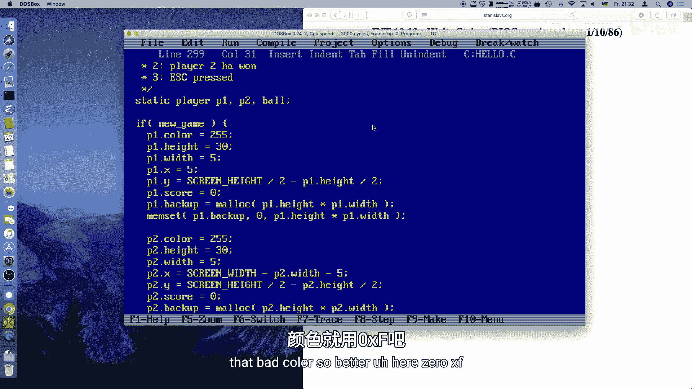

XXF。🎼What's the next thing， the pointer， yes， yes。🤢。

🎼I'm not sure if we can use it like this because this will be I something on the stack probably。

 but let's see what the compiler says。🎼Nampala will say suspicious point of conversion。

This is a bad thing， and it doesn't so that should be fine。🎼At a text。 Yeah， you see。

 we are definitely pointing somewhere in inside of。Cold。Data， I don't know what。But it doesn't work。

🎼It doesn't work， but the stringling worked because we see there's a lot of characters printed。

🎼And hello worshipship。Fit in there， definitely。So that doesn't work。🎼Question is， what does。

🎼And what does work is printing character by character。So how you that in here？🎼But I put an if。

🎼1 else， this。Preer as a macro。🎼So you can switch between both branches just by doing if zero。

 then this will run， and if1， then this will run。🎼So， instead， we will use。

🎼The function set cursor and right character。So we will iterate over all the rows of over all the columns。

And call this function here。Basically， we need an。Turation。I equals0， I less than2 n。Offfice。

Plus plus i。Then we will first set up the registers。I X contains simply。Sitch。

Corssor shifted by8 bytes until low by to 0。A hell is unused。Bx。

Simply contain zero in both by lower hand lowbys， it's the page number or thefographics mode。Then。

 very simple。RD x。Here again。Why in the high and。X and the low bite。And then， we can simply。ca啲。

They interrupt。And this will advance the cursor on the screen。Because it's invisible in graphic mode。

 so there's no blinking thing or anything。But this would simply work。

And the next thing that we need to do is print。Sple character。 This is function 9。

And in the low bite， we passed the character to ride。The display page。

Or in Mo 13 background pixel value， that's very nice。

And the character attribute for value in the low bite。So we could actually do some background Kalaya。

 That's nice。Didn't think of that。So， x R X。Equs set。 Oh， look， that's the type1。

Sa no not a print character。the highlight。The low bite is the character。That is S of I。And the Bx is。

Behi is the background pixel。 Let's use color 1 first， to test。And。Color as the for gun color。

 whatever we pass。From the calling function。And C X。

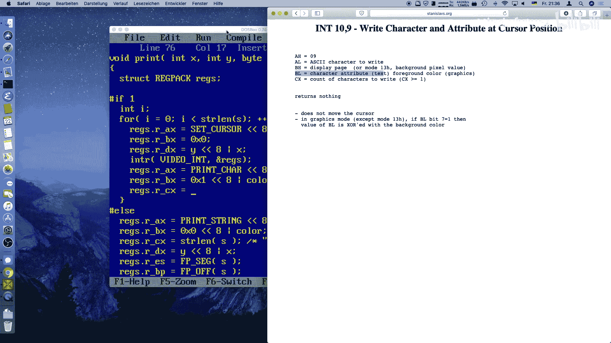

One， we ought to print one character。Very nice。Oh， oh， oh， oh， we only set the。Not only set the Ka。

 but didn't call the interrupt。Andterron。A第嗯。That's not particularly useful。 Okay。

 what did we do wrong。Who can see what we did wrong。And。Oh， yes， of course。

The Y stays the same that H。Needs to becem。We just saw the hello word but only the D of the hellello word。

That's better。Okay， the background color doesn't look。Particularly impressive。

 I think that didn't work。Let's say to5。And see if that changes anything。No。

 doesn't I think Dos box ignores that or this document。ation is a bit incomplete。

That's just what it's you there。顺他。But fair enough， we can print。 We can print stuff。

That's already a good thing。And this is not the score， right？

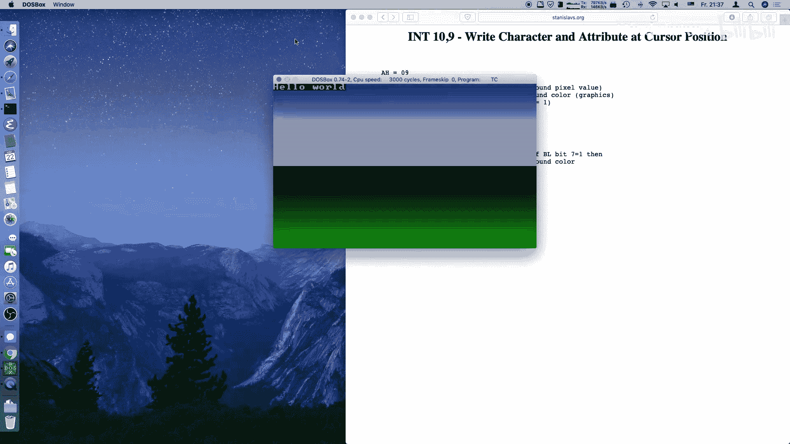

So。Let's put that in here。In the handle gamer routine。Actually， we want to print。

Something a little bit better。How do we do that？ We will make a concept character。Temps。Basically。

And the template will look like this。Yeah。嗯。It would say。系啊。1 has score。Something。 And with printer。

 you can actually write。Please print leading zeros。

 That's what the zeros form and print up to three digits。And it's supposed to be a decimal， a number。

And then， we need。Some spaces， I don't know how many we will figure that out。 and on the other side。

 I will make it mirror symmetric， let's say here player2。 I'm not sure if these are40 characters。But。

 we can test that。So this is what we can print。🎼but this is only a template and we don't support the template here。

 So what we actually need to do is to print this to some string。🎼Whi we go out。

🎼And there's a string print function。🎼Which actually lets you， oh， that's not quite correct。

🎼Which lets you print to the outstr using a template string。🎼And two parameters。

 and those parameters will be the player one score。🎼And the player to score。

🎼You can look that up it's in the head of file standardo。🎼And here's the S print F。

🎼Sensformaticted output twist string。🎼バフ。🎼Format and then whatever arguments you need。

This looks good。🎼But two things we need to define。🎼The out。🎼Variable。 and if we try this。

 if we just use。🎼Character are out and let's say we allocate 256 bytes， be careful。

 buffer for overruns possible。🎼And build this， there will be warnings， two warnings。🎼First of all。

 it says， oh， there's a aeditious pointer conversion here because what Espeniff doesn't say is。

🎼Once a fire pointer here and here as well， of course。

 because we define it that way that we want a fire pointer。🎼So， that won't do。🎼Instead。

 what we need to do is。🎼To me up that stuff。🎼And we want to do it only once。

 so we make a static variable。🎼Which you initials with the no pointer。And only once。

When we enter the function。Yes。🎼How it equals now， you could also put it in here in the new game。

 but this is safer。 If we misuse the function and call it twice， we won't have any memory leaks。

🎼If out equals now， then we do out equals。🎼Moc 256。🎼Bs， and that's it。🎼Let's see if that were。

🎼Give us a far pointer。 We， of course， have to declare far。🎼Office will also throw a。

🎼Suspicious point of conversion。No that works should be fine。🎼A meoc， even if it doesnt your meoc。

 it will return a far pointer。

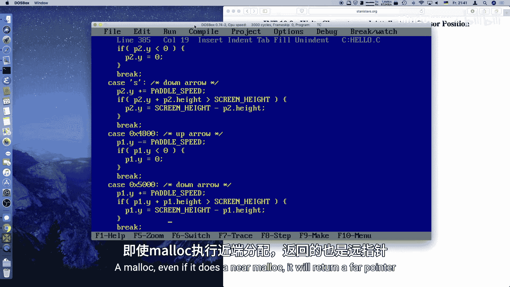

🎼And。🎼Where's our print F exactly here， we willt print the score once， Okay， we are up to date。

P it again。🎼Okay， this looks very good。 there's one， two， three， four characters missing， I think。

🎼So we put in all spaces here。Let's see where is it up here？🎼One， two， three， four。

🎼And we should have a nice status bar at the top pitlo cor bar Yeah that's nice。

🎼But the score doesn't increment， as you can see。

🎼But we already prepared for that。🎼So we take the sponge and we put it in the regular handle game code as well。

🎼And。We have this handle ball thing a year。🎼And we now say。🎼啊。🎼Right now equals center bar。And if。

🎼My turn value。🎼Pa。🎼Oh is this actually what I want， Is this what I want？😔，🎼Is this what I am on。

Nope， nope， nope， nope， nope， I want a second track down value。Update。Score， let's go update score。

If we are supposed to update the score。Because we don't want to print all the time。

 The bias functions are。B functions are slow and digest。I just moved it away。 I'm so stupid。Yeah。

 here we are。Now we at the post place。 So you don't want to print to do this stuff in every frame。

 It's slow。 its bio functions are extremely slow。But only if the handleball routine says yet。

 there was an score update。Then I want to print this stuff。So let's check a handle ball， actually。

Can do that handle balls up here。 It count at the moment。 so we will tell it， yeah。

 you return something。And you return some return value and by default0。

Which means that's nothing to do。And only if the score was'tcremented， I would say， yeah， okay。

Rral equals2。 I don't know。 Maybe we don't need that， but。Just。

Return also which player had the score increased or incremented。

Have you want to highlight it graphically or something。T， player1 had that。

 and then we say return that vow。So that should already do the trick。down here。

And we have the update score。 We need to define it。 We need to define update score。

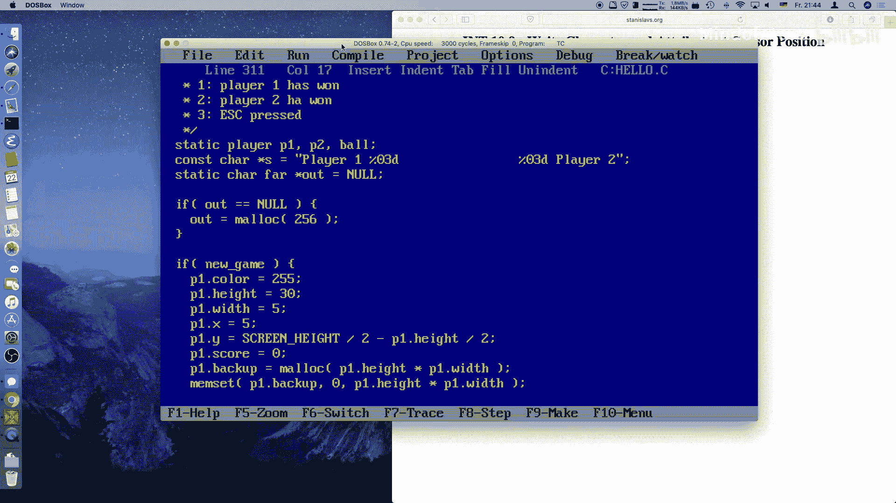

So end update， score， and let's initialize it with0， so we don't。Have any problems。

Any errors no we are good。And now when the ball hits the exit here， we see that。It increments。

 and it will do so forever because we don't have any。

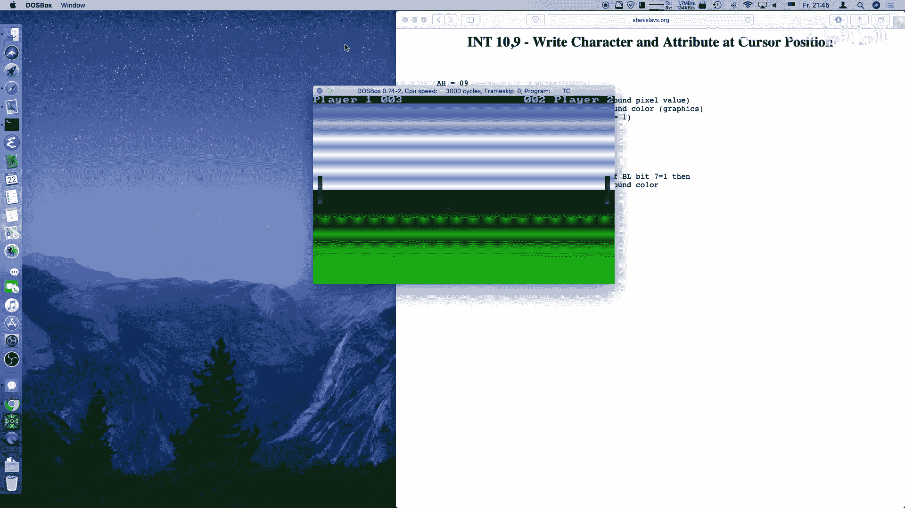

endd game condition。So let's add that as well， we already defined the maximum score。

And we can do that， actually。N you hear a think。And down here， return Redwell。

 let's do the following。If P1 scorere。This greater equal max score。Then we say， return one。As if。

Player2 score is。Has reached the maximum allowed score。And then we say， well， that's a game over。

Return to。And if nothing of that is the case。We just say。Return。ほ turn来。

And we return turn 0 I think we don't need the return value because if we hit escape。

 we return3 already like this。

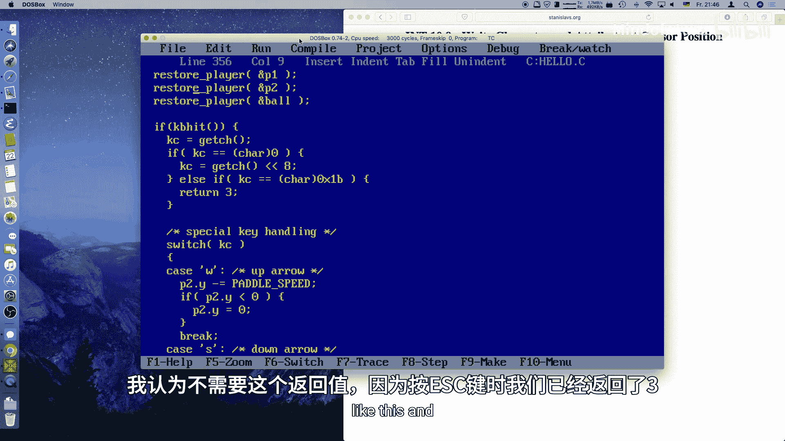

And we don't need the return value at all。That's totally unnecessary， so let's key out this variable。

And this we have an end game condition。U the game will just quit。 so let's quickly see。Score is 1，0。

1，1。And when we hit 5， a game should automatically quit without fanfare should just fade out。4。And。

Last point。

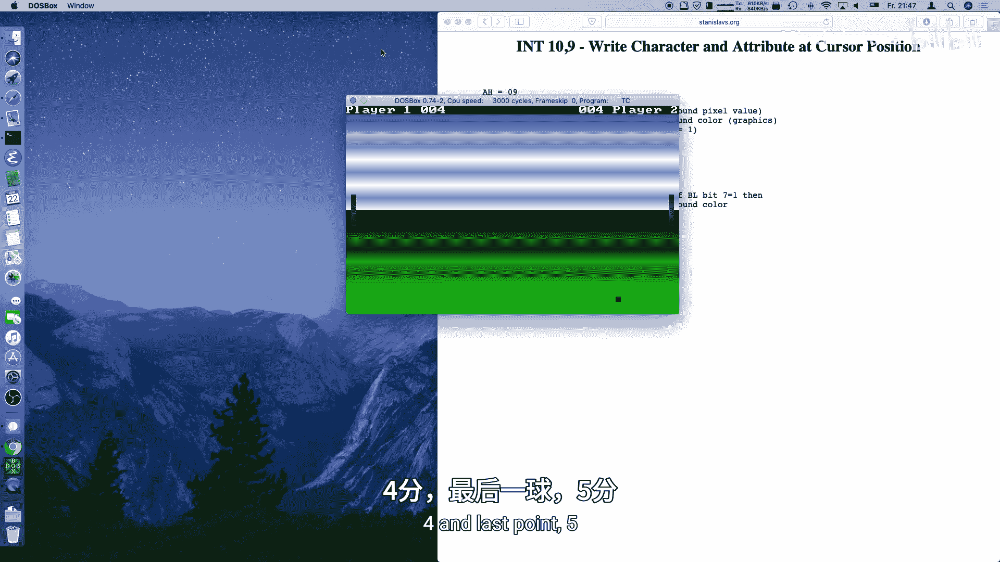

5， yeah， it fades out。 and it's no。We could stop here， but I think it's nicer probably。Yeah。

 we could stop here， but I think it's nice if we have also some handle game over routine。

That we can call so before doing the fade out， we would say here。

And the game over to present players with。Something。And let's call this。Winner or something。嗯。

This will be an end。In the beginning， we have no winner。And。

We need do call the kind of game routine while。When I equals 0， we'll do this thing。And when I is。

Handle game。When we' are in a normal game loop。1 was in the start of the game， and 0 was。

In the middle of the game。So。We pass the winner instruction to the Henryry game over routine。

And what does it look like？Doesn't return anything handle game。后会儿。And when。Yeah， we want to print。

Just something。And we need to。Hok。The keyboard again， for for key press before we exit。

 So we have a key code variable as usual。And。We have to。And game strings，1 will be。

A congratulation message。 congratulations。Playever。1 or two。And we will have a second line。

 which will always be printed even if we press Kate。Something like press pace。To exit game。

This fits nicely， will be very， very nice。And well。Also， need to。Print something。Again。

 we need some static。Character， fire pointer。Out。W是 less with。

So our standard buffer for the printing， we could forward that to the print function actually that would be nicer but I leave that task up to you。

And。We need to have some。Colum where we prints。Bite。可能 equal。I already counted this。 so we。

 you don't have to。 This will be 11。And we want to have some fading effects。 but I'll add that later。

So， if the player。Number was less than3。 We have a realbu。So， we do the。

S perf of the first condition， as well。Notice is called out。So we will use the end one。C。And say。

Winner， we called a winner here， right， yeah。Play 1 and 2。In my notes， I wrote playa。

 but this is called Win here。 That's much nicer。And we will print it out。At 710。

 this is something that you just try out until it fits and looks nice。

And this is the out string that we want to print。Of the S string。And。

What we also always do is print the second line。And we actually don't。

Need to put anything in there or so doesn't have any other。Perrameter。

And it will be just in the row below that， so row 11。Saamme color。Also， the output buffer。

Now what we'll do is。Do the keyboard loop。And we will quit。If the keyboard was hit。Then we' do。啊。

The get character， call， read the whatever we had。And very simple， if the key code。

Was simply the space bar oh， double equal sign。Make no mistake。Then we'll just break。

 and the whole team will exit。And to make it nicer， we will do even a little bit of animation。 wait。

 retrace， wait。Does the call like that no， I think it's called wait for retce。And we will。嗯。

We'll actually do the following。 Yes， we will。I'll put here。To the collectette。Pll it right， Reg。没死啊。

Do a color we got。And then we'll I think there might be and might be some back here， but we'll we'll。

 we'll probably encounter it。 Let's see。 So we write to the teleite register。And the colour that we。

 we printed， and will just。Ho put here。Some value I that we still need to define。Three times。

So well make the white that we are printing with fade in and out。嗯。🎼But how does that work？

 So we need to definitely have some。🎼Bight value here， I， which start off at 63 ish or so。🎼And。

🎼Does it no thats zero， that's side of zero。And some。🎼Direction information。

 which will tell us are we making color brighter or are we making it darker so this will be one or minus1。

🎼And we would simply increment eye with this directional information。And if。🎼I becomes less than one。

🎼If we're on the way down。🎼Or F I becomes greater than 62。🎼啊。And then we。

🎼Invert the sign so DI will be minus D。🎼So on our way up， when we hit to 63。

🎼Will then start to subtract one until it hits。🎼Zero， and then we'll go back up again。

This shouldn't theory work。🎼Let's try to run it。🎼Bunch of  errors。

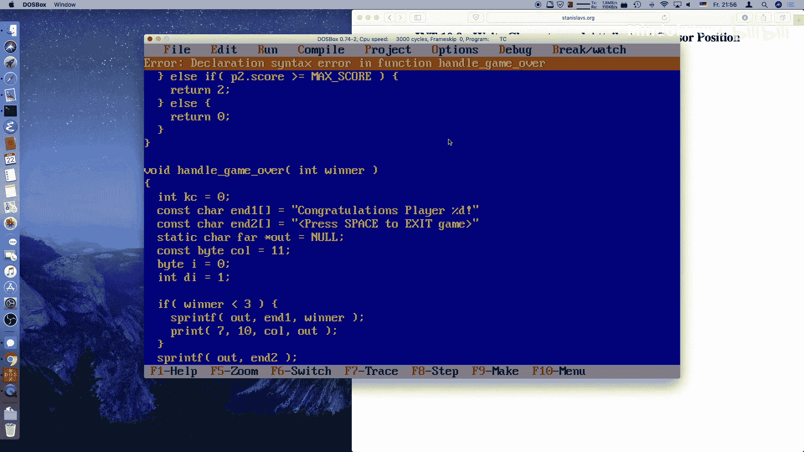

🎼Yes， some semicolons missing。🎼And those are already honest things。🎼Yeah， and look at that。

🎼When an all hit escape， we get the message presspae to exit the game。

🎼And other possibility is to just wait and。🎼き。🎼Wait for the。🎼Game and condition to arise。

 which takes a couple of seconds I should have said it to like three or something。🎼Make it faster。

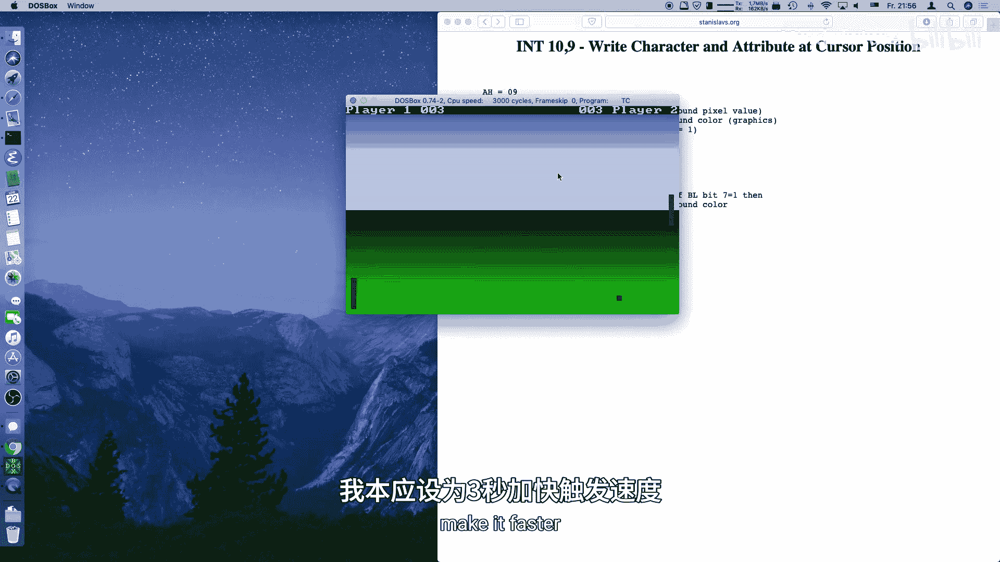

🎼But this should also quit， and we should see a nice message。🎼Congratulations， player one。

 arch we can put in extra space there， but it fades in and out very nicely。嗯。🎼That's it， I would say。

🎼What did we learn。🎼We learned how to initialize the graphics mode。

 how to draw something on the screen， how to handle the keyboard， how to fade in and out stuff。

 how to animate things， how to keep track of gamesstead。🎼That was already quite a bunch。 I mean。

 we produced a very simple game， but I think you can。

 by now tell that all the more complex games just add more stuff there， have more。State。

 game state and stuff。🎼And yeah， I hope this was instructional and you learned something。

🎼And please let me know in the comments。 What you want to learn about。

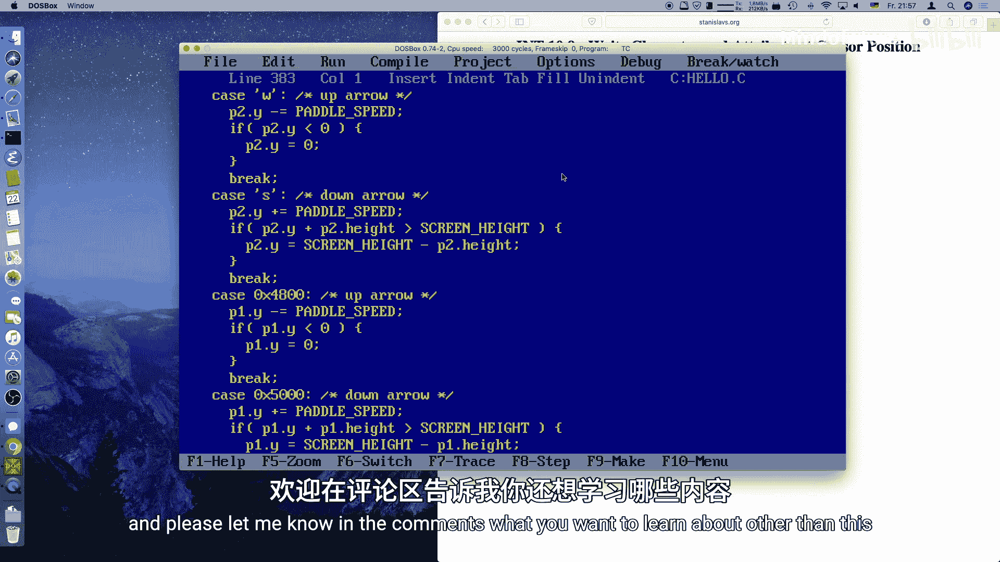

🎼は名です。🎼And I would love to thank you for watching， for keeping。🎼With me during the soul， kind of。

🎼That's code event。🎼And I certainly had fun making this。

🎼I had to take out a lot of stuff that I already forgot。🎼But I think， yeah， we can take it further。

 We can。 We can make even better stuff in the future。

🎼And I hope you will return with the second season， not sure when I'm going to start it。

 but it will be definitely this year。🎼When I have prepared out some。

🎼Some information here and there and tried out some stuff。🎼So thank you for watching， please share。

 like and definitely subscribe。🎼There will be more videos coming。🎼And other than that。

🎼Have a nice evening。🎼。🎼ああら。🎼。🎼。🎼The。🎼。🎼。