# 编写MS-DOS-系统-｜-windows-｜-操作系统-｜-汇编--｜-vga-｜-x86-p08-P08-Lets-Code-MS-DOS-0x08---Using-the-Mouse--BV1zs35zQEru_p8-

🎼Hello， welcome and good evening。😔，🎼To the next episode of Let's go Deists。🎼And last time， we。

🎼Did this， we wrote a little pong style game with。🎼In J graphics， keyboard input and the likes。🎼No。

 in the second season， so to speak I。😔，🎼Want to tackle some more tasks that you need if you want to write and store applications and games。

😔，🎼And。🎼My goal is to put out like one or two。😔，Ps every month。Some of the topics are。

🎼Rather advanced， so I willt need a bit of preparation for that。😔，So bear with me。🎼If you wanna。

🎼Help the channel out， then please consider subscribing。🎼And or drop a coin into the kufi or patreon。

🎼Accountt， I've set up those to help with some expenses that I have。🎼Regarding this hobby and。

🎼While this just a hobby， would be nice to get something。😔，um。🎼To make further interesting videos。

 So if you like to do that。I would be very grateful。🎼So this week。

 we want to do some coding for the mouse。😔，🎼And I've set up a simple program here that is basically the skeleton of our PGA based game and our main function does nothing except for setting the。

🎼Graphics mode blanking the screen and then handling the input， waiting for the escape key。

🎼And limiting it to the refresh right off the screen， which is 70 Hertz。😔。

🎼Then setting the text mode if。🎼Hlin good says， okay， as cable wass pressed and then just returning。

🎼So。🎼As for the most。🎼The mouse is something that came later in the PC's life， the PC。

🎼Was created in 1981， and the first mice took a couple of years to arrive on the scene。😔。

And the word different standards。🎼For M storess， but the。Most widespread standard was basically big。

🎼Microsoft Mo and。🎼The Microsoft Mouse driver that you had to install。

🎼Provided us with an API similar to the one that we have for the graphics。🎼The API endorses always。

🎼And interrupt。 So the interrupt 33 Hx is the mouse function calls。🎼And today。

 we only need three of those The function 0， which is resetiting the mouse and。

🎼Determining if mouse drivers installed。🎼The show mouse cursa， the heightmost cursa。

 which basically almost the same。🎼Very simple functions enter get mouse positioning button status。

🎼So， let's get started by defining some。🎼Consts here for the mouse input。🎼And first of all。

 we will define。你。🎼Mouse interrupt。🎼Which is X demal。33。🎼And we define the different functions。

🎼Mouse。🎼let's called it in mouse， so we don't。🎼啊。🎼Confuse it with the nose end。Interrupt。

🎼And also the。Show mouse， switches。Function number one。Hide mouse。What' is function number 2， and。

Good most That is keep short。Let's be。The bows， I would say， its probably better。

 which is function number 3。So let's first look at the get mouse function。

 Basically you only have to set the ax register to 0 and when calling the interrupt 33 x will be set still set to 0 if there's no driven stored or。

Forruple F， if the most ever was installed。And the B X register。

 you can also query the number of buttons。Usually that those would be two or three underdo。

 back then there was no scroll wheel had no extra buttons。😔，You had two or three mouse buttons。

 and the Microsoft M usually had two mouse buttons。

 So only very few programs dealt with a middle mouse button， which。Most users did not have。

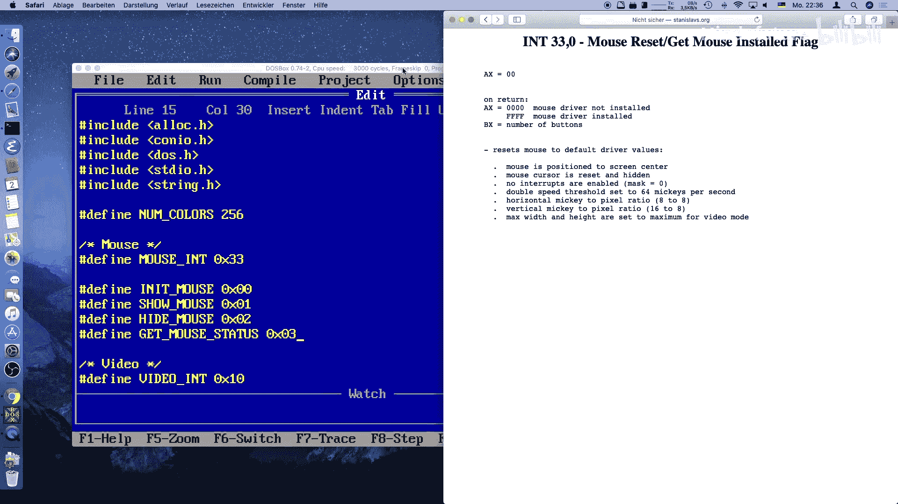

So I think we should write a。Youit mouse function， then。

So the innermost function will look something like。H。This。And we probably want to return。

AV if there was a mouse or not。And。What we need is。A set of registers。Just like above。

And then we set the X register to。In it， almost。Then we call the noise interrupt。😔。

Mouse in and pass the registers as usual， input registers， output registers。😔。

Don't forget the am for taking the address。And then。Wei。Return 1。By comparing。Qudruptable F。To。

Let's do it like this， by equal。To the current。Register， A X。

So this will return one if a mouse is installed in 0， if this none installed。

So we can go down to the。嗯。Section here if。In it， mouse。If not in it mouse。

Then we will print something。Like。Almost found。And we can quit。So this should hopefully run。

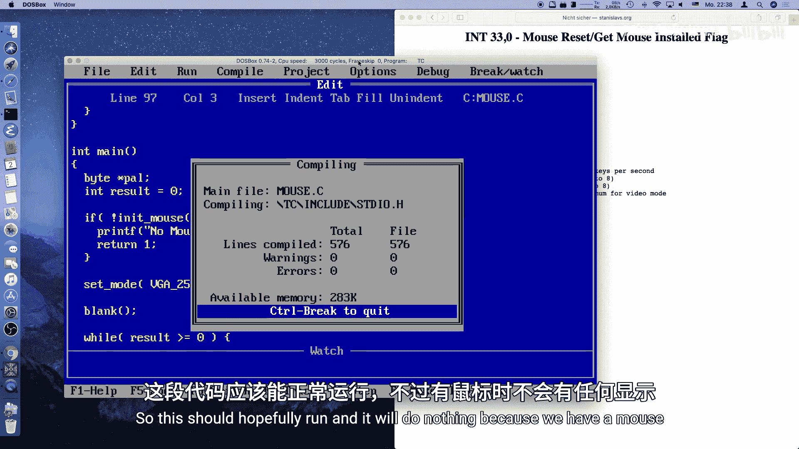

And it will do nothing， because we have a mouse。But if you take away the dot earlier the。

Exclamation mark。

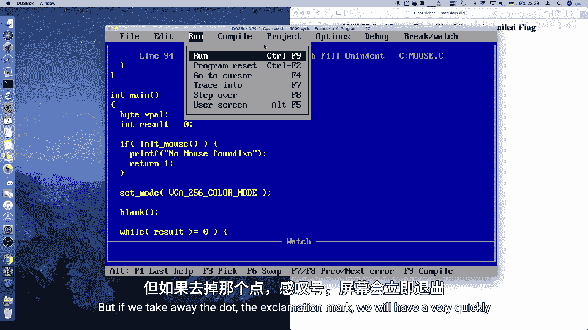

We will have a very quickly exiting screen and it has no font， which is， of course， not true。

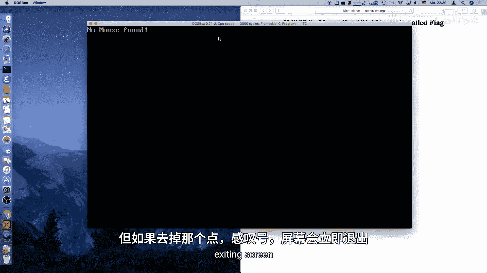

But that way， we can check that the function actually returns。The correct value。Okay。

 so the mouse is initialized。Now we want to show the mouse cursor。This is a simple function。

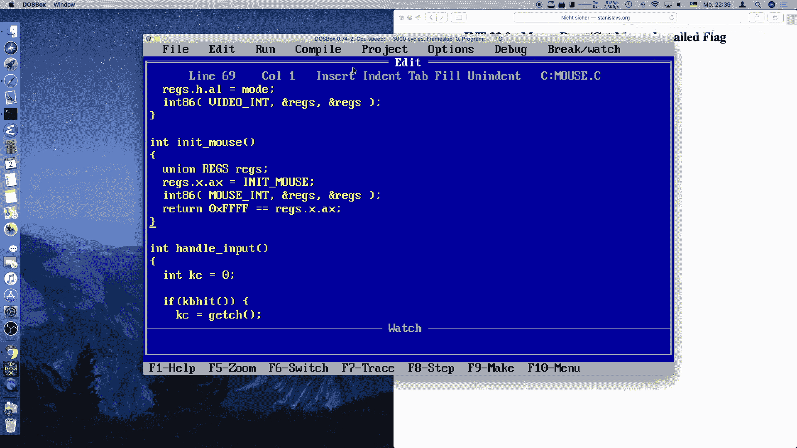

This is a very simple function。Show mosts is just。

Her eggs equals one without anything else。So， we can。More or less copy。This whole function。

And we don't need to return anything。😔，And we will call it show mouse。诶。This was the same。Show mouse。

 And let's do the hyp mouse as well。Because it's。Very simple， and very similar。😔。

To the show mousefunction。H， there you have it。And we can already test this。

After setting and blanking， we can call。S mouse。And to be nice， we will。😔。

Call hide mouse before going back to text mode。Let's see if that works。

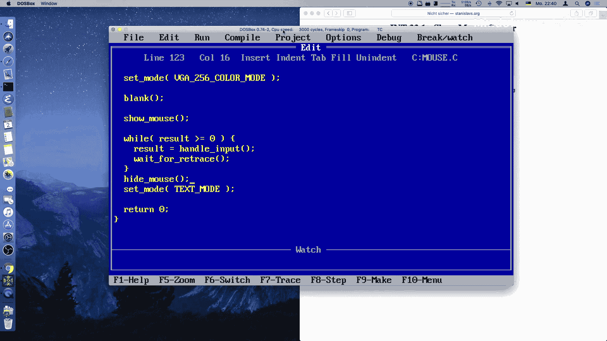

They have it。The mouse driver comes with a bullet in。Mo pointer or mouse cursa。And we can already。

Move it around。

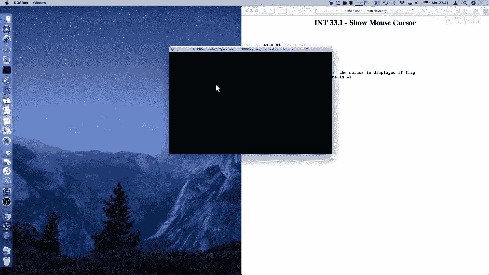

That's pretty nice。 You can even set your own。Graphics cursi， if you don't like the default one。

But we will do don't do。 We won't do that in this episode because it would take too long。

But you can basically look at the API and supply your own screen and cursor mask。

 Cursor mask means the。Transparent parts。

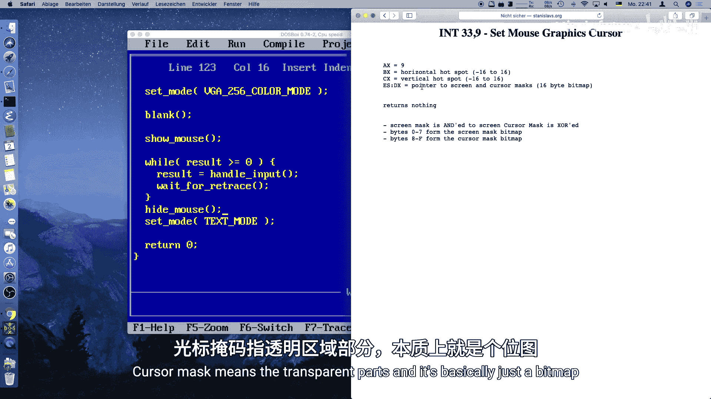

And it's basically just a bit map。Yeah， so we can show and hide。 Now we want to do something useful。

 We want to get the position of the mouse cursor and draw pixel。That would be nice。

 So we make a little drawing problem。So。We want a function， get mouse。Where we pass。

An integer are able to get the x and Y coordinate。As well as。

The status of the left button and the status of the right button。 So the idea will be。

That we can set a colour with the left button until you raise it with the right button。

So what do we need to do the same as before。Called the mouse interrupt this time。With the。

Get mouse status function。You at mouse status。Now we need to do a little bit more。😔，So， the。

X value is stored。 Let's take a look。

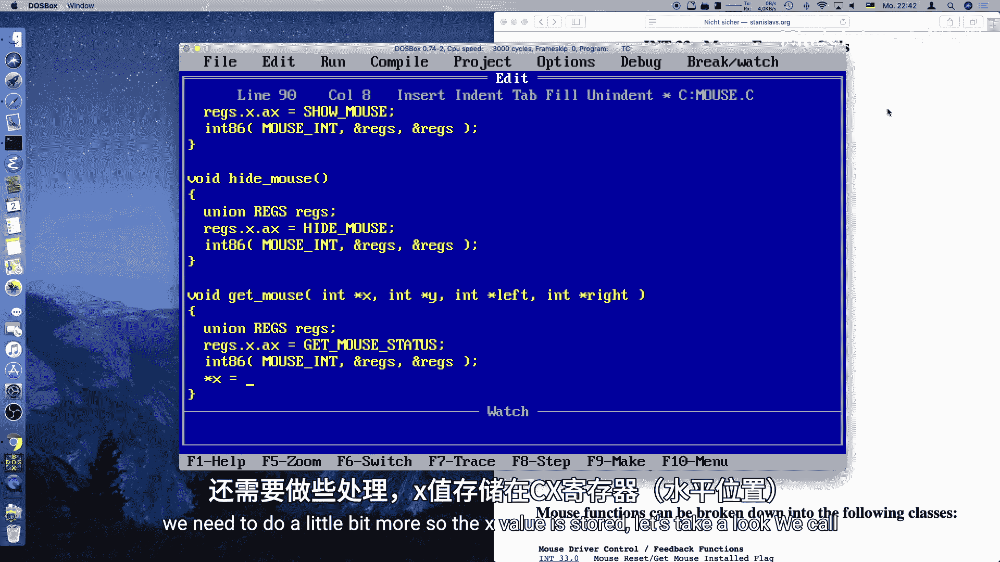

We call the mouse button and register Cx will have the horizontal position and Bx the vertical position。

 Note the value range here is 640 by 200。Which is。CGA resolution。And this is always the case。

 so you don't get any higher with the standard mouse interface。If you have higher resolutions。

This won't probably be happening。 And especially in our 3，20 by 200 mode， we will still get the 640。

 so we need to divide the exposition by 2。

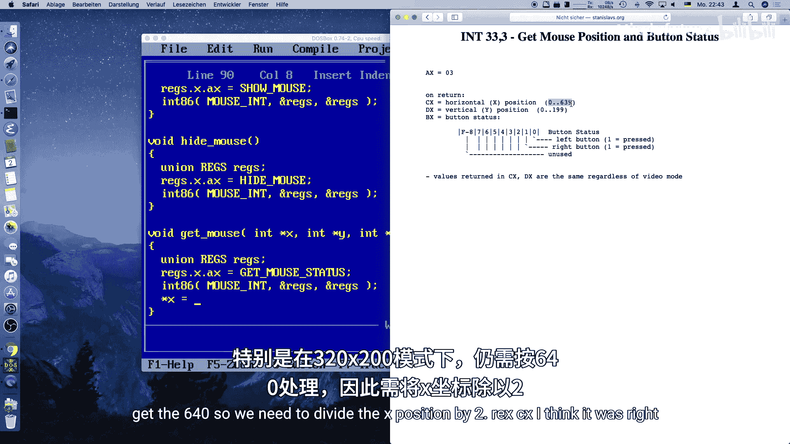

Rx， C， X。I think it was right。 Yes， C x divided by 2。And don't forget to。

Put the asterisk here to reference de referenceference the pointer that we get here。

Because C doesn't have the C plus style。嗯。References， basically。So we need to do it like this。

And the y coordinate is Rex X， D X。And we don't need to do anything here。

So this will give us X and y。

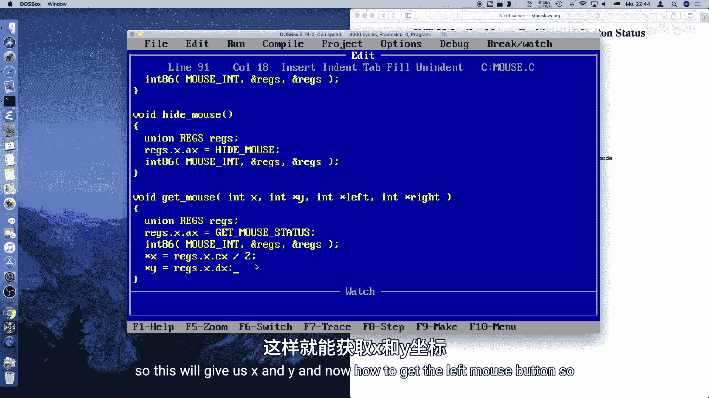

And now how to get the left mouse button。 So we get in B X， the button status。

And bits 0 and1 are the left button and the right button。

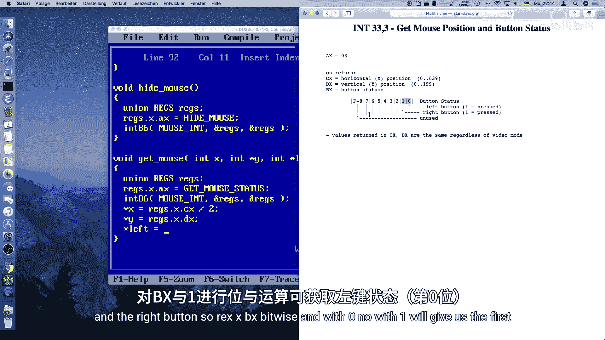

So， Re， X， Bx。bitit wise， and。With 0， no， with one will give us the。First， are0th bit。

Or the left button。And。😔，X， X， B， X， and。2 will give us。The second or number1 bit here。

For the right button。So that's pretty good。 We can already get everything that we need。

 Now we need to。Implement something for drawing。For that， we were defined to colours。

Black is always0，0 in the default palette。And let's start with white， whites。

0 x F in the default pallet。 Or if you want to write it as a by it。Something like this。Then， we will。

Store。We need to store exactly these four things， X， Y left and right。And also， store the current。

Coour， and well set that to white in the beginning。And that should be actually a byte。And no。

 what do we need to change here as well？😔，So。First of all， we will call。

Get mouse status or get mouse call it。Give the addresses of all our variables。Like this。This way。

 we get the status。And then， if the。left button was clicked。We will try to set。Was it T ps。

We find that appear somewhere。😔，Yeah， set pics， X， Y， and color。So set pics。X， Y， N。Current colour。

And this is basically just poking into video memory。😔，The right button will be。X。

 Y and black black will always be raising。😔，So， this should already give us。Some kind of control。

But if we try this out， okay， we have some typos。😔，Invi indirect。えス。Let me think。

 Let me think what did we do wrong here。😔，Oh， yes， because we forgot to add the asterisk。

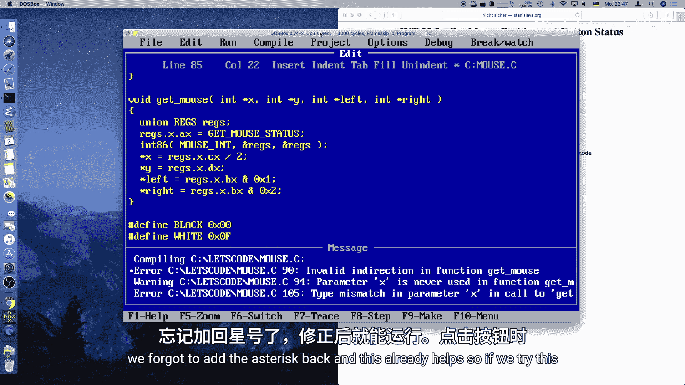

Back and。Its already helpss。So if we try this。Youuqi。The button。When I press the button。

 there will be。A wide pixel。 But as soon as I move the mouse， it will disappear。

And this is because we are just poking into the video memory and the mouse driver works in the following way。

嗯。Will store whatever is under the mouse cursor。Then draw the mouse cursor。

 and when we move the mouse， it will restore whatever was before。 So whenever I click。

 I put a pixel there， but it gets erased by the mouse driver。

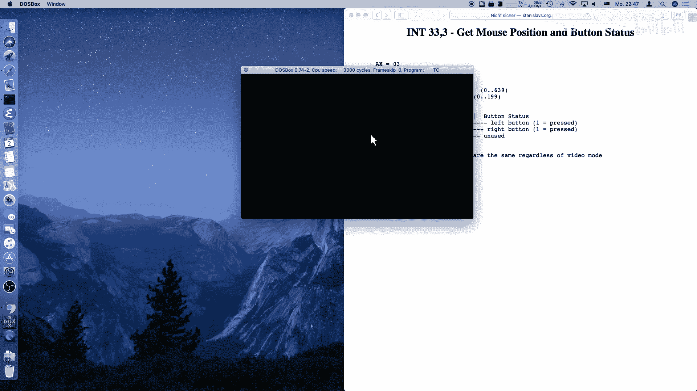

So the simplest thing that we can do and since we are。Aligned with a vertical refresh。

 this will actually not。Fickcker。We can do the following every time we see that a button click hadnt。

 we can hide。The mosque up。🎼And then afterwards， show the mouse curs again。🎼This way。

 it will restore what's on the screen。 Then we set the pixel length， and it will store again。

🎼And this should。🎼Work， just fine。🎼Same goes for un drawing click。

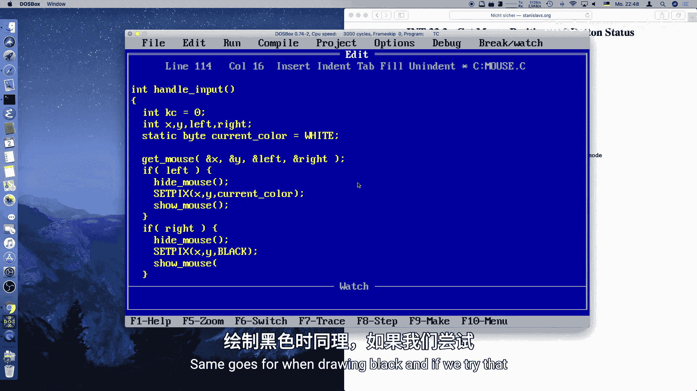

🎼And if we try that。🎼We can draw stuff and when I draw faster you can see that the sampling rate of the mouse。

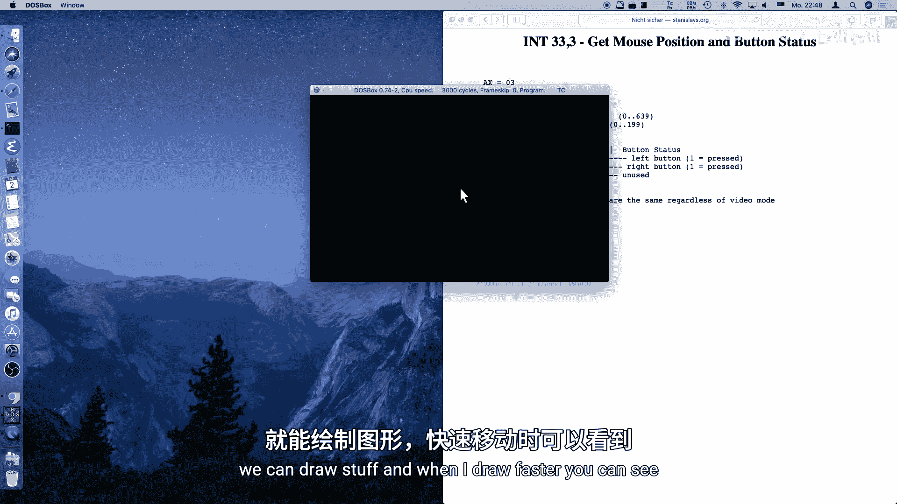

🎼Is， of course， not continuous， but is limited。 but if I draw very slowly， I can actually。

🎼Draw stuff or write something。🎼And this is already pretty nice。 And as a bonus。

 we will add a bit of color。🎼To this。🎼And instead of just drawing dots， you can， of course。

 draw lines。🎼But that's something that we'll talk about some other time， of course， because。

🎼Drawing lines is a bit more difficult。🎼And that will take another episode。

So let's add some color to make it more nice。🎼For that。🎼We以。Add a key handling。Let's say， I press。

The plus key。Then， I will。Take current color and increment it by one。Then brave， of course。

🎼And the same goes for minus， then I will simply。🎼Dcrment the current colour。

🎼And that should already be enough to get some color in there。

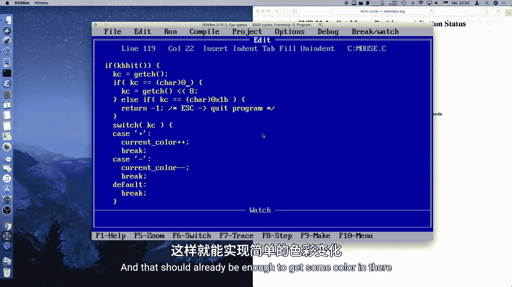

🎼So right now， I can draw white。🎼I press minus will go to yellow。🎼The magenta。Red。🎼ああ。Light blue。

 light green。🎼Dark blue， gray。🎼Wite， and red mouse button will。🎼Will it work， actually。Yes， it。

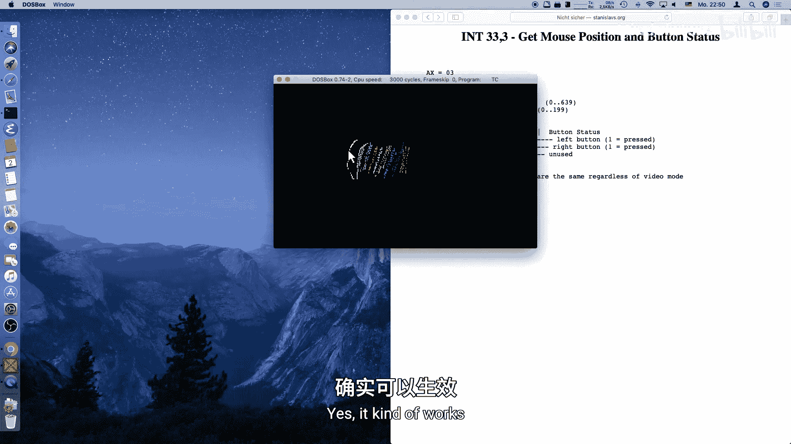

🎼Kind of works。 Sa too。Hit the right spot。🎼And if I just keep on holding the。🎼Minus key。

 I will draw in nice rainbow。🎼So they have it a very primitive drawing program with mouse handling。😔。

🎼And not being able to say or load anything file handling will come at a later point。😔。

🎼If you are interested in that， as well。🎼But you can see you can already write your own。

🎼Itos paint program。🎼With low support。Yeah。🎼I will put up， as usual。

 the code and GitHub link in the video description。🎼And if you want to learn more stuff like this。

 make sure that you watch all the previous videos and hit the subscribe button。

 leave a comment if you want to like or dislike if you liked or didn't like the video。

🎼And I hope to see you soon。😔，🎼Good evening。🎼あ。

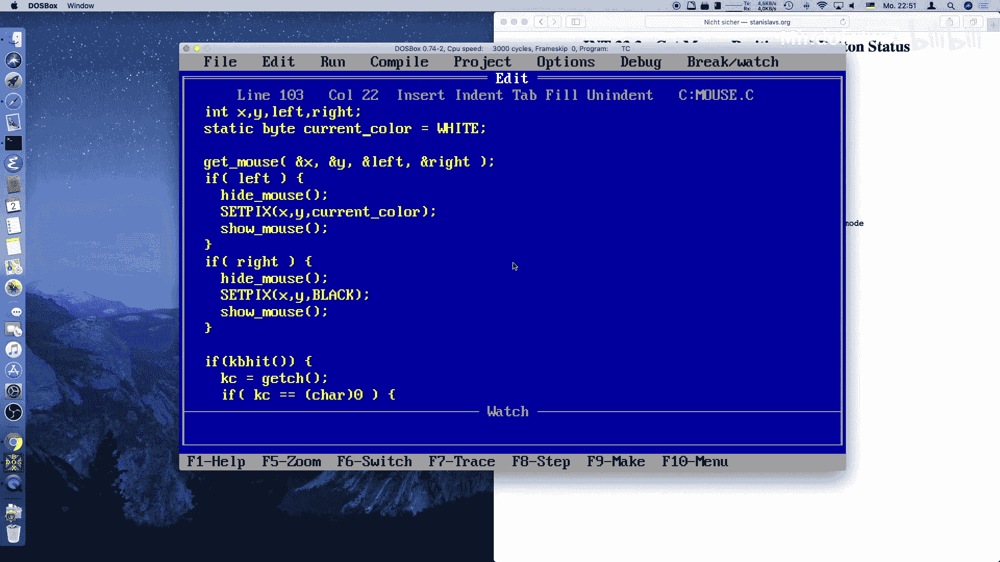

🎼う。🎼ああ。🎼，🎼。🎼。🎼う。🎼。