# 编写MS-DOS-系统-｜-windows-｜-操作系统-｜-汇编--｜-vga-｜-x86-p09-P09-Lets-Code-MS-DOS-0x09---Detecting-a-SoundBlaster-Card--BV1zs35zQEru_p9-

🎼Hello， welcome and good evening to another episode of Let's call Amss。🎼Today。

 we want to start tackling our most complex topic， programming the sound blast sound card。😔。

🎼Because let's face it， I built so many song cards over the last two years。

 the sn bark of the laps blast aboard， the Elib cloneone， the MUS 1099， the Tdy card。😔，🎼But finally。

 we want to do some sound programming， actually。🎼And this will take probably。

🎼Three episodes only from the sound blastster apart for playing digitized sounds。

🎼This alone should show that this is a rather complex topic。🎼In this first part， we will just。

🎼Read and take a look at how to。🎼Detect the sound plasticster card and not even try to initialize it or play anything。

🎼And the second part， we set up everything for playing。🎼Set up the DMA buffers。

 the memory regions install the interrupt handler。🎼And all that kind of stuff。But。

🎼That will not even be enough。 in the third part， we will finally write a function to actually play everything and to read an。

All the data from a wave file。🎼So I could put this into probably one episode。

 but that would take at least one and a half hour， so I'd rather make。

🎼3 separate 20 to 30 minute episodes， which are easier to follow and where we have。

🎼Specific steps that we take。🎼And I also will need to explain a bit more。

🎼Do are some diagrams in the second part， but this start is actually pretty easy。

🎼You know all the basics from the VGA and keyboard programming， you don't need anything new here。And。

🎼What I found here on the web is the Sound blast series sound programming guide。

 which is actually pretty nice。🎼I will link to it in the description and I myself took a sample program from another website that I linked to。

 which you can check out， but you can also just。🎼Wait for us to cover everything。🎼And I took this。

 reformted it a bit， made it more in style with our programming stuff and broke it down into three separate pieces。

🎼So that you can actually， yeah， learn。🎼It's at a time。🎼But enough of the talking。

 let's get started and let's try to detect the somepl card。

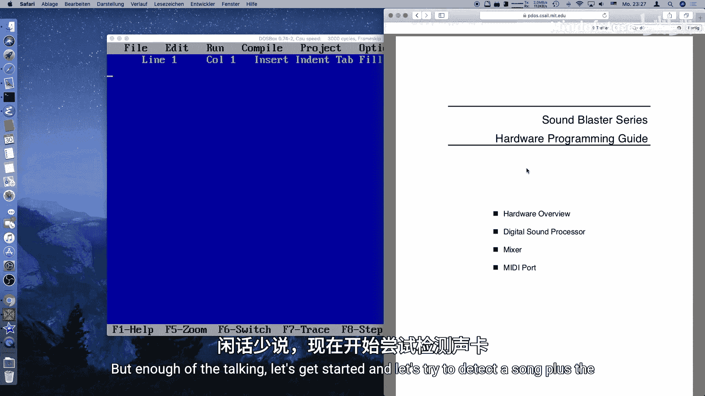

🎼Okay， so we need a bunch of。Include obviously。🎼AndI'll just put them here so theyre out of the way and get the dust header for all the interruptop handlingling and input and output on the ports。

😔，🎼We need standard IO for printing some stuff。😔，🎼And we also need some。🎼Meoc stuff， which is in。

🎼Stard lip。 and in。🎼And member age。🎼Then。🎼We put some forward declarations here so we can call all the functions wherever we want。

🎼Our goal is to have。🎼Detect function， which will detect if。🎼A song process actually in the system。

🎼And which were I turn true or falses。🎼When。🎼We want to do the initialization routine and the。

🎼The initializational team。🎼These are。🎼The functions that will be called by any user of the program。

Or off the code。And that's basically it。The detect function is supposed to find out which address the。

Which base address the。Some pasta believe that this could be very far 2 20。😔，Add。Then。

We also need to store， which。IRQ， and which the MH N。The sound blaster is on， for example。

 for do box this will。Before to Iq 7。Although I configure my cards to IQ 5， usually。

And DA is in 99% of the cases， Cha 1。Also， we will already register an interrupt handler。

We will call it。And yeah， sorry。We don't need to。 Yeah， we do need to register an intertlar。

 but especially we need to store。The old interrupt handler， if there was any。

 usually it will be a default handler from the bio。And we store it in the variable called O IRQ。

 So the syntax here is void and then a hint for the compiler that this is an intratr。This is。

Absolutely pure dos C and you won't find this in modern C functions， usually。

And this is the syntax for a function pointer。 So we have a pointer to a function。

And the name of the point is old IQ， so we can reference it via this。All right。

The other part we will fill in later。Then， we will， also。ni。The implementation of the。

Detect function。And this will look。Fs。So。😔，At first， we would say， well， we didn't find anything yet。

And then， we will iterate。Over a temporary or preliminary。Base address from 1 to。eight。😔。

So less than9 or right， less or equal。e。😔，Increment。And。If we are。And exactly。

 So possible values are 200。Let's write that here。Possible values。Are2 and10。220， 230， 240， 250。😔。

260， not 270， but 280。So we need to exclude to N 70。There could be a different device。

So if we are not testing 270。Then我 do。哎。Reset of the DP。

 and we will write that function very shortly。An。😔，Address the U X 220，200。Plus。

Either we can write temp time 16 because we're in Hex。Or we simply say。Left trip by4。

And I'm not sure about the order of operators， but we probably should do it like this。So。

That looks good。If we found something， we can break the follow here。And we need to。Define。Temp。

 of course。That's that。And if temp equals 9， that means we have tested everything and didn't find anything。

 so we can simply say。Return falses。But。If we found something， we will。Fand out which I Q and D may。

 There are ways to detect that， as well。However， we will use the blast environment variable。

So we need a string here。Which we call blaster， because that's the name of the variable in the environment。

And I can show you。

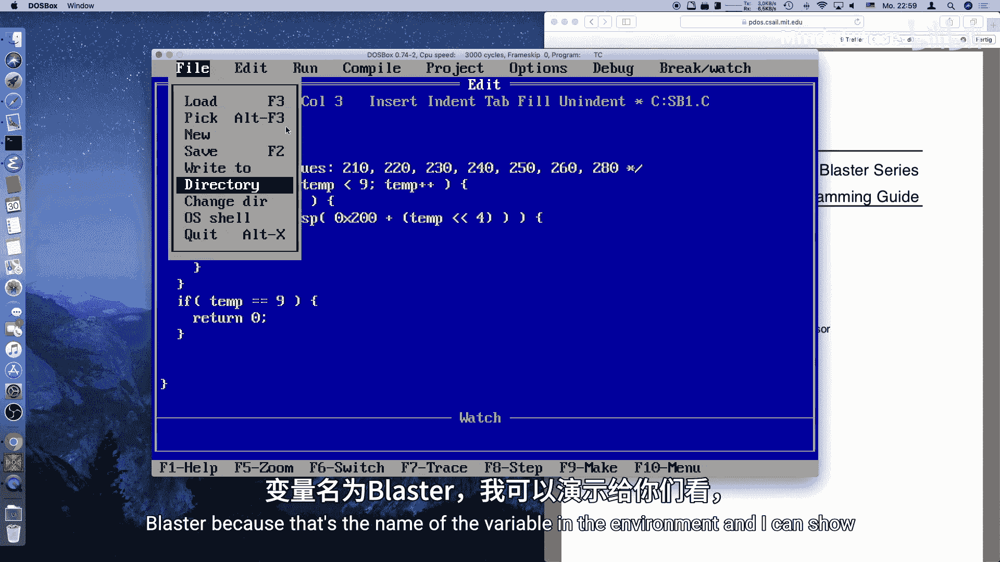

IfFor type set， you will see the blaster variable there， right， It's a 220 I 71。 Actually。

 we could have taken the port from the a variable part。

But it's nice to actually check if it's there and then just take the interrupt and the DMA channel from there。

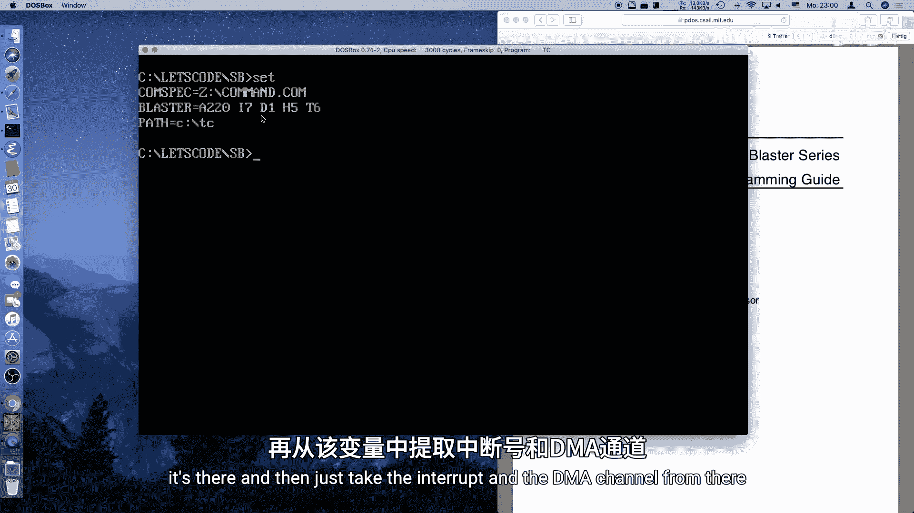

So on。You can get the environment variable by calling giN。With a name， oops。Offf the variable。

Get on plaster。And again， we will。Pretend that we did not find anything for the D A。And then。

 iterate。Overall， possible。嗯。Characters in the blast environment。Variable。あ。

This should be probably something like stringling。Length。And。If we encounter。Lastster。

At position temp。And， well。We could write something like this。

But people could also use the lowercase。So we can write it with an or and do the same comparison again。

A some。Very nice trick， actually。Is to bidwise or with 32。

 which works in the ASI character set just fine。And this is not my idea。 This is from the example。

 blast programming code。But， I do like。This trick actually works。

 This basically ignores the hybrid at position 5。Because that's the only difference between D and D。

So if we find the D， then we know the next character must be the。啲妹。chanhannel。

And here comes the trick that I do actually know。Because the next character， minus。

Asq 0 will give us the numeric value of the number。This is a very old trick。

And I've used that quite a lot。So this will give us 0，1 or 3， depending on。If you typed01 or3。

Can you plus the variable。So that's good。 Does it still compile， I'm not sure。 Let's put a。嗯。

I can count。Character。I can value。 Let's put a main function here。Return 0。

See if we are still compiling。😔，Two warnings。 yeah， we don't use the here， that's fine。

And one undefined symbol， and that's fine。That's just fine。So we need the reset P function。

 but we'll get to that。We are missing the IRQ。So we will do the same all over again。

T0 lessons stringling。Of blastster。Then。뭐。Let's copy this。This takes too long， otherwise。So now。

 we are passing the。Oops。What that。Something。😔，It past thing。 So here we are looking for。The IRQ。

 the interrupt。Then理。So IQ is。The same， like above。But we can also have interrupts 11 and 12。

 for example。So， if。If we look ahead by 2。And let's just hope we don't run out of the array at this point。

 but。Who cares。嗯。If this is not a space。Then must be another number。This is very， very cheap parsing。

 Actually， we could just use scanf， I think that would probably be more。Safe。

Let'll just take the second。Number。Oopps。Times 10。Actually， this， if we have two numbers。

 this must be a one。 So I'm not sure about this example code。But let's just go with it。

 It works reasonably well。So yeah， this， this home part is pretty hacky。

 I think we should definitely rewrite this with scanF。Or S can F to。Pause。嗯。过来了。And now。

 we will return to。If we actually oops。Pound something， which is， I think。Not even necessary。

 because。Yeah。Tpe。That's if not necessary。 If we are past this， we should have found something。

And I didn't set the。So just the base， right， Oh， okay， yeah， because there's a side effect。嗯。Yeah。

Sa effect is probably not very nice， but this year。

Were set as B pay to a value if it found something at the address。All right。

And it will also have done a break， so we know that there must be something in there。😔，Actuallyact。

 we could just return one here。Otherwise， we would have。Ped out earlier。But， let's go with this。

And program the reset function。So I said， what， no， I think not。Should be。

Should be in because we return if we were successful。And it takes a port number。Which is 16 bit。um。

And the way this works， leave right。This is actually from the programming manual。

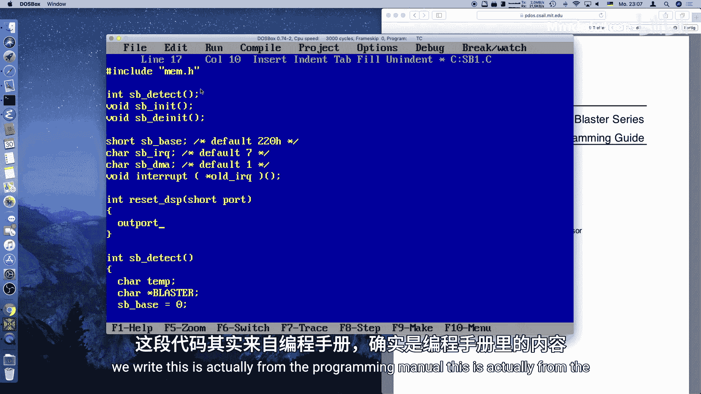

This is actually from the programming menu。😔，And it says somewhere here。Down the line。Reit the DSP。

 we write a one to the reset port。Which is the sixth register。And wait for three max in right tool。

0 to the re port。 and then we pull for the ready byte on the read data port。

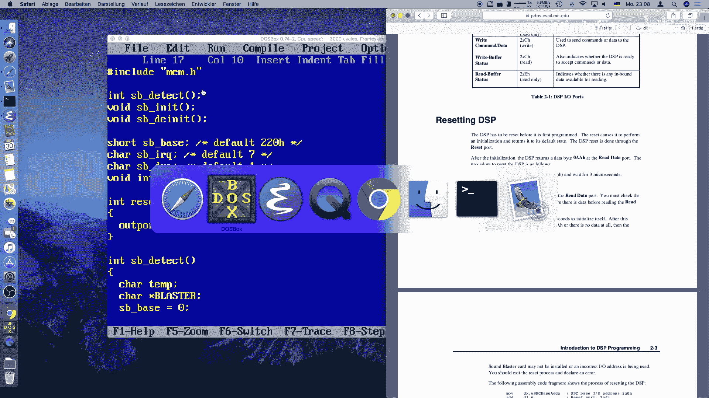

Sounds confusing。 It isn't。So what we're actually doing is here， we output just byte to。

P that we are supposed to test。Plus the。Mir register。And we write a one。

 So what is the reset register done。We just read that。Define a spa reset。S。6，0， x，6。

This is the register on the sound plasticastic card that's supposed to do the reset。

So we shall we are supposed to write Z 1 and then a 0。But in between， we are supposed to。Wait a few。

Microseconds。 So we delay for 10， whatevers。I think these are probably not microseconds。

 probably milliseconds， but doesn't hurt。And after this， we also delay to make sure that。

That these piece settles in。And now we have to test that we were successful。

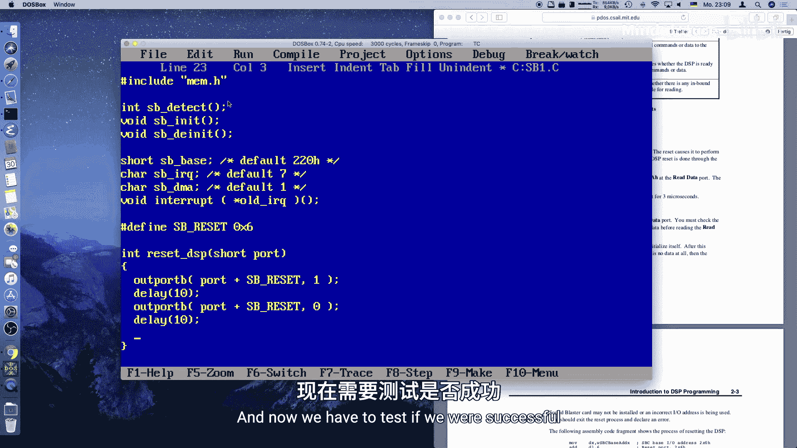

How do we do that， Well let says here we call for a ready bite。0 a A Hx from the Re data port。

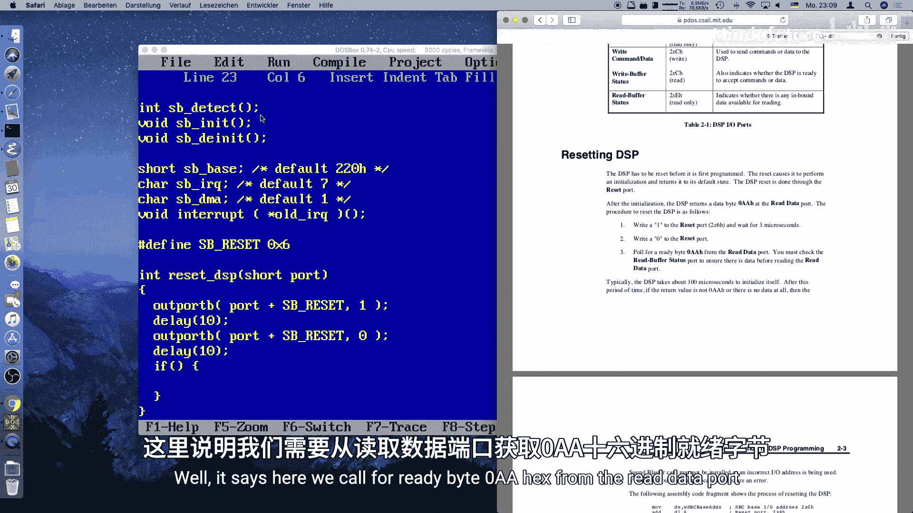

That means， we are reading。Import 1 byte。From the port， plus。Well。

 what is it called the read data port read。Data。😔，It's called itsterrace。And。

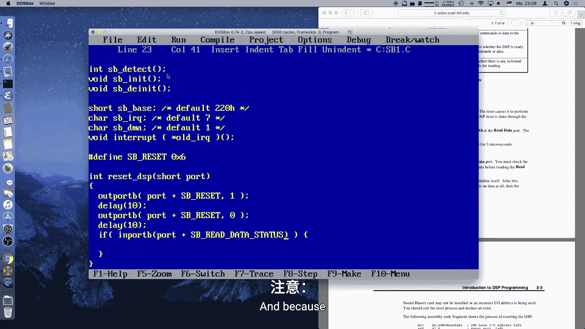

Because。You must check the Read buffer status port to ensure there is data before reading the data port。

And to read buffer status， if we scroll up a bit。Is the portnam the register E。

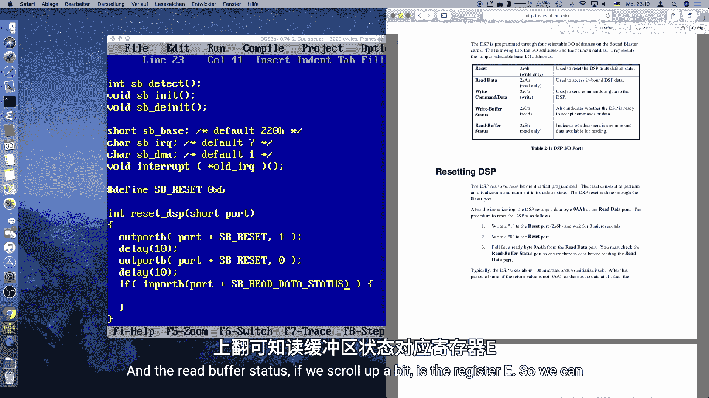

So we can already write here。Define as we read data status。Yes。X一。And this will give us an。80 hex。

 if we are ready。So。We also have to mask this because there might be some noise on there， I think。

And we test if this is then equal to 80 hex。And， I probably should。

Put some more parentheses around there。😔，Just to make sure we are doing the right thing。So， if。

This ready re data status says， we are ready。Then， we can， actually。Readed out。呃。理。We data register。

And here test that's。We data is register， A。Put that here。Read data。

And this is supposed to read0 X0 A A， right。That's what they said here。And if that's the case。

 then we actually know。That is a good port， and we will return true。And otherwise。

We can even skip that， we just say faults。And there's a userpeia。 Okay， got it。

Because we did something wrong， right。嗯。Nope。I am not quite sure what I did wrong。😔。

Can anybody tell me。V aTP。Is a DSP。🎼Oh， look at this。 Okay， forgot the semilon。

🎼Which makes the whole thing。🎼Garbage。🎼Success， great。 No only if you。🎼Missing things。🎼We can。

 actually， already。🎼Tect something， right。🎼Let's try that。 That's actually pretty good。🎼And。🎼So。

How do we do that？🎼And。🎼Yeah。Tected。😔，🎼Just save this。In a variable。

🎼Some plus the detector equals S detect。Yeah。🎼speedpe you detect it。🎼Then we just print something。

Sound。Andt。Like that。🎼Else， we know that we have something。マスタ？🎼Found apps。🎼A， something in H。

🎼And then I something decimal， D something。🎼Deimal， right。And what other things， S B base。🎼B on a Q。

🎼And S B D。🎼I think that's pretty nice right and here we can return error code or something。😔，嗯。

I don't believe you。🎼Okay， this is better。🎼If has been detected， yes， of course， this is an error。

🎼There are two warnings still， but that's fine。

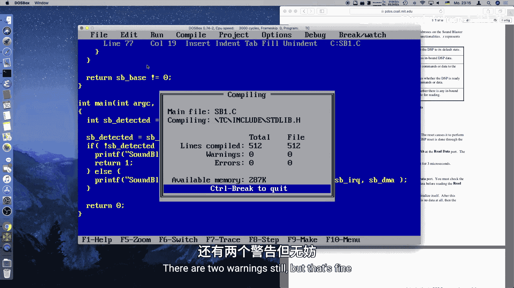

🎼And now I can run it， and it was too quick。 and it says sound blastster found at8220 I 7 T1。

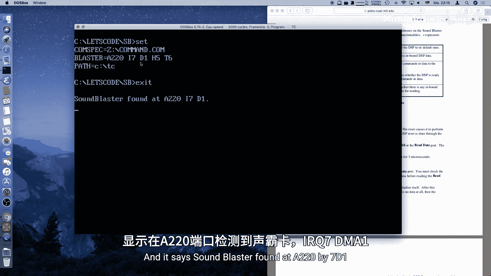

🎼I see， already， you've got your first。성lo programming。🎼You successfully detected a sapl card。

🎼I think that's pretty neat。🎼And I also think this is probably enough for today。🎼In the next episode。

 we will set up。🎼The a buffer in the interrupt handler。🎼And in the third part。

 we will actually play something， as you can see。🎼This is much more involved than。

🎼Let's say programming the VGA card with just switching to some graphic mode。🎼Although。

 I hope you'll already learn something。🎼This will definitely be our most complicated stuff that we've done so far。

🎼I hope you liked it， if so， please leave a comment hit the like button if you haven't subscribed to my channel。

 please do This does greatly help。😔，🎼And I hope to see you soon。

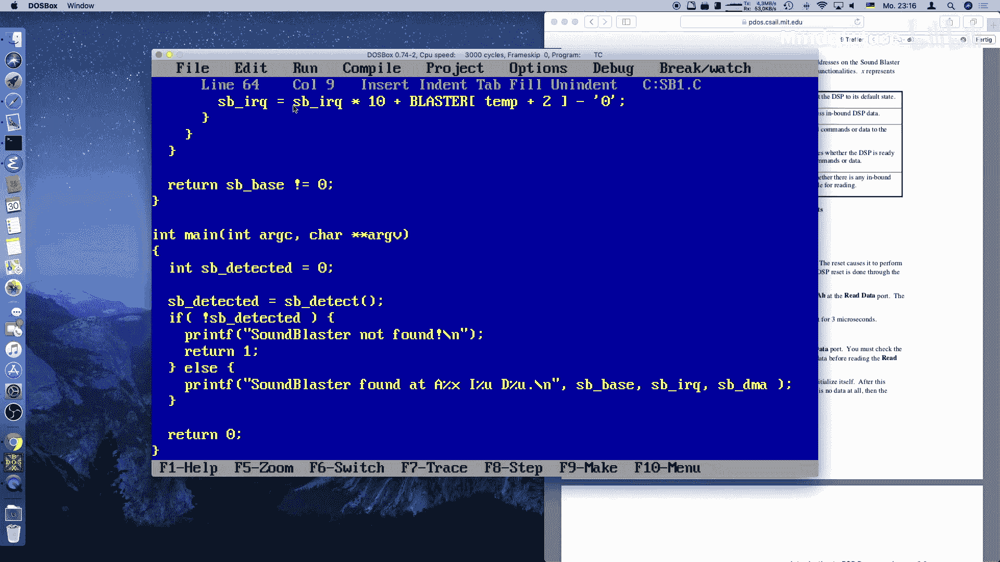

🎼ああ。🎼。🎼う。🎼あ。