# 编写MS-DOS-系统-｜-windows-｜-操作系统-｜-汇编--｜-vga-｜-x86-p10-P10-Lets-Code-MS-DOS-0x0A---Single-Cycle-SoundBlaster-Playback!--BV1zs35zQEru_p10-

🎼Hello， welcome and good evening to the second part of the Sound blastster programming， Let's code。😔。

🎼And a few introducing words today， we want to actually place something on this own plastic card。😔。

🎼And here is a little block diagram of the Soundplacester family card。😔，🎼And there is。

🎼So called passenger interface face chip。🎼And the DP， the DSP being just an inter microcontroller。

🎼And the bus interface I don know， is probably also some standard bus transceiver or something。

 and it interfaces with the PC's IA bus。🎼And today we will use that Iab。

 which comes with a bunch of hardware interrupts。🎼That the card can trigger to alert the user program that it needs new data。

 for example。And that's something that we learn。🎼And the data is actually transferred using DMMA。

 dark memory access。🎼And there's a chip for that in the PC as well。

 which talks over the IA bus from main memory to the passenger interface chip here and which feeds it to the DSP on the soundplastic card。

🎼So this is all stuff that's pretty basic to the PC architecture and I won't talk too much about that you can read it up on the ports on the PC help。

🎼Page that I already linked to。 and I'll put another link here in the video description。

🎼But this could be a whole episode or couple。🎼of their own。

 but just let's wing it for this time because it's already gonna be a very long episode trying to cut it down as much as possible。

 but it is a complex topic so naturally it will take some time。🎼But。😔，🎼That's enough， for now。🎼And。

 let's get started。 We need to enhance our main function。

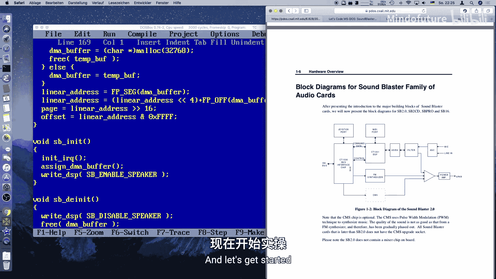

🎼For the playback to actually work， we need three different functions。

🎼An SB in function that set up sets up the RQ stuff and the DMA buffer。🎼Then。We want to write。

Play function to play is one single。你没法。🎼And for that， we use a gooddo Windows 3。1 sound。🎼And then。

 while it's playing。🎼We will wait， do nothing。🎼The next part was the multiple DMA buffer school。

🎼Check for key presses and stuff to regional board， but right now it's fine。

Well take a few seconds at most here。🎼And then we need to function the in that reverses our IQ&Dma setup。

So that's fine。🎼So first of all， we need。A variable here。🎼TheMart volatile。

🎼Volaat means that it can be changed at any point due to， for example， an interrupt。🎼So。

 the compiler won to。🎼Optimizations here。🎼And treat it differently， basically。And。Yeah。

🎼That's what we need here。 And next up。🎼Would be the in function。🎼So。🎼It has B in it。🎼And。

🎼In this function， we will simply call。😔，🎼And in IRQ function， which sets up our IQ handling。Then I。

🎼Assign the A buffer function。🎼And we were。🎼Also。🎼All the soundlast are tool enable。Speaker。

🎼So we need to write a bunch of functions。 Let's start with the right TP function because we will need this all the time。

So let's put it right below the recent EP function。嗯。And we were。Pass it a character。

 which is basically with command。1 byte determines which command the。S plus D P supposed to execute。

The way we do that。

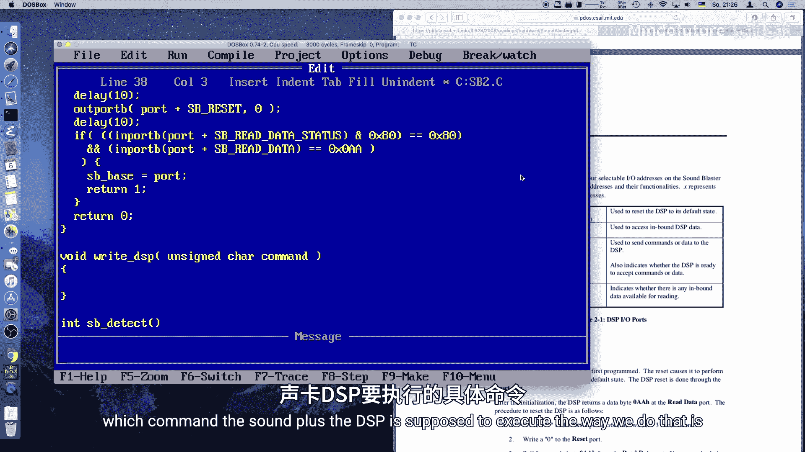

Is。You can read that up here， reading and writing。😔，So before data is written。

 we have to check the right buffer status board。That it's empty。If bit 7 is 0。

 that these people as empty as ready to receive commands。

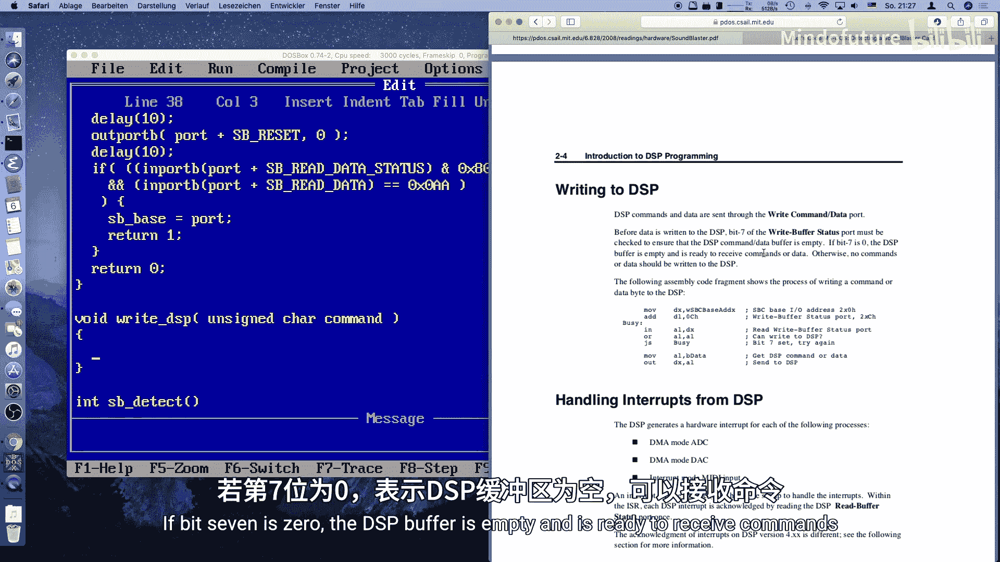

So we can write this like follows。 We just do Y loop。Then， we read。嗯。

From the sound plaster baseboard plus。The right data register， which we will need to define。

And bit 7 is0 x 80。And the soul。Stuff is not empty if this is 0 x 80。 So the bit is set。

And we will do this until this is 0。And when this happened， we can simply write to the same port。

So SB base。Plus， S be right。Later。And we write the command。So， we will have to。Define S B write data。

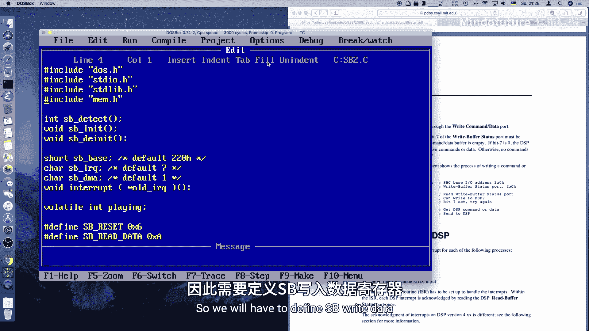

Here we already have the stuff and。The reference tells us the right buffer of status and the right commentator are both register C。

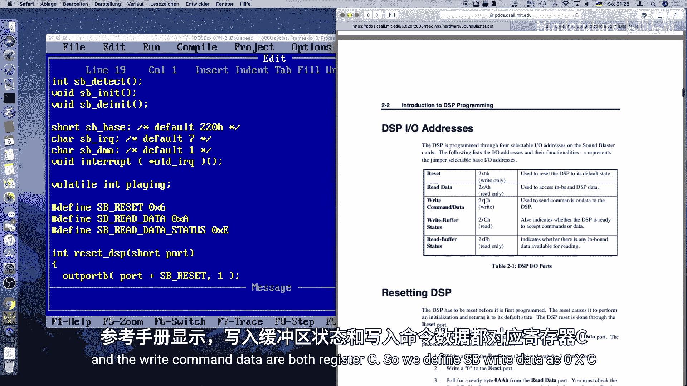

So， I。We define S B right datata S 0， X， C。That's good。

 We have the very first function that we need in our in function。Now， off to the init IQ functions。

Or fanangchun。That will be the next one。😔，In it， IRQ。

And we will have a D in it or a release IRQ also in the D in it function。First of all， we have to。

Save the old IQ。Hler。Our vector usually call this vector IQ vector。

Which is basically the currently installment handler。

 And we need to call it as well from our IQ routine。

Because there might be some T R or something that handles this there。

 We have to do two different things。 It might be that we have a high IRQ introduced with the 286 and above。

 Those are the IQs 2，10 and 11。 IQ 9 is the same as 2 because it's cascaded。So， if。Our as2 or。好。

Let's write it correctly。MyQ is。10 or。IQ S。11。We need to。Do something。 And usually， it's。

I think we got it older Q in the last part， right， Yeah。

 here we already have the function to store it。So。This is equal to get vectored。

 which gets an intro vector to。4our。Some vector as for some interrupt， sorry。

And the hardware interrupt 2， for example， is akin to the software interrupt 71。So we write here if。

This B， IQ。Equals 2。Then we do this。And now we can copy this whole stuff。And for 10 and 11。

This is 72 and 73。 This is a bit ugly， but this is due to the fact that。

We have the two in here that we can't write it much nicer。And that's already that。 else。

 we have a simpler case。 This is for all the PC and Xs， which didn't support the high IQs。

Then we only have to do old IQ equals。Get backed。Of S B IQ。Plus 8， said Proestat。

This will get the IRQ。嗯。And then， we can。Se。😔，Oh IQ vector。So。Same goes here。😔，Basically。

 we can copy。H。We can copy everything here。It's exactly the same。 but this time。

 we will have to call。Seact。Which takes a function pointer。

And our function pointer will be called S B。IQ handleler。mm。うん。😊，Just copy this。So， and we。

 of course， forgot to write the software interrupt here。0 x 71，72。And。23。All right。

 And other than that。For the PCs and the Xs or every normal PC that uses usually 7 or5 as there。

Interrupt， we do something similar。Third vector of S B， IQ plus 8。And we set it to our handler。

All right。Then we have to do one more thing。We have to program the。

I queue controller on the main board， so。We have to enable the RQ with。对。😔，欢迎 board。

Program to the interrupt controller。How does it work？Again。We have to。Decide if we have a cascaded。

Interrupt， as you can see， this is really shoehu horn in the PC。So， if we have。One of the high I cus。

Then we again need to copy all of this。A lot of copy pasting today。

But we don't need to call set fact， but。We need to call。W we need to output。To the port of the Haat。

Interrupt controller。 And you can find this。On the。Port side here with LPC stain Las。

And if you take a look at a1。You can see the interrupt mask register for the second。

Programmable interrupt controller， the first programmable interrupt controller。Can be found。

Here on port 21。 So that will be what we'll be using。Don' there。So the question is。

 what do we need to write to that exact port。And we need to write。Whatever we。Read from。0 x， A 1。

And then we do a bit wise。 And on 2，5，3， which basically gets the current mask。And。

Setets our appropriate bit。So， next up。The two other interrupts that are possible。 And those are。

Just different values。2，5，1， and。2，4，7。And then， we also need to。

Write the same thing to the lower programable controller， so。Z x 21， as I said， is the。

 the primary Android controller。And will enable that， there， as well。And。All right。So。Otherwise。

 this is much simpler。We will take the primary interrupt controller。Read from it。And then， take the。

Take the lower IRQ that we have。Shift the one up to there， because that's then the。And flag。

 if this is n， this is the ends a bit in the in the flag and negate that。And if we end this。

 then that bit is cleared。 Oh， yeah， I think I spoke。

 So this basically clears the appropriate but bits same here。And we are good to go。Okay， this was。

Pretty。😔，Convoluted， I think the interrupt getting and setting on the softer side is pretty fine。

 but the programmer interrupt controllers， especially these cascaded ones are。A bit of a mess。

 I have to admit。Sticking to the lower IRQs is still。Fine， I think this is pretty straightforward。

 You basically just set the appropriate bit to 0。In the register of the primary interrupt controller。

But yeah， let's just go with this。So， we have our。Second function here up to the last function。

 assigned him A file。This is another slightly tricky one。

Because the M A buffers must not cross 64 kiloB pages。Not even segments or something。

 but really pages。Because the DMA controller that is used in the PC was actually for computers that can only address 64 kiloB of Ram。

And， that's definitely not the case with the PC。 So we have this weird。Thing here。

And we need to jump through a lot of hoops， too。Get the assignment working。嗯。Yeah。First of all。

 we need a temporary pointer。2 bys。And we call this temp0 puff。And we will also have to store。

The linear address of this。Bffer， the linear dress is basically the full 20 bit。

Segment and offsets in row into one integer。And。😔，We。Need to。Store。

The two buffer pages right now for the single playback we don't need this。

 but I'll already introduce this for the auto in it because then we don't need need to deal with this in the next。

Of course， because with auto in playback， we will use double buffering。

 We need two different pages for the DMA controller， each being 16 kilobys。And every 6 kiloby。

 we will。Do it interrupt and read more data。So the tempifier now gets。Assigned。

Newly freshly allocated32 kB。 These are the two pages， and this tentatively。

And we now calculate the linear address。Of this whole thing。And we take the segment。Of the pointer。

And。Then， we will shift this。4 bits to the left。Plus， the。Offset。Concept。Pointer。

 So this gives us the 20 B linear address。Now we will calculate the。

Page at which the first page starts。Any address。Rightide shifted by 16。Gives us that part。

And for the。Second。Page。😔，That will be 32 kB，-1 on top of that and then shift it 16 B to the right。

 This gives us the second page。And now， so that we make that。

The two pages are actually on one physical page or one linear page。If。

The page 1 is not equal to page 2， this means。The two halves of the buffer are actually on different pages。

Which is bad。And。If that is the case， we。Just simply。Llocate。32 kilobytes again。Whats the cost。

And this is actually a heck。 this works because the way the to C works is it will just take the next free 32 kilobytes。

 And if those two are currently not matching up， we know that now we definitely get something that fits into actually page2。

And that's a weird heck， but it works。 If the allocator works in a different way。

 allocating from wherever。This will fail， actually。 so you would， in theory。

 need to do something more clever。But it's good enough for us。And it works in this circumstance。

 And then we can actually free the10 buffer because it's not needed。 It was on the wrong page。

However， if by luck， we get something that works from the start， we can just。Say that。And we。

 of course， also need to。Declare that， but we will do that in a second， first of all。

We will store the page the offset of this newly created thing。So。And。Actually， we can copy that from。

Upstairs。I was stupid。Okay， let's take this here。Let's calculate the linear address， again。

But this time from the up。Final game a buffer beard。The temp one or the newly。Calculated one。So。

 that's that， and。Then we will store the page of this because we need to output this to the DMM8 controller at some point。

And we also need to store the offset for the DNA controller。AndThis is basically just the lower16 B。

And that's how you do that。Now we have to define the D A buffer page and offset variables because we didn't。

 I think， yet。So let's put that here。So we have the pointer。Quantity may buffer。We have a。

16 bit value current page and a 16 B value current offset。And all this stuff here。

 these three values are for the DMA controller。Good with。Gotten pretty far。We've gotten。

Almost everything set up。 We've got the in IQ of the assign D maybe with the right is P。So。

 that is fine。Now， we need the D in function， which we can just copy from the。Unit function。

 more or less。Let's do that actually， because I think that's。The fastest。Let's call this。😔，D in it。

 IQ and。Let's do the。A speedG unit function as well。And we will do two things here。

We will do write this P SB。Just enable speaker to turn off the。Sound output。We will release。

The de a buffer， because we don't need it anymore。And we will。D initialize the IRQ。

And that's the funny part here。Please store the old IQ vector。Basically。The whole thing here again。

 said vector。Hold IQ。Just restoring nothing fancy here。😔，Just takes a lot of typing。Same here。

And there's a typo。Let's see how many arrow we will have when compiling this。AndWe。

Don't actually need this whole stuff here。😔，呃。I control wire yeah。But we will need this stuff here。

So to enable this stuff again。We basically。Do something much simpler around。We just have to。

OhThat was a bit stupid。 We have to read。The mask， again。Then， turn off our。Appropriate bit here。

So that's 2 for inter number 2。44。😔，Interruppt number 10。And 8。4 interrupt number 11。And。

We have to commit that as well， again， to the lower。Programmable interrupt controller。

And the same here this time without den neigation， of course。And I see that we have。I made a mistake。

Probably also further upstairs。Yep。😊，So， that's missing。嗯。That's missing。I it looking good。

 It's looking better， at least。Same here。All the semicolons。All right。I think this looks pretty good。

Think this looks pretty good。 So we just need the single play， right。Oh this will never work。

Shall we try to compile this and fix some box first。Some， some， some things。Oh， a lot of warnings。

Yes， we need to write the IRQ handler as well。Let's do that very quickly， because。

We will actually need that。For playing。Where did I put my IQ handle O， syntax is as follows white。

 and then。Something。Only the。Dos Sicomp Pace have the interrupt keyword。

 This as an interrupt handle will set up the function differently。And yeah， let's go define it。

 It doesnn't take any arguments。And it will do something。 What will it do。

What we have to do actually， you can read that up in the somepl documentation。We have to read on the。

嗯。Read buffer status， register。I'm not sure if we。Actually， defined it already。诶。No， we didn't。But。

 we need to。Oh， red data status。 We call it。 Okay， that's fine。Then， let's call it。Read data status。

 as well。So that's the one that I want。That's the one that I want。

And that will already satisfy the sound plaster。Then we need to tell the program of the interrupt controller。

Which， as we have seen。It imports 20 and 21。So on port 20。We need to write a 20 hes， of course。

This would satisfy you。The primary。Inter controller。And again。

 we have some special dealings with interrupts。2，10 and 11。Here we have also to tell， we have also。

The obligation to tell the secondary or cascaded and controller。

 which is listening on a 0 in this case。 And we also write the 20。

So it knows that we have dealt with the interrupt。And actually。

 I will also introduce already what I need for the play function。 We will set the playing status。

To 0， because in this case， we are done。嗯。This will become more complicated。We already defined this。

 I think。Yet， we have the playing。Volaatile integer。 That's good。So， that's。Our。Interruptenla。

 actually， I think that should do it。See if we got more arrows。 now， it gotten much better。

 enabled dis with speaker are still missing。And file is never used， but that's okay。

 I can live with that。Any disabled speaker is not a big deal。So， let's define some commands。

SB enabled speaker。And。Just able to speak， so。What are the commands here？

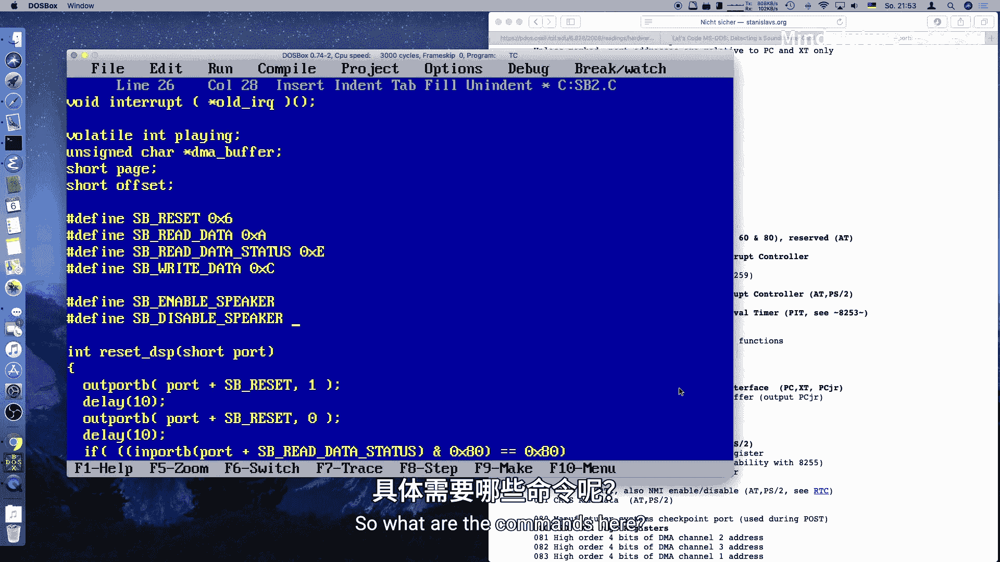

Let's look them up。So at the back here， we will find somewhere。Ai。😔。

The speaker commands here already saw it。 D3 is turn off speaker and the1 is turn on speaker。

 So that's easy。

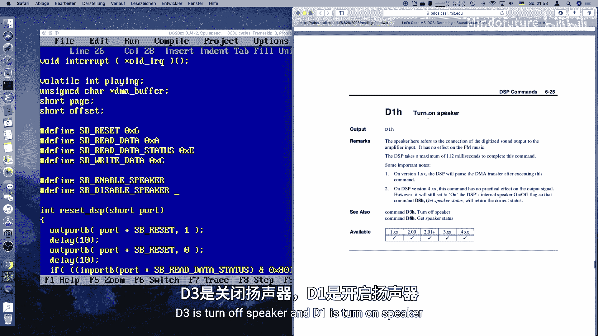

Let's put a0 x D1 here。And。S x D3 here。Save it。 build it。One warning。 and one  error。And yeah， okay。

 that's true。We misspelled。 We misspelled thee in it， Icu。And we mustpeed it somewhere。Here。

That's fix it。Okay， all that's missing is the magic play function。And。Well， that plus。

 plus the actual plane。That's start for the play function。 that's simpler。So we take a file pointer。

We also need to know how big the file is。呃。Then also。

 so that we don't have any noise if we do something bad we don't blast our speakers。

 we will set the the A buffer。To。0， so if we play， for example， we。

 if we can't read and play anything， we don't hear noise， but just silence。It's just convenience。

 You don't need to do that actually， but I think it's better。Then we will open the file。

With a given file name。And well read it in bind me mode。Then we will try to figure out how big it is。

So there's a very old trick to do that。 We seek to the end of the file。嗯。Here we give the position。

 It's a 0 in long。And we say， yeah， please seek to the end。And then， we can actually。

Read out the file size by calling。Tell， F tell。Which give us the position in the file。

Since we seek to the end。It will be。The size of the fire。Then we rewind back to the beginning。

Which is the。that's that。 We know the file size。 and now we can read the whole file in I'm not gonna check if it's bigger than our DMMA buffer。

 If it is， you out of luck。 and bad things will happen。So。Be warned。um。Let's read。1 chunk of size。

 file size。From the file called raw file。 And this is really a raw file，8 bit unsigned，11 kHz。

No headers or any other sample。Size is possible。Then will you write the command？

Said playback frequency， because we need to turn the sunlast。What sample rate this has。

And we will tell it that it has 11 kHz。 But wait。

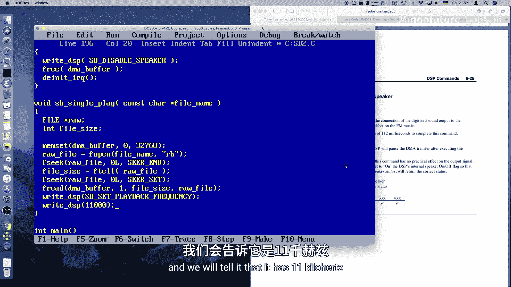

It doesn't work like that。um。

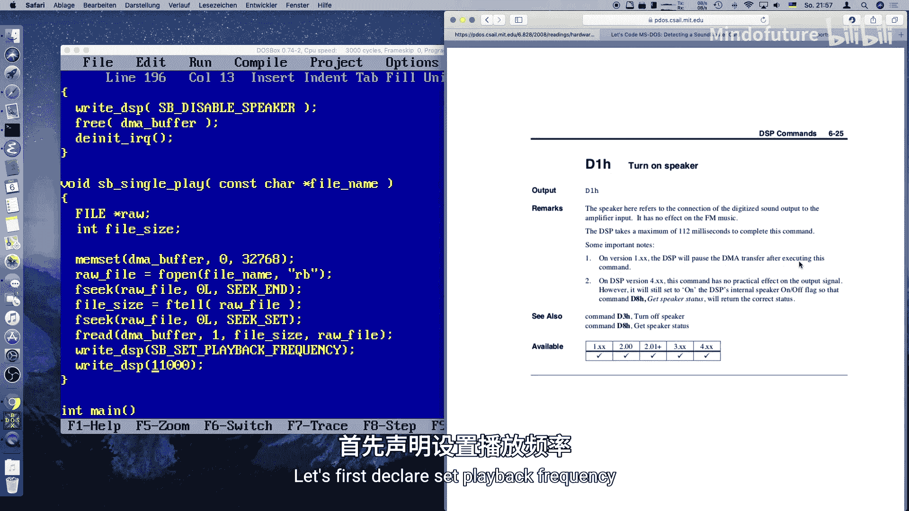

Let's first。 Let's first declare。Set playback frequency。That playback frequency。

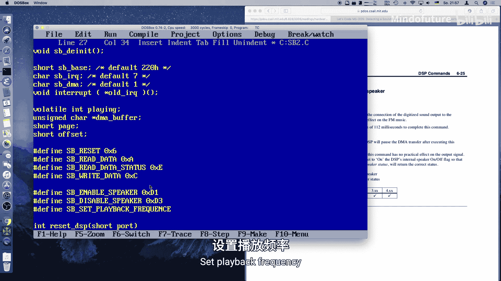

And this has。I have to think。40，40，40， West 40 hex。Here it is。

So digitized sound transfer time constant。 And the formula for this is actually 65536。

-256 million divided by channel time setlink rate。 You can actually factor out that 256 that leaves us with 256-1 million divided by so and so。

Which is easier to handle for such small machines here。And that's what we will use。So。

 formula is 256 minus。1 million，1，2，3，1，2，3。Divided by 11000。Alright。That would work。And。😔。

When we have done this。We will set。We are also need。This year to be played。No， we don't need that。

 do we。Yes， we need。We need to tell the IQ or the， the single playback function on the D controller how much we will need to plan。

And that will be file size。And we will call a function called single cycle playback。

In the next episode， we will do。Multiple Cyplayw。And we need to be saving the to be played as well。

So， we will have。Again， volatile because it might be changed in the interrupt handler。

Couldn't be long because files are long。And we call it to be played。So， that's good。

One step is missing， the mysterious singer。Playback function。See like pay like sorry。There's a bill。

 actually。Not quiet。 Not quite。And。Oh， yeah。Better。And no errors any more and warnings。 Good。

 that's promising。And the single playback function， this actually， again， gets a bit weird。So。

 first of all。When we start this， we are definitely playing something。

 So this is for the main function that it actually waits for us。Now。

 we need to program the Lima controller。First of all， we need to write to the。

Muss register of the DNA controller。And what we are writing there is。First。

 we set the bit that is represented by the four。So these 1，2，4。Third bit， I guess。And。

And we ordered this by the。SBDA channel。So basically we are writing our DMMA channel from the sample pluser to the mass register。

😔，Did we already。Define this probably not。So we should do this。

 So here we willef all the stuff or the。你没 controltl了。The maskque register， again， we can。Check here。

Should be port a。I hope。Looks。Not right， I would say。Actually。

 I will put all the registers here that we need because otherwise I need to jump around like crazy。

So what we also need is the remote register。嗯。Which is B。Pt V on the PC。We also need the MSP， LSP。

Flip flop， which is part of the heck to make this whole thing work on a PC。Because as I said。

 it's actually designed for 64 kilobyte computers。And we need to。Define。

The ports for the different D A channels，0，1 and 3， which are supported by the sunplster cards。

There are also higher channels similar to the interrupt， but we will not support those。

Those are only needed， usually for the sound plus 16 and upwards。

The older ones don't support that at all。And the snack parker， for example， supports only one。

Channel name and V， number one。And so does the sumlastster 1 and 1。5。Alright。

 so we defined all the crazy。点 a。😔，Parts， and we can continue programming the whole device。

So now we have to write outboard， outport B。😔，To the MSB， LSB flipflop。And。We you write a 0 here。

That's simple。呃。And then we will write to the mode register。And we were right here。Again， our DA。

Said the dim bit。Of the Sun Pla a。And then we will write the offset of the。嗯。

And now we need to write the offset and the page。The D a buffer。And there， we will use the。

That's actually pretty simple。 We only need to take our DMA channel， and shift it。By。

Do I do something clever here。Hora。Let's take a look。So， this is basically the。Adds or just， I think。

Shifted by one。 No， this should be the word count register， right。

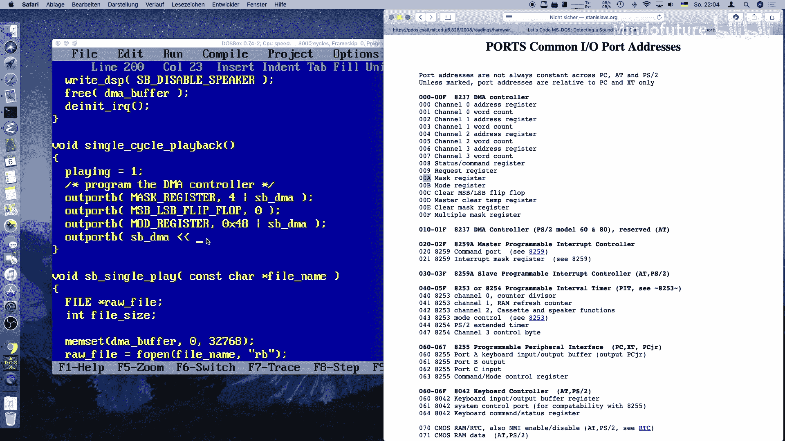

Well， anyway， we need to shift it by one。 And that should be the word conr， I guess。

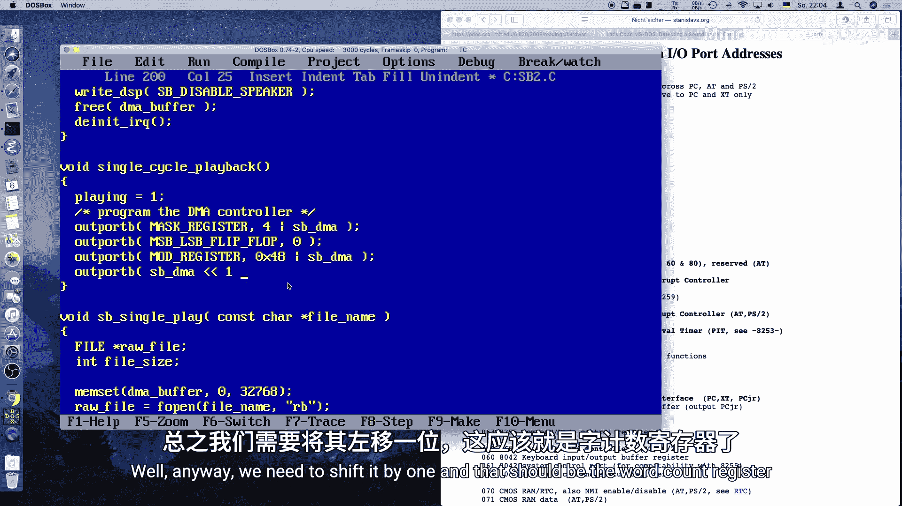

No， it isn't。 That's the advantage of that makes much more sense， because。When we input 0。

 shifted by 1 will be 0。1 shifted by one will be 2， and3 will be。

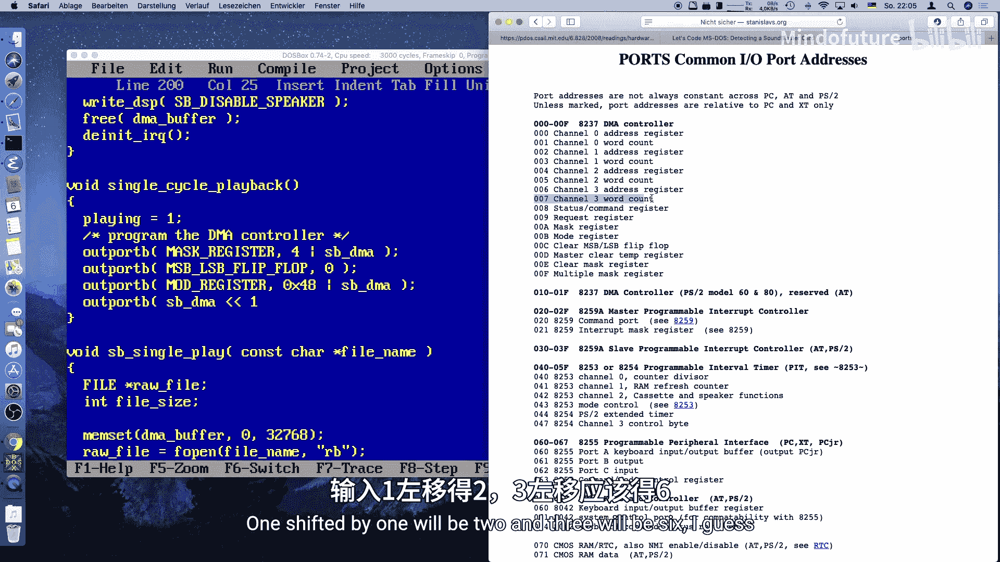

6ix， I guess。Well。Anyway， this works。 I tested it。And we need to output the lowery of the。

Offset first。And then we will need to output the high。

And you do this basically just by selecting with a bitwise operation below 8 B and then shifting right by 8 B。

Ne works。Okay， now we programmed the DMA controller， at least partially。

Now we need to output the page。And let's do this like this。Switch。And we have the K 0。And here。

 we simply output。To what we just defined in H 0。And here， we write the。Let's take a look again。

So those were defined as 87， 83 and 82。

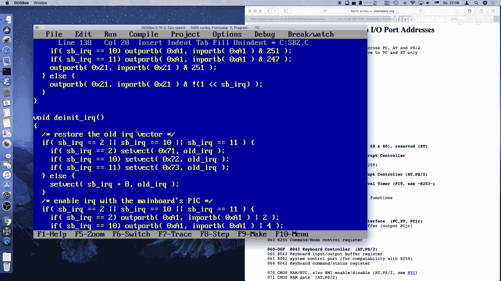

This is the page portion。

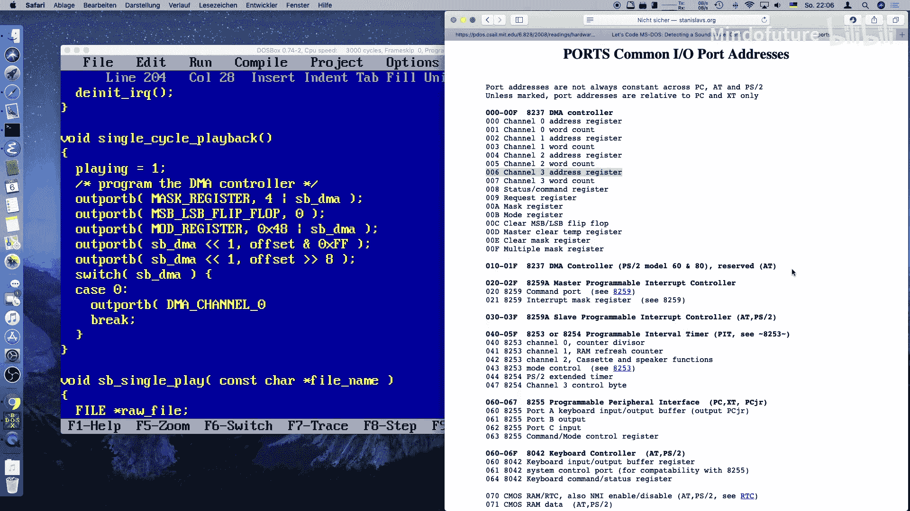

And we will find that here the main pay registers。 and this is basically the hacking part。

Of the Hoium A stuff。So。Here we write the page。That's also why we saw that earlier。No。

 we just need to。Replace this。Okay， so this is the non hacky part The offset is still in the 64 kiloB range。

 and that's why it works fine。Just by this。 and then we need to hey register for the page。😔。

Which is at a completely different place in the memory map。Or port map。Okay。Now。

 we need to tell the DA。Controller， how long or block actually that you want to transfer。

And this is the word count register。 so we can do this。Terrible bit shift again。

But this time we add one。Because。Every register plus one gives us the word count register。

And we write the。Low by it again。And then we can copy this whole。😔，Stuff again。And write the。I bite。

And I hope this works。🎼Then we need to write to the mask register again。To tell。🎼The DM control。

 Okay。 no， I'm not。 I'm finished talking about the。🎼Some plus DM。🎼Last， but not least。

🎼Wed tell the sunlaer to start playing。🎼um。🎼We give it the single cycle playback command。

🎼And we are the right。🎼The number of bites that need to be played because adults need to snow。

🎼In the very same manner。🎼That we did before highb and low bite or lowb and high bit rather。

🎼And that's the end of that。 when we need to。 We don't need to do anything anymore。

🎼Nothing left to play。🎼However， I think we need to define this still。

🎼And the single cycle playback has。🎼Its own。🎼Come on so。🎼Deefine a the single cycle。🎼Playback。

And this has。Comman number。🎼14，8 B singlescrom am mode digitized solarput。Let's build it。🎼One error。

That's fine。🎼Mot register， it's not called Mo register。 It's called Ro Reg。

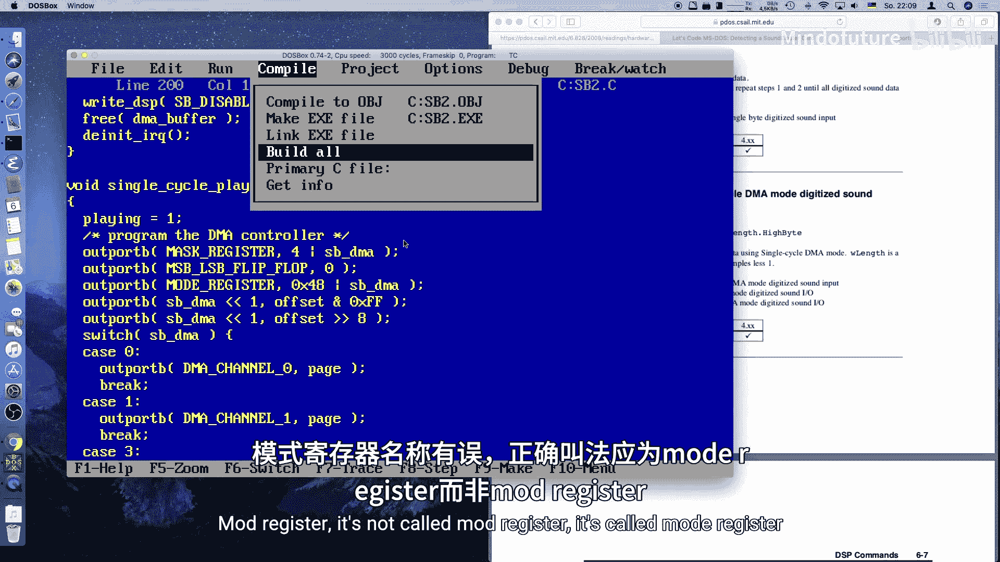

🎼And what do you think， Will it run， Will it play something。

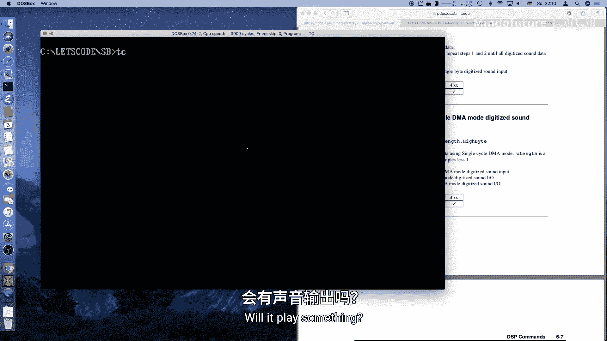

It does and once again。And again。Because it's so very nice。🎼Okay， this is an extremely long episode。

 of course， but。You can play stuff on the sungla to now。

🎼We learned how to detect the sunplace in the last part。

🎼Now we learned how to initialize the IQ handling and allocate a EA buffer。 that's actually。

🎼Good for the wire game A controller and the PC。🎼We learned how to program the image controller more less for single cycle play。

🎼And that was also weird， and we learned how to unreg our IQ handling。🎼Which is not that weird。

 And reading the file was pretty simply because it's raw。🎼And yeah， that's about it。

🎼Next time we will learn how to play long files and。🎼To more complicated stuff。

🎼It will be almost a walk in the park because youve got all the hard parts right now。🎼Already done。

 and。Yeah。🎼If you like this， please click on the like button。

 hit the subscribe button to get us over the 1000 subscribers。

🎼That would be so great and share on your social media if you want to also leave a thumbs down if it didn't like it。

 definitely leave a comment on what you liked or disliked。🎼So we can do something better here。

🎼I hope you enjoyed it anyway and I hope to see you soon for the last part， the alternate playback。

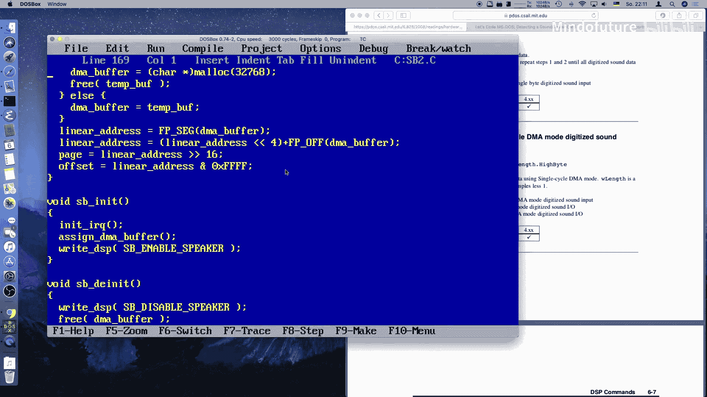

🎼。🎼ああ。🎼。🎼う。🎼うんうんん。🎼う。