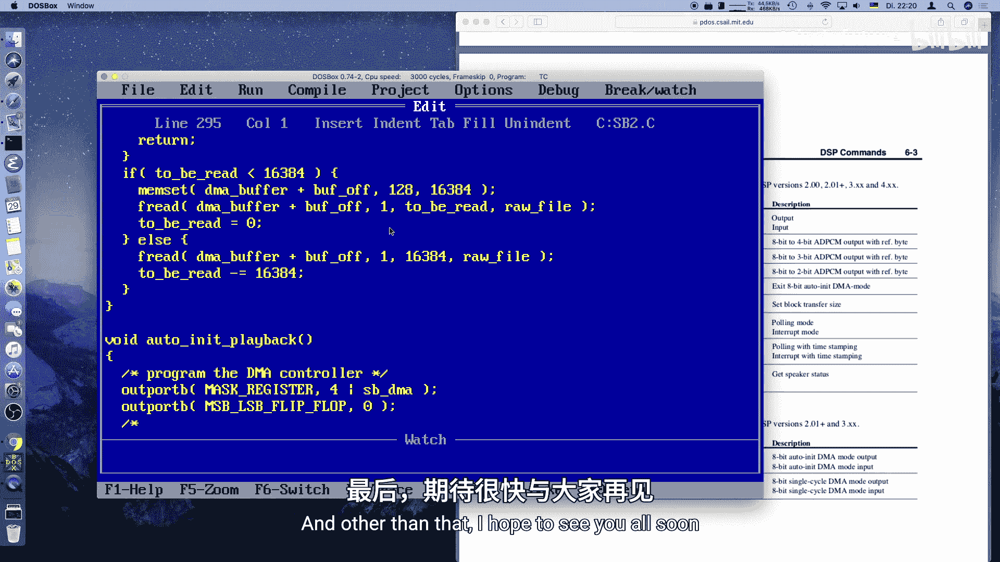

# 编写MS-DOS-系统-｜-windows-｜-操作系统-｜-汇编--｜-vga-｜-x86-p11-P11-Lets-Code-MS-DOS-0x0B---SoundBlaster-Autoinit-DMA--BV1zs35zQEru_p11-

🎼Hello， welcome and good evening。 And tonight we w to finish up our let's code on the Sound Blaster PCM playback。

🎼Last time we learned how to do the single cycle playback。

 which means that we programmed the PCs DMA controller to supply the soundlastster card with。

🎼PCM data。 So wave forms that you can play digital sound。🎼To be precise。And。

🎼We could play one d buffer full of sound， which well。🎼Depending on the size of the DMA by5 fits。

 something like 32 kB will mount to about3 seconds worth of audio。At 11 kHtz， something right。🎼Well。

 this is， of course， not much。 And sometimes you want to have like continuous speech or music playing back。

🎼And for that， we need to switch to something slightly different。

🎼The single cycle playback is not good enough for that。Okay， so let's enhance this program。🎼So。

 first of all， before I forget that。We were。🎼Change the file name because I provided it or I prepared。

🎼A。🎼Another file， which is much longer and which is actually a couple minutes long。

 And you will recognize it。When you hear it， hopefully at the end of the video。🎼And。🎼Yeah。

 this will not be possible to play with only singlecycl playback。

🎼So we'll do something different here， and we will actually。🎼Use a different function。

 We will call it how to play。🎼And we will keep the single play function so that we can call it as well。

🎼But yeah， this is good enough。And we will also put in a。

🎼Check for keyboard input so we can abort the play。🎼Because since it's not only 3 seconds now。

It's definitely。Going to be good if we can stop the playback。And we need a special stop function to。

 actually。🎼Stop all the DNA stuff。🎼The D unit stays the same。🎼And that's， I think， good enough。

🎼For now， let's。🎼Coode these functions 1 by one。 And I think the SB stuff function should be the simplest。

 So we。🎼Might want to start with that。🎼And we will be using the。ああ。🎼Exactly this year。

 the raw file pointer， we will use that。🎼And we will also use the file size here。😔。

🎼And we will remove that。🎼To the top of the file， because we need this all the time。

 this will become global state。🎼Llow variables are bad， but we are in C here， and there's not much。

🎼Helth that we can actually use。 So I'm fine with that。🎼So raw and file size will be。

🎼Global variables now。🎼Then we'll use SB stop。🎼And I probably should declare it at the top， as well。

Because we needed it at some other place， probably。So how does it work， So we write to the DSP。

A new command card。S blastster pause playback。And we will set the playing variable to 0。

The playing marble is one。 while we have some stuff that is still playing。 And this actually。

When called from within the while loop will also exit the while loop。

When we call it at the end for safety reasons， or because we hit keyboard hit。

 it doesn't matter that it's here。We don't care about that。 And also to be clean。

 we will close the file。However， this is not necessarily。Important because when we exit a dust。

 the file will be closed anyway。Okay， so that's good enough。

But we need to code the autoplay function。What does the autoplay function look like， So S B autoplay。

Takes a string。Takes a noise string。Let's call it final name。And how does it work。So， first of all。

 let's make a I need to check if the D A buffer。Hasn't been allocated。 So it's now。

Then we simply return。 We don't do anything because we will crash the program otherwise。And。We need。

To use more than one buffer， actually。We allocated the D buffer with twice the size that we actually need。

 so。I think we had。32 kB are located， and every DM buffer was 16 kB， so we can double buffer。

And the idea will be that we preload both buffers so that buffer 0 and buffer 1 are filled。

 and then we start playing buffer 0。And on the end of bufferer 0， we get an interrupt from the。

Sound blastster。While the sound plaster will continue playing to play Bal1。 And in the meantime。

 what it's playing Bal one， we will。Read in new data into buffer 0。And when buffer one has ended。

The auto unit will swap back to buffer 0 and play that while we load stuff into buffer 1。

 That's why it's called double buffering。 We basically have two buffers。

 which we take turns in playing and filling from the file。That way。

 we don't need to load all the file into memory， but we will just load it on demand。So， we need。

A red buffer variable。 It's basically just an integer。 And we start with buffer 0。

And we will also set the。Contents of the DMA buffer。To 0 and for both halves。 So that's the 32 kB。

So this is also a global estate because we need to have that in the IRQ handler。And this will。

 I think， will just be a short。Integer 16 bit could also be a character。 It doesn't matter。嗯。

So let's put it here。 Short R buffer。Global state， again。Let's go down， down， down。

To our autoplay function， here it is。Okay， so now we have those two things set up。

Then we can actually open the file。So the file will be opened。File name was its name。 And again。

 we read from it in binary mode， not a text file。 It's binary。If it didn't work。Oh，Let's be nice。

 let's say。File not found person S。Ex slash and for a new line。

And persons will be substituted with file name。不能录音。Return。Let's put an arrow here。拍张床片。All right。

Then， I well do。File seek。 So now we need to figure out how large the file is。

 because we need to store the file size。So， we do a seek function。To the beginning。Of the file。No。

 to the end of the file， sorry。So F takes a file pointer， which you have here， an offset。

 which is0 and a relative position。 We want to go to the zeroth by from the end。 so the last byte。

Then， we can use。The function， F T。After tell us。The position in the file。And since we。

 we seek to the end， it will be the actual file size。So。After on raw file will give us the file size。

And then we need to rewind the file。 So we just say， okay。

 go back to the beginning and the beginning is seek set。 It's not begin or something。 it's set。

I don't know why。So now we need to store a bit more。State。

The number of bytes that we still need to read equals the number of bytes that we need to。

Play because they will differ in the end， after one buffer。嗯。

And those are both file size at the moment。So to be written to be played needs to be。And。

We already have to be played here。And， let's put。To be read in here as well。

Both are volatile because we will change them in the interrupt handler。

If we don't put the volatility here， the compiler might do stupid stuff， and we won't have the。

Correct values at all places。 So always， if you modify variable in an IQ handler。

 please put a volatile in front of it。Good。Now， we have set up all the file variables。

And just to make sure that we。See everything， right we。Output this。

And this will be a long and signed integer。New line， and it will be。

To be red doesn't matter what we pick here because they are all the same。

To be ready to be played and file size。Then again， command that we already know。As B said。

 playback frequency。We had this already。In the singer。Playback function。And it's just。Copy that。

Just simply copy that。Okay，11 kHz is the。The number。And we also have to enable the speaker。

 Otherwise， we won't hear anything。Might be the dust box is a bit mal lenient。

 but the true sunplaceer guard will not do anything here。Then， we were。Read the bo。

Then we will simply read the buffer 0， and we will。Read。Buff 1。

 So both hs of the buffer are now filled。And I'm wondering， did we already write the。

Read buffer function。I think we didn't。So that's the next function that we need to implement。

And it will take an argument which tells us which half of the buffer will be overwritten。By new data。

ok嗯。After we've done that。If。We still need to read something。Which means this is a large file。Thenen。

We will， actually。Do the auto unit playback。Right。And we will do that。How to in playback。

There's another function we will need to implement， doesn't take any arguments。

 It does does the D A setup， etca， etctera。But if there's nothing to be read。

 that means that we actually。Havelf everything that we needed was a small file。And we can do thee。

Single cycle playback。And that's something that we have already implemented。So， that's fine。Also。

 no matter what we're doing。We are definitely playing by this point in time。

So we'll just set this to one。Okay。Next。Reed buffer and audio in the playback are definitely missing。

So we will implement those。First of all。re播放。Takes a short。And what do we call this， let me check。

Yeah， let's just call this buffer。Okay。We already did this before。 I think the。Buffer offset。That's。

Put this in a constant integer。So we can't change it。Is actually just simply the0 of the one。

Shifted to the left， by 14 Bs。Because it is the size of our buffer， basically。So 16 kB and。If。

There's still something to be read。If there's nothing to be read， let's， let's put at this。

 If there's nothing to be read anymore。Then we just return。 There's nothing to do。

 So we won't crash here if we call read buffer 0 and read buffer 1 and。

The data was only enough for one buffer。But if。Oh no， this is even。 Yeah， exactly。

 This will be on the second call。 If on the first call， we already see if to the。Red is less than。

1 bufferful。So， that's a 16 K。We will do the following。 We will first。Initialized。

Our current buffer with。1 28。 And I'll tell you why。We are playing unsigned integers here。

 So the waveform will go from 0 to 2，55， but the。Silence， pure silence will be only 128。

 That's basically the middle line without any amplitude。To get an amplitude of negative one。

 basically， you will put a0 here and plus one will be。2 55。

 if you normalize the energy basically in the waveform。And 128 is exactly in the middle。

 and this is just a flat line and it will produce no sound。At all。

So we first initialize the buffer with that。 and then we read whatever needs to be。Red here。

The target will be dimeba。Plus， the buffer offset。We read bytes and how many bytes we read to be red number of bytes。

From which file。Roffei。So the syntax for F it is。Give me a pointer where to put all stuff that seem ever plus buff offset。

What should I read1 bite at a time。How many。And that's the number here， to be right。

And from which file raw file。Simply enough， isn't it。

And then because we know this was the last buffer because it was less than 16 k。

 we say to be red is now 0。Else。We have lots more to read。

So we will say we read to DA buffer plus buffer of that again。And we read a full 16 K now。

From raw fire。And we simply say it to be read。Is 2 be-16 k。And that's already that。Now。

 we can read team A aboves。Slic that。Okay。That takes care of。These two lines， oops。

And these two lines。Now， we need to implement this function and this function。

Will be more complicated。 It looks。A lot。Like the。😔，嗯。Single cycle， playback function。With all the。

DMA programming。 and it will be。Similarly， complicated。If I can find the notes on that。

 Ill point to that。Purely from memory。Students。So this is another void function。

What do we need to do， first of all， again。Very similar to what we had before。Maybe we can copy this。

 Let me check that I don't do any stupid stuff。嗯。Yeah， I think we can copy all this。

You can copy the whole block and then change it accordingly。嗯。This way。

It's hopefully a bit easier to follow。Okay。Let's check it。So， first of all。

 program that my controller。 again， we need to write to the mass register and。Or the。EH channel。

Of this on plaster in there， that's the same because we're still programming the same thing。

 We have to reset the flipflop。We have to write。Something else to the Mo register。

 And now we will put something in here。To make it。Better documented。 We didn't do that last time。So。

 the mode register。In this case。Works out like。Such， no， I'm actually wrong。This is fine。

 Motorist is 58。 That's good。I wanted to have this。Here。No， it's good。That's good。Okay， so。

The mode for the outer unit is。58。Plus。X X， where this is or plus。Dmei。Sound blessed mail。

Where in binary， we have。This year。And。Let's explain this because we had the same thing very similarly here。

So。This year。These two。Can it adhere the0 and the one。啊 the呃。

tell the DM A chair DMA chip to do block mode。Then the next two， the 01 after that。

Tell them to do autoer in it。 And this is where we had the difference between the auto in it and the。

Single psycho Playback。And。Last but least， the 1，0 tells us that this is a re operation。

And so the sound plaster reads from memory and not the other way around。

 it's not the right operation。So， the。The single cycle playback only differed in those two bits。

And you can look up the whole。Data sheet probably for the AA controller。

 and it will tell you exactly these values and what different block modes and other things you have。

But this is how we came to the value of 0 x 48 for single cycle playback and 0 x 58。

For the audio in playback mode。The rest should be the same。 Let us just go through the values。Then。

 we are writing。The address， basically， the offset， as we calculated it。For the DMA buffer。

 this is still the same。 This is also correct。 This is the whole stupid bit shifting thing with the。

Crazy offsets。And we need to write it bywise。 That's why we end with 0 x F F here。

 And then we rideshift to get the higher byte。And we write that to thee。DN A register。And then， we。

Write the page， depending on which DM image channel we have。And then we have to do the same again。

 here。With the number of。It's to be played， but this is wrong， because。This time。

 it's not to be played。 This time， it's some。D youmail block length， and we have to define that。

And I think this should be。We should have used that before。嗯。Yeah， this。

 I think we didn't define yet。So， let's do that。Let's do that。So the SB， I know。

 the first the D A block length。S0 x 7， F，FF。And in a short while， we will also need the S sound pla。

Block length。3x。P。FFF。And if for take。A calculator。And I go tell what's。Oh。

 we should probably switch to。X u x up。This is our 32 kB， which is the whole Tma block size。And。

Guess what。3e。It's clear， clear。3 F， F， F is， obviously。Half of that。

So this is what the sound blaster will play。 and after which it will trigger the interrupt。

 So for the D A controller， this is just one whole thing。 and the sound blaster will trigger the IQ。

Every half of that。Which is fine。All right， both are defined。Let's get back to。あは。

Out there any playback here it is。So， we write the。In a block length。

 And we still have to do some programming on the soundla side。So，But。We will write the size here。

We say S P set。Block size and this command， we will still have to define。

And we defined just now the sound plaster block length， which is the 16 kB。

 And we will write that is well to the sound plaster。So this command we still need to define。

 We'll do that in a second。嗯。Okay so the DMA controller here is now completely programmed。

 knows about its block length， then we say to the sound plaster。

 you also need to know about the block length， but yours is a bit smaller and we just write that。

And then， afterwards。We need to do the command for start， how to in it。Playback。

So we've got a bunch of commands， too。To do。Because we will get a ton of errors now。 Well， not a ton。

 but a few， so。All three are undefined pause playback， set block size and start ordering a playback。

Here' is our documentation。And let's take a look at the commands。 These P commands are。

On chapter 6 and onwards。So。Chapter 6， Cha 6。Please speak commentss。Great。So turn on speaker is D1。

 turn off speakers D3。Yeah， that sounds good。So， first of all。But we don't need that。

 We need to pause play big。And also， single cycle we had。Se block size and auto in playback。嗯。

Po the a mode。 You want that。Donhui。Yeah， we want that。Let's take this。

And define it for clarity's sake， appear。So， define。SB pause playback， S U D X。0 X D 0， so。

And what else do we need。啊啊啊。Singer cycle， single cycle。Outer in it here。

 Ed outer in it dim Mmo did it just sound I O。Probably1 C H， I would guess。Makes sense， right。

 We just want to output。 We don't have 80 PCM。En coded stuff。So that should be fine。So。

We take this here。And also， refine it。S 0 x， what did the command here say。0 x，1， c。Fair enough。

So now we， we have forgotten one set block size。Okay， we can also define this。

Let's see if we can find it in the documentation。Fine。😔，And 0 x set block size， block sensor size，48。

B it。Success。Will it run， That's the good question。And it didn't。But。To be read 1。8 MB， that's fine。

And。Doesn't quite work out， as it should。So what might be the problem here。What might be the problem。

Oh。Okay， yeah。 we， of course， need to change the。IQ hell了。It doesn't do much useful things right now。

It plays。 It plays。 It plays one buffer， and that's it。 And you already probably recognize the sound。

That I'm gonna play。 But， of course， we're still here for the。Singcycl playback。

 where we just needed to acknowledge the IQ。 and that's it and stop playing。What's， of course， Cupid。

We need to do much more here。Well not much more， but quite a bit。

So we still read the status and we acknowledge the IQ。 That's fine。But。Stupid。

If we are still playing。Because。We probably are。Then，We need to say， okay。We played one buffer。

 which is the old value，-16，3，8，4。And then please， let's check if there's still something to play。

 if something is theres still something to play。We have to read stuff。So， we will read。

Into whatever our buffer is currently， That's always 0 or1。And it will toggle every time。And。

We will to it by means of an exclusive or。And it works like this。We x or with  one。

 so it will always toggle 0，1，0，1，0，1。And the end of the IQ handler。So， we read the buffer。And then。

 if。To be played。smaller than a whole。Sound plusster buffer。We do the toggling。Already here。

And we will call single psycho playback， because。There's no auto in it necessary anymore。

 We will be on our last few bys。And this is much simpler than doing the whole auto in its stuff。

However， as if。We have。Less than 32 kB。 So not a full DA buffer， but。Butless。Then， we do。

Stop the auto in it。Because otherwise， it will continue playing whatever was in the buffer。

 And that's ugly。 That sounds terribly。嗯。Okay， so if there was something to be played， we are fine。

If there was nothing to be played， we say playing is now zero and the problem will stop automatically。

Let you do it。That's all IQ honeymo。If we are playing， then we are decrementing the play counter。

 And if there's something still left。We read this stuff。 And if there's only a bit left to be played。

 we do single circle playback if there's a bit more。Then we write。

The stop order in it so that we don't get a loop。And else， we stop entirely。 And if there's enough。

 we go in neither of these。 We just read the buffer and continue as usual。 So I could write here。

An else's block， basically。Saing。All is good。Continue playing。So that should build。 No， it doesn't。

 because we need this。And we need to。Declare this year。At the top。Forward declarations are necessary。

 if you don't。Take care of the。Order of。The functions。since we only have one file， this is just。

Fine and dy。Okay。And we need to declare this function here。Stop auto in playback。

We'll find that in a second。Fine。So stop auto any playback。D A H， okay， so0 X D。들러。And then， run。🎼。

🎼Yeah。うん。All right。I think this should be enough demonstration that goes on， of course。

 for a couple of minutes。Because you know that that's my ultra song。🎼And yeah。

 that's it for the sound plaster PCM playback。 I will put up the source code， as usual。🎼And yeah。

 I know， the DM A programming is a bit weird， but we manage that， especially if you。

 if you've got the single cycle playback， you've got all the hard part。

 this whole stupid programming， the DM A controller。🎼With the different values for the mode register。

 that's that's actually， I think the hardest part。🎼And writing the offset in the page。

🎼It's probably simple getting the offset in the page in a manner that works with the DMA controllers。

 of course， but tricky the location of the DM buffer。Everything else is small less always the same。

🎼And now you have all the code that you need for playing small blocks or even arbitrary long blocks。

嗯。🎼With all those games， you don't usually have like 1。8 megabyte of music。Takes way too much space。

🎼But you would have stuff like like the pinball fantasies games or epic pinball， which use。

🎼Mo players which mix the music in real time， and they will will use this auto in play mode and mix the music on the fly。

🎼Basically， simple wave table synthesis for poor people。🎼But it sounds pretty nice。🎼Anyway。

 you have all the stuff now to do。🎼Amazing sounds in your programs。🎼And I hope you enjoyed it。

Please leave a like and comment。🎼Definitely subscribe You can also support me on Kofi and Patreon。

🎼If you want will be greatly appreciated can。🎼then。🎼Finance this hobby a bit better。

🎼And other than that， I hope to see you soon。

Goodbye。🎼The。🎼あ。🎼あ。🎼。🎼ああ。🎼。🎼。🎼う。🎼。