# 编写MS-DOS-系统-｜-windows-｜-操作系统-｜-汇编--｜-vga-｜-x86-p12-P12-Lets-Code-MS-DOS-0x0C---Loading-GIF-Images--BV1zs35zQEru_p12-

Welcome and good evening， and tonight we want to continue on our quest to learn how to code in Ms。

This time， this is not specific for Mto， but a lot of you guys have asked if。

I'm going to do another game。 And I think that's a good idea。

But this will be much more complex than the little pong game that we did in the first few episodes。

 So we need to work our way towards that goal。And one of those stepping stones here is。

Tonight to actually be able to load some external pictures， because last time we did。

All the graphics only by programming Z code。 And， of course， that's not very convenient。

 It's much nicer if you can paint some nice pictures in your favorite paint program。

Export them and then load them into your game。And the easiest way to do that is basically just dump the pixels and the palette data。

 and that's it。 But that will take quite a bit of a space on the disk。

 And since we're doing ams here， and I personally am targeting。Very old machines， maybe even X Ts。

 but definitely 2，86 and 3，86 processes。 We want to be efficient space and CPU wise。So today。

 we want to learn how to load。Gif files。 I think everybody of you knows what Gif files are。

 They are pretty popular still today， as a means of。Yeah。

 displaying animated things and all kinds of programs on the web in chat programs and whatever most of the time nowadays。

 they are actually not gifts anymore， but something like I 4。But yeah， who cares。

 Their origin is actually from the mid to late80s。 Originally， they form。

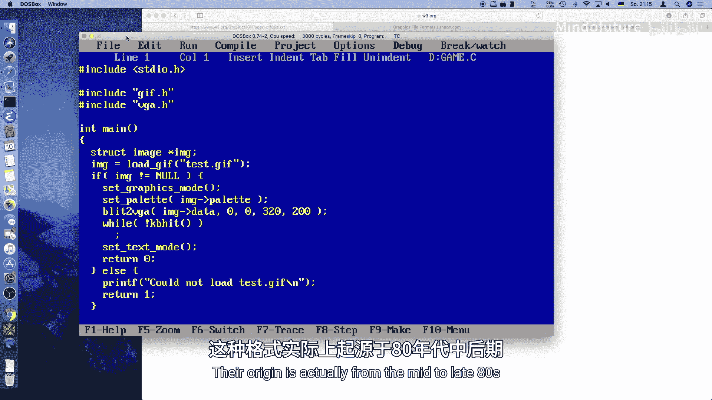

Which actually stands for graphics interchange format was done by Comp。

 who some people may still remember。It was one of the early providers for online services。

 even in the time before mainstream internet。And it was pretty proprietary Later。

 They were basically just an Internet service provider。 And I think they got bought up。

Maybe from A O L， I don't know， but they went under。

 They were never that popular over here in Germany。 But I think they were pretty big in。

In the US anyway， so on the World Web Web organization forum。

 you can find the actual gift specification because every web browser basically supports that。

 and we will have a few looks at this， maybe in between。But since this will be， again。

 a long episode， I'm trying to concentrate on the most important things。

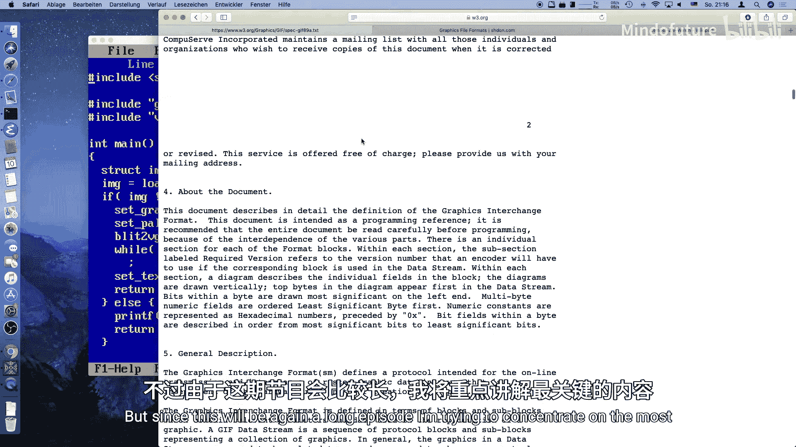

I will talk a little bit about the compression。In a short while。 but first。

 let's look at the program。 I've already prepared a bunch of things。 I've prepared the G Heophil。

 which we'll take a look at soon。 and I reused our VDA routines from the early episodes and I wrote a very small program。

The VGA routines now have a Cstruct called image， which just takes the raw image data plate and also the size。

Like 320 by 200。And。Yeah， our G header file defines a load G function where you just pass file name。

And if it was successful， it would will return a pointer to an image structure， which is not null。

 So if it's not null， we're fine， then we switch to graphics mode。

 We set the palette that was supplied by the image。And then we copy the data from memory to the VGA。

Her card。And this program is very， very hard coded。 It only supports 320 by 200 pixel。Gif fileses。

And it's G and not G obviously， then wait for key press， return to text mode。 and that's it。

Pretty straightforward。 So why did I choose G。Well， we could just simply load bit maps。

 We those bit maps， which are very simple， almost pure data。 We could use PC X。

 which is a very fast and very simple compression algorithm。

But it doesn't compress desert or more complex pictures very well。

Gif has a pretty advanced compression algorithm for。Compared to the other two。嗯。

But it doesn't work well on photographs。So although I use the photograph as a text picture。

 it will not compress very well， but like dessert and handron pictures for games usually compress very well。

 so you can see a lot of space efficiency here。The album that I'm using。

 I simply took from this webage here。And it's a very nice page for Dos codes。

 I will link to it in the description。 I also used their soundplster code as as a starting point。

 And when you compare my source and their source， it still looks pretty similar。

The same is here true for the G loader。 I left it mostly untouched。

 I tried to reflect a bit to collect all the global state into one decoder object or decoder structure。

 which we will see in a minute or two。And to make it possible that you have multiple decoders running at the same time。

 probably not on a doors， but we could probably salvage this for， for other platforms as well。

There's still a lot of lot to do。 The decoder that。We have here is pretty slow。

It's the dos box here simulates with 3000 cycles。 That's roughly somewhere between 286 and 386。

 and also tested it on my real 386 machine and。This test file loads in a couple of seconds。

 and that's pretty slow still so。In some further episode， we might want to optimize this。

 but for now it's good to have it in a simple fashion because otherwise you won't understand it。

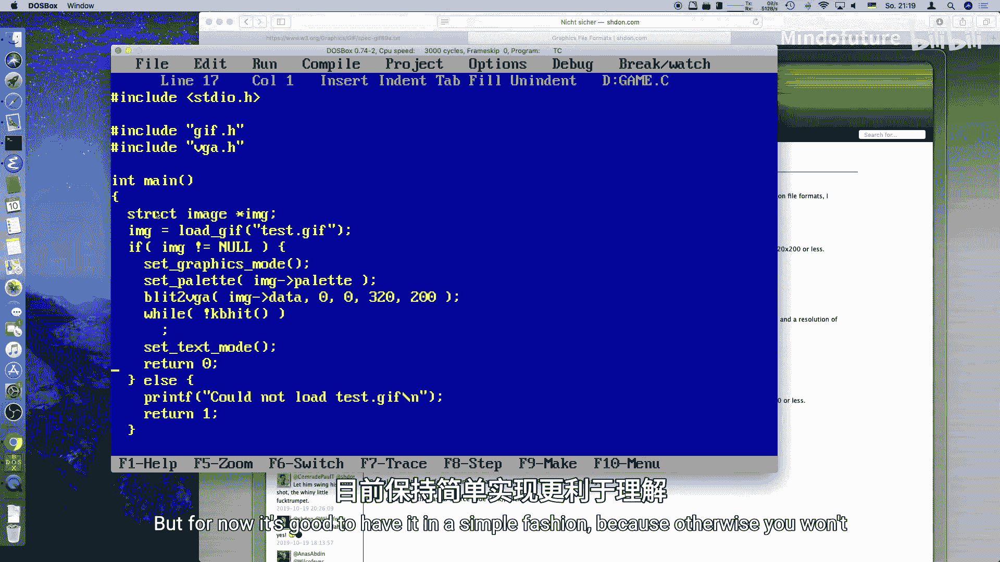

Probably， this will be already a lot to take in。The Gi file uses the so called L Z W compression algorithm that stands for Lem Z Loch。

 which is the authors of the paper。Published in 1984。And it's a。Interesting， compression algorithm。

Wwhich uses varying lengths of code words to encode the whole file and there's a very nice example on the Wikipedia page。

 usually with those algorithms you would need to store a dictionary with all the words that are contained in one document be it a picture so the sequence of pixels or text document。

But that would， of course， take a lot of storage。 So you don't do that。

 but you progressively reconstruct thee。Dictionary， as you go。

The initial dictionary that you have is basically just the whole ASI set。

The example here on Wikipedia' is just the 26 uppercase letters。

Encode it with five bits because that's what you need for 26 letters。But in reality。

 we will use 255 on 256。By its。We know those implicitly， obviously。

And we will reconstruct the rest of the dictionary as we go。And as an example they use here。

 the string to be or not to be or to be or not。And this is quite a bit of repetition。

 So we would assume that strings， like2。Would be compressed later again。

 represented not by two characters， but by less。Then is necessary for two character bits。And yeah。

 let's see how they do that。 So basically， we always have a current sequence。

 longest sequence that we know from the dictionary。

 We have the next character that's coming from our stream。We have an output， output code。

This is our encoding， basically， and the bits。 This is just the。B binaryary representation。

And then we will emit also another a new， possibly a new dictionary code。

To enhance our dictionary on the fly。 So at the beginning。

 we don't have any sequence we start off with Now， the next character is a T。And。

Nothing has to be done。 So we take this as our current sequence that he read the next character and we say。

 okay， we have T and O。 We don't have a code for T O yet， but we know that。We can output the 20。

Because T is in our current dictionary。And we will need to use a new code。

 We need to invent a new code for the sequence T O， because that's a new sequence that we saw。

 and we already have 26 codes in alphabet So 27 is now reserved for the T O。

This is how encodeder works。 the decoder would do basically the same。

 It would encounter the 26 would do the lookup and see the next character that is encoded is also already known。

s it's a 15 So I know that from the 27 and the 15 I have to from 20 and the 15 I have to reconstruct the new entry 27。

So from now on， whenever we see the T O， we will use the code 27。 Let's look down here。

Here is a recurrence of the exact thing happening。 So the current sequence is T O here first we encountered。

嗯。The team。And the next character here。And after the T， we found， okay。

 there we no already know that。 So we have T O and we will emit the 27。

But it will be followed by the B， and。If we went through all this， we would have found okay。

 we don't know yet the sequence T O B， so we emit another new code。

 and you can see here the codes are always increasing 27，28， and so on to 36。

And the longer the sequence runs， and the longer the， the input data will be the more。

Compression you can achieve， actually， because every time you see a sequence for the first time。

 you have a very inefficient code。 The second time around。

 you will have a more efficient coat and the codes。Grow gradually。 Yes。

 you can see we start off with T and with T， O， which is limited and with T， O， B。And then T， O B E。

 this is the longest word in our dictionary that we will find。 So the words can get very long。

 and this will， of course， then mean that we have a very efficient compression if the sequence reoccurs at some point in the text。

The same thing。Can the same algorithm can be applied。To the gi file， basically。So here's， again。

 the example being decoded。I won't do that now because this will take too long。

 I will explain a bit more about the algorithm。

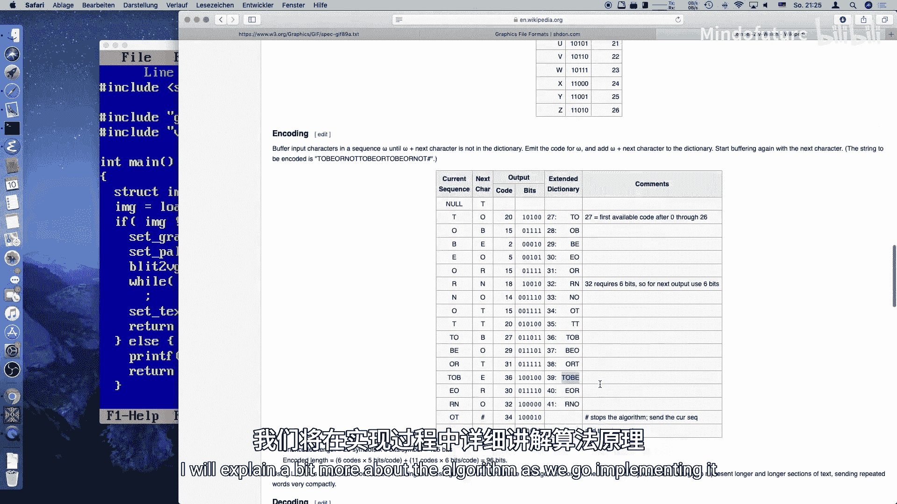

As we go implementing it。 Okay， so， first of all， I try to code this from scratch and record it。

 but it takes way too long。 So the gift loader is roughly 300 lines long。And quite complicated。

 I mean， the algorithm itself isn't that complicated， but there's a lot of stuff happening。

 So I'm definitely not going to do this in the usual manner because this will take way over an hour。

And you probably won't be following。That long， so。Let's just do a code review more or less。

You saw the main program。You know that there is a function called load G， which is down here。

It returns the image structure， and it takes a file name。Okay。

 so the outline of this function is as follows。We will have a couple of strs， one with the image。

 one with the G header， which is basically only a couple of bytes， one with the G descriptor。

 which tells us the size of the image and one with the decoder state。

 the decoder being the function that yeah or the couple of functions that decompress the compressed image into normal bytes and pixels。

Then we have some local state here， the file， we will open the file。

 and then all kind of hell breaks loose。😔，Yeah， first of all。We can see that there is the Dakota。

Being created through the Dakota state， which is a bunch of variabless that we will take a look at in just a few seconds。

Or minutes at most。And then we read in the headers。

The header is only something like 6 bytes and it will say either give 87 a or give 89 a。

 those are the two file versions that we have and every G file starts with those characters。

If it doesn't， we simply quit and say， nope， this is not a goodfire。If this works， I mean。

 this is all just read。Reading stuff and reading some flags。Into the rest of the header structure。

 Yeah， if， if this works out， then we can actually take a look， closer look at the header。

And the head of stores， quite a few things。 Let's take a look at the type f for this。

So the signature first， which is the 7 bys here。Actually。

6 plus plus0 that we pen so that we can do string comparison。

And then next in the file comes the screen width and screen height。

 which is basically the size of the image。Or at least of the what the image should look like on the screen。

For our case， it will be 320 by 200 for the VJ。Then there will be a couple of packed flags。

 So every bit in this by will be a flag。With the definitions up here。

 So all these hex values represent some kind of flag or a couple of flags。

Then we' will have a background color， which is also by handsome some aspect ratio。

 We will ignore both for now。Because we don't use them actually。😔，Yeah。

So let's go back to the load G function。After loading the header， we can decode the。Flags。

 first of all， are the bits per pixel， which you can select from the packed flags。 Then from that。

 you can derive the number of colors by left shifting one。By the amount of bits per pixel。

And if we have bits of pixels between one and4， we will force it to be4， which is 16 colorss。

Why I'm not quite sure It wasn't the original， probably because G doesn't support anything less than 16。

 maybe monochrome still。That's why there's a greater than one here。

But I haven't yet encountered any gifts that look like that。

Then we will allocate the image data structure。And this is basically just the buffer。

 So we allocate thestruct itself。We set the width and height， and allocate some data。

Which is basically just a frame buffer， so melo。By image width times image height。Then to be sure。

 we set the whole region to 0 with memset。And we're go to go。 The image buffer is initialized。

And the next thing that might happen is that hadda says， oh， we do have a colour table。

And if this flag is here， then there will also be。A palette。

 basically a colour table inside the G file。 And you already know this from the VGA course or my VGA videos how that works。

 So basically we just tell the file。 Please give us the palette。With the 256 colour。RGB。

 so that's why there's a three here。 We could have also written 256 times 3，768。And read that in。

And well， then we iterate over that， install that in the image palette。

The anything that we're doing here， as well as right shifting by 2。

 because if defines the RGB colours in 8 B， whereas the VGA only has 6 bit。 so we will。

Divide everything before or write shift by two， and so we reduce the fidelity of the palette from 8 bits to 6 bits。

Nothing new。Later， when we display the whole stuff， we can simply。Use the spinetteton as is。

Nol comess。A bit more weird stuff。After the header。

 there will be a bunch of other blocks in the G consist of a lot of blocks。

 and we are looking for a block of type image。So every block starts with a type bite。

 so you will read in the typeite， which is exactly one by long。And if it's equal to image block。

 then we will break and just display that image。 A ifer can contain many images， for example。

 for animations。We won't support that here。Because we don't need it。

 but you can probably extend this Gi loader to work like that。But， we will just。

Do this wide loop until we encounter image block， and then。Just display it。 However。

 this will probably be not the first block that we encounter。 There might be other blocks。

So if we didn't have an image block， we will。Read。TheWhat kind of block we have。

 And this is stored in a structure called G block。 This is very simple structure that has a label and the size。

We can look at the top here。 gift block is basically just two bytes， label and size。

And as you can see， size is only about it， so it can't be very big。Maximum 256 bys。

So we switch according to the block label and there is a bunch of those extension graphics control。

 application， comment， plain text。So you can put all kinds of text in there and。Yeah， that's。

 that's it。 And maybe some other unknown block， this 34 case。

And everything all this whole loop here does is it tries to skip those blocks because we don't care about them。

For animations， the G extension graphics control might be nice because it will tell you how much time between different images。

 what the transparent colour is， etc。But we don't care for that right now。 So we skip all of those。

 You can have a look later in the source code if you want to understand it more closely。

 but it's not that interesting and not that。Important for the rest of the program。So at this point。

 we encountered the image block。The image block has a descriptor。We will read that descriptor。

And it again， has a bunch of fields that we can take a look at。Namely。

The image coordinates image left， image， top image width and image height， and some pack flags again。

Let's go back down。So here we read the descriptor and first of all。

 we test if the descriptor again has a color table。This is the flag， which is the same as above。

 So every。So the， so the first colour table that we encountered was the so called global colour table。

 but every image block that we encounter can redefine the colour table。It doesn't have to。

 but it can。And if， if it that's the case， we just simply overwrite our image palette just like above。

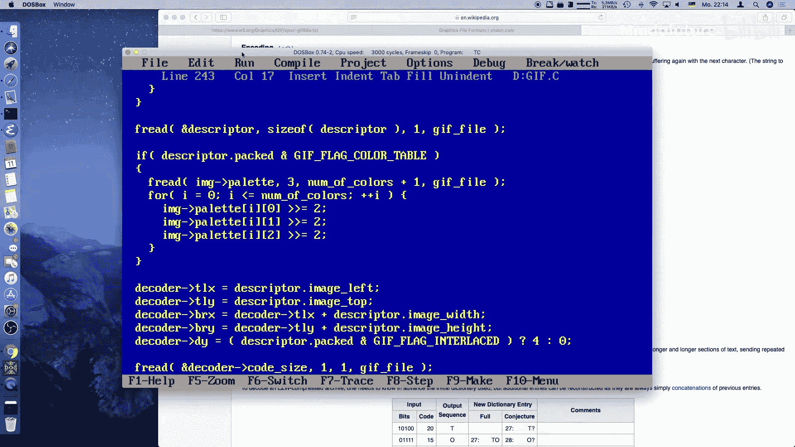

If you are doing animations， you will have to store multiple pellets and set them accordingly。

And then we start setting up our decoder。The decota state stores everything that the descriptor told us。

The top left corner and the bottom right corner of the image。 And it also stores the Y delta。

 which will be used if you have an interlaced G。Enterest gifts were used back in the day so that while the gift was loading。

 you could already display parts of it like a low rest version of the image。

But we probably won't need it， but we can support it。If the interla flag is set， we simply。

When we finished one scanline， we will not go to the next， but to the fourth scanline after that。

And this will continue until the whole picture has been drawn。

Giving you like even after the first couple of scan lines。

 already a rough representation of the image。But that's also not that important for the decoding。

More important is that。After that， we also can read the initial code size and the block size the of the encoded G。

We will always read according to the block site and to our internal buffer。

And the initial code size will be。8 or 9 Bs。And the code size can grow up to 12 bit。

 meaning we can store up to 4095 code words。In our。dictionary， basically。

Then we need to store a bunch of other states。 First of all， the G file itself。

 because other functions also need to access it。Then we need to store a pointer into the buffer。

Which stores the block， the current red block。Then we need to store the clear code， the clear code。

 when we encounter that in the compress stream， it means reset the decoder to its default values。

And it will most often be the first code that we encounter so that the decoder initialize itself correctly。

And the clear code is always the highest code of the initial code size， so。Usually 256 or。

For example。In this example here， we should have。They have 26 characters。

 So the clear code would be character 27。

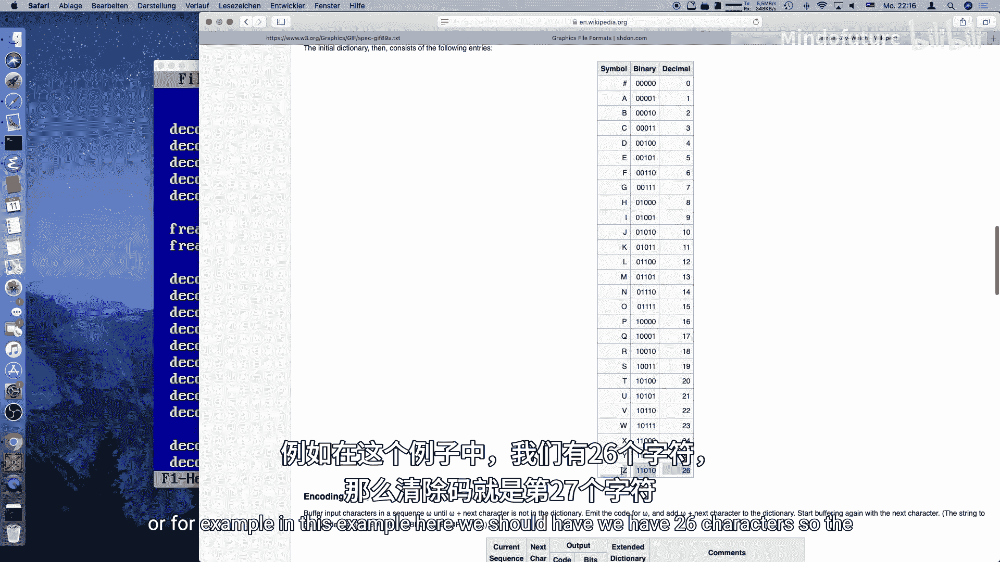

Alright。 then there's also the end of image code， which signifies that we are done with decoding。

 and that is the code after the clear code。 So usually 257。In the case of images with 256 colour。

The first free code that's available。 that's reconstructed。During decoding。

Will be the one after that， Cl code plus 2。And our currently free code is initialized with first free。

 Our initial code size is code size in by one。And the max code that's possible that's currently possible is obviously true to the power of codes。

 So one shifted to the left by code size bits。So our initial， if our initial。H。

Code was code size was 8。 The inner code size will be 9， and our max code will be 256。呃。All right。

 Does it make sense， roughly I hope。Furthermore， we will read the image， the encoded image。

 actually bit by bit。Not on a file system level， but in the memory and every8 bits we need to load the next bit。

And to make sure that the load by routine works， we initialize it with the bits in parameter with 8。

 which forces us to load the next by。 We'll see that also in a minute or two。

So we also saw the current cursor position basically。

 where we draw the pixel and we start at the image left and image top。And also。

 we need to store the pointed with the image。Alright， that's a lot of stuff。But roughly speaking。

 we can here's here's again， the definition of the decota state we can。Sort it into。A few。

Blocks here， first of all， the file and image data blocks。

Thenhan the state that handles everything regarding reading the codes in。

Before actually decoding them， then the parameters for the decoder， like the first way pre code， etc。

Plus two， basically two areass which form a dictionary。The prefix and the suffix。

 the suffix will be the。Last character of the current new code W or dictionary。

 And we can build everything the whole， the whole。2。

Gcode a sequence basically by combining the prefix and the suffix。Okay， and of course。

 the whole image related parts like the x and Y coordinates in the top left and bottom right and the delta for the interlace。

So。After we've done that， we can start the actual decoding process。 This is a big do loop。

 and it will end when we when our decoder has discovered the end of image code。So what do we do here？

First of all， we need to read the next code。 So there's a read code function which gets past the decoder state。

And we saw that in code。If we encounter the end of image code would break。

But how does the re code work， Because there's a lot of magic in there？

Im thinking that we probably should take a look now because everything else here depends on that。

 And as you can see， it gets called now and then。😔，So what does the recode function do， Let's go up。

The read code function。Is relatively simple。It's this year。

It needs the counter and the code that we' are currently having。So this is the bit by bit reading。

So we loop from 0 to the code size。 So we， if the code size is 9， we will read in9 bits。And。

Every time we increment our bits in and it。Toggles to 9。 We know， oh。

 we already decoded this whole bit。 Let's get the next one。

 So we will put into our 10 variable the next by。Reset the bits in variable to one。And that's it。

 We load it in expite。 And then we can start reconstructing。The code that's coming up next。

So if the value that we just read。嗯。It is at its lowest lowest bit。Has a one。

 then we can add this value to the currently being code being reconstructed。

 And this looks probably a bit weird。 But let's say our current code was already something like。1，1。

0，1，1。That was all code。And we are supposed to have a code size of 9。

 So we are still missing five more bits。We read our exp。And。For example。

 because we had to load the next bite。And the next bite that we take is。Let's say1，0，1，0，1，0。1 one。

So that's it。 The lowest spite is a1。So we take that counter should be。Equal to 5。At this point。

 because。嗯。We already read in four bits。 So counter should be5 now。Then we take the one。Shifted by。5。

Which will lead to this representation。 And that that， of course， will lead to this temporary code。

Right。嗯。And we still have four to go。And now what we're doing is we simply writeshift the10 variable by one。

 which basically kills。The lowest bit。And then the loop continues。 We will take this one here。

Which will get shifted，6 B。And it will calculate 1，1，0，1，1 plus the new1 here。

And will give us this value。Right shift again。Well， now we have a 0 here。And it will do nothing。

 It will， in theory。Put a0 in front of this year。 but we will don't。

 We will not have to calculate that explicitly。Right shift again。And we get。This computation here。

 we have to。Left shift by。6，7， right？ Something like that。I hope that's correct。 We have。1， to 3，4，5。

6，7 digits here。 And this should be。1，2，3，4，5，6，7，8。 That's great。

So now we already have this reconor， isnsn't that nice。And it will continue like that。 The lasts。

 there will be a last round。With this year， and finally。

 this will be the code that has been reconstructed。9 Bs。 and weight done。So， that's。Oh， this works。

This will return the code。Fair enough。 That's pretty simple。I hope。Okay嗯。

Back into the hell down here。So there is a lot as I said。First of all。And of image code。

 we didn't get that。Second of all， we could encounter the clear code。 if the clear code happens。

 we are doing the same that we did above。 The free code gets reset to first3。

 the code size gets reset to in code size。 max code depends on the current code size。

And we can read the next code。St our old code variable are it。And then draw the next pixel。

 Wait what you're going to say， What is the next pixel function。So read code we already saw。

We don't yet know what the old code variable does， but it will get important。

And we have the next pixel。 The next pixel。 What does it do。It draws the pixels。It takes the。呃。

Dakota State and Eala。Allright。Whatever that might be。

And it will take the image data buffer plus the current X and Y coordinates。

Times width for the Y and simply write out the color variable mask with 255 because we're doing 256 color pictures。

Then we're incrementing the x coordinate。 And if it's bigger than the bottom right corner x coordinate。

 we need to skip to the next can line。 and I'm signifying this by printing out dot on the console。

And we're resetting the x variable to the top left X corner。

 Here comes the scan line interlace handling， which I'll skip， because we don't need it。

But the takeaway message here is to basically。We are already。 We will always be here in the K 0。

 D Y will be D will be 0， and we will just go to the next scan line。 Otherwise， we might skip 2。

4 or 8 scan lines。And this will decrease whenever we finished one pass of the picture。Alright。

 So next pixel is simply enough。 Just write the next pixel。In the clear code case。

 it will just write the current code that we found， because this would be in。Simimpple called。

 one of the eight bit ones。Which are the only ones possible as the first bit by it that we decode it。

Now comes a complicated part in this Alice case here in this whole。Block。

 we will have to deal with compress data。Okay， so take a deep breath。There are。Two possibilities。

The code that we just read can either be。Inside of the range of the stuff before the free code。

So in the initial very initial case， it will be something less than 256。

Or it can be in the range of being bigger than the free code。And the first case。

We know that we can't draw yet because we will have to continue decoding。

Until we find a new free code。Because the encoder works in the way that it creates something new every time。

And we'll place something in the， in the in the， in the dictionary， right。

So if we found a code that is smaller than three code， we know， oh， we are not done yet。

 We haven't fully decoded a compressed word yet。But we can already。Decompress what we have。

 And this is done by the outstream variable。And it will simply take the current code and will reconstruct the string。

 We will have a look at that， in a sec。The else case is a bit more interesting because here we know we encountered a new free code。

 So we again put just like in the first case。The new bitete that we encountered in the suffix table。

In the free code position。And we will decode it using the old code from the last read。

As you've seen above。This is initial list here。 and down here。

 we will store the current code in the old code variable。However， we also know that at this point。

 we have fully read a compressed word。And we can actually call the next pixel function again。

By doing this。Calling this with the suffix of the new free code。

Which is basically just what we took from the outstreaming function。Afterwards。

 we will have to put the old code in our prefix table。Because。This is the symbol or the the code。

 not the symbol。 So outstr gives us the symbol， which will be stored in the suffix。

 and the old code will give us the prefix that came before that。Which was a code， So compressed。

string of bits。And one safety feature here is if the free code is bigger than the max code。And。

The decoder's code size is still less than 12， because。

So this means we have to add another bit to our code size。But we can only do that until we reach 12。

 Then we will do that。 We will increase our code size by 1 B and almost increase our max code。

So from 9 to 10 and from 5 12 to 1024 possible codes， for example。Okay， so now the question is。

 what does the outstring method， It does basically all the magic for the decompression。The Austria。

Oh我 don I put it。Here's the outstr。Takes the code word。 and the decokota state， obviously。And。

Willll have a temporary buffer。With the。Outco string， basically。And it will do the following。

 if the current code that we got past is less than the clear code。

 We know that this is something from the initial alphabet a dictionary。So in our case。

 it will be a value between 0 and 2 and 55。 We can simply draw that pixel because it's not compressed。

Everything else is more complicated。 We will initialize our count variable。Of。嗯。

Characters that we have。Already reconstructed。And first of all， we will。嗯。

Try to reconstruct the output word from back to front。Basically， this works by。

Taking the suffix of the current code。And putting that into our out string。

 basically under inementing our counter variable。Then we re initialitized the current code with the prefix for。

The last value of current code。So here we get the character of our current quote。

 and here we get which code must have followed this。And this we can do until。

The current code reaches the key code because then we know we are going into the。

Region of uncompressed codes。 And there's nothing left to be done here。And as a last step。

 we will put the last current code as well in the string。

 What we have done now is we have decoded according to the suffix and the prefix table。The compress。

String。But from back to front， because we only know the suffixes， and we worked our way forwards。

 and we didn't know how long the string can be because it can basically be arbitrarily long。

 That's why we also put an ample in 1 kB buffer here。

So the only thing that we need to do here is to draw it out in the opposite direction。

 so we do an next pixel routine over out code by decrementing the outcome variable。And that's it。

 It's probably a bit hard to imagine what it looks like。 But basically， the suffix and prefix table。

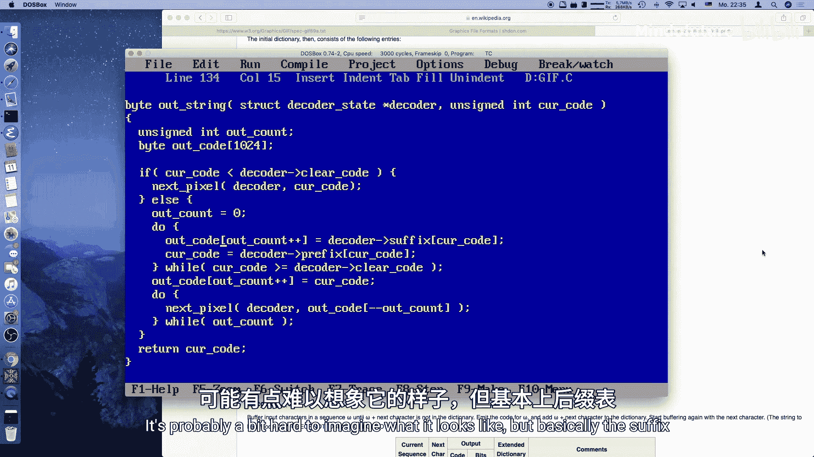

Will contain。 So the subjectuff table will contain all the characters that we encountered in the。

In the。Input or later in the output。And the prefix table will tell us which code must have come before that special character。

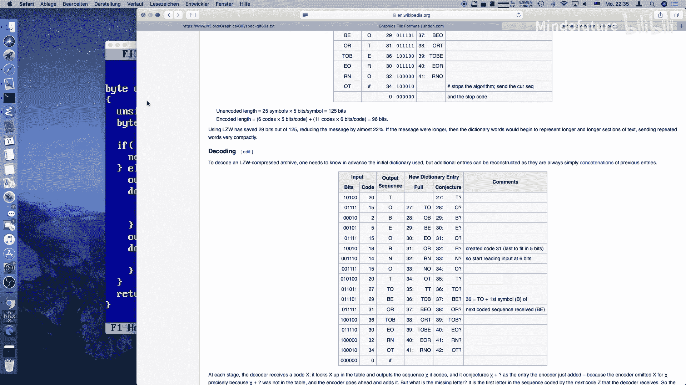

And that's the basically this outwingwing thing here is。The bigig magic of the lambmber Se Welge。

Compression。And the only parts that are also important for this is this part here。

🎼That we fill the suffix tables in the correct way and also fill the prefix with the with the old code from the previous iteration。

🎼And this is all there is to it， actually。🎼And。🎼I think we don't have anything more to say here。😔。

🎼Except， let's try to。🎼B this thing， or it's already up to date。🎼And let's try to run it。

🎼So what's more if I do， he has case。

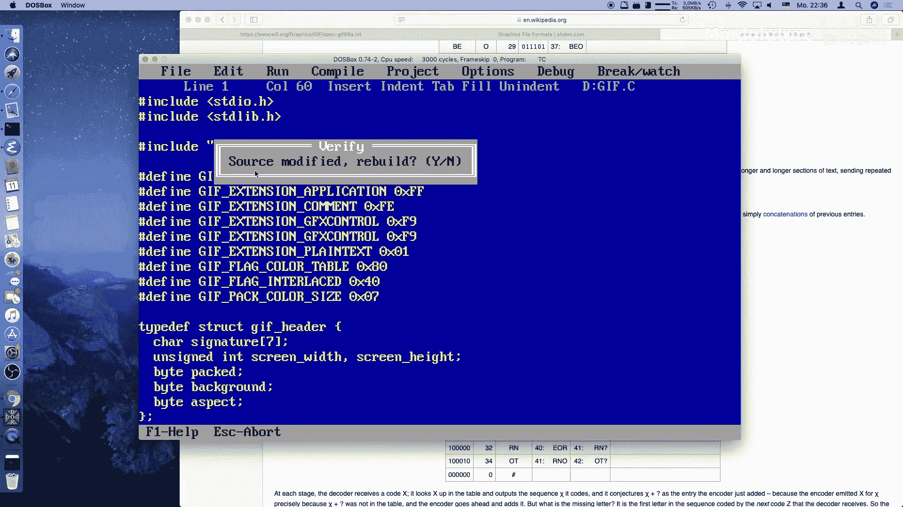

🎼Okay， so every dot means one canline it will be two and a half lines before displaying and here we have it our first G loaded there is simply a picture of the graphic cards in my 386。

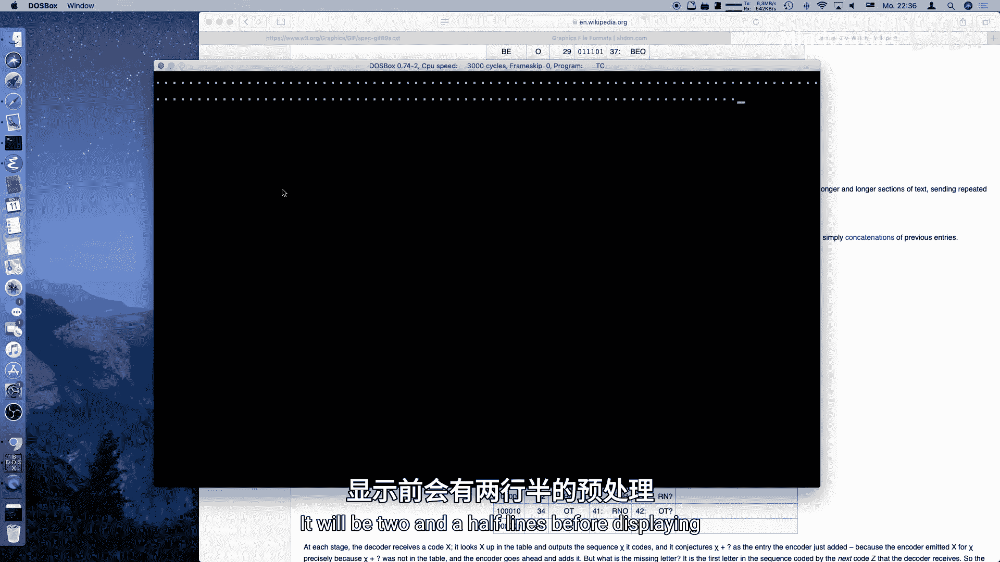

🎼You can probably hardly make it out， but this is the GPU basically if you can call it that DM and the other stuff and this is 320 by to。

🎼Pix that is 256 colors。🎼We can use that。🎼You can load arbitrary images up to this size。

🎼There's not a lot of error handling。 you will be able to crash it very easily。

 And if you' have seen it's， it's actually not that fast。 let's run it again。 It takes。

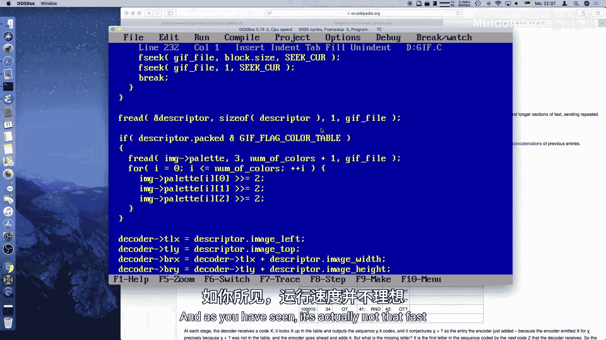

🎼With do box set to 3000 cycles， it takes almost 10 seconds or something。

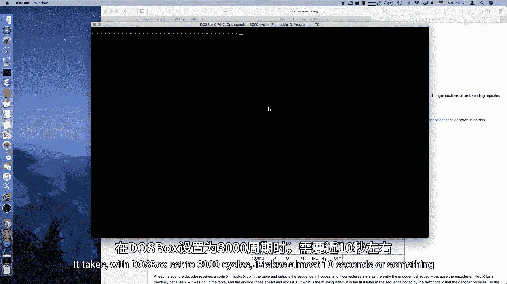

Definitely more than three seconds。🎼And。🎼Yeah， so there's a lot of optimization proof optimization here。

I think the。🎼Load by it。🎼There's probably some， some place where we can optimize because this will load。

Only one block at a time。🎼Which is probably good because it doesn't take up much memory。

🎼But also the read code is pretty inefficient by doing this whole bit wise thing。

🎼But I will have to think hard about how to make that faster。

 We can probably inline a lot of this or rewrite some stuff in a seminar。🎼This will improve things。

 But for the time being， I think it's。Simply enough that we can。🎼Understand it， hopefully。🎼嗯。

🎼Next time， I probably will want to talk about the whole stuff。🎼Splitting。

 splitttting this whole project over a couple of source files， as I've done here。

 adding a project file in Toku see。🎼Because we are getting in an area where this is all already pretty large right and we want to make everything a game and you probably already saw a few hints hearing there what this game will be like。

🎼But there's still a couple of things to do before that。🎼I hope you learned something here。

 I know this is and I couldn't do it from scratch because it's way too complicated and way too long。

🎼Hope you still enjoyed it。 You can check out the source code。 I will put up the gift load itself。

🎼And put a link also to the。🎼Original code。🎼That we base this upon。🎼And yeah。

 make sure to hit the like button。 I would also suggest you subscribe to not miss an episode。

🎼And as I said， I hope you learned something and you enjoyed it。🎼And I hope to see you next time。

 Have a nice evening。

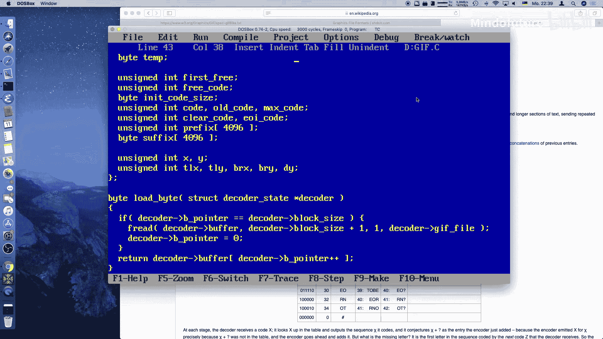

🎼，🎼。🎼。🎼。🎼。🎼うん。🎼。