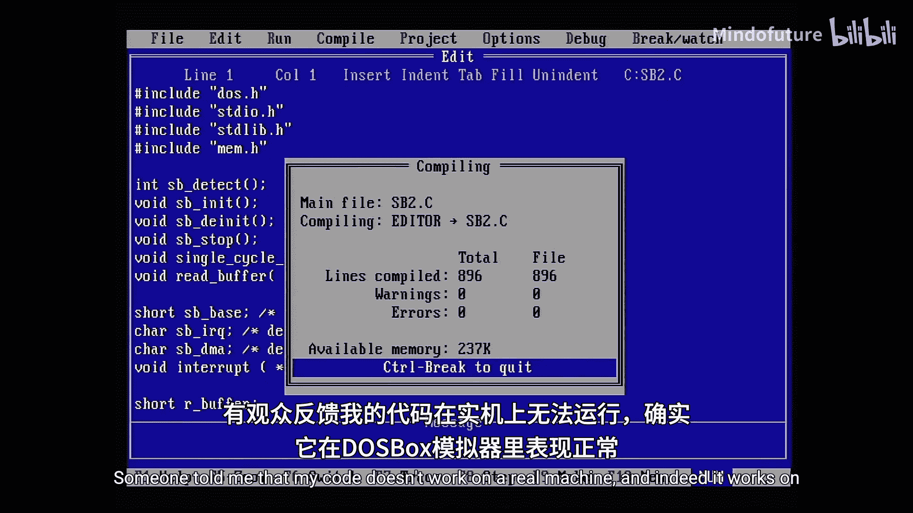
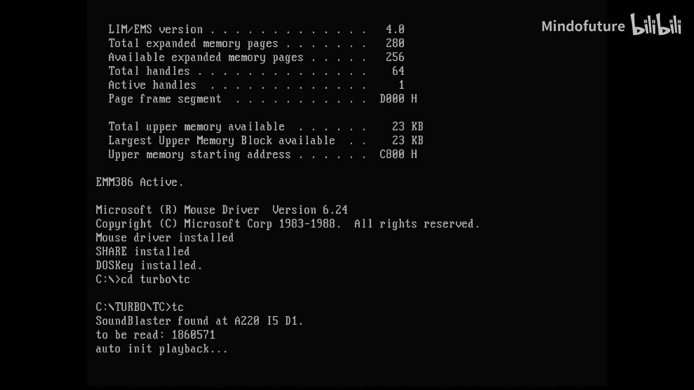
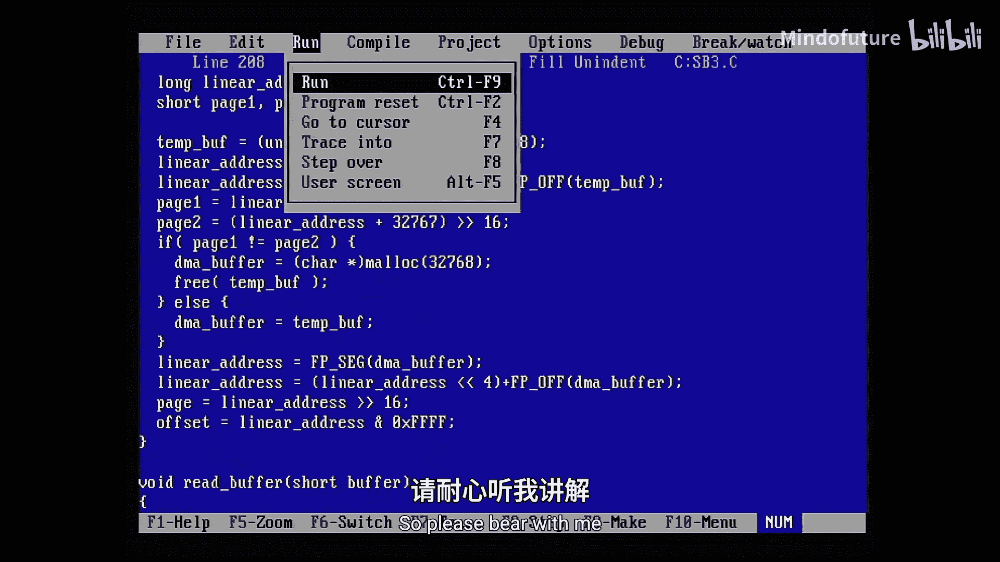
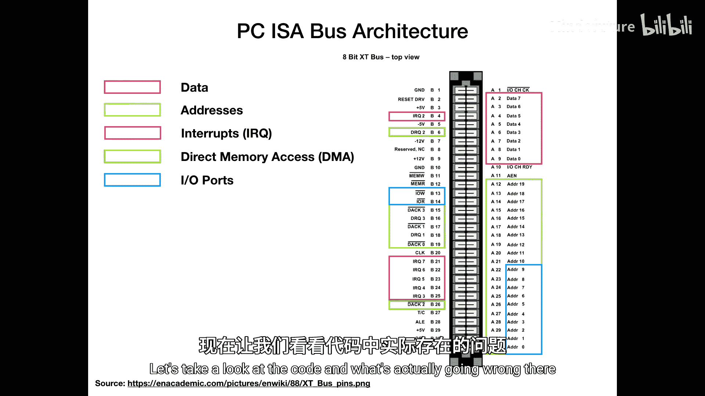
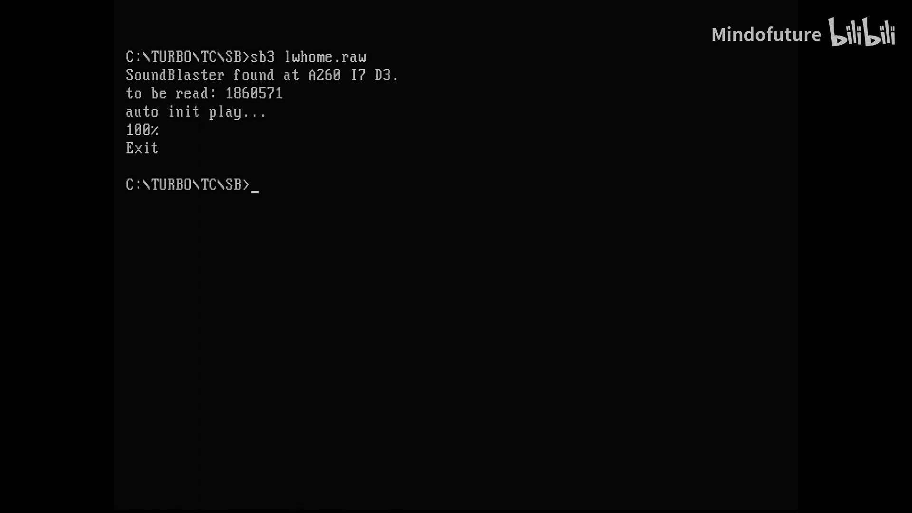

# 编写MS-DOS-系统-｜-windows-｜-操作系统-｜-汇编--｜-vga-｜-x86-p13-P13-Lets-Code-MS-DOS-0x0D---Near-and-Far-and-IRQs--BV1zs35zQEru_p13-

Hello， welcome and good evening and another let's go episode， but this one is sort of like a bug fix。

Someone told me that my coat doesn't work on a real machine， and indeed， it works on dos box。

 but not on a real machine。 Have a listen。

🎼First stuff the road。🎼It's out to pay， but then suddenly it begins to move。🎼And it doesn't work。

🎼The question is why， Because dos box emulates a PC， right， A dos PC。

 But it turns out innovation is not perfect， and many things run on a dos box that won't work on a real machine。

 And when you try to quit here， it gets even worse and you get a ton of stuttering and stuff。

So let's quit this here。

So I had a few assumptions what might be going on here。

 but actually I spent at least two hours coding and fixing things before I had all the solutions that made the problem work。

 and I must say a lot of things to who pointed out that it doesn't work。

It shows that you should always test on real hardware。 and in the following。

 I will need to show you a couple of slides which explain the PC hardware a bit more before we can dive into what I actually changed。

 so please bear with me。

So to explain how all this happened and what we need to take an account into account before our program works。

 we need to understand a bit about the PC architecture。

 so I give you a very quick recap of the PC architecture the original IBM PC the 5150 was based on the Intel 8088 and 8086 CPU the 8088 was a cheaper version with an 8 bit database。

 the 86 had a 6 input database， but both had 20 bits of address bus for up to 1 meby of RAM morem was possible with bank switching in the form of EMS expanded memory but yeah that's what you got back in the day。

The architecture itself looked more or less like this。 You had the CPU。

 which would use its address and data lines to talk over the so calledled I S S I S A bus。

To other peripherals， and the peripherals would be the interrupt controller for controlling interrupter requests from hardware。

 The D A controller for direct memory access and memory transfers。Then， of course， the Ram。

 which was in the base machines， only a few hundred k， but up to 1 MBby。

And then you had expansion cards， something like the San Balasta Car。

 which would be programmed and use DMA IRQ and IO ports to talk to the CPU。

And Darin lies the problem。So first of all， the first problem we have with our program is it needs a certain memory model。

And to understand the memory model， we need to take a look at how the 8086 actually talks to。

Hartware or to to the Ramm。On the hardware level。We have， first of all， a bunch of registers。

 That's small。60 bit wide storage spaces directly on the CPU， and these are the general registers。

 the primary and the base accumulator counter accumulator and the other accumulator， X， B X， C， X。

 and X。Then we have the segment registers which are used to choose which region of memory we are using also for registers。

 CS， D， S， E S and SS。The Cs is the code segment which points to the program that's currently executed。

 DS is the data segment for default defaulting to which data we load and S is the stack segment for making function calls and stuff like that。

And furthermore， there are some special purpose registers。

 the source and destination index for move operations where you copy stuff。

The base point and the stack pointer for stack manipulation， the instruction pointer。

 which points to the current instruction in the current code segment and various CPU flags。

 which tells you if there's an overflow or sine flags or whatever。The segments。

That you can talk to are overlapping because with a 160 bit register。

 you can only address up to 64 kiloBs of Ramm， but using one segment register and one。呃。

Other register， you can address more。So memory segmentation works like follows， as I said。

 we have the four segment registers for code data X and stack and together with the general purpose register or the special purpose registers you can address 1 MBby。

 for example， the pair of Ds for the data segment and S I for the source index gives us some arbitrary1 mebit。

Position in memory。Mgabyte position in memory。 So that's， for example， to get the linear address。

 you take D S multi apply by 16 because every segment follows the next after 16 bytes。

But every segment is still 64 kiloby，64 kilobys， so you calculate D time 16 plus S I to get a linear address segments can and do overlap so that's just fine。

 And if we do a copying and memory， we can use the assear instruction rep for repeat and the move string word command Mof S W。

And this will copy words So 160 B values from the source address。

 That is D SS I to the destination address， E SDI。 This is all implicit。

 You don't have to write that the CPU will use those values in those registers。

 and rep will run for a number of times， and the number of times is stored in the Cx register。

And this is how that works。 And you can basically in your program， choose any segment that you want。

However， the problem now is。That we have so called near and far pointers。To save memory。

 compilers can use so calledled near pointers instead of the 2，16 B values。

 one segment register and one offset register， you can use just 1，8 or 16 B offset instead。

So that you can address。256 B or 64 kB in the current segment。This will save。A lot of space。

 of course， because whenever you have to store an address。

 you simply store 8 or 16 bits instead of 32 bits， because otherwise you need to store the segment register somewhere in memory and the offset register。

And this is， of course， huge memory， saving and also kind of saving speed because less code has to be loaded or decoded from memory。

 that's better。 So down here， we can see an example。 we can move So， so the move mnemonic。

In the in syntax， does the target first and then the saw second。 So Mof S I square bracket P。

 P means。Lot。Whatever is stored at address， B， P。And move it to the S I register and the same goes for the DI register。

 but take the address that's stored in Bp at2 So 60 bits on top of that and take that value。

 what's whatever is there and then do they wrap Mo S W that you already know。

And this using Ne pointers uses less space to put that into a program。

But this is equivalent to writing Mof S I DSSB P。And here you would need to store the value that is in D S as well。

Of course， this is just encoding registers here。 So this is a bit of a theoretical example。

 The assembr wouldn't put the DS S or its value directly in there。

 but you might have some hard coded point pointers there or， for example。

 you load first load segment and an offset from memory into the address registers。 and that's。

 of course， low and takes memory。 So this is a bit of an simplified example。

The implementation here is actually pretty safe， but the compiler has to be tweaked to that。

 So we learned about near and far pointers and what they're doing。And in Do box， for some reason。

 this works by itself。 But on a real machine， this might give very weird。Results。

 so if you go intoacy to the options and compiler menu， you will see the point model。

 And if you press have one here， you get a little help。This menu offers the different memory models。

 which is available in Toberi。 The memory model chosen determines the method of memory addressing。

 So the default is small。 The small memory model， and we want to go for at least compact。

 So let's see what the small memory model does。This model has 64 kB for code and another 64 kB for data and stack。

 So that's not， that's not a lot in in Dos， without any do extenders， you can use 640 kB of code。And。

Data and stack all in all。 So this uses only like 10% for the code and 10% for data and stacks。

 This is really， really a small program。And the second part is actually the important one。

 All functions and data pointers are near by default。

 So whenever we allocate something or pass something around。

 it will only pass a near pointers so only the offset。This might lead to problems。

Especially when using malllo and allocating the D A buffer。

It could be that it doesn't work here it actually does work。

 but let's first see what the difference is。 So when we go to compact。

 this is the first model where it says all functions are near by default and all data pointers are far by default。

 So that's what's important to us。We don't have a big code base。 So we。

 our code probably fits into 64K。And thus， function pointers are fine that theyre are here。

And we don't use function points here anyway。 So thats that's okay。Oh， actually， we do。

 We do for the IRQ handler。But we'll come to that， in a minute。But anyway。

 the compact should be fine。But if you're not。Happy with that。 You can even go bigger。

 You can go to large or huge。 So the large memory model allows for up to 1 MB of code。

64 kb of stack and 1 MB for the heap。 And all functions and data point as af。

 So there should be no problem at all。 And we have one more。 The huge memory model。

This gives multiple data segments each 6 of4 k in size up to 1 MBby for code and 64 k for stack。

All functions and data upon this eyes seem to be far。And。

So it doesn't even say that it limits to 1 MBby for the data segments， but only 64K。呃 each。

But I would guess without having protected mode or anything else。

 that's probably not nothing to do here。嗯。To extend this above 1 MB。

 you would need like E M S and its API to correct that。

 So usually you would go for the compact or large， depending on your program size。This will make。

 of course， your code a bit larger as， as I said， and runtime performance may be a bit worse。

 but for these instances， it should be。Chsen。However， right now。

 I have compiled it for a small memory model。So， let's run that。

And you see it simply works in Dos box。 it might not work on a real machine。

Because those box simulation isn't perfect， and I can switch to compact。

And rebuild by saying compile to OBJ。And make exifier。Link the exifier， and then just run。🎼And that。

 of course， also works。 No problem here。So that's that。

 And the next thing is actually the second buck that I had in my code is the IRQ handling。

 which is also a bit different in Bo box for a real machine。So I acc what are they。

 Where do they come from， Let's take a look at the actual I A bus socket。

 So this is one of the sockets where you plug in your sound cards and all the other stuff。 Actually。

 it's an 8 bit socket， as was used on the。Original IBM PC， there's a 60 extension for As and upwards。

 but we willt talk about that。 And there's a bunch of interesting pins here。 So first of all。

 you have the data pins。 It's an  eight bit bus。 So you have 8 data pins where all the data goes。

Which is sent to any of the devices。And which device， Well， for that， you have the address lines。

 Every address is either a memory address or an Ioppo address。

And that will tell the device if the data that's currently flowing on the bus is for it or not。

Then we have the RQ lines， every device on the I A。Can。

Take one of those IRQ lines and in the original PC you have IoQ lines，2，3，4，5，6， and7。

Z and 1 are not available。And they can be used whenever the device says I need something done。

 it will trigger this line and the CPU will answer and execute an IRQ handler for especially this interrupt。

For example， the sound blastster will trigger the IQ5 or 7 depending on how it's configured。

And this view will start calling your I Q handleler that we programmed into our sound blastster code。

And that will deal with， for example， loading the next sample。And of course， there's the DRQ lines。

 the direct memory access the lines。And therefore， requesting direct memory access and acknowledging direct memory access。

There are three channels， actually four channels on the original IBM PC，0，1，2， and 3。

And with the A T， this was extended。Obviously， to twice the size and the same goes for the IQs。

But again， we won't talk about that， but from a software point of view this is almost the same。

 there's a few things to take into account but basically it stayed the same。

And then there's the ioppos， which I mentioned。 they reuse some part of the address lines。

 The first 10 address lines can be used， and the I OW and I orR lines will be triggered when an Ioppo is read or written。

 That's when we， for example， talk to the base address of the sound plus are usually the 220 hexadecimal。

When we send stuff to the DSP will。Use the in or out functions and it will trigger the IW IOR flags and send the appropriate address。

 and the soundlaer will know， okay， now someone is talking to me。So this is all fine good。

 Let's take a look at the code and what's actually going wrong there。 Okay。

 so you probably do remember that somewhere in the code， we did have to have this function here。

This is the void interrupt S B， IRQ handler， and the。Code word interrupt is specific to Toi and do。

And it's not available in standard C。 And it means that this is a special function that's actually an interrupt handler and will be used as such。

 It gets some extra magic code around it。And。Well， before the changes。It worked in Do box。

 but not particularly well on a real machine。 And the reasons are twofold。I think so first of all。

 what you should do when you enter an IRQ handler is to actually disable all other IRQs。

 except for the non maskable ones。Which is a topic for another time。

And when you leave the interpenlar， you have to re enableable them。 And there's two functions。

In the dos header， I think let's a look headerophiles。Dos H， and there should be dis。And enable。

 this is totally not standard NZ， but perfectly dos and tubeic C。

 So the disable function disables interrupts。 disables all hardware interrupt， except N M I。

 because it could happen that during your handling of the sound plastic code。Some other。

Trigga goes off like the timer。And then you are writing to the sound blast card or with the writepe command。

 or you're writing to the IRQ or DMM A controller and everything goes haywire。 And that's very bad。

 So while we are writing to the hardware， we must not be interrupted。

 That's why we disable our interrupts。 And at the end of the function， we enable them again。

The second problem is that in Do box everything is very fast。 For example。

 input and output is very fast before the change we used to call the read buffer function。

 which would make a disk access and load the next part of the buffer that's 16 kilobys worth of data and load that into memory。

This is extremely expensive。 It will take probably on a slow machine several milliseconds。

And an interruptop handler shouldn't stay for long。Because there might be some other hardware needs。

 And if you disable everything， the machine will get unstable。 that's what we did see here。

So actually， it's a stupid idea to do the loading inside of the IQ routine。

But what we can do instead is we introduce a new variable。It's called do read。

 and it will be defaulted to 0。And it's another one of those volatile variables。Here we have it。

 It's just the character because it just needs to store a0 or one。

And volatile means it can be changed by an interrupt。

 so the compiler can't know the value at any given time because it might be changed via a side effect outside of its control。

So instead of really reading the data， we just tell the variable well。

 we should be reading something now because our buffer is running empty。

So what we' are doing here is just said Duri to one and do everything as we did before。

 if there's only very little amount of bites left we do the single cycle playback or if it's more。

 but not that much we actually stop the audio in playback。Otherwise。

 we are done if there's nothing else to be played， et cea， et cetera。 You know， the drill。

And we also swap the buffer variable from 0 to 1 over1 to 0。When we look at the main function now。

 there was this busy loop， or event loop， basically。

 and before it was just saying while playing and not keyboard it， do nothing。

But now we can actually do something。Namely， if the do read variable suddenly is one。

I could also write。An explicit one here。Just testing for truth value works as well。

If there is set one， then we actually do read the buffer。And we'll set the do read back to 0。

And so we will spend a minimal amount of time in the IQ handle， actually。

And since we exhort the R buffer variable in the IQ handler。

 we have to do it here again to write to the correct buffer。And when you're not reading。

 we are now also displaying just a percentage because I wanted to see when the thing gets stuck。

 and this is not that interesting， but basically I'm just waiting for 10 milliseconds a here so that I don't do a extremely busy loop。

 but just let the process asleep a bit。Then calculate the percentage and print that stuff。

Nothing big just so that we can see what's going on here。And we can rebuild it。

And now with a compact memory model， it will also work。 So every time。This thing， the IQ fires。

 it just sets the do read variable。🎼In the main loop here， when it's not displaying the percentage。

 we'll load the next block。And this is actually what made everything work。

 And we can have a quick look on the real machine。And see that it indeed does work。Yeah。🎼。🎼。🎼Yeah。

 you can see now it works。The whole code functions totally fine。🎼And many thanks to Michael， who。

🎼Poined this out。 And yeah， this was very educational。

 We improved our knowledge about interrupt handling and the likes and near and far pointers。

 So I hope you learned something。🎼Please do hit the subscribe button。

🎼Because we are nearing the 1000 subscribers the magical mark。🎼And also the like button。

 because then it will hopefully get recommended to other people as well。🎼And if you want。

 you can drop a coin to my cofi or Patreon account。 If you don't， it's fine as well。

 it's just a hobby anyway。 but I would be very grateful， indeed。

🎼So I hope to see you next time we will continue on our quest to code again。🎼And yeah。

 I've got a lot of things in store。 And instead I the usual outro。

 I'll just let the music run as is from the 386 with the。🎼Actually。

 currently it's playing on the blaststerboard card， which is running on port 260。

🎼Interrupt 7 and D M H L 3， because I have actually two sound plastic cards in my machine。

If that isn't cool， I don't know what is。🎼Have a nice evening。

