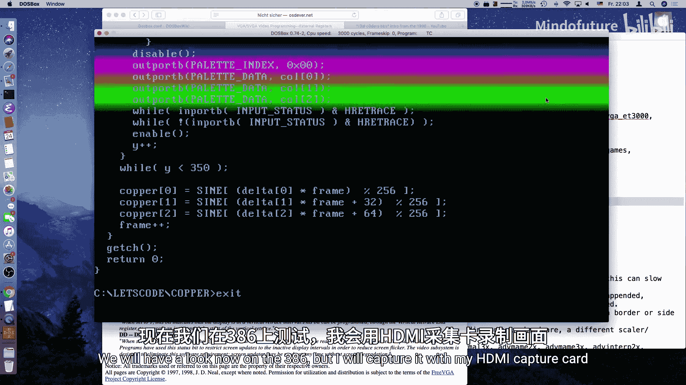
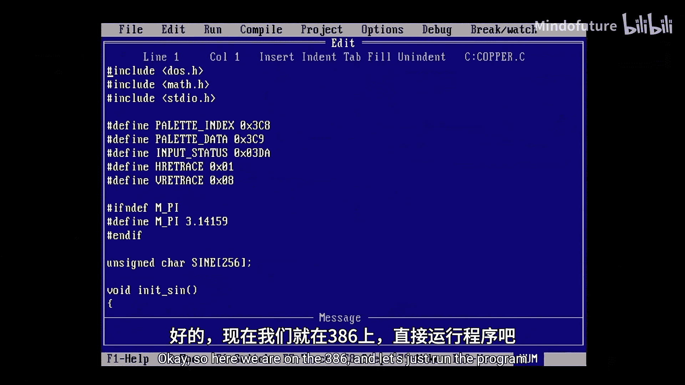
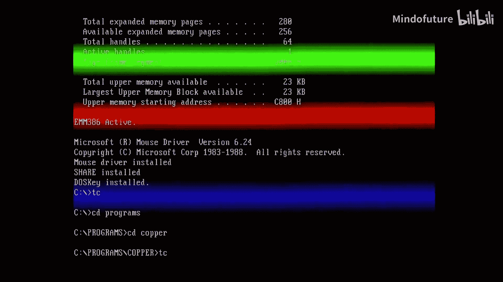

# 编写MS-DOS-系统-｜-windows-｜-操作系统-｜-汇编--｜-vga-｜-x86-p15-P15-Lets-Code-MS-DOS-0x0F---VGA-Copper-Bars--BV1zs35zQEru_p15-

🎼Hello， welcome and good evening to another Let's code andtos episode。

🎼And today I want to introduce you to a graphics effect on the VGA card called Copper or Ruster bars。

 You can find this on a lot of home computers of the 80s and 90s。

🎼The name copper Bar stems from the Amiga actually。

 where the copper is a co processor on the Agnes chip， which allowed for very cool video trickery。

🎼But also the PC can do similar things， maybe a bit more simple because let's face it。

 the VJ was a pretty dump chip with not much。Compared to like the Amyga chipet。

🎼But things like this were possible。 so you would get high color。🎼Bars that move up and down。

 and you could like code a lot of them。🎼And those were used usually， for example。

 like this in intros for DBSs or in correcttros when you got pirated software or something。

🎼And it looks pretty neat。 And the nice thing is it works in any VGA mode。

🎼Even in text mode or 16 color modes。🎼Because the VGA has a digital to analog converter that you can tweak on the fly。

🎼And that's actually how this works。 The old CRts， the cathode rate tubes before the LCDs。🎼We're。

🎼again， were tracing the picture that was drawn。🎼From the top to the bottom and from left to right。

🎼More or less and you could basically switch the palette during every line and hence get this very nice effect。

🎼And if we take a look at。🎼The VGA register， we already used。

🎼The input status register at address 3D A， namely to synchronize with the vertical retrace。

 we already know that we can read that port and wait until the bit flips。

🎼But there's also the display disabled bit， which is bit 0。

🎼And the documentation here says when set to one， this bit indicates the horizontal or vertical retra interval。

🎼So， you know when you just。🎼Passt a verticalory tracece。 The next time the display disabled。

🎼Is set one， It must be a horizontal retrace， actually。🎼And。🎼When looking for this bit toggle。

 we can actually count the number of lines that we are already into the new picture that is displayed on the COT。

And that's what we're going to do。🎼For this to work in Dos box。

 we actually need to set the machine type。🎼Because mostly the default to box。🎼Configuration will be。

🎼SVGA S3。🎼And this particular emulation doesn't emulate this register， so you won't see anything。

🎼For it to work， you need to switch to VGA only。🎼Whidge is what I did here on my Mac with a Dos box 0。

742 preferences so I just write here machine equals VG only where it formally said machine equals SVG S3 You can also switch to1 mode for1 games to get 10 sound and graphic modes。

🎼But that's not what we want today。 We want PGA only。🎼When you do that， the font changes slightly。

But it's still recognizable。so we can simply start coding。

 And first thing that we do is include our standard headers。

 We will need stuff from the dos header for the port access。And we want a nice animation animation。

 So I want the sine or cosine functions， which are in the math header。

And I probably need to read a character from the keyboard so that it doesn't。Gets。Repeatated。

And maybe I want to print something。 So standard I O is always a good idea。

The old C compilers to C is。Probably even older than the Anz standard。 So 1989。

 the An standard for C was made， but the 1989。Sana doesn't include。A constant for。Pi。

 because we will need pi for the sine function。So I'm asking here if pi is not defined。

 which would be the case on over。 I'm just gonna define it。As approximately 3。14159。

 that's good enough for our purposes。 You can add more。Digits， if you want to。And furthermore。

 calling the sign function is expensive， terriblyibly expensive。 And we will do that。Every frame。

So I wanna avoid this。And the way I do it is I create an array， a bite array。Called sign。

And I will make a 256 bys in size。I know will create a function called in it。Sign。

And this will calculate a sign table。Which is basically fast look up。

 I will get integer values because I need integer values。

Instead of the floater double values that the sine function will return。

 we can have a look here at the math header。And there's all the nice。Fctions， for example。

The sine function， which takes a double and returns the double。And that's not what we want。

Exces in radiance。 That is it goes from 0 to to pi before the function repeats。

 and it returns the value in the range between -1 and 1。

 But I want something in the range of 0 to 2 55， because I take。Bs。

 and this will be also our screen coordinate。So。Let's make a follow up。4 I equals 0。

 I less than 2 at 56。Increment I。And。Let's fill the table， so。The element number I。

Will be scale2 by size。 So I say something times 255。And what is it that we take time 155。 Well。

 it's some。Expression。嗯。Divided by 2。And why is the divided by two， because。

We read that sign goes from -1 to1， so I will。Compute something here。

And add one to make it always positive。 So now it will be from 0 to 2。

But that would be bad because then I would reach 25010。 did a5net and 10 here。So I divide by 2。

 This way， I scale the function。It will be some kind of sign call。This way。

 I will scale the sine function not from -1 to 1， but from 0 to 1。Makes sense。

 And if I take that times 255， I get exactly a byte value。And can implicitly cast it to an integer。

I could also。Cas it manually， C allows you to make this explicit。

So I could write something like this。But it's actually not necessary in this version of C。

Later versions might warn or even put an error。If you lose accuracy accuracy by converting from float or double to integer。

Okay， so what's the value。Something to do with I， obviously。But in need to scale I。

 I goes from 0 to 255。 So I need to scale it to the domain of。This sign。

 So if we're divided by 255 dot 0， important。 Otherwise， we don't get fraction。

I will have an input from 0 to 1。Well that's not good。The sign goes from 0 to2 pi。

So I need to scale it by2 pi。What I have known is。A value that goes from 0 to2 pi。

When out a rate of I。And then I put this into the sine function， and I get something between -11。

 and I scale this。From 0 to 2。And then， from 0 to 1。

Multiplying this by 255 gives me a discrete sign table。With 256 entries。Scaling from 0 to 2 55。Now。

 this is when I'm going to recall this， this will be a very fast sign lookup。

So let's write the main function。Because there's already one thing that we can do。And third is。

2 initialize the side function。And we will also have。As usual， some。Busy loop。

Why the keyboard was not pressed。We do。😔，Whatever。We see。Andm。O。😔。

Then we need need a bunch of variables。So we need to count the number of frames。Because。

The s function will take。The time as an input， basically。So the time is the number of frames。

 We could also call it time or T or whatever。When I'm going to call it frames。

Then we need our copper bars。 and I'm gonna store the position when the copper bar starts。

I'll make three。Red， green， and blue。You can make more and then invent some colour scheme for them。

And I'm gonna store a delta， which is the speed of the copper bar that it's moving at。

We can initialize those variables already。 So we started frame 0。

Starting later frame will just change the starting position。

And all the couple bars will start at the top of the screen。At the first row。

So that's their initialization。 And let's make。The first cup bar fast。

 it will always move three lines at a time， from step to step。On not three lines。

 but three steps in the the sign table。And depending on where the sign we are to move faster or slower。

Then this one takes one step at a time。 The green one， It will be the slowest。

 and the blue  one will be a bit faster。Okay， what else do we need for good measure， we will have。

A few。Iteration variables。 And I know that I'm gonna need。Also， a variable for the current line。

And we will need。The colour that we are computing。Red， green and blue。

And I think this is all we will need。嗯。First of all， we would。

Need to wait in every loop for the vertical retrase。So for that to happen。

 and because this is really， everything is here very timing critical。I will use the disable function。

 if you remember， from one of the former。嗯。Episodes disable， disables all the interrupts。

 except for the non mask ones， which is fine。 But so notice are anything can disturb us in our counting of the frames and the lines。

 Otherwise， the picture will get messy。Very quickly。

 if something happens in the background and don't forget to enable after the critical section and our critical section here waiting for the。

Vertical re。 And we did this already。 So we read about it。From the input status register of the VGA。

嗯。And mask it with the vertical retrace bit。And then we wait for the bit to toggle。So， okay， this is。

 yeah， I should probably put parentes around that。To make it better。 Now， we need to define those。

But we already know that define input status。Was0 x 3D A。On color cards， on monochrome， but we don't。

 we don't care for monochme， DJ。And。We also saw that bit number 3 is。Vertical retrains。

So that is 2 to the power 3 is 8。 So that's the x value 8。And the horizontal retrace， or actually。

 the display dis part we will call it horizontal retra here is。But number 0。 So it's he my value 1。

2 to the power 0 equals 1。嗯。Okay， we have to find everything that's here。That's good。

And now we start a new screen。 So we start counting lines。Every time we need to set。This to 0。

 and 10， we will do a while loop， a do while loop， actually。Why， why is smaller than。I don't know。

300。 And so we have actually 400 lines available。However。

I tried that and it will not work on real hardware with this many， so。To stay safe。

 I will say 3 and 50 lines。 That works fine on my machine。And yeah。

 you might try depending on how fast your machine is。Because you might actually skip some lines。

 even though we are trying to be as fast and efficient as possible here。So， that's what we do。嗯。

And the easy part now is to。Wait for。The line changes。

So this is actually pretty similar to what we had here so we can copy this。

So well wait for the line to finish， and this works in the same manner。

 But with the horizontal retraracce bit as a mask。And。We do the dis the enable。 and afterwards。

 we can say， okay。We counted one line。That's fine。I think we have something so the next the while。

 Yeah， we should probably。And then， this a bit better。Okay， this is good。

But there will be something more to do here。Probably not here， but it doesn't matter much， I guess。😔。

So。What will we do here， We will set the colour。Oops。Let's write it here， as well。Wait for hurry。

Someter trains。Next line。Setting the colour， you already know that。This is done by writing。

To the pellelet index register。The colour that we wantanna change。 And we in text modes。

 So we have a lot of black， a lot of black screen。So we will， I think I can press other the five。

 yeah。You see there's a lot of black money around the program， so we will change the color black。

 This will look nice。And then。You write out to the。Pllard data register。The colors。And we have red。

 green and blue。And we need to define pallet index and palette data。

We already did that in the VGA video， and had 0 x 3。C， H， so X 3， c，8 and 3， c，9。

Dfinine palette data 0 x 3， C 9。We probably should take away the semilon。 Otherwise。

 we get weird  errors。From the compiler。3，8，3， c，9。Okay。That's all good and fine。

 We can set the colors， but nothing will happen。Because we're not changing anything， we have。Oh。

 possible use of color before definition in function main。That's not good。Why is it complaining。

Because I forgot to set it。Shall we set it。Gos 0 equals 0。

It's not strictly necessary because we will set it in a moment。But let's， let's be nice。

 It happens only once。It runs。 It doesn't do anything。

 You can't see that it changes the palette because we are not doing anything yet。 but we can。

 We can do now。And。How does it work， so。We are counting the Y coordinate。 So what we can do is。

We can say。嗯。If the Y coordinate。Its bigger or equal to。Our。Copper bar。Coornate。Hent。

If it's also smaller。Then。The start of the cup bar plus whatever height we take。

 And I'm gonna choose 63 here because that's nice size for a copper bar。

 And it makes easier calculating the colour。嗯。If it's the case， then we will。Set the color。

To some value。We will。😔，Have a look what we put here。 Let's say33 at the moment。 No， let's say 63。

 which is the maximum amount。Or else， we will put。A0 here， because then it's not active。Of course。

 we have to set。We， yeah， this is fine。 This is actually fine， yes。And when we do this。

 we will also already see a bar。Which doesn't do much， because we're not moving it。

 the y component of the copper bar never changes。But it has to change。And that is， after every。嗯。

Frame， right， Because we have to count the frames。At the end of each loop in our main loop。

 we count the frames。 One frame is done。And we can。Actually。Increment the。Or we can， we can。

 we can read actually the coordinate。 and we use the sign tab for that。

And the simplest way to do that is to use frame。Modulular 256， because we have 256 entries。 This way。

 we will get a nice， smooth animation。 It will go up and down。And up。And down， and obviously。

 not to the bottom， because we are only going 256 p pixels down。 So this is already nice， right。

 We have one copper bar。Without any。Shading as it， but it moves smoothly。 So that's fine。

 And we're not using the speed。 So let's also use the speed。So， we multiply。

The frame times the delta。Now， it should be faster。Yep， this is a fast cup of bar。

And we can actually do this for all three copper bars。 However， we will need to。

Write this three times。 We can。 We can make a follow loop， actually， but。

It's actually not good to do for loop because this is timing critical。

 and every fall loop has a slight overhead。 So we will just write the code three times。

But we can already said the coordinates for。The other two copper bars， which is straightforward。

 just changed the indices。And it will still run， but we won't see anything because we don't set the colour for the other two copper bars。

But we can do that。Let's see all the three copper bars。So， very simple。

Just replace the indices with one and2 respectively。And we should see。A red。

 a green and a blue copper bar。Yeah， this is already nice。Pretty smooth。Of course。

 is this is actually pretty hard to emulate。 It's very expensive because who do box has to count and emulate the retce and everything。

 but still it's。Good enough。 But now we want to add shading， right， because this， this looks nice。

 but it's not as nice as we can make it because the cool thing is that even in text mode。

 we can display hundreds of colours。😊，And that's what we'll do。In theory。

 what we can do here is just。To。Y minus copper。0。And this will already give us shading。

You see that the red copper bar is shaded from black to bright red。

 but I wantan to make it look more round。 So what I will do is。嗯。Yeah， actually。Actually。

 we can take this。And I had the second variable， right。I'm not using I currently。😔，No。

 I can use the I variable。And I would call this I。And then。Yeah， we make a Tterernary expression。

Which does the following， you can write an expression like。Is I less than 32。

 So that means we haven't reached the middle。Question mark is I smaller than 32。

 then do something else。 Do something else。🎼And something and something else are now two different expressions。

 If we are smaller than 32， we just take I times 2。🎼times 2， then it will go from 0 to 63 at most。

🎼62， actually。🎼Not that's good enough。 And otherwise， we want to let it go from 62 to 0。

🎼So you just take 63 subtract I and then also multiply by two。🎼This way。

🎼We will get a very nice red bar。 The other ones are still looking flat， obviously。But。🎼We can。

Just copy this。🎼Delete that。🎼Replace that。🎼And then。🎼What's plays。🎼Here。🎼Delete that。

🎼And we should hopefully have nice copper bath。 Look at that。 So that's where I wanted to go。

🎼3 RGP copper bars with nice round shading and I think it looks amazing because this is actually text mode。

 this is not graphic mode。🎼And it has pretty smooth animation。

🎼On a real PC with a real CRTC you will get this in 70 frames per second and it looks。

 I think it looks awesome and it's amazing that you can do this with this old hardware and it should work even on a 286。

🎼We will have a look now on the 386。

🎼I will capture it with my HE， HMI capture card。🎼So it doesn't look as good as it would look in person。

 but so that you see that also works on that one。🎼Okay。

 so here we are on the 36 and let's just run the program and as you can see。

 it looks a bit jittery due to the HDMI capture it's not perfect and you can see a little bit of artifacts because it's all。

🎼Analog here， you can see with noise in the middle of this screen。

 but it's typical for old VGA cards。🎼But it works。 So even through HDI capture on an old machine。

🎼This definitely works。 So yeah， feel free to use this effect。 You can enhance it。

 put other colour to it。 And there's a lot more that you can actually do with the CT registers。

 etctera。 But this will have to wait for another time。🎼In the meantime。

 thank you very much for watching。 I hope you learned something in this episode。

🎼Please leave a comment if you like this also press like or dislike buttons， share and subscribe。

🎼And if you enjoyed this very much， you can also leave a tip on Kofi or on Patreon。🎼Or just， yeah。

 so me by sharing and commenting。 that's always very nice。🎼Other than that。

 I will leave you to this and。🎼I hope to see you next time。🎼Bai。

🎼あ。🎼う。🎼ああ。🎼，🎼。🎼。🎼う。🎼。