# 编写MS-DOS-系统-｜-windows-｜-操作系统-｜-汇编--｜-vga-｜-x86-p16-P16-Lets-Code-MS-DOS-0x10---VGA-Smooth-Scrolling-In-Text-Mode!--BV1zs35zQEru_p16-

🎼Hello， welcome and good evening to another episode of Let's code Amstos。🎼This is the 16th episode。

 so yay， we are breaking into the second digit of our Xcode counter。🎼And last time。

 we learned how to program。🎼The copper bars in PGA text note， the same works， of course。

 also for the graphics mode， there's not much difference there。

🎼And I think this is already a very neat effect of the VGA card。

 but the VGA card can actually do so much more。🎼And today。

 we want to look at another nice effect that is actually pretty cool。 And I wanna why not more。

🎼Programs used it because it's actually pretty neat and we'll be doing this in text mode again。

🎼And in graphics mode， it will be similar and we will come back to that once we recover more of the 256 color VGA modes。

🎼But for now we will stay and take small because it's actually pretty impressive。

🎼Well be doing smooth。🎼Scrolling， vertical scrolling here。🎼But horizontal scroll is possible as well。

 but that's for the later episode。🎼But vertical， smooth scrolling。

 And this looks pretty impressive because usually in text mode， you can。🎼Scroll， yes。

 that's not a big problem， but you will scroll line by line， and this looks very jumpy。

🎼And since you can't address pixels individually in text mode。

🎼It's actually pretty impressive that you can do some kind of smooth scrolling in VGA。

🎼And we will start off with a version of the copper VGA program from last time。

🎼But we will change a few thing things， right。So， first of all。🎼I will change the sign function。

 We come pre computeed signine function。 and this time we want to scroll the screen。

By one page and one page in text mode 400 lines of pixels。So I want to have something like。

🎼400 here as the value that we are scaling to。🎼Instead of 256。

 and I need higher resolution for the sign table as well。 So that's why I put already a 5 12 year。

 and I will also make the area 512 bys long so that we can have very， very smooth。Sine function。

🎼With almost pixel accuracy。🎼And we need to change the normalization factor here as well to 511 instead of 255。

 because now the sine function will go from 0 to 511 in the y direction。🎼And we will have。

🎼Am I talking crap？🎼Yes， sort of。 So in the x direction。 So the input parameters will be 02。

5 and11 and the y direction will be 0 to400。🎼Okay， that's nice。 We will still do the initialization。

 we will do our main loop。🎼And that's more or less it right now。

🎼Then getting the character so we don't get a spurious return or something return key when we exit。

🎼And restoring the text mode， of course。🎼That's all good and fine。

🎼But how does the virtual virtual vertical vertical scrolling actually work？

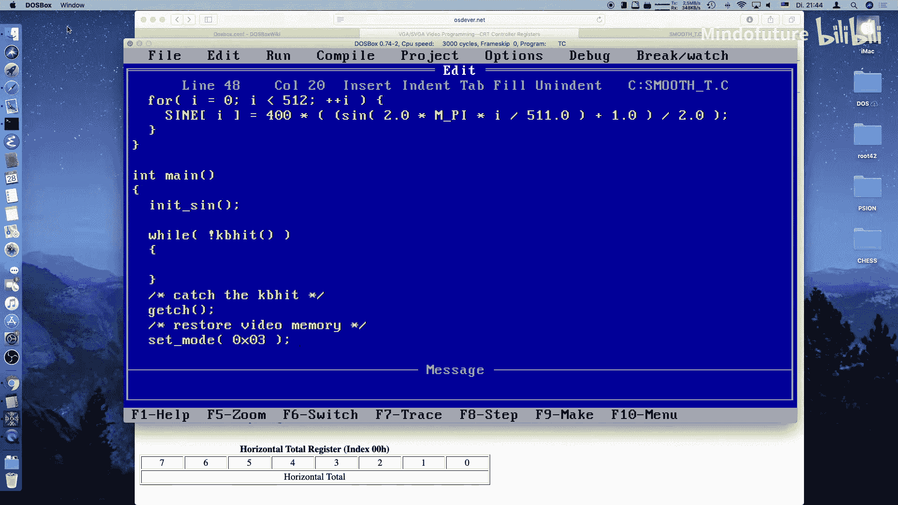

🎼Well， if you take a look at the documentation for the COT controller registers。

🎼There are two things。 There are two registers，0， C， Hx and 0 D H for the start and。

Address higher and low。And if you take a look at that。

🎼It says this contains the bits of the starters field。

 The upper 8 bits are specified by starters High register。 Okay。

 the start dress field specifies the display memory address of the upper left pixel carried of the screen。

Okay， this sounds pretty nice， doesn't it。Normally， this field is programme to0。

 except when using virtual resolutions， paging and or split screen operations。

 and paging means scrolling basically， because if you increment this。

By the number of pixels per line， you get line accurate scrolling， at least in graphics mode。

But not in text mode， it will scroll for a whole。

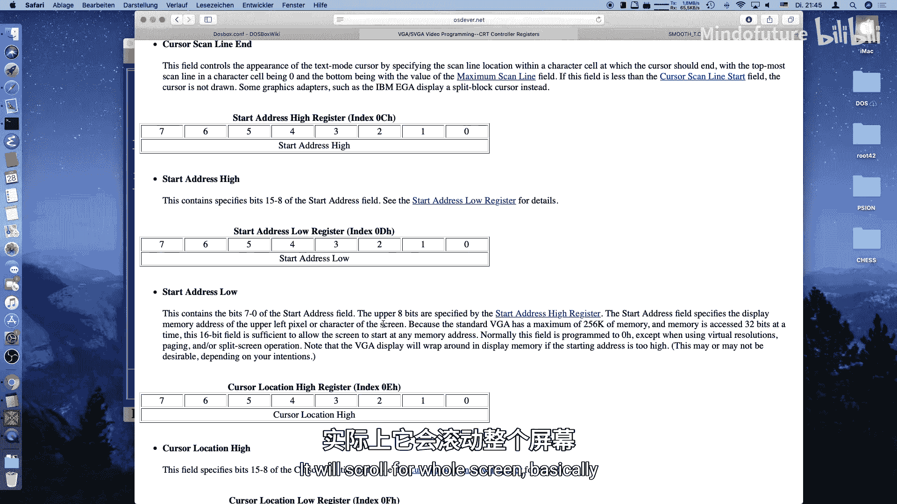

Screen， basically。So we will do that。We'll do that right here。 We will do something like this。

We will need to write to the right register。 So we will output by to the。C，TC index register。

 and we will call it start。Register， hi。That's where were writing to。 And then。We will do CRTC data。

And we'll need to ride a bike there。 So we do a cast， although I don't think it's strictly necessary。

And what will be right， Well， some kind of offset。But。The offset shifted。8 B to the right。

Because we are writing out the。Hi。😔，B， basically。So we are now missing a few things。

 The offset is equal to whatever line we are in currently with this scrolling。Times 80。 Why times 80。

 because we have 80 characters per line。So you always have to calculate the offset number of pixels or characters and text mode times the width of the screen。

And the width of the screen can actually be adjusted， but that's also something for later。

 So the VGA is pretty flexible here。Okay， so we need to introduce a variable offset。 Let's call it。

I think we should use an unsigned in here。To make sure this is all good。And we will have。Also。

 an on site end。Line。And that will be 0。In the beginning， at least。Okay， so there you have that。

Then we will need to do our regular thinking to the。Vertical retrace。

 you already know that drill disable and enable the interrupts。Then， doing out。No， wrong， wrong。

 wrong。 Do an import。While import of the input status register of the VJ。Mask with vertical resfi。

Wait for the current picture to finish the current retrace to finish。If there is any。

 and then wait for the picture to finish。And close some parentheses。And we should be good。 Okay。

 we have to do the output on the CTC first， because the start register is only。

Evaluated once per screen， refresh。I think， if that's correct。And if we do it after that。

 we will get some jumpy jetittery stuff so that will look pretty bad， actually。

Start register low is also fine。 And here we are just doing。Making with the lowbite。Okay。

 that should actually set。Everything。This will do linewise scrolling if we now do something。

 and what is it that we want to do。Well， we have to have a frame count or something。

 We will increment that， and we will also introduce that here。Let's do a frame equals 0 here as well。

And then， we can actually calculate。The line value， right， so。

We will have to calculate a Y coordinate。And this will be our signine function。

Indexed by the frame modo 512 feet because we have 512 values in there then after that， it repeats。

And the line is basically just the y value divided by 16。

Because every character on the VJ card is 16 pixels high。 So then we get。S wavy scrolling effect。

With 16 steps。And this is actually it。 But I probably forgot a couple of things。 There are errors。

 Okay， we need to define the start register。

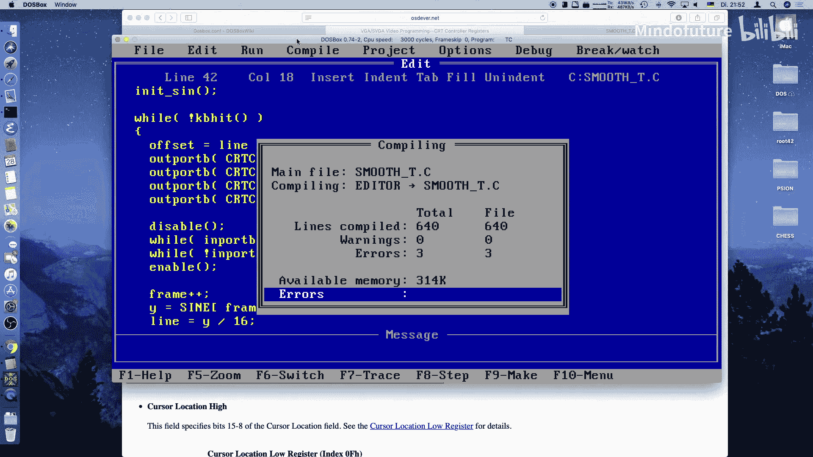

And we saw that here。 So the start address register and yeah are 0， C and 0 D。

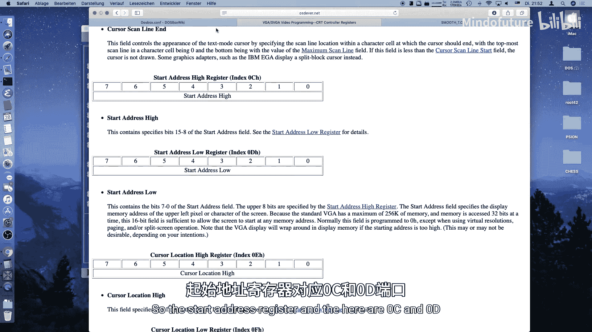

So， define。Start。Register。Hi，0， x0， c。And then。Copy that。And you。X0 d is the next。

 and we didn't define Y。 that's also bad。😔，Let's put it here as well。 Y equals 0。Build everything。

And we still have something。 Oh， yeah， should have been。Lu。And if we run that。Not much happens。

Because we did a。这是op。Alright， that's embarrassing。Now， think on the Mac， I can't break。 No。

 I don't have a brake key。That's too bad。Okay， so we quit。We quit， and we restart do box。

 That's the good thing about do box。 It is easy to restart。So what did we do wrong， We coded a。

An infinite loop， it seems right。But which one Disable enable， That's fine。Wellhy not keyboard it。

 That's also fine。I could just imagine that we did something wrong here。Oh， yeah。

Who spotted at first。Total sity。Total stupidity， yeah。Masking is a bit like that。

 doesn't make sense at all。So we got stuck in the while loop and everything broke。Okay， no。

 this is not nice to look at。 Oh my god。Terrible。But。嗯。Okay。I'm wondering。

If that's actually supposed to look like that。Probably not。But the rest is I think fine。

 the sine function should be okay。Tell you what， so that we see actually something nice。

 Let me introduce you to something。

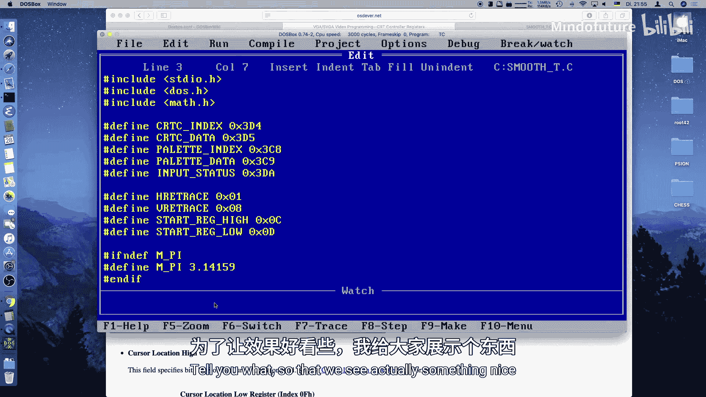

There's a problem called the draw。And the draw is a paint program for。Text mode。So， we can basically。

Choose some colors。I'm selecting background colour。 Yeah， let's take blue as a background。

 Did it use that。Actually choose that。 I don't know。And you can draw with askI characters。

 choose different。Styles。And do all kinds of things。 So I。Created little。Something。

 I'm not a good artist， but I did this And a second page。

As a means to fill the frame in the text mode。And what you can actually do is you can actually save in C。

That's here as a C header file and include that into your program， which is pretty neat。

And that's what I did。So we can actually go back to our program。And。

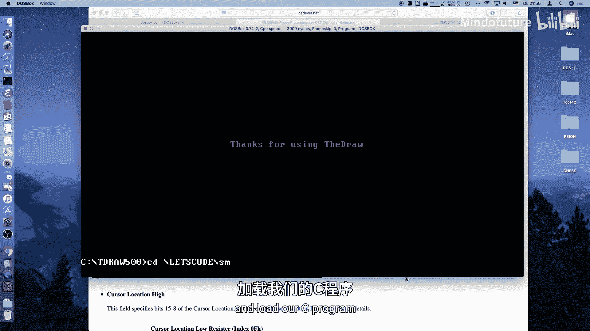

Load our sea program。And if we look in the directory， I have two files here。

Called route 421 and route 422 dot H。 And they define。The whole frame of a here。 And you can simply。

Include that file， and。Pooke the image data here into video memory。

So let's do that so that we can see actually a bit more what's going on。

And maybe get sick a bit more by the weird scrolling。So what we need to do is to include those files。

 include now with the quotation marks because we are including from the local directory。

Route 4 to1 dot H。I entered 422， that age。And I named， you can actually pick a name。

For those things and the picture number one is called image data 1。

 the picture number2 is image data 2。So that's， that's nice that you can name that。

So we need to define the frame form。 and again， it's an unsigned character pointer。

 but it's a far pointer because it includes the segment。We call it buff。For buffer。And it's actually。

 it's segment B 80，0 for the text mode。And offset 0。So to write that in C notation。

 it will be just like this。Pretty neat。 Okay， so after initializing our sign function， we will。

Put everything into the memory。And we already know that the whole thing。Has length， image data 1。

Length， because that's defined。 So we don't need to calculate anything。

And we will poke that by just doing。Buff plus， plus equals image data。1 off I。Isn't that simple。

 And the same thing can be done。With image data， too。

 and it will just right to the second video page。And of course， we need now also variable I。

We have one warning。 non portable pointer assignment。 Okay， yeah。

 we need to cast that because this is not， not a pointer4 C。So we need to tell see， yeah。

 this is an unsigned character far pointer。Very explicitly。And then， the warnings are silent。

But it looks weird。 So we did something wrong。 And I think we might have screwed up our computation here。

And I'm wondering why。Let's check， double check the register。 So I said register hi would be 0 x0 C。

 That's correct。 And 0 x 0 D is also correct。That's fine。 Am I writing correctly。

 So let's think about that as well。Start register high。Then， I'm。😔，Well， what I did earlier was to。

Explicitly， mask out。The higher。B only。But that actually shouldn't make any difference。

 in my opinion。So let's check that。 No， exactly。 So this is。This doesn't matter。

But something else is wrong。 Who can tell me what is wrong。The vertical retrains should be fine。

I think。This is wrong。I need to。Do it like this， because and has a pretty low。Presidentnce。

I think it was， yeah。 No， we， no， we are talking。So that was the problem。

 It was not sync to the vertically refresh。 And now this looks already nice， right。

 That's a nice doss logo there， red blop。And it's scrolling。With a sign pattern。That's neat。

 But now we'll make its move， actually。 And how do we do that。 Well for that。

 let's look at the documentation and。

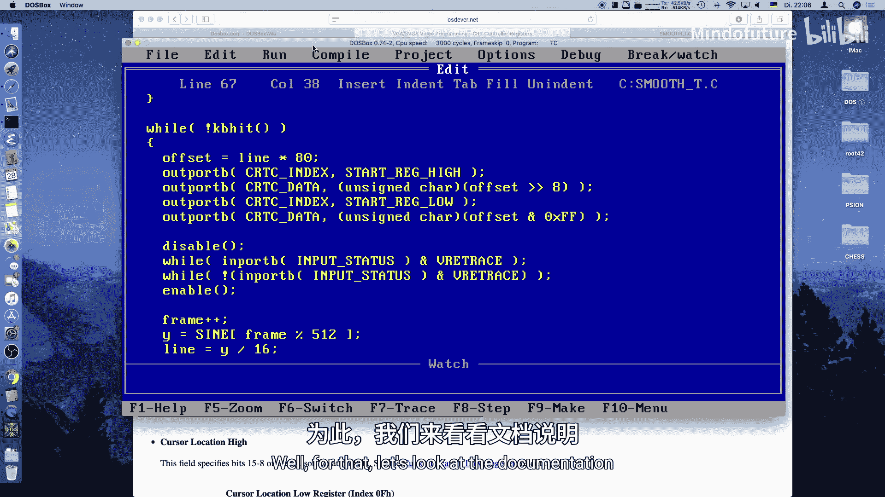

Looking through the documentation， you will find the preset row can address address register。

 No Preset rows can register。

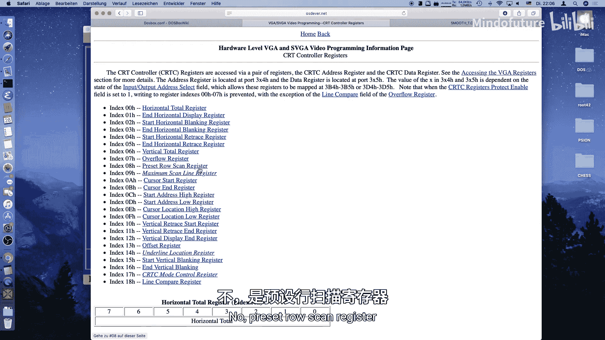

That has index 8。And two things can be done here。 The bite panning is not interesting for us right now。

But the priest roseken as nice。Basically， what this allows is to shift the start。

Line off what is being rendered by up2。31 lines， because it has5 bits。

Well only need 4 because we need to scroll 16 at most。

 But this is exactly the register that we are interested in。

So let's define it before we forget it again。And let's put it here。So， define。Preet。Scan0 x U8。

And then， we simply。Copy this because it will be simple， simple， no， similar。C， O TC index and。

Preset a row scan。And this is for pixel accurate。Scrolling， so。We will output。

The value we call it pixel。I would say。😔，Pixel sounds good。

And to make sure that we don't write any garbage， we will mask it to the lower 4 or 5 Bs。

🎼So0 x F should do the trick。🎼Then of course， we need to compute the pixel value and this is basically just the remainder of our division here。

 So why modo 16。🎼In the beginning， it will be 0 pixels， then 1，2，3，4，5， etc cetera， up to 15。

 And then when we switch to 16， will。🎼Jump back to the zeros pixel and the next line。🎼Well。

 that's pretty straightforward， right？🎼And to make sure that。We have a nice thing here。

🎼We'll initialize it with0 and we'll just use the bite for that。🎼So。🎼Do I have to do anything else。

 I don't think so。 Let's see if it works。 And then we go through the coat once more。 No warnings。

🎼But also， it doesn't work。 So we did something wrong。 What did we do wrong， Where did we go wrong。

Oh， yes。🎼Copy and paste error as usual， CTC index twice。🎼The next slide should go to CRTC data。

 obviously。🎼First， write to the index register， then through the data register and。It works。

🎼And look at this。 So this is pure text mode。🎼And I will， again， show you the same thing。

🎼On the 386 on the real machine。🎼So that you see that it's not only do box doing this。

🎼But it's extremely smooth。 It's even better in person because I can only render the to 30 frames per second。

 and on a real machine， this again will be 70 frames per second， and that's incredibly smooth。

🎼So as you can see， it's a really， really neat thing and it's really， really small。

🎼What did we learn today， We learned about the start register， high and low address。

 The pre Rose can address。Register。And。

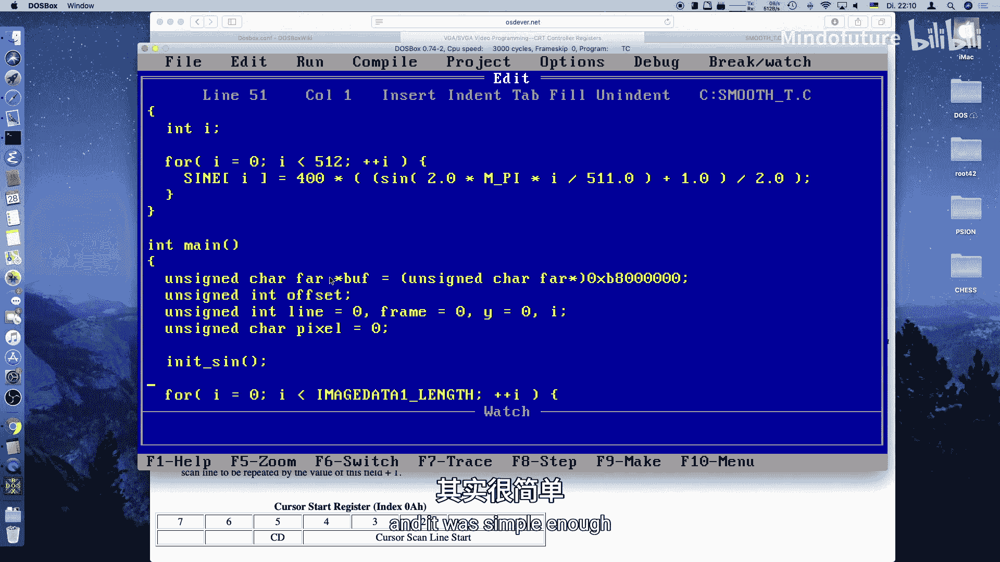

And it was simply enough。🎼Just set the start address first。 Wait for the retce。

 and then set the pre scan。🎼Okay， so here we are on the 386 and running Tui loading our program。

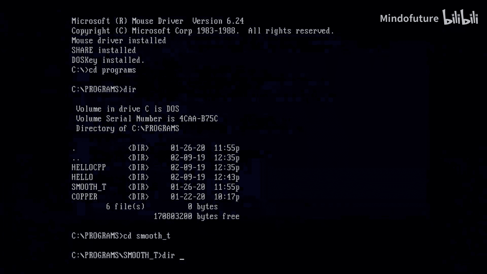

🎼And yeah， it's the same basically that you had before I cleaned it up a bit。

🎼And this is also the version that I will upload to Gitthub link in the video description so you can check out the code。

🎼AndThen let's run it and as you can see， it works also on a real machine Capcha while on the OSSC and my HDI capture device。

 and it looks smooth as butter I like it。🎼So where can we build on that。

 we can put in horizontal scrolling that will be an upcoming video。

 we can use it also in graphics mode。🎼That will also happen later。🎼But for now， that's it for today。

🎼I hope you like the video。🎼Please consider subscribing。 and if you want to drop。🎼Coin and hat。

 Feel free to go over to Patreon or to coffeefi。🎼No commitment。 If you don't want to just leave it B。

 Leave a comment。🎼And otherwise， I hope I will see you。🎼Next time。 and so long， bye。

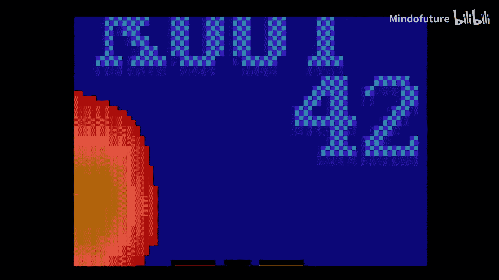

🎼あ。🎼The。🎼う。🎼ああ。🎼，🎼。🎼う。🎼。