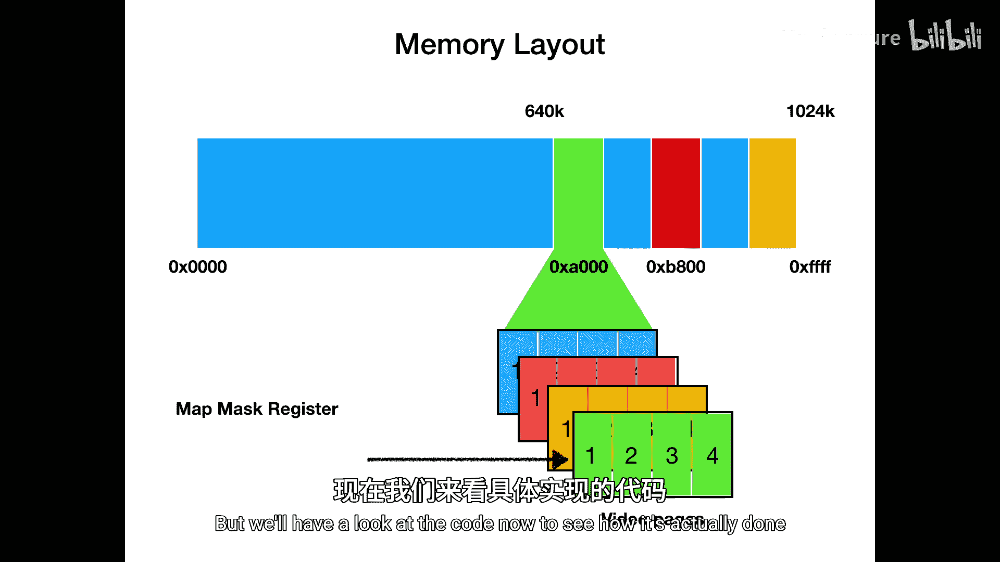
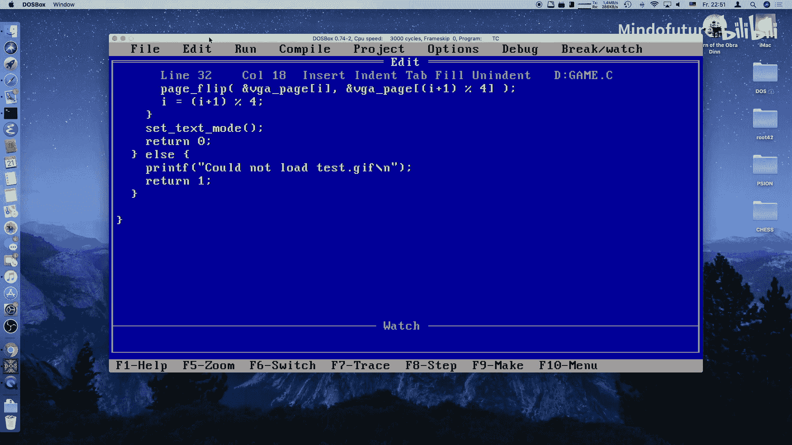
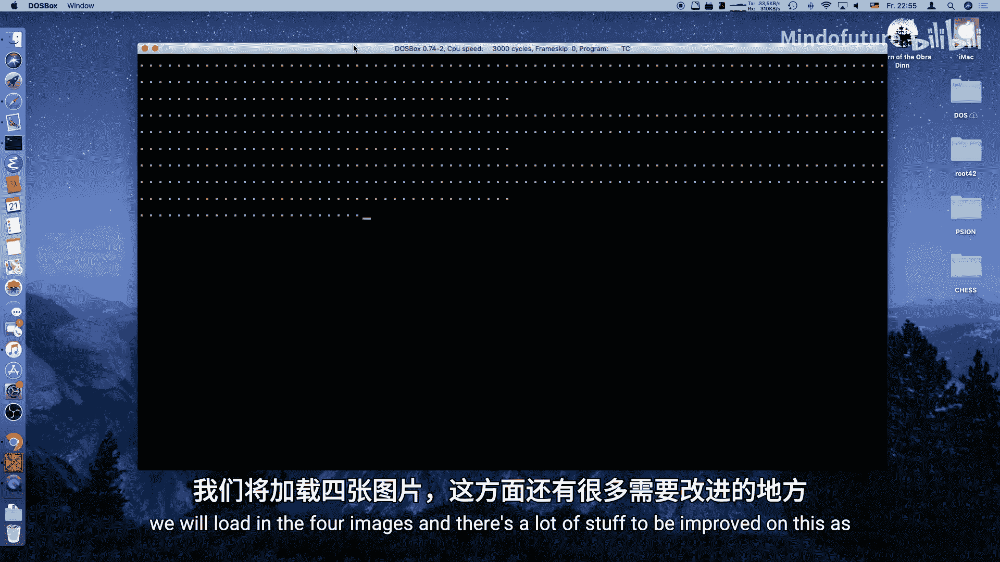

# 编写MS-DOS-系统-｜-windows-｜-操作系统-｜-汇编--｜-vga-｜-x86-p17-P17-Lets-Code-MS-DOS-0x11---The-Mysterious-VGA-Mode-X--BV1zs35zQEru_p17-

🎼Hello， welcome。 and good evening。🎼To another episode of let's go them。🎼And this time。

 we want to visit the mysterious Mo X。😔，🎼So far we did quite a bit of the GA programming。

 We learned how to manipulate the pellet registers。🎼How to set the mode 13 for 256 colour。

🎼And how to do text， soft scrolling。🎼And similar things。🎼However， let's recap a little bit。

 the memory layout of the PC。🎼Looked like this。 I think I showed this slide in a previous episode。

🎼The original PC could access 1 MBga of Ram。🎼The lure 600640 k were used for applications and for dos。

🎼And then right after the 6940 kB is the segment hexetadel a 0，0，0。

 which is the frame for the E GA and V GA cards。🎼Then we have some upper memory blocks which can be used for expansion cards or for loading drivers and stuff。

🎼And text S mode B 8，0，0 is the frame for the C GA and the text modes。

🎼And then right at the top of the 1 MBby， there's the bio in the roomm。

🎼So what does it mean for the VGA， the VGA memory segment， a 0，0，0。🎼Is only 64 kB in size。

 but all of the VGA cards， even the earliest ones by IBM， have at least 256 kB installed。

🎼Many of them have even half a megabyte or megabyte of Rammen installed。

🎼But 256 kB is the lowest common denominator。 so we can always expect that this is actually available。

🎼But in Motine， you can't access the remaining 192 kB， which is actually a shame。🎼VGス。

🎼Previousredecessor， the EGA cardt introduced so called bit planes。

4 bit planes were used in the 16 colour modes。🎼But only one bit plane was active at a time。

🎼O to some certain degree， you could operate on all fourbid planes into some funky operations。

 but we won't go into those details right now。🎼The same concept still exists in the VJ。

 but we call them bike planes instead， and they can be used to actually do some kind of bang switching of the whole 256 kB。

🎼The VGA has a bunch of components that we need to know and that we need to program in order to make that happen。

🎼Sitting on the system bus is the graphics controller。

 the system bus is the ISA bus where you plug in your expansion cards and which is basically the backbone of the PC。

🎼The graphics controller has the buzz interface in the readr logic to access the video memory。

🎼The video memory itself is organized in four planes of 64 kB， which gives us the 256 kiloB。

🎼This is then read by the sequencer， which talks to the palette registers of the deck。

🎼The digital analog controller， which again talks to the CT controller。

 which produces the image on the screen。🎼So once we have all of those together。

 we can program them using the VGAIO ports。🎼PJ A I O ports are indexed。 That means first。

 we send the index of the register that want to write to the corresponding index port and then。

🎼We will read or write the data on the second port。🎼For the attribute controller， for example。

 we have the port 3 C，0 for the index and 3 C1 for the data。

🎼The sequence controller has similar ports，3 C4 and 3 C5。🎼Graphics Control and C T controller have。

🎼Something different altogether。 And when you see here， multiple different by。By not by it。

 but O pairs， this means that the alternatives are actually available when you plug in the VGA to a monochro monitor and configure the VGA to run in monochrome mode。

But this is mostly not of interest to us because we will do all our stuff in colour mode。No。

 how do we get to modex。😔，While we go through mode 13， and that's the mode that we already know。

 It's the only one which is provided by the VG I Bs， which supports 256 colours。

Its advantages are that it's compatible with a short lift MCGA 64 kb standard of the IBM PS S1。

 At least I think it was the IBM PS S1。Which was sort of like compatible to the CGA cart。

 but also added this 256 colour mode for games。Its advantage is that it's very easy to program。

 We have this flat pixel addressing。 Every byte in this segment is directly corresponding to a pixel on the 3。

20 by 200 screen。And it's pretty flick of free at，70 Hz。

Its disadvantages are that the mode is not very powerful。 You have no page flipping。

 You can do nose scrolling。 And actually， the pixels are not square。On a4 by3 COT screen。😔。

So what is page flipping， Page flipping is actually the thing that we are most after together with the scrolling capabilities。

So with page flipping， you have a front buffer， which is currently displayed by the CT controller on the screen。

 And then in the background， you write to a second buffer。Which is not shown on the screen。

 And sometimes the redraw takes a lot of time more than one refresh off the screen。

If we were doing that in the front buffer， you could see how we paint the screen and you get screen tiing and all kinds of weird artifacts。

So once you finished your back buffer， you basically show the front buffer and then switch seamlessly。

To the backpack buffer。 And the same thing comes again。U infinitum。

So this is very useful for animating stuff and for games， especially。

So let's introduce mode X and mode y。How do we get there， We basically enter mode 13。

 which already sets up all important graphic servicess。The Mo X was popularized by Mac Laberish。

 who wrote a big book on graphics for the PC。And it's a sort of hidden mode because it's not supported by the bias。

But actually， all the registers of the VJ I are pretty well documented。

 And even before Michael Abbri popularised it， it was already used in quite a few games。

So the mods actually unleashes all the power of the VJ。It makes page flipping and scrolling possible。

 and we get access to roughly3 screen pages。Each page will have square pixels at 3。

20 by 240 resolution， and the image refreshes at 60 Hz。

We won't use that exact mode when we leave out the repro of the refresh and the screen size。

 we'll end up with something that is called mode Y。 It is the same as modx， but uses the familiar 3。

20 by 200 resolution。And has 70 Hz refresh。This gives us access to exactly four screen pages。

 plus a few extra lines。Which we can use in all kinds of manners。

 and we can still use all the graphics assets that were made for 320 by 200 resolution。

So how do we set up modedo I Well， first， we switch to mode 13 by calling interrupt 10。

 which is the graphics interrupt。And then we set the memory mode register of the VJA in the sequencer controller to Xodsmal 6。

If you look at the bits in that register， this means that we enable 256 kilob of Ram sequential axis and the chain form mode。

 The chain form mode allows us to write to the mapma register to pick which bi planee is currently active for reading or writing。

This is one of the crucial steps to actually get access to the whole memory of the VGA card。Second。

 we set the CTC underline register to 0。To disable the so called word addressing mode。

 this further allows us to access all the video memory。

 So it's pretty complicated to actually get all this stuff running on the V G A。

 There are several bits and several registers that we have to flip。To。Make all the 256 kB accessible。

And last but least。We have to set the CRTC mode control register to hexadeimmal E 3。

 And if you look at the byte pattern， this at last enables byed dressing。

 which is the last step in enabling access to the full 256 kB。

If all of this doesn't mean much to you， we will come back to this in a short moment。

 You just have to look up these values and write them to the correct registers。

 It's not hard figuring out how to do that。 That was， I think， the hard part。

 But that was already done more than 30 years ago by people who are probably much more clever than us。

😔，Anyway， we can use their knowledge and get a very nice mode for programming games。

So how do we access individual pixels now in more why。Well， we use the Mo mapap register， as I said。

 to select one of the four by planes。Each by plane contains all of the video pages that we see。

 but only roughly one quarter of one single video page。So to access one pixel。

 we take the x coordinate of the pixel and compute mod 4， which gives us， for example。

 for the four first pixel， we get a one， then a2， then a3 and a4。 and then back to one。

 So every fourth pixel will be on by plane  one。Then the neighbouring pixels of those will all be on by planee 2。

3 and 4。So the whole memory contains all of the four pages， and we can actually visualise this。

 This was the memory layout that we saw before。 And this is how the VGA card actually sees it and how it will be mapped to the segment a 0。

00。So。I colour the different bike planes here in green， orange， red and blue。

 and every bike plane contains the four video pages， which are actually not physically existing。

 but this our logical partitioning of each bike plane， basically。

And we can use the map mask register to， for example。

 Pick the blue B plane and write all our pixels that we want。 Then when we are done with that。

 we can switch to the red orange and greenb plane， which。All are just numbered by plane 1，2，4。

 or 0 to 3 or whatever you want to call it。And this， of course。

 is a much more complicated addressing mode than what we had in mode 13。

You should avoid switching the by planes to often because it's a very costly operation。

 When you set single pixels， then you probably can't get around choosing the map mouse register every time。

But when you're doing， for example， block transfers， copying whole sections of the memory。

 you should always do it in for every by planee， copy everything that you need for one frame from B planee 1 and then only switch to by planee 2 when everything is done in by planee 1 and so on。

But we'll have a look at the code now to see how it's actually done。

Okay， so this is where we left off the last time when we actually coded the G loader。And to。

 we want to enhance this a little bit， I think。So instead of just loading one image。

 I actually want to load four different images so that we can use or show the usage of the four BGA pages。

Hence， I would like to。Load for different gifts。 And let's just call them。With an ominous name。

And os。Duplicate that。We could use a loop， but。For these four lines I'm。Not going to bother。So。

 after this。We at least test if one of the images could be loaded， then we are fine with that。

And we will change the said graphics mode。To， said Mo why。Which will be a different function。

We will take the palette of the very first image。I will make sure that。

All the images have the same palette。And we can't use the B VGA function。

We'll do something slightly different。 We will call it copy to copy to page。

 which slowly copies to a certain VJA page。In upcoming episodes。

 we will take a look at faster btting routines for more eggs。 But right now。

 we will do it very simply。So， not to make it。Confusing。😔。

And well only tell it how many lines it should copy。But we will also tell it which page co copy to。

 So we will have another array of pointers。With four entries for the different。Pages。So。

Same goes here。First， second and third image go to the。First， second and third page with the zeroth。

As the。Actual first thing。And then while the keyboard wasn't hit。We're going to do something now。

 We will。嗯。Delay for a couple of milliseconds。 let's say， one fifth of a second sounds good。

And then we will perform page flip。And we will toggle between all four pages， so。We take VJ page。off。

Index I。And we'll have to take the address of that。Because there will be some swapping involved。

Well probably yeah。Actually， probably not even necessary。And。We will increment。

The index by one and take it modular 4 so that when we are displaying the third or the fourth。Page。

 and we do the plus one。 we wrap back  to 0。Prety symmetric。 You should。Already know this stuff。

And then， we will actually increment。Accountant。Exactly in the same fashion。

This looks more or less good， I think。But， we need2。Introduce the counter， of course。

And will initialize that with 0。So this is what the problem will looks like will look like。

 We have four。Gifts that we load， We check that it's there。

 Then we actually enter mode why set the palette， copy other the pictures to the different video pages。

 and then we can quickly flip them around and make some kind of animation。So let's go to the VGA。

Coutteines， because we need to implement。At least a couple of routines here。

So let's go right below set mode。Let's call it set mode， Y。Doesn't take any arguments。And yeah。

 now we have to remember what we just learned， how to initialize。Moode why。 Well， first of all。

 we will have to。Do some。Do I need this， Do I need the registers， I don't think so。

 I think we can skip the registers。 We can just call。Set mode with the VGA 256 colour mode。

 This was already defined in the previous episodes。 So now we have mode 13。

And then we will initialize the VJ。Page。Variables， and the first page。Has offset 0。Then。

The second page。Has。320。Times 200。Divided by 4 is the offset。 So one quarter of the way in。However。

I want to keep this。So that we can actually change this to。Mode X at a future point。

 And then we might switch the horizontal and vertical resolutions to 3，60 or 2 40。

 So we actually have these variables defined or these constants。VGA width and VGA height。And。Yeah。

 this， this is actually better。For later expansion。And the second and the third， actually the same。

But times 2 and times 3。 These are the opposites into the memory。Actually。

 this year is time zero and to be perfectly honest。The zeroth， we could also。嗯。Right。

 in the same way。It's。Obviously， times0， right？So it's a bit stupid because this will vary to 0。

 but it makes the structure more clear how to calculate the offset into the PGA memory。Okay。

 first step that we need to do is。Disable the chain for bit。And if we remember the slide。

 we will need to output to the sequence controller I register。嗯。The memory mode register in there。

 sequence controller， memory mode， yes。That's correct。

And then we will need to output on the data port。Hexter S 6。Wass the encoding。And step 2。Disable。

Double word mode。That's the CRTCC， the CRT controller。First， the。Underline location， register。And。

Again， to the data port of the same。We need to output just a 0， very simple。Save that here。And。Right。

So， next up。Is disabling。My word mode。So we output to the C T index again。 But this time。

 the more control register。So bio access is possible。C， toC data。And there we had to write Z X E 3。

 You hopefully remember the。Bit pattern there。 but you can look it up always。

And now what you w to do is we want to clear the video memory because。

The remaining192 kB probably has a lot of garbage。 And when we only partially write to the memory。

 we will see。Complete garbage in the screen。 And we don't want that。

 So this is the first time we will use the mat mask register。So we tell the sequence controller oh。

Clear all。B Jmen。So， we tell the。Metma register， which is in the sequence controller。That。

We want to enable all the planes。I we can do it by just writing a。Completely filled by it。

 We selects all the planes。And we will have to。呃。Right。2 to the power of。16 bits。我 knows。Actually。

And this is too big for。The size T type and two， you will have to do it twice， which is a bit lame。

But we can do this。So， first。We have no offset。 We write zeros， and we write exactly half of。

So what we want to write is。0 x FFF got divided by 2。 This will be。Actually， we want to write 1，0，0。

0。That divided2 should be。0 x 8，0，0，0，0。Yeah。And the next offset is， of course。I this actually。

 it would be enough to go like this。Yeah。This would clear all the memory。Actually。Is it， is it No。

 we need to start here because we started at 0 here。 Okay， this would have been a nice of1 error。

 but we won't see it anyway。And this is already everything we need to do。We disable chain4。

 we dis double word and word mode， which enable spiteite mode and cleared all the memory。

That's just fine。Let's do the pixel setting next。Because we already saw the usage of the。嗯。Word note。

 word Mo note， map mouse register。 That's what I wantan to say。First of all， you can select the page。

 which is basically the offset into the。TheJA memory。And you can give us an X and an ycon coordinate。

And of course， the color。That's what our pixel setting routine looks like。 It will be slow。

 very slow because it won't test if we are ready in the correct mask。We could store this an variable。

 but I'm not gonna bother with that because it can break very easily。😔，So。Again。

 you already saw that。 We tell the index register we want to write the mask。 web mask register。

And then， we write the data。Register。嗯。A one shift to the left by。How which， which。

 which page we actually have， so。X and 3 selects the。Not the page。 Sorry， X and 3 selects the plane。

 the VGA plane that we are actually writing to。 You remember the four differently coloured planes。

And the bits are actually arranged in that register and exactly that matter manner。

 So we just left shift by these by this number that we get from that。

So this will select the correct plane。 and then we can just write to the VGA memory very。

 very simply by taking the page of it。Plus。Yeah， what is the， the why coordinate we have to do。

Mipplication， PGA width times y。Plus， x， this is the usual calculation。

 But since every bike plane only has one fourth。Of this， we achieved to right。Divide by 4。

Or if you want to， it's a bit faster。 If the compiler can't optimize this。

 you can actually do a right shift by2。 This is a trick。That people used to use back in the day。

So I can write here。X divided by4 is。Equal to x。Shift right by2。Why do I have scroll up on。No dear。

 Okay， how's going。Yeah， this is the set pixel routine。 That's already it。 It doesn't look like much。

 but。As I said。These two lines are very expensive。 So this will be slow molasses。

 and we will change that in a future episode。 But right now。It's good enough。Ex up。

 the actual page flipping。So。Yeah， exactly。I want to have。Point us， because I want to change those。

Pointers。😔，To the bow， both of the pages that we want to flip。嗯。

I need a temp variable because I I want to do a swap， which isn't available in Anzi C。

So we will do something like tempus first page1。Then we set page 1，2。Whatever is in。Page 2。

And page 2。Will become。InThe1 value。 Now， we have swapped the variables。

Then we need to calculate the high and low part of the address。

And we should probably introduce a variable for that。So we have a high address。😔，And。

Low address part。And the high address part is。Something which we'll have to define。Ior with the。Yeah。

 no， let's not do that。 Let's not do that。 Let's do it。In a more simple fashion， shall we。

Or shall I show you this trick？ Well， we can。 We can do the trick。 Let's do it， actually here。

This is the register of the high address register， and we can combine it with。

The information we just calculated。But we have to take only the。Upper bite， obviously。

And you're probably wondering what the high address here means。

 We will come to that in a very short tomorrow。And the lower address will be written to the lower address register。

And we're basically doing the same。Taking page 1， but this time on the low by and the low by will be。

Basically， this part here， if I would were to do it like this。And then。

 but I have to shift it up anyway。 so I can just ignore that and just shift it left 8 bits。

If I do this， then my lower bits will be always this constant and my。High as will be this part。

Why do I do that， Because there's a trick。Goonna write this in a comment。Instead of doing。

2 calls out by it。Hi， address。Comema。Page 1， and。0 X， F， F。0，0。And then， also。Since it's a bite。

 I have to。Rightr shift by 8。Inスろ。Do this。 We can do。 Oh， sorry， wait a second。嗯。Not cut， right。

Almost。I'm actually， I'm not， I'm going to write to the。To this thing here。 So instead of doing this。

CTC index address， sorry。My forward。So the usually usual addressing hole still holds。

 We output a by to the index register with the higher address register number。

And then to the data port， we do this。But instead of that， we can actually。

Compute the higher address like this。Just copy this here for completeness sake。

And do only one out port。Command， but not output by it， but we output a word。But in Tobui。

 you just read outport。2 CRTC index with the value， High address。

What this does is actually doing both things。In one function call。

Because writing a word to port means that you write the1 by to。

The first address and the second by to the same address plus one， which is the case for the VGA。

 actually。So this is possible and we're going to do this here。

Because it looks a bit neater because we have to do quite a bit of stuff， so。Will use the trick to。

Write to the CRTC and next register another。Hi address first。And then we will copy that。Come on。

Andrea right there。The address。However， this will lead still to screen clear and strange artifacts。

 so we will。Wait for the vertical retrace， or rather， the display able。

So well read from the input status register as usual。And this time。

 we don't use the vertegoary tracepi， but the display a little bit。

Which is more suitable in this case。So just like this。And。😔，Then we wait for the vertical retce to。

Finish。😔，Or start， Let me think， why not input。嗯。We re tracece this。Should be good。

 I think I need another。Prenhees。Yeah。Okay， one thing sur missinging the copy。First， let's try to。

Do this here。 Code has no effect。Which is true， because it's 0。And this is worse。

 This is actually not what I want。 This should have an effect。

But it doesn't because I think I'm missing some parents， right。Not quite。

 So I would just replace this to silence the warning。Oh， I know why。Because I forgot。

To actually set the colour。That's what I forgot。Yeah， that's better。

 So we have all these implemented， but the copy to page is still missing。So let's do that。

Copy to page。Takes a4。 on。From the source。The page offset that and a height。

 a maximum height that we should copy。So I need probably some iteration variables because I'm itating over x and y。

Should的。Probably call them X and Y。Could be a good idea。Yeah， let's call them X and Y。

 So we know better what we are talking about。So first， we iterate over the。Why coordinates。

As long as y is less than the height that we're supposed to do。We just increment。Same goes for。

The x coordinate F x。You're smaller than。Screen what was it VGA with， right？😔，We increment。

This is good， so。Let's also make。It more readable readable by introducing。

A special variable for con calculating the colour。You take the source image。

Take the white coordinate times。B G A width， which sounds fine， I think。Plus， the X coordinate。

 And that should be our source pixel。Then we call simply set ps。

 which we just implemented for this page that we got。X and Y coordinate and C。🎼Let's build it all。

 There's one warning。🎼Suspicious point of conversion。🎼Which is。🎼Fine， yeah， I think I should。Take。😔。

🎼The address of the first。🎼By it probably。🎼Yeah， the silence of the warning。🎼Understandably， yeah。

 because it was a pointer to a pointer and that got cast to a simple pointer。

🎼And by de referencing both pointers。🎼With an excess here。🎼We can actually get a valid point out。

 shall I will try to run it。🎼Hopefully it doesn't crash。🎼Four times over lotus。🎼And the last one。

🎼It's very slow， we need to speed up the G loader。🎼And it doesn't work。 Okay， looks， looks funny。

What's complete garbage。🎼Yeah， so let's， let's see what's， what's wrong here。

🎼Okay， thisarrow was annoyingly simple。🎼Because the rightshift operator actually has very low precedents。

 so I have to actually put parents around this。 Otherwise the whole page plus something gets rightshift。

🎼It is very low precedeilnt， so always make sure to put your parenthses correctly。🎼Yeah。

 if we run this， you get。🎼To wait a couple more seconds as usual。

 but we will load in the four images， and there's a lot of stuff to be improved on this。

 as you can see， was the speed。 And also the pixel plottting is very slow。 And you can see me here。

 the four other pages being loaded in the back buffers。

 And you get a dummy animation looking very stupidly。

 But demonstrating the effect that actually the mode Y plus the fast。

Paage flipping actually works。🎼Yeah， I think this is already a good starting point。

 We can definitely improve on。🎼What we can do with this stuff。 but there。

🎼Episode is already pretty long。 and as you can see。

🎼We have now a basis on which to build and make more interesting stuff。 Now。

 we can put this into the VGA library and say we've dealt with that。

 Now we can do faster bit btting operations， scrolling， maybe sprites or whatever。

Is possible in the future。But this will take a couple of episodes， of course， to build up to that。

🎼So please bear with me。 and I hope you learned something here。🎼I hope to see you soon。

🎼Hit the share and like buttons。🎼Please do subscribe if you haven't。

 we are getting so much closer to the 1000 subscribers which unlocks quite a number of nice features。

🎼In YouTube。 And I really want to see that happen。If possible。

🎼And if you want to support me as usual， there are patron and coffee links down there。🎼If you can't。

 doesn't matter， please leave a comment to start a bit of conversation。🎼And otherwise。

 I will see you next time， hopefully。🎼う。🎼あふ。🎼。🎼う。🎼うん。🎼。

