# 编写MS-DOS-系统-｜-windows-｜-操作系统-｜-汇编--｜-vga-｜-x86-p19-P19-Lets-Code-MS-DOS-0x13---VGA-Mode-X-Fast(er)-Blitting--BV1zs35zQEru_p19-

Hello， welcome and good evening to the next episode of Let's Code Emstos。

🎼And today we will return to the question of how to put stuff on the screen。😔。

🎼We're still working on the game， and。🎼To make the game nice。

 we need to be able to support something like sprites right are moving objects on the screen like little rectangles with graphics data that we want to push around for our player character or whatever assets we have。

🎼And we are not very performed at the moment in doing that in MoX。🎼I've got our example program here。

 I changed it a little bit。🎼So that we load for gift files。

🎼And I actually opened two do boxes windows here because running this program from within TuC。

 at least not enough space for the actual program to load all four gifts and it's a bit wasteful at the moment but that's how it is so I've got a second screen over there where we'll run all the programs。

🎼Anyway， weve just simply load the programs。And if。🎼Any of those is now it says sc load image。

 but it won't happen， then you switch to the graphics modes at the palette。

🎼And then we cycle through the images， but not as we did in the page flipping tutorial because we want to simulate now what happens if we want to create a dynamic scene。

🎼From memories， putting stuff from memory into the VGA。

 And we do this by the function called copypy2 page。

 which you already did program in a previous episode。It takes。🎼Some image data。

🎼And which was loaded from the gift file。🎼And copies it to the back buffer。

 basically VGA page1 is always the back buffer because the page flip function will flip buffer0 and buffer 1。

🎼So this will be copied in the background so you don't see any screen hearinging and it will just be copied to the top left corner with the width and height of the image and these are just full screen images。

 320 by 240 note by 200 actually。🎼Then we increase the frame。🎼Counter， and then。

🎼We delay by one qua of a second， but I can even take this out， and it will still be very slow。

 This is just for the optimized version that we are doing now later。

 so that we have roughly four frames per second， because this is just a four frame animation and a very。

🎼Chap on at that I just doodd it on my iPad。 So when we run this and using our copy to page routine。

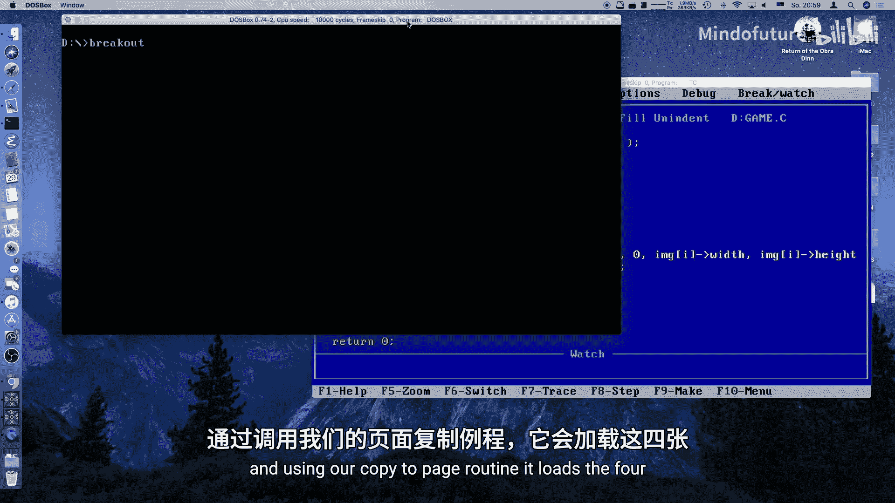

🎼It loads the four images， and then it swaps the images very slowly。

 This is not four frames per second。 This is slower。 This is more like one frame per second。

🎼So our copy to page routine is extremely， extremely slow。

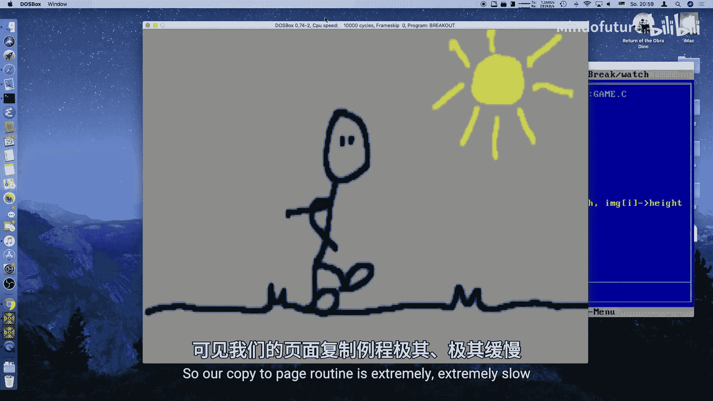

🎼And we can have a look at why that is， actually。🎼And the main reason。If we go here。🎼Let's see where。

🎼Copy。🎼Pages。🎼It's not in GF， It is in VGA。🎼Doty。🎼And somewhere。🎼Further up， here we are。

 copypy to page。🎼It's， it's a very， very simple procedure。 It goes over the y X direction。

 then it reads out the value at the source image。🎼And use a set ps to actually set it in the mode X。

 VGA。🎼In the given page。🎼And set pics were slow。🎼Because。

🎼Set Ps makes two output calls to the VGA to select the correct plane。

 Even if we are already selecting the correct plane， we still do the output。 This is。

Horrendrously slow。 One optimization would be to， actually。Store here in a static variable。

 which plane we selected last。But the problem is， you might have some different chs that change the plane。

Then you're back to square zero and you still have to do this stuff。

So port calls are extremely expensive。 This makes everything super， super slow。

That and the fact that we can only ride  one byte at a time here。And not multiple。Bs。

 because at least on the 286， we can even ride two bys at one time。On 36。

 we can even ride 4 bytes at a time， given。Compil can support a topy can't， but yeah。

That's another problem。We want to change that。And we do this by introducing。A flag。First of all。

 we will introduce a flag。 We call the flag mods。And I'm gonna set it right away to one。

So we can switch back and forth between the implementations。And what this flag will do is。

 instead of。Coll and copy the page。 If mode X is set。

We will copy a different call a different routine。And this routine will be very similar to the cop page。

 at least on the surface。And we will call this function B to page。

 It will take exactly the same arguments。 It will semanically function the same。

 but it will be much faster。Okay。无以 will。Implement this function。Here， somewhere。

 let's see whether the copy to page routine is here。 Let's just put it。Below。嗯。Copy to pay routine。

And let's see。 Did I already define it， Yes， split to pages already here。

 So I probably already put a stub in there。So let's search for B to page。Here it is， yeah。

 this is a step。And when we look at this。And I have to spy on my notes。

So I don't make too many mistakes。The idea here is， as follows。We。Basically， want to。嗯。

We basically want to iterate over all the pages that we have。We would have sorry。

Fingers got messed up。We will have a page variable， and it goes from 0。To 4， or less than 4。Alright。

 so we will go through all four video pages of the VGA。And。We will select only once。 the correct。

Page that we want to write to。 So we write to the sequence controller index register there。

But we want to write to the map mask， the map mask map register。And then to the data register。

 we write。The usual stuff， and the usual stuff is。Normally， P and 3， this selects。The correct。

Page and。We left shift the one because 2 to the power of P is the mouse we want to select。 However。

 we can adjust with an offset here， and we need to take this into account。 so we will。Actually。

 take P plus x。So that the right page is taken， as you remember。

 every fourth pixel in the mode X memory space belongs to the same plane。So， if we start at the。

Pixel number 0。We are fine with just doing P and 3。 But if we started pixel number one。

 then we need to take the next page。 so we need to calculate P plus 1。And then。Maked with the three。

Okay。That should do it。 Ne to close the parents。So we definitely need some kind of counter variable here。

 That's enough if this is a bite。And。Next up， What else do we need to do。

 We need to calculate where in the source bit map we have to start。

And we heard that the bitmap offset。And this will be the plane that we are currently looking at。

Because the actually the memory that we will be btting。Will be。

Sttored in such a way that it's exactly like the mode X memory。 So also in this pagewise fashion。

 we won't have continuous pixels as in the mode 13 case or S B load gifts。Right now。

But we will put them in memory， in the main memory， exactly as Moex wanted once。

So we need to calculate an offset。With a page included。

And this will be the page number times with time height， because that's the size。 But， of course。

 every page is of width。Divided by4。Because it contains only one quarter of the pixels。So， we need。

A couple of more variables。We need a double word for the bitmap offset。And we。No。

 we already have the width and height as a peri。 That's fine。The same goes for the screen。

P the screen offset that。嗯。Here， we will take the input y。Times the current PGA width。

Which should be 320 in all case， here。Plus， the x coordinate that were shifting and the。P page。

And all that divided by 4 again， I can also write divide before that。Doesn't。Mettters so much。

 So this year will be slightly faster。If the compiler is a bit stupid。But we can also write this。

 This， this won't make much of a difference。Okay， now we have the bitmov and screen offset。

And then we need to， we can now copy whole lines。 And that's the main advantage。

 We only need to do the port writing once per page。

 and then we can do efficient memory copying per line。So， we take some。Iterate variable J。

It doesnn't matter what its name is， and this runs up to the height of the copied stuff。

And we incremented。And we probably should also introduce it up here。

And we should also introduce the screen offset。And did I forget anything。

 I think I think this looks pretty okay。And then， we actually do。The me'm copy。

 the me'm copy it takes。The destination pointer， which is the VGA memory。

 We defined that already in the previous episodes。嗯。Plus， whatever page we selected up here。

This is the page also， basically for the screen。Plus， the calculated。Screen offset。And yeah， let's。

 let's break this so we can read it better。Then comes the source pointer。

 We are taking it from the source image。And we at the Bimap offset， we called it。To that。

 that's fine。And how wide is our line， our line is width divided by 4。Well， that's great。

This is our memco we call。 It looks maybe a bit weird in ended it like this。

 but I like to do it this way， because then you have one parameter per line。

 If the parameters are calculated， this is， I think， much easier to read。O。Now。

 we have to increment our Bimap offset， because after every line。

We were incremented by width divide perform。 This is the length of the line。

And the same for the screen of set。Here we take the VGA width。divided by 4。Okay， this， in theory。

 is already our b to page。Does it compile？One warning。

 which is fine because I already have a different st in here that we will take a look at in one second。

And then it should work。 Let's see what happens。But。Nothing happens。O。Yeah， here we are。

 So this looks like this。 And this is actually what the memory more or less looks like when put into the planes。

So everything is shifted in multipied per four， and it looks totally weird。

Because the memory is not yet in the Mos format in the main memory。 And we just copied over。

 So that's wrong。 We need to change how we plot the pixels in the gift loading routine， obviously。

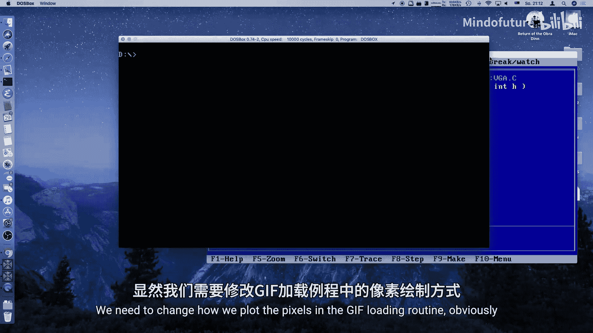

So， and the actual error that we just had was that Tobui had a crazy thought。

 I wrote the wrong variable here I instead of J， and it didn't compile at all。

 but also didn't give me an error。Let's wear it。 Sometimes T he does this。

 then you have to restart it， and it will recover。Everything's fine now。 So let's go to the。Gif。

First， we' get head on。Let's say we want the load gift to also know about storing in mode X。

 So I will give it a mode X variable。I will change the main。Game function。To also pass to。

IHere we are not using spaces。 Okay， I'm taking it out。So we， we pass it to the load gift routine。

That it can plot the pixels in a different way。嗯。有。Where is Logiif， Let's find Logiif。No if's here。

We pass。The mode X flag。And then we need to look at where the decoder is。

 And I think I already added。No， not here。 I need to look at the decoder structure。Just。

Right here at the top。Right， at the top。No， we don't。 didnn't edit yet。

 we will also add the Mo X flag。To this。Then we find the Lo function and wherever。

The decoder is mallloed。 We can already set this decoder。Mode X equals mode X。

 because then we can use it in the next pixel routine。 The next pixel routine， if you remember。

 and if you don't， you should definitely check out my video on loading G and not gifs。

I will put a inex cart in the top corner， if possible。

The next pixels routine unpacks the next pixel that was decoded from the gif。

 It's basically a fancy plottting routine。It handles interlacing as well， and stuff like that。

But mainly， we want to simply change it。 We want to also have it。呃。Use modex。No。

 we don't want to put it here put it in the Dakota state， which is， which is absolutely much。

 much better。So。If the decoder。Moexs said， we do something different。From the typical。

Setting the pixel。But what actually do we do？Now， it becomes a bit more complicated。

 but not that much。 First of all， we need to deal with the planes。 so we will calculate the plane。

The plane is very simple， actually， the decoder x coordinate contains the current x coordinate。

And as we all know， X modular 4 gives us the plane。

 which is how we set pixels and modes in the first place。嗯。

And the actual x coordinate that we have in memory。Is the decota x variable divided by 4。

 because every plane contains only one quarter of the pixels。

So now we have the plane and the X new X coordinate。Then we can compute the offset into memory。

And the opposite is， again， the plane that we calculated。Times the size of the x axis of our image。

Again， and divided before。You to the。With one linena modex。Times the size and dimension， y。

Of the whole image that we're decoding。And that's actually it。So we need to define x1。

And offset up here。And we need to set the pixel line。But this is nothing hard anymore。

So this will look just like below it will be the color mouse to 255。 so because it's an integer。

 it could be bigger。Shouldn't， but could be。And again， we take the。Image data pointer。

We add to it the F that we calculated。Which gives us。Yeah， the pointer into the page。Plus， of course。

 we need to take the Y coordinate。Times。The size of the and the width of the image divided before plus our coordinate x1。

Yeah， so the offset is just the plane offset and the part behind that is the calculated pixel offset。

 which is the typical formula， which is usually simply y coordinate times width plus x。

 and this time we have y coordinate times corrected with plus corrected x coordinate。And that's it。

That should， in theory， already work。Let me get six  errorss。Pe isn't of course。

 defined because I' forgot that。So let's make that a word as well。

And we mistyped decokota and what else。🎼Oh yeah， we should probably put a semico on there fixing errors as we go。

Deeclaration index error， okay。 There should be anels and the curly braces。And it looks much better。

 Now， have a look。Let's start it。 load four images。And it's fast。 This is four frames per second。

 And just for giggles， we can crank it up to the maximum。 Then we can compare。

 Let's just take out the delay。

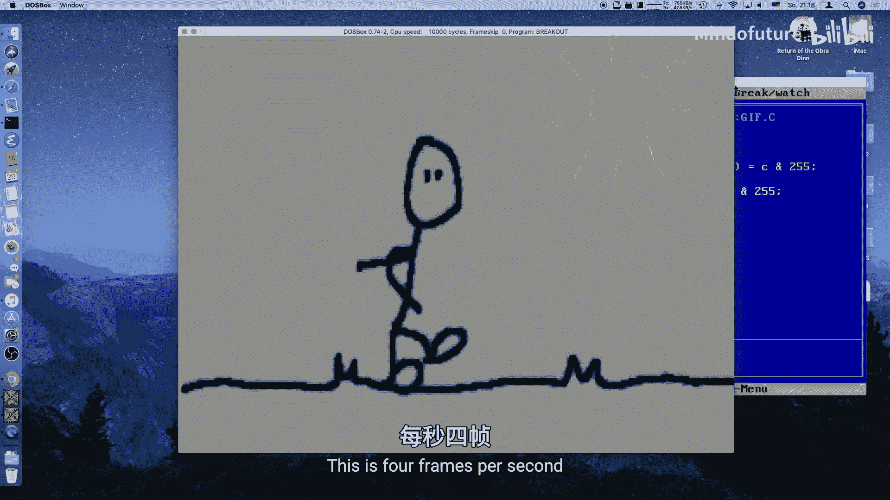

Now， it's just limited by the page flip， which syncs to。Okay， again， it doesn't compile。

 So I have to do all the compilation steps manually。Now just thanks to the vertical refresh。

 which is 70 Hz， even on the simulated dust box。

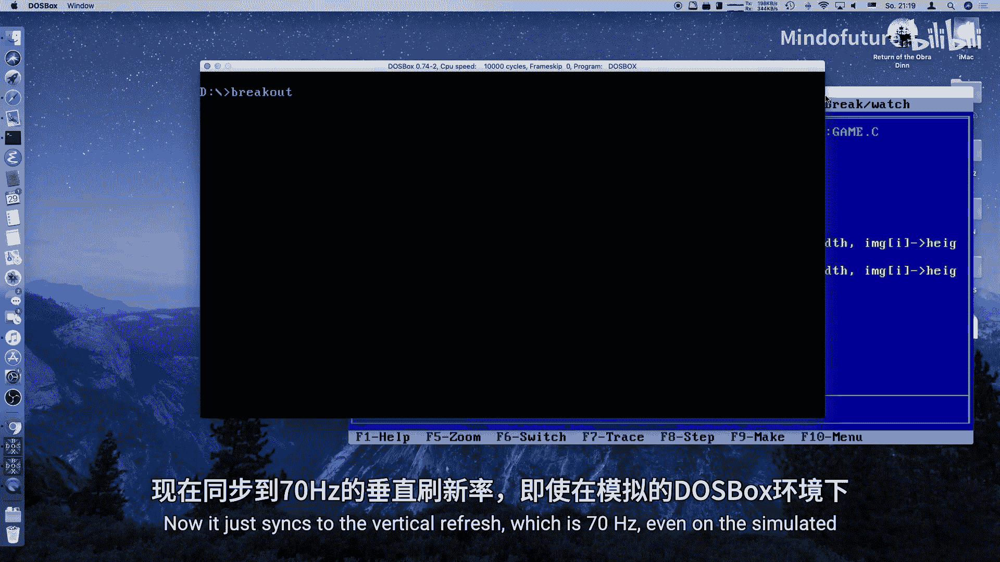

And it be crazy fast。 As you can see， it's crazy fast。🎼This is how fast we can copy。

 at least on dust box。 We will test it in a minute on a real 3，86 PC。

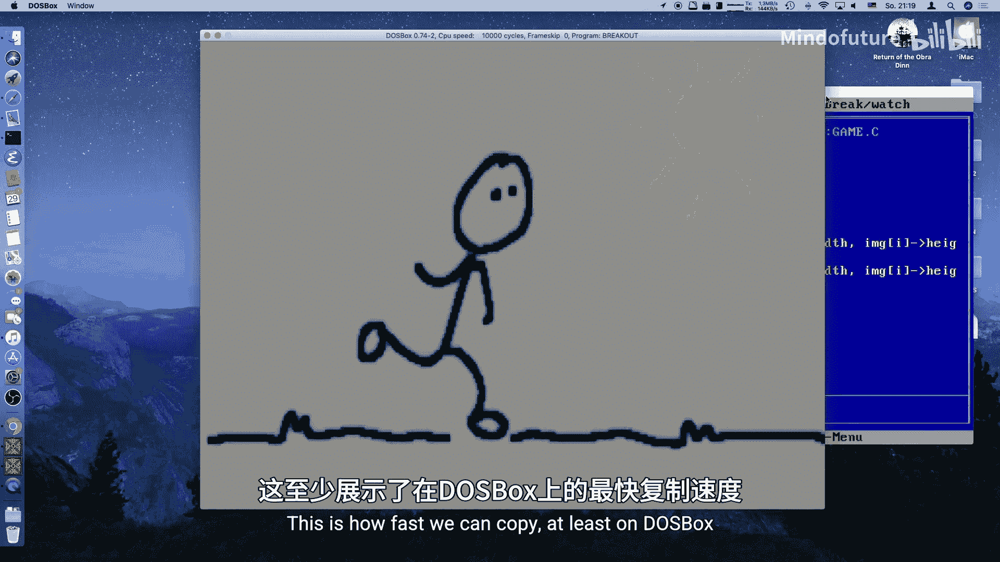

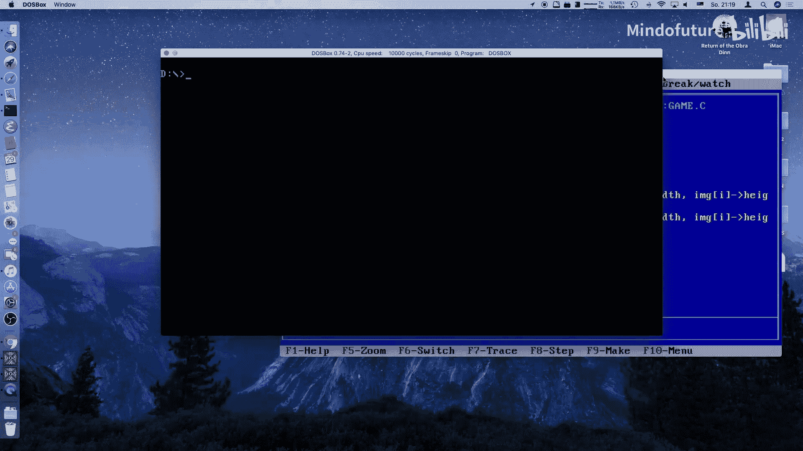

🎼And now， just for gis， we change the modx variable to 0。 And then you see the raw performance。🎼O。

🎼The set picks the routine。🎼And here we go。🎼And this is the raw performance of a side pixel solutionin。

 as you can see this is roughly two orders of magnitudes slower。

🎼I think this is one frame per second versus 100 frames per second or something like that。

🎼So now we have some pixel bttting routine， which is。

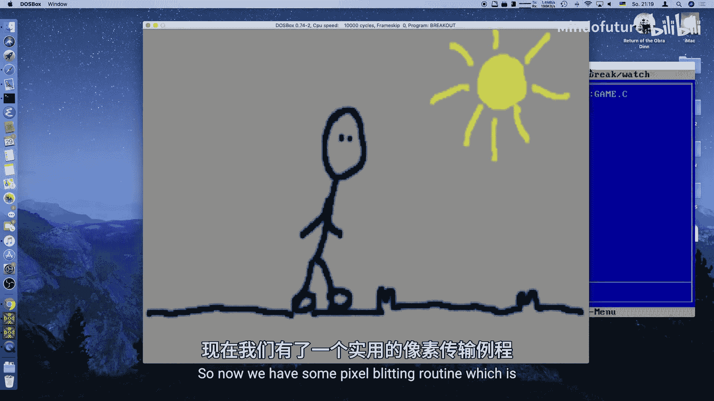

🎼Actually， useful， and。🎼Yeah， I think this is extremely。🎼Hopepful in making the game actually work。

In a meaningful way。🎼So what did we do， we tweaked the loadka routine so that it actually loads the pixels into main memory in the same way that the VGA actually requires them。

🎼Then we tweaked or created a b to page routine。🎼Which only has to do the port commands four times for every plane once。

🎼And then we copy the data for each plane line by line， because this is what works。

 It doesn't matter what the size of the image is as long as it's smaller than the VGA screen。

🎼And this is extremely fast， as you can see， and this we can use in the next episodes to build actual runnings。

 sps and fast。Game action。🎼And now Ill switch to the 36 and we have a look how it performs if it works at all on the machine。

 I hope so。🎼Yeah， so let's turn the 386 on。Okay， here we are on the real machine。 and yeah。

 let's just fire it up。And let's take a look。😔，🎼So the loading is slower because I tune post box to be a bit more faster than the 386。

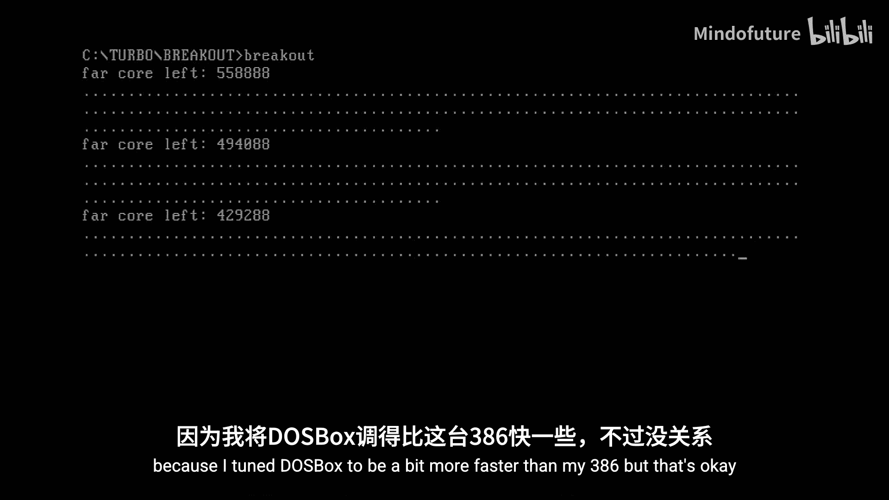

🎼But that's okay。 And as you can see， it's crazy， fast as well。 And this is on a lowly I A bus。

 no less， which is 60 bit。🎼And only like， I don't know，8 MHz or something。

 So you get at most something like， I don't know，16 Mby per second。 maybe if you're lucky。

 probably much less。So this is actually pretty impressive that the VGA can push this much using MoX and some。

🎼Slightly clever programming techniques。

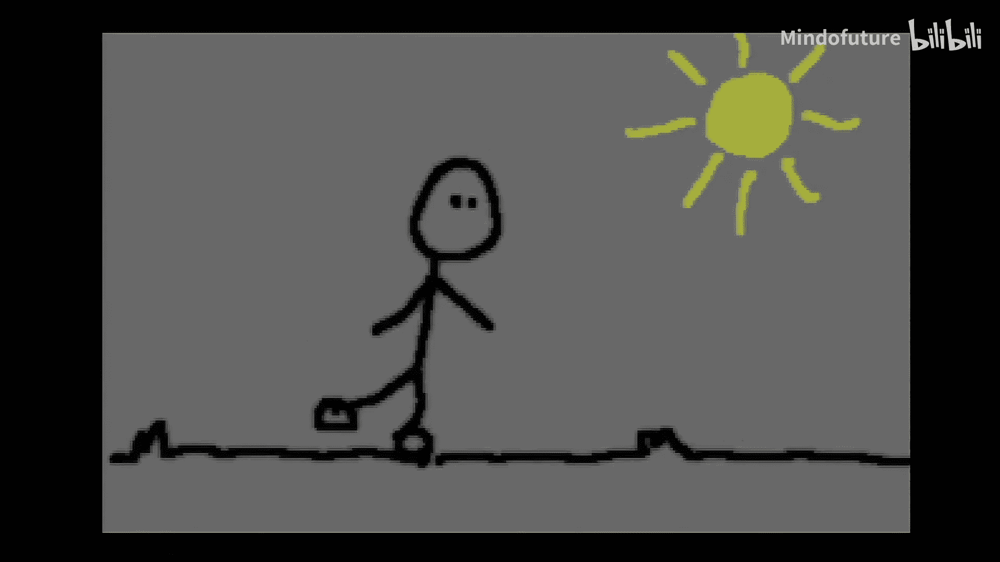

🎼Okay， hope you don't get a seizure from this。 I'm gonna stop this now。

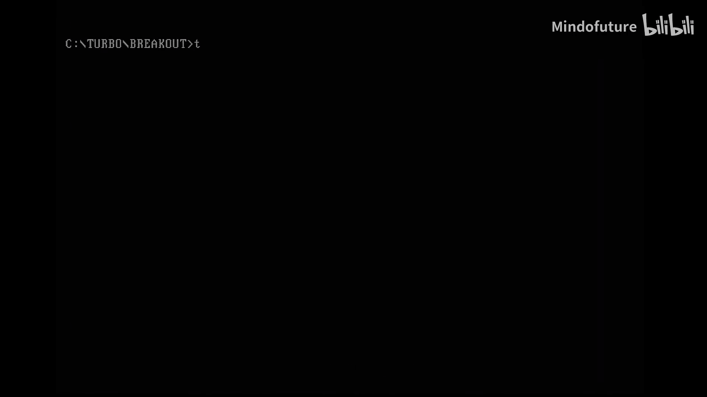

🎼And。🎼Yeah， let's have another look。🎼So I hope you learned something。

 This is definitely something that we can build on for our progress in this little gaming thing。

🎼And I hope to see you soon。 Please share a like and definitely subscribe if you。

🎼1ant to and live alike or dislike。🎼Leave a comment。 Let's have a little discussion。

 You can also post some。🎼Comments on what I should cover in the future。 I can only make。

Like one or two videos of these every month。🎼So far， because time is very limited。

 but maybe in the future， we can ramp this up， so。🎼Yeah， leave a comment and see you next time。

 goodbye。🎼うん。🎼The。🎼。🎼やほ。🎼。🎼。🎼。🎼あ。

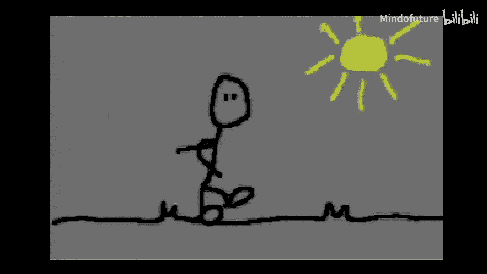