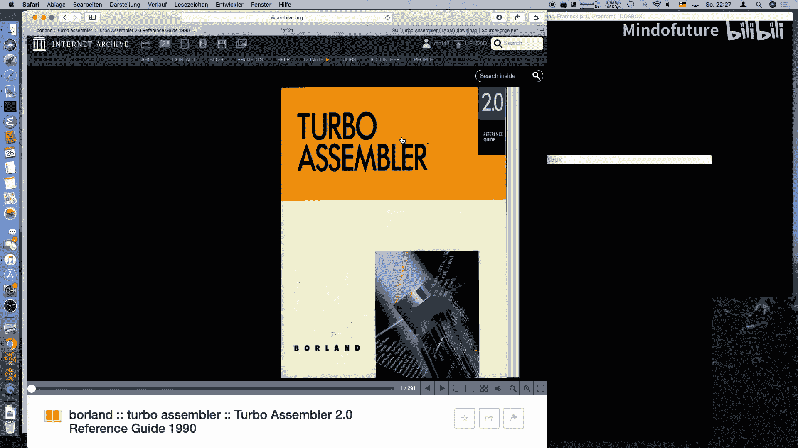
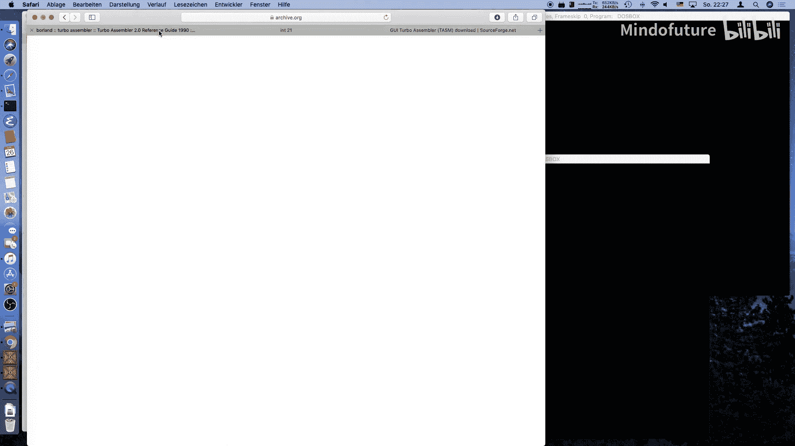
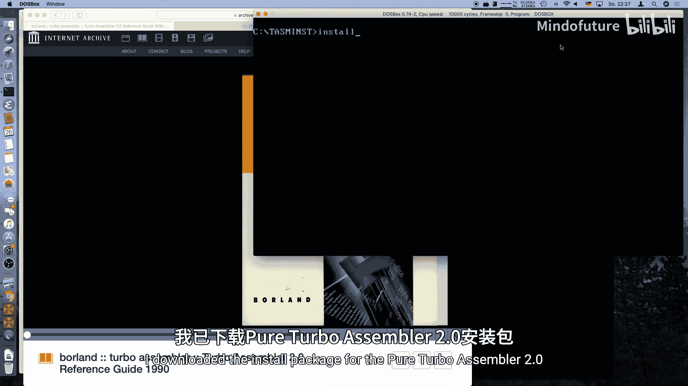
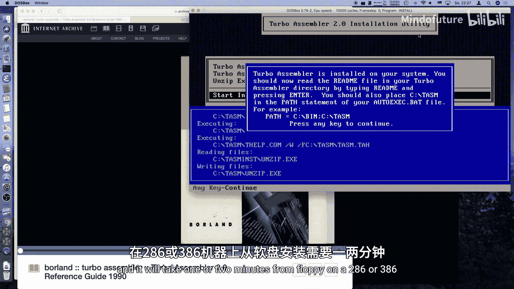
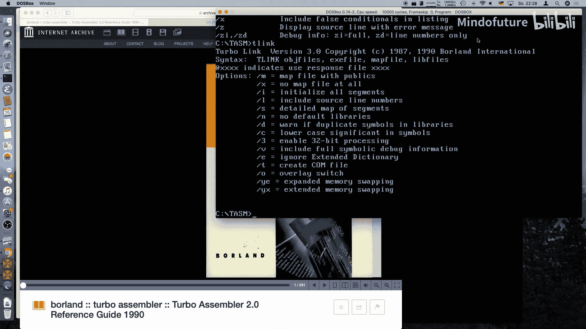
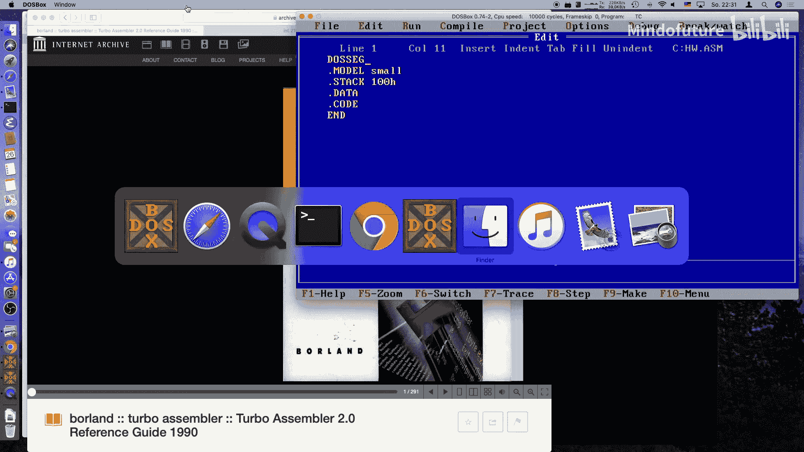
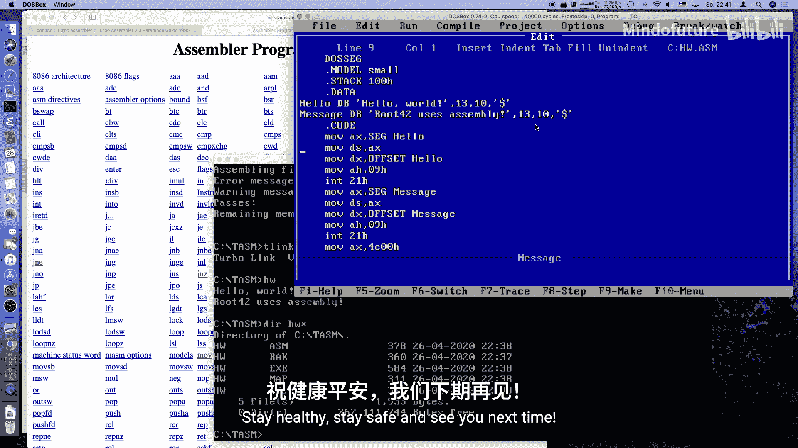

# 编写MS-DOS-系统-｜-windows-｜-操作系统-｜-汇编--｜-vga-｜-x86-p20-P20-Lets-Code-MS-DOS-0x14---Hello-World-in-x86-Assembly--BV1zs35zQEru_p20-

Hello， welcome， and good evening。🎼To another let's code episode at this time concerning aseler for Amisttoos。

🎼And yeah。🎼This will be not that long of an episode， and it will deal with the very basics。

 because I just moved house and nothing is really set up。 And I just already recorded this video。

 but the sound was pure garbage。 because I don't have my microphone here。

 And I have to record with what I have。 And since there's not this。😔，🎼Much stuff in the room。

 The echo is pretty pretty bad。 I hope this sounds now， quite some。

Something better because Im basically holding my phone up to my mouth。But， yeah。So is life。

 But let's get started with the assembly。🎼In the last live stream。

 we did a bit of inline assembly for Tobay。😔，🎼And yeah， I wanted to try out the tobo and LED self。

🎼Because assembly language is pretty basic and not that hard。

 it's often cited as being for the experts but I think we can do a hell work program today。😔。

🎼And you can use a different assembler， of course， there's Microsoft's macro assembar or later versions of the To assembler。

There's the netwide assembar， N ASM。And some other stuff， like A 86。🎼And much， much more。

 But since we are using Tobo C 2。01 in this series。🎼The top as similar 2。

0 was actually pretty fitting。 And you can look at the manual on archive dot org。

The software itself is not for download available on。Legal sites。 but there are some。Graish。

🎼Let's say not quite legal download sites that archive a lot of Microsoft related software。

🎼For the old doss machines， which are not commercially interesting any more。

 And if you search for Tos and 2。0 download or something like that， you will probably find it。

 or you can buy a used copy on the market。🎼But it might sometimes be hard to get hold of it。🎼Anyway。

 there's also on sourceforge， the Gui Tobo assembler for Windows。

 which includes the ball and Tobo assemblyemble and Toblelinker。 I'm not sure how they license it。

 but it is there and。

🎼I haven't used it because I'm running Macs， but you windows guys probably can。😔，🎼Tried out。

 And supposedly， it should be fine。For learning assembly stuff。

🎼At least according to the screenshots down here， it looks pretty okay。

🎼But other than that， yeah， let's， let's get rolling。

🎼I downloaded the install package for the pure To assembly 2。0。

🎼I'm going to run the install program install from my hard drive to my hard drive。😔。

And this will be very quick， and it will take one or two minutes from floppy On。

286 or 386。🎼So that's that when you switch to the Tassim directory。😔。

There will be lots of stuff in there。😔，🎼A lot of example assembler files， which is pretty nice。

 some C files and how to interface C and toolware assembler。🎼And yeah。

 we can run the tour by similar just per writing tasan。 It has quite a few options， but。

🎼We won't use any of those for today。 That's fine。And whenever you put an assembly file in there。

And run Tasim， it will produce an object file O BJ。

 which is basically the assembled bytecode of what you just wrote。But you can't run this for that。

 you need the linker called Tlink。Conteling will create an ex file from the OBJ file。

And that you can actually run。

So let's run to see because we need an editor。嗯。And we will write this to。

A problem called hello word dot Cno， dot A M。And what does an asmbr program look like well。

And a similar program has different segments， and the most important segments that you need is the code segment because you will put your code there。

 obviously。But this is not everything that you can have。

If you look at the ball and toba assembly menu， it will tell you you will also need to specify the memory model。

 which we already know from Tobo C and we can actually have a look here。😔，If we go here to the。

Compilr options。 you can choose between5，6 different memory models from tiny to huge and depending on that the kind of the pointers and the amount of code and data that you can use varies。

For now， we will use the small memory model。 That will be fine。

We also need to specify how large our stack is， because whenever we make a sub procedurecedure call or push something onto the stack。

Well， we need space for that。 And this is done by specifying dot stack。

 and then some arbitraryrbit value，100 hecx is 256 bys。

Which should be enough because we actually are not going to do much of that anyway。

The last segment that you need to specify is。The data segment。And here， we will put our。Variables。

 basically， and how to do that， we will learn in a second。One more thing。

 if you're writing in Dos program is。To write the directive dos sec。

 which means that these segments will be ordered in the way that Microsoft actually。

Wanted them to be ordered。

And we can have a look at this。In the manual， which are downloaded for convenience sake。

And here around page 108， we find this。😔，The dossec directive causes the segments in assemb program to be grouped according to the Microsoft segment ordering conventions。

 For now， you don't need to worry about what that means。

 All you need to know is that almost all standalone assemb programs will work just fine。

 if you start them with dosec。So that's fine。 And also dot model is explained here as well as the other directives。

So you definitely should have a look at that。It's pretty interesting。😔，Stack。

 code and ta are mentioned here as well。 and here can already see how variables are declared。

You can declare word by it or。Several other kinds of variables。

And you already see here what a string sort of looks like。And let's dissect that a bit more。

So we need to put something in the data segment， obviously。

And our hello world message will be called hello。And it will be a string。 So we have single bytes。

 So DB defines our bytes。And you can simply write a string by writing it in these single quotation marks。

So we'll put hello word in here。😔，And when we look at how does actually。Outputs。Data onto the screen。

 There's one function。They interrupt 21 function 9 print string。

 You already know interrupts from our Tobu C examples where we use it for video mode setting and similar things。

 so。To access this function， we load the value 9 into the A H register。

 Then we need to load D S and D X with the point of the string。Ending in a dollar sign。

And that will output the character string to standard out。So actually。

 we need to put a dollar sign here。And how do we load this stuff well。First of all。

We need to load the address， and usually you won would do something like move theirs。And then。

 the segment of the。Variable， which you can do while writing the sec macro。4。😔，The hello variable。

But this is not allowed。 You can't write it directly to the segment registers。

 This is some kind of security feature of the In CPU。

You first need to load it into a general register like A X。 and then you can do move。D S comma X。

 So this will load the segment。Part of the address of Hello into AX， then push that into Ds。

Now DS S has the correct value， and we need to load Dx with the offset。And for that。

 we have a macroco offset that。And again， we use hello for that。Then， we can。Load。

A H with the function number 0，9。And corn。The interrupt 21。エクス？Which will print our stuff。

So this should， in theory， work。We can try out。If this is actually valid stuff。

 So second do window and gonna try to。Assemble this。There were no complaints， which is fine。

 Then we're gonna link this。Because it produce an OBJ file。 And now we should have。

All our files there。 Yeah， there's a hardware ex file。A hardware had a world X file。

And it gives us a du error， which is interesting。And this is because。

We probably didn't quit the program correctly， I think。嗯。Other than that。

The segment and the offset should be fine。😔，Yeah， I think we should quit the program correctly。

 and there's a function for that as well。 So Do says tons of function， as you can see。

 for file handling networking。And most broadlydily terminate process with return code。

This is something that we should definitely do。 AH will be loaded with 4 C and AL with return code。

So we can directly write to X and write both values at the same time for c is c。

Fun and 0 is our return code because everything is just fine。And that's signaled by。That。And then。

 we can run。The test again， and link and run。And there you go。 We get a hello word。

 our very first programme。No one will think。One little thing to add is。If you want。

To write a second string， we can just define another variable， right。So。Let's call it message。

And this will be called。Route 42。Users。Assembly， yay。😔，And we can copy the whole block here。Later。

 we will learn in in a different episode， we can learn how to， do loops or。

Function chs or something like that。But for now， this is fine。

 the data segment is actually staying the same， but we load it again just to be on the safe side。

We will output the second message。And what's gonna happen， or do you think。Actually， it works。

 but everything is more lying because the print string。Does adjust that。

 It doesn't print any new line。 And if you wan to do that， you need to split the string and。

Put in the values。 they ask values for oops， sorry。🎼They ask values for those new lines。

 and those use actually two characters，13 and 10。🎼For carriage， return and line feed。

🎼And Ex use only one of them。🎼Which is。🎼Point of concern for a lot of programmers who have to switch between platforms。

🎼When I do this now， we should get a new line on every output。So let's assemble it again。

🎼Link it and run it。 And there we go。 We have two lines printed to an assembly。

🎼And this was actually pretty easy right， so all your assembly programs will look something like this。

 define the model， define the stack， some data， some code。🎼And then you use some upcodes。🎼And by now。

 we only seen two different of codes， moth and int。 But there are many more for looping for。

🎼Calculating stuff。 But you already learned how to put stuff into registers。

 how to load a segment register， how to get addresses of variables。🎼This is quite a。

 quite a bit of stuff。🎼So if you have any questions。

 please put them in the comments and I can also do， for example。

 a little primer on assembly language。In one of the upcoming episodes。

 you can go to the LPC website and look up all the basic assembly commands for the X86。

🎼There are other sides which do that probably more comprehensively also for 386 entire stuff。

But this is already pretty nice。 You can check out the morph。

 for example and see what kind of parameters it takes。🎼How long it takes on different CPUs。

 And this is pretty nice。 And also look at the different jump instructions。

🎼Which you need for doing actual， clever code。That does something。🎼So there's a lot to be learned。

 but I think this is already pretty nice and shows that assembly isn't quite that black magic。

 but actually a pretty simple language。🎼It takes， of course。

 a little bit of work to write bigger problems in it。 And you have to do everything manually。

🎼This would have been just two print of lines in see， but here it is quite a bit more involved。

🎼But you get a pretty compact program if you look at this。We have。🎼I'll come on where Here it is。

 We have a program which is 584 by in size。 We can even squeeze the down much smaller life if we don't produce an ex file but a comp file。

🎼We'll do that in a different episode。😔，🎼And maybe we can try to write some small nice。😔。

🎼Little mini graphics programs or even games in assembly。🎼But for today day， I think that's it。

 Please share， Like and subscribe the video。 Leave a comment as I said。

 Don't hesitate to put some questions there。🎼And also， if you like。

 you can support me on Patreon or cofi， if you can't do that for whatever reason， that's fine。😔。

🎼Stay healthy， stay safe and see you next time。😔。

🎼The。🎼。🎼ああ。🎼。🎼。🎼。