# 编写MS-DOS-系统-｜-windows-｜-操作系统-｜-汇编--｜-vga-｜-x86-p21-P21-Lets-Code-MS-DOS-0x15---Sine-Tables--BV1zs35zQEru_p21-

🎼Hello welcome and good evening to another Let's code a session this time with a little filler episode and this is regarding a topic that I got a question about in the YouTube comment so it's always worth leaving a comment if you have questions I will try to answer them and sometimes the topic is even complex enough to warrant another episode or some explanatory video。

🎼And today's topic was that one viewer said。🎼He or she doesn't really understand what I'm doing in the different programs with the sign tables。

🎼And a sign table。 Well， we can have a look here at。🎼The code that prepared。

🎼I used this in quite a few programs， for example， in the cop program。🎼Where I display copper bars。

 they are animated by using signine tables， the motion here is sine wave。

🎼And if you don't know what a sine wave is， then。😔，🎼Read up on that on Wikipedia。

 but I think you should have learned that in school it's basic trigenometry。

🎼There was also a very nice video today on。🎼Was it number file， I think？

Explaining what the sine function， how the sine function can be interpreted。

🎼I probably will link to that with a card。And。🎼Yeah， it's a very basic thing。

 especially for doing animations and similar things。🎼Yeah。

 and we are using sign and cosine tables here。Because。

Actually computing the sine and cosine is very expensive。

Let's have a look here at the 8087 instruction set， the 887 is the floating point coprocessor。

🎼Of the PC， basically， and。🎼Back in the day when we had those machines before the 486。

 not every machine would have a coprocessor。 and if we look here for the F S function，🎼First of all。

 F sine and cosine on the FPO were introduced only with the 387， so the core 2 the 386。

🎼And this would take anywhere between 122 cycles。🎼And 771 cycles compare that to a simple move operation or。

🎼Some simpler operations like Sepro mode， which take only a couple of cycles。

🎼So calculating the sine and cosine even with a co processor is extremely expensive。

 extraordinarily expensive。🎼Loading the value for memory is always much faster on those computers。

🎼And the 8087 and the 287 didn't support this instruction directly。

 so you would have to code your own approximations。🎼Using。🎼Some kind of mathematical tricks。

🎼But we want to deal with that because we will have an implementation until oversee that does that for us。

🎼However。🎼We want to make it faster so we use these tables so that we can simply look up the sign values in a table instead of computing them。

🎼And I ended up with using some expression like this， which。🎼Fair enough， looks pretty complicated。

🎼But isn't that complicated at all？🎼I'm going to plot the function。

🎼Make a graph basically an animated graph of what it looks like and。🎼Usually you would say， well。

 why don't you just take the cosine， the cosine of the value and put that in the table。

🎼We can do that。The I runs from 0 to 256 because I want to store 256 values。And。

When I do this and run this thing， then we get something that looks more or less like a flat line with sometimes a little dip in there and it's running at the top of the screen and it doesn't look nice at all。

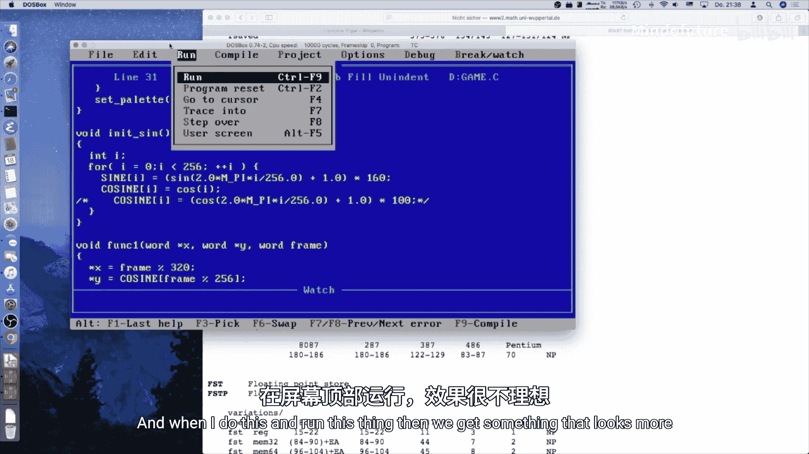

Okay， this is because the cosine is。Producing values between-1 and1。

So that will shift maximum to pixels。And the same goes for the signine because sine and cosine are just shifted by a certain amount。

In the horizontal axis， basically。So let's make the amplitude of this function larger。

 and the amplitude can be changed simply by multiplying with something。 So if I multiply by 10。

 I should get something that is 10 times higher in the。Vertical direction。

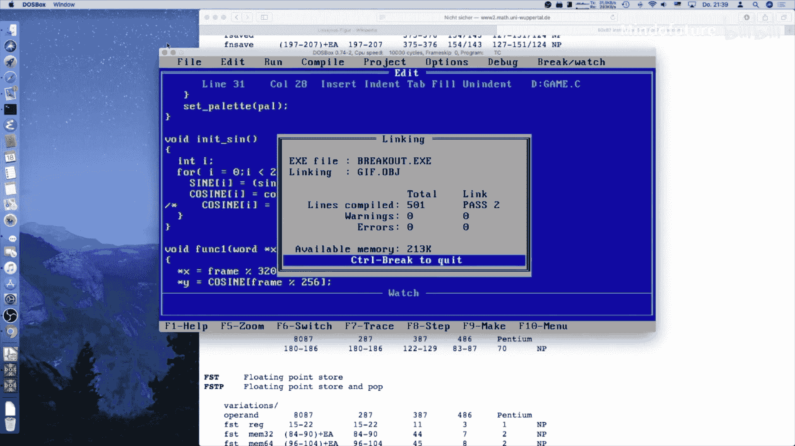

So doing that， yes， now it's not one line anymore， but it's sort of like a scatter plot of tons of dots。

And that is because we give input values between 0 and 256 into this function。

And that's not how the sine and cosine are defined， that sine and cosine are defined in radiance。

Radance is a measure of angles and one full circle。

 That is one3 and a 60 degree angle is2 pi raddiance。

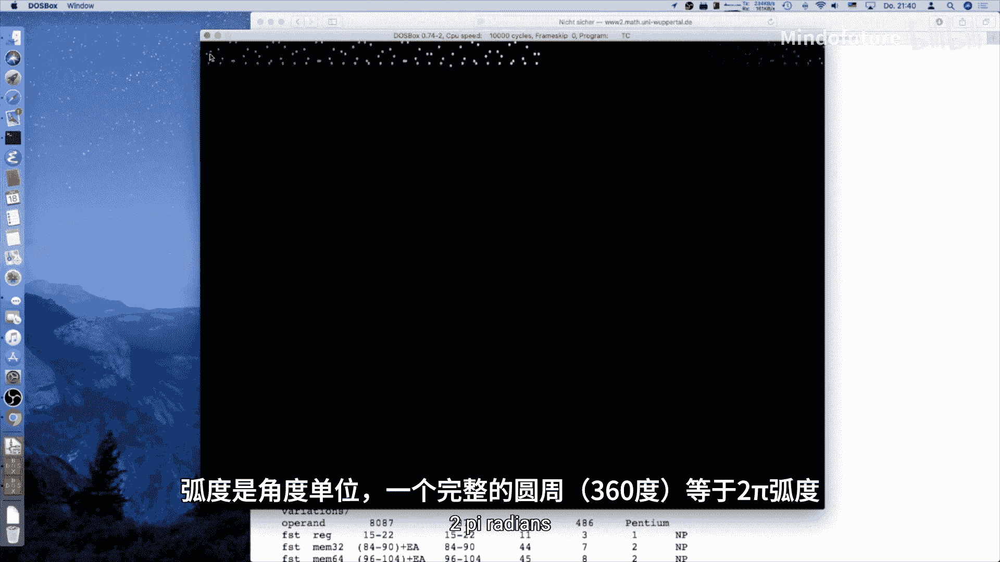

So actually， something of the size to pi is。Expected here。

So if you want to describe one full circle after which the cosine repeats itself because it's a periodic function。

 so we only need to store this。We can。Do something like two times pi。

This will give us one full circle。But if you just。To this times， I， of course， we get。

But something even worse here， we get garbage again。

What we actually want to do is we want to have a value between0 and two pi。

And we get that by dividing I by 256。Point0， this is important。 Otherwise。

 this will be an in division， and this will be always 001。So if I， first of all， delete this。

 if I do this， then I will get for I equals0， I get0 for I equals 1， I get 1，200 over 256。

And then two over 256。 So slightly a number that is slightly getting bigger every step。

 And in the end here， I will get 256 over 256， which is one。 Then we have the full circle， basically。

But only from 0 to 1， if we do this， this already looks better。 We get a relatively smooth function。

 but suddenly it drops off because we're only going from 0 to 1 and not from 0 to2 pi。

 which is roughly 3。28 6。28。

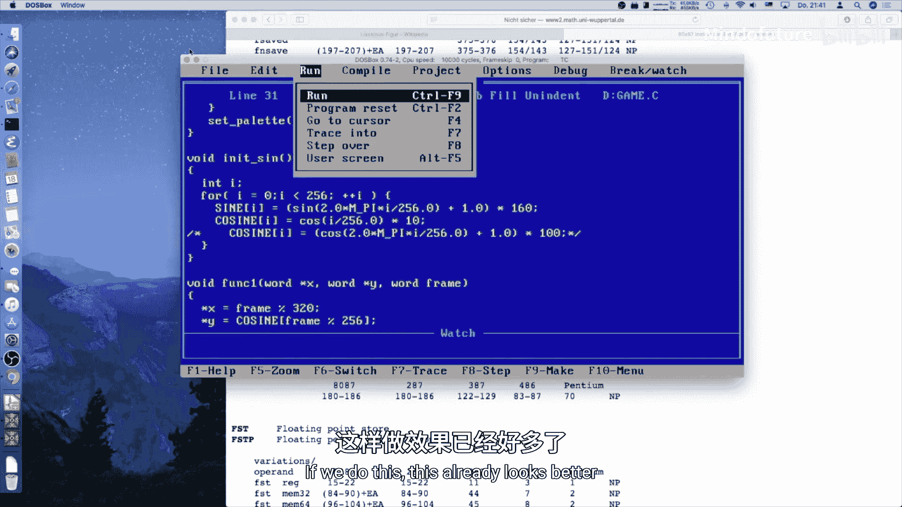

Because it's twice 3。14。Roughly。So。If we multiply this。By。2 pi。

We get something anywhere in between 0 and2 pi。

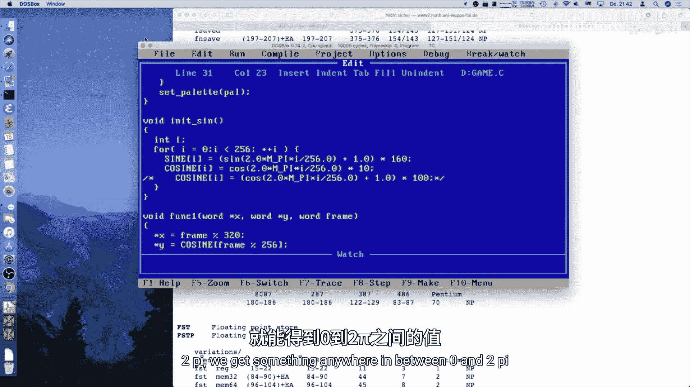

Running this will give us。A pretty smooth function， however。

 means running out of the screen for some reason。

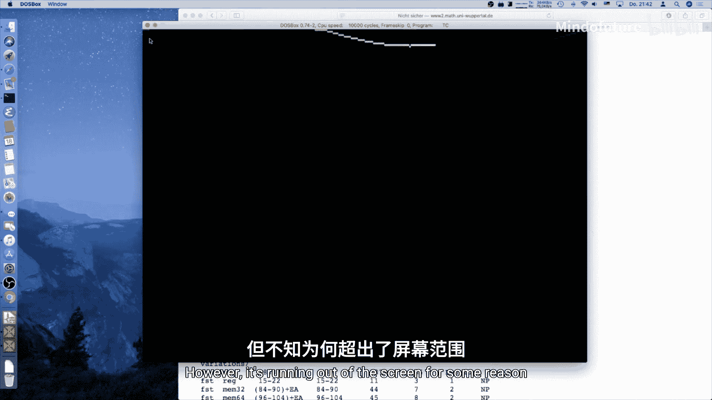

And that is because the cosine gives us values between -1。And one。 So if it goes-1。

 then it will run out of the screen and draw up here。

 and then it comes down back again and goes back up。So we need to do something more。 We need to take。

Whatever is in here。Whatever the co on returns。And add the number one to it。

Because then the negative minus-1 becomes 0， which is the top of our screen。

And plus 1 becomes plus 2。And that times 10， we get something in between 0 and 20。

 so we should get something relatively large on the screen。

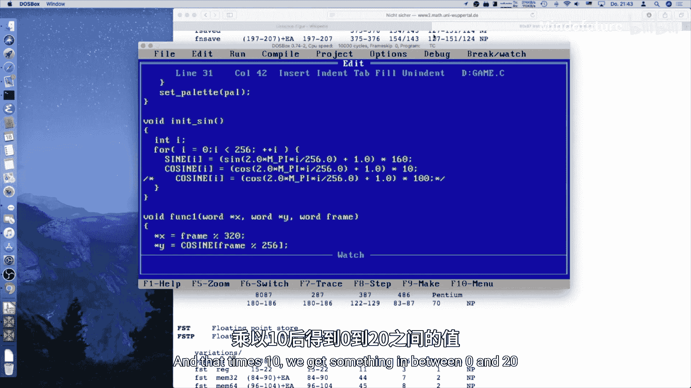

And indeed， we we get something in the first 10% of the screen， a very nice， smooth。Cosine function。

Which。Looks pretty nice， doesn't it。Hi Vi， I want to use the whole screen width to draw something。

 I need to scale this a bit further。

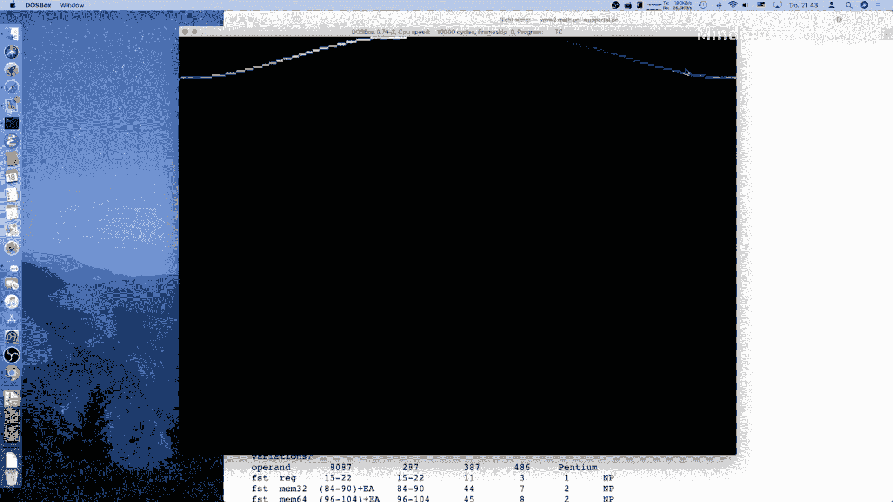

And。Usually， you will use some power of two that you multiply it with。

 but we want to draw on the screen。 So this is why I end up with。This down here。So。Our。

Screen is 200 pixels in height。 We are producing something between 0 and 2 here。

If I might apply the two by 100， I will get 200。 So this whole expression will give me something between 0 and 200。

 which。Perfectly fits。The 200 scanline on my screen。 if're on this。

 I should get a full screen cosine function， of course。

 with a little bit of holes in there because our resolution here is not that high and the jumps between each pixel will be a bit larger than one pixel。

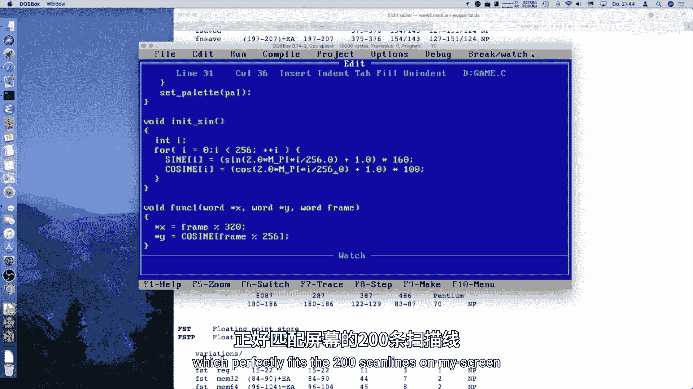

But as you can see， it is a very perfectly fine。Cos and function。And yeah， it works。

 We can increase or decrease the frequency， of course， by actually。

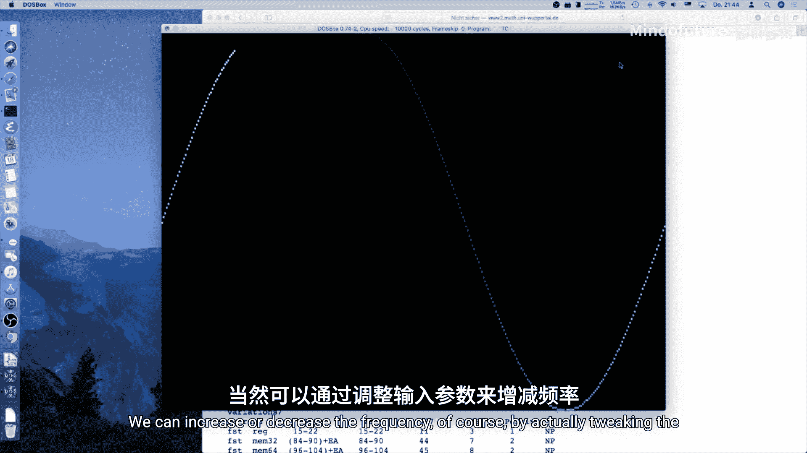

Tweaking the parameter that we put into here。 For example， I can not go from。

2 pi times I divided by something。 I can either multiply here by a certain factor like times 4 to increase the frequency。

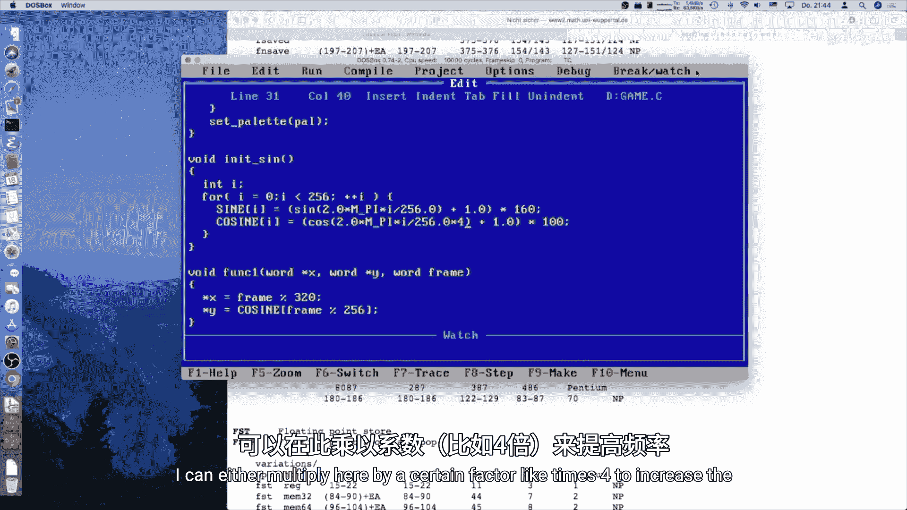

Then I get a high frequency cosine curve if I want to have like fast animations。

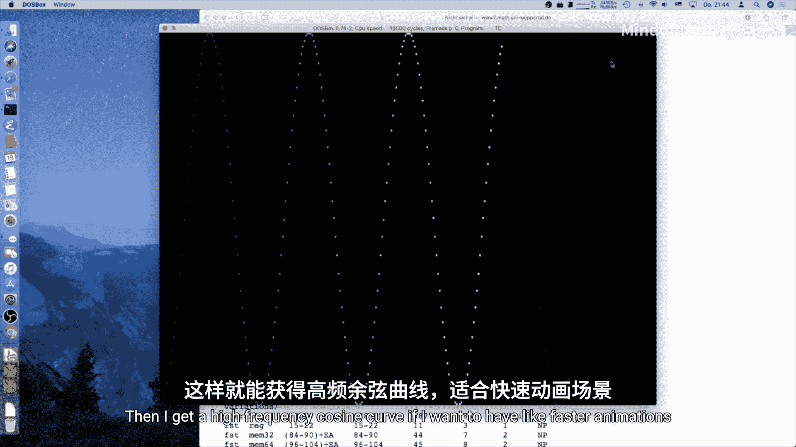

Or I can make it even slower。 I can do times 05。

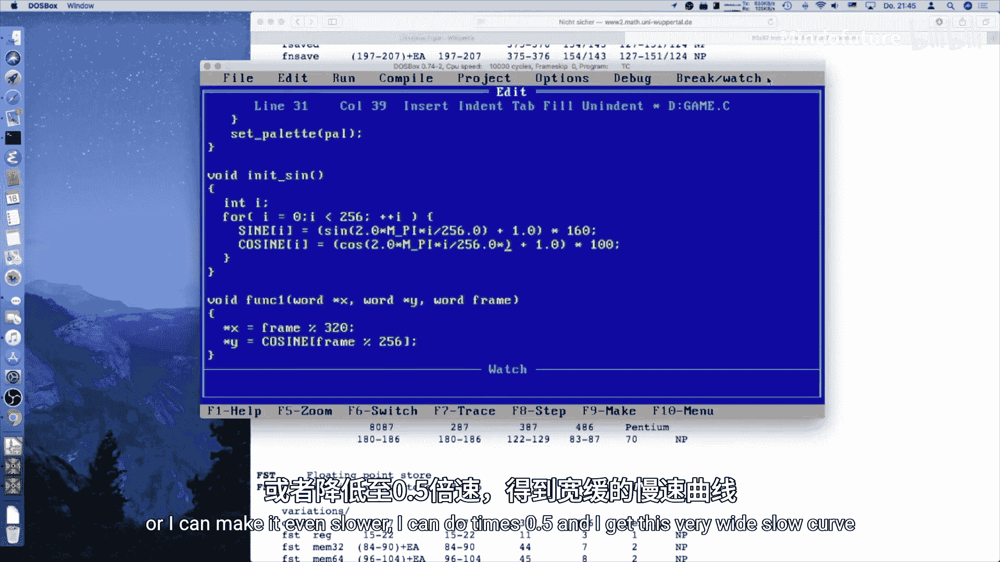

And I get this very wide， slow curve。And actually， it doesn't fit in our table anymore。

 That's why there's a jump。

But we don't want that。 We want exactly this because we can scale it later。

 because now we have a perfectly。

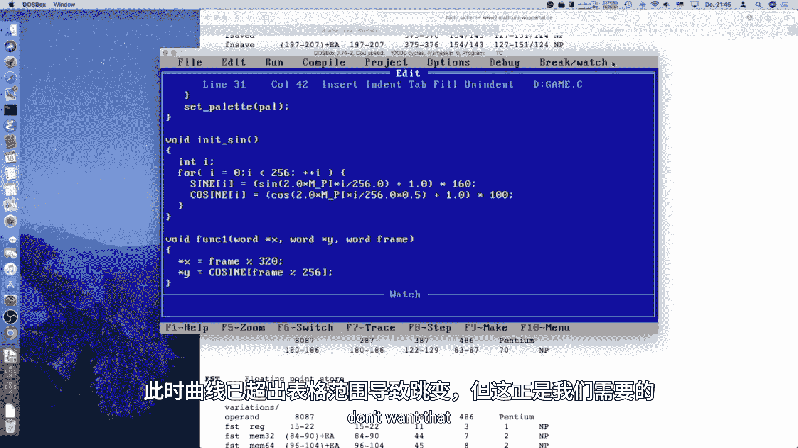

Periodic function， whenever you run out of the array and start at the beginning。

You will get something that is periodic。

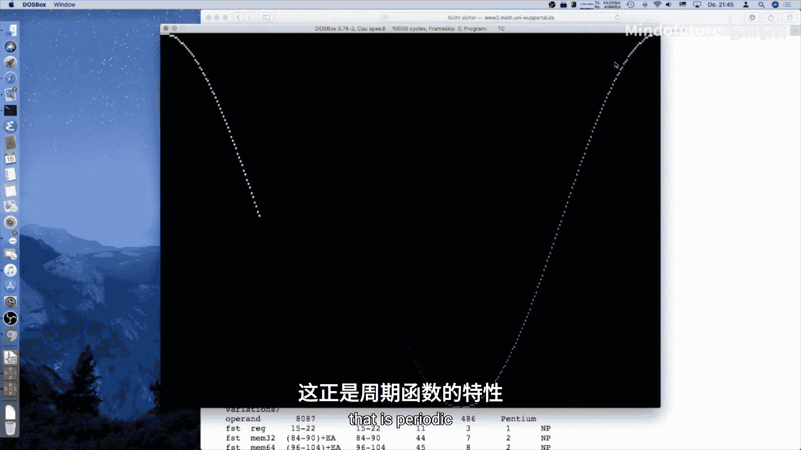

So which is why you would compute the sign table and the cosine table like this。

And then you can use it in a function。 This is the function that I was drawing。

 I'm just taking the X coordinate。And see that it wraps around to the left side once we leave the 320 pixels。

 and on the y axis， we block the cosine function。 instead of doing frame。MoModular 256。

 we can do something like increase the frequency here。 framera times 2。 This will give us a。

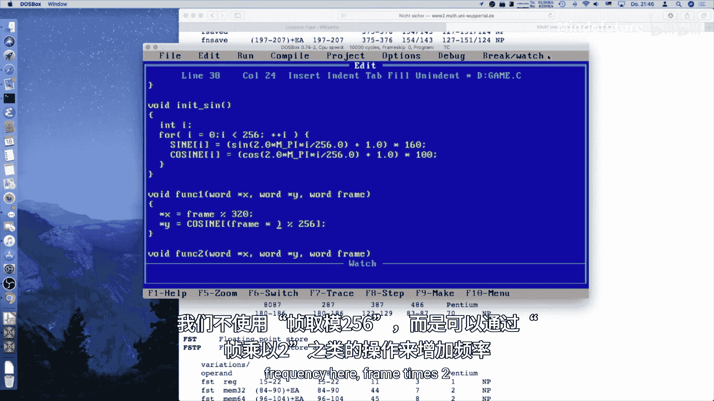

Shortter frequency。Or I can。Take good times，8， maybe。Yeah。And this will give us， of course。

 the resolution then gets worse。

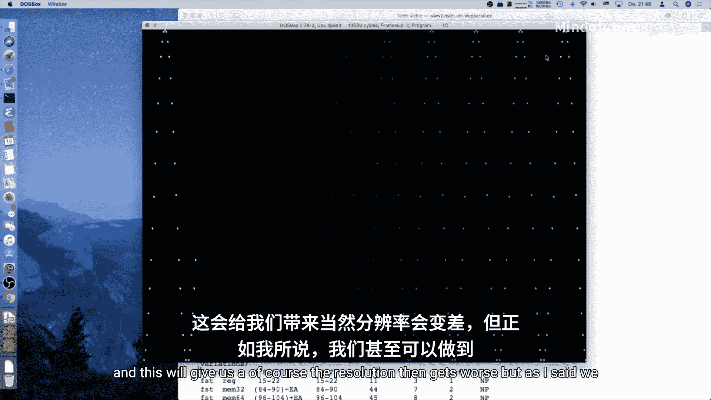

But as I said， we can even do。Times0 5 will not work because this is an illegal operation。

 because you can't use。Float values to index something， but we can write shift by one。

 This is the same as dividing by2。

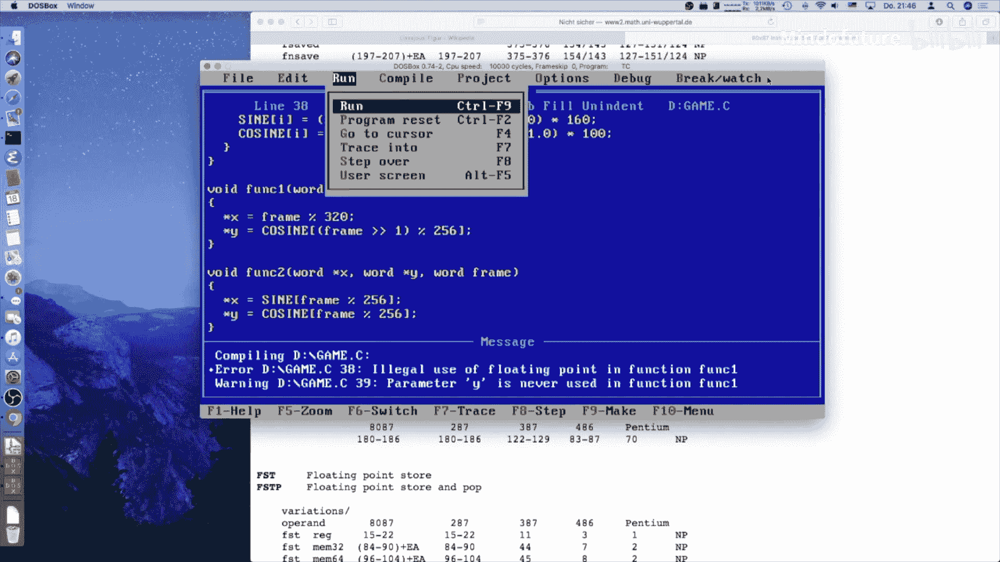

Or we can just write you like a tool。 That would also work。And then we get a nice， low。Curve again。

 of course， due to the quantization we will get。A few gaps here and there。 But for animations。

 that's good enough， and it's extremely fast。 And you can even precompute multiple sign tables because they are pretty small for different resolutions。

 Then you need to， of course， store more samples， for example。

That's good enough。For us here。Then we can of course。

 use both have values to plot different parts here I take the signine for the x direction and the cosine for the y direction without any manipulations。

And let's change that here。And taking these two functions like that gives us a very important function that you all know。

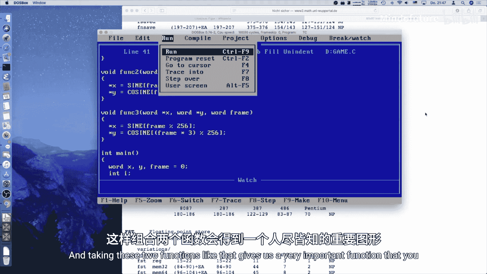

Circle。This will just draw a circle， which is， of course。

 the expectation ratio is not correct for that we would need to scale。

Ex direction be also2 on a pixel wide。

So if we want to have a perfectly square。Circle basically his square circle。 And of course。

 that's not true。 but with， with the same height as width。

 we need to put a 1 and20 here because actually in the 320 by 2 mode， the pixels are not square。

 but they're a little bit squished。

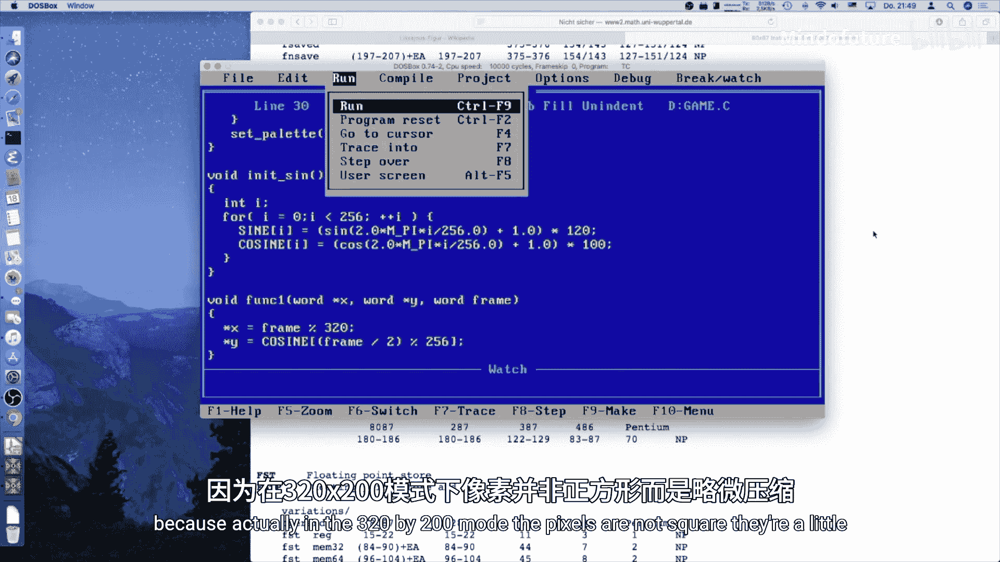

So if we do that， we get a perfect circle， which is not quite nice。And for example。

 you could use that to scroll this。Pend the screen in in a circular motion or some objects。

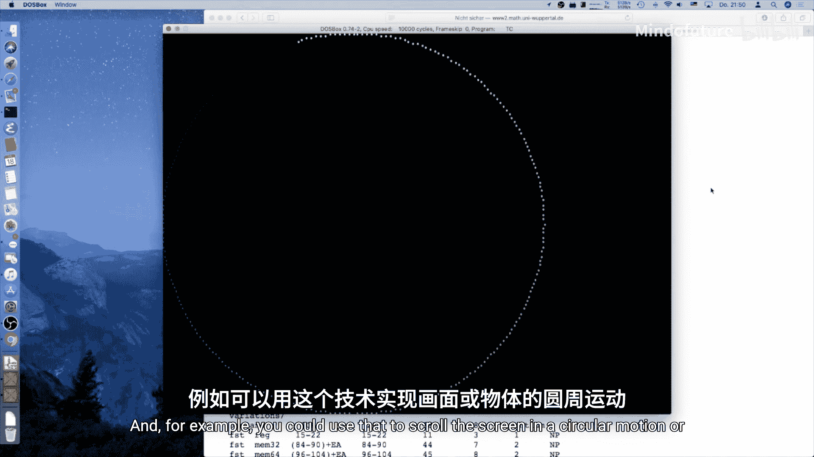

Whatever you like， I have done a few examples in the other videos。

 and we have another function you can even draw so calledled li graphs by manipulating the frequency that you put in there and use different phase shifts and cosine is already face shifted by。

Quarter circle。And if we use that， we get actually quite nice patterns。One such sample is here。

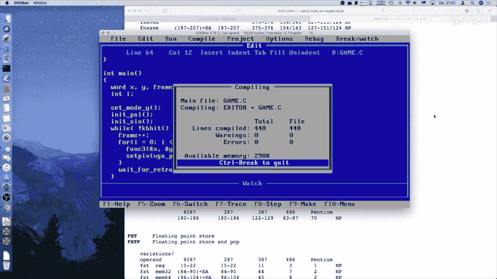

This is one of the lit figures， but you can draw many more。And yeah， this is very。

 you can draw very nice figures。 You can animate stuff。 And it's obviously。

Much faster because this is basically just loading one value for memory， which。

We can look at up what this takes， roughly。These are the interteger codes。 Let's see。我者。

Move is actually。A simple move from memory to register。Takes something between 13 plus。or three。

Cyclees on a 26 and 13 plus something on in 8088。Which is at least one of out of magnitude faster than what。

We get with the F sign。 I mean， if you compare the 386， it's only two cycles， and we had。

At least 200 cycles for the 37。So that's even two orders of magnitude faster。 So there's no question。

 And this is actually pretty useful， I would say。

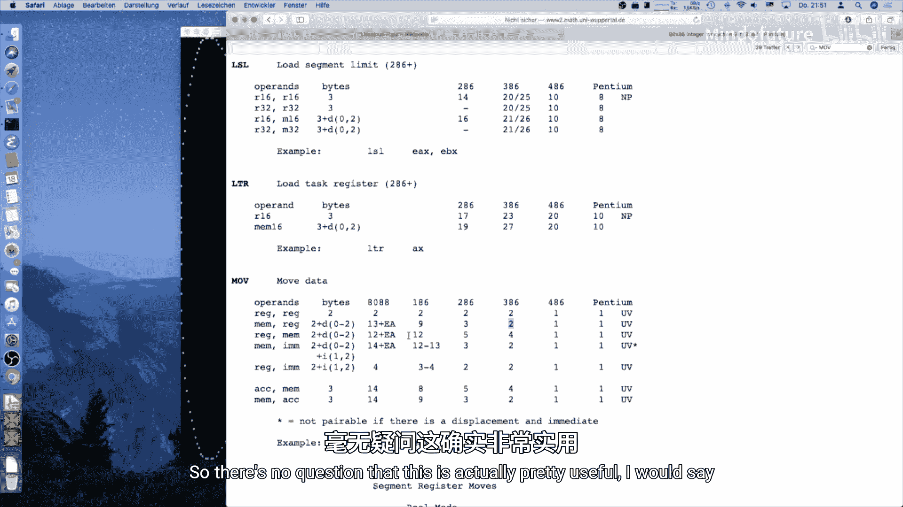

Yeah， and there are quite a few demos which use this trick。

I think every demo actually that uses some kind of animation will use this trick。

And I will show you a couple on the aomega where you can see these nice laser view figures and。

Otherwise， that's it for today。I hope you enjoyed this， and I hope you learned something。

 make sure to share， like and subscribe。So that you don't miss out any new coding episodes。

And please leave a comment as you see， sometimes something good comes out of it。

And you can also support me on Patreon or on cofi or via Paypal links all on my channel page。

 if you can't do that， that's all very nice and dy。And I hope youd just enjoy this。 And yeah。

Hope to see you next time。

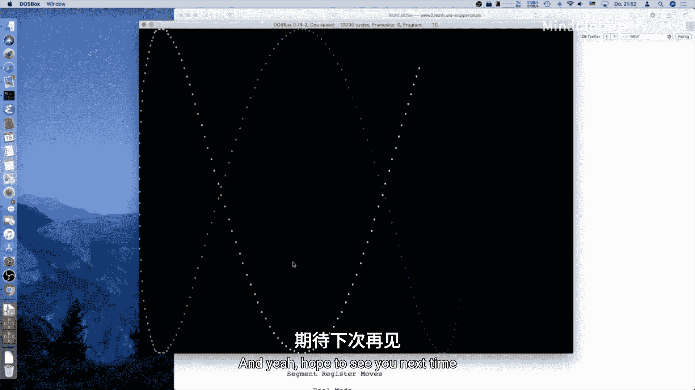

That's it for the day， goodbye。그。🎼ああ。🎼。🎼うん。🎼。