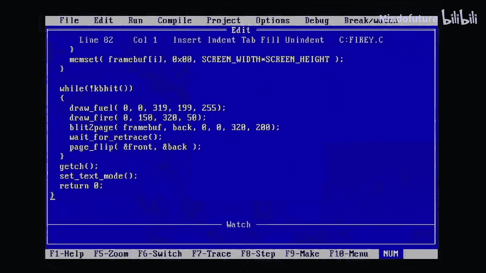
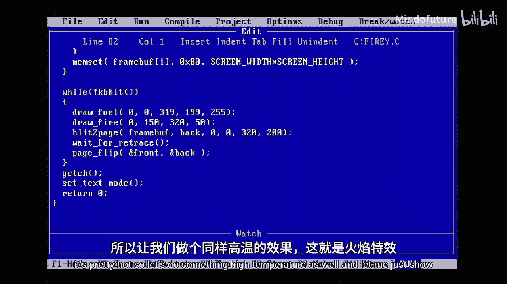
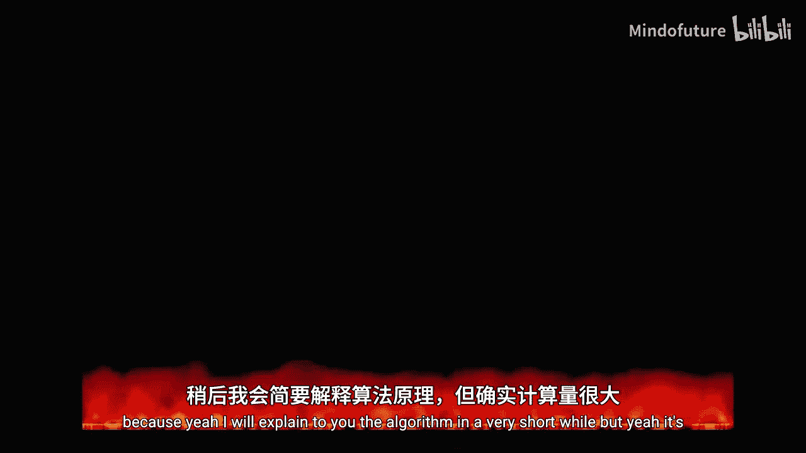
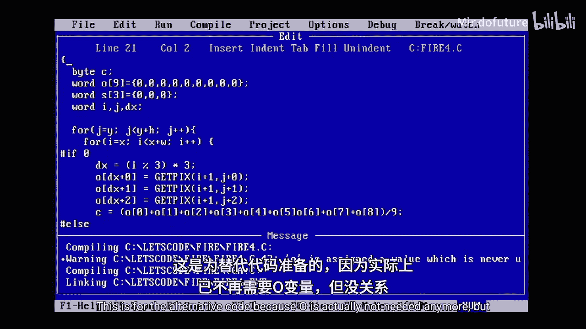
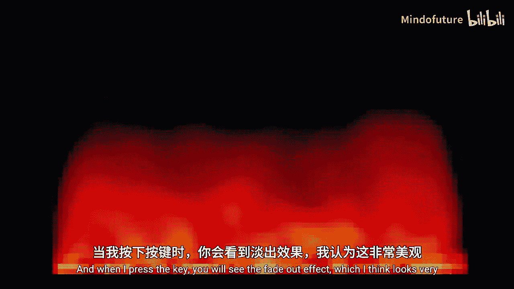
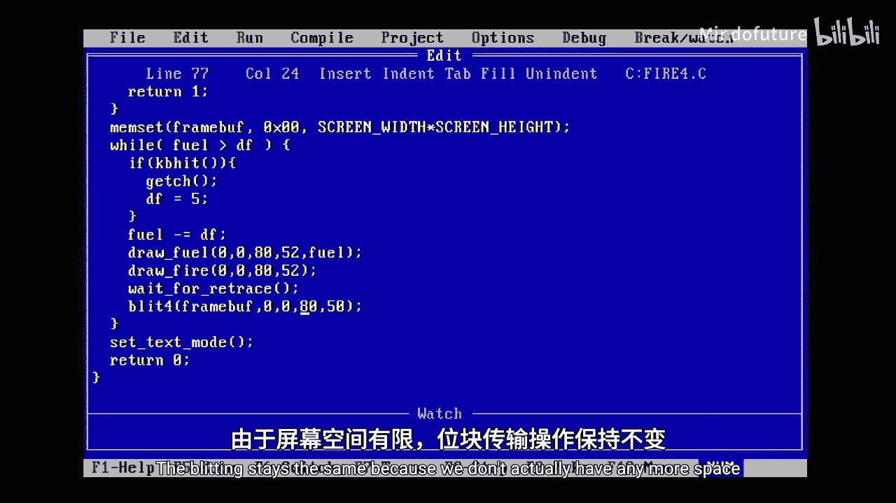
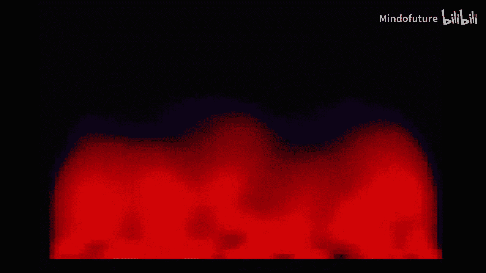

# 编写MS-DOS-系统-｜-windows-｜-操作系统-｜-汇编--｜-vga-｜-x86-p22-P22-Lets-Code-MS-DOS-0x16---Fire-Exclamation-Mark!--BV1zs35zQEru_p22-

Hello， welcome and an excellent evening to you folks。🎼Today， we are back again with a。

 let's quote Emmas Dos episode。 It has been a while， and I still have some open things。

🎼To tackle here。 But today， we' are doing something different。 We're doing。

🎼Nice graphical effect that is probably known to a lot of you。

🎼It was in quite a bunch of different demos and some games might have used it。🎼And I thought， well。

 it's summertime and here， at least it's pretty hot。😔。

🎼So let's do something high temperature as well。

🎼And let me just show you what we are dealing with。🎼This is a fire effect。

 This is supposed to be a nice。🎼Fire， and as you can see。

 it is not running extremely fast because the fire effect is actually pretty expensive to compute。

 And this is already a fast version in quotation marks。🎼Running on my 4，86 at the moment on the 286。

 it would be。🎼Quite a bit slower， maybe one or two。

🎼I think frames per second are the best that you could hope for。🎼I mean， even here。

 it's only just like two frames per second， probably。

🎼So on the 26 it's more like two or three seconds per frame， I guess。🎼Because， yeah。

 I will explain to you the algorithm in a very short while， but。

Yeah， it's expensive and we already did some optimization here。And。🎼We can do better， actually。

 Of course， we are using To C。 So in assemblysemb it could be faster using 386 up codes。

🎼Could make it faster， but I want to target older and slower machines。 and I want to teach it in a。

A bit more high level language， like C。🎼We can at some point convert this to assembly of course。

 and we will come back to assemblyly Let's go as well， because that was actually pretty popular。

🎼And yeah， but this is the version that I did first just to show that it works。

 But then we will have a look now at something that is even faster with a bit of trickery from the VJ card。

🎼Because let's face it。 The fire doesn't need that many pixels because it's quite blurry。

 and it's much nicer to have it running in a high frame rate。 actually。

 And while the V J A card can't do real scaling in X and Y directions。 like， for example。

 some dedicated hardware good， we have a few tricks on the car that help us with。

🎼Getting something akin to scaling， not arbitrary scaling， but by effect fact of 4。

 And that should help us with the frame weight cried significantly。So I'm going to load up。

🎼A different program where I will walk you through the program itself。

 we are basing this on previous episodes so the types。h and Vga。

h header are actually known from previous episodes if you haven't watched those you can go back and watch them first I would switch to a different toicC project。

🎼And I've also included here a head of our cord P dot H， which is the palette。

🎼Because I don't want to talk about how to create the pellet for the fire eye。🎼Honestly。

 ripped it off of another example problem of the Internet。It's just 7 out68。

🎼Bite values which encode the nice fire colours， but you can choose your own palellet or generate it。

🎼Using some four loops， which I usually do。🎼But that's not the topic of today。 Today。

 we want to make this faster and。🎼We are going to use mode X or mode Y or a variation thereof。

 so we will use the functions that we introduced in the VGA header last time but we will also use a frame buffer which is located in system memory because our trickery will depend on that and reading and writing to system memory usually faster than to the actual VGA card。

So that we will have， and we will need some set pixel and get pixel and macros into the frame of。

 which are very simple。 These are the same as for the flat。13 hex a decimal。Moode of the VJ card。

 It's basically just the frame buffer address plus the screen width times the Y coordinate plus the X coordinate。

Make sure if you use macros like I did here， because I didn't want to depend on inline functions working in the compiler。

To put your parameters into parentheses。Otherwise， if you have some calculation in there or some other stuff。

In the original variable， this will get put in there as well it might lead to problems。

Later down the road， we need three functions。 the draw fire routine。

 the draw fuel routine and the main function， because the fire effect works like this in a loop。

 we will always draw new fuel。 that is on the bottom of the screen will draw white pixels and they will be the hot burning coal。

 and then the draw fire routine will go from scan lines from all the scan lines from top to bottom。

 and compute a blur basically of the three。Scan lines below and average node。

Which generates an upward motion。At the same time as making the fire more and more blurry。

 the higher I go up the screen。And this is basically using some。Linear filter。

 you can express this as a matrix or filter kernel。But it's actually a very primitive one。

 And we will already optimize this as to reduce the number of operations that we actually have to calculate。

But， let's go。Top to bottom， let's write the main problem first and then go to the actual implementation of the。

Other functions。So the main functions， we need a few variables。

We need something to encode the fuel intensity， and。

Because we want to have a nice effect there when we quit the problem。So initially。

 we use 255 as our highest intensity for the fuel。And I will need to help a variable for the fuel。

Only for quitting the program， you can ignore that for now。 I will explain it in a short while。

Then we need an iteration variable， usually。And。That is actually it。 I think。

 I think we don't need anything else。And then we need to call the randomized function。

 which is tool C specific。It will set the random number generator to something useful and generate a different random pseudo。

Random numbered sequence every time you call it， because it's time based。

So we get a different fire each time we run this thing。Then next up， we will set。Search。

The graphics mode， we will switch to mode Y， which is 3，20 by。204 video pages。

We don't know about that， to check out my earlier videos。

 I explain how it works and what the advantages are。Of this graphics mode。Then，你 set the。Plaed to。

What was given。And。They had a file that I just showed you。So we have the nice colors。

And we also need to。I locate a frame of。And the frame of will simply be。Our screen width。Times。

Screen height。Just like that， make sure to。Use some larger memory model。

Using compact allows you to allocate stuff on the file by your default。

 and that will be much simpler。 So that's that。Next up。

 we will check just a chainity check if frame buffer。This is not than something bad hadn。

So we will print an error message。Not enough memory or something should never happen。

Except you're maybe running this from inside to sea and your very long memory to begin with。

 But actually， I don't think even then， because we use very little memory here。But。

Let are safe than sorry。 And for bigger programs of games later on， this will be useful。As well。

Then we need to clear the frame of otherwise we see a lot of garbage on the screen。So。

Is that the frame buffer our contents。 can't see my keyboard。To the value 0。

You can also play around with different stuff， but。That doesn't make much sense。嗯。Clear the hole。

Screen。And that's that。And then we can do an endless loop， or more or less endless。Of course。

 as' an end。And usually， I would write here while not Keep it it。And in the end。

 we switch back to set text mode。But we won't do that today。 Instead， we will do something different。

 We will look here if。Some keyboard。Key was pressed， if keyboard hit。Then， we。First of all。

 clear the character that was read。 Otherwise， Do might read， for example， press enter。

 Doth write read and might read that and press enter on the command line。

 Or if you runs it from the Noraughtton command or something， it will launch the pro again。

 And that's pretty annoying。And now here comes in my helper variable。

 I will set this to this is supposed to be Delta fuel。I would set this to five。

And my why look now will be as long as our fuel intensity is greater than my Delta fuel。And。

The idea will be here that every frame we subtract Delta fuel from the fuel。

While you're not hitting any key， this will stay 255。 But when you hit a key。

 it will slowly fade out by。Dcrmenting the fuel amount。Until it's 5 or S maybe even0。

 but you can put in any value here。 putting a higher value in here will fade out faster。

And that's a nice effect for stopping the fire， actually。Then after we dealt with the keyboard stuff。

We can actually draw the fuel。And the function takes some rectangle where we want to draw it。And。

We will say， go from the top left。Which actually isn't that important because I just， actually。

 I shouldn't have used a rectangle because I only draw the bottom line。

One co and a width should have sufficed。But there we are。 That is what it is。I will write 80 pixels。

 horizontally and 52 vertically。Normally， I would use。嗯。50， and let's put that here as well。

 But we'll change that later to 52。 and you will see in a minute。Why we're doing that。

And then we also call draw file。And draw fire takes。A true rectangle。

 And I will put it to the same size for now， and it will also be changed to 52。

 for some reason later。Which is a minor reason， but I think it looks better。

After we drew the fuel and drew the fire into the memory frame of fire， it's not yet visible。

 So we wait for the vertical retrace of the screen so that when we do something now。

 there will be no screen tiing。 and you can't see until the retrace is finished。

And we will use a new function that we still have to write coin B 4。And B4 will。嗯。Basically。

Scale the image by a factor of4 in both directions。And it would be a very fast lid。

 So it takes the frame of acid source。Doesn't need any destination， except for the rectangle。

Which we want to use。And it's basically the same。It's this is the size that we want to copy。

 We can copy just a subset of it if we want to， but no need for that。

And this will be the function that we will look at last。 But first。

 we will take a look at the fuel function because it's simple。And the fire function。

 because it's interesting how the fire is actually being drawn。So let's have a look at fuel。

Fuel is rather simple。We。Actually， need an iterator variable。And。We need。

Ave temporary fuel variable as well。And then， we can iterate。And we start by going to the。

First corner， X and Y。Actually， we don't need the y here， but we initialize I with x。

And as long as I is less than x plus the width。We can increment I。

That means we run from x to x plus W。Which is the width。Then we calculate the extra fuel and。

We make the fire flicker by using random fuel values， every frame。And we get the random value。

By computing something， converting it to byte。And that something is a random， random number。And we。

 since we only need to buy it， we only take the lower 8 bits， which can be done by using。

The bit wise end。And masking it with 255。 You could have written 2，5，5， or more easily， I think，0 X。

 F， F。Yeah， just select only the lower。Bits， basically， and。Then， we check if。This value。

Is bigger than 128， which is U U x 7 F。And if that is the case， we pick the current fuel value。

 Otherwise we pick 0。This gives us a nice effect that we have more flicker in in the fire because the fuel can either be on or off nothing in between。

 If you just use the random value here， you get a much smoother fire without less， much turbulence。

And this here， I think， looks better。 but you can play round with this line and produce different fire effects。

You can even draw。Text or something。 you can draw circles and let them burn。 or I don't know。

 You can play around with this or 3D objects you could use。This is basically what you want to。

Light on fire。 And the draw fire is the actual filter， basically。Okay。Since we selected that。

 we can use the set ps and macro to write into the off screen frame buffer。

And we use I as the X coordinate， and we use Y plus H。

 And that's why I said we don't need actually both the coordinates because it's always the same。

And the temporary feel were value。And that's our draw fuel。Pretty simple。

Now comes s draw fire routine， which is a bit more interesting。And。In theory。

What we need is something to collect the color。And sorry for the noise outside。

 But I actually can't close the window today because it's too hot。And we also。1，22。

Some our our filter kernel， which are called O， I don't know why， but I did。And it's of size 3 by3。

And to make sure that it has sensible values to start with， we initialize it with our zeros。

 and we can just write it down。 We don't need any memet， which would be an overhead。And。In a second。

 we will use this here as well。Another。Aray of three values， which we also。In lies with zeros。

 but we won't use it。Straightway。But in a second， as I said。And we need some iteration variables。

We will use them later。And then。What we'll actually do is we will iterate over thee。

X and Y directions。Why direction will be first。So J will be our y iterator。

 We start with with a Y coordinate， obviously。And run up to y plus height。And increment。

Same goes for the X coordinate。So this is basically processing every pixel on the。

 on the frame buffer。And so there's not， not much to explain here。 It runs scan lines from。

Top to bottom， as I said。goeses from 0 to 200 in our case， or。To 50， because we are。

Drawing at a quarter size to make it faster。And。Yeah， actually， what we would now do is we would now。

Take all the pixels。 Let's， let's draw it like this。We would take all the pixels。

And this would be the current pixel that we' are looking at。

And we will take all the pixels that are below it and next to it。But not above。 And average them。

 and。Make basically epic。Some of those。And divide that。By9。Yeah，Okay。But that's。

 that's expensive because you would call get pixel on all these things。 And that's pretty expensive。

And also computing this sum is pretty expensive。So instead， what we are doing is we note that。

From pixel to pixel， we only ever need to。Get。3 new pixels。And these are。This ones here。

Because when we step。Through the screen， we going from left to right。Let's draw it like this。

 We're going from left to right， and there will be one additional column of pixels that we need to get。

 These year are the same from the last iteration。So we can pre first of all。

 store these and also precompute the sums。And yeah， that's actually pretty useful， I would say。

So we will only use that， and this will give us。speeded up， not a， not a huge speed up up。

 but something like 50% or something。2。Yeah， adaptling roughly。So let's do that。 First of all。

 we need to compute some index， which I call Dx here。嗯。To make the O。Colonel Biru。

 more less a ring buffer。And this will be the iconnet modular 3。Times 3。Which means。We will。At first。

 because then you can also leave out the the sums。 the sums can be added later。And basically。

 in the first iteration， you were。Right to this。Trit， then in the。Ohoops， in the next iteration。

We will write to this triplet， and the others will stay the same。It will become， hopefully。

 a bit more obvious。Basically， what we do is we write to O D X plus 0。

And place erara is not necessary， but it's for visualization purposes for you。The value that。

We read from the pixel， and the pixel is。The one in the column to the right That's I plus 1。And。😔。

In the current lines， with J plus 0。And oops， I'm sorry。

Then the next two values are basically also the column to the right。But one line down。

And that is basically the update of our filter kernel。 And in theory。

 we could now just sum over all the filter kernel values and be done with it。But actually。

 I will skip that and actually noticing that。We can actually live with only three values here。嗯。For。

 for the， for the filter kernel。I needed the nine values。 Now let's， let's write it。

 Let's write it that way that we need the9 values。Actually， what you can now write is C equals。Was。1。

Oh0。S of。1 and， etc cetera， et cetera。🎼I won't do a loop here because a loop is actually。

More expensive。So let's look like this，3，4。5，6。菜不。8。

And the most simple thing to write here is just divide by 9， which averages everything。

And then we're doing one more thing。We are actually attenuating the fire。So， we take。

And the maximum of this value and 2， because we don't want to produce any negative numbers and subtract -2。

 If you don't do that， the fire will grow higher and larger。

 you can attenuate it by writing arbitrary values here， but I found2 to be a nice effect。

AndThen we can actually set the pixel。And write that to the position I J with Col C。

So this is already much faster than the naive solution。Which uses nine get Pix calls。

So this is quite a bit faster， but we can still catch the partial sums here and when we do that we don't need the whole nine values anymore and we don't need to compute this index here。

 but I'll leave it in so that you can check。被告呢。Commen us out by doing。The F 0 trick。

So you can switch between the implementations and see the difference。

And what we'll actually do here is。We will use the S array。Again。

 with the I modular 3 to get a ring buffer。um。And then， we simply。Again， take the。

Tell you that we just computed or D x plus0。Oh。D X 1。

And here you can already see that we actually don't need the whole buffer anymore。

Let's actually optimize it。Let's put this in here。And make this。Much simpler。But using all off。

Actually， no， we make one large。 Let's make one large。Expression。Because we can。嗯。

We want to take this。And we just add up all the。Pixel values straight away。So。

These are the neighbouring pixels。 We don't need to store them any more。And this should be。

Oh whole expression， right。And then， what we can do is。We can just sum up。对异议。

3 values that are in the sum vector。And divide that by 9。And that should be the same。

As the whole clutter above。 And I think this is pretty neat。 This should give us。

Quite a bit of advantage， because let's face it Tocy will not be intelligent enough to optimize this code。

To this code， basically， and your compiler probably can do that， yeah， but。

And if we would hand code it in as， we would do it in a similar fashion。 So yeah。

 I think there's still some leverage in assembly coding。But this will be quite nice already。So。

 this is actually。Everything in the fire program。 It's not large， it's。80 lines with。

Roughly 20 lines of boiler plate at the top。So it's a pretty small algorithm。

 and this is just alternative code。 So you cannot even scrap that。 So yeah。

 let's implement the V GA bttting routine。Because that's still missing。

And I'm just going to walk you through this to save a little bit of time。This is the B 4 function。

 And it's similar to the B function that we already had。 There's a b to page function that we used。

Which。Copies all the four bit planes1 by one。 And this gives a pretty fast splitttting routine。

It's not perfect。 And it wants the。Picks the data in memory to be aligned in the same fashion as modx that is。

Every other pixel needs to be on a different bit plane。And this is not the case with our B4 routine。

 but it looks similar。We， first of all， write to the mapm register， and we don't have the。

Loop over the bit planes anymore， because we run to right to all the planes at once。

Which means every pixel that we write gets。Multiply it by4。 So with every right。

 you actually write four pixels on the screen。We compute the bitment offset as usual， Sa it to 0。

 The screen offset is simpler because it's just an index into the VGA memory divided by 4 due to the。

Multiply before。With the bit planes。And then we iterate over all the lines on the screen。

 and we simply copy four times every line。And update our screen offset in every line。

But update our ament offset only hour。Every four lines， because in the horizontal direction。

 we get the scaling for free。And the vertical direction， we have to do a man copy for every line。

And that's already the whole trick to get like a free horizontal recaling。

🎼More than factor 4 is not possible， I think， but you can do a scaling by2 by writing to two bit planes at once。

 two neighbouring bit planes， you have to adjust it here and then you have to loop over two bit planes。

 then you get a free scaling by factor of2 basically。

🎼Which is nice because it will get you a less chunky look。 But for the fire。

 I think this is pretty nice。🎼So let's see if we can compile this。🎼We got two warnings。

🎼The D X is not used。 Yeah， we should probably。🎼Put that into the。🎼Thin here， and。

🎼O is also never used， but we don't care about that right now。🎼This is for the old。

🎼Alternative codes。🎼Because O is actually not needed anymore， but that's fine。

 it doesn't hurt the problem。

🎼And yeah， here we go。 And as you can see it is a lot faster than the original program。

🎼And now you can also see why I wanted to push down the fuel by two lines。

 because I think the bottom two lines actually look a bit too flicky。🎼And when it press the key。

 you would see the fade artifact effect。

🎼Which I think looks very nice。🎼Let's actually push down the fire by2。🎼Pixels。

🎼The bttting stays the same because we don't actually don't have any more space。

🎼On the screen。 and I think this looks a bit more smooth。🎼But that's up to you。

 you can change it as you want。🎼Yeah， and this is a very nice chunky fire effect。 you can use this。

 the split function for。🎼All kinds of things。 I think some routezs might。🎼Have better performance。

 if you。🎼Computed on， on。🎼More cost resolution， for example。Yeah。🎼And that's already it for today。

 I will put all the source code on Gitthub， including the Mo Y version， which is pretty slow。

🎼And I will actually try to incorporate the optimization that we just did。

But leaving out the whole ORA。🎼And。🎼Because that should be the fastest version that we can get and see more or less。

🎼If you have some improvements， please share them。 You can fork the Giripo， play with it。

🎼And other than that， if you haven't subscribed， please do。 it helps a lot。

🎼Give it a thumbs up this video or a thumbs down depending on if you liked it or not。🎼In any case。

 leave a comment， we can have a nice discussion always。🎼And if you want， you can also support me。

 there are a couple of patrons who are already supporting me， you can head over there。

 you can also head over to Kofi and buy me a coffee， which is also very nice。🎼Payper me something。

🎼Which helps me to spend more time on this and。🎼Less time on other work that you can't see。

🎼Which would be a nice thing。 And if you can't do that， it's also fine。

 I'm happy that you watch this stuff。 I'm having fun doing this。

🎼And I hope to see you in the next Let's go video， or rather in any video that I make。

 So have a great evening。🎼，🎼The。🎼The。🎼ああ。🎼。🎼The。🎼うんん。🎼。

