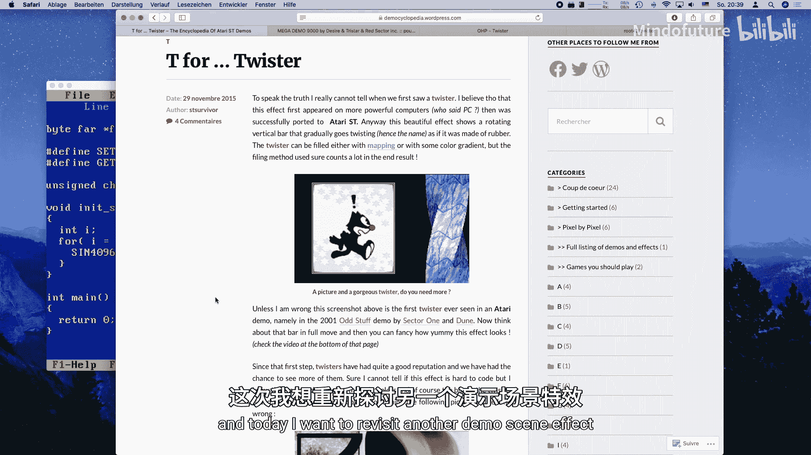
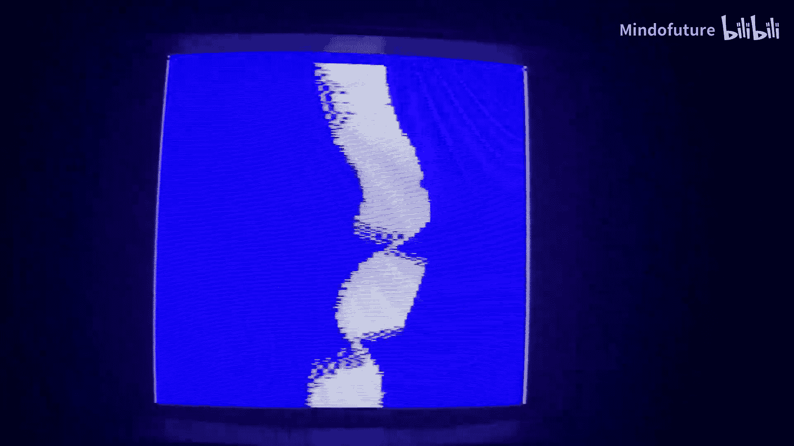
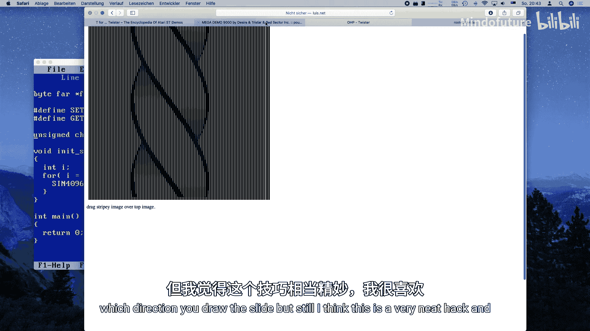
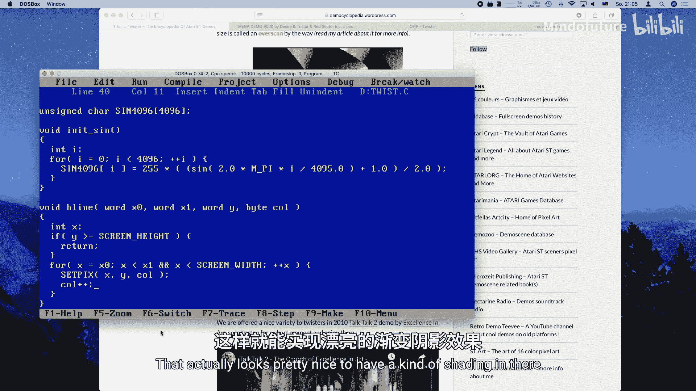
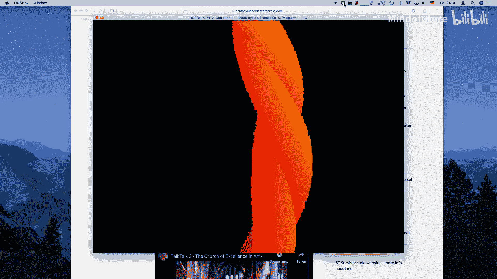

# 编写MS-DOS-系统-｜-windows-｜-操作系统-｜-汇编--｜-vga-｜-x86-p23-P23-Lets-Code-MS-DOS-0x17---Come-On-Lets-Twist--BV1zs35zQEru_p23-

🎼Hello， welcome and a very nice evening indeed。🎼Today。

 we want to continue our let's code MSistT series where we program in C4 MSistos PC。

🎼And today I want to revisit another demo scene effect。😔。

🎼Last time we had the fire， which is already a pretty neat effect， I think。

🎼And today I want to do something that I never did before。

 but I've seen it now in a bunch of videos mainly on the Atari 2600。

🎼And also on the aomega in。🎼Both cases， this is a pretty。🎼Standard effect。

 And I think this is probably also due to the fact that。

🎼I guess the amiga copper chip can actually support rendering this thing。😔。

🎼But on the PC with the VGA card， we don't have much help there。

 It's basically a CPU intensive effect。🎼Which is probably why I haven't seen it in any of the 90s old school demos on the PC。

😔，🎼But it's still possible to do it。 and you might need a bit more beefier CPU。

 So the 286 will probably be too slow。 but on my 4，86，33 meHz at runss， actually pretty decent。

🎼And the effect we're talking about is the twister or the twister bar， which yeah。

 I don't know where it comes from。 I've just seen it in a bunch of demos。

And the idea is that you have。🎼Usually a bar that looks to be square。

🎼And that is being twisted and that runs up and down the screen。

 And you can see here some examples on this website。

🎼And it's probably a bit hard to imagine what it looks like when it's running。 But yeah。

 I'm going show you a few examples from the 2600 and the amiga so that you have an idea of what is possible。

 Our version will be a bit more simple。🎼But you can put text on there as well， et cetera。 So， yeah。

 there's a lot to be done。 One thing while researching this topic that I found out is that。

🎼The demo group's desire and Tristar， probably Tristar and Red sectorctor Inc， also known as TRSI。

🎼Did a wild demo back in 2012 at the party 2012。🎼Wd entries are basically。

Everything's allowed and they did an overhead projector demo。🎼Which sounds really。

 really cool because it uses no computers。 but they had some prepared slides。

🎼And one of those slides was this thing here。 So you basically have two slides。

 This is the actual encoded animation， and this is a。🎼Russter basically。

 And when we put the rosterster in front of the other slide and we move it to the left or right。

 we can actually see the twister animation， which is。Quite neat。 I mean。

 it's a very simple animation， just the twister running。🎼Up or down。

 depending on which direction you draw the slide。🎼But still， I think this is a very neat hack。

 And yeah， I like that。 You can see they they had some other neat effects like a amiga bowling ball rotating and stuff like that。

🎼Yeah， you should definitely check that out， lots of other great demos， old school and new school。

On Puit dot net， I have no idea how to pronounce that， but。Other than that， let's get started I。

Taking the fire program and ripped everything out。I changed。

 I introduced the sign table from our sign table video。

One thing I changed here was to make it larger to have 4K entries in there， because with the。

Twist bar， we need a lot more。Temporary resolution， basically。And I fixed one buck。

 we used to have here scaling factor of 256， which would lead to a negative value in this case。

 So 255 is actually correct because that's the maximum amount that we can actually get in a byte。

 The byte runs from0 to 255。 so。There was a slight mistake in the s table video， but with 256 values。

 it wouldn't。Yeah， it wouldn't come up actually， but with the enhanced resolution。

 we actually see a problem here。So。This is already known。 We are going to use the standard mode 13。

 No mode。 Y I have a version on Github that has mode Y support。

 but it's actually slower because we need to switch around the bit planes and stuff like that。

 We can probably code something more efficient here。But that would complicate the code。

 So I'm going with readability here， and we are going to draw into off screen memory and then just copy the whole page with very fast mem copy。

Into video memory and that would be really fast on the 486， even though I am using an IA video card。

 So if you have a visa local bus or PCI， it will be bing fast anyway。

 so mode Y will have even less of an advantage there。But maybe as a homework。

 you can write a more efficient mold X or mode Y implementation， if you want。

So our main function first， then we dive down into the extra algorithm。

So we need some iteration variable here。 We want to count the frame that we're currently in because that will determine the state of our animation。

Then we also do what else do we need， We definitely I what I。Want to have some randomness in there。

 because otherwise， the animation always starts in the same state。

 So I'm going to initialize the random number generator， and I'm going take the initial frame to be。

Somewhere， one of the first 1024 frames is just arbitrary。 You can put anything in there。

 in the range of a word。But yeah， I think that's that's pretty okay。

 You see a lot of different states then。And。We， of course， have to initialize the side table。

And afterwards， we can set the graphics mode。 I'm reusing here code from the VGA tutorial and file tutorial。

 So all that code here for the VHA stuff is in the VGA header。

Which is also in the source code linked to the repository is in the video description。 and as always。

 you can have a look， play around with it and improve on it。I'm also going to reuse the fire palette。

From the fire demo， because I noticed it actually looks good here as well。Give a nice。

 glowing effect。And further， we have a frame buffer variable here。

Which doesn't exactly need to be far， but。Since at 64 kB。We rather do that。 And we gonna me that。

And it will be as large as the screen。 So it's screen width times。Screen height。Or in other words。

 it will be 64000 bys。Exactly。Okay， we will have a quick check。AndFor the。

For the moment why I actually had to allocate all four bit planes。

 so I could run out of memory if running this from the Tober sea environment。

Which means I'm going check if。Nowll return now。Just to be in the safe side。And if that's the case。

 I'm gonna print not enough memory。Which is always good to check for。

We're gonna return an error code。So that we know。What happened'。But if that worked。

 we will actually clear the memory。 So the frame of our will be set with a0 by。And。We can。

Weuse the size of the screen。 We could also make。 at some point， we could make a consent of that。

But I'm lazy。 I'm not going to do that today。Okay， this has set up the off screen memory。

We now have a whole page of memory。To our availability。 and as usual， we will do this event loop。

 more or less thing。Where。AndWe wait until the keyboard was hit。If the key is it。

 we read the character so we don't restart the problem accidentally by pressing enter。

Weturn to text mode。 And then we are happy。 Are we already happy， and we return。What's a0。

Every time we are drawing something。Actually， we can。We don't need that。

 We can just move the whole meet thing in here。Just do it at the start of the loop， which。

Makes this superfluous。Then we'll draw the twister。And we can。

 we will be able to adjust the size and position。 The first one will be the X position。

 The second one， the y position。 And I'm gonna go 100 pixel to the right。

And start at the top of the screen。 I'll make it 128 ps wide， and 200 high。

And our current frame is frame。And， of course。At the end， we will increment frame so that the。

That there's actually an animation。Naturally。And we will have to wait for the vertical retrace。

 because。We don't have any back buffer。 otherwise， we will see screen hearinging。

 so this will wait for the screen to be in vertical retras。

 at which point there will be no picture being drawn。And then， we can update the。

Frame buffer on the DJA cards by。Doing a copy to the VGA pointer， which is defined in the VGA header。

And we take the frame of， and again。We are going take the screen size。And this will be very quick。

 actually， the implementation is probably， I don't know。 it's， it's pretty good。

 I think that will'll receive implementation of me copy。 It's pretty fast。

And that's already our main function。 So it's pretty simple。 We just clear the screen。

 the off screen， we draw the twist， we wait for the retce。

 and then we copy the whole thing over and increment the frame。

This is a pretty tight loop and a pretty fast one at that。

So the next thing that we need is the draw twist routine。I'm gonna to have to look at my cheat sheet。

So the draw twist routine doesn't return anything。But it will take an x coordinate where we start and Y coordinate which to call x 0 and y0 or x n and y not。

We need a width， and。We need a height。And we need a time T， which is the frame number， basically。

Also， we need a bunch of variables。 We need some kind of amplitude， which says。

 how much will this wiggle this twister。We need a counter for our scan line。

And we need four coordinates， because the。Twiter bar has four corners。

 and these are basically the four x coordinates of the projected twister bar。

And we will have also a modulation and the X direction so that it gives an extra twist that it makes these bendy waves along the screen that you saw in my examples。

Otherwise， it will look a bit more boring。 You can leave this out and try to play with this。

 or you can， for example， set the amplitude to 0， set this to 0 or change the parameters。

 This gives all kinds of interesting facts。 and you should definitely try and play with that。

So drawing the twister bar is actually pretty simple。 It's mostly one for loop。In the white arch。

 we started y 0。And。We run。Oops， we run until y reaches y 0 plus the height。And。That's okay that。

And that's pretty nice decent。And then we can calculate the amplitude of the wave。And for that。

 we just looked at the sign table。And we think of some function that is both dependent on the Y coordinate。

And as well on the temporal coordinate。And for that， I figured out that doing something like。

The time time 16 to speed things up if you make this。Smaller than it will be a slower animation。Plus。

 y times 2。Which gives us certain wavaviness in the wide direction。Modulular 1496。

 because this is the size of our sign table。This gives actually a pretty nice thing。 Plus。

 we need to scale it somehow。And we scale it。To a quarter of W。

 which is the width and to be more efficient， we can do a right shift by 2。

 which is a bit faster on older processes like the 2，86 and 386。On the 46。

 it probably is still faster。 So I doing bit shifts when you have something like this， as always。

A bit advantageous。Same thing goes here。 We can do。

But we need to be careful because the bitshift operators have very low precedents。

We could do a bit of by4 here to the left， and we can do。关闭。Wen。P shift left by one here。

 which is the same as time 16 and times 2。That should be good enough。Then， we take the modulation。

Let's put this， somehow， in the same。Column the modulation starts off with the offset。

And then adds another sine function。Which we need to scale as well。

 So there will be another big shift。But first， we look into this thing。

 and it looks basically the same。We can。 can。 We can take the same function。

And just change it a tiny bit。I'm looking at this and I'm wondering I need to take this hole in our part。

😔，But we， we will change a little bit the， the time factor because that will look a bit nicer if we no。

 not the time factor， the y factor to make it more wavy in the y direction。

Depending on the Y coordinate， the Y screen coordinate。Again。

 you can just play around with different factors here， and it will give very different results。

 or you can even maybe animate that。If you don't do powers of tool， maybe。Or interpoed。

If you have lots of power， you can use floating point here as well。

What we are doing it on very old machines。 And so we need to do all integer arithmetic。

 So everything here is non floating point， and that is very important。

 This is actually what makes it fast。So I think this should be fine。Now， we can go to the。

Actual projected ex coordinates。And they look very similar。 They take the ex modulation， always。

And they will add。Another sign function。And the sine function will look very similar from one x corner to the next。

We will always take the amplitude。And we will add something here。嗯。In the first example，1，2，3，4。

 we will add a 0， and I will explain in a second why Ill just write this out so that it looks the same。

In every case。And we will divide this by4 to scale it down a bit。 Otherwise。

 it will not fit inside the。128 bys they set。Yeah， al right。 So why am I doing this。

 Because I can now copy this， and it will look almost the same for all four coordinates。

These are the four corners of the bar。And the only difference is。

 if you think about rotating a square， then the X projection will be the sine if you wanted to have the Y projection or the z projection into the screen。

 it would be the cosine。But it doesn't really matter here。 but since all four angles。

all four corners are offset by 90 degrees。 We need to shift the index into the sign table by 90 degrees。

And the full table has 360 degrees encoded。And。Or two pi basically。

 And we need to shift by 90 degrees or one pi。Is that true， I think so。No sure not。 half a pie。

 half a pie。Here，1 per here and 1。5 per here are 90，118 and 270 degrees rotated。

And this is done in our case， not by adding pi or something。

 but by adding one quarter of our total number of entries， which in this case is 1024。

And for the second， we need to。Add 2048， which is 180 degrees and 270 degrees。W would be 3027，72。

 sorry。This gives us the projected X screen coordinates。Now we have everything that we need。

 The A and X M were only used as intermediate values， which are then used to construct x1 through x4。

Here's the A， the amplitude， and here's the modulation that we add on top of the rotation。Now。

 we simply need to check if。The line from x1 to x2 is visible， and then from x2 to x3 is visible。

And that is the case if the X 1 coordinate is actually smaller than x2， that means。We have x1 here。

 and then we draw a line to x2。If it were the other way around， it would be the backside。

 and we couldn't see it。So the only thing that we need to do is to test if x1 is smaller than x 2。

Which means， yeah， we can see this part of the bar and we will draw a horizontal line。From X1 to。

X 2 with some color。And actually also with some white coordinate and some colour。

 And I figured out in the palette。33 is the colour that we want。

You can choose your palettes as you wish， and colors， as you wish。That's totally up to you。

I copied this four times。Because this whole thing now looks always the same X 2 versus x3。

I will change the colors in a second。 x3 versus x4。And then， of course。

 going the full circle x4 to x1。These are the four corners。

 and only two lines will be drawn at any given time because the back side is， of course。

 not visible at most two colour。 It might be that youre looking straight on a side of the bar。

 Then there's only one line being drawn。And the other colour that I figured out look nice are 49。

65 and 81， but you can。Choose whichever。Okay， will this compile？This will compile。

 but this will not link。 and oh， there are too few parameters to melo。That totally makes sense。

What do we need， We need， of course。Spcreen width times。Screen height。 And now we have it， I think。

 four times， three times at least。嗯。Three times yeah， we should probably make a consent of that。

But not right now。Here。Still， this will not link because theres an unfin simple H line。

Which makes sense。 We don't have the routine to draw a horizontal line。

So let's take a look at the cheat sheet again。It's， again。Avoid function。Or H line。

It takes one x coordinate， and another x coordinate。The why coordinate。And also a color。

 which is a bite。So this is a pretty simple function because we， it's no fancy brazenm or anything。

 It's， it's very simple。 We just need an iterator。We also need to check if the Y coer just for safety purposes。

 it should not happen， but。I know。 I did a few。Oops。And yeah。

If the screen coordinate is out of range， then we just return。So we don't to thrash the memory。

 but you can try without it to speed up。Tiny bit。But this should be actually pretty cheap operation。

And the i coordinate net， we let run from x0， which is the start2。Ex one。And we only do that if。

 again， if we are not running out of the width of the screen， if you're doing something bad here。

 you won't overwride any memory or run run into the next scanline or anything stupid like that。

And it will also be。If you do that， then it will be faster than drawing additional pixels。

And then it's actually pretty simple。 We just take the。Current Exconnet， which is。Maybe I should。

 let's call it X。I think that's nice，r。I think Gi up， it's still。Well I， but yeah。

 it looks better if I call it X。So we plotted X and Y。And the color call。

And then to make a good look even nicer， we just increment the colour because we have a huge colour ramp in our fire palette。

 that actually looks pretty nice to have a kind of shading in there。😊。

And that's a pretty cheap， cheap way to do that。So it compiles， it links question is。

 and does it run。It runs， but it looks weird， so I think some of my multiplication tricks shifting。

 but shiftings didn't work。Let me quickly debug that and fix it。 Now。

 This also looks very interesting and very stretched out。 And there we have a very。Fortunate。

 clipping。On the right side， good that we clipping during the H line。All right。 now we have it。

This is the final result。 Yea， so let's have a quick look at what actually went wrong here。 So。

 first of all， I had this left shift by 8 B because I wanted to multiply by 8， but is， of course。

2 to the power of 3 is 8。And also， in the end， after the whole modulation。

 we need to make this a bit smaller。 So I forgot my division by 8。

 So this should be divided by 8 or shift right by 3。 As I said， you can play around with values。

 We can make a bigger loop by reducing this。This will give a bigger wave， basically。As you can see。

 it will twist more to the left。 No， not to the left， but to the right。Which also looks nice。

 And I think here you can see pretty nice the different sides。And yeah。

 I think it looks pretty decent。 It's also reasonably fast。

10000 cycles is roughly equivalent to my 486。🎼On a 3 to6， it will already be quite a bit slower。

 of course， but as I said， I don't really know if we can make this faster on a VGA cart。

 There's no hardware acceleration for this。 You could make the sides flat without the gradient and write a couple pixels at at time using either 32 bit instructions or using the VGA hardware by。

🎼Writing four bys at a time with the same color。🎼But of course， that wouldn't look just as nice。

 And I still think this is， this is pretty neat and looks quite decent。🎼And yeah。

 next up would be not just to increment the color， but to map some texture on there。

🎼Like greetings like a text or something or some， some other nice pictures。

🎼And a lot of other variations that you could do on this。🎼Yeah。

 it's even possible to make several bars intertwine and parallel and stuff like that。

🎼But at least on the older machines like the forage 6， you will run quickly out of processing power。

🎼And， yeah， of course， on the more modern machines。

 you can get like all kinds of hardware acceleration that helps you with that or just the pure CPU power that。

🎼Lets you this in much higher resolution much better。 But we are doing retro stuff here。

 So this is for MS dos。 This is。🎼Very， very retroentt。🎼Yeah， now we know how to do that。

 It's basically just four sine waves intertwined and。

🎼Drawing lines in between those and modulating them in a nice fashion by using more sine waves on top of that。

And yeah， take the source code。And play around with it。🎼And other than that。

 that's it for this video。Please share the video on your favorite social media。Like and subscribe。

 if you haven't already。Leave a comment as usual。 Im always glad to read from you guys。

 I'm sometimes answering， but not all the comments。😊，🎼And if you want to。

 you can support me on Patre， for example， or on Paypal or on coffee。🎼And if you can't。

 that's also fine。Very much appreciate it anyway that you watched。And otherwise。

 I hope to see you soon。🎼And try out some demo effects， yeah， give me some feedback。See you， bye。

🎼あ。🎼う。🎼ああ。🎼。🎼。🎼う。🎼。