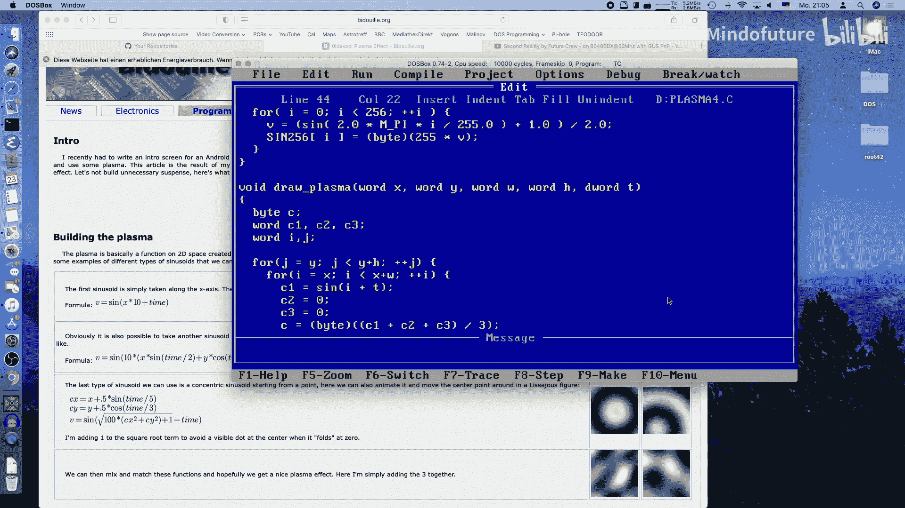
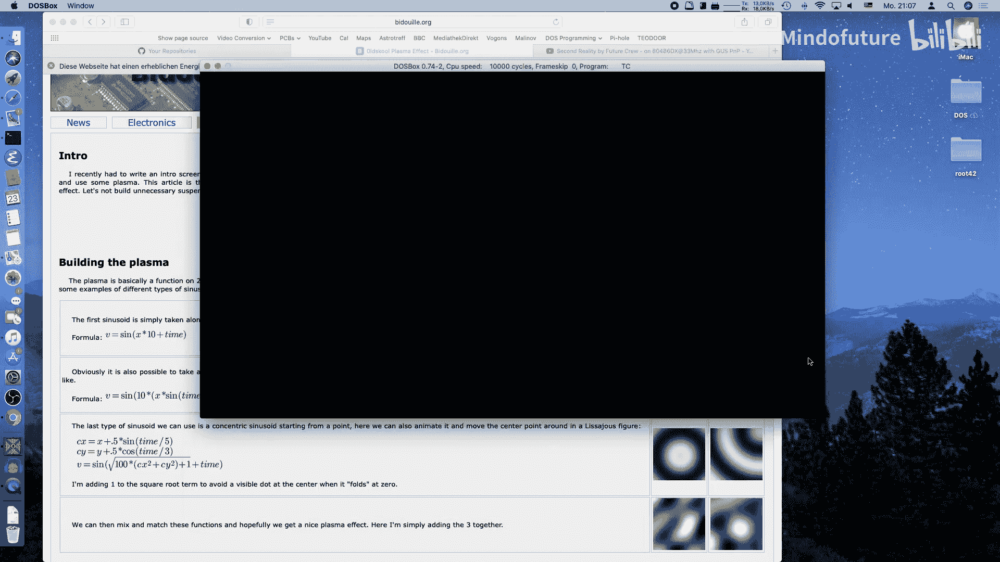
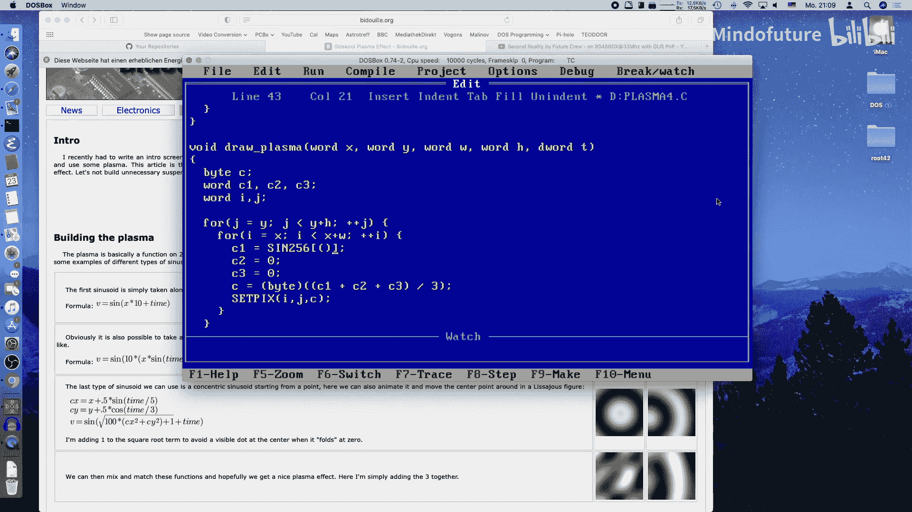
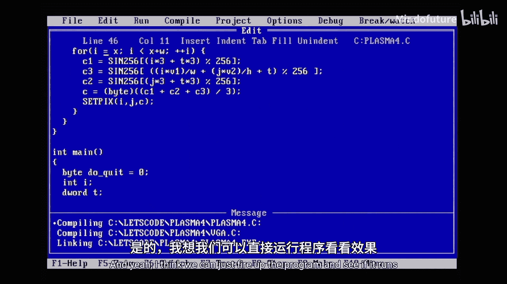
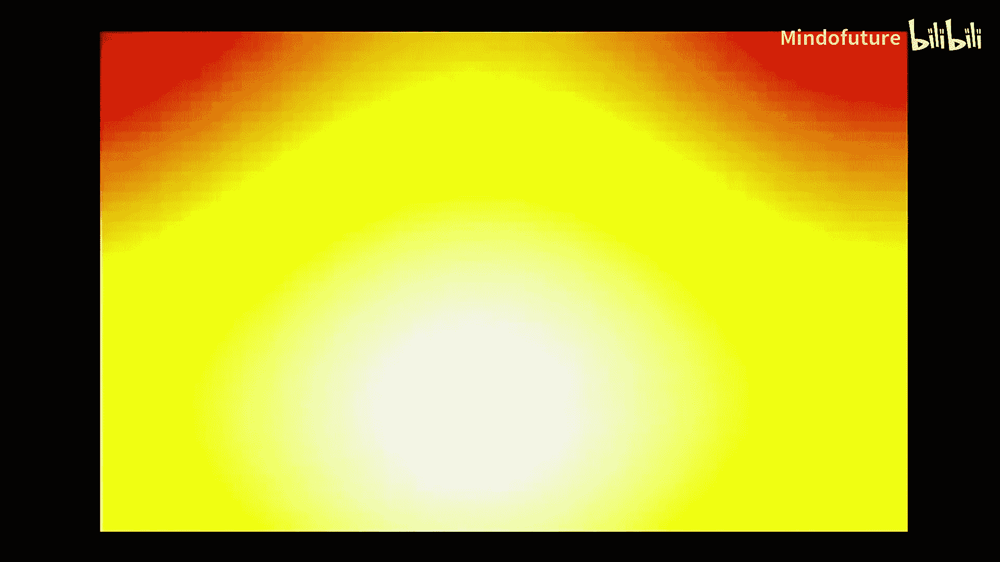

# 编写MS-DOS-系统-｜-windows-｜-操作系统-｜-汇编--｜-vga-｜-x86-p24-P24-Lets-Code-MS-DOS-0x18---VGA-Plasma--BV1zs35zQEru_p24-

🎼Hello， welcome and a very nice evening and welcome back to Let's code MS DoOS and today we want to have a look at another demo effect。

🎼Namely， the plasma effect， which we can see here。🎼Projected on a cube。

 but it's still a plasma by the future crew。🎼From the demo， second reality。

 But this is far from the only demo that does this wavy lobbyy thing。 And it's a staple of。

🎼Demos on the PC on the C64 on the Amiga， and you can find it basically on any platform that is capable of rendering something。

🎼And the question is how can we do it and how can we do it so fast that it looks actually and this nice？

🎼And without using assembler because then it would become a little bit faster still。

 but we will stick to our Torbbo C for simplicity purposes。

 but if you want to you can of course translate this to asseler as well and maybe in the future episode we will come back to assembbller and maybe this would also be a nice thing to do then。

🎼But in the meantime， we'll stick to that。 and there's a very nice website by this person here no idea what his name is。

 but or her。 let's see， compact well。It doesn't say。🎼But it's very well explained with， actually。

🎼In realtime Re plasma on a web page。🎼And it explains pretty well how this effect is actually composed。

🎼Because it is。🎼Very simple。 It's just sine functions and maybe a cosine function for the coordinates。

 But in the end， it's just a sine function and one that is。🎼Producing vertical stripes。

 one that is rotating。🎼Stripees and one that is a circular pattern that moves around。

🎼We will skip on that， because it contains some。🎼Arithmetic that we can do in MSDs and in a fast way。

 but it will not be very readable。 we will produce something a little bit simpler。

 We will use vertical patterns， horizontal patterns and rotating patterns。

 and that already gives us a very nice effect。And also a fast enough effect。So what's your idea here。

🎼Basically， we will be plotting sign functions and we will start off with the fire program that you hopefully remember if not。

 I will put a link into the video and also in the description。🎼Where we draw a fire？A colorful fire。

 branded in real time。🎼By using the Mo Y and the blocky B4 function。

 which allows us to render a very low resolution fire and copy that very quickly onto the screen。

🎼So we get even on a slow， very slow gloss PC， we get a nice fluid animation on faster PC。

 you can use higher resolution and don't need to use the B 4 function， but the proper b function。

🎼But for slow machines， this is actually pretty nice。

 So we will use this whole thing and we ripped out the draw fuel and draw fire routines。

 and instead we have a draw plasma routine。🎼That takes a time tea now as well。

 because we have a counter here。🎼That we increment in the Y loop。

 and the program will run until you hit any key when it will quit。

🎼And the time T is actually randomized。 So the first 4096 frames of the animation。

 we will pick a random one。 New you couldn't pick actually a larger number here。

But so that it doesn't look quite the same Every time it started， it will repeat， of course。

 because the sine function is。A repeating function。 And except if your。Doing some very clever maths。

 then it will look very repetitive in the long run， anyway。However。

We also already know the init sine function， which computes the signine table。

I will also put up a card here because we had a video about calculating sign tables。

Computing the sign function on the fly on MStos on old PC is actually very slow。

 So we just produce an array containinging 256 values。Which。Approximates our sine function。

 And we just look up the values in our draw plasma routine， which currently is empty。

But will not be empty for long。So having a look at the function that we see here。

 it's actually pretty simple。 They take the sign of the x screen coordinate times 10。

 but this is up to you what values you actually put in there plus the time This will lead to this pattern here。

 rolling sine wave coming from the right， moving to the left。The same。

Patttern can be used for vertical lines， which you don't for horizontal lines。 Sorry。

 which you don't see here basically just by replacing the equal sign Y times something plus time。

 Then they will roll from the top to the bottom or the bottom to the top。

The more complicated thing is this term here。 it's the sine function of some constant again。

 times a special thing。 and this is x times sine plus y times cosine。

And if you know a little bit about maths。X times sine plus y times cosine actually gives you a circle。

 That's the circle formula。So putting this in leads to the rotational part here。And。

Taking that from the sign of the time function again of the time value will lead to the actual rotation over time。

And we want some movement here as well。 So we add another time term to that and take the sign of that to get the nice stripes again。

So。The sine and the cos here do not reduce the pattern itself。

 but merely the rotation of the coordinates that we put into the sine function。

So these two things is ever all that we need。So， basically。Let's get my cheat sheet ready。

 We want to store the colour， at some point。We also need to iterate。Over， oh， no。

 the outside will be outside loop will be the Y coordinate， as usual。And J is less than our。唔喂。

Start coordinate plus the height。And we increment Jane。

So this is our loop from top to bottom and then comes our loop from left to right。So， x。Y equals x。

I equals X I less than x plus width。And increment I。Which already tells us that we need。

I and J as variables。Alright， And at some point， inside this。Whole thing。 we want to set。A pixel。

On a comma J comma C。 And the question is， what is C， What is the colour。So。I would say。

 the color is。Has to be cast to bite if we have something else。And。We will have two values。

2 separate color values， C 1， C 2 and C 3。And we will average them so that we don't bleed out color or produce any overflows。

So this is what it looks like， and。F。The time being， we can probably。Yeah， we will put。

Them also in values。 I think no， better not better。

 not better take word values because they will be between 0 and 2 and 55 and adding them up。

 will produce an overflow。 So we better put them in a 16 B variable， which is fine for our purposes。

 because I think this will even run on a fast to 26， Probably not that fast。Not that smooth。

 but it will work。嗯。Definitely， it will work on the 486 that we have。

 and we will try that in the end。 how it runs on the 486。

So let's initialize those variables and then fill them one by one。

So first we put more to 0 to be on the safe side。Let's produce the very slow version first。

 So we read something like。We should compute the sine function。Of。The x value， which is。Actually。

 the eye variable in the loop。Cl， the time。This looks roughly like that。

This should almost if we do this plus1。To normalize it to 0 and 2。And multiplied by 128。

 this should or 1。27 to be on the safe side。 This should give us a byte value that is already doing something。

 So let's try that。Yeah， we get a sign pattern。Which is scrolling and moving。

We can scale that actually， we can make that larger。Let's try sine times 3。Oh， then it gets smaller。

 of course， yeah， well。Let's divide it by 3。Okay， that looks nice。This is the moving pattern。

And we can， of course， do the same。Thing for the。Second value。Let's take J， instead。

And this should give us。Something like this。 Some blobs moving。We can， of course。

 choose different values if we want for this。To scale them differently。 But yeah。

 art doesn't doesn't matter much。This roughly looks。Also very， very lucky。Due to the nature of this。

 probably should have used floats because we're using floats here。 Yeah， this looks better。

 This looks more like I expected it。This looks already pretty。Nice， I would say。Perhaps。We can also。

Scale the time function。And make it run faster。Or。Slower。M。

Looks a bit jittery， but it works， it works。And the last part will actually be。The rotation。

 Let's also try that。So there they say also some scale factor。 I don't know。Let's rather do it。

 We need to scale it down， I think， at the same problem before。So， we take the sign。O， high。Times。

Sign of something。Time。And plus J times cosine of time。And we， for good measure， we add another time。

Term here。And this looks not quite like I was expecting it to look like。Oh， of course。

 because we forgot to scale it up， it was basically 0。Okay， yeah。 well， there we have an overflow。

 which is why it looks so weird， but it works， but it doesn't look very nice。 It's very stuttery。

 There's some。The scaling is off， we have weird overflows and it's yeah， very jittery。

This doesn't look very nice。 We can make this better。

 This is basically just typing in all the formulas。 As you can see。

 it's straight from there to there。It will get better if we use the sign table， actually。

So let's set these terms to 0 again so that we can actually see something。

And let's use the sign table， as we。Usually do。So we take the sign。嗯。But what does it look like well？

We will take something。With the time。And we need to calculate modo 256， so that we wrap around。

This should already produce something。Yeah， this produces a time varying solid color because it's not dependent on the。

I coordinate， actually。Or the X coordinate。Before we would use the X here。 So we just do that。

 We put I plus T in here。And see what it produces。 Well， this looks better。 These are the sign bands。

 And because our sign table is so big， the whole stripes are very big。We can scale that， of course。

 we can。Do something like i times 3。And we get some。Smaller bands are terribly small， but yeah。

 you can already see that there are structure in there。This is pretty nice。

 We can also try and speed things up。Yeah， this looks nice。 This is a。Very smooth。

 fast moving vertical pattern。That looks very nice。 I think I'll， I'll leave that。

 That looks actually pretty decent。So we can do the same with。The vertical pattern。

 And to be in accordance with my cheat sheet， I'm going to put that in C 3。嗯。Otherwise。

 I will forget that。 I did that。So actually， I can just copy that。This should。

 This should actually already work。 I just need to replace。Ngey。

And then we get very nice and smooth scrolling blobs。 This is actually not that bad， I think。

You could still animate the the time coordinate so that it moves up and down backwards and forwards。

 fast and slower。 But I think this is already pretty neat。First， optimization of the day。 actually。

 this line here is dependent only on J and T。 T will not change in the whole function。 It's constant。

J only changes in the outside loop， so we can actually factor this out and pub C。

Is too stupid to do that。The newer compilers like GCC and Clink will be able to do that。

And if we run that， it's actually。Much smoother。 you see。 it's running faster。

 This is one important optimization that you can do if your compiler is too stupid to do that。

 or if you're coding asmb， you have to do it manually anyway， in your loops。

 So take everything outside of the inner loop that you can。The eye here is still dependent。

 so that is nogo。And the calculation is actually depend on the inner loop。

 because there we only have all the values in the set pixel， of course。

 because that's the whole deal。So the the only thing to make it look quite interesting and what is missing is the rotating lines basically。

And how do we do that， I'm going introduce two more variables， V 1 and V2，2 temporary variables。

 Otherwise， it will get very。Well， nasty looking。And the first one is actually。Basically。

 just a time based sign。I want to have it moving。 This is the the the time term， basically。Yeah。

 this this part。And we put， what do we put in there？And we can actually， actually， if I do this。

We can actually put this completely outside the loop。And this will be t times 3。

 just to make it nice and fast。Modulular，256。To make sure that it wraps around。And doesn't overflow。

Okay， and the second variable we can also put here， This is basically the sine part of our rotation。

 and we can calculate the cosine very similarly。We will take what do we call it。 Let's call it。And。

T times 5 methods make it a bit faster than the other one。 And to actually get the cosine。

 we need to at one quarter of the sine table as an index on top of that。

 because the cosine is actually just 90 degrees shifted to the sine and 64 is 90 degrees because it's one quarter of 256 and 90 degrees is one quarter of 360 degrees。

And that's why that is。And yeah， we。Take that module 256。 And this should be roughly correct。

This is our， these are our values， and these are only dependent on the time T。

 so we can factor them out。And the C3 then should be。 And let's hope that it works。

Taking the sign again。Remember， this is the sine of sine plus cosine。

And here we have to take i times v1， which is the sign part。

And we actually have to normalize it because if we just multiply it。

 it will overflow and we have to normalize it by the width of the image。 You can try it without。

 and it will look terrible。 And the same， of course， goes for the Jcon it J times V2。

And normalized by H。And then we had tea on top of that。And if we put that。Into brackets， and。

Do it modo 256。 we should， hopefully have。Something that doesn't press， and that actually works。

And indeed， it does。 And it is。Pretty fast and nice， and wobbly。It's a bit repetitive， Yes。

 but you can play around with the functions。 You can add a few more s terms。

But this is actually pretty， pretty smooth and pretty fast。 I do like it。

 You can also use different pallets。 if you want。 I still use the fire pallllet。

 because I actually like it。 It is。It looks pretty slick， I think。 So what did we do here。

C 1 and C 2。 Oh， we wanted to put something into C 2， which I didn't。嗯。Let's do that， maybe。嗯。

I killed that。So let's copy this one here。And put the J again in here。And see what it looks like。

 Yeah， now we have one more。Term on top of that。 And it gives a bit more of a chaotic appearance。

 slightly less repetitive。 But if you look at it long enough。

 you will see some repetition going on here。 But it looks like， I don't know。

 maybe like lava lamp or something。Nice and blobby， and pretty fast。And if you're wondering。

How fast is this actually on the 46， We will have a look in just a few minutes。And also。

 you might be wondering if this can also be done in the normal mode 13。 Of course。

 it can be or the mode X or mode y。In full screen， full resolution， you can try it out right now。

 we are calculating only 80 by 50 pixels， and that's fast enough for the slow dose machines。

You can try with higher resolutions like 320 by 20 full resolution。But it might be very slow。

 I will put up on Giub  one version where you can actually enable the full resolution。

 And you will see it's not terribly fast。So。I hope this more or less explains everything。

The most important optimization was factoring out the terms that are actually。

Not dependent on Y are X coordinates and just leave in all the coordinates。

Or all the values that are dependent on I and J。And this makes it actually pretty dar fast。

So let's switch to the 46 and see how it looks on a real hardware。Okay。

 here we are under MS Dos on the 486， and I just tried it compiles nicely。And yeah。

 I think we can just fire up the program and see if it runs。

And indeed either does， and it runs also pretty smoothly。 In person。

 it looks actually a bit better because I can only capture with 30 frames per second with my USB capture device。

 but yeah， it definitely works。 And you can try it out。Feel free to download the program。

 run it in Dos box， run it on your old PC， whatever you like。

I hope you'll learn something here and be sure to join for the next Let's go Dets episode or any other stuff that I put on this channel。

 So if you haven't subscribed， please consider doing so， leave a comment for sure。

 that's always very much appreciated。 a thumbs up or thumbs down。

 depending if you like the video or not。And if you want to support me in other forms， there's。

 of course， Patreon， which will help me spend more time on this。 At the moment。

 it's all very small and just a hobby。 But if I get more patrons。

 I can probably actually spend more time on this and do some request。

 because I get requests all the time if I could do this or that on the Let's go serious。

 And I would love to。 And I' am trying， but it takes a long time。😔。

To produce this stuff and my time is very limited。So if you can。

 please consider joining Patreon or coffeefi or supporting the Paypal and if you can't。

 that's all fine。Just come back， if you。Like to。And other than that， I'm going say。

Have a nice evening。

🎼あ。🎼The。🎼。🎼ああ。🎼，🎼。🎼。🎼う。🎼。