# 编写MS-DOS-系统-｜-windows-｜-操作系统-｜-汇编--｜-vga-｜-x86-p25-P25-Lets-Code-MS-DOS-0x19---Fireworks-in-PowerBasic-With-Assembler!--BV1zs35zQEru_p25-

🎼Hello， welcome and a very nice evening。😔，🎼To the last video in this year， 2020。

 which was a weird year to say the least。🎼However， I thought if I didn't do any Christmas video like last year。

 I'm at least going to do a New Year's Eve video。😔，🎼And today we are going to code a firework effect。

🎼And of course we are going to use power basics last year we did some falling snow effect in power basics and today we want to use。

🎼This magnificent programming language from the 1990s to code， a little bit of a firework。

🎼At least here in Germany it's not allowed to do any fireworks this year due to the pandemic。

 so let's make a vow on the computer。🎼And I'm going to use power basic Ps。

 I got quite a bunch of requests to do more basic stuff。🎼And yeah， this is a nice chance to do that。

🎼And again， this is a slightly different version of Power basicsic from last year， last year。

 we used the free runtime edition。🎼Are the cheap。🎼Cheaper runtime edition which couldn't compile to a standalone X file。

 This one here is power basicsic 3。2， which I acquired in the meantime。🎼And yeah。

 it actually can compile to an excififier， and it's a bit more advanced。

🎼But with slight modifications， it should be possible to use the code that I'm doing here in the runtime edition。

🎼As well。🎼So let's get started we want to do graphics of course。

 so I'm straight away going to initialize the graphics mode which is done by the screen command and we're using Sc 7。

🎼The power basics 3。2 doesn't support the 256 color modes of the VGA card。

🎼It supports the 640 by 480，16 colors， which we won't use。 We will use the standard EGA 3。

20 by 216 colors。🎼Moode， which is screen 7 in this case。🎼And。Y。That's what we're doing。🎼Furthermore。

 at the end of the program， we will have to switch back to text mode。

 which is screen zero in basic terms， and then we will have some kind of loop。

🎼And this is what our run loop looks like in power basicic。 do loop until and instant。

🎼Quries the keyboard and this is false as long as there was no key press。🎼Which is sufficient for us。

 too。🎼Do。🎼Just that。🎼In the run loop， we will do the calculations and the drawing。

🎼So we'll call some subrout。 and we need to write call in power basicsic。

 You can't just write the subname。🎼As and see， where we update our particles。

🎼And we'll put something in between here。 The particles will be the fireworks effect。

🎼And then we will draw the particles。🎼At some point。🎼And yeah。🎼There will be more stuff in between。

🎼There will be some exploding。🎼Things here， but for now well leave it at that。

🎼Then we will also have some kind of frame counter which will increment。

 This is basically the same as writing I plus plus and C plus plus or C or I equals I plus 1。

🎼Let's say frame equals frame as one。 We could just write that， but increment frame。

This maybe a bit more。To the point so that you can see what it does。

Also because we want to flick of free animation。We are going to define two variables， called active。

Which will initialize with one and。Visible， which would initialize with 0。

 These are the screen pages。 E G and VGA have multiple screen pages that we can switch around。

To avoid。Making the redraw visible。 So in the back buffer， basically in the active buffer。

 we will draw and。Then we will show the visible buffer， which is already finished。Every。Lop。

 we will swap those two variables， and that's the swap function or command。

Both will be swapped around， and then we can use the screen command again。

 not specifying the first two parameters， which will be the screen mode and I think the color flag for CGA。

But simply specifying active and。Visible， these are the。Exctent， visible pages。

And these will flip around。Then to make it not run too fast， we will write a。A V think function。

Probably will need to write call before that。 But that's optional because this will have no。

Parameter。 So yeah， you can put either call there， leave it as it is。

And then when we in the re think， we will also。Do you have the graphics。

This means here clear screen graphics。 you can also just write clear screen。

 but specifying the graphics is， I think， a bitch。More concise。 Let's have a look。

 This is actually the German version。 So this will not help you。 But you can see you can clear。

The text screen or the graphic screen。Well， let's be precise and say， no。

 we want to clear the graphics mode instead。 not sure what the difference will be。

 but you can try it out。 I think just C less will also work。So first of all。

 we need the v syncnc here。 also before we write that。Well， let's just start doing that。 So this is。

 this is actually the main problem， basically。Main program， just let's market as such。So， we can。

Better。See， because basic doesn't have that kind of structure。

 so we don't see what the main function is。These are some kind of global variables that we need in the whole program。

Oh。Globals， of course， global state， especially global mutable state is not the best idea。

 but that's how basic role。So we will write some kind of sub。Routine v sink。And。

We already know that subroutine， and。It in C plus plus and C， or let's say in C。

 we used that in the VGA coding， I will put up a link on the screen now。We did something like this。

 We would write it， and I'm now translating it into basic while we read from the VGA card。

 namely the register 3D A hex， which is the input status register there are two flags in there which tell us if the horizontal or the vertical electron beam retras happening and we're interested in the vertical retrace。

 because during that time we can flip around the。Image without seeing any screen tearing。

 and it will also lock our frame rate to a maximum of 70 Hz on the VGA card or。

60 Hz on the E D I card， I think。And that flag is， actually。Of decimal value 8。And while this。

Equals1， we know we are in the retrace， so we wait until the that retse has finished。

And to make sure。That we are now in an active free trace。 We wait while。It is still。Not active。

 And after this finished， it will be just fine。 This will， of course， be a bit costly， so we will。

Make this sub in line so that it doesn't cost any overhead when calling it。

 It will just be copy and pasted by the compiler into the code below。Okay， this is。

The basic solution。 But if we want to have it really fast， we can do better。 We can。Comment us out。

And what we can actually do is write some assembly code。

And you do that in power basic by just writing an exclamation mark。

 and then you can write any assembly code。So first of all。

 we will clear the all the interrupt so we don't get disturbed and。

Don't forget to reenable the interrupts when you're done。Cl。

 clear the interrupt flag and st restores it。好。So。We need to load the address of the status register into D X。

 because that's the register that you can use for the in and out commands。 So we will。

Ler hexadeal value of 3 D， A。Into D X。 And then we will have our first。Loop。

 so we make a label decent corner。Okay， so we read the register into the A L8 bit register。

That's doing this in read read in from whatever is in the X in A L。And this gives us a status。And。

 of course， you wan to see if the。bit with the numerical value you8。Is set。 So we do an end A L 8。

And we said， if it's one。We just loop。 So jump， if not 0，2， we sink1。Lesing one。

That does the same as the first line。Second line。 again， we need to loop。

 So we do another label pie too。And we can just copy all that jazz over here。But now。

 instead of jump， if not0， we say jump if 0， which is the second loop。And now we have a very， very。

 very efficient asemler coded His except routine for the vsnc。 Isn't it nice。

 So this will make all of you people happy who want to know more about X86 assembly。Granted。

 it's a very small routine， but I think it's pretty nice， And it will。Work out。 Just fine。嗯。我觉得 also。

Couldut appear some compile of like。 So because I'm running on a 4，86。

 I'm gonna say that the CPU that were targeting is at least the 2，86。Which gives us more performance。

 actually。I am also going to say that for， for size reasons， we are only including the E GA library。

 not the full graphics library， because we are just doing EG A graphics。

 This will reduce the code size a bit。For performance reason， I will。Turn off all error checking。

 especially on array bounds or stuff like that， because basic can power basic can test for out of bounds。

 array excess， etctera， which is nice while developing。

 But when you know that your program runs fine，That's great to disable。We will optimize for speed。

先出一步。Compile for an ex file。So， that's。Good， also， all the variables that I don't declare。

Supposed to be。Integers。Definite means all the variables that are labeled from A to Z。

If they don't have any type。They are automatically integerious。 You have to know that in， in basic。

 you。Make suffix and a variable name。For example， a double variable will have a hash。

 an extended float variable will have two hashes。A string variable will be string dollar。

Well something like that， and I think integers。Are supposed to be percent， maybe。

 but most of the time you need integer variables。 So you just say this。Actually。

 we will need quite a few double variables， but I want to see when I'm dealing with doubles because they do include some performance penal。

 so。I'm just gonna leave them like that。So。Yeah， I think that's good。

Let's go back to the main program， we need to implement update particles， draw particles。

 and we need to deal with the explosions。So。We definitely need the frame counter。

 So we start with frame。Wn。And we need to have a time index because we are doing a physics simulation。

 So I'm going introduce a time variable T hash or T sharp， which is。

A float variable or a double variable。 and we'll initialize it with 0。0。I let'd say。

 I think it doesn't matter much。If we initialize it both1 or0， doesn't matter。Also。

 since I want to have the rockets and the particles follow a ballistic curve with real。Gravity。

 I'm going to introduce the gravitational constant， which usually is 9。

81 m per second squared or something。嗯。But since we are scaling everything down by quite a bit。

There were。Reducuceed to。A。Hundreds。Of that size。No，10s。

 even this is only 1000th of the original size。Which is just something that I made up。

Because it works fine。 You can tweak the parameters and see what happens with the simulation。 Also。

 since we're doing a physics simulation， we need also an increment for the time。

 which I called datata T。And we will go in half steps here，0。5 seconds or whatever that might be。

 I didn't try to figure out real scaling here， but just something that looks nice。Again。

Do play with the variables。Will be nice。We also need the current number of particles that we have。

 I call this n equals1。Because we start with one rocket。

And we need to flag if the rocket has exploded yet， is exploded， and this will be false or 0。

In the beginning。Then we need a whole bunch of state that is used for tracking all the particles。

We need areas for that。 and areas are。Usually done with dim in basic for， I don't know。

 dimension mention， maybe。And do just name it。As you wish， I need one array for x coordinates。

 I need one for Y coordinates。 Those are the positions of my particles。

And I just arbitrarily took 256 here as a value。 I'm not going to use all those。Actually。

 but you can tweak the parameters up and down to again， see what looks nice。 And I'm just putting in。

A reasonable large value here so that I don't get any overflow。Also。We will need more variables here。

 but。We're going to stick with those for the moment until we write something of those functions。

But now the exploding part， that's the interesting thing。 I figured out。If the frame。

Is divisible by 1970。 That is a very nice length for our formula。Just try and error how it is here。

Then we need to check if we should toggle between the rocket explodes or launching a new rocket。

So every time we hit 17，3， 40， etc cetera， etc cetera， we will check。 first of all。

 we will reset the simulation time so timer will go down to 0。And if the rocket already has exploded。

Then we're done with the exploding animation。And instead。We will。Launch another rocket。

 What does it mean that another rocket launches， First of all， our rocket is not exploded anymore。

We will have only one particle， the rocket。And we will call a special function called unit new particles。

嗯。I could also call it any new rocket or something， and it will take some stuff。 We'll put that in。

 in a minute。The else path here is， if the rocket。Has not exploded yet。

 That means it will explode now， so is exploded。Switchches to one。Again， we reset the particles。

 and this time we say， when neuroocre explodes， we get1 hundred0 new particles。

 a nice shower of particles。And we will call something called in it。Explosion。

Which is reasonably nice。 I will also put some parameters in here， in a minute。

And now we will have to implement those four subs。Which one do we take first？Also。

 when the program starts， we need to call。In it， new particles as well。

And and was already initialized。 Yeah， because otherwise， we don't have a rocket to start。Exactly。

 so。What is the first thing that we want to do， I would say we will write any new particles。

 That does make sense， does it。So we write a function in it。 New articles。And at the moment。

 I actually only support one。1 rocket in theory。So we can skip the for loop， and I will skip the。

 I will just call it in it new rocket。 I think that's better。In it new rocket。でよ。Rocket。So。

 there we are。What does a rocket need， A rocket needs some。Exposition， we will reset the exposition。

 It will get changed。嗯。And the rocket will be in the array at the first position So x sharp。

0 equals 0 and y sharp。0 equals 0。 I think we can even leave that out because it will be overwritten in a second。

In it in the different procedure which updates the particles， but better safe than sorry。

We also need some initial position， so we will have an array x0 sharp。Which could take doubles。

And the x position I figured out is somewhere middleish on the screen。

 that means at at least at x con at 1 and 20 plus some random value， which is R And D。Mus。呃， no。

Times， time， sorry，80 times R And D。 So this will place our rocket somewhere between pixel 120 and 200。

 which is。A reasonable amount in the middle of the screen。Also。

 we will always start at the bottom line。Which we will call 0 for usually it will be row 199。

 but we will put that in the drawing code。 So we will start row 0。And also。

 we need a velocity in x and y direction， velocity x。Off the rocket will be some arbitrary value。

 And I just figured some random value times 2， and the random values will always be between 0 and 1。

 So the result will be between 0 and 2。-1。0， so it can go to the left。

 or it can go to the right in every time step， more or less。And we need。A vertical。Velocity。

And there I figured something very similar。Except the minimum speed will be one。

 and the maximum speed will be three steps per iteration， which gives pretty nice。Animation。

 in my opinion。So that is our new rocket。Which will be initial here。Also， when doing this。

 we should call a randomized timer。This will initialize the random number generator with the current clock。

 and the chrome will render something different every time it's run。 This is pretty important。Okay。

 what is the next thing， Probably the most important thing。

After that is the update particles routine。 So let's write that as well。And we also need to。

Andand in the parameters， actually。 So we need to write something like this in。Basic。

 usually all the areas are passed as a pointer。So。We just write their names here。

 and it will be actually pretty efficient to call the routine like that。

 And the one here tells basic what dimensions the area has。 So this is the one dimension area。

And if he had two or three dimensional。Marices or something like that you would just write how many dimensions they have。

 which is actually pretty nice。It's a feature that is not there in C， for example。

They have to write a lot of pointer。Signs of one after the other。So yeah， that's pretty cool。

And I think that's it。We also need to define those variables。 We started off here。

 So let's just copy that。We need the x 0 and y 0 and the V， X 0 and Y， V， Y 0。

And I think those are all the variables we need。And， of course。We need to。Pass those variables。

 as well， to。The program， when we're doing in it， you rocket。But this time。

 we just leave the brackets empty， which tells basic， yeah。

 we are passing the actual array and not any value in that array。

So let's copy that down here as well。I think we got all that covered。

 And now we can already imagine that let's re enableable。

That thing that update particles will take something very similar。But it also needs the time。

And it needs to know how many。Articles are in those areas， actually。I think that looks good。

 doesn't it。So。Let's copy this。And let's call this update articles。Takes T， sharp， and N。Andep。

 we could also declare all those parameters as shared。 So they are using the global parameters。

 but that's not a good style。 I'm trying to do。Rather。

 rather nice basic style here that I would also do in C or any other programming language。

Because this way， you can just report the function and use it somewhere else and don't need to introduce the globals in the same manner as in this particular problem。

 which is better style。Okay， so how does this work， We need a follow loop， I would say。

We also will take one global variable， namely the gravity constant， because it doesn't change。

So that's fine。 I would say this is a global universal constant。And that can be shared。O。

We need to iterate over all the。Entry， so we do a follow look for Y I equals 0，2 n-1。

You have to write my n-1， because in basic， when you start with 0， it actually goes up to n。 So you。

 you would have n plus one entries， but we don't want to。 So we need to subtract one from the n。

And to go to the next duration you write next I， which is different from C plus plus and C。

What I think we can manage。So， here we will update the。X coordinate of that particle。

And the formula for that， you can just look it up on the internet on Wikipedia or anything for ballistic curves。

Is just the initial position x 0。Plus， the velocity。Of。Velocity in x direction of this particle。

Times。The pen step。And for the Y coordinate， it looks actually pretty similar， but。

In the wide direction， of course， the。Gvitational pull comes into play。

 and that formula says it's one half。Times the gravitational constant。Times T squared and T squared。

 we can just write T times T。And I think that should be it。 That's our update routine。 This is。

 this lets us make the particles move。Isn't that nice。 That's very simple。

 So X onnet is just a linear movement。Starting point plus velocity times t。

And why is a linear movement plus the quadratic gravity term， which makes a nice。

 ballistic curve that makes actually the typical parabola that you see when you throw a ball or anything that doesn't move with its own power。

And doesn't accelerate on its own， basically。All right。

That's already that We do have in a new rocket。 We do have update particles。 Next up is。

Drrop articles。We need to draw all the particles。And I would say it will look something very similar in the parameters to this。

Do we need the time step， Actually， I would say no， but we probably need a colour。

 So we take the time step away。And put in the colour， the colour will be。Based on the frame。

Because I want to have some kind of flicky effect twinkling basically。

And we also don't need the velocity vectors。 We just need the x values， actually， and the y values。

We need to have the number of particles， and we need the frame number。

But we don't take the frame number as is， but we will。 no， this is modo in C。

 and this is modular in basicsic。We will take the friend number modo。15， actually。

 because the colour 0 is black on EJ， and we don't want black so that it doesn't get totally black。

So we add one。 so it goes from our color goes from 1 to 15 or to 16。No 1 to 15， actually， yes。

 because 15 would be 0。That should give a nice， flickering， glitter effect。It's a bit cheap。

 you can do more fancy renderings here。 And if you go to 256 colors。

 you can do color cycling instead or some other fancy stuff。But for us， it's。Good， for now。

 I would say。So let's copy that to our sub definitionfin。Sub draw particles。

 one dimensional areas and some form of colour。 We can't call it color because that's already taken。

 We can call it call。We colour is is a keyword in basic or in poet physicsic at least。嗯。I would say。

 we can call it。Coll right。So we will also do the follow loop from。0，2， n，-1。

We will do the next time。And we need to send the pixel witches。Amazingly simple。

 and there' has a function called Excel set。And we just take the。X coordinate and T Y coordinate。

 and now comes something that I said before because we are calculating starting at row 0。

 but row 0 is actually at the top of the screen。 and we want to sound at the bottom。

 We need to take 199， which is the lowest column and subtract our y coordinate。

 So we invert basically our coordinate system。And we brought it with the pixel color。

So that's the particle drawing。 It's just setting one pixel。 That's pretty simple。

So we got that covered。 We got updating the particles， drawing the particles， Iizing a new rocket。

 Now， we need to initialize。An explosion。How do we do that。

And that's actually pretty similar to initializing rocket。Except that we need to。

Know how many particles do。Iitnitiallyialized， so basically， there's another parameter end here， oh。

More like this。So we can take this hole。Stuff here。And create another。Sup。And again。

 we need to specify the dimensions。 All the areass are one dimensional。In this case。And sub。

And I would say。This time， we need to know where to start。 So we call this the X1 position。

And that's actually。嗯。The position of the rocket。 And we put the position of the rocket in the zeroth position of the array。

 We need to store that because we will overwrite that value because the rocket ceases to exist。

That should be why。0， so now we have the position of the rocket。

And now we can initialize all the particles for。I equals 0，2 n-1。And four。We can do some stuff。

 We can do some stuff。 What is the stuff。So。Basically， I want to。

Create random points around the circle。And random points around the circle with a random angle and with a random velocity。

 So I need to create two random values。 The random velocity I call v 0。And that will be 1。

5 times some arbitrary value。Between 0 and 1 plus 0。5。 So the slowest particle will be 0。5。

 The fastest particle will be speed 2。And we need an angle。 I call this angle set up。

That I will go from。0 to2 pi， because that is once one time around the circle。And。

One time around the circle is 6。283185。 roughly， you can use a better approximation。

 and we say times R And D。 So we get something between 0 and2 pi。That's nice， isn't it。

But we need to convert that to proper coordinates， right。Especially to x 0。

 y 0 and velocity coordinates。 So x 0 and y 0 are very simple because those are actually just x1。

 the position of the rocket。 That's our initial position for every particle they start in the center of the rocket。

 and then they stream outward。So let's just do that。 Actually。

 we need to use the subscript here because it's an array。

So every particle would be initialized to the same position where the rocket was。And then。Of course。

 the velocity。Off this particle。And that's always the same。 And we could actually， yeah， no。

 we could not。 This is fine is different for either every particle。

 We calculated for every particle new。 So velocity and that we just。Yeah old。

Times the cosine of the set。And the white coordinate。 And you can look that up why that is the case。

 That's basic tri， trigonometry。You know， angles and circuits and stuff。

So velocity in y direction is the sign。If you take a look at our a。Triangle。

 a right triangle is definediant。 You will see that this is the case。And that's it。

Every particle now has a random direction and a random velocity。

 and they will spread outwards at different rates， and hopefully it will look nice。

Do we have everything。 What， What did we put in here， We put a lot of compile of flags in here。

 which is fine。 They don't do anything。 We learned how to program a little bit of assembly language in basic。

We put in a new rocket。Whenever we need， and I hope this is all right。

We have a simple formula to update the particles， which is the ballistic curve formula that you can also look up。

We have the drop article， which is very simple。 It's just setting pixels。

 We have the innate explosion， which was a bit complicated， but also not too much。

Particles start at the position of the rocket， and then they stream randomly outwards in a circle。

We have a bunch of more or less global variables in the main function。

We are creating one rocket and then enter the main program， basically， going to graphics mode。

 updating all the particles， drawing all the particles。Then every 170 frames。

 we are either creating a new rocket or exploding the current rocket。Couning up the frame。

And we forgot one thing。 One thing that we forgot is。We did not。Havelf an else here。

 because we need to increase。Ti Sha。Otherwise， the simulation won't work。

So if we are not at frame 170 or a multiple thereof， we just need to continue the simulation。

And so that's that。 Let's see if that compiles。 There's the next expected。And for， I wrote that's。

 that's， of course。Not right。Okay， that's it。 Sha we try to run it。

And nothing's happening， which is。Which is。🎼Not the best thing。 Let me quickly debug that。

 and I'll get back to you。 And one of the problems was that I was missing the hash at the end。

 So it was supposed that the theta is an integer variable， which was initialised with 0。🎼Which is。

 of course a bad thing。 and a similar thing happened to me further up， I think。

🎼I think with the in it new rocket， there was。🎼あ。🎼Something missing here。

 Something was wrong here with the variables， if you look。🎼Scroll back a bit in the video。

 you will probably notice it。🎼This is the drawback of basic where you don't have to define any of your variables when you reference a variable that hasn't been defined。

 it's just assumed to be zero。🎼Which is good for beginners， but bad for all the larger projects。

🎼It's nicer that if you have to declare all the variables because then you know， okay。

🎼Those are the things that I actually want to use。 So without further ado， let's run it。

🎼And there goes a rocket and boom it explodes。

🎼And as you can see， it works fine。 It looks probably a bit weird。

 but I think it's pretty convincing。

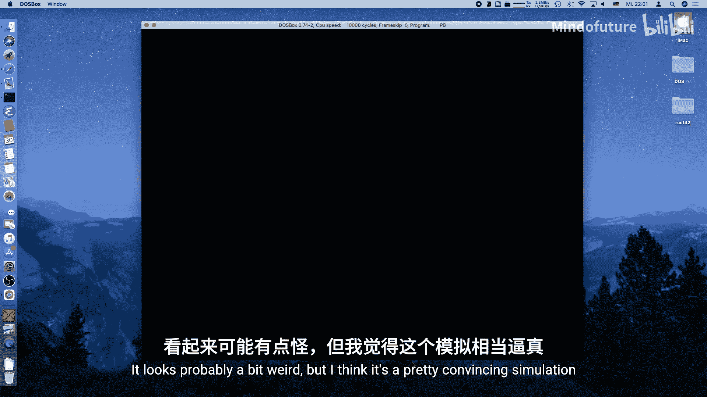

Stimulation。🎼And one， which uses very few lines of coats， actually， to produce such a thing。

 I think the coloring could be a little bit different。

 but I think the shimmer is actually not that bad。 It's cycling very quickly through all the colors。

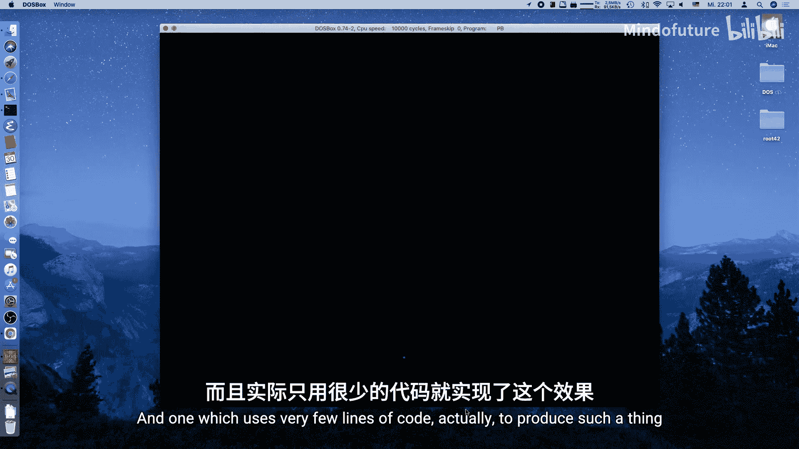

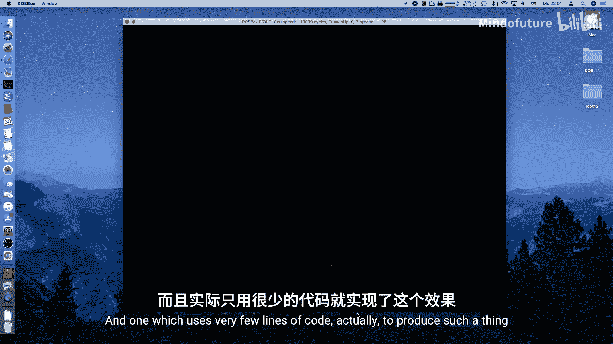

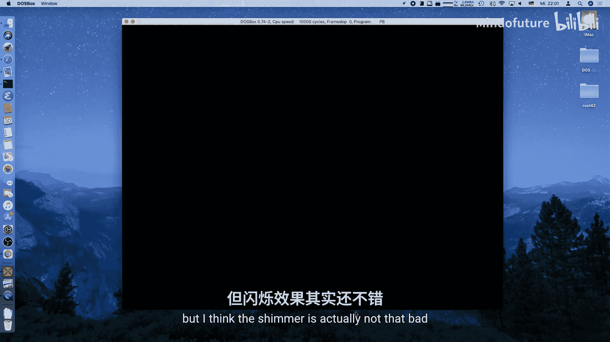

Which makes some kind of glittering effect。🎼You can try to do some other stuff。

 use solid colors or whatever you want。

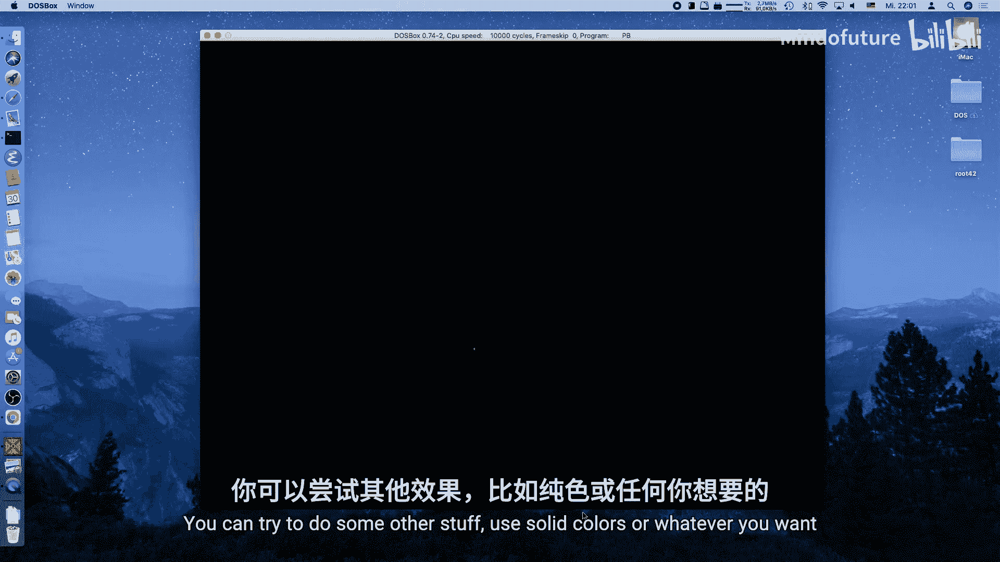

🎼Yeah， but I think this is a very nice。

🎼Effect。🎼And I hope you'll learn something here。

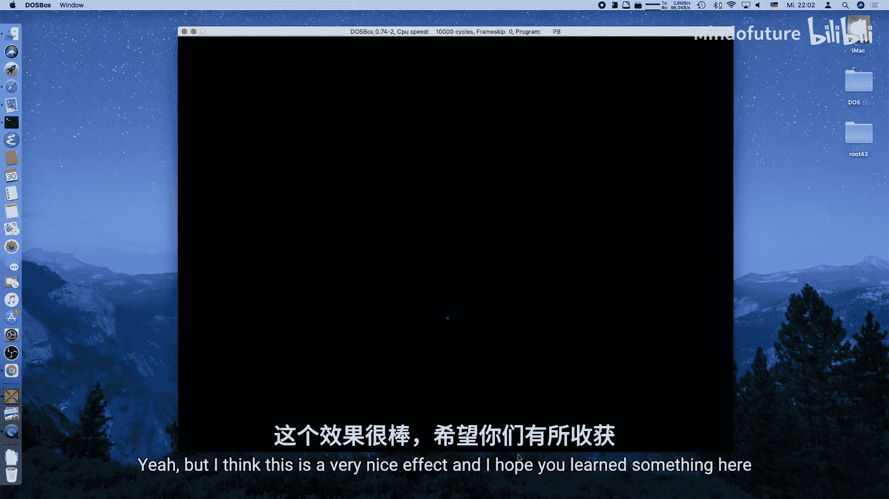

🎼Please consider subscribing， as usual。 I want to thank all of the subscribers We are closing in on the 2000 mark past the 1800 now。

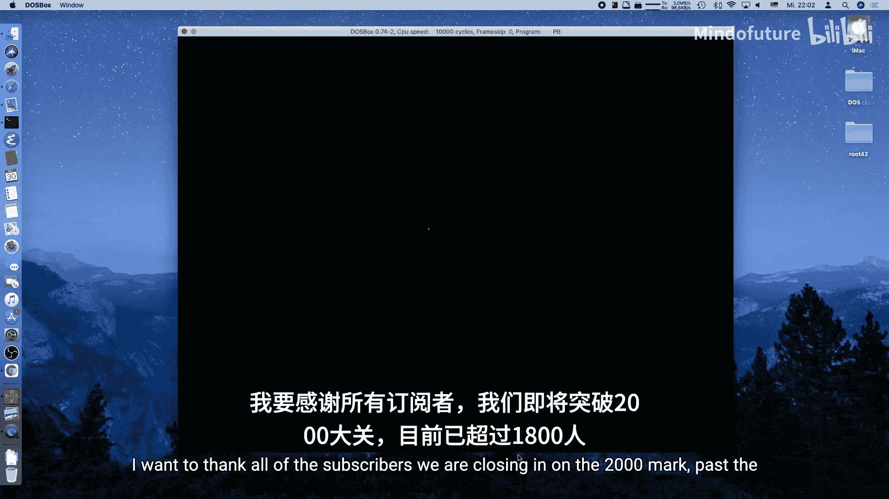

🎼And I'm very grateful for everyone who stayed around， especially through this weird and hard year。

 and I hope you all at home are healthy and are not too affected by the pandemic。 I mean。

 everybody is。 and maybe there's light at the end of the tunnel。😊。

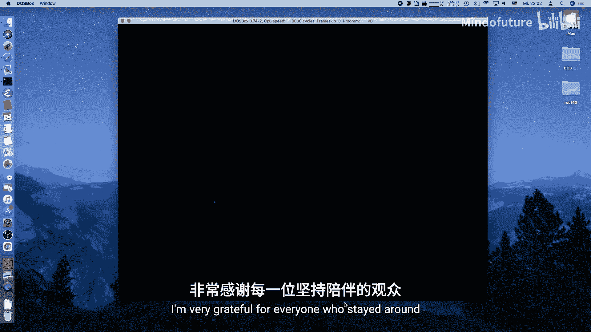

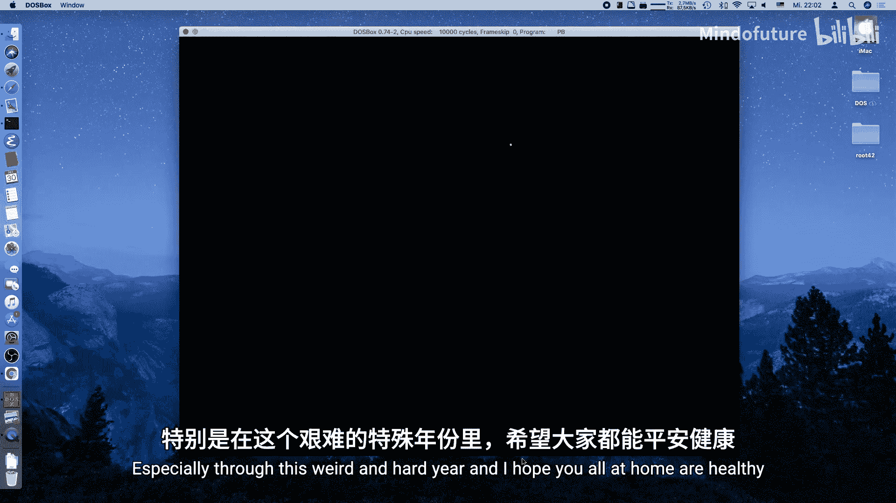

🎼Vaccinations are coming out。 I hope they work。 I hope people get healthier and better。

 and we can return to a bit of a more normal life。

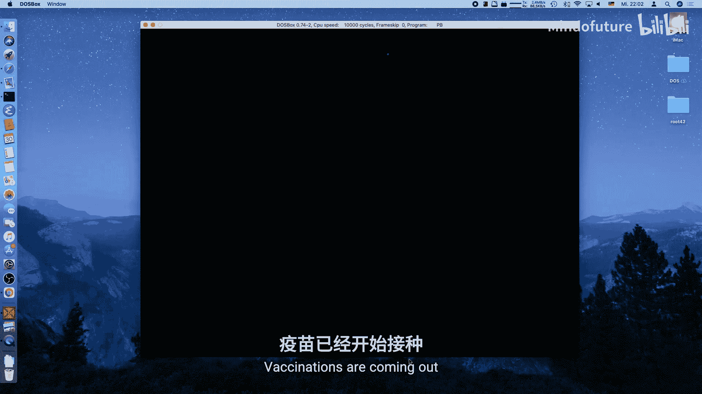

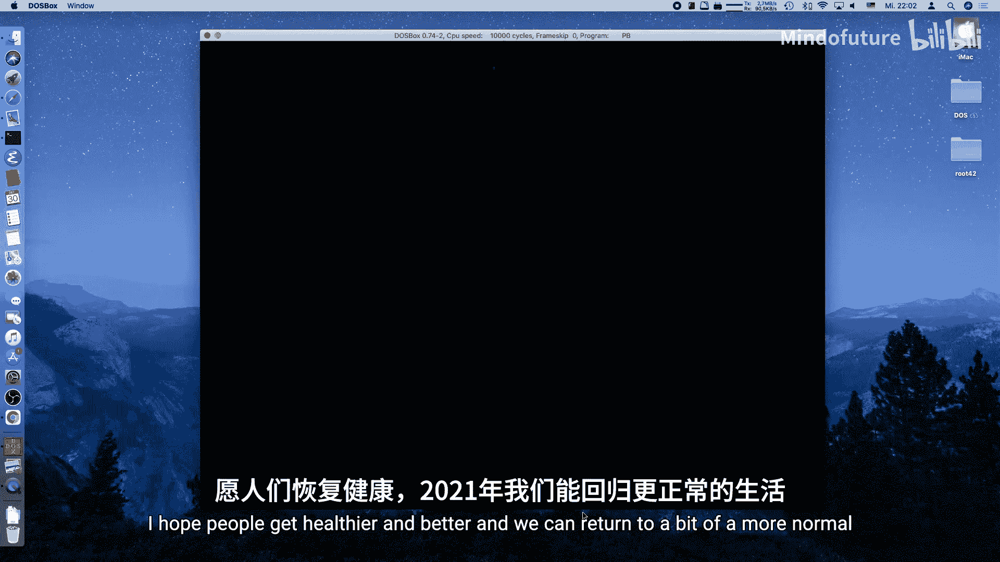

🎼In 2021。

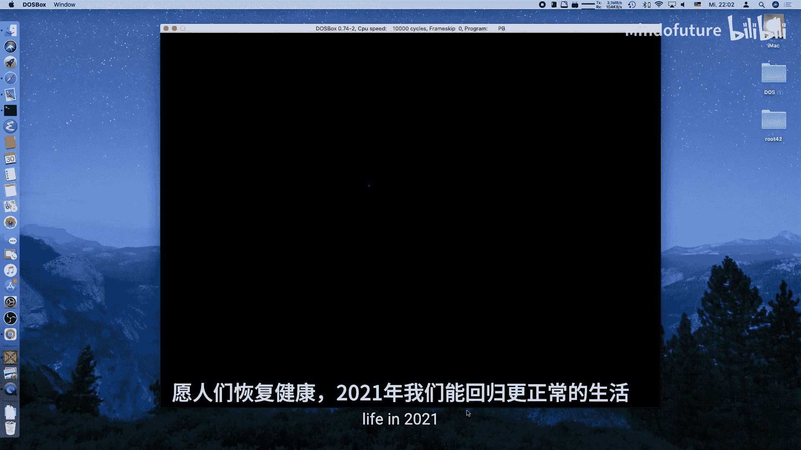

🎼As I said， subscribe， share， like， comment。

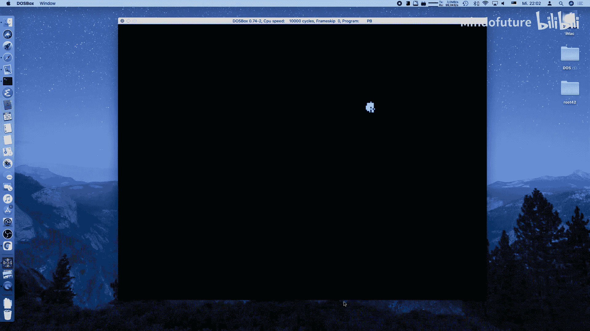

🎼Puut in your comments onto this code or whatever you want to discuss regarding basic。

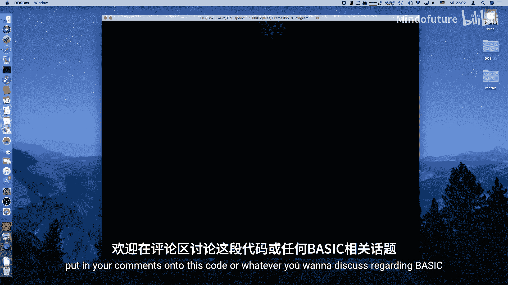

🎼You can also support me， as usual， if you want or。

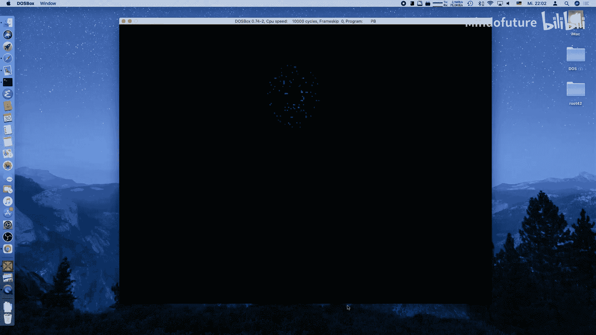

🎼Maybe at the end of the year， you want to donate to some other course， which is also fine。

Links are down in the video description， as usual。

🎼All I can say is have a very good new year。 have a very nice 2021。

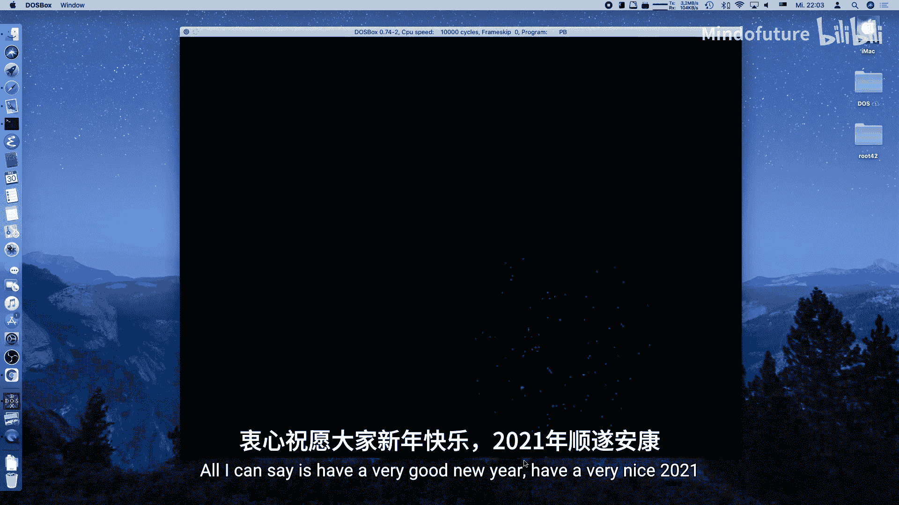

🎼Thank you for sticking around， and I hope to see you soon。

🎼In the next videos， be it lets code or some other tinkering。 So until then。

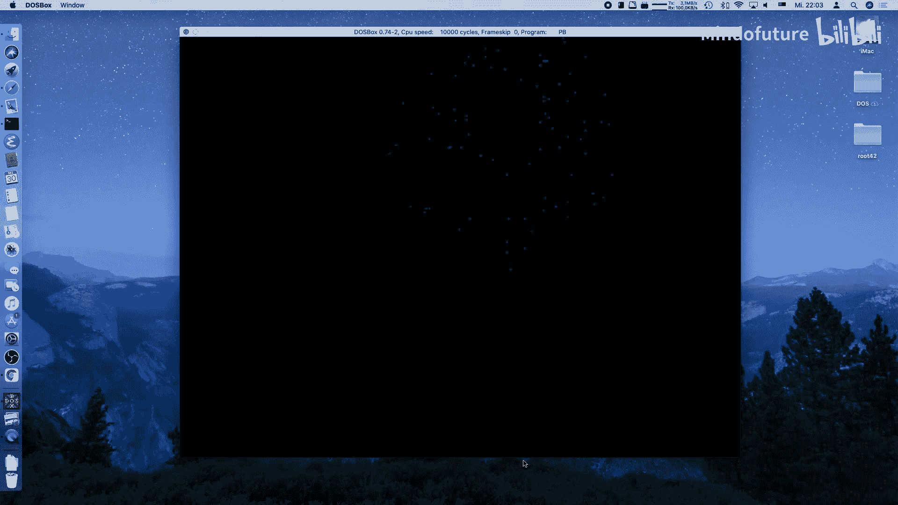

🎼Bye。

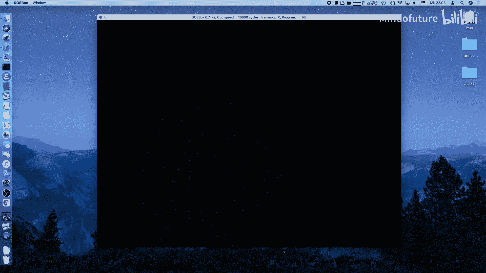

🎼あ。🎼The。🎼う。🎼ああ。🎼。🎼。🎼う。🎼。