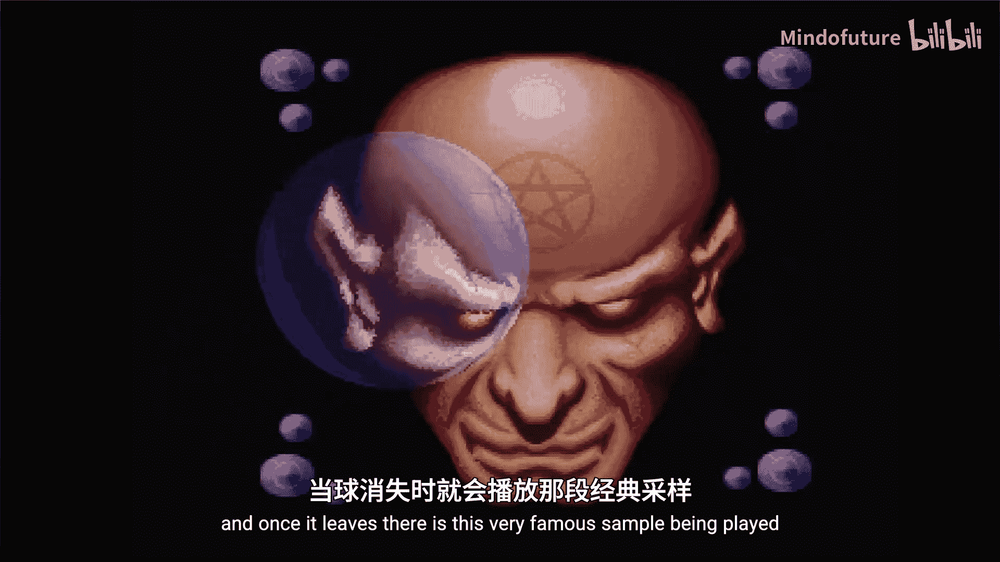
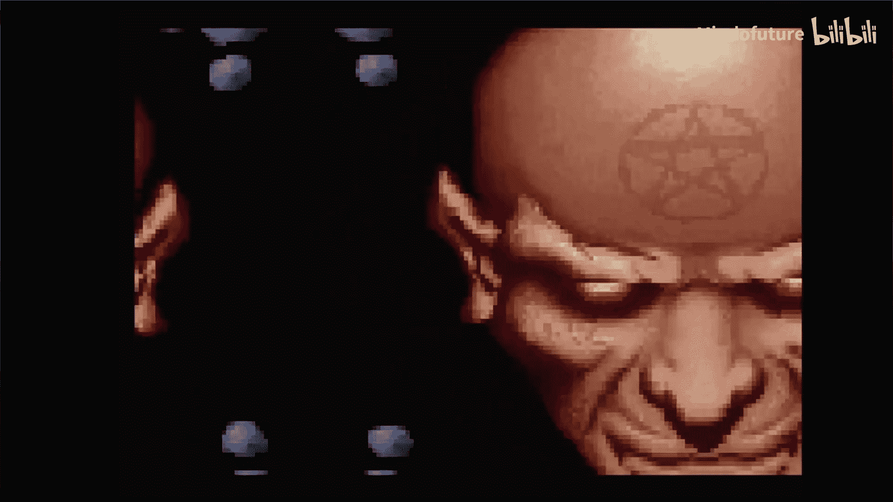
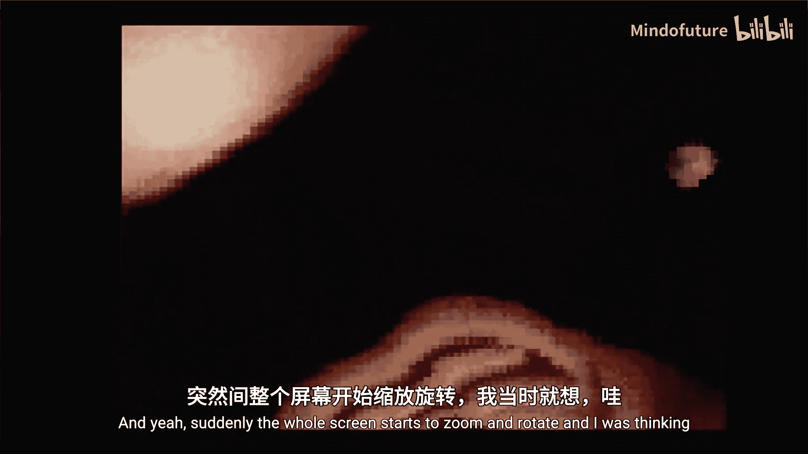
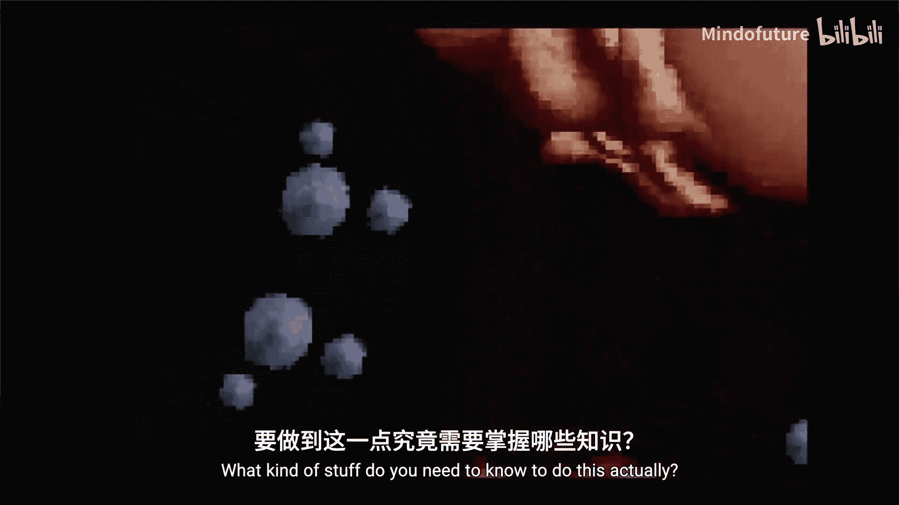
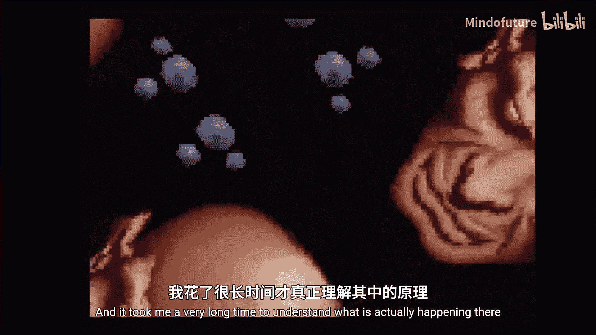

# 编写MS-DOS-系统-｜-windows-｜-操作系统-｜-汇编--｜-vga-｜-x86-p26-P26-Lets-Code-MS-DOS-0x1A---I-Am-Not-An-Atomic-Playboy!-The-Rotozoomer--BV1zs35zQEru_p26-

🎼Very good evening to you all。Today， we are back at Let's code Amazon and。

🎼This time we are looking at another demo effect from the PC demo scene。 Well， actually。

 I think this was done on other platforms as well， maybe on themega。

🎼I definitely saw this on the mega as well， but not sure if it was the same timeframe。

🎼But I am mainly talking about one demo that changed basically the whole PC demo landscape。

 And that is。Second reality by the future crew。🎼I think that demo was released in 1993。

 might have been 1992， but I think it was 93。🎼And it was different。

 There were so many parts in there。 It was truly a mega demomo。

 and there were effects that haven't been seen before。

🎼Or having't been seen before in that quality and that smoothness， etc。

🎼So one thing that fasciated me as a kid when I saw this。🎼Was the part with the rotzuma。

 I will put it on screen now。🎼And there is this nice pixel image of this weird demonic guy and a spherical ball is bumping up and down。

 And once it leaves， there is this very famous sample being played。

🎼And yeah， suddenly， the whole screen starts to zoom and rotate。 And I was thinking， wa。

 how is that possible what？

What kind of stuff do you need to know to do this， actually。

And it。

Took me a very long time to understand what is actually happening there。

🎼You actually need some linear algebra for that。 And I will show you the rough basic ideas behind that in a minute。

And。🎼The problem is， those old pieces。 thus， this was running like on a 4，86。

33 MHz or something and very smoothly。 indeed， they didn't have a lot of processing power。

 They could do integer arithmetics very well。 floating point， not so much。🎼So。🎼Pure 3D was very hard。

 especially with textures。 This is also some kind of texture mapping， but it's only 2D。

 So you can leave out quite a few of costly computations。And。🎼First of all。

 we probably should talk about the texturing problem。

 So let's first do that and we'll look at the bench and I'll draw something up and then we'll come back to this。

🎼So let's talk about texturing or what is behind the maths。🤢，O the rotzumma。

🎼So texturing means applying one image to a different image basically。

🎼And transforming the source image and the process。🎼We have our source image。

 which is the demononic guy。Somehow。🎼And we will parameterize this thing not with X and Y coordinates。

 but we will call those coordinates U and V。🎼And we will also have our screen， which is periized。

With X coordinates and Y coordinates as we know them。

Usually the screen will have a certain resolution。🎼For example。

 320 by 200 for the VGA card in our usual modes， but could be anything。🎼The source image， similarly。

 will have any size， I think I。🎼Scal it down to 128 by 128， I think。 but you can check that later。

And it will be， in our case， a square image。Of Sunday morningonic I， well I'll。

Be drawing a smiley here。Because it's easier to draw。So the question is now。

 how can we apply this texture source to the screen and rotate and scale it？

Well to rotate and scale it。And maybe even translated。

We will have to put it somewhere here on the screen， let's say。We want to rotate it like this。

And also scale it like this， and then of course， it will get tiled over the whole image。

As you can imagine， but we are actually more interested in how we do the first step。

 because the the following steps will just be。Repeating this over and over again。So。😊，We have。

The U coordinates here， which will be map to this arrow over here。

We can already see that there will be an angle of rotation in this direction and we call this angle。

And doing such an rotation。Of some vector， some point in D is actually rather simple。

We can write down a rotation matrix and if you don't know matrices and vectors。

 you should look it up。But the important thing is。A point on a plane or a vector。

 so a direction on a plane can always be described by two components， X and y， for example。

 and we write them like this in a column。Furthermore。

 if we want to transform such a true dimensional vector。We will have a matrix。

 a matrix is basically a table， like an Excel sheet or something。

 and there will be values in here that define how the vector is transformed some numbers basically。

And if we multiply this transformation matrix by this vector。We get a new vector。

 which is transformed。And that new vector will be。This component tends this component。Plus。

 this component times this component in the X component。

And in the Y component we get this component enter。Plus， this component temps this。

 So what does the rotation matrix look like， the rotation matrix。Actually looks like this。

 We take the cosine of this set angle and we take the negative sine of the setta。

And we also take the sine of the theta and the cosine of the theta again。And when we multiply this。

 we get。X times， cosine of theta。Minus y times sine of theta。

In the egg component and the second component of this vector is。X times。Sine of fe。Plus。

Y times cosine of。开车。So this is not no longer a matrix， but a vector with this stuff in here。

 So we just have to write these two formula into our code and multiply every。

Pix corner basically that we have on the screen。Plug that into there and then we get basically。哦。

UV coordinates here。And we can use that to look up in the texture。Furthermore。

 we can also apply some kind of scaling on top of that。

 that means we can also write some scaling factor here to get the zoom。Into there and。

Run it up and down。And we can also translate everything， which means we can have our U coordinates。

But add an additional vector， which we call T。And this will have a Tx and T Y component for shifting along the X or Y axis。

 for example， or we could also call it T and TV because we are shifting in texture space。

 but it doesn't matter where you shift。So long as you do it。And。That is more or less it。

 the whole magic is basically just this rotation matrix。

And how to implement this efficiently to get the screen going here。

We will now have a look at the code and see how we can map this whole stuff that we saw here into Toene。

We should look at the coat。 I have prepared a skeleton。Program。

 which is based on our other demo effect programs。 And it looks very， very similar。

One thing has made a comeback， namely the Gif header， because we want to load an image。

 and I actually prepared the original。Future crew image in， in some fashion。

So we will be able to replicate this process more or less。嗯。Like it was in the actual demo。

Then we also have a bunch of sign tables and the palette for the G and the image structure for the G。

If you are not familiar with this， I will link to the episodes which talk about sign tables and the Gif loading。

In the upper corner， I hope。I hope I don't forget that。 And then you can look that up first。

The initialization of the sign tables， I will skip。But， I will talk a little bit。

For a short while about the main function， which is very similar to the other。

Demo effects that we did。 Mainly， we allocate a frame buffer。 We load the GIif image。

And then I have prepared two different versions of the algorithm for the P and plus my effects。

 we already used the mode Y with its capability of drawing four pixels at once with the same colour to get a very blocky but very fast effect。

We will do this here， as well， for speed purposes。But also。

 it might be too blocky because we actually want to see something here。

 So I have an alternative code path here， which uses just the regular。Mo， what do we use， No。

 the mode 13。And simply copies the whole frame buffer from memory to the VJ。

We are rendering just like future crudeed with 160 by 100 pixels。 Don't be fooled by the 320 here。

 because the。Program will actually draw two pixels at once。So it has once 160 by 100 resolution。

 and we double every scanline basically in this memcopy loop。This one give us a relatively fast。

Solution， one thing where the future crew is much faster at。Is because they use better tools。

 I'm doing this intoy 2。0， because to show that you can do it。You can code it in 16 B。

 It will be slow。The future query used 32 B of codes， probably a bit of assembly language。

 I don't know。 You can look up the source code of the effect in the source code of second reality。

So we will definitely be much slower， because this is。Not very optimized。

 and the top even powder will not optimize very well。

 but it shows that it can be done on a 160 B processor。 It would even run on a 26。

 Probably terribly slow， but it would work。 And that's the nice thing， And I think。And yeah。

 recding this in assembly language with 3，86 up codes and 32 B。Data path will be。Much， much fast。

 of course。But then we probably will be here for a couple of episodes。

So that's not the scope of today。So the main routine will be just this draw rotal。

 It takes the usual parameters and x and y coordinate way to start the effect in a width and height。

So you can basically scale it up and down position it on the screen just as usual and at time index T。

To animate the whole thing。I will actually code two versions of this。

 I will do one with floating point， because it's easier to read。

And then we will do one with fixed point integer arithmetic。

Because it will be actually much faster on a real PC。On this tos box。

 it will probably be similar because my core I 5 here has a very powerful FU， and it can do the。

FPU stuff very fast， so。It doesn't matter， I guess。 but if you put it on real PC。

 having the inte operations will probably be much better。Much faster。All right。So。Let's get started。

I will actually already use the。Constant are defined up here， if the views float。

And there will be an else path for the fixed。Integer arithmetics， which well fill in later。

 Maybe even a second episode。 I am not sure yet how long this will take。

And there is this define up here use float， which will choose this code path。

 So we get the floating part operations。 And then you can swap around between both parts by just。

Unfining that。S simple。Thoms switch basically and recompile the program。 the integer version。Okay。

 so first of all， we need some kind of angle， and we will define everything cons so that the compiler now is okay。

 this might。It's not a variable。 It's content I can put it in register or just use。

Whatever optimizations， Not sure how well To the honest said， but we can give it a hint。

So the angle that we are rotating the image by the Theta。

 I think we called it in our sketch just a minute ago。Is。Pi times。

🎼Our current time index divided by 180。Converting from degrees to raddiance。

 because we need to feed that into the sine code functions。 actually， which leads us to the next。

 as we've seen for the rotation matrix， we need both， both the。Both。The cosine and the signine。

 And we will also store this， because it will。Be used multiple times。

 and we need to compute it only once。 and the computation is expensive， obviously。

Which is why we have the sign tables for the fixed integer Harper。 That's for later。So， we stole the。

Cosine。 And we also stole on the sign。啊飞 angle。And。At some point， we also want to have a zoom。

And we call this Z。And this will also be like a sign。 So I take the sign value that we just computed。

And because I don't want to make it negative， I actually add 1。5。 So we never get a zoo factor of 0。

 which may would make every pixel infinitely large。And we get a certain minimum amount of zoom。

But you can play around with these values。 It makes for some interesting effects。

 going negative might actually flip around the image。E cetera。Here。And also。

 we wanted to translate our。Rotated image。 So we have a translate vector， which is T X， and also。T Y。

This is a translation part。And for that， we also take some some signine function。But， we add some。

Or we multiply by some constant。 I to 64。 you can choose whatever you like。And I also。

Make it so that it never goes below 0。 But you can play around with those。 and I。

Use the cosine for the Y part， because if you。Ploot the sign against the cosine。

 you get actually circled。 So we get some kind of rotational movement。That's at least the idea。

 Again， you can use basically any function here。 You could even use a linear function or just leave it out。

 Then you won't get any translation part。But， yeah， that's okay。 Furthermore， we need to couple of。

Variables， I will call them J S and J C， because they are the product of our current loop。

We will have two loops，1 over I，1 over J for the。Actual U And V coordinates later。

And one will be the product of that variable with sine and with cosine。And for the inner part。

 for the inner。Loop， we will have something similar。 We will have something called I C。J S。

 which is the product of I with C。Plus， the product of J was S。And the same goes for I S J C。

Once we wrote that down， you will see the similarities to the rotation metrics that we talked about earlier。

 This is basically the。Vectctor multiplied with a rotation matrix。And so first of all。

 we can initialize J S。And we can initialize also J C。 So this。

So that we don't have to evaluate it completely every time。

 but can use a simple addition to update this variable because multiplications and divisions are always expensive。

 both with floating points， as well as with integers， and additions are much faster。

🎼So we initialize this with our start coordinate， which is y plus T Y。

 actually because it's the translation。Times the sign。So， that's the first part。And。

The other part is the cosin product。And as you can see， the outer loop will be over the Y coordinate。

 obviously。So that's what we write down。 We write down the loop。The loop goes like this。

 J is equal to 0。Also， for the pixel setting purposes， we won't be。嗯。

Computing the pixel on it all the time。 So we will also carry a。Point it to the pixel。

Which we need to introduce here。 So this is a。Far pointer to the pixel。

 which will point just into the VGA memory。And we initialize that with the first pixel。

🎼Which actually is our frame of a pointer。 plus， of course， our start coordinates， which is why。

Times for it。Plus X。 So this is the very first pixel that we want to write to。

 This is similar to what we always do。And for readability， I'm going to make a line break here。

The end will be reached when J has reached H。 So the height of the image。

 it goes from 0 to the height of the image。Okay， and in every loop， we need to update something。

And we need to update our J， obviously， we just recommended。

And we need to update our pointer to the pixel。 So how much do we need to add？ Well。

 we need to skip to the next line， which is screen with。Minus the width， actually。

 of the image that we are writing。And。That's it for the outer loop， actually， at least for for the。

 for the header。But what do we do inside？ Well， inside， we do something very similar。

 we initialize the variables for the inner loop。And that was the IC JS。

 which is something and the I SJC， which is something。And that will， obviously， be。

Something to do with JS and JC， which we initialized up here。And。

We have something very similar for the Xcon， obviously， So we take the Xcon plus the translation。

And we'll animate。 We will rotate that。 And our rotation matrix tells us that this should be the C。

 the cosine。嗯。We have to subtract the sign part。 You remember， it's basically。

X part times C minus Y part times the sign。And for the second part， it's very similar。

We have let me think the very same x plus T X since our x coordinate that we want to transform。

Times the sine。 And this time， it's plus the cosine part。Okay， so。

All these lines together basically give us our evaluated rotation metrics。

That's more or less already the whole magic。 The rest of the function will be just。

Updating the variables in the correct fashion。So first of all， we need to loop again。

AndThis time it's the eye variable that I picked。 Do I need to carry anything else。 No。

 it's this time it's only the eye variable because the pixels are tracked。In the outer part。

 basically， or almost。嗯。Yes。The end condition is when I reaches the width of the image。

 and we increment I。All right。Opening and closing the loop。

Now we can actually compute the U and V coordinates， which are the actual texture space coordinates。

The you will be。Something like this。 We take the。Transform coordinate。And。

Apply the zoom vector to it， which will make the image larger or smaller。

But we can't use that because this is a floating point variable。So， we basically。Just呃。

Cast the whole thing to an 6 in integer， because this is our lookup into the texture。Hence。

We have to make this， the size of。The texture image that we're actually using。 So image。With。

So that whenever this gets larger， we wrap around to the left side。

 so we'll get this nice tiling pattern。The same goes for the V coordinateordinator。

 It's very similar， but this time we have I JC。And it's not the width， but the height。

If they are different from each other。If it's not a square image。Let me inter fetch the color。 So we。

Take a flu。 I need to introduce a color， I think， up here。By call。So， color is。Our macro get image。

Which。You can look up buff and then just the UnV coordinates。 This will take the sample。

And now we come to the magic。🎼We need to write that， so。The pixel pointer will be de reference。

 That means we will write to it。 And after that， we will go to the next pixel piece plus。

Which is fine， which is also why we do the minus width here because we will write width number of pixels。

 So we need to skip ahead， screen width， minus width。So pixel plus plus equals color。

Now comes the magic with the Mo Y。 If we are not in mo Y。Where we。Basically。

 write four pixel at once。 We need to write。A second pixel to make it fast enough。

So we would do the same again。In that case， if you don't understand it right now。

 you can play around with the coat and see what happens when you take it out。

 You will see that there will be black spots in the image。So。Yeah， just， just play with a cold then。

And， of course， we will also have to increment I once more。Which is fine。

Because we already wrote another pixel。And the true， true magic is now how we update the。

Mets variables。 So I see J S， we could have computed that all the time。

 basically with multiplications， but it's expensive。

 But since we already initialized it in such a nice fashion。

The next multiplication would just lead an increment。Off， exactly。The cos在主动听着这。

Because every time you increment。ああThe。A basically？You're just。

🎼Incrementing the whole thing by the cosine because it's i times C and first it's one times C and it's two times C。

 So instead we can just add the cosine every time instead of recomputing the whole product every time。

 which is much more expensive。🎼And the same goes， of course， for the other variable。

 I S J C equals plus。🎼A plus equals。The sign。🎼It's just the same thing。 It's I times S。

 So one time S，2 times S，3 times S。 every time you just add an S。🎼It's the very same thing。

Same goes for JIS and JC。🎼Outside of this I loop and inside of the J loop， we can increment Js。

🎼By just adding an I and J C will be implemented。🎼By sea。🎼So。

🎼What else is there that we need to do well？🎼Actually。🎼This is the whole thing with floating points。

 obviously， we will try to compile this and see if it works。 It might not work。

 I might have mistyped， as usual。🎼And there are a couple of arrow， because I forgot， of course。

🎼Some run。Variables for the loop。 Let me see。 What did I forget， okay。🎼Yeah。

 we want some something like。Where IJ。🎼And。🎼I think U V is missing。🎼That was an in6 key。

 which is actually the same now as the word， but yeah。Whatever。It will suit。🎼And that looks good。

 Let us see if it works， or if we calleded some garbage。Hey， look at that。🎼That is。

 I think already pretty impressive， it's a bit slow。

🎼I will increase the cycle count to make it a bit more watchable。Yeah， now this is looking good。

 I think this is the 160 by 100h resolution with floating plant variables。

🎼Which will run horribly slow on the 46。 And we will talk about how to make this faster。 But for now。

 we can already gaze upon this very cool effect， I think。

🎼Since we are already at 30 minutes in this video I will cap this short and show you the fixed point computations in the next video。

 but for now thank you very much please consider subscribing liking and sharing the video and as usual if you want to support me you can do this via Paypal Patreon or cofi links in the video description。

🎼If you don't， that's also fine， give your support to any creator that you'll like。

🎼Definitely leave a comment， let's discuss this thing and what your thoughts are about Second reality or if you have ever heard about it。

 which I hope you do if not check it out there are YouTube captures of the video of the demo。

 let's say。🎼And yeah。🎼So far， I like to wish you a very pleasant evening。🎼And see you next time。🎼，🎼。

🎼う。🎼ああ。🎼，🎼。🎼。🎼う。🎼。