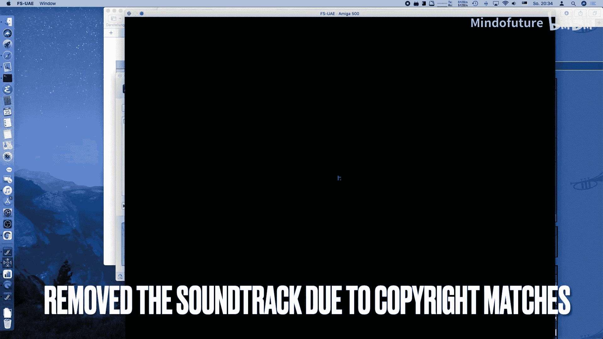
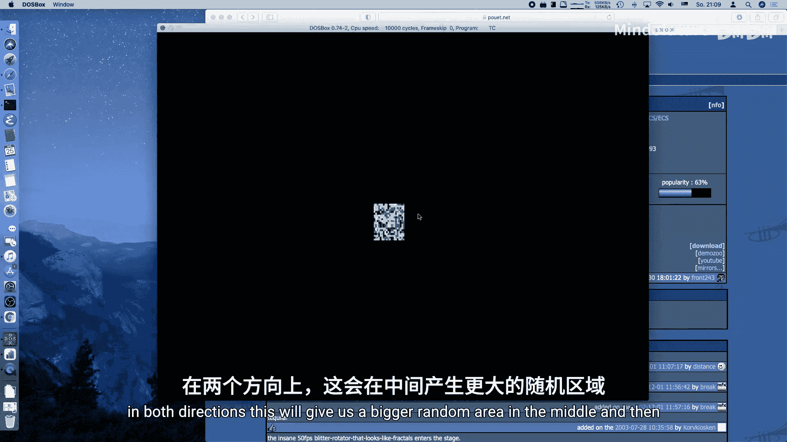

# 编写MS-DOS-系统-｜-windows-｜-操作系统-｜-汇编--｜-vga-｜-x86-p28-P28-Lets-Code-MS-DOS-0x1C---The-Dweezil-Fractal-Zoomer--BV1zs35zQEru_p28-

🎼Hello， welcome and a very good evening to our newest episode of Let's code Emmas Dos。

🎼And today I want to show you another demo scene effect。🎼One that I first saw。

 I'm not sure I think I saw it in some do。🎼Cecttro intro or something like that。🎼Plus。

 I saw in the X screens saver in Linux spec in the mid90s。

🎼But only this year I learned that this effect actually had its roots in the Amyga demo scene。

 which is why we are here on Pue， the website for everything demo scene related。

 I'm going zoom in the website a bit more。🎼And back in 1993， there was at least one demo。

 I think there was another which showed a similar effect。

But this one here is called Banana Man by Stlar。🎼And there is this particular zooming effect。

 And we're going watch that demo for a short bit。🎼So that you can understand more what I'm talking about here。

 basically it。🎼Back then it was called like a fractal infinite zooomer。🎼And yeah。

 maybe you can call it that， but it's actually a bit cheating， but it looks very cool。 And yeah。

s it's pretty impressive。 So I'm gonna fire up the demo and fast forward to the bit。

 That is interesting。😊。

🎼So as you could see， it is an interesting zooming and rotation effect and。

I couldn't really figure out how to do that。🎼I found a website which implemented the same effect in pure basics。

🎼And then a friend of mine picked up an old archived website by someone who made a version。🎼In C。

 basically for tos or windows or whatever。And that was what I used as an inspiration。

🎼And it turns out there's also an explanation by the original codes of this stuff。🎼And on the amyga。

 you would use the b chip， which does basically which can very fast copy your rectangles over the screen。

🎼And that's what's being done here。 And it's a bit complicated to explain。 But in the end。

 it's actually。🎼Pretty simple。 What's going on here。

 And I've prepared a little Excel sheet or number sheet in this case。🎼And basically。

 what we're doing is we are subdividing the screen into a checkout board or chessboard。

 whatever you wantt call it。🎼Best to use something with an odd number of rows and columns here taking5 by5。

 I think in the code。🎼That we are looking at I use， let's see， 13 by 13。

 which works fine as well because it fits on our VGA screen， let me close the aimulator very quickly。

🎼So but for this example， we use the5pa5 and it consists of two separate operations。

 The first one is a zooming operation where we kind of zoom the image that is created in the center in the center。

 we just generate random pixels。🎼And those will create the noisy pattern that we see on the outside。

 And when zooming out， we are copying。🎼Into the destination frame buffer。

🎼By shifting every tile a little bit to the center。

 the ones on the vertical will be these tiles here。 instead of copying directly from the software。

 we will shift it slightly to the center and take a row of fresh pixels and a couple of rows of old pixels and copy them a bit higher into the destination buffer。

 samee goes for the next instead of copying from up here。

 we shift it down even further down so that we have overlap with the older one and so on。

 And on the diagonals， we have a similar solution， we should copy。Ever further in。

This is used to be here， and we shift it down so that we get a lot of overlap， et cetera， et cetera。

 Basically， what we are using here are the coordinates around。The center， the center is 0，0。

Which you hopefully can make out a little bit here。

And going to the left will decrease our x component。 This is coordinate-0，-1，0。 This is -2，0。

 and the upper corner is， -2-2， et cetera， etc cetera。

 And this is actually also the shift that we're doing in the copy operation。This leads us to copy。

The image in such a way that the zoom effect gets faster the further out we get。

 which is what you would expect from zooming into an image or going through a tunnel like thing。

 The further to the image border you get， the faster the stuff is moving because the the displacement is always larger。

 The smallest displacement will be in this here， we only shift by one pixel in each direction。

And then we shift already by two pixels in this direction from， from this position， et cetera。

 Maybe this is a bit too abstract， but hopefully in the code。

 it will become clear what's happening here。 The off diagonal things are a slightly bit different。

 but not too much。There we shift in one direction a little bit less。

So that we get something like this。But the overlap will still be there。

And if we make a bigger pattern， then we have more oftagonal tiles， which behave similarly。

So this is the zooming part， but at the same time， we also apply a rotation and the rotation looks like this。

 We just have to flip the x and Y coordinates。 And if we do the flipping。 So instead of writing x， Y。

 we write Y X or to be precise， we write minus Y X。We get a pattern like this。

 So when we go to the right， we don't copy from the cell directly and we don't go to the inside of the image like we did for the zooming。

 but we go slightly down actually， and for the next cell。

 we go even further down so that we get a slope basically in our copy operation。

Which looks something like this is just approximate， of course。

And if we fill out all the patterns here on the diagonal， nothing happens。 that will stay the same。

 we get， you can already see that a slight rotation movement。Which is actually pretty neat。

And what you have to keep in mind is we don't copy pixel by pixel， but we copy rectangles tiles。

 This is due to the fact that the aomega could only fast。To fast copies on rectangular sections。

 So this was an approximation to a true zoom and scaling and rotation operation。

By subdividing the whole image into discrete parts， which could be handled well by the b。On the PC。

Since we have to do everything in software anyway， we could do a perfect scaling rotation。

 and we did the route routetuzuma back a few episodes。

But that had the disadvantage that it was pretty slow， actually。And。

This discretization into tiles is actually pretty fast。 and even it's even fast under DoOS machines。

 where we can use mem copy to copy whole blocks and regions。Of memory。

 instead of having to do a lot of transformations。So we will do the very same approach here that the Aomega did with the b。

There will be a lot of optimizations that you can still do in the code。 My code is。

Short and mostly readable so that it can easily follow。 But， of course， as usual。

 there are many optimizations that we can apply。But let's look at the actual code。

 I'm going to put this away。And starting out with roughly our regular setup here。

I already filled out the whole main function for you。 So we will skip most of that。

 The important part here is we have to use two buffers。

 which are called frame buffer and data chunks。 the name data chunks I stole from the original code。

Which I augmented actually。 So if you compare with the original code mine is a little bit simpler。

 because I think there were some unnecessary things which made the algorithm harder to understand。

But you can have a look at that。 I will link to that in the video description。

And you can compare and see where my implementation differs。But basically。

 this is a back buffer where we collect all the distorted imagery。 And after we' done that。

 we copyied back to the frame buffer， which gets。Copy to the vgenary， we can probably。

We could probably copy directly from V GA memory， but。I wasn't sure if that's fast enough。

 I will probably do a second video on this where we apply a different video mode。

 which is very suited for this kind of effect。 And there we only need the VGA memory plus one buffer。

So these are the two buffers。Of size， bufferuff size。 and every buffer has a width and height。

They have to be square。 I tried rectangular ones， but then I run out of the memory at some point because of the transformations。

 So this works only for square buffers at the moment。

 I think it will get much more complicated if we want to do rectangular buffers。

But that's also something for a different video。 The buffer width and height is basically the tile size。

 which I called piece size。And times the number of number the number of pieces in x and y direction。

 So you can tune that here。 I found that a tile size of 16 pixels and 13 pixels。

Across in each direction works pretty well， which gives us a pretty large image on our 320 by 200 resolution mode 13。

 And I'm using just simple mode 13 here because we don't need no page flipping。We just need raw。

Memory bandwidth。 And I think this is the most。Efficient way to do that at the moment。So。

We allocate that and if we couldn't allocate anything， we。Bail out， but that shouldn't happen。

That takes only like 100 kilobytes or so of memory。

Then we clear the memory by using Member set on both and writing zeros to that。

 You can actually leave that out and start with the random values in your memory。

 which looks nice and interesting。 You can play around with that， or fill them with。

Maybe other images， like a gF or something。And that also looks very nice because then it gets。

 the image gets distorted。Then we enter the graphics mode， mode 13，3，20 by 2 256 colour。

 We set our fire palette。 you can。Use any palette that you want。

 But that's the I had ready from our fire experiment and the twister and the other effects that use the same。

And then we enter the main loop。This here checks if the key code on the keyboard was escape。

 so with escape， we can quit。But inside the loop， we can also read a key if it was it。

 and we can talk the rotation。 Actually， we can do a clock as rotation or counterclockwise rotation。

 which is equal to rotation equals 1 or -1。And if you can even。

Turn off the rotation by setting it to0， and then you get only the scaling effect。

The zoom effect can be toggled with that the same goes here。

 we can have a zooming into the image effect。 if we set the zoom2， let me check at the top。

 if we set the zoom to minus-1 then we are zooming into the image。Or if we set the zoom to zero。

 there's only rotation happening where you can even turn off everything。

And zoom equals one means we zoom out of the image， which also looks pretty interesting。

And the third part is a bit magic。 It's called a shift。To get the actual fractal appearance。

 we don't copy from the center every frame， but we random randomly select a new center。

 which moves around inside of one tile。 So 16 pixels displacement at at the most。

And copies from there。Doing this， every frame leads to the factor pattern。

It sounds a bit weird right now， but I will show you what the effect is by toggling the shift when we got the program running。

Then we call the drawweasel routine Why do I call it drawweel because the author of this demo here。

 the stellar group， the author who did the effect is called dweasel at least in the scene and the demo scene his real name is got can't read it anymore。

 to finished guys anyway。 so the weasel was his name And so our algorithm is also called dweasel。

Then as usual， we wait for the rets so that we don't get any screen tiing and we have a synchronization to the 70 frames per second of the VGA card。

And then we basically just copy the frame buffer to the screen。

 The whole magic here is just to center the image。I won't explain that right now because you can leave that out。

And the second thing that I do is I cut off the topmost row of tiles and the leftmost row of tiles。

You can also skip that， and then you will see a few artifacts at the border of the screen because during the copy operation。

 we wrap around in the buffer。 and so the left side of the buffer will contain stuff from the right side。

 and it looks a bit weird。This problem。Can be solved by clipping during the copy operation。

 which the b does， I think， which we don't do due to efficiency reasons。

 It's faster to just copy that stuff。 perhaps， maybe， or we would have to。Yeah， adjust。

 adjust our copy routine。 Maybe I'll do that in a later part where we talk about clipping。For now。

 we don't。 And we just cut off a little bit to the left and to the top。Once we quit。

 we set the text mode and return to Dos。 That's it。 The broad visa routine is now pretty empty。

 So let's start implementing that。First of all， I talked about the。Shift。

 that would be a byte variable。Call it shift。 And we already have this Boolean variable here do shift。

 which is true。So we can test for that。嗯。First of all。

 shift will always be initialized with zero during call here。And。If do shift is true。

We will just simply pick a random value。Between 0 and 15。So we are inside of on。 Basically。

 we should use P size， actually here。Which jitters around our centre。 So that we get this。

 this fractal effect。Prety simple。 Then we need to fill up the centre tile with random pixels。

So we do something like， It know。 We we go over y and。X so。What I figured out is。

 it's pretty nice to。Go to， roughly。Let's look like this half the tile size。 So p size divided by2。

And。That goes also for the X direction。Just use。AV good X， which we also need to introduce up here。

And that should be。An injo， I would say。Then we pick a random color。Color equals random。Of2，5，6。

 So anybody value between0 and 2，5，5 will be okay。That should also be a byte value。

That's the index to our palette。And then we can use our set pixel routine。And we put it。

Dead in the center， so。With divided by two。And。We need to。Have width defined。

Do we need that later on， Let me。Check my notes。Actually， no。

 we can just use buffer with think divided by2。Because that's the same thing。Plus x， actually。

 this is the offset。🎼And also， buffer height。Plus， y。And the colour that we just selected。

 this will give us random colours。And also to use Buffite divided by 2。

 And then we should have something that we can already see。

And there we have the randomixs in the center of our buffer。Which is nice。

 Now we need to implement the whole copying stuff。And I already prepared a function in our VGA code。

You can check this out。 I will not go into much detail。 It's called mem copy rectangle。

And it basically copies frommoau to a destination。嗯。

With a certain width and height and a source and destination coordinate and the size of the rectangle that we want to copy。

 the width and height just says。Tells us the height and width of the whole buffer。

 while the copy width and copy height gives us the rectangle。This is。Pretty simple stuff。

 It's just a bunch of men copy cards that go line by line and copy bits or slices of the memory。

 basically。You can have a look at that。 It's really， really basic stuff。

 And I think we probably already had something like that in one of the games。The the pong game。

 maybe。So going back to the main code。What we have to do now is to iterate over all the。

🎼Pieces actually， so we go from0。2 number。What did you call it numb pieces in Y direction？

And the same goes， of course， from the X direction as well。嗯 come on。So， x direction。Same value。

 except nu P P of X。 at the moment， that's always the same。

But maybe we are gonna fix that in a future episode。Who knows or you can do it at home。All right， so。

First of all， we need to compute the。Source coordinates basically for OM copyrighted。

 And I call this X S for X source。And these variables will be x as x source， y source。

 x destination and y destination。These are the。Varable that I'm going to use。And the basic。

Tiles will be x times P size。And we can copy that four times。Because。Selecting the appropriate tile。

Is basically just our exordinate times the size of the pieces， of the tiles。

And the same goes for the destination address。So this is very simple。

 and it will do basically nothing。Particular to our picture。In the end， we can copy back。

What do I want。 No， first of all， I want to copy， do the men copy rectangle。

We copy now to the back buffer。 so we copy two data chunks from our frame buffer。

With the buffer width and buffer height for both。And with the source coordinates and the destination coordinates。

Which are， which is basically just a simple copy。 It does nothing right now。

And we copy exactly one tire at a time。We won't say anything now because it ends up in the back buffer。

 but。We will now copy it back to the frame file， the distorted version， basically， or right now。

 it's undistored。 but this is just a check that we still get the same picture that we got just now before we did that。

 So the target will be framer on。嗯。Plus， in theory， we should use a shift。

 but it's not implemented yet。 so that will come later。With the source being data chunks。

And how much do we want to copy， We want to copy b width times buff height pixels。

 because that's the whole buffer。That should compile。With one warning due to shift not being used。

 we didn't implement it yet。And that gives us exactly the same output。

 We copy once to the back buffer and then to the other buffer again。

Okay so I had a very small buck here， it said less or equal。

 so I copied a bit too much and the do box crashed。

 but no worries we fixed that of course we can only go from0 to number pieces y minus1。

 so that's why we have the less than and not the less or equal。But never fear。

 Next part is the shift， and we can just apply that to the X and Y source coordinate to copy a bit jittery。

 This will look slightly weird， and it will go off into the distance here。

 So we have to actually apply that。To the。Target copy， as well。

By applying this to the x and y coordinate， which just means the x coordinate is plus shift and the y coordinate is plus shift times buffer with。

And to be honest， we probably should。嗯。Subtract the whole stuff here from the number of bytes that we copy just not to run out of the memory that we allocated。

 and that will give us a steady picture because it will copy jitter into the back buffer invisibly and then undo the jitter when copying back。

 So we get a steady image bag， which is important。 Otherwise。

 it looks totally weird as you have seen， and it will do the same with the。Zooming and rotation。

 actually。Okay， the zooming part would be now our goal， which is actually pretty simple。

 We have another term， with something zoom。With the zoom part。

 But we said we don't just want to zoom in。X。Why direction like that。

 But we want to scale the zoom factor， depending on。Our coordinates。

Which brings us back to this here。 So basically， the relative coordinates here are what I'm looking at。

So we want to have in the upper left corner， we want to have this minus-2 minus-2 in the upper right。

2 minus-2 and then center we want to have0， basically。How do we get that？ Well。

 the formula for that is pretty straightforward。 We can just take our current external coordinate。

And。We subtract。The number of pieces in the。Next direction。Divided by2。

This will give us the -2 in the left on the left column in the 0 in the center。 and you can just。Put。

 put the values in here because we have 13 pieces。 So the very left column will be the zeroth column。

 So we will have 0。Let me write the stone。We will have0 minus number of pieces 13 divided by 2。

Which gives us 0 minus。6ix。Which is because 13 divided 2，6。5。 But it's an interteger division。

 So we get 0-6， which gives us。A minus-6， which is exactly what we would expect in a setup where we have 13 by 13 tiles。

On the other hand， when we are at the centre， we will have the sixth element。-13 divided 2。

 So we will have 6-6， and that equals 0。 That's at the centre。 perfectf。 That's exactly what we want。

 And at the other end， we will have 13-13 divided 2。 That's 13-6， which gives us。系。7， I would say。

Actually， we're not going until there we go to 12， of course， because we have this less than。

 as I just said， so we go to6， which is fine。Okay。So， this formula works。

This will give us exactly what we want and the same， of course。 And we need to multiply by that。

🎼We will do the same with the Y coordinate。 Y minus nu pieces in。Why direction divided by it， too。

Having that should already give us a zoom effect， and indeed， it does。

I can stop the zoom by pressing that。 I can reverse the zoom， which copies from the border。

 which gives us a weird result。Or we can zoom back in。

 and I can even stop the shifting the jittering， which gives us another interesting effect。

 and we only get the lower right quadrant producing stuff because of the way that we set the random pixels。

 We can shift them a bit more to the up and left。 and we will get noise all round。

 Let's do just that。Let's say we want to set the pixels from。嗯。Minus piece size divided per two。

In both directions， this will give us a bigger random area in the middle。

And then， we。Get a very weird tunnel like thing。 but it's still something zuma like。

 And if we jitter it round， we get a more noisy picture here。

 a little bit more noise to the upper left。 I'm gonna to stop this before you get some epilepsy or something。

 Probably should put up a warning in the beginning of the video。 Yeah。

 I'll do that in in post editing。Pos processing。And yeah， that's basically the zooming already done。

And the last bit is not that much more complicated， because it looks very similar。As I said。

 we have the rotation。It gets added on top。Probably gonna break the line here so you can actually see the stuff times。

Something very similar， something exactly similar， except that we will swap the y and the X part。

🎼We actually have to use the Y coordinate here to do the actual rotation。

 So it would look something like this y minus。嗯。啱。Pieces。Why。5 to by2。And。Yeah。

 we're missing a closing bracket。But we actually have to do the negative of that。

 So we need to subtract this。 You can try out without， but it will look not correct。嗯。And the same。

 of course， goes for the。X part， But there we have to do the。Plus。

 how to get the rotation and use the Xcon， obviously。So that's that。 And when we start this。

We already have。How와도子吗。🎼We can make the center emitter a bit smaller or something。

 I will note stop the rotation first in the other direction。 and now we have。🎼Only the scaling。

 we can also stop the scaling or zoom in depending on what you want。But now will。

🎼Turn off the jitter and turn on the rotation and then you can actually see how this whole thing works。

 especially in the center。 you will see in the center that we have an octagon shape where the pixels get shifted around and if you look closely。

 there are a lot of tiles in the outer regions you can't see that because they are so fast rotating that it's hard to make out。

 but its basically it's an approximation to a true rotation。

🎼And that's what this whole thing is about。🎼And without the jitter。

 it doesn't look quite as pleasing turning on the jitter makes the whole thing much more fractal like。

🎼And yeah。This is already the whole deal， actually。

🎼It's a very simple approximation to zooming and rotation。

 The only magic here is the way we compute the source coordinates。

And that we have to reapply the jitter if you want to have this。

🎼Fract the look on the way back to the frame of it， actually。🎼If you don't do that。

 then everything explodes。🎼You can take this code play around with the variables a bit。

 be careful because it's very easy to jumble up your whole memory and crash the emulator。

 but it doesn't matter because you can always restart。

🎼We will revisit this thing and try to optimize it more and pick a very nice video mode to really。

 really draw this efficiently。🎼Something that is very well fitting and which is interesting and which we haven't talked about yet。

🎼But for now， this is it。 I hope you enjoyed it and post any questions down below。

 I will link to the source code as usually。 And if you want to support me， you can do that。

 Im very glad if you drop a visit on Patreon and consider joining or you can also use Kofi or a direct paper link so I can。

🎼Do more of these videos， basically。 And if you don't just leave a like or dislike。

 depending on if you enjoyed this video and definitely leave a comment。

 subscribe if you haven't already。 That's always helping。 And I hope to see you very soon。😊，🎼So。

Until then。Have a nice time。🎼あ。🎼あま。🎼。🎼ああ。🎼。🎼，🎼，🎼。