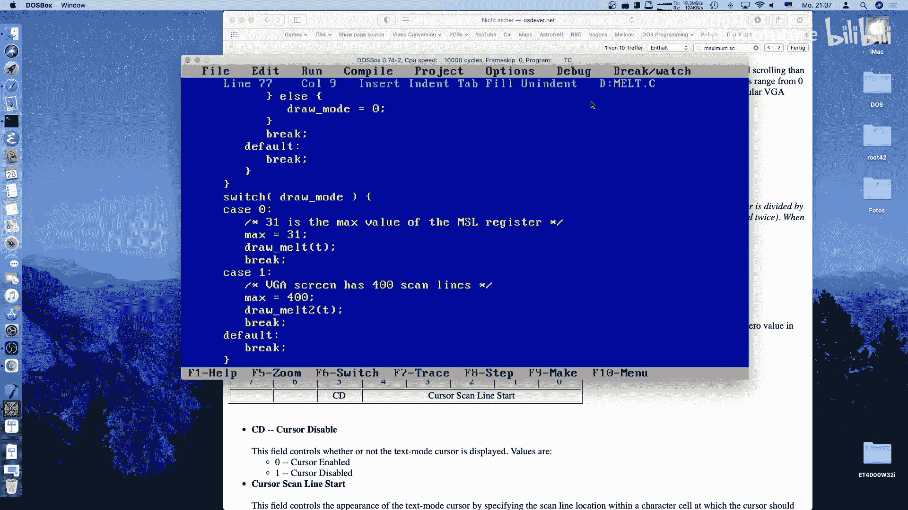
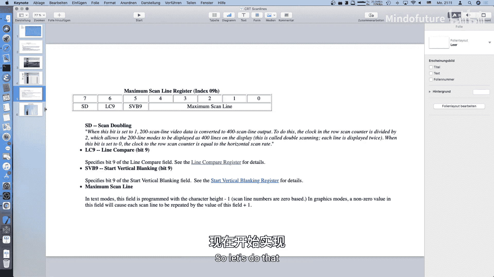
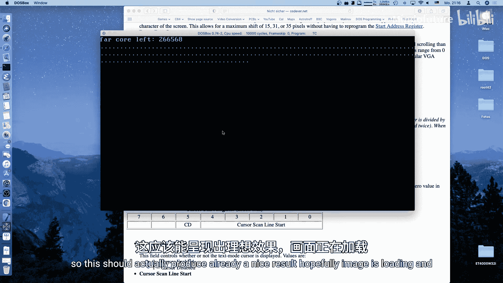
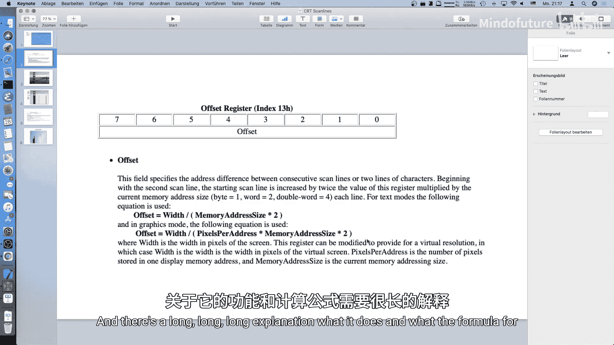

# 编写MS-DOS-系统-｜-windows-｜-操作系统-｜-汇编--｜-vga-｜-x86-p29-P29-Lets-Code-MS-DOS-0x1D---Melting-the-VGA-Screen--BV1zs35zQEru_p29-

🎼Hello and welcome to a new episode of Let's code MSisttos and today I want to show you two melting screen effects that you can do with the VGA graphics card。

🎼And I like those two effects because they do the screen meing via clever manipulation of some EGA registers。

🎼And not by just。🎼Massively drawing pixels or something。

 So this effect should actually work on pretty slow systems。

 probably down to 36 or maybe even slower if you would。🎼Switch from C to assembly language， I guess。

🎼So the main program is more or less similar to what we used in the last episode。

 so we set our graphics mode， set a palette from the Gif file that we load and then we copy the GIF image to the VGA screen and we have the main loop which runs until we hit the escape key。

🎼And we can togg the two effects by pressing the space bar。

🎼And we have two functions called Dr melt and Draw melt2。🎼And they have two different parameters max。

 which I will talk about later。 and this parameter。

🎼Deines how the timing parameter for the animation is。🎼Basically animated。🎼Yeah。

 so first before I talk about the actual code， which we have to fill in here。

🎼Let's have a look at how a CR T screen used to draw images on the screen。 So nowadays， we are using。

🎼LCD screens， which function in a completely different manner。

 but back in the MSO days you would have these big picture tubes called CRTs and they would use an electron ray that scans across the image and draws one line at a time onto a color phospho and this would produce the image and when the electron beam raised from the left to the right it would turn off and then retrace to the left to the next can line and this red arrow is called the horizontal retrace and this is going to be important because we can ask the VGA card if a horizontal retrace is currently happening and during that time we can reprogram the VGA register。

And。🎼Then it will continue with the next scan line and so on and so on until 400 scan lines in our graphics mode have been drawn。

🎼And we end up here at the bottom right of the image and then the electron beam will turn off again and go back to the top left corner and this takes a few microseconds or I'm not sure if it's milliseconds。

 but probably microseconds。🎼And this is called the vertical retrace。

 and in this time we also can do some stuff because nothing is drawn on the screen。🎼For the first。

🎼Melting effect， we will have a look at the maximum skinline register。

🎼This is part of the CRT control of the VGA card and the maximum scan line register has a couple of bits in it。

 bit 7 is the scan doubling bit which we will ignore for now but it is always set to one in the regular mode 13 or mode X。

🎼Where you have 200 scan lines， but the VGA card can only output 400 or more so this bit is set so the 200 scan lines are doubled to 400 skin lines。

 but it will allow for compatibility with older graphic cards that use only 200 scanline。

🎼Also in there are the line compare bit 9 and the start vertical blanking bit 9。

 we won't talk about those today， but we have to store them and restore them when manipulating the other parts of this register。

 which is the Maxim can line。And as you can read here in text modes， we don't care about text modes。

 it does something different， but in graphics modes。

 a nonzero value in this field will cause each scanline to be repeated by the value of this field plus one。

 so if we write a0 into the first five bits， then each scanline will be shown exactly once。

And if we put in a one， then every scan line will be doubled。And so on and so on up to well。

 we have five bits so we can put in a maximum value of 31。

 So 32 times is the maximum that every scan lamp can be repeated。 And what will it look like。

 Let's say we put in the value 10。 Then our image。Which all actually look like this will be stretched vertically。

 And we can actually animate this by putting in a one first， then a two and so on。

 And then basically， the whole image will meltl down the screen pretty quickly。 And yeah。

 this will look hopefully， pretty nicely。So， I would say we。First。

 try to code this because it's actually not that hot。

 The difficult part is that we have to read out these three bits to not disturb them and put in our value here only。

 So let's do that。

This our draw melt function。And。Basically， we will need two bite values。1。

 I will call original or Oric， and one will be called maximum scanline ML for short。First of all。

 to make everything run a bit slower， we will wait for the vertical retrace。

 This function we have been using quite a while in the。Last episodes。

 and I will actually wait for two retraers so that we get roughly 30 frames per second or 36 frames per second。

On the 72 Herz display of the VGA card。And this will make it a bit slower and not as flicky。

And then we will need to read out the original data of the maximum scanline register。

 So first of all， we tell the。啊。C， O TC index port of the VGA card。

To select the maximum scanline Reg。By writing through the specific port， and then we will read。

The original value that we have found in there。On the CRTC data port。 And a quick reminder。

 I have created the。嗯。VGA had a file here which defines nice constants for all of these things。

 so the CRTC index register or the CRTC index port is hexadeal 3D4 and the data port is 3D5。

So we don't have to memorize these numeric constants， but we can just use the words instead。

And the CTC registers are defined here， the maximum scan line register is number9 hexadeadecimal。

 as you can see here， and that's something that you can just look up on the Ote Ega documentation。

 it says here maximum scan line register is 9 hexadademal。So that's where I get these numbers from。

 And you can also look up the report numbers there。

But you don't have to do that because the code will be on Gitthub and linked in the video description。

So we can just work with that。So now we have the original value。 We can actually set。The。

Register with a new value。 So our new maximum scanline value。Is the original value。

 and then we select the upper three bits， which is Xmal0 x E0。So this equates to binary 1，1。1，0，0，0。

0，0。 but you can't write that in， in this old fashioned sea dialect。

 So we have to write 0 x E 0 instead。And then we will or that with the lower 5 B that we set from the。

Timing constant that we get here， so this will count up to 31 and then back to 0。

And to select the lower  five bits， because someone could。

Put in garbage values here and overwride the upper 3 bits。We mask it to the lower。5 bits only。

 So this is basically binaryry 0，0，0，1，1，1，1，1。But again， we can't write that， so we write 0 x1 f。

Okay， this gives us new value。And we can， again。Tell the VGA card to， please。

Select the maximum skyline register， and then we can。Write this value to the CTC。Data register。

And that's more or less。The whole effect， so。Down here in the main loop。

 we basically increment the time timer variable by1 or minus-1。

 depending on which direction the animation is running， If it's one， we increment， so we count 1，2。

3 and so on up to the maximum value， which is 31。And then we reverse the direction and we count down again to 0。

And， of course， correct。 because we overshot by one。

So this should actually produce already a nice result， hopefully images loading and there we have it。

 the screen is melting down and up in a rubbery fashion。

And this is done by。Just manipulating the VGA registers and not copying one single bit of memory。

 So it's highly efficient doing this software by pushing。Bs and pixels would。

Only probably be possible on rather fast machines with fast local bus and stuff like that。So yeah。

While this effect is already pretty funny and I think you can probably tweak it a bit more to look even more cool。

 we can do even better， I think。 let's have a look at the second effect。So。

While we are running over the screen like this， we can actually stop at some point and manipulate the VGA registeristers mid screen。

And the register that we want to manipulate is the so called offset register。 And there's a long。

Long， long explanation what it does and what the formula for this thing is。 But long story short。

 every time we finished a scan line。

The current address。That the Vja is rendering from。

Will be incremented by the value that is in the offset register， that means。

If I have 320 pixels in this direction。It the， the current address will basically be incremented by 320 pixels so that I get the next line of the picture and so on and so on。

 But what we can actually do now is。After we counted like5 or 10 or 50。Scan lines。

 we can actually say stop。 Now we change the offset register and tell it to go 0 pixels for the next scan line。

 So it will actually stay on the same scan line。 And what happens then is that for the rest of the screen。

Build up。 It will render the same line over and over again， and it will look like this。

 and we can actually animate this transition， and it will look quite nice and interesting effect。

 which also is very expensive to do if you want to do it by copying memory around。

And we can again do this only by manipulating the registers。 and at the end of the screen。

 we will reset the offset register to its original value so that we can begin with the normal image at the top of the next screen。

So， let's also try this。嗯。We will have a for loop， so we need some kind of counter variable。

 which we call I。And we will also need。The value， the original value of the line offset register。

 which will call L04 line offset。And then because we're counting scan lines。

 we don't want to be disturbed by anything。 if someone like a hard disk interrupt or time interrupt a fire。

We might miss the actual end of one of the scanline because the IBMC and VGA don't have interrupt signaling the scanline。

 actually much older or much simpler devices like the C64 or the amiga they have interrupts signifying when a scanline ans which is very useful we don't have that so we need to take care that we actually look at the bits that when they are flipping which signals that a scanline is ending So what we are doing is we dis able all interrupts and at the end we have to enle them again or else the program will crash if there are no more interrupts possible。

And the first thing that we are doing is to store the original value of the line offset set register。

 So we tell， again， the C TC。On its index port。That we want the line offset register for the next operation。

And we read the original value。Of that thing from the CTC data port。Now we have the original value。

We can actually manipulate。Value of the of the register， but not just like that。 First of all。

 we will need to make sure that we are at the top of the current image。

It might happen that we are currently inside the vertical retrace。 So basically it could be。

That we are inside of this orange arrow， and we will wait until this orange arrow is finished。

 and we are actually at the top of the screen here。And the way we can do this is just by。Doing a。

Right。Just by doing a little while loop。And we are looking at the input status register of the VGA card。

And we can look at the vertical retrace bit there。 And as long as this is a one， we will just wait。

And as soon as the bit flips to 0， which signals， okay， we are done。

 A new image is starting this while loop will exit， and we can actually do our work。

 And what we are going to do here is we will count。Up to。T， which is the animation parameter here。So。

 we will take our。Ittereration variable，0， from 0 to。C。And just count。The。

 the scan lines that are passing。 And how do we do this， It's very similar to the way we will。

Wait for a vertical refresh。But instead of that， we also have a bit signifying that there's a horizontal retce happening。

And first of all， we will wait。Until the current horizontal ret is being is done， so。

This should be fine like this， I think。And then， we will wait until。

AndThe scan line is actually done。So the first Y loop will run as long as the horizontal re bit is set to one and the second one。

嗯。No， the other way around。 it will run on as long as it's one and the second one will run as long as it's 0。

 And at the end of the second one， we are sure that one of the scan lens is finished。

We can do this T times， and then we have skipped the first T。

Scanline are somewhere in the middle of the picture。

And now we can actually reprogram the scan line line of that register。

 So what we're doing is we tell the。The J card again。Please give us the line offset register。

And then， we say。Okay， the new value。For the line offset register。This zero。

 we are now going to render the same line over and over again。🎼Okay。

 this we will do until we are at the end of the image。 So we need to again。

 look very carefully at the vertical re bit。 But this time， we are saying， okay， as long as。

🎼We are not in a vertical retrace， we are still drawing the image。

 so we' will wait until the image has finished drawing。🎼After this Y loop。

 we are at the bottom of the screen。🎼Down here。 And now we can reset the line of the register to its original value so that when the orange arrow is done。

 we again render。🎼A normal image。🎼So， we can。🎼Again， take these three lines。

🎼And there's actually a typo。🎼And instead of the0， we write the original value that we stored way up here。

🎼And we can format it a little bit nicer。🎼So that you can actually see what's going on。

🎼The Github code will be also slightly commented so that you can。🎼Get more of this。

 So that should do the trick。 Hopefully。 I'm not sure if I mistyped anything，5 errors。 Yes。

 we probably forgot something there's a semicolon missing。🎼And there's more。

🎼What did you do wrong here？ Okay， that's one， too many。🎼Brace is one too many bra。🎼I think one。

2 open，3 open to open。 Okay， that's also。🎼Too many of those here。

 And I think this should do the trick。 Yes， zero warnings， zero arrows。

🎼And first you will see our old effect and with the space key。

 we can switch to the second effect and there you have it。In the middle of the screen。

 going to the bottom， we will。🎼Reset the line of set register set to 0。

🎼And get this very nice effect。🎼Which is very expensive to achieve on an old machine if you want to do that by just copying pixel so。

🎼This is actually pretty neat， I think， yeah。🎼This is already all。 There is to。

🎼The two screen melting effects and you can use it for transitioning between screens or something like that。

You can also probably make it a bit faster by。🎼Incrementing the T peri slightly different ways。

🎼Yeah and but it's definitely very timing critical。

 so if you want to combine this with music and other stuff。

 you need to make sure that there's still enough time to calculate all the mixing and other things。

🎼Doing it like this is yeah， pretty easy， but combining it with other effects in music is probably a bit more hard。

🎼But I think this is it for today， you can download the code and play around with it。

🎼Leave a comment， share like and subscribe as usual and if you want to。

 you can also support me on Patreon or Kofi。🎼And if you don't， it doesn't matter just。

🎼Leave a comment and I hope to see you in the next video until then have a nice evening。🎼あ。あら。🎼The。

🎼う。🎼The。🎼。🎼The。🎼。🎼。