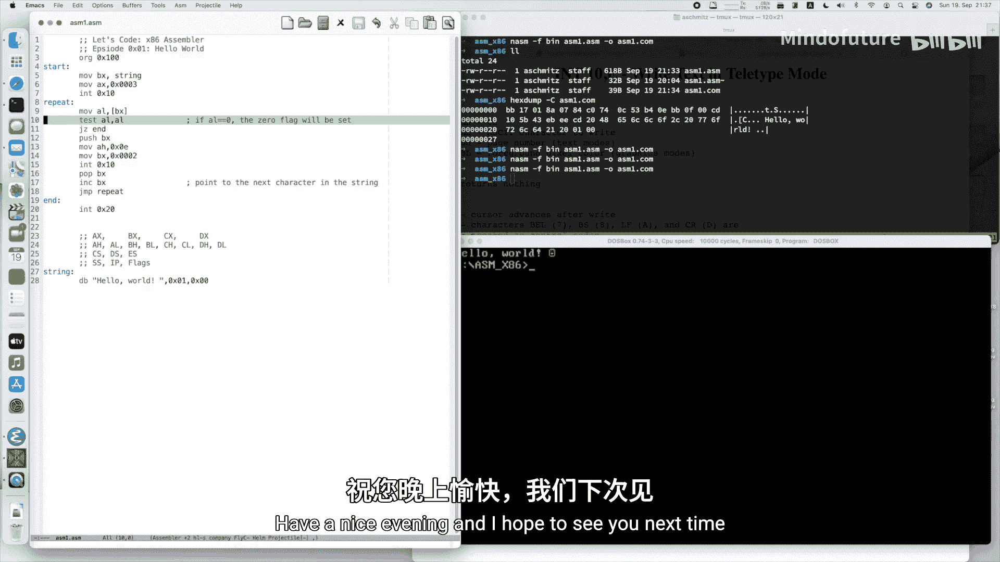

# 编写MS-DOS-系统-｜-windows-｜-操作系统-｜-汇编--｜-vga-｜-x86-p30-P30-Lets-Code-x86-Assembly---0x01-Hello-World--BV1zs35zQEru_p30-

🎼，🎼，🎼Yeah。🎼，🎼，🎼Hello， welcome and a very good evening to my new programming series called。

🎼Let's code X86 assembly and I already did quite a few episodes on let's code Amist starss and there was one episode where we did a hello word in X86 assembly。

And I think that episode was actually particularly popular because people want to know about all the mysterious things that happen in。

Assembly language。 So I thought， well， let's give that its own series and。

This series will be based off of this book called Programing Boot Ser Games by Oscar Toledo。

He's also better known as Nachess on Twitter and the Internet at large。He is very good code。

 I think he did some work on。三？ri very small programs in assembly language he also did win the C obfuscated coding contest quite a couple of times。

So I think this guy really knows what he's talking about。And his book is not only about。

Booott sector size games and what that means we will learn in a short while。

 but it's actually a very good and decent introduction into all things assembly language for the PC。

So we're going take this book。Look at the examples， and I will walk you through them。

 If you want to follow along at home， make sure to check out the book。

 I will put a link in the video description。 You can also check out。Oscar's website。At nanochs。org。

And certainly， yeah， make sure to buy the book if you want to follow this course。

I bought this book myself， so there's no sponsorship involved or anything like that。

 but I thoroughly recommend the book。 and it's， I got the nice hardcover edition。

 I think you might be able to get a paperback。 This is。

 this is like a book on demand thing where whenever you order one copy， I think they produce one。

So yeah， it's not like。You can pick it just up on on Amazon or something， but then again， yeah。

 it's definitely a nice book I think I paid around $27 or something for that。

 roughly the same in euros。But yeah， that's it。I would say we get started by setting up the environment for programming and then have a look at the very first program。

So the first order of business will be to set up the development environment and for that well need an asse。

And we're going to use the net wide as short NasSm that is also used by Oscarcan as a book。

You can just go to Nasan dot US and click on download and then the latest version。

 and you will be offered different versions for Linux， Mac OS and Windows。If you prefer。

 you can also use the B utility on Mac OS and Linux and just write B install Nem。

Which is a nice and easy way to always get the latest release。And this is。The version that I'm using。

And then you can simply type Nam to run thesembler， of course， it wants some input。

But we will get to that in a short while。 Furthermore， you will need doss box。

 and I already have this installed on my Mac。But you can simply go to Gbox。

 co and download the latest version as well。 They have builds for all kinds of platforms。

You can also use a different emulator you can use virtual box with MSdos installed。

 but Du box is probably the easiest to use。Because it's basically just a matter of downloading the package and running it。

 no need to set up a machine。The only thing that I'm also doing here is to run a specific autoic configuration where I mount my programs under。

The letter D with the command mount the home directory slash programs。

And I also have the X86 assembly stuff here so I can run it directly from the Do box。

So details for that， you can look up on the DoOS box website。

 but the simplest thing is just to use the mount command。

 then the drive letter that you want to mount it under and where your source code is actually located on your machine。

And that's more or less it I think we can get started now。 When you open up an editor of your choice。

 it could be noteppa or in my case emails or whatever you actually like best。And assembly files。

 you use the semicolon for comments， so I already wrote here a name of our episode。

And the first thing you have to do if you want to code for MSO。

 you need to define the start address of the code。And that is always the hexsma 100 because the first 255 bytes。

In a Doscom program will be taken up by the program control block of MS Dos so you can't use that and your code needs to skip those first 255 bytes。

 so we start by 256 or 100 exadeimal。We will also define a label called start where our code is going to start。

 obviously。And the next thing that we need to do is to load the address off the string that we want to write。

 And where do we get the address while we define a label called string。

 You could also call it hello or something。But in the book， Oscarscar uses the name string。

 which is just fine。 And then we can declare some datates， which you do by using the directive TV。

 and then you can type in any kind of。Asusky characters， something like kind of word。

But you can also put in。Just datates。 And I'm going to put a hexodadeal 1 or just a one doesn't matter。

Which is the any dose， it's the LC character one， which is a smiley face。

And you have to termminate the string with aze bitete。So that's fine， then we can load the address。

And load an address into a CPU registerar is done by using the Moth or move。Command。

And you have to give it the target where do we want to move it to and we will move it to the Reg Bx。

And what do we want to move there， the address that is？The name string。So first of all。

 we need to clarify that what is Bx， Bx is one of the registers that you have in the CPU。

And the other registers that you can use are。Com on了。A X， B X。CX and DX。

 which are the general purpose registers。 Furthermore， you have the segment registers CS， DSS， E。

You also have the stack segment， register a。Instruction pointer。And there's also the flags register。

 which you can test for certain conditions and flags。Those are the most important ones。

 the later editions also have different registers， all these registers are 60mbit wide because the 8086 is a 6 inputbit machine。

And all the journal purpose registers。Also have subregisters called high and low。

 So A X is actually comprised of the registers A H and A L B X， on the other hand。

 is also accessible through B H and BL， So H is the high byte and L is the low byte。CX is C CO。

And of course， Dx is DH and DL。So all these registers can be used， but there are sometimes。

Restrictions on which register can be used with which instruction so we will always show registers here that can definitely be used in this context。

 but sometimes even instruction specifies a register， it always has to be this register。

 namely often the Cx register has to be used in certain instructions， for example。Or some。

In some functions， you need to use the eggs register or something。Al right。

 so these are the main registers and we will see them again， of course， later。But。

By now we have loaded the Bx register with the address of the string， and Ill just leave that here。

Next， we need to print out the characters and this will be done in a loop。

 so we will have a loop called repeat。And at the end of the loop。

 we will jump back to the beginning of the loop。And we will also have a end of the program in which we will terminate the program。

So the jump instruction does an unconditional jump it will always run through here and go to the repeat。

 so at some point we will need to jump to the end。And the end of the chrome is done with this interrupt function。

And the PC infrastructure or the 886 gives you the option to execute so called interrupts。

 which are more or less operating system API。We can call on functions。In the operating system。

 namely Amsoss。And we have here our interrupt services table so we can look up interrupt 20。

And 20 does only one thing。 it terminates the program。

And that is exactly what we're going to do when we enter。 So we simply call in 20 hes at a small。

Pretty simple。But the question is， what does the repeat loop do？ Well， we need to move through the。

Characters of our string。So first of all， we need to load the character。

 We'll load it into the low byte of the X register， So Mo。And then， we will take。

The address that is in BX。And actually look at the byte that is there。To not look at the address。

 but at the thing that the address points to， we write square brackets around that。

 So B X would be just the address that is represented by string。

And taking the bracket here will load the very first by namely the letter H into the AL register。

Okay， so far as good。We now have the letter H in our register。

Now we need to test if we reached the end of the string， we could do a comparison using the CMP。

Command， but this takes quite a few bytes， so Oscar says we should use the test instruction。

Test A L A， and what does the do， Well， we can look up every instruction on， for example。

 this website here。They have all the instructions here。

 the test instructions is actually adhere to the end instruction， which is a logical end。

Exceptly it does not affect opera。That means if we run test ALL， it will Biwise and all the。

Daer and A L。And we'll set the zero flag in the flex register that I already mentioned。

Which means the zero flick will be set if A L。Is 0， and that means our string is at the end， so。

If I equals 0。The zero flag will be set， which is an important thing。

And we can test for that actually。嗯。For example， there should be an instruction。Called J Z。

Which is a conditional jump that follows a test。It jumps to the specified location if the zero flag set。

 So actually， we can write jump0。To end。So Oscar actually writes JE in this code。In the book。

 but both commands actually the same and they will evaluate to the exact same of code。

 So because test actually sets the zero flag and we want to check for the zero flag here。

 I would rather use the Jz instruction because it's a little bit more clear what we' are doing here。

The J E instruction in my head means jump if equal。

 And I would use that if I am actually testing for equality。

 But here I'm testing explicitly for the  zero fl， which in the end， is the same thing。

But I mean something different in this case。Okay， so we already can stop our。Loop。

 but we still have to increment our counter variable or our pointer variable and print out all the stuff。

 So first of all， we need to save whatever we have in Bx because we will need to overwrite that value for printing out the character。

You can save values by pushing them onto the stack with the push。

Instruction so we push the contents of Bx and whenever we are done we can restore it by calling P which will take the element back from the stack。

 so we do a push to save Bx and then pop to return it to its former state and then we will increment Bx Bx as you remember。

 is the pointer。嗯。To right point。Do the next。Character。And the string。

And this will happen as long as we are not seeing a0 in BX actually。

 on the address that BX points to。Okay， how do we print something。

 Let's have a look again at the interrupt table。Printing something is done by using the interrupt 10。

 which is everything related to graphics and text mode。 And there's a sub function。一。😊。

Or Hxsl E that you put into the AH register， which means write text in so you can basically write single letters to the screen。

And in AH， you put the letter E， as I said， and in AL， you put the SI character。So， basically。

What we want to do is。Come on。We want to move。0ero x， E。Do an H。

And AL already contains the SD character because we loaded it up here。

And we also have to load Bx with certain values， and that is where we overwrite whatever was in Bx。

 So we need to put in the page number and。The screen on MS has multiple pages。

 but we only want to put it into the first page， so we put a zero in VH。

And we can also set the foreground color。 but that is only honoured in。Graphics mode。

 So we are in text mode， so we can put。In whatever we like。 So we could write Mof B， H comma 0 x 0。

0 for the page number and Mof B L comma， whatever， let's say0 x 0 F， which is white。

But this will take quite a few bites， and we can。Shorten this to just writing B X，0， F。

Which is the same thing because we can write both register parts at the same time。Okay。

 then we need to call the interrupt。And this should actually print on the values So how do we assemble this program into a comp file。

 whether we call the network assembler with the format bin because Instores expects a pure binary file without any headers。

 and we give it the source file ASM do AsM1。 As and all for output asM1。 co。

It produces something without any warnings， we can have a look and there is asm1。com。

 which is 39 bytes in size， pretty small。And you can even do something like a head stampump on this。

To have a look at T see both the string variable actually and all the ups。

Then we can go to the Dos box and run the program。 and there you go。

 it prints a world with this smiley face。And to show you that it actually also honors the text color。

In graphics mode， I'm just going try to put a two in here。And again， assemble the program and run it。

 It still is white， but we can actually switch to a graphics mode。We can do this by。呃 loading。

A X with。0，0 for a set screen mode and0 D， no theory。 Yes， the I thing for the 16 calligraphs mode。

And we can call the graphics interrupt。And this should actually switch to。He graphics mode。

Which it does。 And the color2 is green。 and you see a nice blocky 13 3。

20 by 200 size 16 color graphic screen。Isn't that nice？But we don't want that。

 so I'm going to switch back to。The text mode， which is3 hex of SMO。And we can run the program again。

 and we have a nice text homeworkback， but。Now， you have it。So the structure is pretty simple。

 you always have a start of the program and for comp filess you always run from Startre 100 hexsMmal。

 we learned how to load a address of a variable。How to declare the variable using a label and some datates。

And we also learned how to call the interrupts for。Printing。

 setting screen mode and also how to quit the program and how to do a simple loop and how to test if a variable is0。

 which is useful to quit the loop。I think this is already quite a bit。 You can download the program。

 I will put a link to it in the video description。And next time we will move on to the next example programs。

 which will deal with input and other stuff。And yeah， I hope you like this。

 please share and subscribe or leave a comment。And make sure to check out Oscar's book。

 which is pretty useful to get a start in the assembly word， even though it's specifically for。

Programming boot sector size games or stuff that is smaller than 512 mite。

It's actually very useful to learn all the tricks that you can do on the 8086 and using different bios routines and PC hardware that is like the timer and other stuff。

So yeah make sure to check it out， I will base the next examples on the book for sure。

And other than that， I think that's it。🎼Have a nice evening， and I hope to see you next time。

🎼，🎼。🎼，🎼，🎼，🎼Yeah。🎼，🎼Yeah。🎼，🎼，🎼，🎼，🎼。