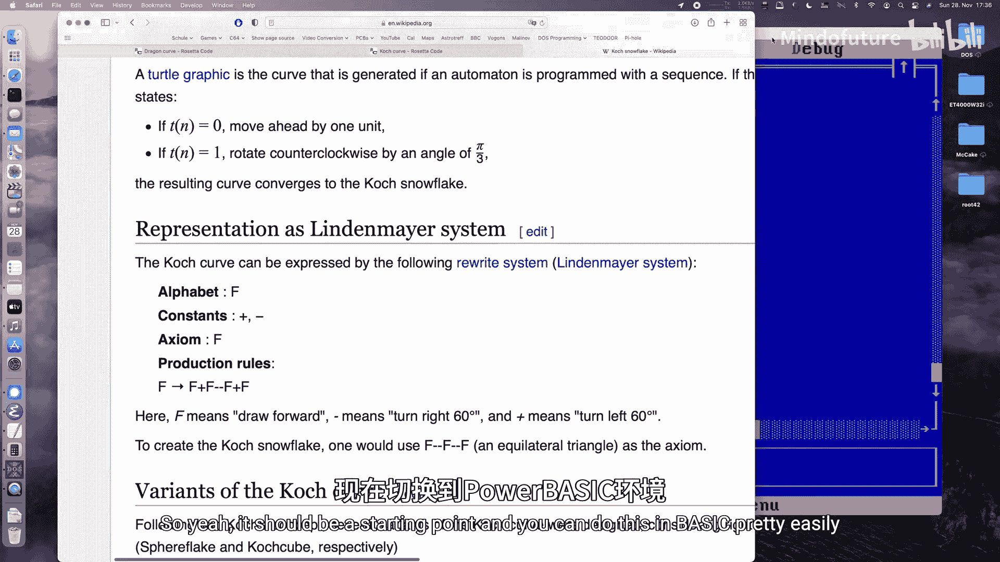
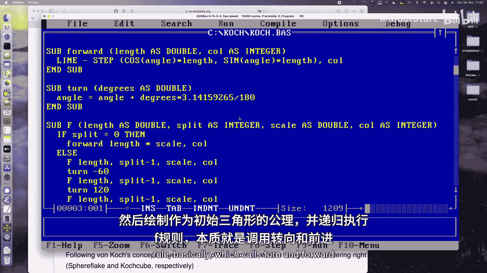
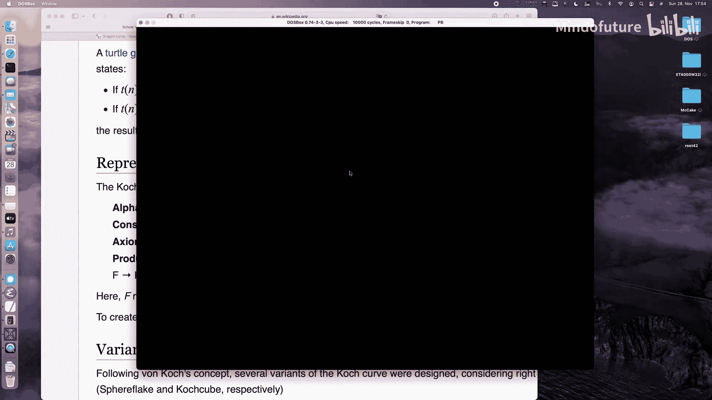
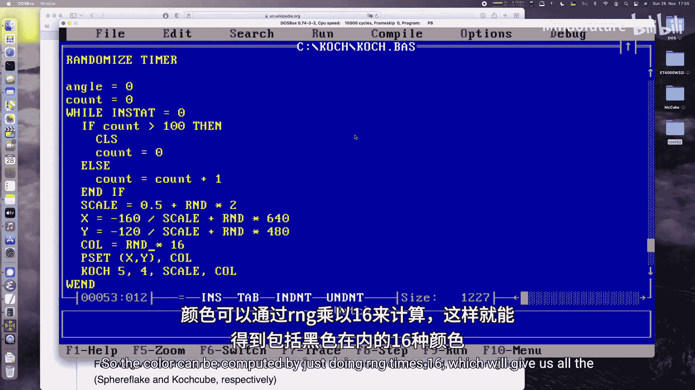
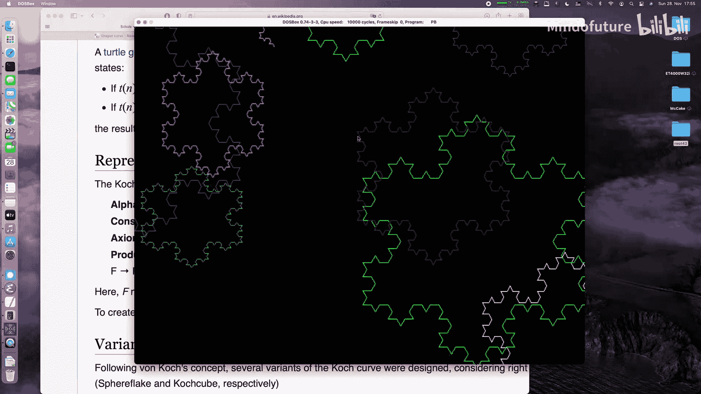
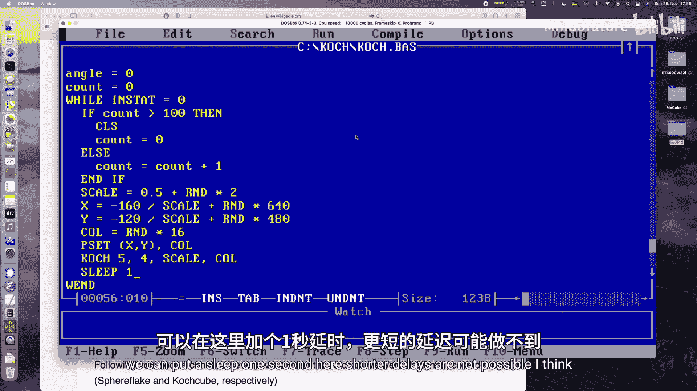
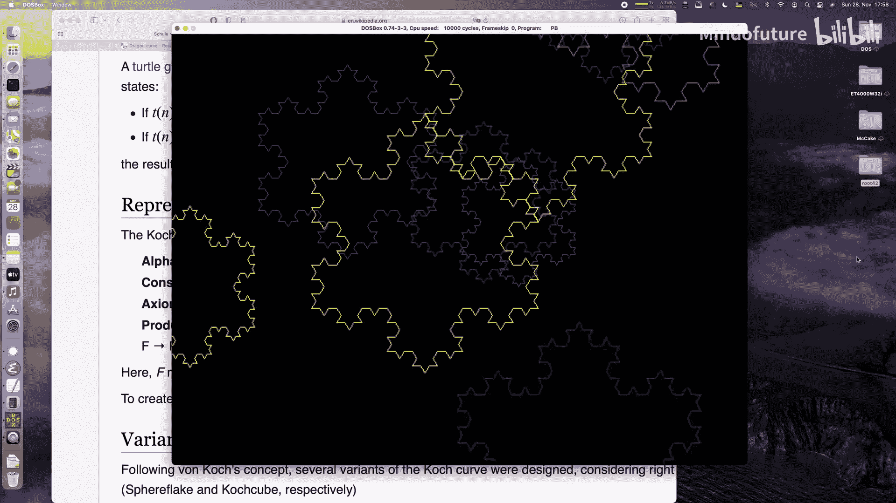

# 编写MS-DOS-系统-｜-windows-｜-操作系统-｜-汇编--｜-vga-｜-x86-p31-P31-Lets-Code-MS-DOS-0x1E---Power-BASIC-Snowflake--BV1zs35zQEru_p31-

🎼Hello， welcome and a very Christmas E evening and we're back at Let's code MSdos and this year's Christmas edition is again about power basicic。

 the programming language which we used the last years as well to code some。Christmas spirit things。

And this year， we will quote a snowflake。The Co snowflake in particular， which is。

An iterated function system。 that is， it's a recursive function that you apply to itself。

 and it will gradually produce these snowflake shaped things。 You start out with a so called axiom。

 which is this triangle in this case。 But there are other function systems that use different axioms。

And then you recursively apply the co function to that， and it will subdivide and。

Generate something which looks a bit like a snowflake。

And we can do this by something called alinden May system or an L system。

And it's actually pretty simple。 Such a system。Such a simple has such a system has rules。

 and our Co curve rule has own Co curve has only one rule， namely this one here。If we encounter an F。

 we will produce something which is called F plus F minus minus F plus F。 Okay， what does it mean。

 Basically， the F means draw a line forward into the direction we are facing。 if you remember。

 perhaps logo and the turtle。That you could use to draw things which could turn left or right and then draw forward。

Something similar happens here。 The plus means turn left by 60 degrees。

 which are the angles that can be seen here in the corners of the snowflake。Let's scroll down again。

And minus means turn right 60 degrees。 So we will go forward for one curve segment。

Do the turn left by 60 degrees draw forward， Turn right by 120 degrees。Draw forward。Turn left again。

P 60 degrees， and。Draw forward。 and the F actually will， of course， produce。

Another one of these rules that means you will have a recursion here。

 So this F will expand to the whole term again。And at some point， you have to stop that。 Otherwise。

 it will be an infinite curve， and you can actually zoom in infinitely into the curve。

 But on the computer， we need to stop at some point， and well do 3，4，5 iterations， and that'll be it。

And the constants here plus minus will be our turn function， and that's it。

And if we want to have the snowflake， we will use this axiom。Forward。10120 degrees right forward。

120 degrees right forward， which produces the triangle， which we saw up here。

So that is actually pretty simple。😊，And as a starting point。

 I used the code from Rosetta code for the drag curve。

 which is another L system and produces this interesting curve down here with a bit more rules。嗯。All。

 let's say these are the rules， I think。But we will not look at this。

 but the nice thing here is there is a very simple Q basic implementation。

 which Ie again use as a starting point， but I ripped apart some things I kept the turn and forward thing and we will reimplement a new function called Coch and also the F operation。

Which will apply the L system。 So this was the starting thing。

 There's also a cock curve of implementation on Rosetta code。But actually， the Q basic one。

ItDoes't look very good。 You， it's a lot of， a lot of。I would say spaghetti code。

 or at least it's way too complex。 We can do this in a much simpler fashion。

Rosetta code itself is pretty neat website。 It has all sorts of algorithms， and things in。

Different programming languages， you can see here， the dragon curve， for example。

 it's and you can evident see。Java， Javavascript in very exotic languages as well。 So basically。

 there's there's an implementation for almost every。Programming language， imaginable。Which is fine。

 But we will stick to。This representation of the co curve。

 And the nice thing is you can change the angles that you're making to generate different。Curves。

 so after I。Finish this。 You can take a code and play around with。The angles。

 or you can look up different L system rules and implement those。

 They are more complex than in my assistance， which allow you to draw trees and other organic structures。

So yeah， it should be a starting point， and you can do this in basic pretty easily。

So let's switch over to power basicsic。 The source code will be on Github。

 and I will link to it in the video description。 So right now， you can just follow along。

 First of all， we need。A variable that stores the angle of the turns we made。

And this is the only difference to Q basic。 This declaration here will be different in Q basic。

 It will， I think， be called dim shared angle as double， so。Q basicsic probably needs it like this。

Dim shared angle S double。There's a slight incompatibility between Q basic power basic。

 but we stick with power basicic because that's what we got。 And you can download power basicsic。

 The free edition on the Web might also link to that in the video description。

 But you can also Google for it。 It shouldn't be too hard to find。

 The freer version will be just enough to do that。 And you can let it run in Dos box like I'm doing here。

Don't need a real retro PCC for that。Furthermore， we need a variable， which I call color for color。

 but I can't use color because that's already。Taken in Pobasic。Which will be an integer。

It source the current colour of the snowflake。 We will make different colour。

16 colours to be exact because we are using the high， VG A mode。For that。

And we will scale the snowflakes make them small or bigger， and that will be a floating point。

 double precision variable as well。Okay， first things first， we will switch to the graphics mode。

 And when we exit， we will switch back to the text mode。Graphics mode is mode 12， which is 6。

40 by 480。So， okay， no number lock，6，40 by 4，80，16 colours。And this year is， basically。Text mode。

 So we are nice when we quit。And we also want to have every time we start this a different outcome。

And this will basically let us use this as a screen save， for example。Which just nice。

And we will initialize the angle that we' are using with 0。We probably can。We probably can。

Use some randomized angle here to rotate the snowflakes。 We'll try that out later， once we have that。

And to make it a true screen savever， every 100 draws， we will clear the screen。

 So we need to count how many draws we made。 And if we run in an endless loop until someone presentes the key。

 this we can do by using the instat function， which is 0 if there was no key pressed。So。

This whole thing here will run until someone presses the key。And let's also do。

The screen clearing here already， if the count exceeds 100。Then。We will clear the screen， C less。

And set the count。 Oh， we're used in lower case here。 count to 0， Not that it matters。

 Basic is not K sensitive。Els。We are just increasing。The count by one。So that's nice。Okay。

 and that's good。What we need to implement， well。We will have a。Function。That， I will call。好。

And it will need。A few parameters。 The first parameter will be how many pixels every leg of the curve will be。

And I say five pixels so that it doesn't get too big。Then how many subdivisions。

 And I figure out4 are pretty nice， nice detail， and not too much detail that it gets weirded on the screen。

We also need to pass at the scaling of the curve。 So we need another variable called scale。which we。

To find up there。And also， the color of the curve。There's some stuff missing， of course。 now。 Well。

 the things that are still missing is we need to have the initial point of the cock curve。

And since we're using the line command in basic， we can actually set the very first point that the lines will continue from。

 You don't always need to specify both ends of the line。

 You can just continue drawing lines and lines and lines。

 and it will just use the previous lines and as the next starting point。

 And we can set that with a pixel set command。And who has set a pixel at some coordinate X and Y。

With our colour， now， we need to figure out what the coordinates will be and the scale。

 So the scale I'm just gonna set to minimum of 05。 So making it half as large as。It could be。Plus。

 some random number。Times，2。That can be arbitrary， but times too worked out in my experiments so that these curves or snowflakes fill at most roughlyuff the screen。

 not more。The x coordinate could simply be some random value times。6，40， which is the。

Ex resolution of the VGA screen screen and the。Wh coordinate could be something R And D times for80。

Which consistss us coordinates between 0 and 6，40 and 0 and 4，80。That would be almost good enough。

 but then the curves or the snowflakes will always start somewhere inside of the screen。

And I figured out we can shift them slightly by 1，60。Roughly。

Which is a quarter of the screen divided by the scale that we calculated。To the left， basically。

 And we can also shift it。By 120， divided by the scale。To the top。

 And then it we will have a very equal distribution of snowflakes over the screen。

 even up here and to the left and to the top。That will look much better。

 You can play around with these values to limit where the snowflakes will appear。 But this。

 in my case， at least worked pretty nicely to put them all over the screen。

So what do we need to implement， We need to implement the。C sub protein。

We'll put that in between here， So we will have sub protein called co， which will take54。 Yeah。

 a few parameters，4 parameters first will be called length。

 which is a double could be an integer in pixels， but we can also specify fractions if we want。

Doesn't matter much。We will。Use the double data anyway。

 because we will scale this by the amount we get in scale。嗯。We will have an parameter called split。

 which is the same that was used in the。Implementation showed you on Rosetta codes。

 So I'm sticking with the parameter names here。Scale split will be an integer。And then scale again。

 will be a double。Naturally。And the colour is， of course， an integer。Can range between 0 and 15。

This is the end of the subrtine。And in between， we are not doing much。 We are doing the axiom。

 which was calling F， then doing a turn whoops。Turned by 1 or 20 degrees， calling F。

Turn by 120 degrees。Fff again。Well， the separateine F will also need the parameters that the co curve got。

 So well just pass at length split。However。-1， so。When split reaches is 0， we will stop。

 Just draw the line， and that's it。 This will stop the recursion。If we don't do that。

 we will get into an infinite loop， which will be bad。The scale of course and the color。 And we can。

Actually。Copy on that。And that's it。So next up， we have our axiom。Now。

 we need to implement implement the F function。 And since were calling that here， well。

 doesn't matter much。 We can put it up here。It will look。

The signature will look exactly the same as the co function。Maybe not moving， copying will be better。

 yes。All right。Does it still compile？Okay， does not compile yet because we need to also have the turn function。

Which takes。Degrees as a double。And we will leave that empty for now。And it will compile。

 but it won't do anything。So let's implement F first before we do the turn。The F function。 Well。

 first， we need to deal with a recursion。 If split equals 0。

 then we are at the end of our recursive procedure， then we will simply。Do a forward movement。

 basically drawing a line。By length， time scale。We could actually， in the end， we probably could。

Factor scale and length out。 like would probably be better。 But I'm sticking with this now。 you can。

 you can optimize this So this at home。So let's do that with a certain colour。

And else we need to apply the recursive rule of the L system。And if we remember。

That was something like doing F then turning by-60 degrees， doing F again， turning by 120 degrees。

Okay， you should probably write that in different lines。Doing F turning by -60。

 and then calling F again。And that's the whole thing。And， of course， we need to。Copy。The parameters。

 again， we could make all that global， but that would be pretty nasty。 So I'm not going to do that。嗯。

That's basically already， the implementation of。The curve algorithm itself。

What's still missing is the forward function and the turn function。So let's have a look at that。

 Forward needs some length， basically。嗯。Let's say that's a double。 Doesn't matter much。

Could be an integer， and。Of course， the colour that we're using。So that's the forward function。

 What are we going to do here。 We're going to draw a line。And if you look up the command for that。

 if you want to。Do just a line from the last point。 You write a dash， then step， and then。

Where to go， basically and。That is actually， a tuple。Of X， Y coordinates。

 and our x coordinate is the cosine of the current angle， which gives us the x coordinate。

And we scale that by the length。And of course， if we want the y coordinate。

 we just take the sign of the angle。This is simple trigeometry。 Basically。

 you should have had that in high school， I hope。Otherwise。

 you need to look it up on Wikipedia or something。 but basically you can say if you have an angle。

 you get the x coordinate on the graph by taking the cosine and the y corner by taking the sine。Okay。

 further， we need to pass the colour。 And that's our forward motion。 That is the actual drawing。

And then the turn is actually not that hard。Turn is basically just updating the angle。

 and that will do angle plus the degrees。But we need to have this in radiance for the cosine sine function。

 So we will。Be doing a multiplication here by pi 3，1，4，1，5，9。2，6，5， divided by 180。

We probably could also do that in the forward motion， but we will do this less often in the turn。

 because the forward will be called much more often。But you can play with that Basically。 Okay。

 this will update our angle。And this should， already。Be enough。 We have。The main function。

 which will clear everyone on the draws。Compute sum scale and x and Y coordinates will set the initial position for the co curve。

Will call the cost function。And then it will draw the axiom， which is the triangle， and recursively。

Do the F。Rule， basically， which calls turn and forward。

So let's see if it works。Nope， so some debugging is in order。

And I found the reason the colour wasn't set。 It was always zero。 So we drew a lot of things。

 but they were all black。 So the colour can be computed by just doing R And D time 16。

 which will give us all the 16 colours， including black。

And this is what it looks like。 And it's actually pretty fast。 So if we want to have it a bit。Slower。

 we can put a sleep。One second here， shorter delays are possible， I think。

This will look like it。And every roughly 100 seconds。

 it will clear the screen because it will get too full。

 and you can see here very nicely the whole snowflake curve。

 and you can play around with the production rules to produce different things and you can see how it gets scaled up and down。

And probably there are more improvisations that can be done。

 but I think this is already a pretty nice screen saver。 And yeah， I will put up the link。

 as I said to the Gi up repository。And yeah， you can check it out。 You can play with it。

 Also don't make sure to download Q basicsic or Po basicsic to try this out。

And I think these L systems are very nifty and they can produce a lot of cool stuff。

So that's it for today。 there will be maybe one or two more videos before the end is over the year is over。

 The end is over。 the year is over。But for let's go M starss， I think that's it for this here。

So have a very nice holiday and enjoy whatever left of the year。Also。

Share like and subscribe as usual。 if you want to support me via Patreon。

 that's always very welcome as well。🎼And until next time， I hope to see you soon。🎼The。🎼The。🎼。

🎼，🎼，🎼The。🎼。🎼，🎼。