# 编写MS-DOS-系统-｜-windows-｜-操作系统-｜-汇编--｜-vga-｜-x86-p33-P33-Lets-Code-MS-DOS-0x20---Bresenham-Line-Drawing--BV1zs35zQEru_p33-

Hello， welcome to a new episode of Le's code Amsdos。 And this time。

 we want to take a look at Braszenham's line algorithm。😊。

I guess if you ever deal dealt with computer graphics。

 you probably might have heard about Grzenhamm's line algorithm because it's the defecto standardner to render just lines basically on the screen。

 without using any floating point arithmetics， which makes it pretty fast。

 especially for old computers such as our MSOS machines that we are emulating here or even running on real hardware。

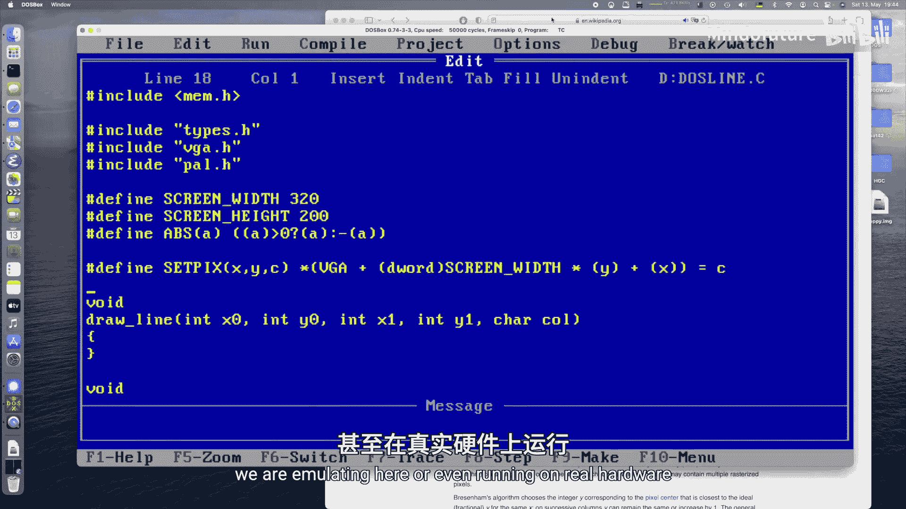

I tried to。Prepare the line algorithm so that I explain it in full detail。

 but I notice that this takes already like 40， 50 minutes。

 so I'm going to point you mostly to the Wikipedia side， which is actually pretty decent。

And the Wikipedia site especially links to one little work or rather big work。

 but there's one little aspect of it。From some， I think。

 Austrian student who a couple of years back wrote some kind of thesis about rendering curves。

 but also straight lines。 And there is an algorithm here， which is basically the。

Most compact version of the Brazenham line algorithm that I found so far。

 which is referenced from the Wikipedia article， and we will take this and transform this into proper C。

Because this year is missing， actually， this is actually pretty， pretty good。

 but I'm going to rewrite it a little bit。So that it works。In auto， and。

I will use the pseudocode that we have down here。 Where is it。Exactly this year。

 this is basically the same algorithm pseudocode， and we can translate that into Tobuy very easily actually。

😊，The idea of the Braszenhamm algorithm， which is also called the midpoint algorithm。

 is to calculate the error that we are making by coloring in only one pixel。

And how far we are deviating from。The midpoint of the pixel with our line approximation。

 basically or from the line。And this error is being accumulated in an error variable and if you look at the pseudocode here。

 this is the error variable and you're basically calculating the distance that you're moving along the x axis over the whole line in pixels plus the distance over the y axis。

And there are two conditions when the double of the error value。Goes over our actual y distance。

 or when it is less than equal our x distance。 And always， when that's the case。

 we need to increment our error variable。And do a step in the X direction or in the Y direction。

 respectively。So in some cases we will do only， for example。

 if we are drawing a mostly horizontal line， we will do mostly x steps and every once in a while this condition will be true and we'll do an additional y step which can be seen here basically will be doing some kind of the screen rectangle first and then we're doing one right and so one x and one y step and then again one step to the right。

In a step to the top， basically to minimize the error value， and then only one right step， et cetera。

 et cetera。In the classical Brazenham， you will need to。

Deaviiate a little bit because the original Braszenhem is only for。One socalledocent。

 which if you look at the cross here。The four sides of the cross are the quadrants and if you draw a 45 degree line。

 you will get two more subdivisions which are called the ocs and the reason algorithm works only for one octant and everything else is basically achieved by mirroring or swapping around the variables。

As I said， this takes a very long time to explain， but we will just pick this all cases thing。

And this actually works。Pretty neatly and pretty fast because as you can see。

 there are only subtractions， all the。Coordinates here and everything else are integer variables。

 there's one multiplication which could be replaced by a bit shift since it's a multiplication by2。

Which is slightly faster on older 8086 machines。

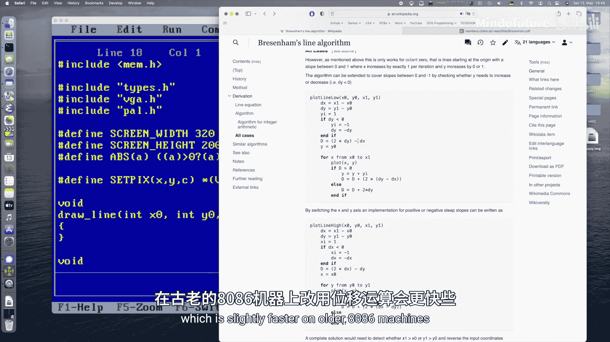

But that's more is it。So I've taken our regular VGA style thing here from our previous VGA demos。

We have the main function， we have a loop where we check for the escape key being pressed。

 we are setting the graphics mode， setting the palette to our usual fire palette。

And I'm also drawing a line at the top here。 Let me show you。

 Hopefully there are some warnings because we're not using the parameters， which is fine。

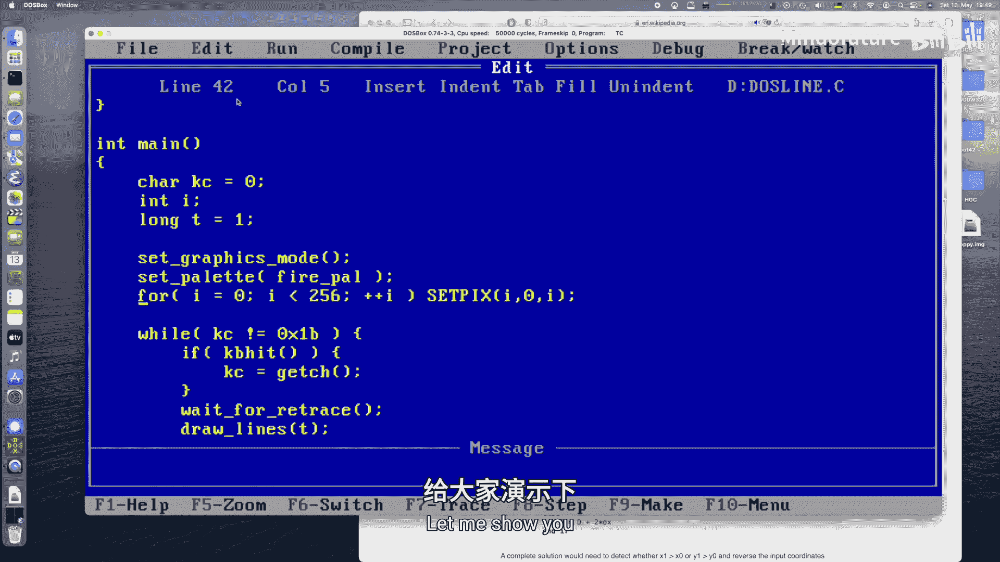

Yeah， it looks like this。 This is basically the palette。

 and we'll use a clever color cycling method to animate the line。 And my idea here is to。

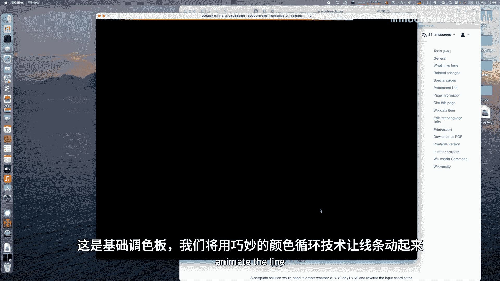

Program something similar to。Either the Marquee Windows screen saver。Which？Looked like Ho is not。

 was it Mcqui， nor was some some different。嗯。It was called differently。

Let us take on one screen savers。Exactly this one here with the lines basically bumping around something like that。

 or it's similar to the game kicks where a similar。look。L creature swoops across the screen。

 I think you can see it here。Drawn from many different lines and bumping around in the screen some effect like that。

 you will see it at the end what it looks like。 So that's my goal here so。

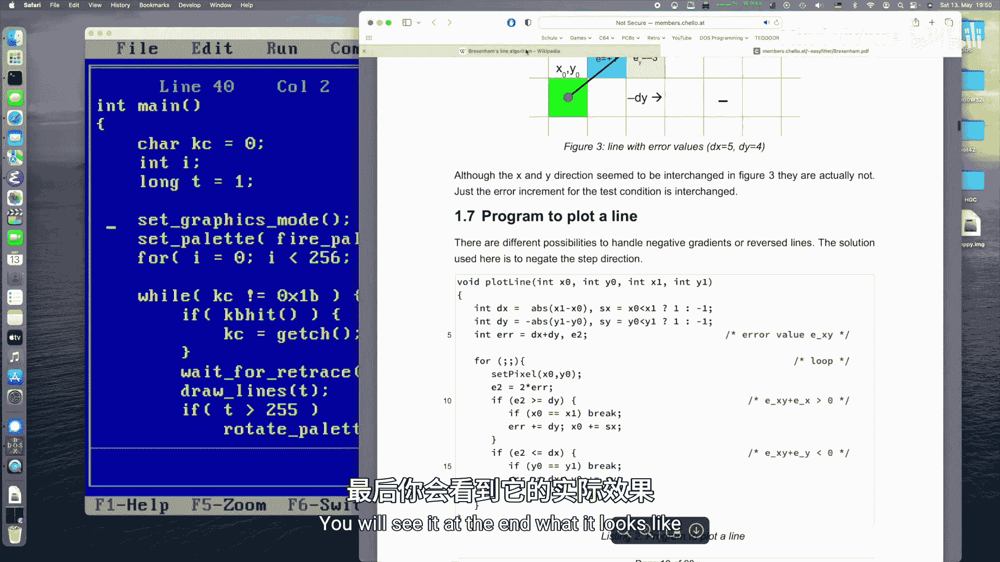

While we are drawing everything looping over everything， as usually right for the vertical retrase。

 then we draw the lines of this creature， but the fact here is we only draw the new line。

 the newly moved line and we erase only the last line and then we have a big sweep of lines on the screen。

And to make them half the correct color， we rotate the palate actually。

 and then reiterate until someone presses escape。So we have some empty。

Functions here called drawaw line， rotate Pit， and drawaw lines。And we will。Try first。

 implement the draw line routine。From the code that we saw on the Bzenhem。Article， basically。

So we need a bunch of variables。 We can use integer。

16 bit integers are totally fine for this screen resolution。 If you have bigger screen resolutions。

 you might need 32 big integers， but on top and 160 bit。 So that's fine。 we need the。

Delta we have in both directions that is。Basically。

 x1 minus x0 and y1 minus y is0 because every line is defined through two coordinate pairs， x0。

 y0 and x1， y1， plus a color that we want to draw。And the s is basically the direction we are stepping in either positive or negative direction。

 depending on the slope。And that can be easily calculated。

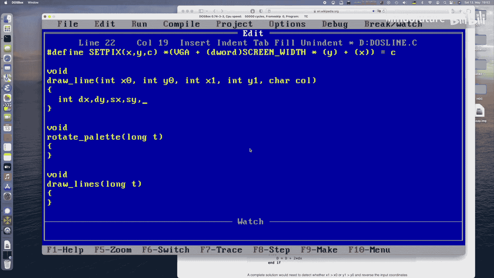

We also need our error variable。 It's called error and E2。 That is exactly what you see here in the。

嗯。Code basically here is called D actually， but I'm calling this。Differently。Oh no。

 it's here this sorry， here it's called arrow。And you do。

 that's actually in the code that were porting。

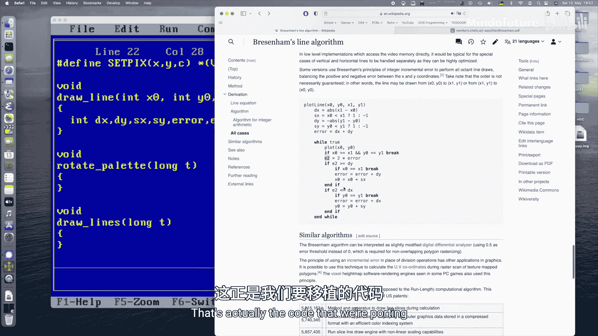

So we can have a peak at that once in a while。So let's initialize that the data。

It's actually pretty easy。 It's x1 minus x0， but we have to take care that this might x1 might be smaller than x0 than it will be negative。

 so I have to find a macro called apps， which gives us the absolute value for an integer。

And the sign is basically。The stepping direction as x。And if x 0 is smaller than x1。

Then our step will be positive。 We will go to the right， basically。 otherwise。

 if we are drawing from right to left， then we are going in the other direction。 So -1。

 This is basically the increment that we're doing every step。

And the same logo goes for the wide direction so we can copy that。意y。And SY。

And that's the very same thing。 y 0， y 1 minus y 0。 And if y 0 is smaller than y 1， S， Y S 1。

 Otherwise， it's -1。The error value then is simply minus dx minus dy。

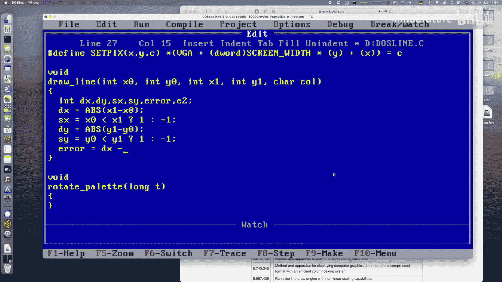

And。The reason for that you can check in this paper as I set。

 there's a little bit of maths involved to compute that。

This is actually using the implicit equation for a straight line。

The Wikipedia page uses the more traditional derivation by using f of x equals nx plus B。

 which you have probably learned in high school。But there's more mass involved to get to the b and formulation basically。

There's also some things I think， when I try to。Calculate that on paper， I think C is a little bit。

Hatily derived here， and it took me like one or two pages to get to all these values。

 which is why we skip that。 And we can just simply go to our pseudocode and use that。

 And if you have some spare time， you can do the mathematic derivation。

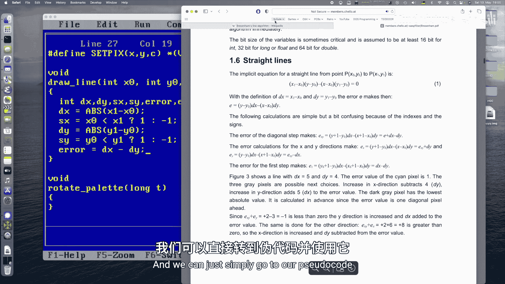

As， an exercise， basically。Then we're doing an infinite loop， basically。

 because we will break out of this once our。Line is at its end。

 This is always the case if our x or y variables are the same because we won't use one S。

In iteration variable， we could have used another variable called X and Y。

But we can save the memory space， these two variables。Doesn't matter。

 First thing we do actually is in every turn we。Set the pixel at the current coordinate and x0 and y0 are all current coordinates。

What's a given color？And we can actually break if at this point x0 equals x1。

Because then we've reached the right end of the。Line， basically， or alternatively。And alternatively。

 not， not alternatively， of course， y 0 equals y 1 because then we have iterated over all the pixels that there are。

 and we can simply do the break。Then we need thearrow variable E2 here。Just simply。

 actually we don't need it， we could leave it out， it's just for optimization here。Pl times two。

And if。E2 is greater or equal than minus d， and I've used a slightly different formulation here。嗯。

Because in the original， they wrote， the error is the x plus d y， which。

Came from dy equals minus absolute value of y1 minus y 0。

 and I find it a bit more intuitive if Dx and dy defines the same， so if you change the signs。

 you have to change something along here as well for the error and for the error condition here。

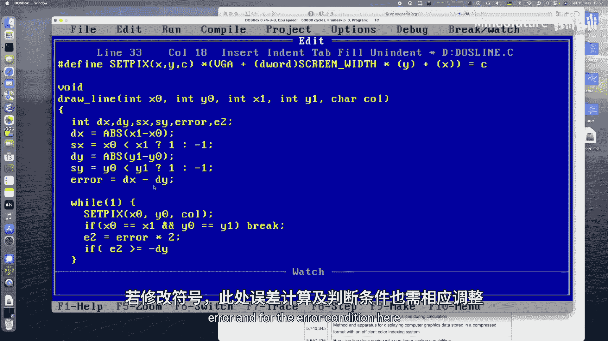

So don't be confused， you can also use this algorithm。

 both equivalent I've just switched around the signs a bit so that they're more consistent in my opinion。

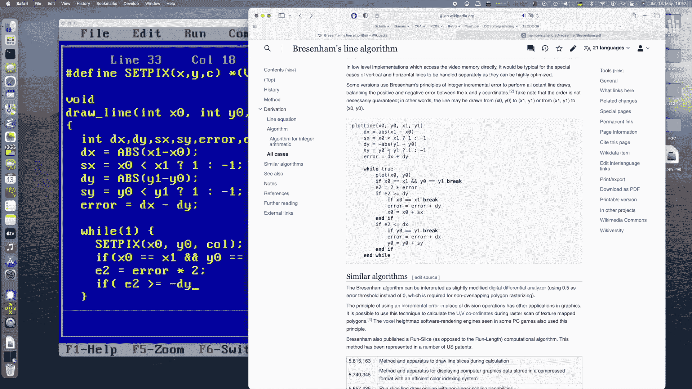

And easier to read。 but that's up to you how you implement that。

So if E2 is bigger or equal to minus to negative d。

 then we also have to check are we already at the end of the line， so x1 equals。X0 again。

 and we also break and we are done the line， there's no more pixels to plot。 Otherwise。

 we decrement the error value by D because we' are making a step into the x direction。

Which decrements our arrow we on the Y direction。And x0 gets this step。 x 0 plus equals S x。

 This does the extra step in the X direction。And now we can do a very similar thing。放字。啊。The X error。

 but this time it will be e to smaller equal than the x。

And here we have to check because we're doing the Y step if we're at the end in the vertical direction。

 then can break。And as the arrow here is negative， we actually add Vx。All right。 And then。

We do this and of course， this step will also not be in the x direction， but in the Y direction。

And that's， actually， already。The algorithm we can now for testing purposes。Call drawline。

Every frame from， let's say，0。Com on，0，0 to319，199， which is across the screen， and we're using。

Oh no， 255， which will be a white color， and that should， in theory， give us yeah。

 we have some unused parameters。

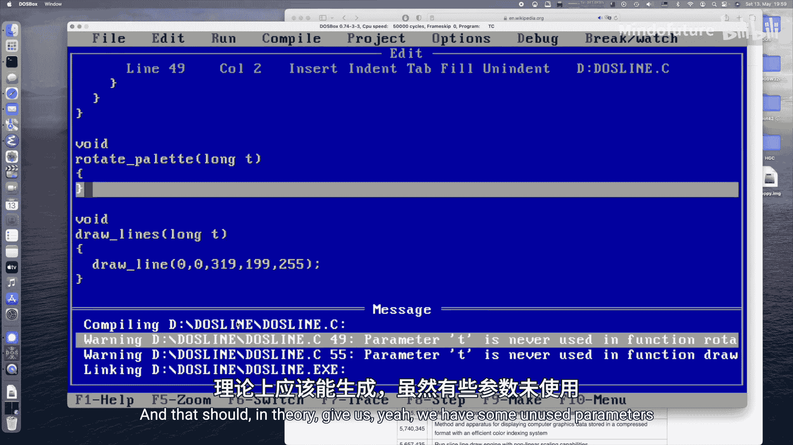

A nice， straight line arm over the screen。

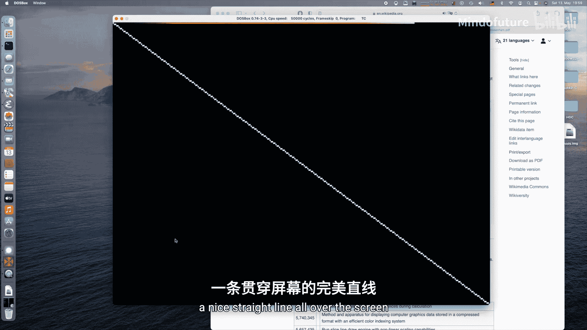

So that's nice。 So let's。Continue with the program。 I'm going to delete this for now。

And we're going to do the actual effect of the moving pattern that looks a little bit kick like kicks or the Windows screen saver from Windows 3。

1 as mentioned， and we will need a couple of variables that we need to access and you can make them static but as I want to access them from the main function as well for initialization。

And we could also factor this out。 I'm just going to put them here。

It's probably not as nice as it could be。🤢，But yeah， you have to deal with this now。 Basically。

 we will allow up to 256 lines to be on the screen at the same time， which will be super slow on。

A like Xt or 286 class machine， but we will code it， as I said。

 in such a way that we only ever draw two lines per frame。

 so even as very slow Xt will be able to handle this kind of complexity。

So these are all the coordinates for all the line pairs。256， furthermore。😊。

We need a signed integer for the directions that the lines are moving in。

 so I'm going to declare Dx0， D Y 0， Dx1 and D1 here。And。That small is all we need。Furthermore。

 we need to initialize this stuff。basically。By calling the randomized function。

Wwhichch generates new random numbers after every startup of the program。

 so you don't get the same effect each time， but it will be slightly too different by initializing the coordinates differently。

So we're going to。Initialized the very first coordinate。With the R function， you can actually。

Go to the help file here and I thing that's in top seats in the standard library。

 there should be something like exactly random， R and randomize， randomize says。

It uses the time function and depending on the time of day， it will create a different seed。

And then R will produce a value between0 and R max， and in Tousi that's 32，000 so 15 Bs。

And we will clip this to basically the screen。Wds for the ex coordinate。

And the same goes for the second coordinate， basically。And we can do the same for the Y coordinate。

But here we will clamp this to os， sorry， to the screen height。So what this does is。It will be。

Screen height at most 199 and screen width 319。嗯。Screen height。Furthermore。

 we have to initialize the。Speed with which the lines move。

 So there I'm going to take the rent a random value。Moulular3 plus one， so we don't get a zero speed。

 but at least one and up to three pixels per movement， we could add a sign here， a random sign。

 but I figured out that makes everything very unreadable。

And it doesn't add to the complexity because once the line gets reflected at the border of the screen。

It will basically be the same。We can do the movement of the lines now。

And we need a couple of state variables here as well。 We need to have an index。

Of the first line that was drawn。Which will be different。

Because we will overrite the index into this array。

 basically it will not always be the zeros because otherwise we would have to copy a lot of coordinates。

 but we will have a moving pointer， which is this index first and we'll derive this from the time index T。

We don't need to store。Explicitly where we were， basically， we will have the index。Last。

 which is the last line that has been drawn， which is very simply our timeix mod 256。

Which will move through the arrays and once it reaches the end it will wrap back to index 0。

Which is quite an elegant solution， I think。And we will have the index previous。

 which is the last frame basically， which obviously is t minus1 mod 256。Exactly。

And if we have already drawn more than 255。Lines， saw in the first 255。Frames we don't need to do。

The deleting of the oldest line because there are not that many lines。But。If we are at a later stage。

Then we will to erase the oldest line that is on the screen。

 This is the first line that we will be drawing， and we calculate the。First index。

 that's what I call it。As t-255， because that's the oldest that we have modular 256。

 That's all just modular arithmetic。 That's really not super complicated。

 And then we just draw the line。With its index。Andex first。あ。

We are actually going to draw it with color zero， and we can。Let's。

 let's make it a little bit a little bit more readable。

 We can take this index next because this will look almost the same for all coordinates， Y 0。

 x1 and y 1。 So this is the deleting of the oldest line， basically very simple。In the end， we also。

Want to draw the new line， but there will be something in between that we'll deal with in a minute。

And this time， it's not index first， but obviously what we called index last。

This is the nearest line。And we will need to calculate。The value from that， obviously。

Which we'll do in a second。Let's roll this up from， from。Back to front， basically。

 So here we will calculate。The coordinates for the new line。Which is exactly what you saw here。

 let's copy this actually。This。Sas us some typing。So。

And that's exactly the value that we want to update。And that is。

Index of the previous line or the coordinate of the previous line plus our increment that were having。

 right？So we can copy that as well。It's very simple。Always the same， but here's， of course。

 y 0 and d y0。啊。I moved instead of copying， then we have x1 plus。Dx1。And Y 1 and B Y1。However。

 this will。Not work as it should once we reach the borders of the screen。

And so we need to check for reflection。Check for。Reflection at。Sreeen borders。

Because once the line touches， the screenboard， it should be reflected and bounce back。So。

That can be done as follows。 We need to check。X0 position for。In next previous。

If that is smaller then。I could have just written smaller than。Smaller equal to0。

But since we have a certain speed， we could run out of the border。

 so we are basically checking for the absolute value of our screen speed。Or if。

The same x 0 index previous。His。Great or equal to our screen。With。

Minus the absolute value of our speed。Then we actually have to flip the direction。

 So the x0 equals minus the x0， very simple。The same thing can now be done for x1。

And we just need to change the subscript here。It is exactly the same principle。And then obviously。

 we can do the same for y zero， but now we have to take a little bit of care。Because。

It's not the screen width， but obviously the screen height。Because it's a right direction。

And that is the same。And then we can copy that for the segment y coordinate of this。

Line that we are looking at。And in theory， this should already work and give us some kind of moving color or a moving line。

 but the color is still off。And I'm to pick the time index here as a color so we get a nice gradient modular 255。

 not modo 256。Because we don't want to use the。Color 0， basically。Because that is for racing only。

So let's try that。There are some  errors。Oh yeah。 Okay， that is， of course， true。

They have it We have already our first variant of the thing， However。

 I want to make it a little bit more convincing so to speak。

 I want to have the newest line always be the white color。

 the hot color basically and then for the rest to fade a little bit into the black because we have this nice gradient from white over yellow orange dark red and bluish black。

And that is being done by rotating the palette because then we get an animation over all the lines without having to draw all the lines。

 and that is actually the magic。You see that the erasing of the lines， of course。

 draws over the already existing lines。 This is the price that we're paying for having。

To only draw two lines in every frame。As a homework basically you can rewrite this code to not erase the lines as they are。

 but just clear the screen and redraw all the lines minus the last one basically。

 this will give you a perfect rendering basically but at the expense of much much more memory operations and that will for sure not work on an Xt or 286 machine because it's way too many lines。

Okay， but let's do the roting of the palette。We are already calling it， I hope， Yeah。

 we are already calling the rotate palette。So we only need to implement it。

That's actually not super hard。We need a bunch of variables as usual。嗯。We need an iteration variable。

A start variable， which is our starting index into the palette。

 which is and that I had to calculate on paper so you can try at home to figure this one out。

254 minus2 modular 255。Looks a bit weird， but this gives us the starting color basically that we want to achieve。

And I need do I need to index， yes， I need to index。嗯。So we save a little bit on typing。

 first of all。We're gonna write out the。Into the Pette index register of the VGA card。

 if you don't know what that is， look up our VGA programming tutorial in this series and it will explain that。

And once youve written to that re， you can write 256。

RGB triplets out to the palette data register of the VGA account， which is this。嗯。

And actually we wouldn't need to write out 0，1 and2。

 I think we can skip that because we could start actually at index 3 because this year will not be rotated and will be always the same。

 We can try to optimize this in the second step， but for now let's just take that and see if it works。

And the magic rotation happens here by calculating the actual index that we're using。

 so here we are iterating from one to 255。嗯。Like so。

And we are calculating the index into the palette。As start index that we took above plus our current I。

Of course， we have to do this moduleo 255 to get the wrap around。And then times three。

 because we have ourGB triplets and the palette actually is 768。Entries， obviously， so we can just。

Copy this whole bunch。This will be very， very similar。And the index， obviously， will be。In next。

Inex plus one and index。Plus2。 And this should give us the rotated palette。

 And I think as an optimization， we could set this to three。Yeah， let's let's actually try that。嗯。

It's just a that should work， too。Here we go。Oh， and actually no。

 because we are outputting something wrong。So that's why I left that inoriginally。

And bit confused why。ロ白タ this。Maybe it's ignoring the Pellelet index register， I think that's why。

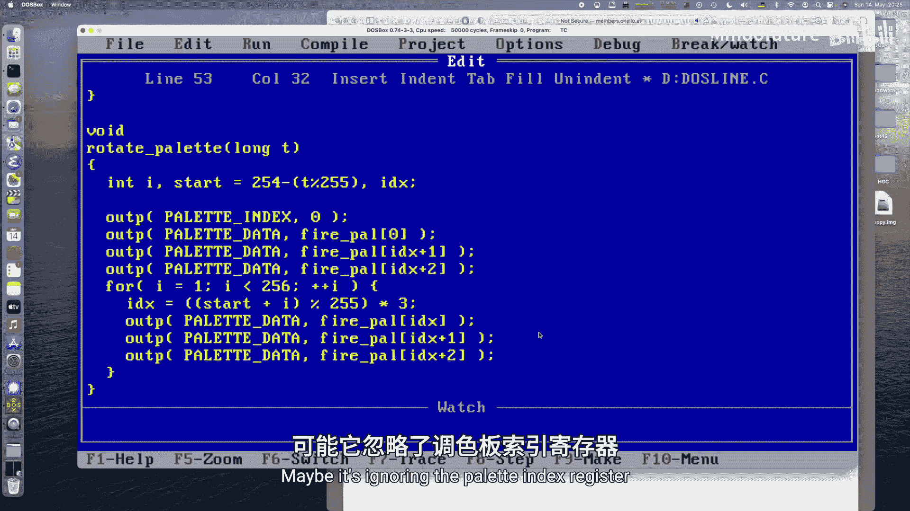

Did that， so let's try once more。Fingers crossed。Yeah at the top。

 you can see the cycling of the colors。 this is actually never redrawn。

 but it's only visualizing the cycling of the colors。

 And you see how nice it looks when it fades out in the back and the front part of the lines are always。

In red， hot， white， basically。 And then it fades out， gets cooler。

 And I think this is a pretty neat effect。 We can turn down the cycles。Almost。Two very。

 very low values until yeah here here you will see at the top a bit of not so nice pald effects some parts of the white line here are getting black because we are running out of time in the vertical retrace。

So 3，800 cycles。Is a bit too slow， but if you look up this is already a very slow machine being emulated here and yeah you if we were to port this to assembly。

 I think we could make it even faster I think toC is still a bit inefficient and we could make it run on very slow machines indeed and yeah。

🤢，I think this is a pretty neat effect。As I said， as an example and homework。

 you could try to code this so that。Every frame 256 lines are being drawn。

 but then you will run into massive problems if you don't have a very fast 46。

Of faster machine in real life or dos box having said to， well， I don't know，20，3040 or 50000 cycles。

But as you can see this runs pretty smoothly even on this low cycle count， but that's it for today。

 Thank you very much for watching。I hope you enjoyed the series。

 I want to continue it in 2022 I did not release a single pure， let's go De Dos。

 only the let's go X86 assemblyly， but I noticed that people actually do like these videos。

 but they are always a lot of work to prepare and to research hence as this is only my hobby and I gain very little money from this。

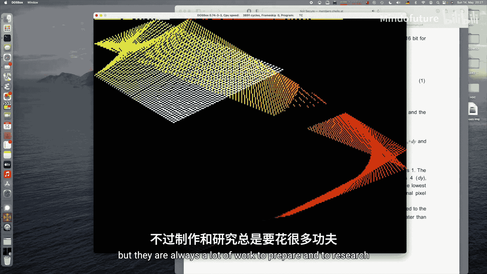

I always have to weigh my time and efforts to yeah what I get back basically but it amazes me that so many people still watch this and I'm very humbled so thank you very much if you want to support me you can do so the links are in the video description but it's already very nice if you would give me a thumbs up share this stuff on social media so people learn a bit more about these old school computers and programming techniques which still can be I think applied。

In the modern systems， you probably sometimes need a linear interpolation like this or line drawing。

 and it can be quite useful even on modern systems。

 so thank you very much and I hope to see you next time so long。🎼，🎼我。🎼。🎼。

