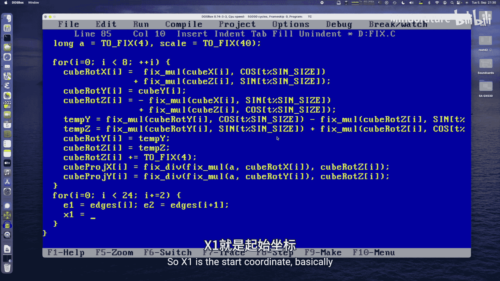
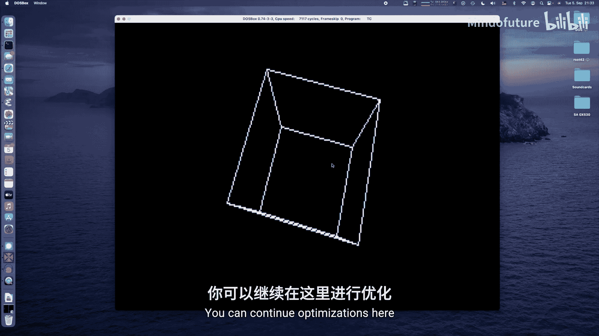
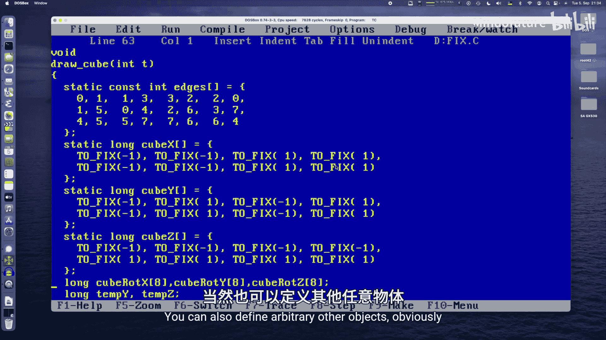
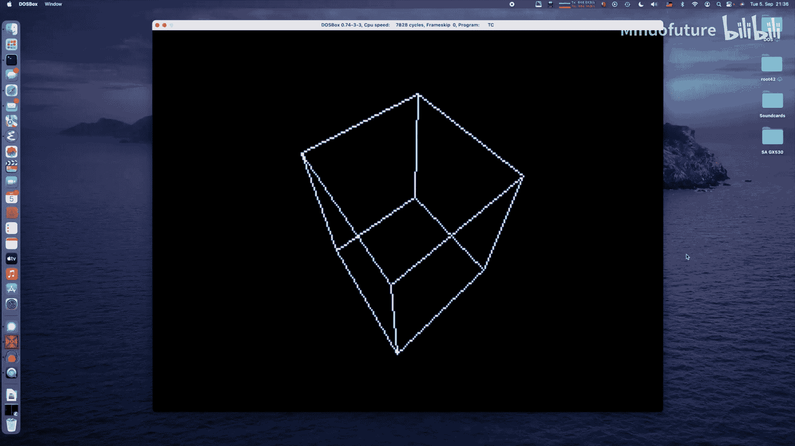
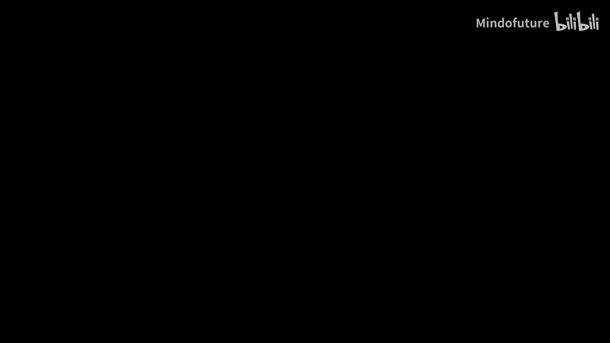

# 编写MS-DOS-系统-｜-windows-｜-操作系统-｜-汇编--｜-vga-｜-x86-p34-P34-Lets-Code-MS-DOS-0x21---3D-Fixed-Point-Maths--BV1zs35zQEru_p34-

Hello welcome to another episode of Let's code MSsdos and yeah。

 this time we start off on the desk because I want to show you this book back in the 1990s when internet was at best via dial up modems and very slow。

That was when I got interested in the PC demo scene and graphics and game programming and stuff like that。

And there was very little information I could pick up on because I wasn't online yet。

 it was very expensive to get a modem， etc cetera， et ceter so I learned everything from magazines and later from this book here by German company Data Becker。

They also have the PC intern series of books which are an excellent guide to the PC and MSdos programming and this here PC underground。

 I think this is the first edition。Well， I think it's done by a couple of demo scene people。

I forgot which， which group they belong to， but they explain quite a bit about Dos， VGA， 3D。

 etcter programming。It is also about Windows 95 because it was released in 1996 or something I forgot something like that late dosy years。

 definitely。 So this came a little bit almost too late for me。But I learned quite a bit from it。

 It's in German。 obviously， I think there might have been English translation as well。

 but this was our go to thing。yeah when for German kids basically and there's a lot of stuff here。

 graphic routines， mostly in Pascal and assembly language that was the thing of the day maybe a little bit of C the C ro in here。

 sorry for pushing the tripod is missing。But I think it's available on archive。 org。

 And today I want to talk to you about 3D graphics programming and namely the most simple things that we can do。

 And let me see if I can get this centered roughly yeah， I can。

 So that's a rather short chapter of introduction to 3D programming。

I will quickly go over this because the main attraction， and let me put the light a bit over here。

Its supposed to。Be a very simple wire frame cube that we're going to coach today using only fixed point mathematics。

 I glossed over a fixed point mathematics in the Rotozuma episode， which I will try and link up here。

 I hope it appears。And we had fixed point maths in there because the older Xs and 80s。

 and most of the 386s wouldn't have an FU that could do floating point。

 And if you would do floating point and software， it would be terribly slow。

 But there's another way you can do fixed point mathematics by simply using integers that the normal CPU。

 the 286，36 can do。Pretty well， but fixedix point mass has some drawbacks。

 has lesser precision in some aspects， lesser range for sure。And yeah。

 you have to be a little bit careful about the range of numbers that you're dealing with。

But it's good enough for us to code a very efficient， very fast wireframe queue。

 which is one of the standard things that you would need to be able to do when you become a demo scene programmer basically so very quickly for 3D programming you need to know linear algebra especially vectors and mates。

 I hope that you already know that they are very simple rules。

Points and translations can be displayed by vectors。 I'm not going go into the distinct。

Gushing factors of a vector in the point。For now， we will just keep three dimensional vectors and leave the fourth thing away for points versus vectors。

Because we won't need it today， we can talk about that in a different episode。

 so we'll keep the mass a little bit simpler。 so basically a three dimension vector has three components。

It will be something like an array， for example， or Tple in C in all programming language。 And yeah。

 it can be an arbitrary。Values which determine in the x。

 Y and z direction where in space you are or what kind of translation you're doing。

 you can do several operations on vectors。 You can， for example， take the length of a vector。

W whichch is defined here， we won't need that right now。

 you can add vectors that we will need actually for translation because we want to translate our cubes so that we can actually see it and it won't be in the middle of the observer。

And that's pretty simple just by adding， it's basically adding the arrows that the vectors because every vector basically represents a translation from the origin 000 to the specified value like 2。

3 minus5， and you can add two vectors by basically just adding each component on its own。

And subtraction also works， which will give you a vector pointing from one vector to the other。

Yeah you should look that up on on Wikipedia something or pause and take a look at these images here there are also scalar products I won't go into that detail where we can calculate the cosine en close between two vectors so we can basically compute the angle we will need that later if we ever get to that for lighting and stuff like that。

We'll skip that for now， but one thing is a little bit important thats this year that's getting stuff on the screen because right now we have three dimensional vectors X。

 Y， Z。 The question is how do we get a screen point a pixel from that namely only x and Y So something has to happen with the Z coordinate because that。

Gets lost， basically。And I'm going to zoom down on this so we can see it。So this is German。

 but never mind this means eye or camera。 This is the object in worldspace and then we have the screen here。

 there's a focal length， which is called a from the eye or the camera to the screen and it determines basically。

The distortion angle and the focal length basically that you have。And yeah， the question is。

 if I have an object with a y coordinate， what coordinate y dash on the screen will it be and that depends obviously only on the Z here。

 depending if the Y stays the same and the z varies， the point on the screen will change。

And what you can see down here is y equals or y dash。

 the projected point equals the focal length a times the coordinate y over z， very simple。

 and the x coordinate is the same x dash or x prime equals a times x over z。 So very simple。

 you need one division。So that's fine。Let's zoom out a little bit again。Then we need transformations。

Translations are very simple。 It's just adding。A vector to another vector。

 but these things here are the rotation matrices， so we want to be able to rotate objects so that we don't have to look at them only from one side and our rotating cube will do exactly that rotateator around to axis's。

And that's relatively simple。There are rotation matrices， they have written them a little bit。

Stupidly， I'm gonna take my ball pen and。Put。😔，The matrix braces around that so that you know that it should look like that。

They were a little bit lazy regarding that， for example。

 rotation around the X axis' leaves the x coordinate as it is。

And I'm going to zoom down again so we can see actually see something。I think you can see now， okay。

 so xx stays the same， which corresponds to the row 10，0。And also the column 10，0。

And then the y coordinate will be y times the cosine。Of a is not the focal length here。

 it should be alpha， it's the rotation angle。Minus z times sine of alpha basically so there's no x here so that's this row here 0 cosine of a or alpha minus sine of alpha and the z prime is y times sine of alpha plus z times cos of alpha。

So that's that So basically these are the formulas that you have to use in your code and the same goes for the Y xs and the z Xs。

 there's matrices here as well， so you just have to learn those by heart or put them once in your code and you're done and you can rotate around the X Y and Z Xs independently to get all degrees of freedom basically plus the three degrees of freedom using your translation and you're fine basically。

And that's already all you need to know。There's one more thing in here that I have to look up。

 which we'll be using in。A second。And I'm wondering where the lead was。嗯。Hold。早です。That's here。

 that's the chapter about fixed point arithmetics， which talks about the way fixed point works。

 but we'll have a look at that。 There's assembly language。Functions here， but。

We can do that in another， let's code assembly language session maybe。

 but right now we will do just C functions。 They're easy to follow and you can translate them to assembly language itself。

 if you think you can get any more perform out of that。

 So let's switch over to the computer and have a look at the C code and write our rotating 3D cube with fixed point mathematics。

Okay， so this is our staub of a program。 and let's quickly look through the main function。

 We will have a time counter which basically animates the whole thing。

 We have our key code from the keyboard so that we can detect when the user hits escape key。

 We allocate a buffer for the off screen drawing。And set the VGA buffer to be that the back buffer basically。

 I've changed the VGA dot C and dot H files a little bit to incorporate the line drawing routine from the last video so you can watch that if you want to know how to draw lines。

Then we will initialize the sign， which we already know how to do。

 but I will go over it very quickly again because we also need to do that in fixed point math we will use the bit in sign function which is floating point just for this purpose。

 but you can precompute that and store that in the file if you want to so you have no reliance on FPU stuff at all。

 and we set the graphics mode 320 by 20256 colors， and then we have the Y loop key code is not equal to the escape key and if a keyboard if the key was it keyboard was it then we get the key code。

And then we'll see if it will be escape or not。Then we clear the back buffer， draw the cube。

 wait for the rets and during the rets while the screen is still refreshing。

 we copy everything to the VGA frame buffer， and then we advance the time step by two to make the animation a little bit faster。

 you can play around with this。And if escape was pressed， we set the text mode and returned to Dos。

So what we need to implement is， first of all， the D cube protein and the in sign。

We'll do that first。And yeah， we'll talk about what this will entail。 First of all。

 we will use long ins for the。Fixed point maths on October C， that means 32 B。Integers on Pentium。

 you could also use 64 B integers or on 486s。 But here we are using a 2，86 at most and。

Ty comes with arithmetics for 302 B integers， which is a bit slow on a 286。

 but it could be done natively on a 36， but we want to be able to support as old an PC as possible down to the 8088。

 which also can do 160 B arithmetics， although a little bit slower。 The sign table will be。

Of a certain size。 And let's first also define that。Fine sin size to be something。Like 512。

 that should be sufficient。And we will also reuse the same table to be。The cosine table。

 so we have a cosine offset into the signine table。

 which is one qua of this because the signine and the cosine are basically just phase shifted and they are just the same thing。

 so we will enlarge this area a little bit by this same thing。That's okay。

 And we will also just make a pointer to the Cosign table by doing sign plus。Cosine offset。

 So we don't waste any memory， Not that it meant as much。

 but that's a couple of kilobytes here and there。So， that's good。Okay， that's the definition。

 How do we proceed， We need a running variable I。And take also a。Value from the sign。

Just to make it a little bit more readable。Then， we're gonna iterate。Over。The whole。

Whoops over the hole。Sign table。Plus， the cosine offset。

 So I don't have to copy any values you could get away by copying the。あ。Last part， basically。

And as usual， how we will compute that。 that's already explained in another video。 but basically。

 we take2， two times。Hi。Pi is already defined in the math dot H times I over。W。

So that we get a double value in size。Okay， what does it mean。

 This gives us a fraction basically between 0 and 1， depending on where we are。

 And this computes the whole circle， basically。From 0 to2 pi。And this gives us a full sine curve。

 If we add the cosine offset there as well， we also get a little bit more。 We scale up to 1。

25 times 2 times pi。So that's fine。 And the entry into the sign table has to be converted to a fixed point value Now。

 How does that work， Well， we will write a。Macro called to fix。

 which takes a double value and will convert it to F。Point value。For that to work。

 we need to think about the precision that we are going to use。

 F point mathematics will have a certain precision， and we will take 9 Bs here。

 We could go with 8 B plus 24 in a long。That are for the。Integer part of the fixed point value。

 But that is a bit crude。 So we'll take 5 12 graduations。 You could also use 10。

This changes basically effective numeric range that you can actually do。Yeah， what is the two fix。

Mecro look like。Well， basically。We will take， let's leave a little bit of space here。

 We take the value X， and。Multiplis。By one shifted。This many times。嗯。To the left， basically。

 we could probably also just shift the whole thing。

 but I like to write it like this because then it's clear that we are doing a multiplication。

We could just write this。But for clarity's sake， and as this can be evaluated。嗯。

More or less by the compiler， I think it doesn't hurt。 We can rewrite it later if we want to。

 So this will give us basically a。Double value right now。 How many。

Closing browsers do need something like this。 And that whole value。

 we will cast into a 30 degreeit integer。 Okay， this。Basically。

 just left shifts everything on it multiplies everything。And then that works like that important。

Here， of course， as this is a double value， we can't left shift。

 That's why we're doing the one left shift fixed precision。 So that's why。

 And if we just cast this to a long， then it won't work because we will cut off all the。

Frectionional parts， basically。The question is， how do we convert this back， This is basically。

The function too long。 I'm going to call this。 It's auto macro。And here we do the same thing。

 but in reverse， we divide by one shift left to fix precision。Right。This is giving us the。

Same representation rounded basically2 along。 And we can also just convert back to a double。

And get a fractional topic， of course， with some rounding errors， obviously。Which sorry。Works very。

 very similarly。 But first， we're gonna cast our input value x。

And then divide that by and to make sure that it， it's also definitely double we cast that as well。

Again， our precision value。Which is basically 512 in our case。All right。That's that。

So we have three functions we can convert to a fixed point representation or back from fixed point to double or long value。

We will have a little bit of issues on a 286， with only 32 Bs。And the 386 would be nice to have here。

 but I'm going to limit myself to88086 and 286 this year。But we'll get to that in a minute。 Okay。

 so we can initialize the signine function。And we also need some mathematics functions。

 Ed and subtraction are just that you can just write a minus B and a plus B。

 because they are integers。Nothing to do there。 but multiplication。

 squaring and division are a little bit more complicated， not much， but a little bit。So。

Mipplication is basically。A times B， however， as both are shifted to the left by our fixed precision。

 we need to do one correction shift。By fixed precision。 So basically a division by 512。

The squaring is exactly the same， because that's。Just a times a。

And we also need to do the correction shift。Division no， that's interesting。

Because you would assume that it might be something like a divide by B and  then0。Yeah， what's the。

 what's the。Correction factor here， because both were shifted to the left。

 and that sort of cancels out， because you have multiplied both sides by 512。And that， of course。

 is a bit of an issue because then you have no。Correction at all anymore。

 So that means we need to overshift， basically。A by fixed precision。

 And that's why the issue comes in， if your number。Has any of the higher 9 Bs set。

 they will get lost。And that's why we would actually need。A 64 bit value。

 which we can't express here in the compiler without using extra variables。

I'm not gonna go this route right now， the。386 has op codes for doing that basically in a little bit of a slower manner because it uses then two bigger 32 bit registers to do the division。

We're just gonna be very careful not to have such large numbers。 Otherwise。

 we would need to write a little bit more complicated over them。

 Maybe you can do that by shifting the higher 9 bits into a second variable and doing the division in a little bit more effort。

 let's say。All right。But that solves that。 Then we need to draw the actual cube。

 This should already compile。Except for warning， obviously。Yeah， first of all， we need to。

Get the cube defined。 And I'm gonna have some。Edges defined off the cube。

 And I'm not gonna go into much detail here。 Basically。

 those are the indices between all the points between the cube。

 You can draw a cube on a paper and come up with something similar。

 So every pair of numbers here is an edge， I go from vertex 1 to vertex。

Of vertex 0 to vertex 1 from1。2 3， this is another edge。T from。3 to 2。7。Yeah， like that。2，20。

 and that's the lower。Face of the cube already defined。 Then we take the vertical lines of the cube。

 and those are one comma 5。 but it depends on which order you write the vertices on。

 You can just do it on a paper。Gra paper or something。 And it will be pretty obvious。

 So I'm not gonna。Show that right now。 I did it on paper and just。Labeled all the。

 all the vertices and all the edges。And that was that。And now is the upper phase， the lid。

 So to speak of the cube。We're defining only agency are no faces because we are doing only bioframes。

I like that。That's the definition of the edges。 And then we need the。Vertices basically。

 and I'm going not have vertices per se， but I will have three different arrays of coordinates。

 X coordinates， Y coordinates and z coordinates。 and taking the same index from each array will give us。

The whole verex， basically。So they will look something like this。And I'm gonna copy this。Just like。

That。Cube X， cube Y and cube Z。And you can also write all those。

 And I'm gonna let the cube be having。At length。2， from -1 to 1。

 but you can also define it from 0 to 1 and then move it to the centre to get a better rotation。

 I just wanted to have it centered around the origin。 So it doesn't rotate around one vertex。

 but around its centre of gravity， basically。And we need to use fixed point maps， obviously。

 So I'm gonna use this thing here heavily。2 fake，-1。

 These are the first two vertices the the X coordinates to fake。1 and two fakes。1， it's very， very。

Similar， all the values。Let me quickly go through this-1，-1，1 and1。 That's correct。Very simple。

 We're gonna copy this。Twice。And correct all the values that are not correct，-1 -1。Then1，1 again。

 drawing this on graph paper will show you which values to use。More complicated geo forms will be。

Much harder。 So there's a good idea to maybe write a little export script in like Python。

 if you're using blender to get simple meshes exported and then write yourself a simple import routine here and in do to get edges and vertices。

 And later maybe even faces， Who knows。 So that's already the whole cube thing。Does it still compile？

Yes， a couple of warnings because we are not using all the things， which is fine。

 Now we need some temporary values for the rotated。X。Yhy and Z coordinates。So， we gonna。

Copy that for why。And Z。 so this will store the rotator coordinates。 Also。

 we need two more 10 variables。 so not to override our rotated ones because we are rotating around two as。

 And I'm gonna write down the equations one after the other。 You could also combine。

 combine everything into one。Why are we're not going to do that。Furthermore。We need to have。

Space for storing the projected X and y coordinates。 this iconcon is gone by then。

 So we need don't need that。And we need a couple of temp variables I E1 and E2。

 which are indices into the。Edges here up here。 those will be the two edge coordinates， basically。嗯。

Also， for the line drawing we need。A start。And an endpoint。We can do without。

 but it's easier to read。 Then we need the focal distance。

 which I will put to for because it comes out to a nice thing and a global scale factor which basically determines the magnification of the whole thing you can play around with this。

 but this leads to nice results。 Yeah just to your liking。

Then we're doing the rotation over all the angles and all the vertices。 We have eight vertices。

So that's snap。And first of all， we are gonna rotate around the Y axis。

 And we already saw in the book what this looks like。 So cube rotated。X。Of this particular vertex。

Is multiplication， and we need the fixed point multiplication here of the cube x coordinate at this point。

And the cosine value。And the rotation angle is just our time stamp。

 mod you know the sign table size so that it it looks around basically every time。Then。

We need to add， again， a product。Of the Z coordinate。Times the sine value of T modular sine size。

 This is just written out。The formula that you just saw in the book。

The y coordinate here stays the same because we are rotating around the y axis。 so that just stays。

And the Z axis is， again， very similar。 We need a fixed point multiplication。Of the X coordinate。

Times。The sign。You could take arbitrarybiter values here。

 depending on how fast you want everything to rotate。I'm a bit annoyed here。 Oh。

 and I forgot a minus here。But I think the rest is correct， cube。Z of I。And cosine of。铁。

Modular sign size。So， that's that。Then we can do the rotation around the X axis。

 and we need to do it into our temporary variable， because otherwise we will overwride Q broad Y and then get garbage values。

 I did that at first and wondered at what's happening。But yeah， I'm gonna say if you're this trouble。

 So this time， it's the very same thing。 We don't need 10 X because10 X will just be。Q broad X。

 And we know already that that's staying the same Basically。 So fixed multiplication of Q broad y。

At this index。Times the cosine。Of T。Modul of the sign size。嗯。Minus。Aff fixedixed my duplication。

Off cube rotated Z from the previous step。Of I comma sign。Off to your modular。Sine size。All right。

 that looks almost good， except there's a bracket missing。

And I'm going copy that for our temporary Z value。And that is actually the same except that it used the sine function here。

And， of course， plus the cosine。And I think that's that。 And now that the1 values have been computed。

Actually， the temp Z wasn't really necessary， but I'm gonna stick with it anyway。

 cubero I equals temp y。Ce rot Z of I equals temp Z。That's that。 Then we also translating everything。

And a little bit further down the Z axis to make it not sit right above the camera because that looks weird。

 So we are just gonna add。Another four for good measure and that will look good。Now， the projection。

 you remember， the projection was。A， which is the focal length times and the original rotated coordinate。

Over or divided by the rotated Z coordinate。Or the object Z coordinate net。 So Q projection X of I。

Equals a fixed division first time of a fixed multiplication。Of a and Q broad X。

 which is the rotated coordinatenet。看吗？Cube rot Z， you divide by the Z coordinate。 Very simple。

And the same goes for。The y value。 And that will be the rotated y。And everything stays the same。So。

 that's already almost everything。Subcring， yes， that is， of course， correct。I forgot to couple off。

Brackets。Better yes。And it's not complaining because we are not using the edges yet， so。

For I equals 0， I less than 24 because we have 24 and we have 12 edges， but I need to index 24。

Pair 24 values and 12 pairs。 And I'm gonna skip every other value in the edge， because it's always。

Let's go back here，0 and 1，1 and3，3 and 2， and so on。So， I'm going use that。And for readability。

 I'm going to pick E1 equals edges。I， that's easier to read， and the2 equals edges。I plus one。

We could have sticked with that， but now we will write a lot of E1 and E2。 And that's much easier。

 So X1。Is the start coordinate， basically， we need to convert it back from the fixed point representation to a long value。

And we're going to use a multiplication with the global scale factor to scale everything nicely up。

 otherwise it will be very small。Q projection。Of x of。The coordinate E1。Times the scale factor。

 which is， I think，40 or something。And we need to center it on the screen。 So I will take。

Our screen width， which is defined in VG8 dot H。Divided by2 or just shifted by one， basically。

 And now we can。We could copy that if I'm not pressing the wrong buttons。Y 1 X 2 and Y 2。And now。

 we have to。Replacease this here。And， of course， the Y coordinate will be VGA height。

And this year will also be VGA height。So as you can see。

 all the multiplication addition and so on was done in fixed。Point mathematics。

 And only at the very end， we convert back to a regular long value， which should be fine。

 Last order of the day should be the actual draw line routine。I'm gonna use the standard palette。

 which will look a little bit lame， but you can apply different effects。

 You learned already a lot of effects here。And we're going to draw in white。 Let's see。 no arrows。

Let's have a look。Henceint， here you go。 That is our wire frame cube on a 46。

 It will run roughly something like this。 I would say， on my very slow eyesza based。Isai based 46。

 something like this， which is still relatively fast。 and on a original PC。

 it will run something like like this， I think。嗯。Still one or two frames per second。

 You can definitely still optimize a little bit because we are pushing a lot of memory here。

 we could just draw in the VGA memory and get some flickering or try to use modics。

 I'm just pushing a lot of a lot of data around here。

So fast star 36s and 46s will look much smoother。Yeah， but I think this is a good starting point。

 you can continue optimizations here。

嗯。Let's very quickly go through the code again， to recap。Yeah。

 the important thing is you can do find your own fixed point maths with a certain precision here。

 we have like 9 bits of precision。 You could also do like 16 or 10 or 12。

 depending on what operations you're doing， but 9 seems to be quite a sweet spot for these kind of simple。

Yeah， animations with not too huge a。Range in values， basically。

We can go with the two fixed and two double and two long macros between both fixed point floating point and integer representations。

 which is nice。 We have to have a sign table with fixed point representation that we did。

The multiplication and squaring is pretty simple。 You have to just correct after the fact for the double precision shift。

 So one shift goes away， and you have to do an extra shift when dividing otherwise the shifts cancel out。

 Basically， that's the important lesson。Then we can define our cube with edges and vertices。

 You can also define arbitrary other objects， obviously。

And then we can do a couple of rotations， according to rotation mattresses here。

 we only do two angles。 You could also add a third angle if you want with different speeds and stuff。

Translation and then the projection with the division。And that's more less it。

 You just draw all the lines and push everything into the visiongenary。So， I think。

That is actually a pretty neat result。 very compact code。

And that's also all there is to say for today。 I thank you very much for watching。

 I hope to see you next time。😊，As usual you can and should support me on Patreon paper or cofi if you want and are able to。

 If not， just leave a comment， leave a like share on social media that's always very useful。

 And yeah， leave a comment， tell me about your experiences with coding three engines。

That are probably more complicated than this。 But I think this is a good start。

 We can definitely build on this。 We can optimizeise the speed still and do maybe more interesting effects with 3D in the future。

But that's it for moment。 See you next time。 So long and have a nice evening。🎼。

🎼The。🎼Yeah。

