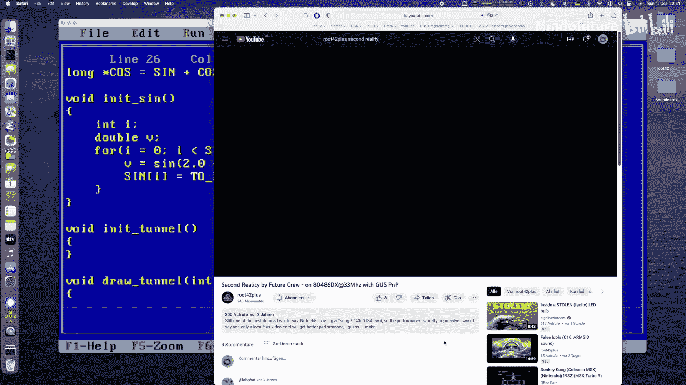
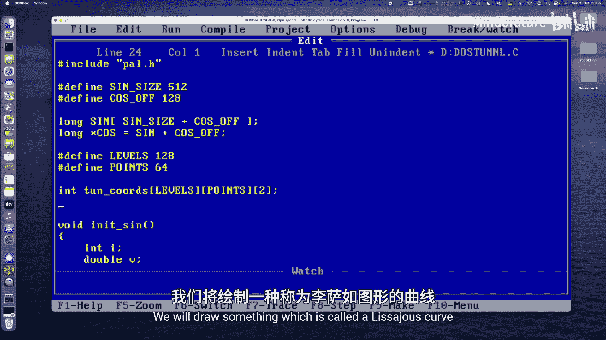
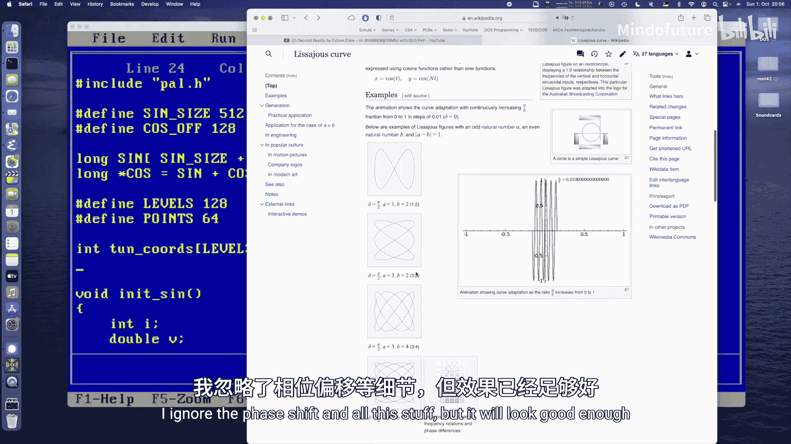
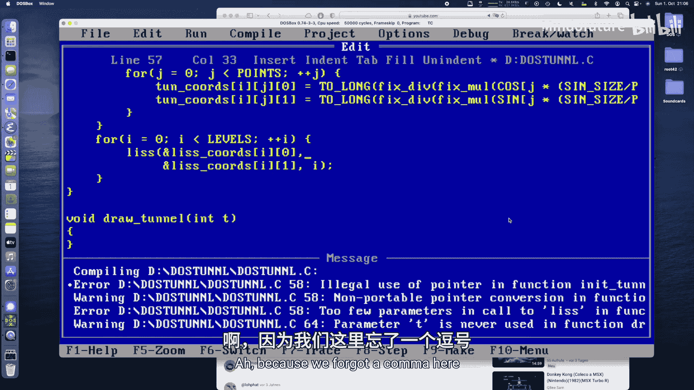
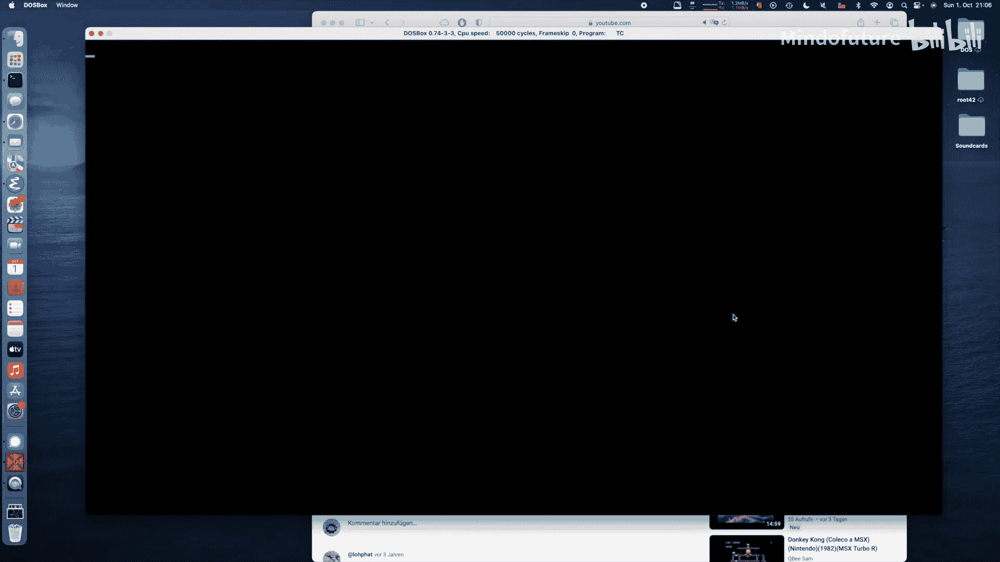
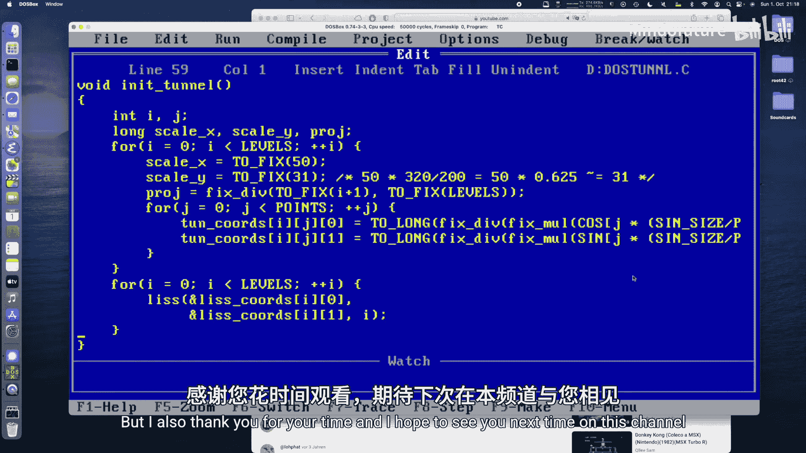
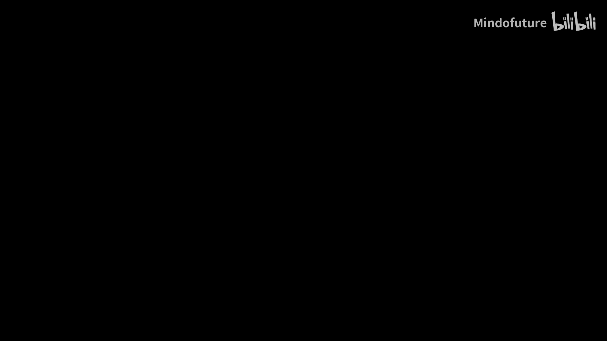

# 编写MS-DOS-系统-｜-windows-｜-操作系统-｜-汇编--｜-vga-｜-x86-p35-P35-Lets-Code-MS-DOS-0x22---2nd-Reality-Tunnel-Effect--BV1zs35zQEru_p35-

Hello， welcome and a very good evening to another episode of Let's code Ms Dos。And today。

 we want to code one of the effects that were made popular by sexuality。

 They were probably not the first ones to do this， but it's at least the first demo where I saw this effect。

 And right after the start something that we won't code today。

 namely the glance vectors here in my old machine with the。Crepy Rammack。

 which is why we get this noise here。 and they do a lot of pellet manipulation。 This， of course。

 very famous as well， because this was very。Important on the Amiga because it could do all this blending stuff。

 but the PC couldn't。 but with a little bit of trickery。 it was still possible。

 I think they're using a 16 colour mode here。But right after that part。

 we get this famous tunnel effect， which is not super complicated， but still pretty mesmerizing。

 I would say， And I want to show you how to code it for yourself。

And we're going to try and do this。And I prepared already a stop program as usual。

 it is based on our last code， the DoOS cube， and I factored out the fixed point mathematics because it will still need them into a little module fixed dot H and fixed dot C。

It's basically the same as usual， except， let me show you。

That I've lowered the precision by 1 B because we don't need that much precision here before we had 9 B of precision。

And we will get a divide error due to the larger numbers that I'm using。

 But that's fine on a 32 B compiler， you wouldn't get that。

I think that's mainly due to me running out of 32 bit values。And on the 32 B compiler。

 you could use a 64 B4 division。 It's actually only the division that has a problem。But never mind。

 we can do with 8 bits of。Precision here very well。 I still have the sign table。

 We will make use of this a lot。And the main idea here is that again。

 we have the main function with the usual loop。 We wait for key press to stop the demo。

And we will clear our back buffer， draw the tunnel。 wait for the retse。

 and then copy while the screen is not displayed into the VGA memory and so on and so on。

 And we will have this init tunnel function， which prepares the tunnel data。Because the following。

Let me just write the code and it will become relatively obvious。 So， first of all。

 we will define a number of levels。 Those are the number of rings， which the tunnel consists of。

 And I picked 108。 You can tweak that it's all about what the visuals look like。

 then you will have to change a couple of other constants。 if you want to have that And every ring。

 every level consists of 64 points。This gives us 128 by 64。s 8192 points that we have to plot。

 which should be very doable on even a relatively slow m machine。 So a 386 or something。Yeah。

 but I guess we are again pushing the limits of the 286s， etc cetera， etc cetera。But yeah。

 you can try it out at home on on slower machines。It will run。 It might be slow。

 So we will have an array called ton chs， which take up the。Regular coordinates。

 because we don't have to recompute all the coordinates all the time， which is a bit expensive。

And we can pre computeute them all the rings and all the scaling basically。

 and we will just make them wiggle around by adding an offset basically onto that。嗯。So， we will have。

First， the number of levels here， it will be a 3D array。 This is one slice in the tunnel basically。

 Then we will have the number of points， and every point has two coordinates， x and Y。

 So that's our tunnel coordinates。And then once we have our tunnel， which would be straight。

 we want to wiggle it around。 Basically， we will draw something which is called Elisa Jew curve。

 Let's pull up。

呃。The browser， again， an Elilysa Z curve is basically， yeah， you can。

 you can see that here on an oscilloscope， for example， it's basically tracing。Basically。

 a circle would be similar to a lici curve because it's sine of theta and for the x coordinate and cosine of theta for the y coordinate。

 If you play around with the vector of the angle。 you will get different patterns， for example。

 something like this with which sweeps around。 And this is a nice smooth motion that we could propagate through the tunnel。

 and there are different frequency components depending on which ratio you use。

 I am gonna pick this one here， the one with a equals 3 and B equals 2， at least a simple version。

 I ignore the phase shift and all the stuff。 but it will look good enough。

 So we are using basically a licihu curve。 So I call this li chors。

And this will be， we will store that for every level。

And it only has X and Y coordinate because we only have one offset for all the points。

 so there's no need to store more。Yeah， so that's that。

Then I'm gonna code a little function called list for computing， the li curve。

We give it a pointer to the X and y coordinate that we will want to use and some time in X T。

And this will give us back the this coordinate for exactly that time coordinate。Exactly。

 so what do we need， We need a scaling factor to make this bigger。

 And you can figure this out by playing around just with the numbers。

I figured out that something like 50 looks nice， but you can make it。Bigger or smaller。

 depending on how much you want the whole tunnel to wiggle。 so to speak。

 and then we store our Isa Z coordinate， which is done by just writing asteriskster X。

 which will take the pointile and write to the memory address that it points to。住在仓位。

Pass back our result。And we need to pass back an integer。

 So we're doing fixed integer multiplication here。Because we also need to multiply by the scale factor that we had。

 so。The last thing here will be common scale。And what is our L Z coordinate， Well。

 it is basically the cosine。offff。And now we get this thing T times 2。 plus， I added a little phase。

 but。Didn't see much difference when I left it out。of course。

 we have to calculate modular the sign table size， otherwise real overrun。

And then we can copy that for the Y coordinate。And here we will leave out the phase。

 and you can read up。The details on the li curve， Wikipedia page， basically。

 but here's the three to2 ratio basically。 And we should probably put some semicolons there。

And that is already our， our offset， which will come in handy in a minute。

But now we have to think about how to draw the tunnel。

 how to create the different points which are not weddled around yet。We need a couple of。Variables。

 Y and J for the loops and X and Y for R。Coordinance， basically。Actually， no。We got rid of that。嗯。

Up there， because we already have the laser z function。

I had that from a previous it durationeration where I didn't have the function。

But we need something to scale our whole circle or tunnel in the x and y direction。

 because as you saw。I also want to make it more elliptical because the screen is not square。

 I tried it with a very round tunnel， but it just doesn't look as good。

 So I think this elliptical tunnel is actually actually nicer。嗯。Yeah。

 we need a scale scale scaling and we need a projection because it's basically a 3D tunnel。

 We use the same projection that we had in the cube demo from last time。

So we look over all the levels。嗯。High smaller than levels。Plus plus I。Yeah， that's that。um。

What do we do here， First of all， we。Declare the scale factors。Which we actually can factor out。

 which。Doesn't matter too much because this is only run once。

 And I've figured out by experimentation again， that 50 is here as well， a very nice scatter effect。

嗯。Yeah， I'll leave it in here in the in the loop， but it's， it's a constant so you can。

 you can pull it out。And 31 looks good。 And that is due to the fact that。Basically。50 times。3。

20 over 200 equals。50 times0。6 to5。Which is。Roundabout。31。 that's how I arrived at this。

 which basically squeezes the circle in the same manner as our aspect ratio of the screen。

And that looks pretty nice， but you can scale it any way you want， basically。

The projection is basically。嗯。The following， we need to divide。

Our current level that we are looking at。Plus one。Otherwise， we start with0。

 which wouldn't be too great， probably。With the maximum number of levels that we have this basically just a normalization。

And that's our projection factor， which works reasonably well and leads to a。Very nice3D effect。

 I would say。So that's our scaling factors that we need。 now we can calculate the circle itself。

Which is not too hard， as I said， it's。Mostly just drawing the circle with cosine and sine for x and y。

 but with all the multiplications of the scale factors thrown in there。

 So basically reiterate over all the points that we defined should be a J。

And then we will calculate the tunnel coordinates。For the current level。And the current point。

 And here we are looking at the X coordinate。So what we actually want to take is the cosine。S。

 our current point。Times。Our table size divided by points。 This basically skips every other entry if。

You don't have as many points as you have in your table。

 and it will still reach basically two pi or a full circle。If you don't do this scaling。

 then you will get only part of the circle， obviously， you can try that。But it won't look good。

And we will multiply that。With our。Scaling factor in the X direction， right？But that's not all。

 We also need to do the projection。 And， as you know， we need to divide by our。Deepth， basically。

 which was the thing that we had here。So that's that。And of course。

 we don't want a fixed point representation， but actually an integer。

 because we don't need the fixed point anymore。 We want to put it right on the screen。

That us our first coordinate。So that's that the second coordinate。Is the y coordinate。 And for that。

 we simply swap to the signine function。And our scale factor is the one for the Y axis。

And that's already our circle。 Basically， it's just drawing a circle with a perspective projection。

Built in basically and a bit of squishing and scaling to make it look good。

 And there's not much else to it。But we need to pre wgggle the basically。

 we need to pre wiggggle the。Tunnel， I would say， you don't need to that。

 I think singularity just starts off with a straight tunnel， but I like the look that you get when。

You basically already are in a， in a twisty， twisty tunnel。 So I do that right now。We iterate again。

 over all， the levels。Because that's how many pre wigal thing we have。

And we just call our li due function。For the residual coordinates。For the level and the。啊。

X coordinate。 And don't forget to take the ampersand because that gives us the address。

 because we need the address to write back the value。And time X is I in this case。That's。That。

Let's put that on this line。Okay， this is all we need to do for initializing the tunnel。

 It should compile， hopefully。Not quite because we forgot a comma here。🤢。

There， yeah。

But it at least runs， doesn't draw anything because we don't draw anything yet。

But we can actually go to that right now， and we can already copy a little bit。

The call to the li function。But it will look slightly different。We will index this with。With T。

 obviously modo the levels。Because now it's getting animated。And gradually overwritten。

 And of course， T is also the index here。And we also need a bunch of things。

 We need a color that we write to the screen and we're using the default VGA palette which has gray scales from index 16 to 31 So we will use 16 shades of gray to simulate depth It's a bit different from what future crudeed。

 they did some psing basically some stripes。 I will do the stripes differently。

 I will just leave gaps to give a bit more of a。Motion sensation。 but you will see once I coded that。

 But if you look here。They basically darkened。Like every 10。Dots or something or rings。

 And then 10 brighter rings。 And this is moving through the screen basically， but we won't do that。

 We will have bright dots at the front and very dim dots at the back so that you can't really see where the tunnel begins。

 This gives a more smooth experience。 And for motion， I will just leave out5 dots in a row。

 And that will move through the tunnel basically。Maybe a bit hard to imagine。 but once you see that。

 it should be obvious what， what I'm what I'm doing here。

We also need the usual stuff to I need the X and Y coordinates。 Actually， let me look on my notes。

 Yes， we do need that。In this case， we do have this thing here already。

 One thing that we do is we offset T with levels because we already did the pre wiggling and already filled it up with。

Levels number of information。 So we just had the offset here so that everything makes sense from an animation perspective。

Yeah， there's only one。No， there's two loops， actually， which are。

Similar to the ones for the initialization。 So， again， the outer loop is over all the levels。And。

There will be an inner loop。As well。Overall， the points。Like that。

And we will have to do a bunch of things。 First of all， we are going to go for the stripes。

 So let's say if。うん。T plus， whatever ring we are looking at。Modulular 10。

 which gives me always0 to 9 basically， is less than5。

 So we are in our animation cycle in the first five rings。

 we are gonna skip those and only draw the next five Basically This gives us the stripes that continually move through our tunnel。

 We just skip this round and skip all the computation and drawing。Here's also the advantage of。

Even further reducing our our draw time， basically， which is nice。

Then we also have to compute the color。The colour is 31 because we need to go from 31， which is。

 I think white， but I'm not quite sure。 Anyway， this works minus I， I divided by。Levels over 16。

 This is just， again， a scaling factor to map all the levels that we have。

 It has to be a multiple of 16。 Obviously， you can have 16 levels，32 levels，64 levels。All 128。

 and we picked 128。So this will give give8 full scaling factor。 And I could have just put in the。

I could have put in eight here， right？However， you can play around with the levels。

 You can shrink it down a little bit to have less rings in the in the whole thing。

 and this makes it easier for you to tweak the parameters， okay。So that's that。

 that is skipping for the rings。 And this is the shading basically。 the further you go back。

 the darker the rings will get and。The further away， they seem basically， they disappear the fog。

That's that。Then we need to actually calculate the x coordinates。And that's pretty simple。 At first。

 we just take the tunnel coordinateals that we already computed。 That's the beauty of it。

 We don't have to redo them。The X coordinate， and we will center it。 So actually， we could do that。

Up top。But I leave it here for and for now。 You can。

 You can move this out of the loop and into the initialization as well。

 And then we will wiggle it around with the liu coordinates， actually。嗯。

And here we need to take T plus I plus1。Otherwise， we skip back a frame and we will get the wrong animation。

 You can try that out that first here。So let's leave it。Is modular the levels， obviously， to。

Have the proper rightaround。And the X coordinate of that。 who， that's online line。

 But it's actually just very simple additions。 There's no modificationplication。

 It's just a look up of everything that we already computed。 The Y coordinate， obviously。Is this。

 And we need to center it also in the middle of the screen。

 And that can be done as well up here in the terminal coordinates here would be good optimization。

 but it's only in addition。 So it's not super expensive。

And wetake the white component of the decision coordinates， as well。

Now we have to do one little check。 We can do， of course， our usual set。Pixel， macro， X， Y。

 and color。However， we should check that we are not out of bound because this time we will definitely run。

Outside of the screen。 So we check if x。Is。Positive or 0， Sam for y。Inser the screen basically。

 and also。Inside the screen limits in the maximum X smaller than 320 and y。Smaller than 200。

 which is all screen resolution。So that's okay。 And I think that should。Beyond there is。

 will it work。 Let's run it。And yes， it does。 And now you see also what I meant with the stripes。

 Also you can see you can see a little bit that in the background the tunnel is appearing。

 but I think it's much less noticeable than in the future crew demo。

 the projection works pretty well。Points get faster， the closer the get to the to the viewer。

 It's nice and screen filling completely。 I think the number of。Dots per level。

 and the levels themselves is pretty nice。 There's a very smooth animation of the wiggling。Yeah。

 I like it。 I actually like it a bit better than what future crew did。 But hey。

 they did it 30 years back， so。I'm， I'm a few decades late， but yeah。

 it shows that that some of the effects that you get in the old school demos were really simple， but。

I still think they are pretty visually pleasing and yeah pretty nice。What can we improve here？

There's， of course， this is again， purely pushing the back buffer into the VGA memory。

 you could perhaps do something more clever here， but I think MoX wouldn't help much because you would have to switch planes too often。

So not sure if there's much to be done here。And you just need a fast bus for the VGA card， yeah。

But I think I like it very much。Yeah， the code is obviously available。

 linksnk in the video description to recap。 we learned a little bit how to draw simple as due curves。

 It's basically just cosine functions with different ratios and a phase offset。

You can do more complicated versions of that， obviously， playing around with， with those。

Then we pre computeutd almost everything here。Probably we can optimize a little bit further by。

Gooding。Offpsset outside of this loop。But as I said， it's only an addition and it it's。

 it's not very expensive at all。Still runs the same。Not noticeable。

This should be the speed that it roughly runs on a 486， yeah， but。

I can't turn the cycles down at the moment due to Macwares capturing one of my keys。

That are used normally for the cycle count， but anyway。Yeah， I think this is a very short。

 very nice little effect。And that's already everything for today， I would say， Thanks for watching。

 Please leave a comment if you also coded something like this or maybe what is your favorite part in Second reality we already had the road to Zuma。

Now we had the tunnel。 there are more effects that we could take a look at。

 but some of them are actually pretty complicated。 and yeah， would be fun maybe to do some of them。

 but。Might be more than one episode worth。Yeah， other than that share。

 like and subscribe sharing on social media is always very welcome。 It leads to new views， et cetera。

 And you can also obviously support me on Patreon， cofi， Paypal or a YouTube premium。

It always helps me out continuing making these videos。

 especially doing the hardware videos because they actually have to invest stuff and buy things。

These let's code videos are。Cheaper to make， obviously， but require sometimes a lot of time。

But I also thank you for your time， and I hope to see you next time。

On this channel。So have a very nice evening and bye bye。🎼。🎼，🎼The。

